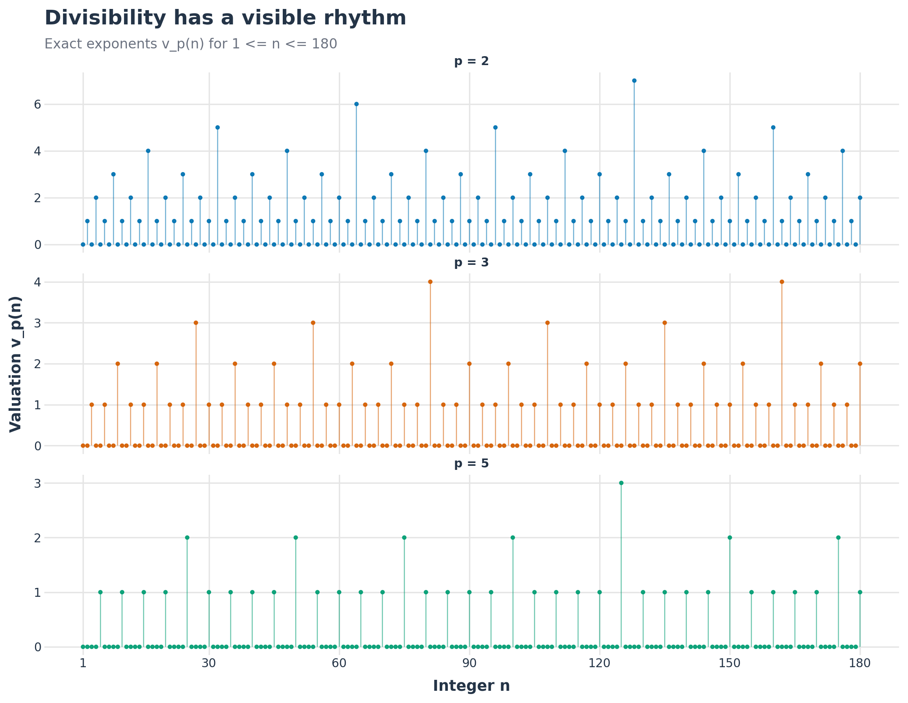

# Divisibility as distance

**Level and prerequisites: L3–L4.** Prepare integer divisibility, prime factorisation and congruences. The [reader guide](index.md) links the Euler arithmetic, algebra and analysis preparation and distinguishes the graduate continuation.

## Goals

This chapter turns divisibility into a quantitative notion. We will compute
$v_p(x)$ efficiently, derive its algebraic rules, and see why $p^{-v_p(x)}$ is an
absolute value. The central conceptual move is to separate *arithmetic size* from
ordinary magnitude.

## Measuring a prime's presence

Fix a prime $p$. Every nonzero integer $n$ has a unique factorization
$n=p^k u$ in which $p\nmid u$. Define $v_p(n)=k$ and $v_p(0)=+\infty$. Negative
signs do not matter. For a rational $x=a/b\ne0$, set

$$
v_p(x)=v_p(a)-v_p(b).
$$

This is well defined: replacing $a/b$ by $ca/cb$ adds the same $v_p(c)$ to the
two terms. Values on rationals may be negative. For example,

$$
v_2(40)=3,\qquad v_3(-81/10)=4,\qquad v_5(14/125)=-3.
$$

Python's `Fraction` first reduces a rational, after which the displayed
difference of numerator and denominator valuations is literal executable
arithmetic.

```python
from fractions import Fraction
from math import isqrt

def rational_valuation(value: Fraction, prime: int) -> int:
    """Return v_p(value) for a nonzero rational and a verified prime p."""
    if value == 0:
        raise ValueError("this finite representation excludes v_p(0) = infinity")
    if prime < 2 or any(
        prime % divisor == 0 for divisor in range(2, isqrt(prime) + 1)
    ):
        raise ValueError("prime must be prime")

    def integer_valuation(integer: int) -> int:
        exponent = 0
        remaining = abs(integer)
        while remaining % prime == 0:
            remaining //= prime
            exponent += 1
        return exponent

    return integer_valuation(value.numerator) - integer_valuation(value.denominator)

examples = [
    rational_valuation(Fraction(40), 2),
    rational_valuation(Fraction(-81, 10), 3),
    rational_valuation(Fraction(14, 125), 5),
]
print(examples)
```

The output `[3, 4, -3]` reproduces all three examples without factorising the
unrelated unit parts.  The function deliberately rejects zero because ordinary
integers cannot store the extended value $+\infty$ without a separate type.

The definition exposes a discrete scale. Each nonzero rational occupies exactly
one shell $v_p(x)=k$, where $k\in\mathbb Z$.

### The valuation laws

For $x,y\in\mathbb Q$,

$$
v_p(xy)=v_p(x)+v_p(y),\qquad
v_p(x+y)\ge \min\{v_p(x),v_p(y)\}.
$$

The second inequality is the source of ultrametric geometry. To prove it, write
$x=p^r u$ and $y=p^s w$, with $u,w$ having numerator and denominator prime to
$p$. If $r\le s$, then

$$
x+y=p^r(u+p^{s-r}w),
$$

so at least $p^r$ divides the sum. Moreover, if $r<s$, then the expression in
parentheses is nonzero modulo $p$ and equality holds:

$$
v_p(x+y)=\min\{v_p(x),v_p(y)\}\quad\text{when }v_p(x)\ne v_p(y).
$$

Only terms of equal valuation can cancel enough leading information to increase
the valuation. For instance, $v_3(1)=v_3(8)=0$, while $v_3(1+8)=2$.

## The *p*-adic absolute value

Define $|0|_p=0$ and $|x|_p=p^{-v_p(x)}$ for $x\ne0$. Then

1. $|x|_p\ge0$, with equality exactly for $x=0$;
2. $|xy|_p=|x|_p|y|_p$; and
3. $|x+y|_p\le\max\{|x|_p,|y|_p\}$.

The third property is the **strong triangle inequality**. It implies the usual
triangle inequality because the maximum is at most the sum. Notice the reversed
interpretation: a large valuation gives a small absolute value. Thus
$|2^{20}|_2=2^{-20}$, even though $2^{20}$ is large on the real line.

<div class="callout callout-important">
<p class="callout-title">Real-intuition trap</p>

The notation $|x|_p$ does not mean the ordinary size of $x$ expressed in base
$p$. It measures only the net exponent of $p$. The numbers $1$ and $10^{100}+1$
can have the same *p*-adic size, while the nearby real numbers $1$ and
$1+p^{100}$ are extraordinarily close *p*-adically.

</div>

### Cancellation in action

Let $x=45$ and $y=18$ at $p=3$. Both have valuation $2$, and
$x+y=63$ also has valuation $2$; no extra cancellation occurs. But with $y=-18$,
$x+y=27$ has valuation $3$. Modulo $3$, the unit parts of $45/9=5$ and
$-18/9=-2$ cancel. This unit-part check is usually faster than expanding full
factorizations.

<figure id="fig-valuation-patterns">


<figcaption>

Figure 1.1: For integers 1 through 180, height records the exponent of each chosen prime; the three panels compare primes 2, 3, and 5.

</figcaption>
</figure>

The spikes in [Figure 1.1](#fig-valuation-patterns) occur at prime powers and their multiples.
The plot encodes arithmetic divisibility, not real distance: horizontal position
is merely the integer label. Higher spikes would lie *closer* to zero in the
corresponding *p*-adic metric.

## Worked computations

At $p=2$,

$$
v_2\!\left(\frac{72}{35}\right)=3,
\qquad
\left|\frac{72}{35}\right|_2=2^{-3}.
$$

At $p=3$, the same rational has valuation $2$, and at $p=5$ it has valuation
$-1$. A rational therefore has one local size for each prime.

For a sum, avoid combining huge integers when congruences suffice. To find
$v_5(3^{100}+2^{100})$, reduce the two unit terms modulo increasing powers of
$5$. Modulo $5$, both powers are $1$, so the sum is $2$, a unit; hence the
valuation is $0$. By contrast, $3^{100}-2^{100}$ vanishes modulo $5$. A more
detailed congruence or a lifting-the-exponent argument is then required.

### An exact algorithm

For a nonzero integer $n$, repeated exact division is enough:

```text
valuation_integer(n, p):
    k = 0
    while n is divisible by p:
        n = n / p
        k = k + 1
    return k
```

For $a/b$, run the integer procedure on numerator and denominator and subtract.
This does not require factoring either integer. Its number of loop iterations is
exactly the answer when $a$ and $b$ are already reduced.

## A useful dictionary

For $x\ne0$, the following descriptions say the same thing:

| Valuation statement | Absolute-value statement | Divisibility statement |
|---|---|---|
| $v_p(x)=k$ | $\vert x\vert _p=p^{-k}$ | exactly $p^k$ occurs in $x$ |
| $v_p(x)\ge N$ | $\vert x\vert _p\le p^{-N}$ | $x$ is $0$ modulo $p^N$ |
| $v_p(x)=0$ | $\vert x\vert _p=1$ | $x$ is a $p$-unit |

For rationals, the last column is shorthand after clearing denominators prime to
$p$. Learning to translate among the columns prevents sign mistakes.

## Arithmetic information carried by a valuation

A valuation does not forget arithmetic indiscriminately. It forgets factors that
are invertible at the chosen prime. To make that distinction precise, consider
the subring of rational numbers whose reduced denominator is not divisible by
$p$. Denote it by $\mathbb Z_{(p)}$. A rational belongs to this ring exactly
when its valuation is nonnegative. If a displayed denominator contains a power
of $p$, cancel common factors before drawing that conclusion: the membership
condition concerns the rational number, not one particular written fraction.

The units of this ring are precisely the rationals of valuation zero. Indeed,
a rational and its reciprocal both have nonnegative valuation exactly when
their opposite valuations are both zero. Thus a rational of positive valuation
is integral at $p$ but is not invertible within this smaller ring. It is still
invertible in $\mathbb Q$. Keeping the ambient ring visible prevents the
misleading assertion that a nonzero divisible integer has no inverse at all.

Here is a complete check that rational valuation is independent of every
fraction representation, not only an obvious cancellation. If $a/b=c/d$
with nonzero denominators and nonzero numerators, then $ad=bc$. Integer
factorisation gives $v_p(a)+v_p(d)=v_p(b)+v_p(c)$. Rearranging proves equality
of the two numerator-minus-denominator formulas. Integer multiplicativity then
proves rational multiplicativity by applying the formula to $ac/(bd)$.
The definition at zero agrees with the statements that zero is divisible by
every prime power and has absolute value zero.

Reduction modulo $p$ extends to $\mathbb Z_{(p)}$: reduce the numerator and
multiply by the inverse of the denominator in $\mathbb F_p$. The denominator
has a nonzero residue by the definition of the ring. If another fraction
represents the same rational, cross multiplication proves that its residue is
the same. This map preserves sums and products, is onto, and has kernel the
rationals of positive valuation. Consequently a valuation-zero rational has
nonzero residue. This is the precise meaning of the unit reduction used in
the unequal-valuation argument.

### Worked example 1: distinguish the chosen prime from other factors

Take $x=54/35$. At $p=3$, it has the form $3^3(2/35)$, where the second
factor is a unit in $\mathbb Z_{(3)}$. Its valuation is three. At $p=5$,
write $x=5^{-1}(54/7)$; the unit part is now different and the valuation
is minus one. The same rational is integral at three and nonintegral at five.
Neither conclusion depends on the ordinary magnitude of the number.

For a positive integer $N$, a statement $x\equiv y\pmod{p^N}$ will mean
that $x-y$ belongs to $p^N\mathbb Z_{(p)}$ when we are working with rationals.
Thus $1/2\equiv 14\pmod{27}$: their difference is $-27/2$, whose three-adic
valuation is three. The congruence can be checked after multiplying by the
unit denominator two. Clearing a denominator divisible by $p$ would instead
change the valuation threshold and must be recorded explicitly.

## Cancellation and the unique minimum

The equality rule extends from two summands to any finite sum having a unique
least valuation. Suppose $x_j$ is the unique term of valuation $r$. Factor
$p^r$ from the whole sum. Its unit part has nonzero residue, while every other
normalized term has residue zero. Their sum therefore has nonzero residue.
The total has valuation exactly $r$ and in particular cannot vanish. This
argument is often more useful than expanding the sum into one fraction.

If several terms share the least valuation, combine their residues first.
For two terms $x=p^r u$ and $y=p^r w$, the valuation of the sum is
$r+v_p(u+w)$, unless the sum is zero, in which case it is infinite.
The residues decide whether the valuation rises at least one level. If they
cancel, further congruences decide how much it rises. Equality of input
valuations alone never determines that extra cancellation depth.

### Worked example 2: a sum with one decisive term

At $p=3$, consider $1/9+2/3+4$. The three valuations are minus two, minus
one and zero. The unique minimum proves that the sum has valuation minus two.
Directly it equals $43/9$, whose numerator is not divisible by three.
The valuation argument obtains the answer before adding the fractions and
explains why no cancellation is possible. Replacing the last term by any
three-adic integral rational leaves that conclusion unchanged.

In contrast, $1+8=9$ at three has valuation two, although both inputs are units.
The family $1+(3^k-1)=3^k$ gives every positive cancellation depth.
The exact equality $1+(-1)=0$ gives infinite cancellation. These are different
outcomes of the same initial residue cancellation, rather than exceptions to
the valuation inequality.

The unique-minimum principle is also a proof of impossibility. An equation
whose terms have one unique least valuation has no solution with those assigned
valuations. Later we will apply this to polynomial roots: a root cannot make
one monomial dominate every other monomial strictly. For now the principle
requires only rational arithmetic and reduction in a finite field, so it does
not assume that a completed field has already been constructed.

## Counting divisibility in factorials

A factorial provides a useful transition from individual numbers to a whole
finite family. Every multiple of $p$ contributes one factor of $p$, every
multiple of $p^2$ contributes one further factor, and so on. Counting pairs
consisting of an integer at most $n$ and one of its prime-power divisors gives

$$
v_p(n!)=\sum_{j\ge1}\left\lfloor\frac n{p^j}\right\rfloor.
$$

The sum is finite because its terms vanish when $p^j>n$. An integer with
valuation $k$ is counted exactly $k$ times, once at each of its levels.
This explains why counting only multiples of $p$ misses additional factors.
It also proves the formula without first factoring every integer in the
factorial.

### Worked example 3: a binomial coefficient without enormous integers

For $\binom{10}{4}$ at $p=2$, the factorial valuations are eight, three and
four for $10!$, $4!$ and $6!$. The binomial coefficient therefore has valuation
one. The familiar integer $210$ confirms the answer, but the computation did
not need its full factorisation. At $p=3$, the corresponding valuations are
four, one and two, again giving valuation one.

A valuation of a quotient is not automatically nonnegative: that conclusion
would require knowing that the quotient is integral. Here binomial coefficients
are integers by their counting interpretation. Their nonnegative valuations
therefore agree with that separate fact. In later work, factorial formulas can
also prove integrality, but then the proof must control every prime and also
show that the rational denominator has no remaining prime factor.

## Precision statements before completion

For rational inputs, the valuation already provides exact information about
errors. If $v_p(x-a)\ge N$ and $v_p(y-b)\ge N$, then subtraction and the strong
inequality give $v_p((x+y)-(a+b))\ge N$. Addition therefore preserves a common
absolute precision threshold. The representative $a+b$ might itself have a
large valuation or be zero; neither event improves the certified error unless
some additional relation between the input errors is known.

Multiplication also depends on the sizes of the inputs. If both inputs and
both representatives are integral at $p$, expand the error as
$x(y-b)+b(x-a)$. Each term has valuation at least $N$, so their sum does too.
Without integrality, a factor of negative valuation can reduce the output
threshold. This dependence is mathematical information, not an implementation
detail. Chapter 6 will record it systematically.

A congruence class should consequently be read as a set of possible inputs.
It is not an assertion that the unknown input equals its displayed representative.
If a residue vanishes modulo the available modulus, all one can conclude is
that its valuation is at least the precision bound. Zero is still possible.
This distinction will remain important after completion, where an element is
usually available only through a sequence of such finite approximations.

## Reading the first possible cancellation

When two nonzero summands have the same valuation $m$, divide their sum by
$p^m$ before asking whether equality holds in the valuation inequality.
The resulting summands are units in $\mathbb Z_{(p)}$. Their sum has
valuation zero exactly when their nonzero residues do not add to zero
in $\mathbb F_p$. If those residues cancel, at least one extra factor
of $p$ appears; detecting the next factor requires another congruence,
not another application of the same coarse inequality.

This separates an exact decision from a lower bound. At two, any two
units have residue one, so their sum always gains at least one
valuation level. At an odd prime, equal valuations alone do not force
a gain: the sum of two copies of one is still a unit. Conversely,
the units one and $p^N-1$ have sum $p^N$, with an arbitrarily large
gain. Thus there is no upper bound for the cancellation determined
only by the two input valuations. Residue information supplies the
missing data. The convention that a zero sum has infinite valuation
fits this discussion: exact cancellation is the limiting extreme, not
an exception to the lower bound.

<!-- inline-formula-code:start -->
## Formula and finite computation

A useful formula in this chapter is

$$
v_p(n)=\max\{k\ge0:p^k\mid n\}
$$

Repeated exact division implements the maximum in the definition. The following standalone Python block expresses that finite rule with its inputs and stopping conditions visible.

```python
from math import isqrt

def is_prime(number: int) -> bool:
    """Return whether number is prime by exact trial division."""
    if number < 2:
        return False
    return all(number % divisor != 0 for divisor in range(2, isqrt(number) + 1))

def valuation(integer: int, prime: int) -> int | None:
    """Return v_prime(integer), using None for v_prime(0) = infinity."""
    if not is_prime(prime):
        raise ValueError("prime must actually be prime")
    if integer == 0:
        return None
    exponent = 0
    remaining = abs(integer)
    while remaining % prime == 0:
        remaining //= prime
        exponent += 1
    return exponent

for integer in (0, 12, 24, 40, 81):
    print(integer, valuation(integer, 2), valuation(integer, 3))
```

**What the computation establishes.** The calculation checks a declared finite instance; the surrounding argument explains what is true beyond those inputs.
<!-- inline-formula-code:end -->

## Summary

The valuation $v_p$ records the exponent of a chosen prime and turns products
into sums. Its inequality for addition says that a sum is at least as divisible
as its less divisible term. Exponentiating with $p^{-v_p}$ reverses the scale and
produces a non-Archimedean absolute value. Unequal valuations cannot cancel;
equal valuations might.

## Exercises

### Exercise 1.1 {#ex-padic-01-01}

Compute $v_p(x)$ and $|x|_p$ for $x=360/49$ and $p=2,3,5,7$.

<details>
<summary>Hint 1</summary>

Factor the numerator only at the four named primes.

</details>

<details>
<summary>Hint 2</summary>

The denominator is seven squared; subtract its valuation at seven.

</details>

<details>
<summary>Full solution</summary>

The numerator is $2^3 3^2 5$, while the denominator is $7^2$. Thus the valuations at $2,3,5,7$ are respectively $3,2,1,-2$, and the absolute values are $1/8,1/9,1/5,49$. The negative last valuation comes from the denominator; it is not changed by the positive numerator.

</details>

### Exercise 1.2 {#ex-padic-01-02}

Prove that $v_p(x^n)=n v_p(x)$ for every positive integer $n$.

<details>
<summary>Hint 1</summary>

Use multiplicativity for two factors.

</details>

<details>
<summary>Hint 2</summary>

Induct on n and handle zero separately.

</details>

<details>
<summary>Full solution</summary>

For nonzero $x$, the assertion at $n=1$ is the definition. If it holds at $n$, multiplicativity gives $v_p(x^{n+1})=v_p(x^n)+v_p(x)=(n+1)v_p(x)$. Induction proves every positive exponent. For $x=0$, both sides are infinite under the usual positive-integer multiple convention for infinity.

</details>

### Exercise 1.3 {#ex-padic-01-03}

If $v_p(x)<v_p(y)$, prove directly that $v_p(x+y)=v_p(x)$.

<details>
<summary>Hint 1</summary>

Factor out the lower prime power.

</details>

<details>
<summary>Hint 2</summary>

Reduce the remaining expression modulo p; exactly one term is a unit.

</details>

<details>
<summary>Full solution</summary>

The smaller valuation is finite. Write $x=p^r u$ and $y=p^s w$ with $r<s$ and unit parts, treating $y=0$ separately. Then $x+y=p^r(u+p^{s-r}w)$. The parenthesis has the nonzero residue of $u$, so its valuation is zero. The result is $r$. If $y=0$, the assertion is immediate.

</details>

### Exercise 1.4 {#ex-padic-01-04}

Find examples at $p=2$ where two units add to a number of valuation exactly $1$, exactly $4$, and exactly $10$.

<details>
<summary>Hint 1</summary>

Choose one unit to be one.

</details>

<details>
<summary>Hint 2</summary>

Subtract one from the desired power of two to obtain the other unit.

</details>

<details>
<summary>Full solution</summary>

Use $1+1=2$, $1+15=16$ and $1+1023=1024$. Both summands in each expression are odd and hence units. The displayed sums are exact powers of two, so their valuations are respectively one, four and ten. A unit means valuation zero here, not ordinary absolute value one.

</details>

### Exercise 1.5 {#ex-padic-01-05}

Show that $d_p(x,y)=|x-y|_p$ is a metric on $\mathbb Q$.

<details>
<summary>Hint 1</summary>

Check definiteness and symmetry before the triangle inequality.

</details>

<details>
<summary>Hint 2</summary>

Write x-z as (x-y)+(y-z) and use the strong inequality.

</details>

<details>
<summary>Full solution</summary>

The distance is nonnegative and is zero precisely when $x-y=0$. Also $|-1|_p=1$, so symmetry follows from $y-x=-(x-y)$. Finally $d_p(x,z)\le\max(d_p(x,y),d_p(y,z))\le d_p(x,y)+d_p(y,z)$. These establish every metric axiom, and the stronger first bound identifies the metric as ultrametric.

</details>

### Exercise 1.6 {#ex-padic-01-06}

Write pseudocode for the valuation of a rational represented by a signed pair of nonzero integers. State how the code handles $0$.

<details>
<summary>Hint 1</summary>

An unreduced fraction is permitted if the two valuations are subtracted.

</details>

<details>
<summary>Hint 2</summary>

A zero numerator needs a separate infinity result before repeated division.

</details>

<details>
<summary>Full solution</summary>

First require a nonzero denominator and an actual prime. If the numerator is zero, return an explicit infinity marker. Otherwise repeatedly divide the absolute numerator by the prime while divisible, counting the divisions; do the same for the absolute denominator, then subtract the counts. Each nonzero integer decreases in ordinary magnitude when divided, so both loops stop. Signs have no effect. Common prime factors cancel in the difference, so reduction is optional.

</details>

### Exercise 1.7 {#ex-padic-01-07}

**Challenge.** Prove $v_p(n!)=\sum_{j\ge1}\lfloor n/p^j\rfloor$ by counting the multiples contributing each factor of $p$.

<details>
<summary>Hint 1</summary>

Write the factorial valuation as the sum of the valuations of its factors.

</details>

<details>
<summary>Hint 2</summary>

Count the same finite set of pairs in the opposite order.

</details>

<details>
<summary>Full solution</summary>

Multiplicativity gives $v_p(n!)=\sum_{m=1}^n v_p(m)$. Replace each $v_p(m)$ by the number of positive integers $j$ with $p^j\mid m$. Interchanging the two finite sums counts, for fixed $j$, exactly $\lfloor n/p^j\rfloor$ multiples. Terms vanish above the largest power not exceeding $n$. The case $n=0$ also holds: the factorial is one and every term is zero.

</details>

### Exercise 1.8 {#ex-padic-01-08}

Prove that a finite sum with exactly one least-valuation nonzero term cannot be zero.

<details>
<summary>Hint 1</summary>

Factor out the common power given by the least valuation.

</details>

<details>
<summary>Hint 2</summary>

Exactly one normalized summand survives reduction modulo p.

</details>

<details>
<summary>Full solution</summary>

If the least valuation is $r$, divide all terms by $p^r$. Every normalized term is integral at $p$. The unique least term becomes a unit; every other term reduces to zero. The total therefore has nonzero residue and valuation zero. Restoring the factor gives total valuation $r$, so the sum is nonzero. Zero summands may simply be omitted.

</details>

### Exercise 1.9 {#ex-padic-01-09}

Determine $v_3(1/9+2/3+u)$ for every rational $u$ integral at $3$.

<details>
<summary>Hint 1</summary>

Compare the three valuations without finding a common denominator.

</details>

<details>
<summary>Hint 2</summary>

The unit or zero status of u cannot remove the unique minimum.

</details>

<details>
<summary>Full solution</summary>

The first two terms have valuations minus two and minus one. Integrality says $v_3(u)\ge0$, including the possibility $u=0$. Thus the first term is the unique least-valuation term. The preceding exercise proves that the entire sum has valuation minus two for every allowed $u$. No finer information about its residue is needed.

</details>

### Exercise 1.10 {#ex-padic-01-10}

Compute $v_5\binom{25}{5}$ and explain why a nonnegative answer alone would not prove that an arbitrary rational quotient is an integer.

<details>
<summary>Hint 1</summary>

Apply the factorial formula to 25!, 5! and 20!.

</details>

<details>
<summary>Hint 2</summary>

A denominator can have a prime divisor different from five.

</details>

<details>
<summary>Full solution</summary>

The three factorial valuations are $6,1,4$, respectively, so the binomial coefficient has valuation $6-1-4=1$. Nonnegative five-adic valuation controls only the factor five. For example $1/2$ has five-adic valuation zero but is not an integer. A rational is an integer only when every denominator prime has been removed; binomial integrality has its own counting proof.

</details>
