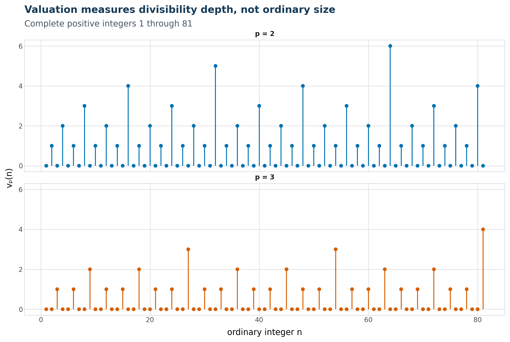

# Absolute values on the rationals

**Level and prerequisites: L3–L4.** Prepare absolute values, rational arithmetic and elementary inequalities. The [reader guide](index.md) links the Euler arithmetic, algebra and analysis preparation and distinguishes the graduate continuation.

## Goals

We now place $|\cdot|_p$ among all possible absolute values on $\mathbb Q$. The
classification explains why the ordinary and *p*-adic completions are not
arbitrary inventions: up to a harmless change of scale, they exhaust the
nontrivial possibilities.

## Absolute values and equivalence

An **absolute value** on a field $F$ is a function $|\cdot|:F\to\mathbb R_{\ge0}$
that is positive definite, multiplicative, and satisfies
$|x+y|\le |x|+|y|$. It is **non-Archimedean** if it satisfies the stronger bound

$$
|x+y|\le\max\{|x|,|y|\}.
$$

The ordinary absolute value is Archimedean: the sequence
$|1+\cdots+1|=n$ is unbounded. Every $|\cdot|_p$ is non-Archimedean because its
valuation inequality reverses after exponentiation.

Two absolute values are **equivalent** if they determine the same convergent
sequences, hence the same topology. For any $c>0$, the function $|x|^c$ induces
the same topology and the same Cauchy sequences as $|x|$. In general it remains
an absolute value automatically when $0<c\le1$; in the non-Archimedean case it
does so for every $c>0$. Normalizing by $|p|_p=p^{-1}$ gives a common language.

### The trivial absolute value

There is also $|0|=0$ and $|x|=1$ for all $x\ne0$. Its metric is discrete, so a
sequence converges only if it is eventually constant. We usually exclude it
when discussing places because it adds no completion.

## Ostrowski's classification

<div class="callout callout-note">
<p class="callout-title">Ostrowski's theorem</p>

Every nontrivial absolute value on $\mathbb Q$ is equivalent either to the
ordinary absolute value or to $|\cdot|_p$ for a unique prime $p$.

</div>

Here is the architecture of the proof. It is worth understanding even if one
postpones a few estimates.

### When the positive integers are bounded

Suppose $|n|\le C$ for all positive integers. Applying the binomial theorem to
$(1+1)^m$ and then taking large powers shows that the strong triangle inequality
must hold. Nontriviality gives an integer $n$ with $|n|<1$. Factor $n$; at least
one prime factor $p$ has $|p|<1$. Two distinct primes cannot both have absolute
value below $1$: Bézout gives integers $a,b$ with $ap^r+bq^s=1$, and for large
$r,s$ the strong inequality would force $|1|<1$. Thus exactly one prime is
small. Every integer not divisible by $p$ has absolute value $1$, while
$|p^k u|=|p|^k$. Therefore the absolute value is a positive power of
$|\cdot|_p$.

### When the positive integers are unbounded

If integer values are unbounded, compare the base-$b$ expansion of a positive
integer $n$ with powers of $b$. The triangle inequality bounds $|n|$ by a
polynomial factor times the largest digit contribution. Repeating the argument
for $n^r$ and taking $r$th roots removes that polynomial factor and shows

$$
|n|=n^\alpha
$$

for a fixed $\alpha>0$. On rationals this is a positive power of the ordinary
absolute value. The two branches complete the classification.

<div class="callout callout-tip">
<p class="callout-title">What equivalence preserves</p>

The equation $|x|_p=p^{-v_p(x)}$ is a normalization choice. Topology,
convergence, continuity, and completeness remain unchanged if the whole absolute
value is raised to a positive power.

</div>

## A full proof of the classification

We now justify both branches of Ostrowski's theorem. Throughout this proof,
vertical bars without a subscript denote the absolute value being classified.
Ordinary magnitude will be indicated explicitly when the two notions could be
confused. First observe that multiplicativity gives $|1|=1$ and $|-1|=1$.
Consequently the values of positive integers determine the absolute value on
all nonzero rationals. There is no additional choice waiting at denominators:
the value of $a/b$ must be $|a|/|b|$.

### Bounded integers force the strong inequality

Assume there is a real constant $C$ bounding $|m|$ for every positive integer.
Increase it to at least one. For any $x,y\in\mathbb Q$, the ordinary triangle
inequality applied to the binomial expansion gives

$$
|x+y|^n
 \le C\sum_{j=0}^n |x|^j|y|^{n-j}
 \le C(n+1)\max(|x|,|y|)^n .
$$

The constant bounds each integer binomial coefficient in the given absolute
value. It does not bound that coefficient's ordinary size, which can be large.
Taking positive real $n$th roots and letting $n$ tend to infinity removes the
factor $C(n+1)$. Its $n$th root tends to one. We obtain the strong triangle
inequality for arbitrary rational inputs. If both inputs are zero the
conclusion is immediate, so no division by zero is hidden in this argument.

For a positive integer $m$, boundedness also applies to all its powers.
Thus $|m|^n=|m^n|\le C$, and taking roots proves $|m|\le1$.
If every positive integer had value one, every nonzero rational would have
value one. Nontriviality therefore supplies a positive integer of value less
than one. Its prime factorisation contains a prime $p$ with $|p|<1$.

That prime is unique. If distinct primes $p,q$ both had value less than one,
Bézout gives integers $a,b$ with $ap+bq=1$. Integer values are at most one,
including negative integers, so the strong inequality would give
$1\le\max(|p|,|q|)<1$, a contradiction. Every other prime has value one.
Factorisation now yields $|x|=|p|^{v_p(x)}$ for every nonzero rational.
Writing $c=-\log|p|/\log p$ gives $c>0$ and
$|x|=|x|_p^c$. This is an equality of functions after a power change,
not merely a vague resemblance between their small neighborhoods.

### Unbounded integers force the ordinary absolute value

Suppose instead that the integer values are unbounded. Choose an integer
$b>1$ with $|b|>1$. For any fixed integer base $a>1$, write the ordinary
base-$a$ expansion of $b^n$. Its number of digits grows at most linearly
with $n$, since the leading exponent is the integer part of
$n\log b/\log a$. Let $C_a$ be the maximum of one and the finitely many
values of the digits $1,\ldots,a-1$.

If $|a|\le1$, every digit contribution has value at most $C_a$.
The triangle inequality would bound $|b|^n$ by $C_a$ times a linear
function of $n$. An exponential with base greater than one cannot satisfy
that bound for every $n$. Hence $|a|>1$ for every integer $a>1$.
This preliminary step matters: the comparison of logarithmic ratios that
follows must have positive denominators and cannot assume that all integer
bases already have growing values.

Now write the ordinary base-$b$ expansion of $a^n$, with highest exponent
$k_n$. Its digit values are bounded by a fixed $C_b$, independently of $n$.
As $|b|>1$, the triangle inequality gives

$$
|a|^n\le C_b(k_n+1)|b|^{k_n},
\qquad
\frac{k_n}{n}\longrightarrow\frac{\log a}{\log b}.
$$

Take real logarithms, divide by $n$, and let $n$ grow. The logarithm of
the linear factor divided by $n$ tends to zero. Therefore
$\log|a|/\log a\le\log|b|/\log b$. Reversing the roles of the two bases
gives the opposite inequality. Their ratios are equal for every integer
$a>1$; call the common positive value $\alpha$.

Thus $|a|=a^\alpha$ for positive integers, and multiplicativity extends
this to $|x|=|x|_\infty^\alpha$ on nonzero rationals. The ordinary triangle
inequality applied to $1+1$ gives $2^\alpha\le2$, so $0<\alpha\le1$.
This upper bound distinguishes an Archimedean power from an arbitrary
positive power of a non-Archimedean norm. Conversely, every ordinary power
in that interval is indeed an absolute value.

The two alternatives exhaust bounded and unbounded integer values, proving
the theorem. Their topological distinction is also explicit. The sequence
$p^n$ tends to zero for the $p$-adic absolute value. For a different prime
$q$ its $q$-adic value is always one, while its ordinary magnitude grows.
Consequently the finite places are pairwise distinct and none is the
infinite place. The argument does not rely on comparing pictures of
completions that have not yet been constructed.

## Worked examples of normalization and equivalence

### Worked example 1: a power changes distances but not limits

Define $A(x)=|x|_3^2$. Its possible nonzero values are the even powers
of three. For $x=9/2$, the normalized three-adic value is $1/9$ and
the new value is $1/81$. Both detect the same direction of nearness:
a sequence has errors tending to zero under one exactly when it does
under the other. A required new distance bound $\varepsilon$ translates
to the old bound $\sqrt{\varepsilon}$.

This does not mean that an unchanged numerical radius labels the same ball.
The inequality $A(x)\le1/9$ says that the old norm is at most $1/3$.
Normalization is therefore needed for numerical comparisons, even when
topological statements are invariant under the power change. Later valuation
normalizations in finite extensions will require the same care.

### Worked example 2: an invalid Archimedean power

The proposed function $B(x)=|x|_\infty^2$ is positive definite and
multiplicative. Nevertheless $B(1+1)=4$ exceeds $B(1)+B(1)=2$.
It is not an absolute value. Positivity and multiplicativity alone therefore
do not define the class covered by Ostrowski's theorem.

In contrast, the square root of the ordinary absolute value is an absolute
value. For nonnegative real $s,t$ and $0<c\le1$, one has
$(s+t)^c\le s^c+t^c$. To see this when the sum is positive, divide by
$(s+t)^c$ and put $u=s/(s+t)$. Since $u^c\ge u$ and
$(1-u)^c\ge1-u$, the required bound follows. Applying it after the ordinary
triangle inequality proves the assertion for every such exponent.

### Worked example 3: read all places of one rational

For $x=-250/63$, factor the numerator as $-2\cdot5^3$ and the denominator
as $3^2\cdot7$. Its finite-place values are $1/2$, $9$, $1/125$ and
$7$ at the four relevant primes. Their product is $63/250$.
Multiplication by the ordinary value $250/63$ gives one.

The minus sign has no effect. A denominator prime increases its local
absolute value, even though dividing by that prime decreases ordinary
magnitude. This example also shows why the product formula uses normalized
absolute values. If one finite factor were squared independently and every
other factor left unchanged, the displayed product would usually cease to
equal one. Equivalence preserves topology; it does not preserve this
particular numerical identity without corresponding normalization choices.

## What the classification does and does not assert

A topology can come from many constructions besides an absolute value.
Ostrowski classifies the absolute values on the rational field, not every
topology that someone could impose on its underlying set. It also does
not say that the resulting complete fields are isomorphic. A field
isomorphism respecting the given rational embedding and metric would
have to preserve the behavior of every rational sequence, and the
sequence of prime powers already separates the relevant topologies.

Equivalence of powers preserves Cauchy sequences because it translates
every positive error threshold into another positive threshold. The same
translation proves preservation of convergence and continuity. Completeness
is then preserved on a fixed field: a Cauchy sequence in the new metric
is Cauchy in the old one, obtains its old limit, and converges to it
in the new metric. These are statements about infinite sequences, justified
by their quantifiers rather than by agreement of a finite table of norms.

The trivial absolute value gives a useful limiting comparison. Its ball
of radius less than one is a singleton, so every Cauchy sequence is
eventually constant and the rational field is already complete for that
metric. No $p$-adic absolute value is trivial, because its prime powers
produce nonzero distances tending to zero. The nontriviality assumption
in the theorem therefore removes a genuinely different case, rather than
a redundant choice of normalization.

## The product formula

For a nonzero rational $x$, only finitely many valuations $v_p(x)$ are nonzero.
Unique factorization gives

$$
|x|_\infty\prod_p |x|_p=1,
$$

where $|x|_\infty$ is the ordinary absolute value and the product ranges over all
primes. For $x=18/35$,

$$
|x|_\infty\,|x|_2|x|_3|x|_5|x|_7
=\frac{18}{35}\cdot\frac12\cdot\frac19\cdot5\cdot7=1.
$$

The formula says that a rational cannot be simultaneously small at every place.
A prime appearing in its numerator makes it small at that prime but contributes
to its ordinary size; a denominator reverses the trade.

## Places as coordinated viewpoints

A **place** of $\mathbb Q$ is an equivalence class of nontrivial absolute values.
There is one infinite place, represented by $|\cdot|_\infty$, and one finite
place for each prime. Completion at the infinite place gives $\mathbb R$;
completion at $p$ gives $\mathbb Q_p$. Later, adeles will let these viewpoints
coexist in one restricted product.

It is tempting to ask which completion is the "correct" one. The product formula
suggests a better question: which place sees the feature relevant to the
problem? A congruence modulo powers of $7$ is continuous information in
$\mathbb Q_7$ and discontinuous-looking information on the real line.

## Visual checkpoint: valuation is divisibility depth

<figure id="fig-padic-absolute-valuation-profile">


<figcaption>

Figure 2.1: Two-adic and three-adic valuations form sparse divisibility spikes.

</figcaption>
</figure>

The heights in [Figure 2.1](#fig-padic-absolute-valuation-profile) are not ordinary sizes.
They count repeated prime factors, so a taller spike means a smaller nonzero
$p$-adic absolute value. The plot supplies intuition; the valuation laws follow
from exact factorization.

## What equivalence preserves

Replacing an absolute value by a positive power preserves more than
the collection of open sets. If $|x|'=|x|^\alpha$ with $\alpha>0$,
the condition $|x-y|'<\varepsilon$ is exactly
$|x-y|<\varepsilon^{1/\alpha}$. These tolerance conversions are
independent of the points. Consequently the two metrics have the same
Cauchy sequences, the same convergent sequences with the same limits,
and the same uniformly continuous maps into a fixed metric space.
Completeness is therefore unchanged by this replacement. This explains
why Ostrowski's classification is phrased up to equivalence rather
than choosing one compulsory numerical normalization.

Different primes do not become equivalent by this rule. The sequence
$p^n$ tends to zero for the $p$-adic norm but has norm one for the
$q$-adic norm when $q\ne p$. It cannot tend to zero there.
The trivial absolute value behaves differently again: every nonzero
distance is one, so a Cauchy sequence must eventually be constant.
It gives a discrete complete metric on any field. Excluding the
trivial absolute value from the nontrivial classification is thus a
substantive hypothesis, not an omitted prime or an unusual choice of
exponent.

<!-- inline-formula-code:start -->
## Formula and finite computation

A useful formula in this chapter is

$$
|x|_p=p^{-v_p(x)}
$$

Fractions preserve the exact rational value of the absolute value. The following standalone Python block expresses that finite rule with its inputs and stopping conditions visible.

```python
from fractions import Fraction
from math import isqrt

def is_prime(number: int) -> bool:
    """Return whether number is prime by exact trial division."""
    if number < 2:
        return False
    return all(number % divisor != 0 for divisor in range(2, isqrt(number) + 1))

def integer_valuation(integer: int, prime: int) -> int:
    """Return v_prime(integer) for a nonzero integer and prime >= 2."""
    if integer == 0 or not is_prime(prime):
        raise ValueError("use a nonzero integer and an actual prime")
    exponent = 0
    remaining = abs(integer)
    while remaining % prime == 0:
        remaining //= prime
        exponent += 1
    return exponent

def padic_absolute(value: Fraction, prime: int) -> Fraction:
    """Return the exact p-adic absolute value of a nonzero rational."""
    if value == 0:
        return Fraction(0)
    exponent = integer_valuation(value.numerator, prime) - integer_valuation(
        value.denominator, prime
    )
    return Fraction(prime ** max(-exponent, 0), prime ** max(exponent, 0))

x, y = Fraction(1, 3), Fraction(10, 3)
print(padic_absolute(x, 3), padic_absolute(y, 3), padic_absolute(x - y, 3))
```

**What the computation establishes.** The calculation checks a declared finite instance; the surrounding argument explains what is true beyond those inputs.
<!-- inline-formula-code:end -->

## Summary

Absolute values that differ by a positive power have the same topology.
Ostrowski's theorem says that every nontrivial topology on $\mathbb Q$ arising
from an absolute value is ordinary or *p*-adic. The product formula balances all
these local sizes and foreshadows global–local arithmetic.

## Exercises

### Exercise 2.1 {#ex-padic-02-01}

Verify directly that $|\cdot|^c$ is an absolute value when $0<c\le1$. What can fail for an arbitrary absolute value if $c>1$?

<details>
<summary>Hint 1</summary>

Apply the original triangle inequality before taking the power.

</details>

<details>
<summary>Hint 2</summary>

For nonnegative s,t, divide the scalar inequality by their positive sum to the power c.

</details>

<details>
<summary>Full solution</summary>

Definiteness and multiplicativity survive a positive power. The inequality $(s+t)^c\le s^c+t^c$ for $0<c\le1$ follows from $u^c\ge u$ on $[0,1]$, applied to $u=s/(s+t)$ and its complement. Thus $|x+y|^c\le(|x|+|y|)^c\le|x|^c+|y|^c$. For $c>1$, the ordinary norm at $x=y=1$ violates the triangle inequality.

</details>

### Exercise 2.2 {#ex-padic-02-02}

Prove that a non-Archimedean absolute value satisfies $|x_1+\cdots+x_n|\le\max_i|x_i|$.

<details>
<summary>Hint 1</summary>

Begin with one summand.

</details>

<details>
<summary>Hint 2</summary>

Apply the two-term bound to the partial sum and the next term.

</details>

<details>
<summary>Full solution</summary>

For one summand equality holds. If the assertion is true for the first $n$ terms, the strong triangle inequality bounds the next partial sum by the maximum of the previous partial-sum norm and the new term's norm. The induction hypothesis bounds this by the maximum of all $n+1$ norms. Induction proves the assertion for every positive finite number of terms.

</details>

### Exercise 2.3 {#ex-padic-02-03}

Show that $|n|_p\le1$ for every integer $n$.

<details>
<summary>Hint 1</summary>

Separate zero from nonzero integers.

</details>

<details>
<summary>Hint 2</summary>

An integer prime exponent is nonnegative.

</details>

<details>
<summary>Full solution</summary>

Zero has absolute value zero. A nonzero integer has $v_p(n)\ge0$ by prime factorisation, so $p^{-v_p(n)}\le1$. Negative signs do not change the exponent. This is also a consequence of the finite-sum strong inequality applied to copies of one and then multiplication by minus one.

</details>

### Exercise 2.4 {#ex-padic-02-04}

Verify the product formula for $x=-250/63$.

<details>
<summary>Hint 1</summary>

Only numerator and denominator primes contribute.

</details>

<details>
<summary>Hint 2</summary>

Include the ordinary factor as well as all four nontrivial finite factors.

</details>

<details>
<summary>Full solution</summary>

The ordinary value is $250/63$. The values at $2,3,5,7$ are $1/2,9,1/125,7$ respectively; every other finite-place value is one. The finite product is $63/250$, which cancels the ordinary factor. The product formula concerns a nonzero rational, so its finite number of nonunit factors is guaranteed by factorisation.

</details>

### Exercise 2.5 {#ex-padic-02-05}

Prove that equivalent powers $|\cdot|$ and $|\cdot|^c$ have the same Cauchy sequences.

<details>
<summary>Hint 1</summary>

A positive power is strictly increasing on positive real numbers.

</details>

<details>
<summary>Hint 2</summary>

Translate epsilon into epsilon to the reciprocal power.

</details>

<details>
<summary>Full solution</summary>

For every positive $\varepsilon$, the inequality $|x_m-x_n|^c<\varepsilon$ is equivalent to $|x_m-x_n|<\varepsilon^{1/c}$. Both sets of positive thresholds range over all positive numbers. Substituting this equivalence into the definition, with the same eventual index for the translated threshold, proves both implications. No uniform bound on the sequence is required.

</details>

### Exercise 2.6 {#ex-padic-02-06}

**Challenge.** Fill in the Bézout step in the bounded-integers branch of Ostrowski's theorem.

<details>
<summary>Hint 1</summary>

First use bounded powers to show that every integer has norm at most one.

</details>

<details>
<summary>Hint 2</summary>

Apply Bezout to distinct prime integers and use the strong inequality.

</details>

<details>
<summary>Full solution</summary>

If integer norms are bounded by $C$, then $|m|^r=|m^r|\le C$ for every positive $r$, hence $|m|\le1$. If distinct primes $p,q$ both had norm less than one, choose integers $a,b$ with $ap+bq=1$. The strong inequality gives $1\le\max(|a||p|,|b||q|)\le\max(|p|,|q|)<1$. This contradiction proves uniqueness of the small prime; it uses both boundedness and the strong inequality already proved.

</details>

### Exercise 2.7 {#ex-padic-02-07}

Explain why no $|\cdot|_p$ is equivalent to the ordinary absolute value, using the sequence $p^n$.

<details>
<summary>Hint 1</summary>

Compute the error from zero in each metric.

</details>

<details>
<summary>Hint 2</summary>

Equivalent absolute values must agree on which sequences converge to zero.

</details>

<details>
<summary>Full solution</summary>

The $p$-adic norm of $p^n$ is $p^{-n}$, tending to zero. Its ordinary norm is $p^n$, tending to infinity and in particular not to zero. Hence the two metrics disagree on convergence to zero. They cannot induce the same topology or the same convergent sequences.

</details>

### Exercise 2.8 {#ex-padic-02-08}

In the unbounded-integers proof, show carefully that $|a|>1$ for every integer $a>1$.

<details>
<summary>Hint 1</summary>

Expand the powers of one fixed integer with norm greater than one in base a.

</details>

<details>
<summary>Hint 2</summary>

If the base norm were at most one, only the number of digits could enlarge the bound.

</details>

<details>
<summary>Full solution</summary>

Choose $b>1$ with $|b|>1$. In the base-$a$ expansion of $b^n$, the digit norms have a fixed finite maximum $C_a$, and the number of digits is at most $1+n\log b/\log a$. If $|a|\le1$, the triangle inequality would bound $|b|^n$ by $C_a$ times this linear quantity. Taking $n$th roots gives $|b|\le1$, a contradiction. Thus every such $a$ has norm greater than one.

</details>

### Exercise 2.9 {#ex-padic-02-09}

For distinct primes $p,q$, prove that the corresponding finite places are different.

<details>
<summary>Hint 1</summary>

Use powers of p again.

</details>

<details>
<summary>Hint 2</summary>

Their q-adic valuations are all zero.

</details>

<details>
<summary>Full solution</summary>

The sequence $p^n$ has $p$-adic norm tending to zero. Since $q$ never divides any power of $p$, every $q$-adic valuation is zero and every corresponding norm is one. The sequence therefore does not converge to zero in the $q$-adic metric. The two absolute values are not equivalent.

</details>

### Exercise 2.10 {#ex-padic-02-10}

Suppose a nonzero rational has $|x|_p\le1$ at every finite place. Prove it is an integer. If also $|x|_\infty<1$, what follows?

<details>
<summary>Hint 1</summary>

Put the rational in reduced form.

</details>

<details>
<summary>Hint 2</summary>

A denominator prime would give a negative valuation; then examine the possible ordinary integer size.

</details>

<details>
<summary>Full solution</summary>

Write $x=a/b$ in lowest terms with $b>0$. If $b>1$, a prime divisor $p$ of $b$ does not divide $a$, so $v_p(x)<0$ and $|x|_p>1$, a contradiction. Thus $b=1$ and $x$ is an integer. A nonzero integer has ordinary absolute value at least one. Therefore the additional strict ordinary bound is impossible for a nonzero rational; allowing zero, it forces $x=0$.

</details>
