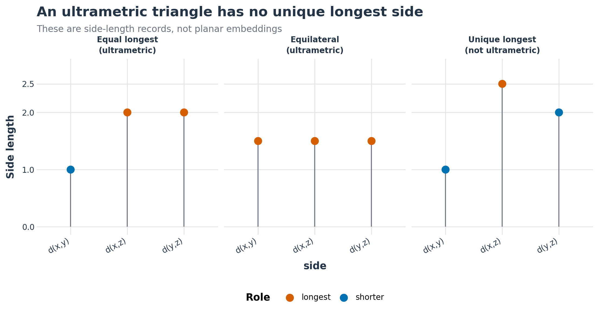
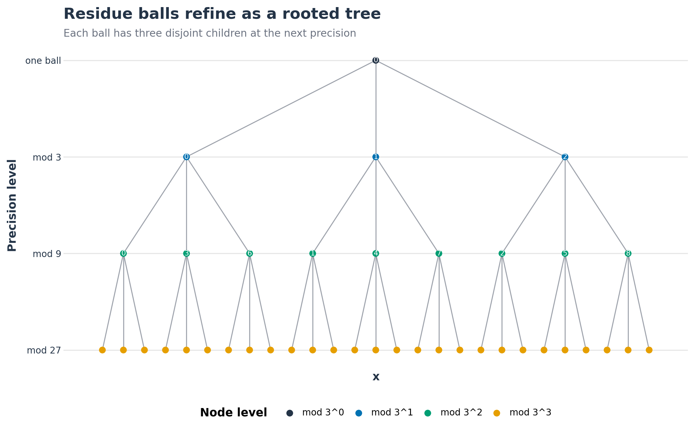

# Ultrametric geometry

**Level and prerequisites: L3–L4.** Prepare metric spaces, balls and the absolute values of Chapter 2. The [reader guide](index.md) links the Euler arithmetic, algebra and analysis preparation and distinguishes the graduate continuation.

## Goals

The metric $d_p(x,y)=|x-y|_p$ reorganizes elementary geometry. We will prove the
strong isosceles property, classify how balls meet, and translate balls into
residue classes. These facts are not curiosities: they control convergence,
continuity, compactness, and computation throughout the book.

## Strong triangles

For any $x,y,z$,

$$
d_p(x,z)\le\max\{d_p(x,y),d_p(y,z)\}.
$$

Suppose the two distances on the right are unequal, say
$d_p(x,y)<d_p(y,z)$. Apply the strong inequality twice:

$$
d_p(x,z)\le d_p(y,z),\qquad
d_p(y,z)\le\max\{d_p(y,x),d_p(x,z)\}.
$$

The second maximum cannot be its first term, so $d_p(y,z)\le d_p(x,z)$.
Consequently $d_p(x,z)=d_p(y,z)$. Every triangle is isosceles with its two
longest sides equal. Equilateral triangles are allowed.

<figure id="fig-ultrametric-triangles">


<figcaption>

Figure 3.1: Three finite metric triangles compare Euclidean side data with two ultrametric patterns; equal longest sides are highlighted.

</figcaption>
</figure>

[Figure 3.1](#fig-ultrametric-triangles) is a side-length diagram, not an embedding of
$\mathbb Q_p$. Its purpose is logical: in the two ultrametric cases no side is
uniquely longest. The familiar image of a thin Euclidean triangle is therefore a
poor guide to *p*-adic nearness.

## Balls have many centers

For $r>0$, write

$$
B(a,r)=\{x:d_p(x,a)<r\},\qquad
\overline B(a,r)=\{x:d_p(x,a)\le r\}.
$$

If $b\in B(a,r)$, then $B(b,r)=B(a,r)$. Indeed, if $x\in B(a,r)$, the strong
triangle inequality gives

$$
d_p(x,b)\le\max\{d_p(x,a),d_p(a,b)\}<r.
$$

The reverse inclusion is symmetric. The same argument works for closed balls.
Thus a ball has no geometrically privileged center.

### Nested or disjoint

If two balls intersect, choose a point $c$ in their intersection. Recenter both
at $c$. If their radii are ordered, the smaller ball lies in the larger. Hence
any two *p*-adic balls are disjoint or one contains the other.

<figure id="fig-nested-balls">


<figcaption>

Figure 3.2: Residue balls modulo powers of 3 are shown as nodes arranged by precision; lines connect each class to its three children.

</figcaption>
</figure>

In [Figure 3.2](#fig-nested-balls), horizontal position is a layout device. A node labeled by
$a\bmod 3^N$ represents the closed ball $a+3^N\mathbb Z_3$; its three children
are the refinements modulo $3^{N+1}$. Branches never merge, encoding the
nested-or-disjoint theorem.

## Balls are congruence classes

For integer points,

$$
|x-a|_p\le p^{-N}
\quad\Longleftrightarrow\quad
x\equiv a\pmod {p^N}.
$$

Thus $\overline B(a,p^{-N})=a+p^N\mathbb Z_p$ once $\mathbb Z_p$ has been
constructed. Already inside $\mathbb Q$, this identifies the ball's rational
points by a congruence after denominators prime to $p$ are cleared.

Because the norm assumes only powers of $p$, nominally different radii can define
the same ball. For example, $\{x:|x|_3<1\}$ equals
$\{x:|x|_3\le1/3\}$. Paying attention to strict versus weak inequalities is
important, but there are no points at intermediate real-valued radii.

### Clopen sets

Every open ball is closed. If $y$ lies outside $B(a,r)$, then the ball
$B(y,d_p(a,y))$ cannot meet $B(a,r)$, so the complement is open. Similarly,
closed balls are open: a point inside can be surrounded by a sufficiently small
ball that stays inside.

This does not make the topology discrete. Singletons are not open: every ball
around $a$ contains $a+p^N$ for large $N$. Instead the topology is **totally
disconnected**. If $x\ne y$, choose a radius below $d_p(x,y)$; disjoint clopen
balls separate them. The only connected subsets are singletons.

<div class="callout callout-warning">
<p class="callout-title">Real-intuition trap</p>

"Open and closed" is not a contradiction. Those labels are not opposites: a set
can be both, neither, or exactly one. In an ultrametric space, clopen residue
balls are the basic neighborhoods.

</div>

## Digit prefixes and distance

Suppose two *p*-adic integers have expansions

$$
x=\sum_{n\ge0}a_np^n,\qquad y=\sum_{n\ge0}b_np^n.
$$

If their first $N$ digits agree and the next digits differ, then
$v_p(x-y)=N$ and $d_p(x,y)=p^{-N}$. Distance records the length of the common
prefix, where digits are read from low powers upward. The residue tree is thus a
faithful combinatorial model of the metric.

For example in $\mathbb Z_5$, the integers $42$ and $167$ differ by $125=5^3$.
Their first three base-$5$ digits agree, so their distance is $5^{-3}$. Their
ordinary separation, $125$, points in exactly the opposite direction.

## Radii, boundary cases and a basis of neighborhoods

A ball in this chapter has a positive radius unless zero is explicitly
discussed. This hypothesis matters. The closed ball of radius zero is the
singleton containing its center. Such a singleton is closed but is not open
in $\mathbb Q_p$. Likewise the sphere of radius zero is a singleton.
The statements about positive-radius balls and spheres do not extend to
that case. A sphere of a radius not attained by the norm is empty;
it is open, but it tells us nothing about distances actually present.

For an integer $N$, put
$D_N(a)=\{x:|x-a|_p\le p^{-N}\}$. The value group consists of integer
powers of $p$, so this is also the open ball of radius $p^{1-N}$.
An open ball of radius $p^{-N}$ is instead $D_{N+1}(a)$.
These formulas reconcile strict and weak inequalities without pretending
that their stated real radii are equal. The sets agree because no
distance lies strictly between the consecutive values.

The sets $D_N(a)$ form a neighborhood basis. Given any positive real
tolerance, choose $N$ large enough that $p^{-N}$ is smaller than it.
The corresponding residue ball lies in the original open neighborhood.
Consequently a subset is open exactly when every one of its points
contains some sufficiently fine residue ball inside the subset. This is
the same local definition used in metric topology, now expressed by
integer precision levels.

### Worked example 1: intersect two arithmetic neighborhoods

In $\mathbb Q_3$, consider $D_2(1)$ and $D_3(10)$. Their center
difference is nine, of valuation two. The center ten therefore belongs
to the first ball, and the finer second ball is contained in the
first. The intersection is exactly $D_3(10)$. Any point in it is
simultaneously congruent to one modulo nine and to ten modulo twenty-seven.

Replace the second center by two. The center difference from one is
a unit, so the balls are disjoint. A point in their intersection
would force that unit to have norm at most one ninth by subtraction,
which is impossible. This gives an exact certificate for emptiness,
rather than a visual judgment that the centers look far apart.

The same calculation describes a general intersection test. For closed
balls with radii $R\le S$, intersection implies that the centers have
distance at most $S$. Conversely, that center condition puts the smaller
ball inside the larger by the strong inequality. The criterion involves
the larger radius. Requiring the centers to be within the smaller
radius would be unnecessarily restrictive.

## Why every point is a centre

The many-centres statement can initially sound like a failure of geometry.
It is instead a precise expression of what the neighborhood records.
Knowing an input modulo $p^N$ singles out a residue class; no element
of that class is more informative as a representative than another.
Changing representatives keeps exactly the same collection of possible
inputs. The ball remembers a shared initial string of digits rather
than a preferred midpoint.

Suppose $b$ belongs to $D_N(a)$. For every $x$ in that ball,
the strong inequality gives $|x-b|_p\le p^{-N}$, proving
$D_N(a)\subseteq D_N(b)$. Reversing the centers gives equality.
The proof works equally with a strict radius because a maximum of two
numbers strictly below the radius is still strictly below it.
No averaging of the centers is used or needed.

This explains why Euclidean circumference pictures can mislead. Points
inside a real interval are not all centers of that same interval with
the same radius. In an ultrametric ball, they are. A positive-radius
closed ball can also be topologically open, so its metric sphere does
not serve as its topological boundary. Indeed every such ball has empty
topological boundary because it is clopen. Distance levels and boundaries
are different notions.

### Worked example 2: a sphere is a finite collection of residue balls

In $\mathbb Q_5$, the sphere $|x-2|_5=5^{-3}$ consists of
$x=2+5^3u$ with $u$ a unit. Split that unit by its first residue,
which can be one, two, three or four. The sphere is the disjoint union

$$
\bigcup_{j=1}^4\left(2+j5^3+5^4\mathbb Z_5\right).
$$

Each piece is a positive-radius clopen ball. The missing fifth child is
$2+5^4\mathbb Z_5$, the points closer to the center than the chosen
sphere radius. Thus a sphere here has interior points; it is not a
thin surface analogous to an ordinary circle.

Before $\mathbb Z_5$ is constructed, the same equality is understood by
intersecting every displayed set with $\mathbb Q$ and interpreting divisibility
in $\mathbb Z_{(5)}$. Chapter 5 supplies the completed ring and proves
the digit notation directly. The geometric argument itself does not depend
on assuming a digit expansion theorem in advance.

## Separation without isolated points

Let a subset contain distinct points $x,y$. Choose a positive radius
strictly smaller than their distance. The ball about $x$ contains $x$
and excludes $y$. It is clopen in the ambient space, so its intersection
with the subset and the complementary intersection form two disjoint,
nonempty relatively open sets. They separate the subset. This proves
that every connected subset has at most one point.

Total disconnectedness does not assert discreteness. For each integer
$M$ the point $x+p^M$ differs from $x$ and approaches it as $M$
grows. Thus every neighborhood of $x$ contains another point. The
topology has abundant clopen neighborhoods without any isolated rational
or $p$-adic points. Both features can hold simultaneously.

It follows that every continuous path from a real interval into
$\mathbb Q_p$ is constant. An interval is connected, and a continuous
image of a connected set is connected. The image must therefore be
a singleton. This argument concerns a real parameter interval with its
ordinary topology. It says nothing against a nonconstant continuous
function defined on a $p$-adic domain, which is itself disconnected.

For example, the characteristic function of a clopen ball is continuous
as a function into the real numbers. At a point inside, a whole
neighborhood has constant value one; at a point outside, a whole
neighborhood has constant value zero. It is locally constant, but can
take two different values globally. This provides a useful source of
continuous functions without invoking ordinary interpolation along paths.

## Continuity becomes preservation of precision

The digit viewpoint translates continuity into a practical statement.
A map is continuous at a point if each requested output precision
can be guaranteed by some sufficiently fine input precision around that
point. The input threshold may depend on both the point and the
requested output level. Uniform continuity requires choosing it independently
of the point on the stated domain.

For a polynomial with coefficients in $\mathbb Z_{(p)}$, integral rational
inputs satisfy a stronger bound:
$|f(x)-f(y)|_p\le|x-y|_p$. For each monomial, factor
$x^j-y^j=(x-y)\sum_{k=0}^{j-1}x^{j-1-k}y^k$.
Every summand in the second factor is integral, hence its norm is at
most one. Multiplying by an integral coefficient and using the strong
inequality across the finitely many monomials gives the claim.
The constant term cancels.

### Worked example 3: a polynomial respects a residue tree

Take $f(x)=x^2+x+1$ at three. If two integral inputs agree modulo
twenty-seven, their difference has valuation at least three. Since
$f(x)-f(y)=(x-y)(x+y+1)$ and the second factor is integral, the
outputs also agree modulo twenty-seven. Thus a residue class at any
precision has a well-defined image class at that same precision.

The estimate can sometimes improve. Near the class $x\equiv1\pmod3$,
the factor $x+y+1$ is divisible by three when both inputs lie in
that class. Their output difference then has at least one extra
valuation level. This does not prove that every output has higher
valuation, only that nearby outputs agree more closely. For instance
$f(1)=3$ itself still has valuation one. Distinguishing output size
from output sensitivity will matter in Newton lifting.

A general rational function needs denominators to stay nonzero and
their valuations to be controlled before a comparable estimate follows.
A polynomial with nonintegral coefficients can also lose precision.
The arithmetic hypotheses in the simple bound are therefore essential.
Continuity is not a slogan that every algebraic expression preserves
every available digit.

## Boundedness and a limit point

If a sequence converges to $a$, its tail eventually lies in any
chosen positive-radius ball around $a$. Select one such radius and
use the strong inequality to bound the norm of every tail element
by the maximum of that radius and $|a|_p$. The finitely many earlier
elements have a finite maximum norm. Combining the two bounds proves
boundedness of the entire sequence together with its limit.

A bounded set need not consist of a single residue class at every
level. The bound gives one coarse common container. Increasing precision
can split it into many disjoint balls. Later compactness of $\mathbb Z_p$
will depend on being able to choose from finitely many children at
each level, not on boundedness alone in an arbitrary metric field.

<!-- inline-formula-code:start -->
## Formula and finite computation

A useful formula in this chapter is

$$
d_p(x,y)=p^{-v_p(x-y)}
$$

A finite matrix makes the strong triangle pattern inspectable. The following standalone Python block expresses that finite rule with its inputs and stopping conditions visible.

```python
import numpy as np
from math import isqrt

def is_prime(number: int) -> bool:
    """Return whether number is prime by exact trial division."""
    if number < 2:
        return False
    return all(number % divisor != 0 for divisor in range(2, isqrt(number) + 1))

def capped_valuation_difference(left: int, right: int, prime: int, cap: int) -> int:
    """Return min(v_p(left-right), cap), with the diagonal assigned cap."""
    if not is_prime(prime) or cap < 0:
        raise ValueError("use an actual prime and nonnegative cap")
    difference = left - right
    if difference == 0:
        return cap
    exponent = 0
    while exponent < cap and difference % prime == 0:
        difference //= prime
        exponent += 1
    return exponent

residues = list(range(27))
matrix = np.array(
    [
        [capped_valuation_difference(x, y, prime=3, cap=4) for y in residues]
        for x in residues
    ]
)
print(matrix.shape, np.unique(matrix, return_counts=True))
```

**What the computation establishes.** The calculation checks a declared finite instance; the surrounding argument explains what is true beyond those inputs.
<!-- inline-formula-code:end -->

## Summary

Ultrametric triangles have no uniquely longest side. Every point of a ball is a
center, and intersecting balls are nested. Balls are congruence classes and are
simultaneously open and closed. Distance between digit expansions is determined
by their first disagreement. These properties replace the linear intuition of
real analysis with a branching one.

## Exercises

### Exercise 3.1 {#ex-padic-03-01}

Compute all pairwise $3$-adic distances among $0,1,3,4,9,10$.

<details>
<summary>Hint 1</summary>

Organize the points by residue modulo three first.

</details>

<details>
<summary>Hint 2</summary>

Within each residue group compare again modulo nine.

</details>

<details>
<summary>Full solution</summary>

Among distinct points, $(0,9)$ and $(1,10)$ have distance $1/9$. The pairs $(0,3),(3,9),(1,4),(4,10)$ have distance $1/3$. Each remaining pair has different residues modulo three and distance one: $(0,1),(0,4),(0,10),(1,3),(1,9),(3,4),(3,10),(4,9),(9,10)$. Every diagonal distance is zero, and symmetry gives the reverse-order entries. These fifteen unordered pairs exhaust the six-point set.

</details>

### Exercise 3.2 {#ex-padic-03-02}

Prove that every point of a closed ball is a center of that ball.

<details>
<summary>Hint 1</summary>

Compare the distances to the old and new centers.

</details>

<details>
<summary>Hint 2</summary>

Apply the strong inequality to get each containment separately.

</details>

<details>
<summary>Full solution</summary>

Let $b$ satisfy $d(a,b)\le r$. If $d(x,a)\le r$, then $d(x,b)\le\max(d(x,a),d(a,b))\le r$, proving one containment. Conversely, if $d(x,b)\le r$, the same inequality through $b$ bounds $d(x,a)$ by $r$. The closed balls coincide. This proof includes radius zero, where membership forces $b=a$.

</details>

### Exercise 3.3 {#ex-padic-03-03}

Assume $r>0$. Show that a sphere $\{x:d_p(x,a)=r\}$ is open whenever it is nonempty.

<details>
<summary>Hint 1</summary>

At a sphere point take an open ball of radius r.

</details>

<details>
<summary>Hint 2</summary>

An unequal-distance triangle forces the distance from the original center to stay r.

</details>

<details>
<summary>Full solution</summary>

Let $y$ lie on the sphere and suppose $d_p(y,z)<r$. As $d_p(a,y)=r$ is larger, the unequal-distance rule gives $d_p(a,z)=r$. Therefore the whole open ball $B(y,r)$ lies on the sphere, proving openness at each point. The positive-radius hypothesis is necessary: at radius zero the sphere is the singleton $\{a\}$, which is not open in $\mathbb Q_p$.

</details>

### Exercise 3.4 {#ex-padic-03-04}

Describe the children of $2+5^3\mathbb Z_5$ at the next precision level.

<details>
<summary>Hint 1</summary>

Specify the next base-five digit.

</details>

<details>
<summary>Hint 2</summary>

There are five possible residues for that digit, with increments of 125.

</details>

<details>
<summary>Full solution</summary>

The five children are $2+j125+625\mathbb Z_5$ for $j=0,1,2,3,4$. Their least nonnegative representatives are $2,127,252,377,502$ modulo $625$. Every parent element has exactly one next digit, so these children cover the parent. Distinct next digits give distinct residues modulo $625$, hence disjoint children.

</details>

### Exercise 3.5 {#ex-padic-03-05}

Prove that a convergent sequence together with its limit is bounded.

<details>
<summary>Hint 1</summary>

Put the tail inside a fixed neighborhood of the limit.

</details>

<details>
<summary>Hint 2</summary>

A finite prefix has a maximum distance from the limit.

</details>

<details>
<summary>Full solution</summary>

If $x_n\to a$, choose $M$ such that $d_p(x_n,a)<1$ for $n\ge M$. Let $R$ be the maximum of one and the finitely many distances $d_p(x_n,a)$ for $n<M$. Every term and $a$ lies in the closed radius-$R$ ball about $a$. This proves metric boundedness; applying the strong inequality through $a$ also gives a uniform norm bound.

</details>

### Exercise 3.6 {#ex-padic-03-06}

Construct three rationals forming an equilateral triangle of side $1$ in $\mathbb Q_5$.

<details>
<summary>Hint 1</summary>

Use three distinct residue classes modulo five.

</details>

<details>
<summary>Hint 2</summary>

The points zero, one and two suffice.

</details>

<details>
<summary>Full solution</summary>

The points $0,1,2$ have nonzero differences $\pm1$ and $\pm2$. None is divisible by five, so every pairwise difference has valuation zero and norm one. Thus every side has the requested length. At two, three integral points cannot have all pairwise differences odd, which shows why the residue-field size matters.

</details>

### Exercise 3.7 {#ex-padic-03-07}

**Challenge.** Show that any finite intersection of balls is empty or equals the smallest ball among them.

<details>
<summary>Hint 1</summary>

Choose a ball of least radius in the finite family.

</details>

<details>
<summary>Hint 2</summary>

If the intersection contains a point, recenter every ball there.

</details>

<details>
<summary>Full solution</summary>

If the intersection is nonempty, choose a common point $c$. Each ball can be recentered at $c$ without changing its radius or strictness. The smallest resulting ball is contained in every larger one, so it is the intersection. For mixed open and closed balls of equal radius, choose the open one as smaller; if they coincide as sets either choice works. Finiteness ensures that a smallest member exists.

</details>

### Exercise 3.8 {#ex-padic-03-08}

Prove that a continuous map from the real interval $[0,1]$ into $\mathbb Q_p$ is constant.

<details>
<summary>Hint 1</summary>

A continuous image of a connected set is connected.

</details>

<details>
<summary>Hint 2</summary>

Use a clopen ball to separate any two alleged image points.

</details>

<details>
<summary>Full solution</summary>

The interval is connected. If its image contained distinct points, a clopen ball containing one and excluding the other would separate that image into two nonempty relatively open pieces. This contradicts connectedness of a continuous image. Therefore the image is a singleton and the map is constant. The parameter topology is the ordinary real topology.

</details>

### Exercise 3.9 {#ex-padic-03-09}

For integral rational inputs, prove that $f(x)=x^3+2x$ cannot decrease $p$-adic agreement precision.

<details>
<summary>Hint 1</summary>

Factor the difference by x-y.

</details>

<details>
<summary>Hint 2</summary>

Every remaining term is integral at the chosen prime.

</details>

<details>
<summary>Full solution</summary>

The difference is $(x-y)(x^2+xy+y^2+2)$. Integral inputs and the integer coefficient two make the second factor integral, of norm at most one. Hence $|f(x)-f(y)|_p\le|x-y|_p$. In particular, divisibility of $x-y$ by $p^N$ implies divisibility of the output difference by $p^N$. Extra cancellation can improve the agreement but is unnecessary for this bound.

</details>

### Exercise 3.10 {#ex-padic-03-10}

Describe $\{x\in\mathbb Q_3:|x-1|_3<1/2\}$ as a closed residue ball, and explain why it is not a singleton.

<details>
<summary>Hint 1</summary>

The next possible positive norm below one is one third.

</details>

<details>
<summary>Hint 2</summary>

Add arbitrarily high powers of three to the center.

</details>

<details>
<summary>Full solution</summary>

The possible nonzero norms are integer powers of three. Norm less than one half is therefore equivalent to norm at most one third. The set is $D_1(1)$, or $1+3\mathbb Z_3$ intersected with $\mathbb Q$. It contains each distinct rational $1+3^M$ for $M\ge1$. Thus its openness and closedness do not make its points isolated.

</details>
