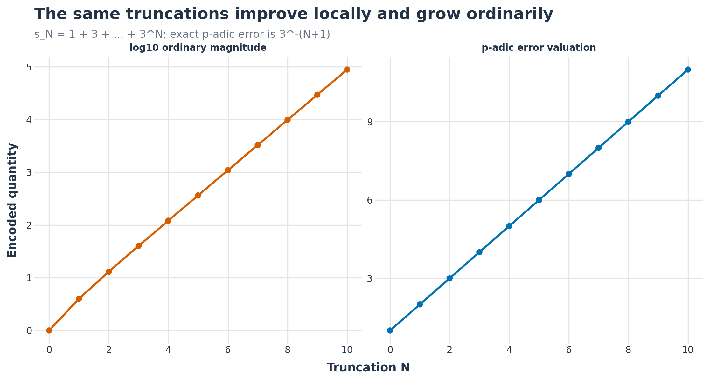

# Completing the rationals

**Level and prerequisites: L3–L4.** Prepare Cauchy sequences, equivalence relations and complete metric spaces. The [reader guide](index.md) links the Euler arithmetic, algebra and analysis preparation and distinguishes the graduate continuation.

## Goals

We construct $\mathbb Q_p$ from Cauchy sequences, extend arithmetic and the
absolute value, and establish its universal role as the completion of
$\mathbb Q$. Along the way, we compare one sequence under several metrics and
learn to recognize convergence from valuations of errors.

## Cauchy means eventual congruence

A sequence $(x_n)$ of rationals is **$p$-adically Cauchy** when for every integer
$N$ there is an index $M$ such that

$$
m,n\ge M\quad\Longrightarrow\quad v_p(x_m-x_n)\ge N.
$$

In words, sufficiently late terms agree modulo every prescribed power $p^N$.
The definition is the usual metric definition with
$\varepsilon=p^{-N}$. Discreteness of possible norms lets us use integer
precision levels instead of arbitrary positive real tolerances.

Consider $s_n=1+p+\cdots+p^n$. If $m>n$, then

$$
s_m-s_n=p^{n+1}(1+p+\cdots+p^{m-n-1}),
$$

and the parenthesized factor is a unit. Hence
$v_p(s_m-s_n)=n+1$, so $(s_n)$ is Cauchy. It has no rational convergence problem,
because the algebraic identity

$$
(1-p)s_n=1-p^{n+1}
$$

suggests the rational limit $(1-p)^{-1}$, and indeed
$v_p(s_n-(1-p)^{-1})=n+1$.

Not every Cauchy sequence has a rational limit. Successively choosing compatible
square roots of $2$ modulo $7^N$ produces a Cauchy sequence whose limit cannot
belong to $\mathbb Q$: a rational square root of $2$ would contradict unique
factorization. The completion supplies that missing limit.

## The sequence construction

Let $C_p$ be the set of $p$-adically Cauchy sequences in $\mathbb Q$. Declare
$(x_n)\sim(y_n)$ when $|x_n-y_n|_p\to0$. This is an equivalence relation. Define

$$
[(x_n)]+[(y_n)]=[(x_n+y_n)],\qquad
[(x_n)][(y_n)]=[(x_ny_n)].
$$

Why is multiplication safe? Every Cauchy sequence is bounded. Then

$$
x_ny_n-x_n'y_n'
=x_n(y_n-y_n')+y_n'(x_n-x_n'),
$$

and the strong triangle inequality, together with boundedness, makes the right
side small when representatives are changed. Thus both operations are well
defined on equivalence classes.

The resulting ring is a field. If $x=[(x_n)]\ne0$, then for all sufficiently
large $n$, the norms $|x_n|_p$ stabilize at a nonzero value. The tail
$(x_n^{-1})$ is Cauchy, because

$$
|x_n^{-1}-x_m^{-1}|_p
=\frac{|x_n-x_m|_p}{|x_n|_p|x_m|_p}.
$$

Changing finitely many early terms is irrelevant. This defines $x^{-1}$.

We call the field of equivalence classes $\mathbb Q_p$. Embed a rational $q$ by
the constant sequence $(q,q,\ldots)$. The embedding preserves addition,
multiplication, and absolute value, so we identify $\mathbb Q$ with its image.

### Extending the valuation

If $x=[(x_n)]\ne0$, the values $|x_n|_p$ are eventually constant. Define
$|x|_p$ to be this eventual value. If $x=0$, define $|x|_p=0$. This avoids taking
a real limit of arbitrary norm values, though that limit gives the same answer.
All valuation laws extend by passage to representatives.

<div class="callout callout-note">
<p class="callout-title">Completion theorem</p>

The field $\mathbb Q_p$ is complete; $\mathbb Q$ is dense in it; and any complete
valued field containing an isometric dense copy of $\mathbb Q$ is uniquely
isomorphic to $\mathbb Q_p$ by an isomorphism fixing $\mathbb Q$.

</div>

For completeness, a Cauchy sequence of equivalence classes can be represented by
a diagonal sequence of rationals: choose the $k$th rational representative
accurate to $p^{-k}$. The diagonal is Cauchy and its class is the desired limit.
Density is immediate: an equivalence class $[(x_n)]$ is approximated by the
rational terms $x_n$. Uniqueness follows because any continuous extension must
send a limit of rationals to the corresponding limit.

## One formula, different limits

The sequence $p^n$ tends to zero in $\mathbb Q_p$ since $|p^n|_p=p^{-n}$, but it
diverges in $\mathbb R$. Conversely, $p^{-n}$ tends to zero in $\mathbb R$ and
escapes to infinite *p*-adic norm. A sequence need not choose one behavior for
all places.

<figure id="fig-convergent-truncations">


<figcaption>

Figure 4.1: For partial sums of a geometric series, one panel shows the p-adic error valuation growing linearly while another shows ordinary magnitude growing.

</figcaption>
</figure>

[Figure 4.1](#fig-convergent-truncations) compares two honest quantities for
$1+p+\cdots+p^N$: the exact valuation of the error from $(1-p)^{-1}$ and the
ordinary magnitude of the truncation. Their opposing trends are the simplest
visual reminder that convergence belongs to a metric.

## Precision as a neighborhood

To know $x\in\mathbb Q_p$ to **absolute precision $p^N$** means to know its
coset $x+p^N\mathbb Z_p$. Any rational $a$ in this coset satisfies
$v_p(x-a)\ge N$. Rational approximations therefore come with an exact certificate:
a congruence, not a floating-point estimate.

One must be careful when $x$ has negative valuation. Saying
$x\equiv a\pmod{p^N}$ still makes sense as $x-a\in p^N\mathbb Z_p$, but a useful
representation may factor out a power of $p$ and track digits of the remaining
unit.

## The algebra of equivalence classes, step by step

The completion construction has two tasks that should not be conflated.
It must add limits, and it must preserve the field operations. Merely
naming a set of Cauchy sequences accomplishes neither task. We give the
details because the same construction will later be used for algebraic
extensions and for $\mathbb C_p$, where different completeness properties
must be kept separate.

First, every Cauchy sequence is bounded. Choose an index after which all
terms differ from one fixed tail term by norm less than one. The
strong inequality bounds every term in that tail by the maximum of one
and the fixed term's norm. The finitely many earlier norms have a
maximum too. This elementary fact is precisely what multiplication needs:
an error tending to zero remains small when multiplied by a bounded
sequence.

Suppose $(x_n)$ and $(y_n)$ are Cauchy. Their sum is Cauchy by the
strong triangle inequality. For the product, write
$x_ny_n-x_my_m=x_n(y_n-y_m)+y_m(x_n-x_m)$.
Uniform bounds on both sequences multiply the two errors by fixed real
constants. Given any positive tolerance, make both differences small enough
that these bounded products fall below it. The maximum then falls below
it as well. Thus termwise products really stay inside the set of Cauchy
sequences.

Changing representatives is a second check. If $x_n-x'_n$ and
$y_n-y'_n$ tend to zero, then
$x_ny_n-x'_ny'_n=x_n(y_n-y'_n)+y'_n(x_n-x'_n)$.
The same boundedness argument shows that the two product sequences are
equivalent. The analogous addition calculation is simpler. Associativity,
commutativity and distributivity descend from the rational identities,
because those identities hold at every index. The class of the constant
sequence one is not the zero class: its norm never approaches zero.

## A nonzero Cauchy class has a fixed size

A useful strengthening of boundedness is eventual stabilization of nonzero
norms. If a Cauchy sequence is not equivalent to zero, some positive
$\varepsilon$ is exceeded by the norms of arbitrarily late terms.
Choose a tail in which all pairwise differences have norm less than
$\varepsilon$, then choose one term of that tail whose norm is at least
$\varepsilon$. Its difference from any other tail term is strictly smaller
than its norm. The unequal-norm rule forces every tail term to have
exactly the same norm.

If an equivalent representative is chosen, its difference from the first
one tends to zero. Eventually that difference is smaller than the fixed
nonzero norm, so the new representative has the same norm. This proves
that the proposed absolute value of a nonzero class is well defined.
For the zero class, the rational norms tend to zero instead. The
definition is positive definite on classes, not merely on the terms
of a chosen sequence.

Multiplicativity follows by taking sufficiently late representatives of two
nonzero classes: both norms have stabilized, and the product norm equals
their product. The strong inequality follows similarly, with the zero
sum treated separately. Thus the completion carries an extension of the
original absolute value. No new nonzero norm values appear: every
nonzero completed element still has norm an integer power of $p$.

The fixed nonzero norm also justifies inversion. A nonzero class has
a representative with no zero terms after some index and with all
those terms of the same norm $r>0$. Differences of inverses have
norm $|x_n-x_m|_p/r^2$, so they tend to zero. Fill the finitely many
early positions with any nonzero rationals. The resulting inverse class
multiplies the original class to one, because the tail products are
exactly one. Equivalent representatives give equivalent inverses by the
same difference formula.

## Density comes before the diagonal completeness proof

For a class represented by $(a_n)$, regard each rational $a_n$ as a
constant-sequence class. These constant classes converge to the original
class. Indeed, given a precision level, Cauchyness makes all sufficiently
late differences $a_m-a_n$ small. The norm of the class represented
by $(a_m-a_n)_m$ is then bounded by that same threshold.
This proves density of the embedded rational field without assuming the
completion is already complete.

Now let $(X_n)$ be a Cauchy sequence of completed elements. Density
allows us to choose a rational $q_n$ with
$|X_n-q_n|_p\le p^{-n}$. The strong inequality gives

$$
|q_n-q_m|_p\le
\max\{p^{-n},\,|X_n-X_m|_p,\,p^{-m}\}.
$$

Every entry on the right becomes small for large indices, so $(q_n)$
is a rational Cauchy sequence. Let $L$ be its class. The density
argument just proved says that the constant classes $q_n$ converge
to $L$. Finally
$|X_n-L|_p\le\max(p^{-n},|q_n-L|_p)$ tends to zero.
Thus every Cauchy sequence of completed elements has a limit.

Notice the order of the argument. Rational Cauchy sequences define elements
by construction; arbitrary Cauchy sequences of those elements require the
additional diagonal approximation. Choosing one rational from each class
without controlling its error would not suffice. The bound depending on
$n$ is what makes those choices into a usable diagonal sequence.

## The universal property with its field structure

Let $F$ be a complete valued field and let $\iota:\mathbb Q\to F$
be an isometric field embedding. Define the extension on a Cauchy class
by taking the limit of $\iota(a_n)$ in $F$. Such a limit exists by
completeness. Equivalent representatives have images whose differences tend
to zero, so the extension is well defined. Continuity of addition and
multiplication in a valued field makes it a field homomorphism.

The extension is isometric: nonzero rational representative norms eventually
stabilize, and the norm of their nonzero limit in $F$ has that same
value. Alternatively, the ordinary reverse triangle inequality makes the
norm function continuous. An isometry is injective. If $\iota(\mathbb Q)$
is dense in $F$, every element of $F$ is approximated by an image
rational sequence, so the extension is also onto.

Uniqueness uses density rather than an arbitrary choice of representatives.
Any continuous extension fixing the rational embedding must take the limit
of a rational sequence to the limit of its images. It must therefore
agree with the construction on every completed element. The result is
a unique isometric field isomorphism when the rational image is dense,
and a unique isometric embedding into a general complete target.

### Worked example 1: a divergent real series with a rational local limit

At $p=3$, the partial sums $1+3+\cdots+3^n$ tend three-adically
to $-1/2$. The finite identity
$2s_n=3^{n+1}-1$ gives
$s_n+1/2=3^{n+1}/2$, of valuation exactly $n+1$.
The same partial sums grow without bound ordinarily.
An infinite-series symbol acquires its meaning from a convergence metric;
the algebraic finite identity is shared, while its limiting interpretation differs.

### Worked example 2: construct an irrational limit without a general lifting theorem

Start with $a_1=3$, whose square is two modulo seven. Given an
integer $a_N$ with $a_N^2\equiv2\pmod{7^N}$ and
$a_N\equiv3\pmod7$, seek $a_{N+1}=a_N+7^Nt$.
Modulo $7^{N+1}$, the square condition becomes the linear congruence
$(a_N^2-2)/7^N+2a_Nt\equiv0\pmod7$.
Its coefficient $2a_N$ is nonzero modulo seven, so there is exactly
one digit $t$ from zero through six solving it.

The first choices give $a_2=10$ and $a_3=108$. At every stage,
the difference from the previous choice has valuation at least $N$.
The compatible sequence is Cauchy and hence defines an element $\alpha$
of $\mathbb Q_7$. Its square is two because squaring is continuous
and the errors $a_N^2-2$ tend to zero. It cannot be rational:
a reduced rational square equal to two would give an odd valuation
at two on one side and an even valuation on the other.
Completion has added an actual field element, not merely a list of
approximate roots.

### Worked example 3: one sequence approaching zero in two metrics

Choose a prime $q>p$ and put $u_n=p^n/q^n$. Its ordinary magnitude
is $(p/q)^n$, tending to zero. Since the denominator is a $p$-adic
unit, its valuation is $n$, so its $p$-adic norm also tends to
zero. The earlier opposing examples do not imply that ordinary and
$p$-adic convergence can never coexist. They show only that one
topology does not determine the other.

More generally, an error certificate specifies the prime, the valuation
threshold and the metric in which a conclusion is taken. It need
not give an ordinary numerical bound of the same size. Keeping those
roles distinct makes it possible to combine local and real conditions
later without assuming that one kind of closeness secretly supplies
the other.

## A precision description of a completed element

The sequence model permits many representatives of the same element.
Suppose rational numbers $a_N$ satisfy
$|a_{N+1}-a_N|_p\le p^{-N}$ for every sufficiently large $N$.
A finite telescoping sum and the strong inequality give
$|a_M-a_N|_p\le p^{-N}$ whenever $M>N$. Thus the sequence is Cauchy,
and its completed limit $a$ satisfies the same bound
$|a-a_N|_p\le p^{-N}$ by continuity of the norm.

Now choose other rational representatives $b_N$ with
$|b_N-a_N|_p\le p^{-N}$. Their differences from the first sequence
tend to zero, so they define exactly the same completed element.
This is why compatible finite precision data can describe an exact
element without selecting a privileged rational at each stage.
It also shows why merely having bounded representatives is insufficient:
the error thresholds must increase. A sequence alternating between
zero and one stays bounded but does not become Cauchy. Completion
adjoins limits of compatible improving approximations, rather than
limits for arbitrary bounded information.

<!-- inline-formula-code:start -->
## Formula and finite computation

A useful formula in this chapter is

$$
x_{N+1}\equiv x_N\pmod{p^N}
$$

A coherent residue sequence is a finite window into the inverse-limit construction. The following standalone Python block expresses that finite rule with its inputs and stopping conditions visible.

```python
prime = 5
residues = [3, 18, 68, 318]
compatibility = [
    residues[index + 1] % prime ** (index + 1) == residues[index]
    for index in range(len(residues) - 1)
]
print(compatibility)
```

**What the computation establishes.** The output certifies only the declared finite case. The theorem, if one is claimed, still requires the argument developed in the chapter.
<!-- inline-formula-code:end -->

## Summary

$\mathbb Q_p$ is built from $p$-adic Cauchy sequences exactly as $\mathbb R$ can
be built from ordinary Cauchy sequences. Arithmetic is defined termwise and is
independent of representatives. The rational field embeds densely, while the
new field supplies every missing $p$-adic limit. Convergence means growing
divisibility of errors.

## Exercises

### Exercise 4.1 {#ex-padic-04-01}

Show directly that $(p^{n!})$ is Cauchy and converges to zero in $\mathbb Q_p$.

<details>
<summary>Hint 1</summary>

Compute the norm of each term first.

</details>

<details>
<summary>Hint 2</summary>

Convergence to zero already implies the Cauchy property by the strong inequality.

</details>

<details>
<summary>Full solution</summary>

The norm is $p^{-n!}$, which tends to zero. For a precision level $N$, choose $M$ with $M!\ge N$. For $m,n\ge M$, the strong inequality gives $|p^{m!}-p^{n!}|_p\le\max(p^{-m!},p^{-n!})\le p^{-N}$. Thus the sequence is Cauchy and its class is zero.

</details>

### Exercise 4.2 {#ex-padic-04-02}

Prove that every Cauchy sequence in a valued field is bounded.

<details>
<summary>Hint 1</summary>

Fix a tail term after the sequence becomes pairwise close.

</details>

<details>
<summary>Hint 2</summary>

Take a maximum over the finitely many early norms.

</details>

<details>
<summary>Full solution</summary>

Choose $M$ such that $|x_n-x_M|<1$ for $n\ge M$. The ordinary triangle inequality gives $|x_n|\le1+|x_M|$ on that tail. The maximum of this bound and the finitely many earlier norms is finite and bounds the whole sequence. This argument works for every absolute value, without requiring the strong inequality.

</details>

### Exercise 4.3 {#ex-padic-04-03}

Verify that the relation $\sim$ on Cauchy sequences is transitive.

<details>
<summary>Hint 1</summary>

Express the difference between the first and third representatives through the second.

</details>

<details>
<summary>Hint 2</summary>

Use either the ordinary or strong triangle inequality on the two vanishing errors.

</details>

<details>
<summary>Full solution</summary>

If $|x_n-y_n|_p\to0$ and $|y_n-z_n|_p\to0$, then $|x_n-z_n|_p\le\max(|x_n-y_n|_p,|y_n-z_n|_p)\to0$. Hence the first and third sequences are equivalent. Reflexivity follows from zero differences, and symmetry follows from invariance under minus one, completing the equivalence-relation checks.

</details>

### Exercise 4.4 {#ex-padic-04-04}

Show that $\sum_{j=0}^n(-p)^j$ tends to $(1+p)^{-1}$ in $\mathbb Q_p$.

<details>
<summary>Hint 1</summary>

Use the finite geometric identity.

</details>

<details>
<summary>Hint 2</summary>

The denominator one plus p is a unit.

</details>

<details>
<summary>Full solution</summary>

For the partial sum $s_n$, multiplication gives $(1+p)s_n=1-(-p)^{n+1}$. Its error from $(1+p)^{-1}$ is $-(-p)^{n+1}/(1+p)$, of valuation exactly $n+1$. Therefore the error tends to zero. The formula is established from finite sums before taking a local limit.

</details>

### Exercise 4.5 {#ex-padic-04-05}

Give a sequence of rationals converging to zero both ordinarily and $p$-adically.

<details>
<summary>Hint 1</summary>

Use a larger denominator prime distinct from p.

</details>

<details>
<summary>Hint 2</summary>

The ratio p/q can shrink ordinarily while retaining a growing numerator valuation.

</details>

<details>
<summary>Full solution</summary>

Choose a prime $q>p$ and take $x_n=(p/q)^n$. Ordinary convergence follows from $0<p/q<1$. Since $q$ is prime to $p$, the $p$-adic valuation is $n$ and the local norm tends to zero. Each term is rational and nonzero; no completion is needed to define the sequence.

</details>

### Exercise 4.6 {#ex-padic-04-06}

Prove that a $p$-adic Cauchy sequence with rational limit $L$ has every subsequence converging to $L$.

<details>
<summary>Hint 1</summary>

Use the definition of convergence in the p-adic metric.

</details>

<details>
<summary>Hint 2</summary>

A strictly increasing subsequence index eventually exceeds every fixed tail index.

</details>

<details>
<summary>Full solution</summary>

For every positive tolerance, convergence to $L$ supplies an index after which all original terms have error below that tolerance. A subsequence's increasing indices eventually lie past that index, so its terms satisfy the same bound. Thus it converges to $L$. Rationality of $L$ is not needed for this argument, and the Cauchy assumption follows already from convergence.

</details>

### Exercise 4.7 {#ex-padic-04-07}

**Challenge.** Supply the diagonal argument proving completeness of $\mathbb Q_p$.

<details>
<summary>Hint 1</summary>

Approximate the nth completed element by a rational with error at most p to minus n.

</details>

<details>
<summary>Hint 2</summary>

Use the three-term maximum bound to prove those rational choices are Cauchy.

</details>

<details>
<summary>Full solution</summary>

Given completed Cauchy elements $X_n$, density gives rationals $q_n$ with $|X_n-q_n|_p\le p^{-n}$. The bound $|q_n-q_m|_p\le\max(p^{-n},|X_n-X_m|_p,p^{-m})$ makes $(q_n)$ Cauchy. Its class $L$ is approached by the embedded rationals $q_n$. Finally $|X_n-L|_p\le\max(p^{-n},|q_n-L|_p)\to0$. This proves completeness without assuming it when choosing the rational approximations.

</details>

### Exercise 4.8 {#ex-padic-04-08}

Prove that a Cauchy sequence of rationals which is not equivalent to zero has eventually constant nonzero norm.

<details>
<summary>Hint 1</summary>

Nonconvergence to zero supplies arbitrarily late terms bounded away from zero in norm.

</details>

<details>
<summary>Hint 2</summary>

Choose pairwise tail errors strictly smaller than that lower threshold.

</details>

<details>
<summary>Full solution</summary>

Choose $\varepsilon>0$ and arbitrarily late terms with norm at least $\varepsilon$. Choose a Cauchy tail whose pairwise differences have norm less than $\varepsilon$, and select one such large-norm term in it. For every other tail term, the difference is strictly smaller than the chosen term's norm. The unequal-norm rule therefore forces equal norms. That common norm is positive and fixed.

</details>

### Exercise 4.9 {#ex-padic-04-09}

Prove that the square-root sequence in the worked seven-adic example is not eventually constant.

<details>
<summary>Hint 1</summary>

An eventually constant integer tail would itself satisfy every root congruence.

</details>

<details>
<summary>Hint 2</summary>

A nonzero integer cannot be divisible by every power of seven.

</details>

<details>
<summary>Full solution</summary>

If the sequence were eventually the integer $A$, then $A^2-2$ would be divisible by $7^N$ for arbitrarily large $N$. A nonzero integer has finite seven-adic valuation, so $A^2-2=0$. No integer squares to two. Hence the sequence cannot be eventually constant, although it converges to a completed-field root.

</details>

### Exercise 4.10 {#ex-padic-04-10}

Let a complete valued field contain an isometric dense copy of $\mathbb Q$. Explain why an isometric field isomorphism from $\mathbb Q_p$ fixing that copy is unique.

<details>
<summary>Hint 1</summary>

Every completed element is a limit of rational approximations.

</details>

<details>
<summary>Hint 2</summary>

An isometry is continuous and therefore preserves those limits.

</details>

<details>
<summary>Full solution</summary>

For $X\in\mathbb Q_p$, choose rationals $q_n\to X$. Every isometric extension fixing the rational embedding must send $X$ to the limit of the embedded $q_n$. Limits in a metric field are unique. Thus all such extensions agree on every $X$. Density in the target supplies surjectivity for the constructed extension, but uniqueness itself follows from density in the source and continuity.

</details>
