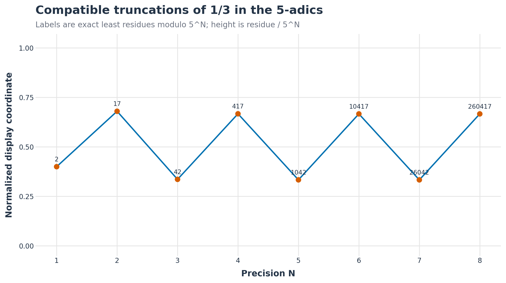

# Digits and the ring of p-adic integers {#sec-digits}

**Level and prerequisites: L3–L4.** Prepare the completion of Chapter 4 and congruence arithmetic. The [reader guide](index.md) links the Euler arithmetic, algebra and analysis preparation and distinguishes the graduate continuation.

## Goals

This chapter gives elements of $\mathbb Q_p$ a usable normal form. We construct
$\mathbb Z_p$, prove existence and uniqueness of base-$p$ digits, explain
negative integers, and identify $\mathbb Z_p$ with an inverse limit of finite
residue rings.

## The valuation ring

Define

$$
\mathbb Z_p=\{x\in\mathbb Q_p:|x|_p\le1\}
=\{x:v_p(x)\ge0\}.
$$

It is a ring: sums and products remain of nonnegative valuation. Its units are
exactly the elements of valuation zero,
$\mathbb Z_p^\times=\{x:|x|_p=1\}$. The nonunits form the ideal
$p\mathbb Z_p$, and reduction of the leading digit yields

$$
\mathbb Z_p/p\mathbb Z_p\cong\mathbb F_p.
$$

Every element of $\mathbb Q_p^\times$ has a unique form $p^m u$ with
$m\in\mathbb Z$ and $u\in\mathbb Z_p^\times$. Thus understanding $\mathbb Z_p$
and its units is enough to understand the whole field multiplicatively.

## Successive digits

<div class="callout callout-note">
<p class="callout-title">Digit expansion theorem</p>

Every $x\in\mathbb Z_p$ has a unique convergent expansion

$$
x=a_0+a_1p+a_2p^2+\cdots,
\qquad 0\le a_n<p.
$$

</div>

To prove existence, choose $a_0$ as the residue of $x$ modulo $p$. Then
$x-a_0$ is divisible by $p$ and $x_1=(x-a_0)/p$ lies in $\mathbb Z_p$. Choose
$a_1$ as the residue of $x_1$ modulo $p$ and repeat. After $N$ steps,

$$
x=\sum_{n=0}^{N-1}a_np^n+p^Nx_N,\qquad x_N\in\mathbb Z_p.
$$

The remainder has norm at most $p^{-N}$ and tends to zero. For uniqueness,
suppose two expansions first differ at digit $k$. Their difference has valuation
exactly $k$, so it cannot be zero.

The truncation $[x]_N=\sum_{n=0}^{N-1}a_np^n$ satisfies the exact error bound

$$
v_p(x-[x]_N)\ge N.
$$

Thus the first $N$ digits mean precisely the residue class modulo $p^N$.

### Several primes

The integer $47$ has finite expansions

$$
47=(101111)_2=(1202)_3=(142)_5=(65)_7,
$$

where the rightmost convention is reversed from ordinary display if digits are
listed by increasing power. In this book, equations such as
$47=1+1\cdot2+1\cdot2^2+1\cdot2^3+0\cdot2^4+1\cdot2^5$ remove ambiguity.

For a rational unit, solve congruences. To expand $1/3$ in $\mathbb Z_5$, find
$r_N$ with $3r_N\equiv1\pmod {5^N}$ and $0\le r_N<5^N$. The first residues are
$2,17,42,417,1042,\ldots$; compatibility $r_{N+1}\equiv r_N\pmod {5^N}$ makes
them truncations of one element.

<figure id="fig-digit-truncations">


<figcaption>

Figure 5.1: Compatible truncations of 1/3 in Z_5 are plotted by precision, with exact residues and normalized real representatives shown only as finite encodings.

</figcaption>
</figure>

In [Figure 5.1](#fig-digit-truncations) each point represents the least nonnegative residue
$r_N$ modulo $5^N$; the normalized height $r_N/5^N$ is a display convention, not
a claim that the sequence converges ordinarily. The meaningful compatibility is
vertical in precision: every new residue preserves all earlier digits.

## Negative integers grow leftward

For every $N$,

$$
-1\equiv p^N-1=(p-1)+(p-1)p+\cdots+(p-1)p^{N-1}\pmod {p^N}.
$$

Taking the compatible limit gives

$$
-1=(p-1)+(p-1)p+(p-1)p^2+\cdots.
$$

At $p=2$, this is the memorable identity $-1=1+2+4+8+\cdots$. At $p=5$,
$-1=4+4\cdot5+4\cdot5^2+\cdots$. It is simply the geometric-series formula in
a metric where $p^N\to0$.

Similarly, $-2$ has initial digit $p-2$, followed by an endless string of
$p-1$ digits. Infinite carrying moves toward higher powers. There is no final
leftmost digit, but every finite precision calculation terminates.

<div class="callout callout-warning">
<p class="callout-title">Digit-direction trap</p>

A real decimal expansion extends toward negative powers and records increasing
fractional precision. A $p$-adic integer expansion extends toward positive
powers. Its most significant known digit is never final; the low-order digits
carry the stable information.

</div>

## The inverse limit

For each $N$, reduction gives a ring map

$$
\mathbb Z/p^{N+1}\mathbb Z\longrightarrow\mathbb Z/p^N\mathbb Z.
$$

The inverse limit consists of compatible sequences

$$
(r_1,r_2,\ldots),\qquad
r_{N+1}\equiv r_N\pmod {p^N}.
$$

Mapping $x\in\mathbb Z_p$ to its residues at every level is an injective ring
homomorphism. It is surjective because compatible residues form a Cauchy
sequence: if $m\ge n$, then $r_m-r_n$ is divisible by $p^n$. Therefore

$$
\mathbb Z_p\cong\lim_{\leftarrow N}\mathbb Z/p^N\mathbb Z.
$$

This description is both conceptual and computational. An infinite object is a
coherent answer to every finite congruence question. Addition and multiplication
take place level by level.

## A digit-extraction algorithm

For a rational $a/b$ with $p\nmid b$, maintain a residual numerator $r$. At each
step choose the unique digit $d\in\{0,\ldots,p-1\}$ satisfying
$bd\equiv r\pmod p$, record $d$, and replace $r$ by $(r-bd)/p$. Exact division
is guaranteed. After $N$ steps, the recorded digits solve

$$
b\sum_{n=0}^{N-1}d_np^n\equiv a\pmod {p^N}.
$$

No floating-point arithmetic is involved.

## Constructing reduction without assuming digits

The instruction “choose the first residue” deserves justification for an element
of the completion. We already know how to reduce a rational whose denominator
is prime to $p$. We extend that operation to the integral completed elements
using density. Given $x\in\mathbb Z_p$, choose a rational $a$ with
$|x-a|_p<1$. The strong inequality implies $|a|_p\le1$, so its reduced
denominator is prime to $p$. Reduce $a$ in $\mathbb F_p$.

A different sufficiently accurate approximation $b$ gives the same residue:
the difference has norm less than one and hence positive valuation.
Both rational reductions therefore agree. We have defined a reduction of
$x$ independently of any digit expansion or chosen representative sequence.
Choose integral rational approximations to two inputs. Their sums and products
approximate the corresponding completed operations to precision less than one;
the rational residue laws prove that reduction is a ring homomorphism.

Its kernel consists of elements of norm less than one. The completed
valuation remains integer-valued, so that condition is equivalent to valuation
at least one, or membership in $p\mathbb Z_p$. The map is onto because
the integers from zero through $p-1$ represent every finite-field residue.
This proves the displayed residue-field identification rather than taking it
as an informal interpretation of an unproved digit picture.

The same argument works at every positive integer level $N$. Choose
an integral rational approximation $a/b$ modulo $p^N$, with $p\nmid b$.
The integer $b$ has a unique inverse modulo $p^N$, so the rational
has an integer representative $r$ at that precision. Every completed integral
element therefore has a representative from zero through $p^N-1$. Two such
integers represent the same class only if their difference is divisible by
$p^N$; the ordinary bound on their difference then forces equality.
Thus reduction identifies $\mathbb Z_p/p^N\mathbb Z_p$ with
$\mathbb Z/p^N\mathbb Z$ at each level.

## What uniqueness of digits really controls

The digit theorem gives a unique infinite sequence of canonical digits,
not a unique choice of arbitrary integer coefficients in an infinite sum.
The condition that each digit lie between zero and $p-1$ is essential.
For example, replacing a coefficient $p$ in one position by zero and
adding one to the next position preserves the value. Carrying eliminates
that ambiguity by imposing the canonical range at every position.

Suppose two canonical expansions first differ at position $k$. Divide
their difference by $p^k$. Its first coefficient is a nonzero integer
strictly between $-p$ and $p$, so it is nonzero modulo $p$.
All later terms have positive valuation after the division. Their convergent
sum has zero residue, while the first coefficient does not. Hence the
normalized difference is a unit and the original difference has valuation
exactly $k$. This proves uniqueness and also the distance formula for
digit streams.

An infinite coefficient tail can be reduced modulo $p$ because it
converges and lies in the closed ideal $p\mathbb Z_p$. To check
closedness directly, a limit of elements of norm at most $p^{-1}$
has that same upper norm bound by continuity of the absolute value.
This small point prevents a proof of digit uniqueness from relying
only on finite truncations without justifying the infinite remainder.

### Worked example 1: recover digits and the error of one third

For $1/3$ at five, the compatible residues
$2,17,42,417,1042$ give low-to-high digits $2,3,1,3,1$.
Indeed the successive differences divided by the relevant powers of five
are those digits. The five-digit truncation is $1042$ and
$1/3-1042=-3125/3$, of valuation five. These five digits are exact
information modulo $5^5$, even though the ordinary representative is
much larger than one third.

The next digit is determined by continuing the residual procedure, not
by guessing a repeating pattern from the displayed list. A finite word
can be the prefix of many different completed elements. Chapter 6
proves eventual periodicity for rationals using a bounded collection of exact
residual states. That additional argument is needed to turn observed
finite repetition into a statement about an infinite tail.

### Worked example 2: the negative integer minus three at five

For every $N\ge1$, the representative of $-3$ modulo $5^N$ is
$5^N-3$. Its first digit is two and every subsequent digit is four.
At six-digit precision the representative is $15622$, and the error
$-3-15622=-15625$ has valuation six. The expansion therefore begins

$$
-3=2+4\cdot5+4\cdot5^2+4\cdot5^3+\cdots .
$$

This does not identify the ordinary positive integer $15622$ with $-3$.
It identifies them modulo a specified power, with an exact difference.
Their limiting equality in the completed field comes from the errors
tending to zero. Negative integers cannot have eventually zero canonical
digits, because an eventually zero expansion is a finite sum of
nonnegative integers.

## Inverse limits as rings and as neighborhoods

An element of the inverse limit is a compatible system of residue classes,
not an arbitrary list of integers. If representatives are chosen differently,
the resulting completed element must not change. A change at level $N$
is by a multiple of $p^N$, so the two representative sequences differ
by errors tending to zero. Their limits coincide. This checks independence
from the representative convention used to describe the limit.

Compatibility makes the chosen representatives Cauchy. For $m\ge n$, their
difference is divisible by $p^n$. Completeness supplies a limit, and the
closedness of each ball ensures that this limit reduces to the prescribed
class at level $n$. Hence the map onto compatible residue systems is
surjective. Injectivity follows because an element reducing to zero at every
level has valuation at least every integer and must be zero.

Addition and multiplication are performed coordinatewise in finite quotient
rings. They preserve compatibility because each reduction map is a ring
homomorphism. The completed reduction map preserves those operations at every
level, so the bijection is a ring isomorphism. This proves both the
set-theoretic and algebraic claims in the inverse-limit description.
It does not treat an infinite decimal display as a substitute for
a ring construction.

The topology is equally explicit. Fixing the coordinate at level $N$
means choosing one coset of $p^N\mathbb Z_p$. These cosets are
exactly the basic residue neighborhoods. A sequence of compatible systems
converges precisely when every fixed finite coordinate eventually stabilizes.
The index after which stabilization occurs may depend on the coordinate.
There need not be a single finite index after which all coordinates
have stabilized simultaneously.

### Worked example 3: a coherent system that has no final precision

Choose digits equal to one at positions $1,2,6,24,120,\ldots$ and
zero at every other nonnegative position. The positions are successive
factorials, with the repeated value $1!=1$ listed only once.
For each $N$, sum the chosen powers below $N$ modulo $p^N$.
The resulting residues are compatible, so they define one element of
$\mathbb Z_p$.

Each finite truncation is an ordinary nonnegative integer. Nevertheless the
completed element is not an ordinary nonnegative integer, because its unique
canonical digits are not eventually zero. Nor is it a negative integer,
whose digits are eventually $p-1$: when $p=2$ there are arbitrarily
long zero stretches, and when $p>2$ the nonzero digits one already
differ from $p-1$ unless $p=2$. Thus the completion contains many
integral elements not supplied by ordinary integers. This example does not
by itself prove irrationality; that stronger classification will require the
periodicity theorem.

## Ideals and a divisibility normal form

Every nonzero ideal of $\mathbb Z_p$ is a power of its maximal ideal.
To prove this, choose a nonzero element of the ideal whose valuation
is least. Such a least nonnegative integer exists by well-ordering.
Write the element as $p^m u$ with $u$ a unit. Multiplying by
the inverse unit shows that $p^m$ belongs to the ideal, so the
ideal contains $p^m\mathbb Z_p$.

Conversely, every nonzero element of the ideal has valuation at least
$m$ and therefore belongs to $p^m\mathbb Z_p$. Zero belongs too.
This proves equality. Together with the zero ideal, these are all the
ideals. In particular the ring is local, since its nonunits form the
unique maximal ideal, and every nonzero ideal has a generator with a
transparent valuation.

The fraction field is $\mathbb Q_p$. Any completed nonzero element has
an integer valuation; multiplying by a sufficiently large power of $p$
makes it integral. Thus it is a quotient of two elements of
$\mathbb Z_p$, with denominator a power of $p$. This statement is
different from claiming that every completed element is a rational number:
the numerator may be an infinite integral digit stream.

These structural facts explain why congruences are so effective. The ideals
are linearly ordered by divisibility, and each finite quotient has exactly
$p^N$ elements. A precision refinement splits one residue class into
exactly $p$ finer classes. The ring structure and the tree geometry
are two descriptions of the same filtration.

## Linear congruences when a coefficient is not a unit

The residue-ring description also determines exactly when division fails
to be unique. Consider $ax\equiv b\pmod {p^N}$ with integral $a,b$.
If $m=v_p(a)<N$, write $a=p^m u$ with $u$ a unit. A necessary
condition for a solution is that $b$ be divisible by $p^m$.
It is sufficient as well: divide the congruence by $p^m$ and invert
$u$ modulo $p^{N-m}$. This gives one class for $x$ modulo
$p^{N-m}$, hence exactly $p^m$ classes modulo $p^N$.

If instead $a$ vanishes modulo the full modulus, the left side is
zero for every class. There are either no solutions, when $b$ does
not vanish, or all $p^N$ classes are solutions. The distinction is
finite precision algebra, not an ambiguity in exact division inside
the field. For instance, multiplying by $p$ loses the highest input
digit when only the output modulo $p^N$ is retained. Knowing one
extra output digit restores it. The inverse-limit viewpoint tracks
that loss explicitly instead of treating every nonzero coefficient
as an invertible element of every residue ring.

<!-- inline-formula-code:start -->
## Formula and finite computation

A useful formula in this chapter is

$$
x\equiv\sum_{i=0}^{N-1}a_ip^i\pmod{p^N}
$$

Repeated quotient and remainder extraction returns the digits in this sum. The following standalone Python block expresses that finite rule with its inputs and stopping conditions visible.

```python
from math import isqrt

def is_prime(number: int) -> bool:
    """Return whether number is prime by exact trial division."""
    if number < 2:
        return False
    return all(number % divisor != 0 for divisor in range(2, isqrt(number) + 1))

def base_p_digits(integer: int, prime: int, precision: int) -> list[int]:
    """Return the least-significant-first digits of integer modulo prime**precision."""
    if not is_prime(prime) or precision <= 0:
        raise ValueError("require an actual prime and positive precision")
    residue = integer % (prime**precision)
    digits: list[int] = []
    for _ in range(precision):
        residue, digit = divmod(residue, prime)
        digits.append(digit)
    return digits

print(base_p_digits(100, prime=3, precision=6))
print(base_p_digits(-1, prime=3, precision=6))
```

**What the computation establishes.** The calculation checks a declared finite instance; the surrounding argument explains what is true beyond those inputs.
<!-- inline-formula-code:end -->

## Summary

$\mathbb Z_p$ is the closed unit ball and a local ring with maximal ideal
$p\mathbb Z_p$. Its elements have unique base-$p$ expansions extending toward
higher powers. Truncation is reduction modulo $p^N$, and compatible truncations
are exactly the inverse-limit description. Negative integers and rational units
fit naturally into this digit system.

## Exercises

### Exercise 5.1 {#ex-padic-05-01}

Find the first eight $3$-adic digits of $1/2$.

<details>
<summary>Hint 1</summary>

The inverse modulo three has first digit two.

</details>

<details>
<summary>Hint 2</summary>

Use the geometric identity with a constant tail of ones.

</details>

<details>
<summary>Full solution</summary>

The digits from low to high are $2,1,1,1,1,1,1,1$. The corresponding truncation is $(3^8+1)/2=3281$, since $2+\sum_{j=1}^7 3^j=(3^8+1)/2$. Its difference from one half is $-3^8/2$, of valuation eight. The infinite tail follows from the convergent geometric series, not from the finite pattern alone.

</details>

### Exercise 5.2 {#ex-padic-05-02}

Write $-3$ through precision $5^6$ in base $5$.

<details>
<summary>Hint 1</summary>

Use the least nonnegative residue modulo 15625.

</details>

<details>
<summary>Hint 2</summary>

The first digit is two and the remaining five are four.

</details>

<details>
<summary>Full solution</summary>

The representative is $5^6-3=15622$, with digits $2,4,4,4,4,4$ read from low powers upward. The error is $-5^6$, so its valuation is exactly six. Repeating the digit four indefinitely gives the completed value minus three; the finite representative is a congruence approximation, not an ordinary equality with minus three.

</details>

### Exercise 5.3 {#ex-padic-05-03}

Prove that an element of $\mathbb Z_p$ is a unit exactly when its first digit is nonzero.

<details>
<summary>Hint 1</summary>

The first nonzero digit determines the valuation.

</details>

<details>
<summary>Hint 2</summary>

An integral inverse exists precisely when the opposite valuation is nonnegative.

</details>

<details>
<summary>Full solution</summary>

A nonzero first digit means valuation zero. The field inverse then also has valuation zero and belongs to $\mathbb Z_p$, proving the element is a ring unit. If the first digit is zero, the element has positive valuation or is zero. It cannot multiply an integral element to one, whose valuation is zero. Thus it is not a unit.

</details>

### Exercise 5.4 {#ex-padic-05-04}

Show directly that digit truncations form a Cauchy sequence.

<details>
<summary>Hint 1</summary>

Subtract two truncations with the earlier low digits cancelled.

</details>

<details>
<summary>Hint 2</summary>

Every remaining term is divisible by the power at the earlier cutoff.

</details>

<details>
<summary>Full solution</summary>

If $m\ge n$, the difference of the length-$m$ and length-$n$ truncations is $\sum_{j=n}^{m-1}a_jp^j$, which belongs to $p^n\mathbb Z_p$. Its norm is at most $p^{-n}$. Given any required precision, every pair of sufficiently long truncations therefore agrees at that precision. This is exactly the Cauchy condition.

</details>

### Exercise 5.5 {#ex-padic-05-05}

Compute compatible solutions to $7x\equiv1\pmod {2^N}$ for $1\le N\le8$.

<details>
<summary>Hint 1</summary>

Find the inverse at each modulus and reduce the next inverse to the previous one.

</details>

<details>
<summary>Hint 2</summary>

The residues at precisions one through eight are small enough to verify by direct multiplication.

</details>

<details>
<summary>Full solution</summary>

The least nonnegative solutions are $1,3,7,7,23,55,55,183$. Their products by seven differ from one by $6,20,48,48,160,384,384,1280$, respectively; each difference is divisible by the required modulus. Each next residue reduces to its predecessor. Uniqueness follows because seven is a unit modulo every power of two.

</details>

### Exercise 5.6 {#ex-padic-05-06}

Prove the inverse-limit map respects multiplication.

<details>
<summary>Hint 1</summary>

At every fixed level, reduce a product in a quotient ring.

</details>

<details>
<summary>Hint 2</summary>

Equality in the inverse limit means equality of every coordinate.

</details>

<details>
<summary>Full solution</summary>

The coordinate at level $N$ of the image of $xy$ is the residue of $xy$ modulo $p^N$. Reduction is a ring homomorphism, so this equals the product of the residues of $x$ and $y$ at that level. These are exactly the coordinates of the coordinatewise product in the inverse limit. Since the equality holds at every level, the systems coincide.

</details>

### Exercise 5.7 {#ex-padic-05-07}

**Challenge.** Show that an ordinary integer is nonnegative exactly when its $p$-adic expansion is eventually zero.

<details>
<summary>Hint 1</summary>

A terminating expansion is a finite sum of nonnegative canonical digit terms.

</details>

<details>
<summary>Hint 2</summary>

Ordinary Euclidean division produces the finite expansion of every nonnegative integer.

</details>

<details>
<summary>Full solution</summary>

An eventually zero canonical expansion is a finite sum $\sum_{j=0}^M a_jp^j$ with nonnegative digits and hence is a nonnegative integer. Conversely, repeated ordinary quotient-and-remainder division of a nonnegative integer by $p$ strictly decreases a positive quotient until it becomes zero. It yields a finite canonical expansion. Uniqueness of completed digits identifies it with the element's $p$-adic expansion.

</details>

### Exercise 5.8 {#ex-padic-05-08}

Prove that every nonzero ideal of $\mathbb Z_p$ is generated by a power of $p$.

<details>
<summary>Hint 1</summary>

Choose the least valuation appearing among its nonzero elements.

</details>

<details>
<summary>Hint 2</summary>

Remove the unit part of an element with that valuation.

</details>

<details>
<summary>Full solution</summary>

Well-ordering supplies a least valuation $m$. An ideal element $p^mu$ of that valuation has unit $u$, so multiplying by $u^{-1}$ puts $p^m$ in the ideal. Thus $p^m\mathbb Z_p$ is contained in it. Every other element has valuation at least $m$ and lies in that principal ideal, proving the reverse inclusion. The zero ideal is the separate excluded case.

</details>

### Exercise 5.9 {#ex-padic-05-09}

How many residue classes modulo $p^{N+1}$ lie above one fixed class modulo $p^N$? Give their representatives.

<details>
<summary>Hint 1</summary>

The new digit has p possible values.

</details>

<details>
<summary>Hint 2</summary>

Add each multiple of p to the power N to a representative of the old class.

</details>

<details>
<summary>Full solution</summary>

For a representative $a$, the classes are $a+jp^N$ modulo $p^{N+1}$, with $0\le j<p$. They all reduce to $a$ at the previous level. Two coincide only if $p^{N+1}$ divides $(j-k)p^N$, forcing $p\mid j-k$ and hence $j=k$. Every lift differs from $a$ by a multiple of $p^N$, so the list is complete.

</details>

### Exercise 5.10 {#ex-padic-05-10}

Construct compatible residues whose canonical digits have infinitely many nonzero positions and infinitely many zero positions. Explain why the resulting element is not an ordinary integer.

<details>
<summary>Hint 1</summary>

Put a digit one at factorial positions and zero elsewhere.

</details>

<details>
<summary>Hint 2</summary>

Nonnegative integers terminate; negative integers eventually have digit p-1.

</details>

<details>
<summary>Full solution</summary>

Use the factorial-position construction in the worked example, listing position one only once. The finite truncations give compatible residues and hence a completed integral element. There are infinitely many ones and arbitrarily long zero gaps. The digits cannot terminate, so it is not nonnegative. They also cannot eventually be $p-1$, so it is not negative. This establishes nonintegrality as an ordinary integer without yet using the rational-periodicity theorem.

</details>
