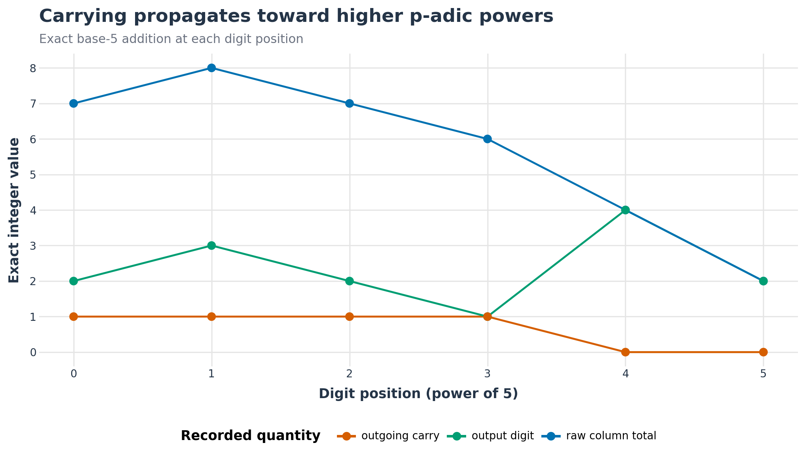

# Arithmetic with finite precision

**Level and prerequisites: L3–L4.** Prepare p-adic digit expansions, valuations and quotient rings. The [reader guide](index.md) links the Euler arithmetic, algebra and analysis preparation and distinguishes the graduate continuation.

## Goals

We turn digit expansions into reliable arithmetic. The focus is not longhand
calculation for its own sake, but precision discipline: how addition,
multiplication, inversion, and division transform a certified congruence.

## Normal form and precision

Every nonzero $x\in\mathbb Q_p$ can be written uniquely as
$x=p^m u$, where $m=v_p(x)$ and $u\in\mathbb Z_p^\times$. A finite
representation may be written

$$
x=p^m(a_0+a_1p+\cdots+a_{N-1}p^{N-1})+O(p^{m+N}),
$$

with $a_0\ne0$. It records $N$ digits of **relative precision** and absolute
precision $m+N$. The notation $O(p^K)$ means an unspecified element of
$p^K\mathbb Z_p$.

### Addition and cancellation

If $x$ and $y$ are both known modulo $p^N$, then $x+y$ is known modulo $p^N$.
But the number of known *relative* digits may drop when leading terms cancel.
At $p=5$,

$$
x=2+3\cdot5+O(5^4),\qquad
y=3+1\cdot5+O(5^4)
$$

give $x+y=5^2+O(5^4)=5^2(1+O(5^2))$. Absolute precision remains $4$, while
relative precision has fallen from four digits to two because the sum's
valuation rose to $2$.

If the stored approximations cancel completely modulo $p^N$, one may only report
$x+y=O(p^N)$. Its actual valuation could be $N$ or much larger. Software that
guesses an exact zero at this point is unsound.

## Multiplication and carrying

Multiply truncated series by convolution, then carry coefficients into the
digit range. If

$$
x=\sum_{i=0}^{N-1}a_ip^i+O(p^N),\qquad
y=\sum_{j=0}^{N-1}b_jp^j+O(p^N),
$$

then the coefficient before carrying at degree $k$ is
$c_k=\sum_{i+j=k}a_ib_j$. Replace $c_k$ by its residue modulo $p$ and pass the
quotient to $c_{k+1}$. Terms of degree at least $N$ merge into $O(p^N)$.

<figure id="fig-carry-process">


<figcaption>

Figure 6.1: A base-5 addition example shows raw column totals, emitted digits, and carries across precision levels.

</figcaption>
</figure>

[Figure 6.1](#fig-carry-process) treats a carry diagram as data: each column reports an exact
raw total and its decomposition into an output digit plus $5$ times the next
carry. The process moves toward higher powers, the direction in which additional
*p*-adic digits live.

## Units and inversion

A residue $u\bmod p^N$ is invertible exactly when $p\nmid u$. The extended
Euclidean algorithm gives $v$ with $uv\equiv1\pmod {p^N}$. This residue is a
certified inverse of every $p$-adic unit represented by $u+O(p^N)$.

One can also double precision by Newton iteration. If $uv\equiv1\pmod {p^k}$,
set

$$
v'=v(2-uv).
$$

Then $1-uv'=(1-uv)^2$, so $uv'\equiv1\pmod {p^{2k}}$. Starting from an inverse
modulo $p$, the number of correct digits roughly doubles at each step.

For general $x=p^m u$, inversion gives $x^{-1}=p^{-m}u^{-1}$. Division by $x$
therefore shifts the absolute precision by $-m$. Dividing by a highly divisible
number magnifies uncertainty; this is the *p*-adic version of division by a small
quantity.

### Worked arithmetic at three primes

At $p=2$, the inverse of $3$ modulo $2^6$ is $43$, because
$3\cdot43=129\equiv1\pmod {64}$. Thus $1/3=43+O(2^6)$.

At $p=3$, $2^{-1}=41+O(3^4)$ since $2\cdot41=82\equiv1\pmod {81}$.
This residue has digits $2+1\cdot3+1\cdot3^2+1\cdot3^3$, agreeing with the
infinite geometric pattern $1/2=2+3+3^2+\cdots$ in $\mathbb Z_3$.

At $p=5$, $7^{-1}=893+O(5^5)$ because $7\cdot893=6251\equiv1\pmod {3125}$.
Multiplying the congruence is the certificate; the least representative need not
look numerically close to $1/7$.

Newton inversion can expose its certified precision after every update.  The
modulus grows from $p$ to $p^2$, $p^4$, and so on, capped at the requested
number of digits.

```python
from math import isqrt

def newton_unit_inverse(unit: int, prime: int, precision: int) -> int:
    """Return the inverse of a p-adic unit modulo prime**precision."""
    if prime < 2 or any(
        prime % divisor == 0 for divisor in range(2, isqrt(prime) + 1)
    ):
        raise ValueError("prime must be prime")
    if precision <= 0 or unit % prime == 0:
        raise ValueError("require positive precision and a p-adic unit")
    inverse = pow(unit, -1, prime)
    known_digits = 1
    while known_digits < precision:
        known_digits = min(2 * known_digits, precision)
        modulus = prime**known_digits
        inverse = inverse * (2 - unit * inverse) % modulus
    return inverse

inverse = newton_unit_inverse(7, 5, 5)
if 7 * inverse % (5**5) != 1:
    raise RuntimeError("the modular inverse certificate failed")
print(inverse)
```

The result $893$ is certified by multiplication modulo $5^5$.  This finite
routine handles units only; the valuation shift in $x=p^m u$ must be tracked
separately when inverting a general nonzero $p$-adic number.

<!-- rational-cycle-repair:start -->
## Rational expansions and periodicity {#sec-rational-cycle-proof}

For $x\in\mathbb Z_p$, the rationality criterion is
$$
x\in\mathbb Q\cap\mathbb Z_p
\quad\Longleftrightarrow\quad
\text{the canonical base-$p$ digits of $x$ are eventually periodic}.
$$
We prove this with the **exact integer residuals** from Chapter 5. Their
classes modulo the denominator are insufficient: for $1/2$ at $p=3$,
residuals $1$ and $-1$ agree modulo $2$ but emit different next digits,
$2$ and $1$. The transition modulo the denominator is deterministic, but
its class does not determine the output digit.

Write a rational $x\in\mathbb Z_p$ as $a/b$, with $a\in\mathbb Z$,
$b>0$ and $p\nmid b$. Reducing the fraction supplies such a denominator;
a negative denominator is normalized by changing both signs.
Set $r_0=a$ and choose
$$
0\le d_n<p,\qquad bd_n\equiv r_n\pmod p,\qquad
r_{n+1}=\frac{r_n-bd_n}{p}.
$$
The digit is unique because $b$ is a unit modulo $p$, and every residual is
an integer. With $S_N=\sum_{n=0}^{N-1}d_np^n$, induction gives
$$
a=bS_N+p^Nr_N,\qquad
\frac ab-S_N=\frac{p^Nr_N}{b}.
$$
The induction step substitutes $r_N=bd_N+pr_{N+1}$. Thus the error has
valuation at least $N$, including zero error with valuation $+\infty$,
so the digits converge to $a/b$.

Now use an **ordinary** bound. Let $H=\max(|a|_\infty,b)$. If
$|r_n|_\infty\le H$, then
$$
|r_{n+1}|_\infty
\le\frac{|r_n|_\infty}{p}+b\left(1-\frac1p\right)
\le H.
$$
All exact states lie in the $2H+1$ integers of $[-H,H]$. Consequently
some two among $r_0,\ldots,r_{2H+1}$ agree. For fixed $p,b$, an exact state
determines both its digit and its successor. A repeat
$r_{\mu+\ell}=r_\mu$, with $\ell>0$, therefore makes every subsequent
digit repeat with period $\ell$.

For the block $B=\sum_{j=0}^{\ell-1}d_{\mu+j}p^j$, the same invariant
around the closed cycle gives
$$
(1-p^\ell)r_\mu=bB,\qquad
\frac ab=S_\mu+\frac{p^\mu B}{1-p^\ell}.
$$
Conversely, any eventually periodic canonical expansion in $\mathbb Z_p$
is a finite prefix plus
$p^\mu B\sum_{k\ge0}p^{k\ell}=p^\mu B/(1-p^\ell)$, hence is rational.
This geometric series converges because $v_p(p^{k\ell})=k\ell\to\infty$,
and $1-p^\ell$ is a unit. Zero is allowed: its state $0$ is fixed and
its block is zero. A terminating digit stream is a nonnegative integer;
negative integers instead eventually have digit $p-1$.

The corresponding statement for $\mathbb Q_p$ is a separate generalization.
For nonzero rational $x$, write $x=p^m u$ with $m=v_p(x)$ and
$u\in\mathbb Q\cap\mathbb Z_p^\times$. Apply the integral result to $u$
and shift exponents by $m$. Finitely many negative positions do not change
eventual periodicity. Conversely, multiply an eventually periodic Laurent
expansion by a sufficiently large power of $p$ to make it integral, then
use the integral converse. Handle $x=0$ separately.

Keith Conrad's author-hosted
[*The p-adic expansion of rational numbers*](https://kconrad.math.uconn.edu/blurbs/gradnumthy/rationalsinQp.pdf#page=3),
Theorem 3.1, printed pages 3–5, gives another proof using negative
rationals; printed page 2 explains the exponent shift. The bounded
exact-state proof here makes the finite certificate explicit.

### Worked cycle: 7/12 at p=5

Since $12^{-1}\equiv3\pmod5$, the exact ledger is

| $n$ | $r_n$ | $d_n$ | $r_{n+1}$ |
|---|---:|---:|---:|
| 0 | 7 | 1 | $-1$ |
| 1 | $-1$ | 2 | $-5$ |
| 2 | $-5$ | 0 | $-1$ |

The first exact repeat is $r_3=r_1$: the initial digit is $1$, followed
by the block $2,0$ forever, read from low powers to high powers.
The closure and value are
$$
(1-25)(-1)=12\cdot2,\qquad
\frac7{12}=1+\frac{5\cdot2}{1-25}.
$$
The three-digit truncation is $S_3=11$, and
$7=12\cdot11+125(-1)$ certifies the exact error $-125/12$, of valuation
$3$. Notice that $r_0=7$ and $r_2=-5$ agree modulo $12$, but their next
digits are $1$ and $0$. Keeping only those classes would lose information.

### A bounded exact cycle ledger {#sec-rational-cycle-ledger}

The standalone function below accepts only exact integers, primes
$2,3,5,7$, numerator size at most $32$, and nonzero denominator size at
most $32$. It normalizes the denominator sign, then requires a unit
denominator. Nonreduced fractions are allowed. Inputs with a remaining
factor of $p$ in the denominator must first be normalized as $p^m u$.
These bounds give $H\le32$, at most $65$ stored states and $65$ updates;
the successor is checked even after the last permitted update.

```python
def rational_cycle_ledger(
    numerator: int, denominator: int, prime: int
) -> tuple[list[tuple[int, int, int]], int, int]:
    """Return the first exact residual cycle for a bounded rational input."""
    if any(type(value) is not int for value in (numerator, denominator, prime)):
        raise TypeError("numerator, denominator, and prime must be exact integers")
    if prime not in (2, 3, 5, 7):
        raise ValueError("use prime 2, 3, 5, or 7")
    if not -32 <= numerator <= 32 or not -32 <= denominator <= 32 or denominator == 0:
        raise ValueError("require |numerator| <= 32 and 1 <= |denominator| <= 32")
    if denominator < 0:
        numerator, denominator = -numerator, -denominator
    if denominator % prime == 0:
        raise ValueError("normalize to a unit denominator before this ledger")

    bound = max(abs(numerator), denominator)
    inverse = pow(denominator, -1, prime)
    residual = numerator
    positions: dict[int, int] = {}
    rows: list[tuple[int, int, int]] = []
    partial, power = 0, 1
    for _ in range(2 * bound + 1):
        positions[residual] = len(rows)
        digit = residual * inverse % prime
        successor, remainder = divmod(residual - denominator * digit, prime)
        if remainder or not 0 <= digit < prime or abs(successor) > bound:
            raise ArithmeticError("the exact residual step failed")
        partial += digit * power
        power *= prime
        if numerator != denominator * partial + power * successor:
            raise ArithmeticError("the truncation invariant failed")
        rows.append((residual, digit, successor))
        residual = successor
        if residual in positions:
            preperiod = positions[residual]
            period = len(rows) - preperiod
            block = sum(
                row[1] * prime**index
                for index, row in enumerate(rows[preperiod:])
            )
            if (1 - prime**period) * residual != denominator * block:
                raise ArithmeticError("the exact cycle closure failed")
            return rows, preperiod, period
    raise ArithmeticError("no exact repeat within the proved state bound")

rows, preperiod, period = rational_cycle_ledger(7, 12, 5)
print(rows, preperiod, period)
```

The returned rows are $(r_n,d_n,r_{n+1})$, followed by the preperiod and
period. The displayed call returns the three worked rows and $(1,2)$.
Zero returns one row $(0,0,0)$ and $(0,1)$. Stopping the search for a
repeat does not mean that the digit stream terminates.

The exact divisions, truncation invariants and cycle closure are finite
certificates for the specified rational input. The ordinary state bound,
convergence proof and deterministic repetition justify the infinite tail;
an observed finite digit pattern of an unknown input does not. Equal
infinite tails would give equal rational residuals $r_n/b$, so the first
exact-state cycle also identifies the least preperiod and period.

[Exercise 6](#sec-rational-cycle-task) changes both the sign and the valuation,
so its exponent positions must be tracked separately.
<!-- rational-cycle-repair:end -->

## A safe data model

A practical exact representation contains `(p, valuation, unit_residue,
relative_precision)`. Its invariant is that `unit_residue` is nonzero modulo
$p$ and lies between $0$ and $p^N-1$. Zero requires a separate state carrying
only an absolute precision bound. Arithmetic returns both a residue and the
precision it can prove.

<div class="callout callout-important">
<p class="callout-title">Precision pitfall</p>

Congruence modulo $p^N$ is absolute information. Never report $N$ significant
digits after cancellation or division without recomputing the valuation and the
resulting relative precision.

</div>

## Arithmetic operates on sets of possible values

A stored approximation $a+O(p^A)$ represents the whole ball
$a+p^A\mathbb Z_p$. It does not assert equality with the rational
or integer representative $a$. A sound operation must contain the result
for every represented input. This interpretation gives a direct proof of
precision formulas and makes their limitations explicit.

For independent input balls $a+O(p^A)$ and $b+O(p^B)$, addition
gives $(a+b)+O(p^{\min(A,B)})$. Write the two errors separately and
apply the strong inequality. The bound is sharp as a statement about
all possible inputs: the less precise input alone can vary by the
corresponding prime power while the other stays fixed. Cancellation of
the displayed representatives does not constrain those unknown errors.

Dependence between inputs is different information. If the same exact
unknown element is subtracted from itself, the result is exactly zero.
If only two equal-looking input balls are supplied, their represented
elements may differ. A representation that does not store that relation
must return a conservative error ball for their difference. This is
a loss of relational information, not a failure of the valuation laws.

### Multiplication with unequal absolute precisions

Write $x=a+\varepsilon$ and $y=b+\eta$, with errors of valuation
at least $A$ and $B$. Then
$xy-ab=a\eta+b\varepsilon+\varepsilon\eta$.
A universally valid output threshold is therefore

$$
\min\{v_p(a)+B,\ v_p(b)+A,\ A+B\},
$$

with zero representatives interpreted as infinite valuation in the relevant
terms. This form remains valid for balls containing zero. It uses
only the representative and certified error bounds, so it never assigns
an unsupported exact valuation to an unresolved input.

When $m=v_p(a)<A$ and $n=v_p(b)<B$, every represented input has
that visible valuation. The third threshold is then larger than the
first two, and the product precision simplifies to
$\min(A+n,B+m)$. The product valuation is $m+n$.
Subtracting it from the absolute precision gives the minimum of the
two input relative precisions. A change in absolute precision is thus
compatible with preserving the number of significant known digits.

### Worked example 1: cancellation changes relative precision

At five, the balls $17+O(5^4)$ and $8+O(5^4)$ both have
valuation-zero representatives and four relative digits. Their sum is
$25+O(5^4)$. Because the valuation two is visible below the absolute
threshold four, the output has two relative digits. The uncertainty
has not become worse in absolute terms; the first two low digits
cancel and the remaining information starts later.

If the second ball were instead $-17+O(5^4)$, the sum would be
$O(5^4)$. This ball includes zero and elements of every valuation
at least four. It has no single exact valuation and no meaningful
single relative-digit count. The answer must remain a zero-containing ball.
Reporting four relative digits or an exact zero would claim information
that the inputs do not supply.

### Worked example 2: negative valuations can lower an output threshold

Suppose $x=1/3+O(3^5)$ and $y=2+O(3^4)$. The visible valuations
are minus one and zero. The product threshold is
$\min(5,4-1)=3$, so
$xy=2/3+O(3^3)$. Its valuation is minus one and its relative
precision is four. The less precise unit input contributes the decisive
error after multiplication by the larger local factor $1/3$.

An arbitrary rule that multiplication preserves the smaller absolute threshold
would incorrectly report four in this example. The input scales matter.
By contrast, multiplying two zero-containing balls $O(3^5)$ and $O(3^4)$
gives $O(3^9)$. No visible nonzero leading term needs to be recovered,
but every possible product has at least that valuation.

## Inverting a ball and dividing by an exact scalar

Inversion requires a ball excluding zero. For $x\in a+O(p^A)$,
put $m=v_p(a)$ and assume $m<A$. The unequal-valuation rule gives
$v_p(x)=m$. Therefore

$$
x^{-1}-a^{-1}=\frac{a-x}{ax}
 \in p^{A-2m}\mathbb Z_p.
$$

The inverse is known to absolute precision $A-2m$, while its
valuation is $-m$. Its relative precision is still $A-m$.
Inversion of an uncertain input consequently changes absolute precision
by twice the input valuation, not once.

Dividing a separate error ball by a fixed exact scalar of valuation
$m$ changes its absolute threshold by minus $m$. That is a
different operation: the divisor itself contributes no uncertainty. If the
divisor is also approximate, use its inverse-ball bound and then the
multiplication rule. A ball containing zero cannot be inverted as a
whole. A routine must reject that operation or request additional
information proving the input nonzero.

### Worked example 3: an inverse with a visible valuation shift

Let $x=25+O(5^6)$. Every represented input has valuation two,
since the uncertainty begins later. Its inverse lies in
$1/25+O(5^2)$: the absolute precision drops from six to two.
The output valuation is minus two, so both input and output have
four relative digits. These apparently different absolute thresholds record
the same amount of unit information at different scales.

For the unit eleven modulo $7^4$, ordinary Euclid supplies the
representative $1528$, since $11\cdot1528=1+7\cdot2401$.
Thus every unit represented by $11+O(7^4)$ has inverse
$1528+O(7^4)$. A multiplication certificate at the declared modulus
proves this finite claim; it does not assert that the rational inverse
equals the displayed positive integer.

## Why Newton inversion can double precision

The Newton update is justified by an exact polynomial identity:
$1-u\,v(2-uv)=(1-uv)^2$. If the current error is divisible
by $p^k$, its square is divisible by $p^{2k}$.
The calculation takes place in a ring, so no analytic differentiation
or limiting theorem is required to prove the finite congruence.
Starting with the unique inverse modulo $p$, repeated updates give
an inverse at any prescribed finite precision.

There is an important input requirement. To claim an inverse modulo
$p^{2k}$, the value of $u$ must itself be known modulo
$p^{2k}$. Feeding a $k$-digit approximation of the divisor into the
formula cannot manufacture the missing higher input digits. One may compute
a high-precision inverse of the representative, but it would not be a
high-precision inverse of every unknown element in the original ball.

Reduction after each update is harmless. Replacing a computed integer by
its congruent representative modulo the working modulus changes no certified
digit. It also keeps the stored integers bounded by that finite modulus.
The number of precision stages is logarithmic in the requested digit
count, but a runtime claim must additionally account for the cost of
the growing integer multiplications.

## Canonical carrying as a finite invariant

At each position, carrying replaces an integer coefficient $c$ by its
canonical remainder $d$ and quotient $q$, so $c=d+pq$.
Multiplying by the relevant power shows that passing $q$ to the
next position preserves the represented integer. Repeating through position
$N-1$ preserves the value modulo $p^N$, even if a final carry
is discarded. That carry belongs entirely to the unresolved higher digits.

This proof also handles negative totals when Euclidean division uses a
remainder between zero and $p-1$. A truncation rule that uses signed
remainders without normalization can produce a different coefficient list,
but it has not produced the canonical digit expansion. The quotient and
remainder convention belongs in the mathematical specification of an arithmetic
routine, rather than being inferred from a programming language's notation.

Rational periodicity fits the same pattern. A finite state must retain enough
information to determine both the next digit and the next state. The
exact integer residuals in the existing proof have that property.
Their residue classes modulo the denominator alone need not determine the
output digit, even when the class transition is deterministic.
The worked changed task below is intended to make both the valuation
shift and this exact-state requirement visible.

<!-- inline-formula-code:start -->
## Formula and finite computation

A useful formula in this chapter is

$$
x_N=\sum_{i=0}^{N-1}a_ip^i
$$

Reconstruction certifies which residue a finite digit list represents. The following standalone Python block expresses that finite rule with its inputs and stopping conditions visible.

```python
def reconstruct(digits: list[int], prime: int) -> int:
    """Return sum digit_i * prime**i after validating every digit."""
    if prime < 2 or not digits:
        raise ValueError("require prime >= 2 and at least one digit")
    if any(digit < 0 or digit >= prime for digit in digits):
        raise ValueError("every digit must lie between zero and prime minus one")
    return sum(digit * prime**index for index, digit in enumerate(digits))

digits = [2, 1, 0, 2, 2]
value = reconstruct(digits, prime=3)
modulus = 3 ** len(digits)
print(value, modulus, value % modulus)
```

**What the computation establishes.** The calculation checks a declared finite instance; the surrounding argument explains what is true beyond those inputs.
<!-- inline-formula-code:end -->

## Summary

Finite *p*-adic arithmetic is exact modular arithmetic plus explicit precision.
Addition preserves absolute precision but cancellation can reduce relative
precision. Multiplication combines valuations, and unit inversion is modular
inversion or a Newton process. Rational elements are characterized by eventually
periodic digit expansions.

## Exercises

### Exercise 6.1 {#ex-padic-06-01}

Add $38+87$ digit by digit in base $5$ through $5^4$.

<details>
<summary>Hint 1</summary>

Write both inputs using digits at positions zero through three.

</details>

<details>
<summary>Hint 2</summary>

At each of the first three positions the raw total including the carry is five.

</details>

<details>
<summary>Full solution</summary>

The inputs have low-to-high digits $(3,2,1,0)$ and $(2,2,3,0)$. Position zero emits zero and carries one. Position one has total five, again emitting zero and carrying one. Position two also has total five. Position three receives the final one. The result has digits $(0,0,0,1)$ and value $125$ modulo $625$, agreeing with the exact ordinary sum.

</details>

### Exercise 6.2 {#ex-padic-06-02}

Multiply $1+2\cdot3+2\cdot3^2$ by $2+3$ modulo $3^4$.

<details>
<summary>Hint 1</summary>

Form the four raw convolution coefficients before carrying.

</details>

<details>
<summary>Hint 2</summary>

They are 2,5,6,2; carries affect later coefficients.

</details>

<details>
<summary>Full solution</summary>

The raw product coefficients are $(2,5,6,2)$. Emit digit two at the first position. Five emits two and carries one, so the next total is seven; it emits one and carries two. The last total is four, emitting one and carrying one beyond the modulus. The canonical digits are $(2,2,1,1)$, representing $44$ modulo $81$. The exact factors are $25$ and $5$, with product $125\equiv44\pmod{81}$.

</details>

### Exercise 6.3 {#ex-padic-06-03}

Find $11^{-1}\pmod {7^4}$ by Euclid and verify it.

<details>
<summary>Hint 1</summary>

Use the division 2401=218*11+3.

</details>

<details>
<summary>Hint 2</summary>

Continue 11=3*3+2 and 3=2+1, then substitute backward.

</details>

<details>
<summary>Full solution</summary>

Back substitution gives $1=3-2=4\cdot3-11=4(2401-218\cdot11)-11=4\cdot2401-873\cdot11$. Therefore the inverse residue is $-873\equiv1528\pmod{2401}$. Direct multiplication gives $11\cdot1528=16808=1+7\cdot2401$, the required certificate. The inverse is unique because eleven is prime to seven.

</details>

### Exercise 6.4 {#ex-padic-06-04}

Starting with $3^{-1}\equiv1\pmod2$, use Newton inversion through modulus $2^8$.

<details>
<summary>Hint 1</summary>

Apply v times (2-3v) and reduce at each doubled modulus.

</details>

<details>
<summary>Hint 2</summary>

The successive precisions are 2,4 and8 binary digits.

</details>

<details>
<summary>Full solution</summary>

Starting at one modulo two, the next residues are $3$ modulo four and $11$ modulo sixteen. The next update is $11(2-33)=-341$, whose residue modulo $256$ is $171$. The final certificate is $3\cdot171=513=1+2\cdot256$. The update squares the current error, explaining all three precision increases.

</details>

### Exercise 6.5 {#ex-padic-06-05}

Give two inputs known modulo $5^6$ whose sum has no provably nonzero digit.

<details>
<summary>Hint 1</summary>

Choose displayed representatives that cancel.

</details>

<details>
<summary>Hint 2</summary>

The independent unknown errors remain free at the original precision.

</details>

<details>
<summary>Full solution</summary>

Take $x=1+O(5^6)$ and $y=-1+O(5^6)$. Their sum is $O(5^6)$, containing exact zero and every multiple of $5^6$. No nonzero leading digit or exact valuation is certified. These are two independent input balls; if the additional exact relation $y=-x$ were supplied, the sum would instead be exactly zero.

</details>

### Exercise 6.6 {#ex-padic-06-06}

Prove the eventually-periodic criterion in both directions, then complete the [valuation-shifted task](#sec-rational-cycle-task) below.

#### Normalize the valuation {#sec-rational-cycle-task}

First prove the integral eventually-periodic criterion in both directions.
Then work in $\mathbb Q_3$ with $x=-10/21$.

1. Explain why denominator $21$ cannot be inverted modulo $3$. Normalize
   $x=p^m u$ before using the [exact ledger](#sec-rational-cycle-ledger).
2. Follow the exact integer residuals until the first repeat. Give the
   initial block and least repeating block, with their actual exponent
   positions for $x$.
3. Prove the infinite expansion by an exact cycle closure and a geometric
   tail. Explain why a repeated finite digit pattern alone is insufficient.
4. After eight digits of the normalized unit, give the exact shifted
   truncation error for $x$ and its valuation.

<details>
<summary>Hint 1</summary>

For rational inputs, bound actual integer residuals; for the converse, sum the repeated block as a geometric series.

</details>

<details>
<summary>Hint 2</summary>

In the changed task normalize x as one third times the unit -10/7 before following its exact residuals.

</details>

<details>
<summary>Full solution</summary>

For $x\in\mathbb Z_p$, write a rational $x=a/b$ with $b>0$ and
$p\nmid b$. The exact recurrence gives
$a=bS_N+p^Nr_N$ and $|r_N|_\infty\le H=\max(|a|_\infty,b)$.
Thus the truncations converge to $a/b$ in the $p$-adic norm, while only
$2H+1$ actual integer states can occur. An exact state determines its
digit and successor, so a repeated state gives eventual periodicity.
Conversely a finite prefix plus a block of length $\ell>0$ sums to
$S_\mu+p^\mu B/(1-p^\ell)$, which is rational. The
[chapter proof](#sec-rational-cycle-proof) includes the
induction, bound, zero case and separate Laurent generalization.

For the changed input, $v_3(-10/21)=-1$. We must use the normalized unit
$u=3x=-10/7$, not attempt to invert $21$ modulo $3$. The exact rows are

| $n$ | $r_n$ | $d_n$ | $r_{n+1}$ |
|---|---:|---:|---:|
| 0 | $-10$ | 2 | $-8$ |
| 1 | $-8$ | 1 | $-5$ |
| 2 | $-5$ | 1 | $-4$ |
| 3 | $-4$ | 2 | $-6$ |
| 4 | $-6$ | 0 | $-2$ |
| 5 | $-2$ | 1 | $-3$ |
| 6 | $-3$ | 0 | $-1$ |
| 7 | $-1$ | 2 | $-5$ |

The first repeat is $r_8=r_2$. For $u$, the prefix is $2,1$ and the
six-digit block is $1,2,0,1,0,2$, in increasing exponent order. Thus
$$
S_2=5,\qquad B=1+2\cdot3+3^3+2\cdot3^5=520,
$$
and the exact closure is
$$
(1-3^6)(-5)=3640=7\cdot520.
$$
Consequently
$$
u=5+\frac{3^2\cdot520}{1-3^6}=-\frac{10}{7},
\qquad
x=\frac53+\frac{3\cdot520}{1-3^6}=-\frac{10}{21}.
$$
The geometric tail converges because its successive blocks gain valuation
$6$. For $x$, the two initial digits occupy exponents $-1,0$; repetition
starts at exponent $1$. The prefix length is two when counted from the
leading Laurent exponent $-1$, or one when counting only nonnegative
positions.

These lengths are least. By the invariant and convergence, the remaining
digit tail from state $r_n$ is the canonical expansion of $r_n/7$.
Equal infinite digit tails force equal residual states. All eight states
before $r_8$ are distinct, and neither $r_0$ nor $r_1$ lies on the six-cycle.
An earlier periodic start or shorter period would therefore force an
earlier exact repeat, contradicting the ledger. This reasoning uses the
specified exact rational recurrence, not a guess from finite digits.

After eight digits of $u$, $S_8=5+9\cdot520=4685$ and $r_8=-5$.
Shifting back to $x$ gives the truncation $4685/3$ and exact error
$$
x-\frac{4685}{3}=\frac{3^7(-5)}7,\qquad
v_3\!\left(x-\frac{4685}{3}\right)=7.
$$
The shift changes both digit positions and absolute error precision.

</details>

### Exercise 6.7 {#ex-padic-06-07}

**Project.** Specify addition and multiplication for the safe data model, including all zero and precision cases.

<details>
<summary>Hint 1</summary>

Interpret each record as a ball before giving an operation.

</details>

<details>
<summary>Hint 2</summary>

For multiplication expand the two independent error terms and their product; normalize only when a leading nonzero digit is visible.

</details>

<details>
<summary>Full solution</summary>

Store a prime, a rational representative and an integer absolute threshold, optionally with a normalized visible valuation and relative precision when the representative valuation lies below the threshold. A zero-containing record carries only its absolute threshold. Addition returns the sum representative at the minimum input threshold. Multiplication returns the product representative with threshold $\min(v_p(a)+B,v_p(b)+A,A+B)$, using infinite representative valuation for zero. Reduce the representative at that threshold. If its valuation is below the threshold, factor it out and report their difference as relative precision; otherwise retain a zero-containing ball. The error expansions prove soundness for every represented pair. Do not infer exact zero or input correlation from equal representatives.

</details>

### Exercise 6.8 {#ex-padic-06-08}

Invert the ball $25+O(5^6)$ and give both its absolute and relative output precision.

<details>
<summary>Hint 1</summary>

Its visible valuation is two.

</details>

<details>
<summary>Hint 2</summary>

Inversion changes an absolute threshold A to A-2m when the input valuation m is visible.

</details>

<details>
<summary>Full solution</summary>

The ball excludes zero because its representative valuation two is below six. The inverse is $1/25+O(5^2)$, with absolute threshold $6-4=2$. The inverse valuation is minus two, so its relative precision is $2-(-2)=4$, equal to the input's $6-2=4$. Treating inversion as division of an unrelated exact error by a fixed scalar would miss one contribution of the uncertain divisor.

</details>

### Exercise 6.9 {#ex-padic-06-09}

For $x=1/3+O(3^5)$ and $y=2+O(3^4)$, give a certified product ball.

<details>
<summary>Hint 1</summary>

The input valuations are minus one and zero.

</details>

<details>
<summary>Hint 2</summary>

Take the minimum of the two valuation-shifted absolute thresholds.

</details>

<details>
<summary>Full solution</summary>

The product representative is $2/3$. Its certified threshold is $\min(5+0,4-1)=3$, so the product lies in $2/3+O(3^3)$. Its visible valuation is minus one, hence it has four relative digits. The mixed input error is of still higher valuation and does not reduce this bound.

</details>

### Exercise 6.10 {#ex-padic-06-10}

Explain why the Newton inverse update cannot increase knowledge of an unknown divisor supplied only modulo $p^k$.

<details>
<summary>Hint 1</summary>

Two allowed divisors may differ at the next digit.

</details>

<details>
<summary>Hint 2</summary>

Their inverse difference has the same valuation as their divisor difference when both are units.

</details>

<details>
<summary>Full solution</summary>

Take two units $u$ and $u+p^k$ compatible with the same input record. Their inverse difference is $-p^k/(u(u+p^k))$, of valuation exactly $k$. Thus the input ball permits inverses differing at the first unknown digit. A claimed uniform inverse modulo $p^{2k}$ would distinguish inputs that the record does not distinguish. Newton doubling requires the divisor to be available at the increased precision.

</details>
