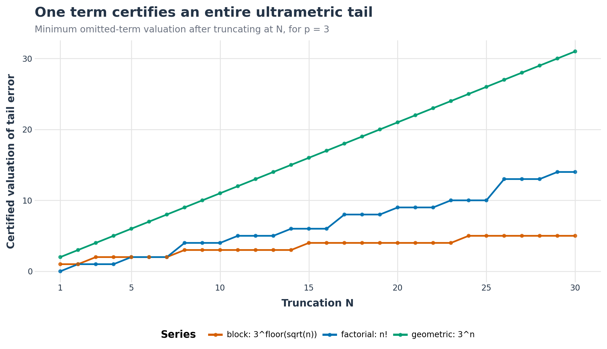

# Sequences, series, and infinite products

**Level and prerequisites: L3–L4.** Prepare Cauchy convergence, valuations and non-Archimedean completeness. The [reader guide](index.md) links the Euler arithmetic, algebra and analysis preparation and distinguishes the graduate continuation.

## Goals

Completeness and the strong triangle inequality make convergence unusually
decisive. We prove the *p*-adic series criterion, study rearrangements and
products, and use factorial valuations to locate the first analytic functions.

## Cauchy sequences revisited

In any ultrametric space, a sequence is Cauchy exactly when its points become
uniformly close in the valuation sense. A useful sufficient condition is

$$
d(x_{n+1},x_n)\longrightarrow0
$$

because the strong triangle inequality bounds every later endpoint distance by
the largest intervening step. No monotonicity of the steps is needed.

<div class="callout callout-note">
<p class="callout-title">Series criterion</p>

Let $K$ be a complete non-Archimedean valued field. The series
$\sum_{n=0}^\infty a_n$ converges in $K$ if and only if $a_n\to0$.

</div>

Necessity holds in every metric field because $a_n=s_n-s_{n-1}$. For
sufficiency, if $m>n$, then

$$
\left|\sum_{k=n+1}^{m}a_k\right|
\le\max_{n<k\le m}|a_k|.
$$

When $a_k\to0$, the right side is uniformly small for large $n$, so the partial
sums are Cauchy. This contrasts sharply with real analysis, where terms tending
to zero are far from sufficient.

## Examples that reset intuition

The geometric series $\sum x^n$ converges exactly when $|x|_p<1$, and then has
sum $(1-x)^{-1}$. Thus $\sum p^n=(1-p)^{-1}$.

The series $\sum n!$ converges in every $\mathbb Q_p$ because
$v_p(n!)\to\infty$. There is no similarly simple closed form in general. Also,
$\sum p^{\lfloor\sqrt n\rfloor}$ converges: its terms approach zero even though
many consecutive terms are equal.

By contrast, $\sum 1/n$ does not converge in $\mathbb Q_p$. Infinitely many
integers $n$ are prime to $p$, so $|1/n|_p=1$ along a subsequence; the terms do
not tend to zero. A series that looks "harmonic" can converge or diverge only
after its valuations are examined.

<figure id="fig-series-tails">


<figcaption>

Figure 7.1: Tail bounds for three p-adic series are encoded by the minimum valuation among omitted terms; higher values mean smaller certified tails.

</figcaption>
</figure>

The curves in [Figure 7.1](#fig-series-tails) show exact tail certificates for selected finite
families. In an ultrametric field, the least valuation among omitted terms bounds
the entire tail. Cancellation can improve the true error, but the displayed
bound is always valid.

## Rearrangements

If $\sum a_n$ converges, then every rearrangement converges to the same sum. To
see this, choose $N$ so all $n>N$ satisfy $|a_n|_p<\varepsilon$. Once a rearranged
partial sum has included the finite set $a_0,\ldots,a_N$, its difference from an
appropriate original partial sum consists only of tail terms and has norm below
$\varepsilon$.

There is no analogue of conditionally convergent real series. In fact a family
indexed by a countable set has a well-defined unordered sum whenever, for every
$\varepsilon>0$, only finitely many terms have norm at least $\varepsilon$.

## Infinite products

Write partial products $P_N=\prod_{n=1}^N(1+u_n)$. If $u_n\to0$, then the product
converges to a nonzero limit provided no factor is zero. For sufficiently large
$n$, $|u_n|_p<1$, hence $|1+u_n|_p=1$. Moreover,

$$
\left|\prod_{k=n+1}^{m}(1+u_k)-1\right|_p
\le\max_{n<k\le m}|u_k|_p.
$$

This follows by expanding the product: every nonconstant term contains at least
one small factor. The partial products are Cauchy units, and continuity of the
norm keeps the limit nonzero.

## Factorials and digit sums

Counting multiples of $p,p^2,\ldots$ among $1,\ldots,n$ gives Legendre's formula

$$
v_p(n!)=\sum_{j\ge1}\left\lfloor\frac{n}{p^j}\right\rfloor.
$$

If $s_p(n)$ is the sum of the base-$p$ digits of $n$, rearranging the geometric
counts yields

$$
v_p(n!)=\frac{n-s_p(n)}{p-1}.
$$

These formulas decide convergence of factorial-weighted series. For example,
the exponential series $\sum x^n/n!$ has term valuation

$$
n v_p(x)-v_p(n!).
$$

Since $v_p(n!)/n$ approaches $1/(p-1)$, the terms tend to zero when
$v_p(x)>1/(p-1)$. Because $v_p(x)$ is integral on $\mathbb Q_p$, this means
$v_p(x)\ge1$ for odd $p$ and $v_2(x)\ge2$ for $p=2$.

Similarly,

$$
\log(1+x)=\sum_{n\ge1}(-1)^{n+1}\frac{x^n}{n}
$$

converges for $|x|_p<1$: $n v_p(x)-v_p(n)\to\infty$. We will study these maps in
the next chapter.

## Small successive steps and complete limits

In an ultrametric space, successive distances tending to zero already imply
the Cauchy property; no monotonicity assumption on those distances is needed.
For a finite chain, repeated use of the strong inequality bounds the distance
between its endpoints by the largest step. Once all sufficiently late steps
are smaller than a prescribed tolerance, every pair of sufficiently late
endpoints is equally close. Conversely, a Cauchy sequence has successive
distances tending to zero by its definition.

Completeness enters only when turning the Cauchy property into existence of
a limit. Rational geometric partial sums may have a missing rational limit,
whereas $\mathbb Q_p$ supplies it. The same separation of roles applies
to every complete non-Archimedean field in the series theorem.
The strong inequality proves that the partial sums are Cauchy; completeness
then produces their sum.

For a convergent series, a useful uniform tail estimate is

$$
\left|\sum_{n>N}a_n\right|
 \le \sup_{n>N}|a_n|.
$$

Finite tail sums satisfy this bound. Their limit does too, because a
closed ball is closed. When the coefficient norms tend to zero, the
supremum tends to zero as $N$ increases. Thus a proof of coefficient
decay simultaneously supplies a proof of convergence and an error bound.

If exactly one term in the entire omitted tail has greatest norm,
the tail has that same norm. Divide by that term. Every other
normalized term has norm strictly below one. In $\mathbb Q_p$ the
discrete value group puts them all in $p\mathbb Z_p$; their convergent
sum stays there. The normalized tail is one plus an element of
$p\mathbb Z_p$, hence a unit. Without uniqueness, cancellation may make
the error smaller, so the maximum estimate is a bound rather than
an automatic equality.

### Worked example 1: a slowly improving coefficient scale

For $a_n=p^{\lfloor\sqrt n\rfloor}$, the valuation tends to infinity,
although it stays constant across increasingly long blocks. The series
converges. For every omitted index $n>N$, one has
$v_p(a_n)\ge\lfloor\sqrt{N+1}\rfloor$, so the tail lies in the
corresponding error ball.

There are many equal-valuation terms in each block. Their sum can
have extra divisibility, especially when the block length is divisible
by $p$. It would therefore be unjustified to call the displayed
tail bound exact without inspecting cancellation. Convergence needs only the
uniform bound on every omitted term, not a claim about which term
dominates the sum.

## Countable families and rearrangement without conditional convergence

For a countable index set $I$, call a family $(a_i)$ summable
if, for every positive tolerance, only finitely many terms have norm at
least that tolerance. Choose an enumeration and form its partial sums.
The condition makes the enumerated terms tend to zero, so completeness
gives a limit. We must still prove that another enumeration gives
the same element.

Fix a tolerance and choose a smaller positive tolerance to allow passage
to limits. There is a finite exceptional set outside which all terms
are smaller than that chosen threshold. Any two finite sums containing
the exceptional set differ by terms outside it, so their difference
has norm at most the same threshold. In each enumeration, sufficiently
late partial sums contain the exceptional set. Taking limits shows
that the two limits differ by less than the original tolerance.
Since the tolerance was arbitrary, the limits are equal.

This also explains why deleting or grouping finitely many terms causes
no difficulty. For a partition into finite blocks, partial block sums
are finite sums from the same family. Including all exceptional indices
eventually gives the same limiting value. One cannot instead group a
nonsummable family arbitrarily and infer that the original unordered family
has become summable. Grouping terms may conceal cancellations that its
individual terms do not satisfy.

For example, the paired blocks $1+(-1)$ all vanish, but the family
with infinitely many separate ones and minus ones is not summable.
There are infinitely many terms of norm one. The zero sums of
the chosen blocks do not define an enumeration-independent sum for
the original family. This is the appropriate warning against manipulating
nonconvergent expressions, despite the pleasant rearrangement theorem for
genuinely convergent non-Archimedean series.

### Worked example 2: multiply two convergent geometric series

Let $|x|_p<1$ and consider two copies of $\sum_{n\ge0}x^n$.
The double family $x^{i+j}$ is summable: for every tolerance there
are only finitely many pairs with bounded total exponent. Grouping by
the finite diagonals $i+j=n$ gives

$$
\left(\sum_{i\ge0}x^i\right)^2
 =\sum_{n\ge0}(n+1)x^n
 =\frac1{(1-x)^2}.
$$

The integer coefficient has norm at most one, so the diagonal terms
still tend to zero. The identity follows first from finite products
and then from the uniform smallness of omitted double terms. It does
not require the real series of coefficient absolute values to converge.

More generally, two null sequences in a valued field are bounded.
If their bounds are $A,B>0$, a product term of norm at least
$\varepsilon$ must have its first factor of norm at least
$\varepsilon/B$ and its second of norm at least $\varepsilon/A$.
Each restriction leaves finitely many indices. The product double family
is therefore summable. This proves the Cauchy-product rule for two
convergent series in the complete non-Archimedean setting.

## Infinite products and the nonzero-limit hypothesis

For a finite collection with $|u_k|<1$, expand
$\prod(1+u_k)-1$ into nonempty monomials. Each monomial contains a factor
whose norm is at most the largest input norm, and all its other
factors have norm less than one. Its norm is therefore bounded by
that same maximum. The strong inequality gives the stated finite-product
estimate, independently of the number of monomials.

Now assume $u_n\to0$ and no factor $1+u_n$ vanishes. Beyond some
index every factor has norm one. All later partial products have the
same positive norm as the fixed finite prefix. Applying the finite
estimate to the quotient of two tail products proves that the partial
products are Cauchy. Their limit retains that positive norm and is
nonzero. This explicitly handles early factors whose norms are not one.

Conversely, if the partial products converge to a nonzero limit, their
successive quotient tends to one by continuity of division. That quotient
is $1+u_n$, so $u_n\to0$. The nonzero-limit qualification cannot be
dropped. A product of copies of $p$ tends to zero, although the
corresponding $u_n=p-1$ never tends to zero. A finite zero factor
also makes every subsequent partial product zero for a completely
different reason.

### Worked example 3: certify a nonzero product limit

Consider $\prod_{n\ge1}(1+p^n)$. Every factor is a unit and the
tail parameters tend to zero. The product converges to a unit $P$.
After the first $N$ factors, the quotient tail differs from one by
norm at most $p^{-(N+1)}$, so
$v_p(P-P_N)\ge N+1$, since $P_N$ is itself a unit.

This is a precision certificate even without a simple closed form for
$P$. The finite partial product and its error ball describe the limit
honestly. An observed stable string of residues at several low levels
would be consistent with this proof, but would not replace its
uniform bound on every future factor.

## Factorial growth and boundary convergence

Write $n=\sum_i d_ip^i$ with canonical digits. Substituting the digit
expansion into the finite sum of integer quotients gives

$$
\sum_{j\ge1}\left\lfloor n/p^j\right\rfloor
 =\sum_i d_i(1+p+\cdots+p^{i-1})
 =\frac{n-\sum_i d_i}{p-1}.
$$

The sum of the digits grows at most logarithmically in $n$,
because each digit is at most $p-1$ and there are only
$1+\lfloor\log_p n\rfloor$ positions. Dividing the formula by $n$
proves the factorial valuation asymptotic used above. It is an exact
finite identity followed by an ordinary real growth estimate.

For exponential terms at the critical valuation
$v_p(x)=1/(p-1)$, their valuations would equal $s_p(n)/(p-1)$.
Along $n=p^j$ this is the constant $1/(p-1)$, so the terms
do not tend to zero. Therefore the strict exponential convergence
condition is essential even in a larger valued field where that
fractional input valuation is available. In $\mathbb Q_2$, it specifically
excludes valuation one.

For logarithmic terms, the elementary bound
$v_p(n)\le\log_p n$ shows that any positive input valuation gives
term valuations tending to infinity. These separate calculations explain
why logarithm and exponential have different initial domains. A formal
inverse identity between their power series does not authorize evaluation
outside those domains. Chapter 8 will keep convergence, differentiation
and composition conditions visible when using the functions.

## Long plateaus are compatible with convergence

A useful example separates growth of valuations from monotone growth
at every step. For positive integers $n$, set
$a_n=p^{\lfloor\log_p n\rfloor}$, where the logarithm here is the
ordinary real logarithm used to locate the interval containing $n$.
The valuation remains constant on each block
$p^k\le n<p^{k+1}$, and the blocks become longer. Nevertheless the
valuation tends to infinity: only finitely many terms occur before
any prescribed block. The series therefore converges in $\mathbb Q_p$.

There are $(p-1)p^k$ terms in block $k$, each equal to $p^k$.
Its block sum is $(p-1)p^{2k}$. Grouping these finite blocks gives
the geometric series with sum

$$
\sum_{n\ge1}a_n
 =\sum_{k\ge0}(p-1)p^{2k}
 =\frac{p-1}{1-p^2}=-\frac1{p+1}.
$$

This regrouping is legitimate because the original terms tend to zero;
the unordered summability criterion already proved controls every tail.
The formula is not an ordinary real summation of positive terms,
which would diverge. It is a convergence statement for the stated
$p$-adic norm. Long stretches of equally sized terms cause no
difficulty when their size eventually becomes arbitrarily small.

<!-- inline-formula-code:start -->
## Formula and finite computation

A useful formula in this chapter is

$$
\sum_{k=0}^{N-1}p^k=\frac{p^N-1}{p-1}
$$

Exact integers and fractions certify the geometric partial sum and tail valuation. The following standalone Python block expresses that finite rule with its inputs and stopping conditions visible.

```python
from fractions import Fraction
from math import isqrt

def is_prime(number: int) -> bool:
    """Return whether number is prime by exact trial division."""
    if number < 2:
        return False
    return all(number % divisor != 0 for divisor in range(2, isqrt(number) + 1))

def geometric_series_certificate(prime: int, terms: int) -> tuple[int, Fraction, int]:
    """Return the partial sum, exact tail, and tail valuation."""
    if not is_prime(prime) or terms <= 0:
        raise ValueError("prime must be prime and terms must be positive")
    partial = sum(prime**index for index in range(terms))
    if (1 - prime) * partial != 1 - prime**terms:
        raise RuntimeError("finite geometric identity failed")
    limit = Fraction(1, 1 - prime)
    tail = limit - partial
    return partial, tail, terms

for terms in (1, 2, 5, 10):
    print(terms, geometric_series_certificate(prime=3, terms=terms))
```

**What the computation establishes.** The calculation checks a declared finite instance; the surrounding argument explains what is true beyond those inputs.
<!-- inline-formula-code:end -->

## Summary

In a complete non-Archimedean field, a series converges precisely when its terms
tend to zero. The largest tail term controls the whole tail, making
rearrangements harmless. Infinite products of $1+u_n$ converge when $u_n\to0$.
Factorial valuations determine the natural domains of the exponential and
logarithm.

## Exercises

### Exercise 7.1 {#ex-padic-07-01}

Determine whether $\sum 3^{n^2}/n$ converges in $\mathbb Q_3$.

<details>
<summary>Hint 1</summary>

Compute each term valuation.

</details>

<details>
<summary>Hint 2</summary>

The valuation of n grows at most logarithmically.

</details>

<details>
<summary>Full solution</summary>

The term valuation is $n^2-v_3(n)\ge n^2-\log_3 n$, which tends to infinity. Thus the terms tend to zero in $\mathbb Q_3$. Completeness and the non-Archimedean series criterion prove convergence. The finite powers in the numerator dominate the possible denominator valuation; ordinary magnitude is irrelevant to this conclusion.

</details>

### Exercise 7.2 {#ex-padic-07-02}

Show that $\sum p^n/n$ converges in $\mathbb Q_p$.

<details>
<summary>Hint 1</summary>

Its term valuation is n minus the prime exponent of n.

</details>

<details>
<summary>Hint 2</summary>

Use p to that exponent at most n.

</details>

<details>
<summary>Full solution</summary>

Since $p^{v_p(n)}\le n$, one has $v_p(n)\le\log_p n$. Hence $v_p(p^n/n)=n-v_p(n)\ge n-\log_p n\to\infty$. The terms tend to zero, so the series converges. This is the same argument as the existing selected appendix answer, with the convergence hypothesis supplied by completeness.

</details>

### Exercise 7.3 {#ex-padic-07-03}

Prove the stated bound for finite products of $1+u_k$ when $|u_k|_p<1$.

<details>
<summary>Hint 1</summary>

Expand the product minus one into nonconstant monomials.

</details>

<details>
<summary>Hint 2</summary>

Every such monomial contains a small factor, and all other factors have norm at most one.

</details>

<details>
<summary>Full solution</summary>

Let $r$ be the maximum of the finitely many input norms. Each nonempty product of distinct $u_k$ has norm at most $r$, because one factor is at most $r$ and the remaining factors are less than one. The strong inequality bounds the sum of these monomials, which is the product minus one, by $r$. The empty collection gives product one and zero difference.

</details>

### Exercise 7.4 {#ex-padic-07-04}

Compute $v_2(100!)$ and $v_5(100!)$ in two ways.

<details>
<summary>Hint 1</summary>

Count the multiples of successive prime powers.

</details>

<details>
<summary>Hint 2</summary>

The binary digit sum of100 is3, and its base-five digits are400.

</details>

<details>
<summary>Full solution</summary>

For two the quotient sum is $50+25+12+6+3+1=97$. Since $100=64+32+4$ has binary digit sum three, the digit formula gives $100-3=97$. For five the quotient sum is $20+4=24$. The base-five expansion has digit sum four, so the second formula gives $(100-4)/4=24$. Both are exact finite calculations.

</details>

### Exercise 7.5 {#ex-padic-07-05}

Show that $\sum n!x^n$ converges for every $x\in\mathbb Z_p$.

<details>
<summary>Hint 1</summary>

The input valuation is nonnegative.

</details>

<details>
<summary>Hint 2</summary>

The factorial valuation alone tends to infinity.

</details>

<details>
<summary>Full solution</summary>

For nonzero integral $x$, the term valuation is $v_p(n!)+n v_p(x)\ge v_p(n!)\ge\lfloor n/p\rfloor$, tending to infinity. Thus the terms tend to zero and the series converges. At $x=0$, all positive-degree terms vanish and the series reduces to its constant term. The proof establishes the claimed domain without asserting it is maximal.

</details>

### Exercise 7.6 {#ex-padic-07-06}

Give a sequence with $a_n\to0$ $p$-adically but $|a_n|_\infty\to\infty$.

<details>
<summary>Hint 1</summary>

Powers of the chosen prime have the two opposite size behaviors.

</details>

<details>
<summary>Hint 2</summary>

Compute both norms directly.

</details>

<details>
<summary>Full solution</summary>

Take $a_n=p^n$. Its local norm is $p^{-n}\to0$, while its ordinary magnitude is $p^n\to\infty$. The sequence is rational at every stage. This does not contradict the real necessity that convergent-series terms tend to zero; the relevant convergence metric is different.

</details>

### Exercise 7.7 {#ex-padic-07-07}

**Challenge.** Formalize the criterion for an unordered countable sum and prove independence of enumeration.

<details>
<summary>Hint 1</summary>

Require finitely many terms above every positive norm threshold.

</details>

<details>
<summary>Hint 2</summary>

Compare finite partial sums after both include the finite exceptional set.

</details>

<details>
<summary>Full solution</summary>

Assume that for every $\varepsilon>0$, only finitely many indices have norm at least $\varepsilon$. Every enumeration then has null terms, so its partial sums converge by completeness. Given a target tolerance, choose a smaller threshold and include all its exceptional indices in each partial sum. The difference of any two such finite sums contains only small remaining terms and has norm bounded by that smaller threshold. Passing to both limits puts their difference below the target tolerance. It is therefore zero. This also describes the limit of the finite-subset net and proves independence of enumeration.

</details>

### Exercise 7.8 {#ex-padic-07-08}

Prove that $\prod_{n\ge1}(1+p^n)$ converges to a unit and certify the error after N factors.

<details>
<summary>Hint 1</summary>

Every finite factor has norm one.

</details>

<details>
<summary>Hint 2</summary>

Use the finite-product bound on all factors beyond N.

</details>

<details>
<summary>Full solution</summary>

The parameters $p^n$ tend to zero and no factor vanishes. The product theorem therefore supplies a limit of norm one. The quotient tail differs from one by norm at most $p^{-(N+1)}$. Multiplying by the unit partial product gives the same bound for $P-P_N$, hence valuation at least $N+1$. No explicit closed form for the unit limit is required.

</details>

### Exercise 7.9 {#ex-padic-07-09}

Show that $\sum x^n/n!$ diverges when $v_2(x)=1$.

<details>
<summary>Hint 1</summary>

Use the factorial digit formula.

</details>

<details>
<summary>Hint 2</summary>

Look only at the subsequence of indices that are powers of two.

</details>

<details>
<summary>Full solution</summary>

At this input valuation the term valuation is $n-v_2(n!)=s_2(n)$. For $n=2^j$, the binary digit sum is one, so those terms always have norm one half. The terms do not tend to zero. Necessity in the series criterion proves divergence, even though many other term valuations can be much larger.

</details>

### Exercise 7.10 {#ex-padic-07-10}

Explain why grouping the family $1,-1,1,-1,\ldots$ into zero pairs does not define an unordered sum.

<details>
<summary>Hint 1</summary>

Test the finite-exception condition at a norm threshold below one.

</details>

<details>
<summary>Hint 2</summary>

Different finite subsets can contain arbitrarily many unpaired terms.

</details>

<details>
<summary>Full solution</summary>

Every term has norm one, so infinitely many exceed any fixed positive threshold smaller than one. The summability condition fails. Zero paired blocks reflect a chosen cancellation pattern, not convergence of the original finite-subset sums. A finite subset containing all previously specified indices may still be enlarged by a single additional one, changing its sum by norm one. Thus the finite-subset net is not Cauchy.

</details>
