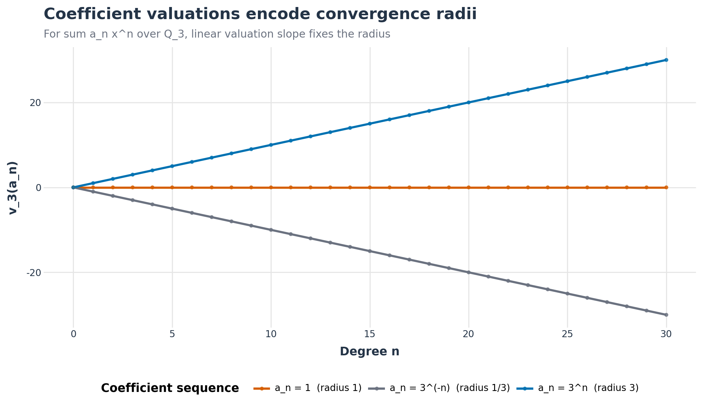

# Power series and analytic functions {#sec-analysis}

**Level and prerequisites: L3–L4.** Prepare convergent series, formal derivatives and power series. The [reader guide](index.md) links the Euler arithmetic, algebra and analysis preparation and distinguishes the graduate continuation.

## Goals

We develop one-variable analysis on *p*-adic discs. Power series remain central,
but ultrametric estimates make coefficients unusually visible. We establish
radii of convergence, differentiation, a maximum estimate, Strassmann's finite
zero theorem, and the exponential–logarithm correspondence.

## Radius of convergence

For $f(x)=\sum_{n\ge0}a_n(x-c)^n$, convergence at $x$ is equivalent to

$$
|a_n|_p|x-c|_p^n\longrightarrow0.
$$

Define

$$
R=\frac{1}{\limsup_{n\to\infty}|a_n|_p^{1/n}}.
$$

Then the series converges for $|x-c|_p<R$ and diverges for $|x-c|_p>R$.
Boundary behavior still needs separate analysis. Because possible radii in
$\mathbb Q_p$ are discrete, a formal real value of $R$ often separates two
adjacent shells rather than describing a populated sphere.

<figure id="fig-power-series-radii">


<figcaption>

Figure 8.1: Coefficient valuations for three power series are shown against degree; comparison slopes encode their p-adic convergence radii.

</figcaption>
</figure>

In [Figure 8.1](#fig-power-series-radii), a term valuation is
$v_p(a_n)+n v_p(x-c)$. Convergence occurs when these values rise without bound.
The guide slopes turn the root-test formula into arithmetic linear growth; no
Euclidean graph of the function is being asserted.

## Uniform control on discs

On a closed disc $D=\{x:|x-c|_p\le r\}$, if $|a_n|_p r^n\to0$, then the series
converges uniformly because

$$
\sup_{x\in D}\left|\sum_{n>N}a_n(x-c)^n\right|_p
\le\sup_{n>N}|a_n|_p r^n.
$$

Uniform convergence legitimizes termwise addition and multiplication.
Differentiation is also valid inside the radius: the factor $n$ never enlarges a
term because $|n|_p\le1$. Thus

$$
f'(x)=\sum_{n\ge1}n a_n(x-c)^{n-1}.
$$

<!-- primitive-boundary-clinic:start -->
### Formal primitives: radius and boundary {#sec-primitive-boundary-clinic}

Antidifferentiation can enlarge individual coefficients. Over $\mathbb Q_p$
it preserves the open convergence radius, while convergence on the boundary
requires a separate argument.

Use $T$ for the local coordinate and write
$$
f(T)=\sum_{n\ge0}a_nT^n,\qquad
F(T)=\sum_{n\ge0}\frac{a_n}{n+1}T^{n+1}.
$$
The second series is the **formal primitive with constant term zero**:
coefficient by coefficient, $F'=f$ and $F(0)=0$. These algebraic identities
make sense before either series is evaluated.

<div class="callout callout-note">
<p class="callout-title">One formal primitive keeps the open radius</p>

With the normalization $|p|_p=p^{-1}$, the radii satisfy $R_F=R_f$,
including $R_f=0$ and $R_f=\infty$. This equality alone makes no assertion
about convergence at the boundary.

</div>

For every positive integer $m$,
$$
1\le \left|\frac1m\right|_p=p^{v_p(m)}\le m,
$$
because $p^{v_p(m)}$ divides $m$. Coefficient growth from one division is
therefore at most ordinary polynomial growth in the degree.

Here is a proof that includes the change of degree. If $0<r<R_f$, choose
$r<\rho<R_f$. The weighted coefficients $|a_n|_p\rho^n$ tend to zero and
have a finite upper bound $C$. Put $b_{n+1}=a_n/(n+1)$. Then
$$
|b_{n+1}|_p r^{n+1}
\le Cr(n+1)(r/\rho)^n\longrightarrow0.
$$
For $0<q<1$, the ratio of successive terms of $(n+1)q^n$ tends to $q$;
eventually it is at most $(1+q)/2<1$, proving that limit. Thus $R_F\ge R_f$.
If $R_f=\infty$, this works for every finite $r$; if $R_f=0$, the inequality
is automatic.

Conversely, for $0<r<R_F$,
$$
|a_n|_p r^n
=|n+1|_p r^{-1}|b_{n+1}|_p r^{n+1}
\le r^{-1}|b_{n+1}|_p r^{n+1}\longrightarrow0.
$$
Hence $R_f\ge R_F$, also when either radius is zero or infinite. The zero
series, constants, and all polynomials have infinite radius on both sides.
Adding a constant to $F$ changes one coefficient and leaves the radius alone.
The real numbers $r,\rho$ here are coefficient weights; the proof does not
assume points of $\mathbb Q_p$ have every possible real-valued norm.

On the common open disc, the formal derivative agrees with differentiation
of the evaluated series. The strict choice $r<\rho<R_f$ explains why a
separate boundary test remains necessary. The later
[differential-equations chapter](29-differential-equations.md#sec-padic-differential-equations)
states the related radius-preservation result for differentiation; the
argument here establishes it at the first use of primitives.

#### Worked pair: a boundary can be lost

In $\mathbb Q_2$, consider the standard pair
$$
f(T)=\sum_{k\ge1}2^kT^{2^k-1},\qquad
F(T)=\sum_{k\ge1}T^{2^k}.
$$
The first terms pair as $2T$ with $T^2$, $4T^3$ with $T^4$, and $8T^7$
with $T^8$. The divisor is the primitive's degree $2^k$, which cancels
the coefficient $2^k$.

The nonzero coefficient root norms of $f$ are
$2^{-k/(2^k-1)}\to1$; those of $F$ are $1$. The missing coefficients are
zero, so both root-test limsups are $1$ and both open radii are exactly $1$.

On $\mathbb Z_2$, the $k$th term of $f$ has norm at most $2^{-k}$.
Consequently $f$ converges uniformly on the closed unit disc. After terms
$1,\ldots,K$, its tail has valuation at least $K+1$. At a unit $T$ the
term valuations are exactly $k$, so the first omitted term is uniquely
smallest in valuation and the tail valuation is exactly $K+1$.

At a unit, every term of $F$ has norm $1$: the terms do not tend to zero,
so this primitive series fails to converge. If $T\in2\mathbb Z_2$ is
nonzero, its term valuations are $2^k v_2(T)\to\infty$, so it converges.
At $T=0$ both series vanish. In particular,
$f(1)=\sum_{k\ge1}2^k=-2$, while $F(1)$ diverges.

The boundary behavior has changed, but the open radius has not. These
statements classify the displayed series; existence of primitive functions
on other domains is a separate question. The pair is credited in the
[primary reading](appendix-d-bibliography.md#sec-primitive-boundary-reading).

#### A finite coefficient audit

The following ledger covers only this worked pair ($p=2$) and the changed
pair below ($p=3$). Its rows contain the original degree and coefficient,
the primitive degree and coefficient, and the two monomial valuations.
An input valuation of zero means a unit; None denotes the exact input
$T=0$, for which the monomial valuations are infinite. All monomial degrees
here are positive. The explicit limits keep this audit finite.

```python
def primitive_term_ledger(
    prime: int, last_index: int, input_valuation: int | None
) -> list[tuple[int, int, int, int, int | None, int | None]]:
    """Audit finite terms of the worked (p=2) or changed (p=3) pair."""
    if type(prime) is not int or type(last_index) is not int:
        raise TypeError("prime and last_index must be exact integers")
    if input_valuation is not None and type(input_valuation) is not int:
        raise TypeError("input_valuation must be an exact integer or None")
    if prime not in (2, 3):
        raise ValueError("only the two declared families, p=2 and p=3, are supported")
    if not 1 <= last_index <= 8:
        raise ValueError("last_index must lie between 1 and 8")
    if input_valuation is not None and not -4 <= input_valuation <= 4:
        raise ValueError("input_valuation must lie between -4 and 4")

    coefficient_power = 1 if prime == 2 else 2
    rows: list[tuple[int, int, int, int, int | None, int | None]] = []
    for index in range(1, last_index + 1):
        primitive_degree = prime**index
        degree = primitive_degree - 1
        coefficient = prime ** (coefficient_power * index)
        primitive_coefficient, remainder = divmod(
            coefficient, primitive_degree
        )
        if remainder != 0:
            raise ArithmeticError("the declared coefficient identity failed")

        if input_valuation is None:
            term_valuation = None
            primitive_term_valuation = None
        else:
            term_valuation = (
                coefficient_power * index + degree * input_valuation
            )
            primitive_term_valuation = (
                (coefficient_power - 1) * index
                + primitive_degree * input_valuation
            )
        rows.append((
            degree, coefficient, primitive_degree, primitive_coefficient,
            term_valuation, primitive_term_valuation,
        ))
    return rows

for row in primitive_term_ledger(2, last_index=3, input_valuation=0):
    print(row)
```

For the three worked terms at a unit, the final two entries are
$(1,0)$, $(2,0)$, and $(3,0)$. The coefficient identity
$(\text{primitive degree})(\text{primitive coefficient})
=\text{original coefficient}$ is exact.
The rows certify finite identities and monomial valuations. The radius,
uniform convergence, and infinite tail conclusions require the proofs;
they do not follow from inspecting any finite ledger.

<!-- primitive-boundary-clinic:end -->

## Maximum estimates

For $|x-c|_p\le r$,

$$
|f(x)|_p\le \max_n |a_n|_p r^n.
$$

If a unique index achieves the maximum and $|x-c|_p=r$, equality holds: the
dominant term cannot be cancelled by smaller ones. When several terms tie,
cancellation on particular residue classes may lower the value. This
coefficient-controlled behavior replaces much of the geometric intuition of
complex analysis.

### Strassmann's theorem

<div class="callout callout-note">
<p class="callout-title">Strassmann's theorem</p>

Let $f(x)=\sum_{n\ge0}a_nx^n$ converge on $\mathbb Z_p$ and not be identically
zero. If $N$ is the largest index at which $|a_N|_p$ attains the maximum of the
coefficient norms, then $f$ has at most $N$ zeros in $\mathbb Z_p$.

</div>

A proof proceeds by induction on $N$. If $z\in\mathbb Z_p$ is a zero, divide the
convergent series by $x-z$ using synthetic division. Ultrametric coefficient
estimates show that the largest last maximum index drops by at least one. Each
distinct zero permits another division, so there can be at most $N$.

This theorem is striking because $\mathbb Z_p$ is an infinite compact set, yet a
nonzero convergent power series cannot vanish there infinitely often. It is an
analytic rigidity statement with a discrete coefficient proof.

## Exponential and logarithm

Set

$$
\exp(x)=\sum_{n=0}^\infty\frac{x^n}{n!},\qquad
\log(1+x)=\sum_{n=1}^\infty(-1)^{n+1}\frac{x^n}{n}.
$$

The logarithm converges on $p\mathbb Z_p$. The exponential converges on
$p\mathbb Z_p$ for odd $p$ and on $4\mathbb Z_2$ for $p=2$. On those common
domains, formal power-series identities are justified by uniform convergence:

$$
\exp(x+y)=\exp(x)\exp(y),\qquad
\log(uv)=\log u+\log v.
$$

For odd $p$, the maps

$$
\exp:p\mathbb Z_p\longleftrightarrow1+p\mathbb Z_p:\log
$$

are inverse isometries in the valuation sense: $v_p(\exp(x)-1)=v_p(x)$ and
$v_p(\log(1+x))=v_p(x)$. At $p=2$, restricting both sides to
$4\mathbb Z_2$ and $1+4\mathbb Z_2$ avoids the exceptional boundary.

<div class="callout callout-warning">
<p class="callout-title">Endpoint pitfall</p>

Do not import real convergence domains. The $2$-adic exponential does not
converge on all of $2\mathbb Z_2$: at $x=2$, the valuations of $2^n/n!$ do not
tend to infinity. The stricter domain $4\mathbb Z_2$ is essential.

</div>

## Toward locally analytic functions

A function on $\mathbb Z_p$ is locally analytic if every point has a ball on
which the function is represented by a convergent power series. Local constancy
is a degenerate but important example. Another coordinate system uses binomial
polynomials

$$
\binom{x}{n}=\frac{x(x-1)\cdots(x-n+1)}{n!}.
$$

Mahler's theorem, beyond our proof here, says every continuous
$f:\mathbb Z_p\to\mathbb Q_p$ has a unique uniformly convergent expansion
$f(x)=\sum_{n\ge0}c_n\binom{x}{n}$ with $c_n\to0$. This is the *p*-adic analogue
of expanding a function in a basis adapted to the domain's arithmetic.

## Coefficient bounds and values on a disc

The maximum estimate bounds function values by weighted coefficient norms.
It need not be attained on the rational points of a closed disc.
When several coefficients tie, cancellation can occur on every residue class
of the base field. Distinguishing a coefficient bound from the supremum
of actual values prevents an inappropriate transfer of a complex
maximum-modulus picture.

### Worked example 1: cancellation at every residue

For $f(T)=T^p-T$ on $\mathbb Z_p$, the two nonzero coefficients
have norm one. Every integral input reduces to an element of
$\mathbb F_p$, where its $p$th power equals itself. Consequently
$|f(x)|_p\le p^{-1}$ at every point of the disc, strictly below
the coefficient maximum. There is no contradiction: the condition requiring
a unique dominant term is absent.

For $1+3T+9T^5$ on $\mathbb Z_3$, the constant term instead
dominates both remaining terms. Every value is a unit, so there is
no zero. Strassmann reaches the same conclusion by recording last
maximum index zero. A numerical table of sample values is unnecessary
in either argument.

## A full proof of Strassmann by synthetic division

Write $f(T)=\sum_{n\ge0}a_nT^n$, with $a_n\to0$ and some coefficient
nonzero. The positive maximum coefficient norm $M$ exists: a tail
is smaller than a chosen nonzero coefficient, leaving a finite initial
maximum. Only finitely many indices attain $M$. Let $N$ be the
last such index.

If $z\in\mathbb Z_p$ is a root, define
$$
b_n=\sum_{k>n}a_kz^{k-n-1}.
$$
The summands tend to zero, so these coefficients exist by completeness.
The bound $|b_n|_p\le\sup_{k>n}|a_k|_p$ also proves $b_n\to0$.
Thus the quotient candidate $g(T)=\sum b_nT^n$ converges on the
same closed unit disc.

For $n\ge1$, cancellation in the two defining tails gives
$b_{n-1}-zb_n=a_n$. The root equation gives $-zb_0=a_0$.
These are precisely the coefficient identities for
$f(T)=(T-z)g(T)$. Both series converge on the disc, so the formal
identity can also be evaluated there.

All quotient coefficients have norm at most $M$. For $n\ge N$,
their defining tails start after the last maximal coefficient, and the
maximum of that tail is strictly less than $M$. Such a tail
maximum exists because the original coefficients tend to zero. Hence
$|b_n|_p<M$. At index $N-1$, the quotient coefficient is $a_N$
plus a strictly smaller tail, so its norm is $M$. Division
changes the last maximum index from $N$ to exactly $N-1$.

If $N=0$, the constant term dominates every other evaluated term
on the disc, ruling out a root. For positive $N$, divide by
one root when there is one. Every other distinct root remains a
root of the quotient, because its difference from the chosen root
is nonzero in a field. Induction bounds the remaining roots by
$N-1$ and all roots by $N$. Repeated division also gives the
bound with multiplicity when the same root continues to divide
the quotient.

Coefficient decay on the closed disc is essential here. An arbitrary
formal series is not covered. The conclusion is an upper bound,
not an assertion that the polynomial or series has any roots.
Nor does it control zeros outside the chosen disc.

### Worked example 2: a correct bound need not be sharp

For $3+T^2+9T^5$ on $\mathbb Z_3$, the coefficient maximum is
one and its last occurrence is degree two. Strassmann allows at
most two roots. Reduction modulo three forces any root into
$3\mathbb Z_3$. At such an input the constant has valuation one,
the square term at least two, and the fifth-degree term at least
seven. The unique least term cannot cancel, so there are actually
no roots.

The coefficient theorem, residue restriction and unequal-valuation argument
answer different parts of the problem. Combining them improves a bound
without changing any theorem or assuming that a finite search found
every possible completed-field input.

## Differentiate with a uniform remainder estimate

Inside the radius choose a positive real $r<R$. The weighted
coefficients $|a_n|_p r^n$ tend to zero and have a finite bound
$M_r$. Since $|n|_p\le1$, the derivative series has uniformly
small tails on that disc. To show it is the actual derivative,
we must additionally bound the remainder in a difference quotient.

For a finite partial polynomial, expand
$(x+h)^n-x^n-nx^{n-1}h$. Every surviving term contains at least
$h^2$. If $|x|_p,|h|_p\le r$, each term after multiplication
by its coefficient has norm at most
$M_r|h|_p^2/r^2$, since integer binomial coefficients have norm
at most one. The strong inequality bounds the entire remainder by
the same quantity, independently of the number of terms.

Pass to the limits of the polynomial and derivative partial sums.
Uniform convergence preserves the bound. Dividing by nonzero $h$
leaves a remainder of norm at most a fixed constant times
$|h|_p$, which tends to zero. Thus the derivative series represents
the derivative. Translation by a center gives the same proof in a
local coordinate. Nothing here asserts boundary differentiability where
the original series fails to converge.

## Leading terms of logarithm and exponential

Let $p$ be odd and $t=v_p(x)\ge1$. The first logarithm term
has valuation $t$, whereas a later term has valuation
$nt-v_p(n)>t$. To see the strict inequality, put
$k=v_p(n)$. From $n\ge p^k$ and
$p^k\ge1+k(p-1)$ we get
$k\le(n-1)/(p-1)<n-1$ for $n\ge2$.
Thus the first term is uniquely least and
$v_p(\log(1+x))=t$.

For exponential, the factorial digit formula gives
$v_p(n!)\le(n-1)/(p-1)$. If $t>1/(p-1)$, every term after
the linear term in $\exp(x)-1$ has valuation strictly larger than
$t$. Its sum therefore has valuation $t$. At two the common
integral domain requires $t\ge2$. There the logarithm estimate
also has a strict gap between the first term and its tail.

### Worked example 3: the size of a logarithm

In $\mathbb Q_3$, write $10=1+9$. The logarithm has first term
nine of valuation two, and every later term has greater valuation.
It therefore has exactly valuation two. This determines the local
size of the logarithm, not its complete digit expansion and not
an equality with nine. A strict tail estimate can certify a
valuation while leaving infinitely many higher digits unspecified.

The inverse identities of exponential and logarithm are rational formal
power-series identities before evaluation. On a smaller disc in the
common convergence domain, their product and substitution tails are
summable. Finite truncations and the coefficient estimates therefore
pass those identities to the analytic values. Evaluating a formal
identity outside a convergence domain would skip an essential step.

Locally analytic functions need a power-series description only in
some neighborhood of each point. A locally constant function is
analytic on sufficiently small balls, even if no one polynomial
describes it globally. The later Mahler chapter gives an additional
expansion theorem for general continuous functions; it is not an
input to the Strassmann proof or differentiation argument here.

<!-- inline-formula-code:start -->
## Formula and finite computation

A useful formula in this chapter is

$$
v_p\!\left(\frac{x^n}{n!}\right)=nv_p(x)-v_p(n!)
$$

The term-valuation list shows the convergence test without floating point. The following standalone Python block expresses that finite rule with its inputs and stopping conditions visible.

```python
from math import isqrt

def is_prime(number: int) -> bool:
    """Return whether number is prime by exact trial division."""
    if number < 2:
        return False
    return all(number % divisor != 0 for divisor in range(2, isqrt(number) + 1))

def factorial_valuation(number: int, prime: int) -> int:
    """Return v_prime(number factorial) from Legendre's finite sum."""
    if number < 0 or not is_prime(prime):
        raise ValueError("number must be nonnegative and prime must be prime")
    total = 0
    quotient = number
    while quotient:
        quotient //= prime
        total += quotient
    return total

def exponential_valuations(prime: int, input_valuation: int, terms: int) -> list[int]:
    """Return valuations of x**n/n! for n=1 through terms."""
    if not is_prime(prime) or input_valuation < 0 or terms <= 0:
        raise ValueError("use a prime, nonnegative input valuation, and positive terms")
    return [
        index * input_valuation - factorial_valuation(index, prime)
        for index in range(1, terms + 1)
    ]

for prime in (3, 5, 7):
    print(prime, exponential_valuations(prime, input_valuation=1, terms=15))
```

**What the computation establishes.** The calculation checks a declared finite instance; the surrounding argument explains what is true beyond those inputs.
<!-- inline-formula-code:end -->

## Summary

Coefficient valuations determine convergence radii and uniform estimates on
discs. Power series may be differentiated termwise, and a maximal coefficient
controls function size unless tied cancellation intervenes. Strassmann bounds
zeros. Exponential and logarithm give local additive–multiplicative
coordinates, with a necessary special restriction at $p=2$.

## Exercises

### Exercise 8.1 {#ex-padic-08-01}

Find the radius of $\sum p^{-n}x^n$.

<details>
<summary>Hint 1</summary>

Compute the nth root of the coefficient norm.

</details>

<details>
<summary>Hint 2</summary>

The coefficient norm is p to the n.

</details>

<details>
<summary>Full solution</summary>

The coefficient root norms equal $p$, so the radius is $p^{-1}$. The series converges for $|x|_p<p^{-1}$ and diverges for larger norm. At norm exactly $p^{-1}$, every term has norm one, so it diverges there too. This boundary conclusion uses the term test separately.

</details>

### Exercise 8.2 {#ex-padic-08-02}

Show that $\sum x^{n!}$ converges for $|x|_p<1$ and diverges for $|x|_p>1$.

<details>
<summary>Hint 1</summary>

Examine the monomial norm as the factorial exponent grows.

</details>

<details>
<summary>Hint 2</summary>

Inside the unit disc it tends to zero; outside it grows.

</details>

<details>
<summary>Full solution</summary>

For norm less than one, the term norms $|x|_p^{n!}$ tend to zero, so completeness and the series criterion give convergence. For norm greater than one the terms do not tend to zero. On the unit sphere they have norm one and also fail the necessary condition. The missing coefficient degrees do not affect these tests of the nonzero monomials.

</details>

### Exercise 8.3 {#ex-padic-08-03}

Prove the maximum estimate on a closed disc.

<details>
<summary>Hint 1</summary>

Bound every finite partial sum first.

</details>

<details>
<summary>Hint 2</summary>

Pass to its limit inside the closed norm ball.

</details>

<details>
<summary>Full solution</summary>

Assume $|a_n|_p r^n\to0$ and let $M$ be their maximum, with the zero series handled separately. Every term evaluated on the disc has norm at most $M$. The strong inequality gives the same bound for each partial sum. Closedness of the norm ball preserves the bound in the limit. A unique dominant evaluated term gives equality, but tied coefficients alone do not.

</details>

### Exercise 8.4 {#ex-padic-08-04}

For odd $p$, show $v_p(\log(1+x))=v_p(x)$ when $v_p(x)\ge1$.

<details>
<summary>Hint 1</summary>

Compare the linear term with every later term.

</details>

<details>
<summary>Hint 2</summary>

For n at least two, the denominator valuation is strictly smaller than n-1.

</details>

<details>
<summary>Full solution</summary>

For nonzero input put $t=v_p(x)\ge1$. The linear term has valuation $t$. For $n\ge2$, the later term has valuation $nt-v_p(n)$. The inequality $v_p(n)\le(n-1)/(p-1)<n-1$ makes this strictly larger than $t$. The convergent tail cannot cancel the unique least-valuation linear term. At zero the logarithm is zero and both valuations are infinite.

</details>

### Exercise 8.5 {#ex-padic-08-05}

Apply Strassmann to bound the zeros in $\mathbb Z_3$ of $1+3x+9x^5$.

<details>
<summary>Hint 1</summary>

Find the last coefficient of maximal norm.

</details>

<details>
<summary>Hint 2</summary>

The constant coefficient alone has norm one.

</details>

<details>
<summary>Full solution</summary>

The coefficient maximum one occurs only at degree zero. Strassmann therefore gives no zero on $\mathbb Z_3$. Directly, every integral value is congruent to one modulo three, so it is a unit. The theorem and the elementary residue check agree.

</details>

### Exercise 8.6 {#ex-padic-08-06}

Complete the [formal-primitive changed task](#sec-primitive-boundary-task): distinguish the open radius from convergence and exact tail bounds on its boundary.

#### Formal primitive and its boundary {#sec-primitive-boundary-task}

Work in $\mathbb Q_3$ with
$$
g(T)=\sum_{k\ge1}3^{2k}T^{3^k-1}.
$$

1. Find the formal primitive $G$ with constant term zero. Compute both
   open radii from the actual degrees, including missing coefficients.
2. Decide whether $g$ and $G$ converge uniformly on $\mathbb Z_3$.
   Does forming a primitive necessarily destroy boundary convergence?
3. Let $G_K$ contain exactly the terms $1\le k\le K$, with $K\ge1$.
   Find the exact valuation of $G(T)-G_K(T)$ for a unit $T$, then for
   any nonzero $T\in\mathbb Z_3$ with $t=v_3(T)$. Handle $T=0$ separately.
   Evaluate $g(1)$ and $G(1)$ exactly.
4. Explain why coefficient enlargement is not evidence that the open
   radius has decreased.

<details>
<summary>Hint 1</summary>

Divide by the actual degree when forming the primitive.

</details>

<details>
<summary>Hint 2</summary>

For nonzero integral T, compare the strictly increasing valuations of successive tail terms.

</details>

<details>
<summary>Full solution</summary>

Termwise formal integration gives
$$
G(T)=\sum_{k\ge1}3^kT^{3^k},
$$
since the primitive monomial has degree $3^k$. The original nonzero
coefficient root norms are $3^{-2k/(3^k-1)}\to1$; the primitive's are
$3^{-k/3^k}\to1$. Other coefficients vanish. Both root-test limsups are
therefore $1$, so both open radii are $1$.

For $T\in\mathbb Z_3$, the original term norms are at most $3^{-2k}$
and the primitive term norms at most $3^{-k}$. The series criterion and
ultrametric tail bound prove uniform convergence of **both** series on
the closed unit disc. Boundary loss is possible, as in the worked pair,
but is not inevitable.

For nonzero $T\in\mathbb Z_3$, let $t=v_3(T)\ge0$. Primitive term $k$
has valuation
$$
k+3^kt.
$$
The increase to the next term is $1+2\cdot3^kt>0$. Thus the first omitted
term uniquely has least valuation. Dividing the whole convergent tail by
that term leaves $1$ plus an element of $3\mathbb Z_3$, which is a unit.
Consequently
$$
v_3\bigl(G(T)-G_K(T)\bigr)=K+1+3^{K+1}t.
$$
At a unit this is exactly $K+1$, giving the sharp uniform error norm
$3^{-(K+1)}$ on $\mathbb Z_3$. At zero, the tail is exactly zero and
has valuation $+\infty$. The same argument for the original series gives
$$
v_3\bigl(g(T)-g_K(T)\bigr)
=2(K+1)+(3^{K+1}-1)t
$$
for nonzero $T\in\mathbb Z_3$.

At $T=1$, convergent geometric sums give
$$
g(1)=\sum_{k\ge1}9^k=-\frac98,\qquad
G(1)=\sum_{k\ge1}3^k=-\frac32.
$$
The first three unit-valuation ledger rows end in $(2,1)$, $(4,2)$,
and $(6,3)$, providing finite checks of the two coefficient families.
If $t<0$, the monomial valuations tend to $-\infty$; neither series
converges outside $\mathbb Z_3$. Division enlarges some coefficient norms
but introduces only subexponential growth in the degree, so it cannot
lower the open radius. Boundary convergence needs the separate term and
tail estimates just given.

</details>

### Exercise 8.7 {#ex-padic-08-07}

**Challenge.** Complete the synthetic-division induction in Strassmann's theorem.

<details>
<summary>Hint 1</summary>

Use convergent coefficient tails to define the quotient.

</details>

<details>
<summary>Hint 2</summary>

The last maximum index drops by exactly one after division by a root.

</details>

<details>
<summary>Full solution</summary>

For a root $z$ on the unit disc, define $b_n=\sum_{k>n}a_kz^{k-n-1}$. Tail estimates prove coefficient decay and the identities $f=(T-z)g$. If $N$ is the old last maximum index, every $b_n$ with $n\ge N$ is smaller than the old maximum, while $b_{N-1}$ is $a_N$ plus a smaller tail and attains it. The base case has dominant constant term and no root. Every other root survives division, so induction gives at most $N$ distinct roots.

</details>

### Exercise 8.8 {#ex-padic-08-08}

Show that the coefficient maximum of $T^p-T$ is not its maximum value norm on $\mathbb Z_p$.

<details>
<summary>Hint 1</summary>

Reduce every input in the finite field.

</details>

<details>
<summary>Hint 2</summary>

Every residue satisfies the pth-power identity.

</details>

<details>
<summary>Full solution</summary>

Both nonzero coefficients have norm one. But reduction of every integral value is $\bar x^p-\bar x=0$, so each value has norm at most $p^{-1}$. It cannot attain the coefficient maximum. This illustrates cancellation of tied maximal terms, without contradicting the stated upper bound.

</details>

### Exercise 8.9 {#ex-padic-08-09}

Prove that $3+T^2+9T^5$ has no root in $\mathbb Z_3$, despite its Strassmann bound of two.

<details>
<summary>Hint 1</summary>

First reduce a possible root modulo three.

</details>

<details>
<summary>Hint 2</summary>

At a multiple of three, the constant is uniquely least in valuation.

</details>

<details>
<summary>Full solution</summary>

Reduction gives $T^2$, forcing any root to be divisible by three. At such an input the constant has valuation one, the square term at least two, and the fifth-degree term at least seven. The unique least term cannot cancel, so the value is nonzero. At zero it is three. Thus the zero count is actually zero.

</details>

### Exercise 8.10 {#ex-padic-08-10}

Determine $v_3(\log10)$ and explain why this does not give the exact logarithm.

<details>
<summary>Hint 1</summary>

Write ten as one plus nine.

</details>

<details>
<summary>Hint 2</summary>

Apply the odd-prime leading-term estimate at valuation two.

</details>

<details>
<summary>Full solution</summary>

The input increment nine has valuation two, so the logarithm has exactly valuation two. Its tail terms have higher valuation, which certifies that size. They need not vanish, so neither equality with nine nor a complete digit expansion follows from the valuation result.

</details>
