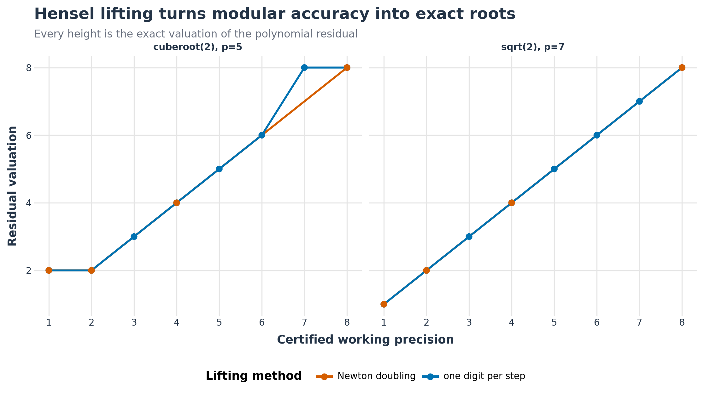

# Hensel's lemma and Newton lifting

**Level and prerequisites: L3–L4.** Prepare p-adic completeness, polynomial derivatives and modular arithmetic. The [reader guide](index.md) links the Euler arithmetic, algebra and analysis preparation and distinguishes the graduate continuation.

## Goals

Hensel's lemma turns an approximate modular root into an exact *p*-adic root.
We prove the simple-root form digit by digit, derive Newton's faster version,
work examples at several primes, and distinguish genuine failure from a theorem
whose hypotheses merely fail.

## One more correct digit

Let $f\in\mathbb Z_p[x]$. Suppose $a_n$ solves
$f(a_n)\equiv0\pmod {p^n}$. Seek a refinement

$$
a_{n+1}=a_n+t p^n,\qquad t\in\{0,1,\ldots,p-1\}.
$$

Taylor expansion modulo $p^{n+1}$ gives

$$
f(a_n+t p^n)\equiv f(a_n)+t p^n f'(a_n)\pmod {p^{n+1}}.
$$

After dividing the known factor $p^n$, the next digit $t$ must solve one linear
congruence modulo $p$. If $f'(a_n)$ is a unit, there is exactly one solution.

<div class="callout callout-note">
<p class="callout-title">Simple-root Hensel lemma</p>

Let $f\in\mathbb Z_p[x]$ and $a_1\in\mathbb Z_p$. If

$$
f(a_1)\equiv0\pmod p,
\qquad f'(a_1)\not\equiv0\pmod p,
$$

then there is a unique $\alpha\in\mathbb Z_p$ such that
$f(\alpha)=0$ and $\alpha\equiv a_1\pmod p$.

</div>

The digit calculation constructs compatible $a_n$ with
$f(a_n)\equiv0\pmod {p^n}$. They form a Cauchy sequence, hence converge to
$\alpha$. Polynomial evaluation is continuous, so $f(\alpha)=0$. Any two roots
in the same residue class would, at their first differing precision, be forced
to choose the same unique next digit. This proves uniqueness.

## Newton iteration

If $f'(a)$ is a unit, define

$$
N_f(a)=a-\frac{f(a)}{f'(a)}.
$$

Taylor's formula shows that if $v_p(f(a))\ge n$, then
$v_p(f(N_f(a)))\ge2n$ under the unit-derivative hypothesis. The number of
correct digits roughly doubles. Newton iteration is therefore faster than
one-digit lifting, although one-digit lifting makes existence and uniqueness
especially transparent.

More generally, a useful criterion is

$$
v_p(f(a))>2v_p(f'(a)).
$$

Then Newton iteration is defined, remains in a controlled ball, and converges to
a unique root $\alpha$ satisfying

$$
v_p(\alpha-a)>v_p(f'(a)).
$$

The proof normalizes the Taylor remainder by the derivative. Each step makes the
error valuation at least twice as large relative to that derivative, producing
a contraction inside the chosen ball.

<!-- nonunit-newton-clinic:start -->
### Optional clinic: residual digits and root digits {#sec-nonunit-newton-clinic}

A residual certificate counts zero digits in $f(a)$; a root certificate
counts agreement between $a$ and a specified exact root. They need not have
the same precision when the derivative is not a unit. This clinic uses the
strong criterion already stated above. Preparation is valuation arithmetic
from Chapter 1, balls from Chapter 3, and precision from Chapter 6.

Take $f_A(X)=X^2-A$, first with the exact coefficient $A=17$, and start at
$a_0=1$. The simple-root routine later in this chapter correctly rejects
this input: $2a_0$ is even. The strong criterion applies instead, because

$$
v_2(f_{17}(1))=4>2v_2(f_{17}'(1))=2.
$$

It gives one root $\alpha$ in $1+4\mathbb Z_2$. The other root $-\alpha$
lies in $3+4\mathbb Z_2$; uniqueness in the strong-Hensel ball does not mean
uniqueness among all odd roots. The derivative $2\alpha$ is nonzero in
$\mathbb Q_2$, although its reduction modulo $2$ vanishes.

Put $b=(a+A/a)/2$. Direct algebra gives

$$
b^2-A=\frac{(a^2-A)^2}{4a^2},
\qquad
b-\alpha=\frac{(a-\alpha)^2}{2a}.
$$

For a unit $a$ with $r=v_2(a^2-A)>2$, the correction $b-a$ has valuation
$r-1\ge2$. Thus every iterate stays in $1+4\mathbb Z_2$, and every
derivative has valuation $1$. Since $a+\alpha\equiv2\pmod4$, factorization
gives the exact conversion

$$
r_n=v_2(a_n^2-A),\qquad
e_n=v_2(a_n-\alpha)=r_n-1.
$$

Consequently $r_{n+1}=2r_n-2$ and $e_{n+1}=2e_n-1$. These equalities
come from this quadratic identity; the general Newton theorem supplies
bounds rather than an unconditional equality for every polynomial.

| $n$ | $a_n$ | $r_n$ | $e_n$ |
|---:|---:|---:|---:|
| 0 | $1$ | $4$ | $3$ |
| 1 | $9$ | $6$ | $5$ |
| 2 | $49/9$ | $10$ | $9$ |
| 3 | $1889/441$ | $18$ | $17$ |

The exact residuals are $-16$, $64$, $1024/81$, and
$262144/194481$. All denominators are odd. In particular,
$9^2\equiv17\pmod{64}$ certifies only five root bits, not six:
$v_2(9-\alpha)=5$. Residual valuations here refer to the exact rational
iterates; replacing a rational by a truncated integer does not preserve
its exact residual valuation.

Now suppose the actual coefficient is known only as
$A=17+O(2^M)$, with $M\ge3$. Every admissible $A$ is $1$ modulo $8$,
so strong Hensel at $1$ still supplies its unique selected root
$\alpha_A\in1+4\mathbb Z_2$. For $A\ne17$,

$$
(\alpha_A-\alpha_{17})(\alpha_A+\alpha_{17})=A-17,
\qquad
v_2(\alpha_A-\alpha_{17})=v_2(A-17)-1.
$$

The root sum has valuation $1$. The selected roots form exactly the ball
$\alpha_{17}+2^{M-1}\mathbb Z_2$: the identity proves one inclusion;
conversely, every $\beta$ in that ball satisfies
$\beta\equiv1\pmod4$ and $\beta^2\equiv17\pmod{2^M}$, so it is the
selected root of the admissible coefficient $\beta^2$.

At a nominal iterate $a_n$, the sharp uniform enclosing precision is

$$
P_n=\min(r_n,M)-1.
$$

Indeed $v_2(a_n^2-A)\ge\min(r_n,M)$, and
$v_2(a_n+\alpha_A)=1$. Sharpness uses the nominal coefficient when
$r_n\le M$; if $r_n>M$, the admissible perturbation $A=17+2^M$ has
residual valuation exactly $M$. An individual coefficient can have
more accuracy through cancellation; the uniform guarantee covers them all.

For $M=6$, the robust precisions are $3,5,5,5$. The admissible coefficient
$81=17+64$ has selected root $9$, whereas
$\alpha_{17}\equiv41\pmod{64}$, certified by $a_2$ with nominal precision
$9$. The two exact inputs give different sixth bits. After $a_1$ an honest
output is $9+O(2^5)$; extra nominal iterations cannot improve the input's
five-bit guarantee. Since the root is a unit, its absolute and relative
precisions both equal $5$. Six root bits require at least $M=7$ and, from
this stipulated start, two updates. Higher coefficient precision must come
from new information, not from appending zeros to the old input.

The following small ledger starts at $1$. Rows contain the exact center,
residual valuation, derivative valuation, nominal root bits, and robust
root bits. It stops at an exact nominal root; None then denotes infinite
residual valuation and exact nominal accuracy, while the uncertain source
still caps the root at $M-1$ bits. The declared limits keep this example
finite: a coefficient center of at most $32$ bits, $3$–$64$ coefficient
bits, and at most four updates.

The separate certificate uses integer divisibility. For $a=q/d$ on the
selected branch, a claim of $P\ge2$ root bits requires $M\ge P+1$ and

$$
q^2-A_0d^2\equiv0\pmod{2^{P+1}}.
$$

The denominator is odd, and this congruence persists for every
$A\in A_0+2^M\mathbb Z_2$. Strong Hensel and the factor of valuation one
then give $v_2(a-\alpha_A)\ge P$. Only $d$ is modularly inverted;
$2a$ must not be treated as a unit. The returned precision is the requested
certified precision, not necessarily the largest available one.

```python
from fractions import Fraction

def two_valuation(nonzero_integer: int) -> int:
    """Return the valuation of a nonzero exact integer."""
    if type(nonzero_integer) is not int:
        raise TypeError("valuation requires an exact integer")
    if nonzero_integer == 0:
        raise ValueError("zero has no finite valuation")
    magnitude = abs(nonzero_integer)
    return (magnitude & -magnitude).bit_length() - 1

def nonunit_square_ledger(
    coefficient_center: int, coefficient_precision: int, updates: int
) -> list[tuple[Fraction, int | None, int, int | None, int]]:
    """Return (centre, residual v, derivative v, nominal bits, robust bits)."""
    if any(type(value) is not int for value in (
        coefficient_center, coefficient_precision, updates
    )):
        raise TypeError("all ledger inputs must be exact integers")
    if coefficient_center.bit_length() > 32:
        raise ValueError("the coefficient centre is limited to 32 bits")
    if coefficient_center % 8 != 1:
        raise ValueError("require a coefficient centre congruent to 1 modulo 8")
    if not 3 <= coefficient_precision <= 64 or not 0 <= updates <= 4:
        raise ValueError("use 3..64 coefficient bits and 0..4 updates")
    rows = []
    approximation = Fraction(1)
    for iteration in range(updates + 1):
        numerator = approximation.numerator
        denominator = approximation.denominator
        if numerator % 2 == 0 or denominator % 2 == 0:
            raise ArithmeticError("the iterate must remain a 2-adic unit")
        if numerator * pow(denominator, -1, 4) % 4 != 1:
            raise ArithmeticError("the iterate left the selected branch")
        derivative_valuation = two_valuation(2 * numerator)
        residual = approximation * approximation - coefficient_center
        if residual == 0:
            rows.append((
                approximation, None, derivative_valuation,
                None, coefficient_precision - 1
            ))
            break
        residual_valuation = two_valuation(residual.numerator)
        if derivative_valuation != 1 or residual_valuation <= 2:
            raise ArithmeticError("the strong Hensel inequality was lost")
        nominal_bits = residual_valuation - derivative_valuation
        robust_bits = min(nominal_bits, coefficient_precision - 1)
        rows.append((
            approximation, residual_valuation, derivative_valuation,
            nominal_bits, robust_bits
        ))
        if iteration < updates:
            approximation = (
                approximation + Fraction(coefficient_center) / approximation
            ) / 2
    return rows

def nonunit_root_certificate(
    coefficient_center: int,
    coefficient_precision: int,
    numerator: int,
    denominator: int,
    root_precision: int,
) -> tuple[int, int]:
    """Check a branch-specific root ball for every admissible coefficient."""
    if any(type(value) is not int for value in (
        coefficient_center, coefficient_precision,
        numerator, denominator, root_precision
    )):
        raise TypeError("all certificate inputs must be exact integers")
    if coefficient_center.bit_length() > 32:
        raise ValueError("the coefficient centre is limited to 32 bits")
    if max(numerator.bit_length(), denominator.bit_length()) > 1024:
        raise ValueError("the rational centre is limited to 1024-bit integers")
    if not 2 <= root_precision <= 63:
        raise ValueError("request 2..63 root bits")
    if not 3 <= coefficient_precision <= 64:
        raise ValueError("use 3..64 coefficient bits")
    if coefficient_precision < root_precision + 1:
        raise ValueError("the source needs one more bit than the root claim")
    if coefficient_center % 8 != 1:
        raise ValueError("require a coefficient centre congruent to 1 modulo 8")
    if numerator % 2 == 0 or denominator % 2 == 0:
        raise ValueError("the numerator and denominator must both be odd")
    if numerator * pow(denominator, -1, 4) % 4 != 1:
        raise ValueError("the rational centre must lie in 1 + 4 Z_2")
    residual_modulus = 2 ** (root_precision + 1)
    residual_numerator = (
        numerator * numerator - coefficient_center * denominator * denominator
    )
    if residual_numerator % residual_modulus != 0:
        raise ValueError("the residual does not certify the requested root bits")
    root_modulus = 2**root_precision
    residue = numerator * pow(denominator, -1, root_modulus) % root_modulus
    return root_precision, residue

for row in nonunit_square_ledger(17, 6, 3):
    print(row)
print(nonunit_root_certificate(17, 6, 9, 1, 5))
```

The four ledger rows reproduce the table, with derivative valuation $1$
and robust precisions $3,5,5,5$. The certificate returns (5, 9).
It checks a finite congruence and source cap; the strong-Hensel theorem
and the factorization argument provide existence, uniqueness, and the
uniform conclusion. The certificate also accepts a zero nominal residual
by divisibility, without assigning $v_2(0)$ a finite value. Its limits are
$2$–$63$ root bits and at most $1024$ bits in either rational integer;
these are computational limits of the example, not limits of Hensel's lemma.

<!-- nonunit-newton-clinic:end -->

## Square root of 2 in the 7-adics

Take $f(x)=x^2-2$. Modulo $7$, $3^2\equiv2$ and $f'(3)=6$ is a unit. Lift the
root beginning at $3$. If $a_n$ is known modulo $7^n$, solve

$$
\frac{a_n^2-2}{7^n}+2a_n t\equiv0\pmod7.
$$

The least nonnegative compatible roots begin

$$
3\pmod7,\quad 10\pmod {49},\quad108\pmod {343},\quad2166\pmod {2401}.
$$

Each congruence can be checked by squaring. A second root begins at $4$ modulo
$7$ and is the negative of the first at every precision.

<figure id="fig-hensel-lifts">


<figcaption>

Figure 9.1: Successive Hensel lifts for roots of x squared minus 2 at p=7 and x cubed minus 2 at p=5 show increasing certified valuation of the residual.

</figcaption>
</figure>

[Figure 9.1](#fig-hensel-lifts) plots $v_p(f(a_n))$, the number of certified zero digits in the
residual, against iteration. The displayed height is an arithmetic accuracy
measure. The one-digit path grows linearly; Newton updates jump more quickly
when enough precision is carried.

## A cube root at 5

For $f(x)=x^3-2$, $3^3\equiv2\pmod5$ and
$f'(3)=27\equiv2\pmod5$. Hensel's lemma gives a unique root in
$3+5\mathbb Z_5$. A one-digit calculation yields compatible residues

$$
3\pmod5,\quad3\pmod {25},\quad53\pmod {125},\quad303\pmod {625}.
$$

For instance, the correct exact check is
$53^3-2=148875=125\cdot1191$, so $53$ is a root modulo $125$ but not modulo
$625$. Exact divisibility, not a rounded decimal display, certifies the lift.

## Singular reductions

If $f'(a)\equiv0\pmod p$, the simple-root theorem says nothing. Three outcomes
are possible.

- A root may still lift, nonuniquely. For $f(x)=x^2-1$ modulo $2$, the derivative
  is even, yet $1$ and $-1$ are $2$-adic roots in the same class modulo $2$.
- A root may fail to lift. The congruence $x^2+1\equiv0\pmod2$ has solution
  $x\equiv1$, but no solution modulo $4$.
- Stronger initial accuracy may restore control. The valuation criterion above
  is designed for this situation.

<div class="callout callout-warning">
<p class="callout-title">Logical pitfall</p>

Failure of a sufficient hypothesis is not proof of nonexistence. When the
derivative vanishes modulo $p$, inspect higher moduli, factor the polynomial, or
use a stronger version of Hensel's lemma.

</div>

## Singular lifting: finite roots and compatible branches {#sec-singular-root-tree}

### One parent can have one, all, or no children

For $N\ge1$, put

$$
R_N=\{a\bmod p^N:f(a)\equiv0\pmod{p^N}\}.
$$

A node is a residue root at one specified level. Join a node $a\in R_N$ to
$b\in R_{N+1}$ precisely when $b\equiv a\pmod{p^N}$. Call $b$ a child of
$a$. This parent relation, rather than the number of dots at each level,
records compatibility.

Choose the representative $0\le a<p^N$ and write
$c=f(a)/p^N\bmod p$ and $d=f'(a)\bmod p$. The Taylor calculation already
proved in this chapter says that a child $a+t p^N$ must satisfy

$$
c+td=0\pmod p,\qquad 0\le t<p.
$$

If $d\ne0$, there is one child. If $d=0$ and $c=0$, all $p$ candidates are
children. If $d=0$ and $c\ne0$, there are none. Thus singular lifting can
branch at one step and stop at a later step. A node with no child is dead at
that next level; a node at the last level inspected by a computation has
**unknown** further descendants, not a proved absence of children.

### A growing count with only one exact root

For $f(x)=x^2$, divisibility of a square gives the complete finite answer:

$$
R_N=\{p^{\lceil N/2\rceil}j\bmod p^N:
0\le j<p^{\lfloor N/2\rfloor}\},
\qquad \#R_N=p^{\lfloor N/2\rfloor}.
$$

Indeed, $p^N\mid a^2$ exactly when $p^{\lceil N/2\rceil}\mid a$.
These counts grow without bound. Nevertheless $x^2=0$ in the field
$\mathbb Q_p$, and hence in its subring $\mathbb Z_p$, forces $x=0$.
There is one distinct exact root. Its algebraic multiplicity over $\mathbb Q_p$
is two, independent of computational precision; neither of these numbers is
the growing count $\#R_N$.

The lifetime of a nonzero node explains the discrepancy. If a nonzero residue
$a\bmod p^N$ has $r=v_p(a)<N$, every extension of this residue retains
valuation $r$, since adding a multiple of $p^N$ cannot cancel its leading
digit. Its square has valuation exactly $2r$. If $a\in R_N$, its descendants
therefore remain roots through level $2r$, but **none** can reach level
$2r+1$. The zero residue is a different case: it specifies valuation at least
$N$, not a fixed finite valuation, and its zero extension survives forever.

For $p=3$, the roots modulo $9$ are $0,3,6$. At the next level their children
for $x^2$ are

| Parent modulo $9$ | Children modulo $27$ |
|---|---|
| $0$ | $0,9,18$ |
| $3$ | none |
| $6$ | none |

For instance, $3,12,21$ all have valuation one, so none has square divisible
by $27$. Even the new nodes $9,18$ only survive through level four and die at
level five. A forever-compatible path must use the zero residue at every
level. The reduction $R_3\to R_2$ is not surjective: its image is just $0$.

### What the inverse limit does prove

An exact root $\alpha\in\mathbb Z_p$ supplies a compatible infinite path
$a_N=\alpha\bmod p^N$ with $a_N\in R_N$. Conversely, such a path converges
to a $p$-adic integer $\alpha$. Continuity gives $f(\alpha)=0$: its value is
divisible by every $p^N$, and only zero has that property. Distinct exact roots
give distinct infinite paths, because distinct $p$-adic integers disagree at
some finite precision. This is the root-set version of the inverse limit from
Chapter 5.

There is also an existence theorem whose quantifier matters:

$$
f\text{ has a root in }\mathbb Z_p
\quad\Longleftrightarrow\quad
R_N\ne\varnothing\text{ for every }N\ge1.
$$

Here is why nonempty levels suffice even though reduction maps need not be
surjective. The finitely many nodes of $R_1$ collectively have descendants at
arbitrarily high levels, so one of them must have descendants at arbitrarily
high levels. Among its finitely many children, one again has that property.
Repeat to choose a compatible infinite path, then apply the preceding limit
argument. This reasoning finds some infinite path; it does not say that every
node, or an arbitrarily prescribed initial root, extends forever.

The theorem requires a proof of nonemptiness for **every** level. A program
stopping at a finite horizon $H$ cannot replace that quantifier by checking
$1\le N\le H$. Backward pruning can identify which nodes reach that stated
horizon; the terminal nodes themselves have not yet been tested for a next
child. [Lab 15](appendix-h-python-laboratory.md#sec-root-lift-laboratory)
records both the exact parent relations and this finite-horizon calculation.
The finite-set argument is also developed in [Poonen](appendix-d-bibliography.md#ref-poonen2009notes) (2009), Section 11,
Lemma 11.1 and Proposition 11.2.

## Certified lifting algorithm

An exact one-digit procedure stores $(a,n)$ with
$f(a)\equiv0\pmod {p^n}$ and $f'(a)$ a unit. Compute
$c=f(a)/p^n$ exactly, solve

$$
t\equiv-c\,f'(a)^{-1}\pmod p,
$$

and return $(a+tp^n,n+1)$. A Newton procedure instead chooses a working modulus,
inverts $f'(a)$ to that precision, updates, and verifies the resulting residual.
Verification should always be separate from prediction.

The multivariable analogue replaces $f'(a)$ by the Jacobian determinant. If the
Jacobian is invertible modulo $p$, a compatible solution vector lifts uniquely.
This is a local implicit-function principle and underlies many arithmetic
applications.

## Proving the strong Newton criterion

We give the strengthened one-variable theorem in its precise integral setting.
Let $f\in\mathbb Z_p[T]$, let $a\in\mathbb Z_p$, and suppose
$f'(a)\ne0$. Put $d=v_p(f'(a))$. If $f(a)\ne0$, put
$s=v_p(f(a))$ and assume $s>2d$. Then Newton iteration converges
to the unique root in the ball $v_p(x-a)>d$. Moreover
$v_p(\alpha-a)=s-d$. If $f(a)=0$, the starting point itself
is already that root and no first correction is needed.

For integral $z,h$, polynomial expansion gives
$f(z+h)=f(z)+f'(z)h+h^2R$ with $R\in\mathbb Z_p$.
The derivative difference also satisfies
$f'(z+h)-f'(z)=hS$ for an integral $S$.
These are finite polynomial identities. They apply at two as well:
their integral remainder coefficients involve binomial coefficients,
not division by factorials that might be nonunits.

Set $h=-f(a)/f'(a)$. Its valuation is $s-d>d$, so it is
integral and remains inside the specified neighborhood. The derivative
changes by a term of valuation greater than $d$, hence its valuation
stays exactly $d$. The new residual has valuation at least
$2(s-d)$. If it vanishes, iteration has reached an exact root.
Otherwise the same hypotheses apply at the next point.

Writing $t=s-2d>0$, the new excess residual valuation is at least
$2t$. Inductively, at step $n$ this excess is at least $2^nt$,
and the correction has valuation at least $d+2^nt$. The corrections
tend to zero, so the iterates are Cauchy by ultrametric geometry.
They converge by completeness. Their residuals tend to zero, and
continuity of polynomial evaluation makes the limit a root.

The first correction has valuation exactly $s-d=d+t$. Every later
correction has strictly greater valuation unless iteration has already
stopped. Thus the first correction cannot be cancelled by the tail,
proving $v_p(\alpha-a)=s-d$. This is a root-error statement.
The residual valuation was $s$, larger by the derivative valuation
$d$. Identifying those two kinds of precision would be incorrect
when the derivative is a nonunit.

### Uniqueness is local, with an explicit ball

For two points $x,y$ satisfying $v_p(x-a)>d$ and
$v_p(y-a)>d$, factor
$f(x)-f(y)=(x-y)g(x,y)$.
The polynomial difference quotient $g$ is integral and evaluates to
$f'(a)$ at $(a,a)$. Replacing either argument by a point differing
from $a$ by valuation greater than $d$ changes its value by
valuation greater than $d$. Therefore $v_p(g(x,y))=d$.

If both $x$ and $y$ were roots, their difference times this
nonzero quotient would vanish. A field has no zero divisors, so
$x=y$. This proves uniqueness in the stated ball. It does not
rule out another root in a different residue neighborhood. In the
simple-root case $d=0$, the ball is the original class modulo $p$,
recovering the earlier theorem.

The same quotient argument identifies the residual of any approximate
point in that ball: its valuation is the root-error valuation plus
$d$. A certificate can consequently translate between residual digits
and root digits, provided the derivative valuation and branch have
already been justified. The existing nonunit clinic illustrates why both
conditions belong in the statement.

### Worked example 1: uniqueness depends on the branch

For $f(T)=T^2-17$ at two and $a=1$, the residual valuation
is four and the derivative valuation is one. The strong inequality
applies, producing one root in $1+4\mathbb Z_2$, with initial
root-error valuation three. The negative root lies in $3+4\mathbb Z_2$.
Both reduce to one modulo two, so reduction modulo two alone does
not choose between them.

The factorisation
$a^2-17=(a-\alpha)(a+\alpha)$ explains the one-bit loss:
inside the chosen branch, $a+\alpha$ has valuation one.
A large residual proves one fewer bit of agreement with that root.
The difference is a theorem about the derivative and the selected
neighborhood, not a numerical defect in Newton iteration.

### Worked example 2: a simple cubic at five

For $f(T)=T^3-T-1$, the residue $a=2$ gives
$f(2)=5$ and $f'(2)=11$, a unit at five.
The next digit solves $1+t\equiv0\pmod5$, so $t=4$ and
the next representative is $22$ modulo twenty-five.
Direct substitution gives $f(22)=10625$, divisible by twenty-five.
The simple-root theorem supplies the exact completed root, and
the digit calculation certifies its first two digits.

The root need not be an ordinary integer. A polynomial can have
a simple root in a residue field and therefore in the completion,
while lacking a rational root. The theorem proves local existence
in a specified class; a separate rational argument is needed for
a global conclusion.

## Singular congruences and compatible branches

When the derivative vanishes modulo $p$, the next-digit equation has
either no solution or all $p$ choices. If its constant residual
term also vanishes modulo $p$, every next digit is allowed.
Otherwise none is allowed. This statement concerns one edge layer
of the finite root tree. A node with many children can still
have no descendants at a much later level.

For a fixed integral polynomial, nonempty root sets at every level
do imply an exact integral root. Choose a residue at the first
level having descendants at arbitrarily high levels. At least one
exists because that level is finite. Among its finitely many children,
one again has arbitrarily high descendants. Repeating this choice gives
a compatible infinite path. Its representatives are Cauchy, so their
limit exists and is a polynomial root.

The finite branching is essential to that selection argument. We do
not choose an arbitrary root independently at every level, because
those choices may be incompatible. Nor does the conclusion assert that
every node seen at a finite level belongs to an infinite path.
The strengthened Newton theorem certifies one controlled branch; the
finite-branch argument obtains existence under an entirely different
all-level hypothesis.

### Worked example 3: residue counts can grow around one exact root

For $f(T)=T^2$, the roots modulo $p^N$ are precisely residues
divisible by $p^{\lceil N/2\rceil}$. There are
$p^{\lfloor N/2\rfloor}$ such residues. Their count grows,
yet the only exact root in the field is zero.
For an infinite compatible path, every fixed digit must eventually
lie below the growing divisibility threshold and therefore vanish.

Thus large finite counts need not represent many exact roots.
At each fixed level the truncation of zero is only one among
the listed residues; the others eventually fail to lift.
The changed family below makes the distinction sharper by matching
several entire initial root sets for polynomials with different exact
root counts.

## Certificates and precision-aware computation

A simple-root digit routine needs the exact residue of $f(a)/p^n$
modulo $p$, not necessarily the whole enormous integer $f(a)$.
It also needs the derivative residue to be invertible.
The mathematical invariant is that the stored representative is a root
at the current precision and remains in the initial simple residue
class. The new linear congruence proves both the next root condition
and uniqueness of its digit.

Newton lifting uses increasingly precise derivative inverses.
A predicted doubling is not a substitute for checking the resulting
congruence, especially if polynomial coefficients are themselves approximate.
A coefficient uncertainty can cap the root precision even when the
iteration for the displayed coefficient continues to improve.
The nonunit changed task asks for an explicit witness showing that
such a cap is sharp.

The multivariable analogue uses an invertible Jacobian over the residue
field. It is stated as a continuation here, not proved by the
one-variable calculations. A complete argument would control vector Taylor
remainders and the inverse matrix through the same filtration.
Nothing in the one-variable singular case licenses a multivariable lift
when that Jacobian hypothesis fails.

<!-- inline-formula-code:start -->
## Formula and finite computation

A useful formula in this chapter is

$$
x_{k+1}=x_k-\frac{f(x_k)}{f'(x_k)}\pmod{p^{N_k}}
$$

The lifting code keeps modulus and residual beside every approximation. The following standalone Python block expresses that finite rule with its inputs and stopping conditions visible.

```python
from math import isqrt

def is_prime(number: int) -> bool:
    """Return whether number is prime by exact trial division."""
    if number < 2:
        return False
    return all(number % divisor != 0 for divisor in range(2, isqrt(number) + 1))

def hensel_square_root(
    target: int, prime: int, root_mod_prime: int, precision: int
) -> list[tuple[int, int]]:
    """Lift a simple root of x squared minus target through p-power moduli."""
    if precision <= 0 or not is_prime(prime):
        raise ValueError("use an actual prime and positive precision")
    root = root_mod_prime % prime
    if (root * root - target) % prime != 0 or (2 * root) % prime == 0:
        raise ValueError("the initial residue must be a simple root")
    certificates = [(prime, root)]
    for exponent in range(2, precision + 1):
        previous_modulus = prime ** (exponent - 1)
        error_digit = ((root * root - target) // previous_modulus) % prime
        correction = (-error_digit * pow(2 * root, -1, prime)) % prime
        root += correction * previous_modulus
        modulus = prime**exponent
        if (root * root - target) % modulus != 0:
            raise ArithmeticError("Hensel certificate failed")
        certificates.append((modulus, root))
    return certificates

print(hensel_square_root(target=2, prime=7, root_mod_prime=3, precision=6))
```

**What the computation establishes.** The calculation checks a declared finite instance; the surrounding argument explains what is true beyond those inputs.
<!-- inline-formula-code:end -->

## Summary

A simple root modulo $p$ determines one exact root in the corresponding
$p$-adic ball. One-digit lifting solves a linear congruence; Newton iteration can
double accuracy. Singular derivatives require more information and can lead to
no lift, several lifts, or a lift controlled by a stronger criterion.

## Exercises

### Exercise 9.1 {#ex-padic-09-01}

Lift the root $2$ of $x^2+1$ modulo $5$ through modulus $5^5$.

<details>
<summary>Hint 1</summary>

Solve one new linear digit equation at each step.

</details>

<details>
<summary>Hint 2</summary>

The derivative remains a unit in the starting residue class.

</details>

<details>
<summary>Full solution</summary>

The compatible residues are $2,7,57,182,2057$ modulo $5,25,125,625,3125$. At each step the digit solves $t\equiv-[f(a)/5^n](2a)^{-1}\pmod5$. The final certificate is $2057^2+1=4231250$, divisible by $3125$. The derivative is always a unit because the representatives reduce to two modulo five. These are the selected appendix residues, now supported inline.

</details>

### Exercise 9.2 {#ex-padic-09-02}

Find both square roots of $2$ modulo $7^4$ and verify that they sum to zero modulo $7^4$.

<details>
<summary>Hint 1</summary>

Start with residues three and four modulo seven.

</details>

<details>
<summary>Hint 2</summary>

The positive-branch successive representatives are 3, 10, 108 and 2166.

</details>

<details>
<summary>Full solution</summary>

Starting at three gives $10$ modulo 49 and $108$ modulo 343. Since $(108^2-2)/343=34\equiv6\pmod7$ and $2\cdot108\equiv6$, the next digit solves $6+6t=0$, hence $t=6$. The root is $108+6\cdot343=2166$ modulo 2401. Its negative is 235. Their sum is 2401. Every root modulo seven is three or four and has a unit derivative, so these unique lifts are all the roots.

</details>

### Exercise 9.3 {#ex-padic-09-03}

Show that $x^3-x-1$ has a root in $\mathbb Z_5$.

<details>
<summary>Hint 1</summary>

Test the residue two.

</details>

<details>
<summary>Hint 2</summary>

Check both the polynomial and derivative hypotheses.

</details>

<details>
<summary>Full solution</summary>

At two the polynomial is five and the derivative is eleven. Thus the value vanishes modulo five while the derivative does not. Simple-root Hensel gives a unique integral five-adic root congruent to two. Its next residue is22 modulo25, found from the one-digit equation. A finite substitution check certifies that residue, while completeness proves the exact root.

</details>

### Exercise 9.4 {#ex-padic-09-04}

Determine which roots of $x^2-x$ modulo $6$ can be studied one prime at a time; lift them modulo $2^N$ and $3^N$.

<details>
<summary>Hint 1</summary>

First identify all idempotents modulo six.

</details>

<details>
<summary>Hint 2</summary>

At either prime, the roots zero and one have unit derivative.

</details>

<details>
<summary>Full solution</summary>

The roots modulo six are $0,1,3,4$. They correspond by CRT to the four pairs of residues from $\{0,1\}$ modulo two and modulo three. At zero the derivative $2x-1$ is minus one; at one it is one. Each prime-side root therefore has a unique lift at every power, namely the exact root zero or one. Combining the two independent choices gives four roots modulo $2^N3^N$. In either completed field separately, the only roots are zero and one.

</details>

### Exercise 9.5 {#ex-padic-09-05}

Give all lifts modulo $2^4$ of the root $1$ of $x^2-1$ modulo $2$.

<details>
<summary>Hint 1</summary>

Check odd residues modulo sixteen.

</details>

<details>
<summary>Hint 2</summary>

Use (x-1)(x+1) and the valuations of neighboring even integers.

</details>

<details>
<summary>Full solution</summary>

The roots modulo sixteen are $1,7,9,15$. Their squares are respectively $1,49,81,225$, all congruent to one. An odd residue has one of its two neighboring even factors divisible by four and the other of valuation one. Requiring their product divisible by sixteen leaves precisely residues congruent to one or minus one modulo eight. These are the four listed lifts, despite only two exact roots in $\mathbb Q_2$.

</details>

### Exercise 9.6 {#ex-padic-09-06}

Prove uniqueness in the simple-root lemma directly from $f(x)-f(y)=(x-y)g(x,y)$.

<details>
<summary>Hint 1</summary>

Reduce both points to the same simple residue.

</details>

<details>
<summary>Hint 2</summary>

The difference quotient reduces to the derivative at that residue.

</details>

<details>
<summary>Full solution</summary>

For two roots in the initial residue class, $g(x,y)$ reduces modulo $p$ to the nonzero derivative at that class. Hence the quotient is a unit and is nonzero. The equation $0=f(x)-f(y)=(x-y)g(x,y)$ then forces $x=y$ in the field. This proves uniqueness inside that class, without claiming that other residue classes contain no roots.

</details>

### Exercise 9.7 {#ex-padic-09-07}

**Project.** Implement one-digit and Newton lifting with exact integer arithmetic and compare their iteration counts.

<details>
<summary>Hint 1</summary>

State the same initial root, polynomial precision and requested output precision for both procedures.

</details>

<details>
<summary>Hint 2</summary>

Use a certified residual invariant; distinguish predicted steps from operations on growing integers.

</details>

<details>
<summary>Full solution</summary>

A complete specification fixes an integral polynomial, a simple starting residue and a target exponent $N$. The one-digit procedure solves $t\equiv-[f(a)/p^n]f'(a)^{-1}\pmod p$ and returns $a+tp^n$, proving precision $n+1$. Newton uses a derivative inverse at its working modulus, returns $a-f(a)/f'(a)$ modulo that modulus and certifies at least doubled residual precision. From precision one it needs at most $\lceil\log_2N\rceil$ doubling stages, versus $N-1$ one-digit stages. Both must verify their congruences and keep coefficient uncertainty explicit. This is a mathematical implementation contract and count comparison, not an executed timing result; larger Newton stages have higher arithmetic costs.

</details>

### Exercise 9.8 {#ex-padic-09-08}

Complete the nonunit Newton changed task, preserving its requested root branch and coefficient precision.

#### Choose the branch and the data {#sec-nonunit-newton-task}

The actual coefficient is $A=41+O(2^6)$, and the requested root is in
$1+4\mathbb Z_2$.

1. A helper starts at $3$ and reports residual valuation $5$ and derivative
   valuation $1$. Does strong Hensel apply, and which branch does it certify?
2. Restart at the stipulated $a_0=1$. Compute three exact Newton updates,
   their residual valuations, nominal root bits, and robust root bits.
3. Find the largest precision supported by the source and the first listed
   iterate that attains it. Prove sharpness using an admissible coefficient
   with an explicit integer square root.
4. Can extra nominal iterations certify six root bits? If remeasurement gives
   $41+O(2^7)$, which earliest listed iterate certifies six bits?
   Explain why the update count is specific to the stipulated start.

The [reading path](appendix-d-bibliography.md#sec-nonunit-hensel-reading)
identifies the precise strong-Hensel statement and the standard existence example.

<details>
<summary>Hint 1</summary>

Translate the Hensel ball into a congruence modulo four.

</details>

<details>
<summary>Hint 2</summary>

Use the admissible coefficient 361 and its selected root minus 19 to prove sharpness of the source cap.

</details>

<details>
<summary>Full solution</summary>

The helper satisfies the strict inequality $5>2$. It certifies the
unique root in $3+4\mathbb Z_2$, the negative of the requested root.
Thus the theorem is valid but its direct branch conclusion does not
meet the request. For this even polynomial, explicitly negating a certified
root is a valid separate symmetry argument.

Restarting from $1$ gives:

| $n$ | $a_n$ | $r_n$ | $e_n$ |
|---:|---:|---:|---:|
| 0 | $1$ | $3$ | $2$ |
| 1 | $21$ | $4$ | $3$ |
| 2 | $241/21$ | $6$ | $5$ |
| 3 | $38081/5061$ | $10$ | $9$ |

The exact residuals are
$-40$, $400$, $40000/441$, and $400000000/25613721$.
Every derivative valuation is $1$. The same quadratic identities prove
$r_{n+1}=2r_n-2$ and $e_n=r_n-1$, hence
$r_n=2+2^n$ and $e_n=1+2^n$.

With source cap $M=6$, the uniform precisions
$\min(r_n,M)-1$ are $2,3,5,5$. Five bits are first attained at $a_2$.
The coefficient

$$
361=41+5\cdot64
$$

is admissible and has the selected root $-19\equiv1\pmod4$.
Factoring the difference of squares proves
$v_2(\alpha_{41}-(-19))=6-1=5$. More visibly, $a_3$ certifies
$\alpha_{41}\equiv13\pmod{64}$, whereas $-19\equiv45\pmod{64}$.
Both are $13$ modulo $32$. The two admissible exact inputs disagree on
the sixth bit, so no algorithm can infer it from the original source.
An honest output is $13+O(2^5)$, five absolute and relative bits.

Additional nominal iterations cannot remove this source ambiguity.
If remeasurement gives $41+O(2^7)$, source precision allows six bits.
The listed $a_2$ still has only five nominal root bits; $a_3$ is the first
to certify $\min(10,7)-1=6$. The certificate calls for these two cases are:

    nonunit_root_certificate(41, 6, 241, 21, 5) -> (5, 13)
    nonunit_root_certificate(41, 7, 38081, 5061, 6) -> (6, 13)

Three updates is the count from the stipulated start $1$, not an optimum
over all starts or methods. A better starting approximation, or lifting the
other branch and explicitly negating, may reduce it.

</details>

### Exercise 9.9 {#ex-padic-09-09}

Complete the singular-root changed task and its family indexed by k.

#### Changed task: matching early data, different exact roots

Work over $\mathbb Z_3$ with

$$
f_0(x)=x^2,\qquad f_1(x)=x^2-9,\qquad f_2(x)=x^2-18.
$$

Each has root set $\{0\}$ modulo $3$ and $\{0,3,6\}$ modulo $9$.
Before computing a third level, predict how many distinct exact roots each
polynomial has, and write the reason for your prediction.

1. Draw every parent–child edge from modulus $9$ to modulus $27$ for all
   three polynomials. Which nodes die? Revise the prediction if necessary.
2. Prove the exact root counts by factorisation or valuations and a unit
   congruence. A finite table alone is not the requested proof.
3. For $f_1$, show that the residue-root count is six for every $N\ge3$.
   Explain why this does not give six exact roots.
4. Replace $9,18$ by $3^{2k},2\cdot3^{2k}$ for an arbitrary integer $k\ge1$.
   Show the three root sets agree through level $2k$, then derive their counts
   at level $2k+1$ and their exact root counts. What can any fixed finite
   inspection horizon distinguish uniformly over this family?

<details>
<summary>Hint 1</summary>

Classify next digits by the residual divided by the current modulus.

</details>

<details>
<summary>Hint 2</summary>

Prove exact root counts separately by factorisation or the nonsquare unit two modulo three.

</details>

<details>
<summary>Full solution</summary>

The changed task in [Section 9.7](#sec-singular-root-tree) has the same first two residue
levels for three different polynomials. Since both $9$ and $18$ vanish modulo
$3$ and $9$, those congruences reduce to $x^2=0$ at the two stated levels.
At level three, the exact edges from parents modulo $9$ are:

- For $x^2$, parent $0$ has children $0,9,18$ modulo $27$; parents $3,6$
  have no children.
- For $x^2-9$, parent $0$ has no children, parent $3$ has children $3,12,21$,
  and parent $6$ has children $6,15,24$.
- For $x^2-18$, none of the three parents has a child.

These conclusions also follow from the next-digit equation. The derivative
is zero modulo $3$ at every parent, so each has all three candidates or none,
according as $f(a)/9$ is zero or nonzero modulo $3$. Consequently the root
counts modulo $27$ are $3,6,0$.

For the **exact** conclusions, use arithmetic in the integral domain
$\mathbb Z_3$. The equation $x^2=0$ forces $x=0$, giving one distinct root.
The factorisation $x^2-9=(x-3)(x+3)$ gives exactly $3,-3$, which are distinct
in characteristic zero. These exact roots have algebraic multiplicity one,
despite their singular reductions modulo $3$. Finally, a root of $x^2-18$
would satisfy $x\equiv0\pmod3$, so $x=3y$ for $y\in\mathbb Z_3$ and
$y^2=2$. Reducing modulo $3$ is impossible. The distinct exact root counts
are therefore **one, two, and zero**, established by proof rather than by
extrapolating the third level.

For $x^2-9$ and $N\ge3$, write a residue root as $x=3y$, with $y$ read modulo
$3^{N-1}$. Its condition is

$$
y^2=1\pmod{3^{N-2}}.
$$

The two simple roots $\pm1$ modulo $3$ have unique lifts to modulus
$3^{N-2}$. Each allows three choices for the extra, unconstrained digit of
$y$ modulo $3^{N-1}$. Hence there are six residue roots modulo $3^N$.
There are still only two infinite compatible paths, the truncations of
$3$ and $-3$. In fact, from level $N\ge3$, only the two parent residues
$\pm3\bmod3^N$ have children; the other four die at the next level.
Writing a parent as $\pm3+3^{N-1}t$ shows why: its residual divided by $3^N$
is $\pm2t\bmod3$, so only $t=0$ has children. Each of those two continuing
parents has three children, which keeps the finite count equal to six.

For the transfer with $k\ge1$, constants $3^{2k}$ and $2\cdot3^{2k}$ both
vanish modulo every $3^N$ with $N\le2k$. All three finite root sets therefore
agree through level $2k$. At level $2k+1$:

- $x^2$ has $3^k$ residue roots by the valuation formula in Chapter 9;
- $x^2-3^{2k}$ requires $v_3(x)=k$, so $x=3^k u$ with
  $u\bmod3^{k+1}$ a unit satisfying $u^2=1\pmod3$; the two residue choices
  for $u\bmod3$ and its $k$ free digits give $2\cdot3^k$ roots;
- $x^2-2\cdot3^{2k}$ would instead require $u^2=2\pmod3$, so has none.

The exact roots are respectively $0$, the pair $\pm3^k$, and none. Thus for
any fixed inspection horizon $H$, choosing $2k\ge H$ produces three
polynomials with identical data through that horizon but different exact root
counts. This statement changes the polynomials as the horizon changes. It
does not provide one fixed rootless polynomial with nonempty root sets at
every level: each rootless member first fails at its own level $2k+1$, in
agreement with the inverse-limit existence theorem.

</details>

### Exercise 9.10 {#ex-padic-09-10}

In the strong Newton theorem, prove that derivative valuation stays constant and the excess residual valuation at least doubles.

<details>
<summary>Hint 1</summary>

Write the new correction valuation as s-d, with s greater than2d.

</details>

<details>
<summary>Hint 2</summary>

Use integral Taylor remainders for both polynomial and derivative.

</details>

<details>
<summary>Full solution</summary>

The correction has valuation $s-d>d$. The derivative changes by a multiple of that correction with integral coefficient, so the change has valuation greater than $d$ and the new derivative still has valuation $d$. Cancellation of the constant and linear Taylor terms leaves residual valuation at least $2(s-d)$. Subtracting $2d$ gives a new excess at least $2(s-2d)$. Iteration therefore doubles the positive excess and forces corrections to tend to zero.

</details>
