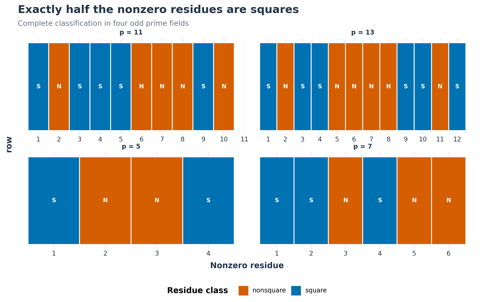

# Units, powers, and square classes

**Level and prerequisites: L3–L4.** Prepare Hensel lifting, multiplicative groups and square classes. The [reader guide](index.md) links the Euler arithmetic, algebra and analysis preparation and distinguishes the graduate continuation.

## Goals

We analyze the multiplicative group through valuation, residue, and principal
unit layers. This yields a complete square test in $\mathbb Q_p$, including the
exceptional rules at $p=2$, and supplies a model for more general power equations.

## The unit filtration

Let

$$
U_0=\mathbb Z_p^\times,
\qquad U_n=1+p^n\mathbb Z_p\quad(n\ge1).
$$

Then $U_{n+1}\subset U_n$, and for $n\ge1$ the map

$$
1+p^na\longmapsto a\pmod p
$$

induces an isomorphism of groups
$U_n/U_{n+1}\cong(\mathbb F_p,+)$. Multiplication becomes addition at the next
unresolved digit because

$$
(1+p^na)(1+p^nb)\equiv1+p^n(a+b)\pmod {p^{n+1}}.
$$

This filtration makes the nonlinear unit group accessible one congruence layer
at a time.

## Residue units and Teichmüller representatives

For odd $p$, each nonzero residue $a\in\mathbb F_p^\times$ has a unique lift
$\omega(a)\in\mathbb Z_p^\times$ satisfying

$$
\omega(a)\equiv a\pmod p,
\qquad \omega(a)^{p-1}=1.
$$

Apply Hensel's lemma to $x^{p-1}-1$: its derivative is nonzero at every nonzero
residue. These **Teichmüller representatives** form a cyclic group
$\mu_{p-1}$. Every unit decomposes uniquely as

$$
u=\omega(\bar u)\langle u\rangle,
\qquad \langle u\rangle\in1+p\mathbb Z_p.
$$

Together with valuation, this gives

$$
\mathbb Q_p^\times\cong p^{\mathbb Z}\times\mu_{p-1}
\times(1+p\mathbb Z_p)
$$

for odd $p$. The logarithm identifies the last factor locally with the additive
group $p\mathbb Z_p$.

## Squares for odd primes

<div class="callout callout-note">
<p class="callout-title">Odd-prime square criterion</p>

For odd $p$, an element $x\in\mathbb Q_p^\times$ is a square if and only if
$v_p(x)$ is even and the residue of $p^{-v_p(x)}x$ is a square in
$\mathbb F_p^\times$.

</div>

Necessity follows by writing $x=y^2$. Conversely, write
$x=p^{2m}u$ and choose $a$ with $a^2\equiv u\pmod p$. The derivative of
$f(t)=t^2-u$ at $a$ is $2a$, a unit because $p$ is odd. Hensel lifts $a$ to a
square root of $u$, and multiplying by $p^m$ gives a root of $x$.

For $p=7$, $2$ is a square because $3^2\equiv2\pmod7$; the preceding chapter
constructed its root. The number $14$ is not a square because its valuation is
odd. The number $3$ is not a square because the nonzero squares modulo $7$ are
$1,2,4$.

Choose any nonsquare unit $u$. Every element is, modulo a square, represented by
one of

$$
1,\quad u,\quad p,\quad up.
$$

Thus $\mathbb Q_p^\times/(\mathbb Q_p^\times)^2$ has four elements for odd $p$.

<figure id="fig-square-classes">


<figcaption>

Figure 10.1: For several primes, residue units are classified as square or nonsquare and arranged by their least representatives.

</figcaption>
</figure>

[Figure 10.1](#fig-square-classes) is finite data in $\mathbb F_p$: each colored cell records
whether a unit residue has a square root. For odd $p$, exactly half of the
nonzero residues are squares. Hensel's lemma promotes this finite classification
to all units in $\mathbb Z_p$.

## Why 2 is exceptional

Every odd square is congruent to $1$ modulo $8$: writing $y=2k+1$ gives
$y^2=4k(k+1)+1$, and $k(k+1)$ is even. The converse also holds *2*-adically.

<div class="callout callout-note">
<p class="callout-title">2-adic square criterion</p>

An element $x\in\mathbb Q_2^\times$ is a square if and only if $v_2(x)$ is even
and the unit $2^{-v_2(x)}x$ is congruent to $1$ modulo $8$.

</div>

For sufficiency, write the unit as $1+8a$. A strengthened Hensel argument applied
to $t^2-u$ starts at $t=1$: the derivative is not a unit, but
$v_2(f(1))\ge3>2v_2(f'(1))=2$. This produces a root.

The unit square classes are represented by $1,3,5,7$ modulo $8$. Including
valuation parity gives eight square classes, represented for example by

$$
1,3,5,7,2,6,10,14.
$$

This richer answer is not a nuisance convention; it reflects real algebraic
structure at the prime $2$.

## Solving quadratic equations locally

For $ax^2+bx+c=0$ with $a\ne0$ over a field of characteristic not $2$, completing the square
reduces solvability to whether the discriminant
$\Delta=b^2-4ac$ is a square. The criteria above therefore decide any quadratic
over $\mathbb Q_p$.

Example: $x^2+x+1=0$ over $\mathbb Q_5$ has discriminant $-3\equiv2\pmod5$.
The nonzero squares modulo $5$ are $1$ and $4$, so no root exists. Over
$\mathbb Q_7$, $-3\equiv4$ is a square and two simple roots lift.

Higher powers follow the same blueprint but are sensitive to whether the
exponent is divisible by $p$. If $p\nmid n$, Hensel often reduces $x^n=u$ for a
unit to a residue-field question. If $p\mid n$, the derivative is singular and
deeper unit-filtration information is required.

## Proving the principal-unit quotient

For $n\ge1$, define a map from $U_n$ to the additive residue field
by sending $1+p^na$ to $\bar a$. The coefficient $a$ is determined
uniquely by the element, so this is well defined. Multiplication gives
$a+b+p^nab$ after removing the initial one and dividing by $p^n$.
The last term vanishes modulo $p$, because $n\ge1$.
Thus the map is a group homomorphism.

It is onto: the elements $1+p^nj$ represent every residue. Its
kernel is precisely $U_{n+1}$. The first isomorphism theorem gives
the quotient description. This is a statement about one layer, not
an additive identification of the entire unit group. Multiplication of
deeper terms still contributes at later levels.

In particular the condition $n\ge1$ is essential. Reduction of
$U_0$ is the multiplicative group $\mathbb F_p^\times$, not the
additive group $\mathbb F_p$. Confusing the first unit layer with
later principal-unit quotients changes both the group law and its
cardinality.

## Teichmüller representatives as a multiplicative section

For odd $p$, nonzero residues are roots of $T^{p-1}-1$ modulo
$p$, with unit derivative. Hensel supplies exactly one lift of
each residue to a root in $\mathbb Z_p$. The product of two
such lifts is again a root and has the product residue.
Uniqueness therefore gives $\omega(ab)=\omega(a)\omega(b)$.
Thus these representatives form a multiplicative subgroup isomorphic
to $\mathbb F_p^\times$.

The finite multiplicative group is cyclic, a standard finite-field result
proved in the preceding algebra preparation. Its lifted subgroup is
therefore cyclic of order $p-1$. For any unit $u$, the quotient
$u/\omega(\bar u)$ has residue one and belongs to $U_1$.
If two such decompositions agree, their root-of-unity factors have
the same residue and are equal, forcing equality of the principal
factors. This proves the direct-product statement, including uniqueness.

At two the residue-unit group is trivial, but this does not
make all two-adic units behave like an odd-prime $U_1$.
Instead every odd unit has a unique expression
$(-1)^\varepsilon w$ with $w\in1+4\mathbb Z_2$.
Choose the sign according to its residue modulo four.
The intersection of the sign group and $1+4\mathbb Z_2$ is
trivial, since minus one is three modulo four.
This gives the useful decomposition into sign and a deeper
principal-unit factor.

## Power equations when the exponent is a unit

Let $m$ be a positive integer prime to $p$. For every
$v\in U_1$, the polynomial $T^m-v$ has value zero modulo
$p$ at one and derivative $m$, a unit.
It therefore has a unique root in $U_1$.
The power map is a bijective homomorphism on that group,
so it is an automorphism.

For an arbitrary unit, first solve the residue equation
$a^m=\bar v$ in $\mathbb F_p^\times$. Every solution has a
unit derivative and lifts uniquely to an exact root with that
residue. Thus the completed unit problem has exactly as many
solutions as its residue problem. This conclusion depends on the
exponent being prime to $p$; no corresponding simple-root argument
works for an exponent divisible by $p$.

For odd $p$, logarithm gives a complementary description of those
singular exponents. Its isomorphism from $U_1$ to
$p\mathbb Z_p$ turns an $m$th power into multiplication by $m$.
If $v_p(m)=d$, the image is $p^{d+1}\mathbb Z_p$,
hence the image of $U_1$ is exactly $U_{d+1}$.
The group-theoretic translation requires the common convergence domain
and inverse identities established in Chapter 8.
At two one starts with $1+4\mathbb Z_2$ instead.

### Worked example 1: valuation parity and a residue obstruction

In $\mathbb Q_5$, consider $18/25$. Its valuation is minus two,
which passes the evenness test. Removing that power leaves unit
eighteen, whose residue is three, a nonsquare modulo five.
The rational is not a square locally. Valuation parity alone
was necessary but not sufficient.

For $6/25$, the valuation is again minus two, but its unit
residue is one. The root of $T^2-6$ starting at one modulo
five has a unit derivative and lifts uniquely. Dividing that
root by five gives a square root of $6/25$.
A negative valuation is therefore no obstruction when it is even
and its unit passes the residue test.

## A complete two-adic unit argument

Necessity of the modulo-eight criterion follows from
$(2k+1)^2=1+4k(k+1)$ and the evenness of $k(k+1)$.
For sufficiency, the strong Hensel theorem already gives a proof:
for $f(T)=T^2-u$ at one, the derivative valuation is one,
while $u\equiv1\pmod8$ gives residual valuation at least three,
strictly greater than two.

One can also see the digits directly. Suppose an odd $r_N$
satisfies $r_N^2\equiv u\pmod{2^N}$ for $N\ge3$.
Replace it by $r_N+\varepsilon2^{N-1}$.
Modulo $2^{N+1}$, its square changes by
$\varepsilon2^Nr_N$, because the correction square is divisible
by $2^{N+1}$. Since $r_N$ is odd, exactly one
$\varepsilon\in\{0,1\}$ fixes the next residual bit.

These corrections have valuation at least $N-1$, so they
produce a Cauchy sequence. Its square errors tend to zero,
giving an exact root by continuity. Starting at one keeps all
later approximations in $1+4\mathbb Z_2$; the negative root
lies in the other odd class modulo four.
The corrections need not preserve the current representative modulo
$2^N$, but they do preserve all digits below position $N-1$.
That is enough for convergence and explains why this construction
is not ordinary simple-root digit lifting.

### Worked example 2: two inputs passing the same unit test

The units seventeen and minus seven are both one modulo eight.
They are therefore squares in $\mathbb Q_2$.
At one their residuals for the two square equations are minus
sixteen and eight, of valuations four and three respectively.
Both pass the strict strong-Hensel threshold, though the initial
error precision differs.

By contrast, twelve has even valuation two but unit part three,
so it is not a square. Forty has odd valuation three,
which already prevents a square regardless of its unit.
These examples separate the two obstructions rather than collapsing
them into a test of a short displayed residue alone.

## Counting the square classes

For odd $p$, the square map on the finite residue group has
kernel $\{1,-1\}$, so its image has half the group size.
There are exactly two residue-unit classes modulo squares.
All principal units are squares by the unit-derivative theorem,
so those are also exactly the two completed unit classes.
Valuation parity contributes an independent binary choice, giving
four classes of nonzero field elements.

At two, two odd units are in the same square class exactly
when their quotient is one modulo eight. This happens exactly
when they have the same odd residue modulo eight.
There are four unit classes, represented by one, three, five
and seven. Adding valuation parity doubles the count to eight.
Zero is a square but is not an element of the multiplicative
square-class group, whose definition uses nonzero elements.

The distinctness assertions matter as much as the representative lists.
Different valuation parities cannot be related by a square.
For equal parity, a nonsquare unit quotient prevents equivalence
by the proved criteria. Conversely, matching both pieces produces
a square quotient. Thus the lists give a classification rather
than a collection of examples that might omit further classes.

### Worked example 3: cubes in the seven-adic units

The nonzero residues modulo seven form a cyclic group of order
six. Their cubes are precisely one and minus one.
Since three is prime to seven, the cube map is an
automorphism on $1+7\mathbb Z_7$.
Consequently a seven-adic unit is a cube exactly when its
residue is one or six. Each such unit has three cube
roots, one in each eligible residue class.

For instance fifteen has residue one and therefore has a cube
root. Starting at one, the next-digit equation for $T^3-15$
is $-2+3t\equiv0\pmod7$, so $t=3$ and
the next representative is twenty-two modulo forty-nine.
The polynomial has value $10633=49\cdot217$ there.
This finite certificate verifies that digit; Hensel proves the
infinite root.

## Quadratics and the field characteristic

For a genuine quadratic with $a\ne0$, multiplying
$ax^2+bx+c=0$ by $4a$ and completing the square gives
$(2ax+b)^2=b^2-4ac$.
The base field $\mathbb Q_p$ has characteristic zero even when
$p=2$, so division by two is legal in the field.
It may change integral valuations and precision, which must be
tracked separately.

A nonzero square discriminant gives two roots, a zero discriminant
one repeated root, and a nonsquare discriminant none.
If $a=0$, solve the linear or constant equation instead;
the quadratic formula does not apply.
These elementary case distinctions keep the local square criteria
from being used outside their stated nonzero multiplicative setting.

## The prime-to-characteristic power criterion

The same separation of valuation and residue gives a useful generalization
of the square test. Let $m$ be a positive integer not divisible by $p$,
and let $a\in\mathbb Q_p^\times$. Write $a=p^v u$ with $u$ a unit.
Then $a$ is an $m$th power precisely when $m$ divides $v$ and the
residue of $u$ is an $m$th power in $\mathbb F_p^\times$.
Necessity follows by taking valuations and reducing the unit part.
For sufficiency, choose a nonzero residue solution of $X^m-\overline u$.
Its derivative $mX^{m-1}$ is nonzero, so Hensel supplies a unique
unit solution in that residue class. Multiply it by $p^{v/m}$.

Each residue solution lifts uniquely, and every unit root reduces to
one of them. Therefore, when a root exists, its number is
$\gcd(m,p-1)$, using cyclicity of the finite multiplicative group.
At two and odd $m$ this gives a unique unit root, since the
multiplicative residue group has order one. The hypothesis
$p\nmid m$ is indispensable: if the exponent contains $p$,
the derivative loses unit status and principal-unit congruences carry
information that the first residue cannot see. The special square
criterion at two is already an example of that additional information.

<!-- inline-formula-code:start -->
## Formula and finite computation

A useful formula in this chapter is

$$
R_N(f)=\{x\bmod p^N:f(x)\equiv0\pmod{p^N}\}
$$

Exhaustive finite residues realize this root set exactly. The following standalone Python block expresses that finite rule with its inputs and stopping conditions visible.

```python
from collections.abc import Callable
from math import isqrt

def is_prime(number: int) -> bool:
    """Return whether number is prime by exact trial division."""
    if number < 2:
        return False
    return all(number % divisor != 0 for divisor in range(2, isqrt(number) + 1))

def roots_mod_prime_power(
    polynomial: Callable[[int], int], prime: int, precision: int
) -> list[int]:
    """Return every residue root modulo prime**precision by exhaustive search."""
    if not is_prime(prime) or precision <= 0:
        raise ValueError("require an actual prime and positive precision")
    modulus = prime**precision
    return [residue for residue in range(modulus) if polynomial(residue) % modulus == 0]

for precision in range(1, 6):
    roots = roots_mod_prime_power(lambda x: x * x, prime=2, precision=precision)
    print(precision, roots)
```

**What the computation establishes.** The calculation checks a declared finite instance; the surrounding argument explains what is true beyond those inputs.
<!-- inline-formula-code:end -->

## Summary

The unit filtration linearizes multiplicative structure one residue layer at a
time. For odd primes, valuation parity and the first unit residue completely
decide squareness. At $p=2$, a unit must be $1$ modulo $8$, producing eight
rather than four square classes. Quadratic solvability follows from the
discriminant test.

## Exercises

### Exercise 10.1 {#ex-padic-10-01}

List the nonzero square residues modulo $11$.

<details>
<summary>Hint 1</summary>

Square the residues one through five.

</details>

<details>
<summary>Hint 2</summary>

Opposite residues have equal squares.

</details>

<details>
<summary>Full solution</summary>

The squares of one through five are $1,4,9,5,3$ modulo eleven. Their negatives give the same list, so the nonzero square residues are $\{1,3,4,5,9\}$. There are five because the square map has kernel of size two on a group of ten elements.

</details>

### Exercise 10.2 {#ex-padic-10-02}

Decide whether $3,15,45,$ and $75$ are squares in $\mathbb Q_5$.

<details>
<summary>Hint 1</summary>

Separate valuation parity from the unit residue.

</details>

<details>
<summary>Hint 2</summary>

The nonzero squares modulo five are one and four.

</details>

<details>
<summary>Full solution</summary>

Three has valuation zero but nonsquare residue three. Fifteen and forty-five both have valuation one, so neither is a square. Seventy-five has valuation two but unit part three, again a nonsquare residue. Thus none of the four is a square in $\mathbb Q_5$. Each rejection names its particular obstruction.

</details>

### Exercise 10.3 {#ex-padic-10-03}

Decide whether $17,-7,12,$ and $40$ are squares in $\mathbb Q_2$.

<details>
<summary>Hint 1</summary>

For units use reduction modulo eight.

</details>

<details>
<summary>Hint 2</summary>

For nonunits first remove the exact power of two.

</details>

<details>
<summary>Full solution</summary>

Seventeen and minus seven are odd and congruent to one modulo eight, so both are squares. Twelve has valuation two but odd unit three, so it fails the unit test. Forty has odd valuation three, so it fails before any unit test. The classification applies to the whole two-adic field, not only its integer ring.

</details>

### Exercise 10.4 {#ex-padic-10-04}

Prove $U_n/U_{n+1}\cong\mathbb F_p$ for $n\ge1$.

<details>
<summary>Hint 1</summary>

Send one plus p to the n times a to the residue of a.

</details>

<details>
<summary>Hint 2</summary>

Compute the product and identify the kernel.

</details>

<details>
<summary>Full solution</summary>

The map $1+p^na\mapsto\bar a$ is onto. A product maps to $\overline{a+b+p^nab}=\bar a+\bar b$ because $n\ge1$. Its kernel consists of coefficients divisible by $p$, exactly $U_{n+1}$. The first isomorphism theorem gives the asserted additive quotient. The residue-unit quotient at level zero is a different multiplicative group.

</details>

### Exercise 10.5 {#ex-padic-10-05}

Show that every principal unit in $1+p\mathbb Z_p$ is a square when $p$ is odd.

<details>
<summary>Hint 1</summary>

Use the square polynomial at the residue one.

</details>

<details>
<summary>Hint 2</summary>

Its derivative two is invertible modulo an odd prime.

</details>

<details>
<summary>Full solution</summary>

For $u\in1+p\mathbb Z_p$, the polynomial $T^2-u$ vanishes modulo $p$ at one and has derivative two there. Simple-root Hensel gives a unique root in $1+p\mathbb Z_p$. It squares to $u$, proving surjectivity of squaring on principal units. The unique root in that group is accompanied by its negative outside the group when considering all units.

</details>

### Exercise 10.6 {#ex-padic-10-06}

Determine for which of $p=3,5,7,11$ the equation $x^2+x+1=0$ has a root in $\mathbb Q_p$.

<details>
<summary>Hint 1</summary>

Use discriminant minus three.

</details>

<details>
<summary>Hint 2</summary>

At three its valuation is odd; at other primes test the unit residue.

</details>

<details>
<summary>Full solution</summary>

At three the discriminant has valuation one, so is not a square. At five its residue is two, a nonsquare. At seven its residue is four, a nonzero square, so there are two roots. At eleven its residue is eight, absent from $\{1,3,4,5,9\}$. Thus exactly seven among the listed primes gives a root. Characteristic zero allows completing the square at every listed place.

</details>

### Exercise 10.7 {#ex-padic-10-07}

**Challenge.** Describe the image of the cube map on $\mathbb Z_7^\times$ using residues and the unit filtration.

<details>
<summary>Hint 1</summary>

Use the cyclic residue group of order six.

</details>

<details>
<summary>Hint 2</summary>

Cubing is an automorphism on the principal units because three is a seven-adic unit.

</details>

<details>
<summary>Full solution</summary>

The residue cube image is $\{1,6\}$. For each principal unit $v$, Hensel applied to $T^3-v$ at one gives a unique cube root in $U_1$. The Teichmüller decomposition therefore shows that the full image is precisely the units congruent to one or six modulo seven. The residue kernel has three elements and the principal-unit kernel is trivial, so each image element has exactly three cube roots.

</details>

### Exercise 10.8 {#ex-padic-10-08}

Prove that $\mathbb Q_2^\times$ has exactly eight square classes.

<details>
<summary>Hint 1</summary>

Record valuation parity and the odd unit residue modulo eight.

</details>

<details>
<summary>Hint 2</summary>

Two units have square quotient precisely when their odd residues agree.

</details>

<details>
<summary>Full solution</summary>

Every nonzero element is a power of two times an odd unit. Removing an even power leaves valuation parity zero or one. The proved two-adic criterion identifies exactly four unit classes, represented by $1,3,5,7$. Their products with one or two give eight representatives. Distinct parities cannot have square quotient; within one parity, different odd residues modulo eight cannot either. Matching both pieces does give a square quotient, proving completeness and distinctness.

</details>

### Exercise 10.9 {#ex-padic-10-09}

For odd $p$, find the image of the $p^d$th-power map on $1+p\mathbb Z_p$, where $d\ge1$.

<details>
<summary>Hint 1</summary>

Use the logarithm isomorphism on principal units.

</details>

<details>
<summary>Hint 2</summary>

Multiplication by p to the d sends pZp onto the next corresponding additive ideal.

</details>

<details>
<summary>Full solution</summary>

The logarithm takes the power map to multiplication by $p^d$ on $p\mathbb Z_p$. Its image is $p^{d+1}\mathbb Z_p$. The inverse exponential therefore identifies the multiplicative image as $1+p^{d+1}\mathbb Z_p=U_{d+1}$. The odd-prime common convergence domain is essential; one cannot apply this argument to all two-adic principal units unchanged.

</details>

### Exercise 10.10 {#ex-padic-10-10}

Explain why the discriminant criterion must treat $a=0$ and discriminant zero separately.

<details>
<summary>Hint 1</summary>

The quadratic formula divides by a.

</details>

<details>
<summary>Hint 2</summary>

A zero square root gives only one value, not two distinct roots.

</details>

<details>
<summary>Full solution</summary>

If $a=0$, the equation is linear when $b\ne0$, with root $-c/b$; if also $b=0$, it is either always true or impossible according to $c$. For $a\ne0$ and discriminant zero, completing the square gives the single repeated root $-b/(2a)$. Only a nonzero square discriminant gives two distinct roots. These cases are valid in $\mathbb Q_2$ as well, since its field characteristic is zero.

</details>
