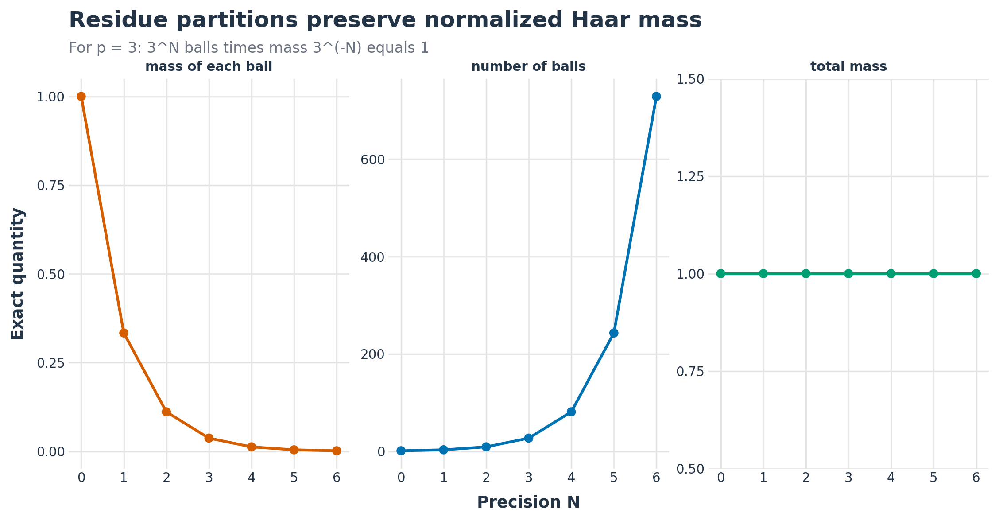

# Compactness, integration, and Haar measure {#sec-compactness-measure}

**Level and prerequisites: L3–L4.** Prepare compact metric spaces, residue-class partitions and elementary integration. The [reader guide](index.md) links the Euler arithmetic, algebra and analysis preparation and distinguishes the graduate continuation.

## Goals

The ring $\mathbb Z_p$ is simultaneously infinite, highly disconnected, and
compact. We prove compactness from compatible digits, extend it to local
compactness of $\mathbb Q_p$, and build the normalized translation-invariant
measure used in *p*-adic probability and integration.

## Compactness from digits

Take any sequence $(x_m)$ in $\mathbb Z_p$. Among its members, infinitely many
share one residue modulo $p$. From that subsequence, infinitely many share one
residue modulo $p^2$. Continue and take a diagonal subsequence whose first $N$
digits stabilize by its $N$th stage. This subsequence is Cauchy and therefore
converges in $\mathbb Z_p$. Thus $\mathbb Z_p$ is sequentially compact.

In metric spaces, sequential compactness is equivalent to compactness. Another
proof separates the ingredients: $\mathbb Z_p$ is complete, and for each $N$ it
is covered by the finitely many balls

$$
a+p^N\mathbb Z_p,\qquad 0\le a<p^N.
$$

So it is totally bounded. A complete, totally bounded metric space is compact.

Every ball in $\mathbb Q_p$ is a scaling and translation of $\mathbb Z_p$:

$$
a+p^N\mathbb Z_p.
$$

It is compact. Consequently each point of $\mathbb Q_p$ has a compact
neighborhood, making $\mathbb Q_p$ **locally compact**. The whole field is not
compact, because the open cover by expanding balls $p^{-N}\mathbb Z_p$ has no
finite subcover.

## Haar measure

A locally compact topological group has a translation-invariant measure unique
up to scale. For the additive group of $\mathbb Q_p$, normalize Haar measure
$\mu$ by

$$
\mu(\mathbb Z_p)=1.
$$

The $p^N$ residue balls modulo $p^N$ partition $\mathbb Z_p$ equally. Translation
invariance therefore forces

$$
\mu(a+p^N\mathbb Z_p)=p^{-N}.
$$

Scaling satisfies $\mu(cE)=|c|_p\mu(E)$, first for $c=p^k$ by partitioning, then
for units because units permute $\mathbb Z_p$. Hence the formula extends to all
balls, including $N<0$.

<figure id="fig-haar-partitions">


<figcaption>

Figure 11.1: At precision levels 0 through 5, the number of residue balls grows as p to the N while each ball's Haar measure falls as p to minus N; total mass stays one.

</figcaption>
</figure>

[Figure 11.1](#fig-haar-partitions) displays the two exact factors in a partition of
$\mathbb Z_p$: count $p^N$ and mass per class $p^{-N}$. The constant product is
finite additivity made visible. The chart does not assign Euclidean lengths to
the balls.

## Integrating locally constant functions

A real- or complex-valued function constant on residue classes modulo $p^N$ has a finite integral:

$$
\int_{\mathbb Z_p}f(x)\,d\mu(x)
=p^{-N}\sum_{a=0}^{p^N-1}f(a).
$$

This is independent of choosing a finer level, because every class splits into
$p$ children of equal total mass. Continuous real- or complex-valued functions on compact
$\mathbb Z_p$ are uniformly continuous and can be approximated by such locally
constant functions, giving an elementary route to integration.

As an example, the indicator of the units has integral

$$
\mu(\mathbb Z_p^\times)=1-\mu(p\mathbb Z_p)=1-p^{-1}.
$$

For a uniformly random $p$-adic integer, the digits are independent and uniform
in $\{0,\ldots,p-1\}$ in the finite-dimensional sense. Therefore

$$
\Pr(v_p(X)=k)=p^{-k}(1-p^{-1}),\qquad k\ge0.
$$

The first $k$ digits must vanish and the next must be nonzero.

## Shells and a local zeta integral

Decompose $\mathbb Z_p$ into the point $0$ and shells

$$
p^k\mathbb Z_p^\times=\{x:v_p(x)=k\}.
$$

The singleton has measure zero, since it is contained in balls of arbitrarily
small measure. Each shell has measure $p^{-k}(1-p^{-1})$. For real or complex
$s$ with $\operatorname{Re}(s)>-1$,

$$
\begin{aligned}
\int_{\mathbb Z_p}|x|_p^s\,d\mu(x)
&=\sum_{k=0}^\infty p^{-ks}p^{-k}(1-p^{-1})\\
&=\frac{1-p^{-1}}{1-p^{-(s+1)}}.
\end{aligned}
$$

This elementary integral is a local factor of the kind that appears in zeta
functions. Arithmetic information is organized shell by shell.

## Additive characters: an outlook

A continuous homomorphism from $(\mathbb Q_p,+)$ to the complex unit circle is
an additive character. Nontrivial characters are locally constant, and one can
choose a standard character trivial on $\mathbb Z_p$ but not on
$p^{-1}\mathbb Z_p$. Integrating functions against characters yields a Fourier
transform. With suitable normalization, $\mathbb Q_p$ is self-dual as a locally
compact abelian group. Developing this fully requires more harmonic analysis,
but compact-open balls make many first transforms finite sums.

<div class="callout callout-warning">
<p class="callout-title">Probability pitfall</p>

There is a uniform probability distribution on compact $\mathbb Z_p$, not on
all of noncompact $\mathbb Q_p$. Haar measure of $\mathbb Q_p$ is infinite under
our normalization.

</div>

## Constructing this measure from compact-open sets

For this particular additive group, a general Haar existence theorem can
be replaced by an explicit construction. Let the basic sets be balls
$a+p^N\mathbb Z_p$ with integer $N$. Assign such a ball mass
$p^{-N}$. A compact-open set is a finite union of these balls.
Refining a finite list to one common precision gives a disjoint
union, so define its mass by adding the masses of its disjoint
pieces.

This is independent of refinement. Each ball splits into exactly $p$
children at the next level, and their assigned masses sum to its
mass. Any two finite presentations can be refined to a common
level, where they describe exactly the same finite set of classes.
Finite additivity follows by the same argument. We have built a
premeasure on the ring of compact-open sets.

To justify the countable-additivity condition needed for extension, suppose
a disjoint countable collection of compact-open sets has compact-open
union $A$. The sets form an open cover of compact $A$,
so finitely many already cover it. Disjointness then forces every
other piece to be empty. The required equality is just finite
additivity. This is a useful place where topology proves a
measure-theoretic consistency condition.

We now use the measure-extension theorem: a sigma-finite premeasure on a
ring extends uniquely to a measure on the sigma-algebra it generates.
This is the Carathéodory extension theorem from measure theory; its
general proof is imported, not replaced by the finite partition argument.
Our ring is sigma-finite because the expanding balls
$p^{-n}\mathbb Z_p$ cover the field. Its generated sigma-algebra
is the Borel sigma-algebra. Indeed the residue balls form a
countable basis: at each scale they have a countable set of
rational representatives, and the scales themselves are countable.

Thus the extension gives a Borel measure on $\mathbb Q_p$.
Translation sends balls to balls of equal assigned mass.
By uniqueness of the sigma-finite extension, translating a Borel set
does not change its mass. The measure we constructed is therefore
the normalized additive Haar measure. Its existence here rests on
compact-open partitions and one explicitly named extension theorem.

## Uniqueness and scaling on all Borel sets

Any translation-invariant Borel measure finite on compact sets and normalized
to mass one on $\mathbb Z_p$ must give equal masses to
its $p^N$ residue classes. Their partition forces mass $p^{-N}$
at positive levels. Partitioning an expanding ball into translates of
$\mathbb Z_p$ gives the negative levels too.
It agrees with our premeasure on every compact-open set, so
the extension uniqueness proves equality on every Borel set.

For nonzero $c=p^ku$ with a unit $u$, multiplication sends
$a+p^N\mathbb Z_p$ onto $ca+p^{N+k}\mathbb Z_p$.
The mass changes by $p^{-k}=|c|_p$.
After dividing the pushed-forward mass by this factor, we again
have a Borel measure agreeing with the original premeasure on the
ring. Uniqueness proves $\mu(cE)=|c|_p\mu(E)$ for every Borel
set $E$, not only balls.

No finite translation-invariant probability exists on all of $\mathbb Q_p$.
If a coset of $\mathbb Z_p$ had positive mass, arbitrarily
many disjoint translates would exceed any finite total.
If its mass were zero, every expanding ball, a finite union
of such cosets, would have mass zero. Their countable union is
the entire field, again contradicting total probability one.
There are many probability measures supported on parts of the
field; the obstruction concerns a uniform translation-invariant one.

## Which functions are being integrated?

The integrals in this chapter take real or complex values.
The domain is non-Archimedean, but the measure is an ordinary nonnegative
real measure. A bounded continuous complex-valued function on compact
$\mathbb Z_p$ is integrable in the usual measure-theoretic sense.
This is not a construction of an integral for every continuous
function with values in $\mathbb Q_p$.

For a complex-valued continuous $f$, compactness gives uniform continuity.
Choose one representative in each residue ball at level $N$
and let $f_N$ be the function constant on that ball with
the chosen value. The uniform error tends to zero.
The finite average of those values is its integral, and
the ordinary complex inequality gives
$|\int(f-f_N)\,d\mu|\le\sup|f-f_N|$.
Thus the finite averages converge independently of representative choices.

That estimate uses the ordinary complex modulus and the real total
mass one. Replacing it by the $p$-adic norm without another
construction would be invalid: the rational averaging weight $p^{-N}$
has growing $p$-adic norm. Specialized $p$-adic integration theories
need additional definitions and hypotheses. Their existence is not
being inferred from the elementary Haar averages here.

### Worked example 1: exact probability of one valuation

For a uniformly distributed element of $\mathbb Z_5$, valuation
exactly three means membership in $125\mathbb Z_5$ but not in
$625\mathbb Z_5$. Its probability is
$1/125-1/625=4/625$.
Conditional on divisibility by $125$, the probability of not being
divisible by $625$ is four fifths.

The first three digits are zero and the fourth is nonzero.
There are four permitted fourth digits and each four-digit cylinder
has mass $5^{-4}$, giving the same result.
The event specifies a finite prefix; it does not assert
that the infinite digit stream eventually terminates.

## Infinite digits and finite-dimensional independence

A cylinder fixing the first $N$ digits has probability $p^{-N}$.
More generally, if only selected positions among those digits are
fixed, count the free choices in the other positions.
The probability is the product of one factor $1/p$ for
each fixed digit. This proves independence and uniformity of every
finite collection of digit coordinates.

The infinite probability measure is already supplied by the Borel
construction. We do not assume that a finite random sample represents
all infinite streams. The coordinate description explains that measure
and allows exact event probabilities. A simulation of finitely many
digits samples a finite quotient; a tail event may require
a limiting argument rather than a finite count.

The singleton zero has probability zero, because it lies in
$p^N\mathbb Z_p$ for every $N$ and those masses tend to zero.
Every individual point likewise has zero mass by translation.
This does not contradict total mass one: countable additivity concerns
countable unions, whereas $\mathbb Z_p$ is uncountable.
A diagonal digit argument proves that uncountability directly.

### Worked example 2: a locally constant integral

Let $f$ equal one on the units and two on
$p\mathbb Z_p$. The two pieces partition $\mathbb Z_p$, so
$\int f\,d\mu=(1-p^{-1})+2p^{-1}=1+p^{-1}$.
At any finer precision, exactly the same proportion of
representatives lies in each piece, giving the same average.

This exact stability is special to a function already constant on
a finite residue partition. A general continuous function gives
successively improving approximations, with an error governed by its
uniform continuity. Numerical stabilization at a few levels alone is
not a proof of that limiting error estimate.

## Unbounded integrands and a shell decomposition

The valuation function is nonnegative on $\mathbb Z_p$ and infinite
at zero. Truncate it at an integer $M$. The identity
$\min(v_p(x),M)=\sum_{n=1}^M\mathbf1_{p^n\mathbb Z_p}(x)$
is pointwise, including at zero. Integrating the finite sum gives
$\sum_{n=1}^M p^{-n}$. Monotone convergence then yields
$\int v_p(x)\,d\mu=1/(p-1)$.
The infinite value on a null singleton causes no difficulty
for this extended nonnegative integral.

For the local zeta integral, define $|x|_p^s$ on nonzero
inputs using the ordinary real logarithm of the positive norm.
At zero assign any value: the singleton is null.
Absolute integrability is decided by the shell series with
exponent $\operatorname{Re}(s)$.
Its ratio has modulus less than one exactly when
$\operatorname{Re}(s)>-1$.
Thus the domain in the displayed formula is also its domain
of Lebesgue integrability.

### Worked example 3: a real integral with a rational answer

At $p=3$ and $s=1$, shell masses give
$\int_{\mathbb Z_3}|x|_3\,d\mu
=(2/3)/(1-1/9)=3/4$.
The answer is an ordinary real integral, although it happens
to be rational. At $s=-1$, every nonzero shell contributes
the same positive amount, so the integral diverges.

The rational expression in the parameter may have a meromorphic
continuation outside the integration half-plane.
Such a continuation is a different representation of the resulting
function, not evidence that the original integral converges there.
This is the same separation between analytic continuation and
convergent expressions encountered for Dirichlet series.

## Why the whole field has no uniform probability law

Haar measure on the unit ball can be normalized to a probability
measure, but a translation-invariant probability measure on all of
$\mathbb Q_p$ is impossible. Here is a direct argument that uses
only countable additivity and translation invariance. If every coset
of $\mathbb Z_p$ had the same positive mass $c$, arbitrarily many
disjoint cosets would have total mass exceeding one. Thus their
common mass would have to be zero.

For each nonnegative integer $N$, the ball $p^{-N}\mathbb Z_p$
is a union of $p^N$ such cosets, so it too would have mass zero.
These balls increase to the whole field. Countable additivity, or
continuity from below for a measure, would then give total mass zero,
again contradicting a probability measure. There is no third option.

The normalized Haar measure instead assigns mass $p^N$ to that
larger ball, and consequently has infinite total mass on the field.
Probability questions in this chapter specify a finite-measure
sampling region, usually $\mathbb Z_p$, before normalizing.
Translation invariance remains available for integration on the
whole field, but it does not make choosing an unrestricted uniformly
random $p$-adic number meaningful.

<!-- inline-formula-code:start -->
## Formula and finite computation

A useful formula in this chapter is

$$
\mu(a+p^N\mathbb Z_p)=p^{-N}
$$

The finite partition count and exact fractions verify normalization. The following standalone Python block expresses that finite rule with its inputs and stopping conditions visible.

```python
from fractions import Fraction
from math import isqrt

def is_prime(number: int) -> bool:
    """Return whether number is prime by exact trial division."""
    if number < 2:
        return False
    return all(number % divisor != 0 for divisor in range(2, isqrt(number) + 1))

def ball_partition_certificate(prime: int, depth: int) -> tuple[int, Fraction, Fraction]:
    """Return ball count, one ball's measure, and the total measure."""
    if not is_prime(prime) or depth < 0:
        raise ValueError("prime must be prime and depth nonnegative")
    count = prime**depth
    measure = Fraction(1, count)
    return count, measure, count * measure

for depth in range(6):
    print(depth, ball_partition_certificate(prime=3, depth=depth))
```

**What the computation establishes.** The calculation checks a declared finite instance; the surrounding argument explains what is true beyond those inputs.
<!-- inline-formula-code:end -->

## Summary

Digit stabilization proves compactness of $\mathbb Z_p$; its scaled translates
make $\mathbb Q_p$ locally compact. Normalized Haar measure assigns
$p^{-N}$ to every residue ball modulo $p^N$. Locally constant integrals reduce to
finite averages, and shell decompositions yield exact probabilities and local
zeta factors.

## Exercises

### Exercise 11.1 {#ex-padic-11-01}

Prove that $p^k\mathbb Z_p^\times$ has measure $p^{-k}(1-p^{-1})$.

<details>
<summary>Hint 1</summary>

Express the shell as the difference of two nested balls.

</details>

<details>
<summary>Hint 2</summary>

Use the ball formula at levels k and k+1.

</details>

<details>
<summary>Full solution</summary>

The shell is $p^k\mathbb Z_p\setminus p^{k+1}\mathbb Z_p$. The balls have finite masses $p^{-k}$ and $p^{-(k+1)}$, even for negative integer $k$. Subtracting gives $p^{-k}(1-p^{-1})$. Equivalently, scale the unit shell by $p^k$ and apply the proved scaling law.

</details>

### Exercise 11.2 {#ex-padic-11-02}

Compute the probability that a random $x\in\mathbb Z_5$ is divisible by $125$ but not $625$.

<details>
<summary>Hint 1</summary>

This is the valuation-three shell.

</details>

<details>
<summary>Hint 2</summary>

Subtract the two ball probabilities.

</details>

<details>
<summary>Full solution</summary>

The event has probability $5^{-3}-5^{-4}=1/125-1/625=4/625$. It fixes three zero digits followed by any of four nonzero fourth digits. Conditioning on divisibility by125 would instead give probability four fifths; the question asks the unconditional probability.

</details>

### Exercise 11.3 {#ex-padic-11-03}

Integrate the indicator of $2+3^4\mathbb Z_3$ over $\mathbb Z_3$.

<details>
<summary>Hint 1</summary>

The coset lies entirely inside the integral ring.

</details>

<details>
<summary>Hint 2</summary>

An indicator integrates to the mass of its set.

</details>

<details>
<summary>Full solution</summary>

The integral is the mass of the residue ball, namely $3^{-4}=1/81$. At any level at least four, exactly one eighty-first of the residue representatives lie in the ball. Refining the partition does not change the average. The integrand is real-valued.

</details>

### Exercise 11.4 {#ex-padic-11-04}

Show that every continuous function on $\mathbb Z_p$ is uniformly continuous.

<details>
<summary>Hint 1</summary>

State the target metric and suppose uniform continuity fails.

</details>

<details>
<summary>Hint 2</summary>

Use compact subsequences of pairs whose input distance tends to zero.

</details>

<details>
<summary>Full solution</summary>

For a continuous map into any metric space, failure of uniform continuity would give pairs $x_n,y_n$ with $d_p(x_n,y_n)\to0$ but output distance bounded below by a fixed positive number. Compactness gives a convergent subsequence of $x_n$. The corresponding $y_n$ has the same limit. Continuity makes both output subsequences converge to the same point, contradicting the lower bound. For Haar integration here, the intended target is real or complex.

</details>

### Exercise 11.5 {#ex-padic-11-05}

Compute $\int_{\mathbb Z_p}v_p(x)\,d\mu(x)$ by a geometric series.

<details>
<summary>Hint 1</summary>

First truncate the valuation at a finite integer M.

</details>

<details>
<summary>Hint 2</summary>

Write the truncation as a finite sum of divisibility indicators.

</details>

<details>
<summary>Full solution</summary>

The truncation is $\sum_{n=1}^M\mathbf1_{p^n\mathbb Z_p}$, so its integral is $\sum_{n=1}^M p^{-n}$. These nonnegative truncations increase to the valuation, with infinity at zero. Monotone convergence gives the limit $1/(p-1)$. The null singleton does not alter this integral.

</details>

### Exercise 11.6 {#ex-padic-11-06}

Prove directly that $\mathbb Q_p$ is not compact.

<details>
<summary>Hint 1</summary>

Use the increasing open balls p to minus N times Zp.

</details>

<details>
<summary>Hint 2</summary>

Every finite subcollection has one largest ball and misses a larger-norm element.

</details>

<details>
<summary>Full solution</summary>

The open balls $p^{-N}\mathbb Z_p$ for $N\ge0$ cover the field because every nonzero element has finite valuation. A finite subcollection is contained in its largest member $p^{-M}\mathbb Z_p$. The element $p^{-(M+1)}$ lies outside that member. Thus the cover has no finite subcover, proving noncompactness.

</details>

### Exercise 11.7 {#ex-padic-11-07}

**Project.** Simulate independent base-$p$ digits and compare empirical valuation frequencies with the exact Haar probabilities.

<details>
<summary>Hint 1</summary>

Specify a finite digit length and record the unresolved all-zero prefix separately.

</details>

<details>
<summary>Hint 2</summary>

Compare expected shell probabilities with the finite-sample frequencies, without identifying a finite zero word with exact zero.

</details>

<details>
<summary>Full solution</summary>

A mathematical specification chooses a prime, digit depth $N$ and sample count. Each sample is a uniform word of length $N$. For $k<N$, valuation exactly $k$ has probability $p^{-k}(1-p^{-1})$; the all-zero word has probability $p^{-N}$ and means valuation at least $N$. Frequencies can be compared with these exact probabilities using a stated sampling-error measure, but no sample proves convergence of all frequencies. The infinite Haar law follows from the cylinder measure construction. No simulation was executed for this answer.

</details>

### Exercise 11.8 {#ex-padic-11-08}

Prove that every singleton has Haar measure zero and explain why total mass one is possible.

<details>
<summary>Hint 1</summary>

Contain a point in balls of arbitrarily small mass.

</details>

<details>
<summary>Hint 2</summary>

Countable additivity does not extend to an uncountable sum of singleton masses.

</details>

<details>
<summary>Full solution</summary>

The point $a$ lies in $a+p^N\mathbb Z_p$, whose mass is $p^{-N}$. Monotonicity bounds its mass by every such number, forcing zero. The integral ring is uncountable, so its decomposition into points is not a countable disjoint union. Countable additivity therefore does not imply that its mass is the sum of zero over all points.

</details>

### Exercise 11.9 {#ex-padic-11-09}

For a real- or complex-valued continuous function, justify convergence of the residue-class averages on $\mathbb Z_p$.

<details>
<summary>Hint 1</summary>

Approximate uniformly by one value on each fine residue ball.

</details>

<details>
<summary>Hint 2</summary>

Use total mass one to bound the integral error in the ordinary target modulus.

</details>

<details>
<summary>Full solution</summary>

Uniform continuity makes the oscillation on every level-$N$ residue ball uniformly small. The corresponding locally constant approximation $f_N$ therefore tends uniformly to $f$. Its integral is the finite residue average. Since $|\int(f-f_N)\,d\mu|\le\|f-f_N\|_\infty$, those averages converge to the ordinary integral. This argument does not apply unchanged to a $\mathbb Q_p$-valued target.

</details>

### Exercise 11.10 {#ex-padic-11-10}

Evaluate $\int_{\mathbb Z_3}|x|_3\,d\mu$ and state why the analogous integral with exponent minus one diverges.

<details>
<summary>Hint 1</summary>

Use the shell ratio at s=1.

</details>

<details>
<summary>Hint 2</summary>

At exponent minus one, every shell contributes the same positive amount.

</details>

<details>
<summary>Full solution</summary>

At exponent one, the shell sum is $(1-1/3)\sum_{k\ge0}3^{-2k}=(2/3)/(1-1/9)=3/4$. At exponent minus one the norm contribution $3^k$ cancels the shell factor $3^{-k}$, leaving two thirds from every shell. The nonnegative sum diverges. Any continued rational expression outside the original half-plane is not the value of that divergent integral.

</details>
