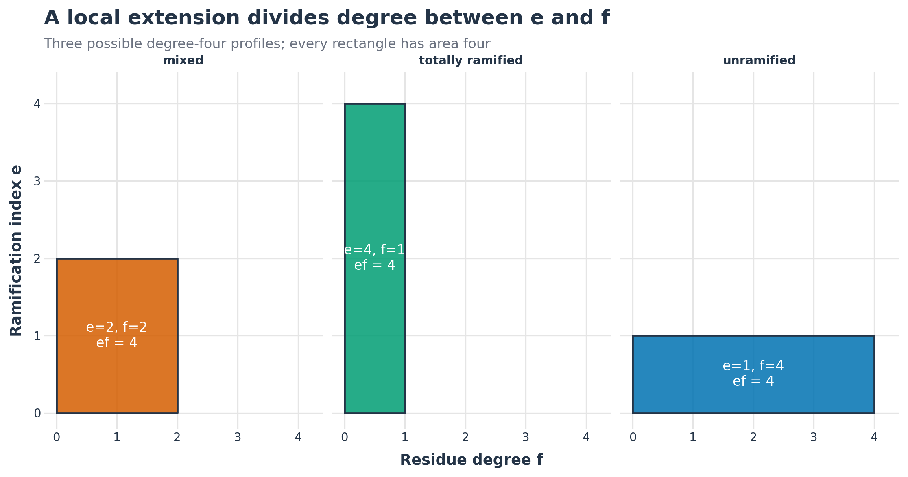

# Local fields beyond the rationals {#sec-local-fields}

**Level and prerequisites: L3–L4.** Prepare finite field extensions, vector-space dimension and valuations. The [reader guide](index.md) links the Euler arithmetic, algebra and analysis preparation and distinguishes the graduate continuation.

## Goals

Finite extensions of $\mathbb Q_p$ retain the essential architecture of a
discrete valuation, compact ring of integers, and finite residue field. We
introduce ramification and residue degree, construct representative extensions,
and interpret trace, norm, and discriminant.

## Extending the absolute value

Let $K/\mathbb Q_p$ be a finite field extension. There is a unique absolute value
on $K$ extending the one on $\mathbb Q_p$, and $K$ is complete for it. One route
defines

$$
|x|_K=|N_{K/\mathbb Q_p}(x)|_p^{1/[K:\mathbb Q_p]},
$$

then verifies that it is the desired extension. A normalized discrete valuation
$v_K$ is usually chosen to have value group $\mathbb Z$; under this
normalization its restriction satisfies

$$
v_K(x)=e\,v_p(x)\qquad(x\in\mathbb Q_p^\times)
$$

for a positive integer $e$.

Define the ring of integers, maximal ideal, and residue field by

$$
\mathcal O_K=\{x:v_K(x)\ge0\},\qquad
\mathfrak p_K=\{x:v_K(x)>0\},\qquad
k_K=\mathcal O_K/\mathfrak p_K.
$$

An element $\pi$ with $v_K(\pi)=1$ is a **uniformizer**; then
$\mathfrak p_K=\pi\mathcal O_K$. The residue field is finite, say
$|k_K|=p^f$. The integers $e$ and $f$ are the ramification index and residue
degree.

<div class="callout callout-note">
<p class="callout-title">Fundamental degree identity</p>

For every finite extension $K/\mathbb Q_p$,

$$
[K:\mathbb Q_p]=ef.
$$

</div>

A proof chooses representatives of an $\mathbb F_p$-basis of $k_K$ and uses
$1,\pi,\ldots,\pi^{e-1}$ to span the valuation layers. Linear independence can
be checked by taking the least valuation term and then reducing its coefficient
modulo $\mathfrak p_K$. Completeness supplies the limiting expansion.

## Ramified examples from Eisenstein polynomials

A polynomial

$$
T^n+a_{n-1}T^{n-1}+\cdots+a_0\in\mathbb Z_p[T]
$$

is **Eisenstein at $p$** when every $a_i$ is divisible by $p$, $a_0$ is not
divisible by $p^2$, and the leading coefficient is a unit. Eisenstein's
criterion proves irreducibility. If $\pi$ is a root, then the root $\pi$
becomes a uniformizer and the extension is totally ramified: $e=n$ and
$f=1$.

For example, $T^n-p$ is Eisenstein whenever $n\ge2$. In
$K=\mathbb Q_p(p^{1/n})$, the new uniformizer $\pi=p^{1/n}$ satisfies
$p=\pi^n$. Measured in the normalized $K$-valuation, the old prime has valuation
$n$.

<figure id="fig-extension-ef">


<figcaption>

Figure 12.1: Ramified and unramified degree-four extensions are compared by exact e and f data, with rectangle dimensions encoding their product.

</figcaption>
</figure>

[Figure 12.1](#fig-extension-ef) uses area to encode degree $ef$. A totally ramified extension
spends its degree in vertical valuation refinement; an unramified extension
spends it in horizontal residue-field enlargement. Mixed cases divide degree
between the two. The rectangles are a bookkeeping diagram, not a lattice of
subfields.

## Unramified extensions

For each $f\ge1$, there is, up to $\mathbb Q_p$-isomorphism, a unique unramified
extension of degree $f$. It has $e=1$ and residue field $\mathbb F_{p^f}$.
Choose an irreducible separable polynomial $\bar g$ of degree $f$ over
$\mathbb F_p$, lift its coefficients to $\mathbb Z_p$, and adjoin a root. Hensel
lifting controls the factorization and produces the extension.

The contrast is useful. In an unramified extension, $p$ remains a uniformizer
while the residue field grows. In a totally ramified extension, the residue field
stays $\mathbb F_p$ while $p$ becomes a power of a finer uniformizer.

## Trace, norm, and discriminant

Multiplication by $x\in K$ is a $\mathbb Q_p$-linear map on the finite-dimensional
vector space $K$. Its trace and determinant are

$$
\operatorname{Tr}_{K/\mathbb Q_p}(x),\qquad
N_{K/\mathbb Q_p}(x).
$$

After passing to a splitting field they become the sum and product of the
conjugates of $x$. The norm is multiplicative and explains the extended absolute
value. The trace is additive and gives a bilinear pairing
$(x,y)\mapsto\operatorname{Tr}(xy)$.

For a basis $b_1,\ldots,b_n$, the discriminant is

$$
\operatorname{disc}(b_1,\ldots,b_n)
=\det\bigl(\operatorname{Tr}(b_i b_j)\bigr).
$$

For an integral basis of the integer ring, its valuation records the discriminant
ideal and detects ramification. A general vector-space basis can change that
valuation by a squared basis determinant; for a separable extension the
discriminant is nonzero. A complete classification introduces the
different and higher ramification groups, topics left for further study.

## What is a local field?

A nondiscrete locally compact field is called a **local field**. Up to
topological field isomorphism, the characteristic-zero local fields are
$\mathbb R$, $\mathbb C$, and the finite extensions of $\mathbb Q_p$ for primes
$p$. In positive characteristic $p$, every local field is topologically
isomorphic to a finite extension of $\mathbb F_p((t))$, the field of Laurent
series over a finite field. The parallel dictionary for the non-Archimedean
cases is

$$
p\longleftrightarrow t,\qquad
\mathbb Z_p\longleftrightarrow\mathbb F_p[[t]].
$$

The Laurent-series model often makes valuation arguments visually obvious:
$v_t$ is the first exponent with nonzero coefficient. Mixed characteristic is
deeper precisely because repeatedly adding $1$ eventually produces the
base prime $p$, which has valuation $e$ in a ramified extension.

The classification of all nondiscrete locally compact topological fields is
background here. The proofs below construct and analyze finite extensions of
$\mathbb Q_p$; they do not prove that an arbitrary locally compact field must
have one of the listed forms. The real and complex cases and the reduction of
the general classification to those finite-extension models require additional
topological-field arguments.

<div class="callout callout-warning">
<p class="callout-title">Normalization pitfall</p>

Authors may extend $v_p$ to a value group $(1/e)\mathbb Z$ or normalize $v_K$ to
have value group $\mathbb Z$. State the convention before comparing formulas.
Here $v_K(\pi)=1$, so $v_K(p)=e$.

</div>

## A construction of the extended absolute value

We prove the finite-extension assertion rather than assuming that the norm
formula is automatically an absolute value. Let $n=[K:\mathbb Q_p]$ and
choose a vector-space basis. Give $K$ the coordinate maximum norm
$\|x\|$, the maximum $p$-adic norm of its coordinates.
It is complete, because each coordinate field is complete.
Addition is ultrametric and scalar multiplication has its expected norm.
At this stage the coordinate norm need not be multiplicative.

The coordinate unit sphere $S=\{x:\|x\|=1\}$ is compact.
It is a closed subset of a finite product of copies of
$\mathbb Z_p$. Multiplication is continuous in coordinates, and no
product of two elements of $S$ is zero because $K$ is
a field. The positive continuous function $\|xy\|$ on $S\times S$
therefore has a positive minimum and a finite maximum.
Scaling arbitrary nonzero vectors by powers of the base prime puts
them on $S$, since the coordinate norms are integer powers of $p$.
Consequently constants $c,C>0$ satisfy

$$
c\|x\|\|y\|\le\|xy\|\le C\|x\|\|y\|.
$$

Choose $D\ge0$ bounding the absolute logarithmic defect in these
inequalities. For fixed nonzero $x$, put $u_m=\log\|x^m\|$.
Then $|u_{r+s}-u_r-u_s|\le D$.
The limit $u_m/m$ exists. To see this directly, fix $r$,
write $m=kr+s$ with $0\le s<r$, and iterate the defect bound.
The finitely many possible remainders do not affect the limiting ratios.
Thus
$\limsup u_m/m\le(u_r+D)/r$ and
$\liminf u_m/m\ge(u_r-D)/r$.
Their difference is at most $2D/r$ for every $r$ and hence zero.

Define $|x|_K=\exp(\lim u_m/m)$ for nonzero $x$, and set
$|0|_K=0$. Taking multiples of any fixed exponent in the same
defect estimate gives the useful uniform comparison
$e^{-D}\|x\|\le|x|_K\le e^D\|x\|$.
In particular this value is positive for nonzero $x$ and gives
the coordinate topology.

Since $K$ is commutative, $(xy)^m=x^my^m$.
The logarithmic product defect divided by $m$ tends to zero,
proving multiplicativity of the new absolute value.
It extends the base norm because
$\|a^m\|=|a|_p^m\|1\|$ for $a\in\mathbb Q_p^\times$.

For the strong triangle inequality, expand $(x+y)^m$.
The coordinate norm of each integer binomial coefficient is at
most one as a scalar. The defect comparison bounds each
$\|x^jy^{m-j}\|$ by a fixed constant times
$|x|_K^j|y|_K^{m-j}$, including the two endpoint powers after
enlarging the constant to cover $\|1\|$.
The coordinate strong inequality bounds the full sum by that
constant times $\max(|x|_K,|y|_K)^m$.
Taking $m$th roots proves
$|x+y|_K\le\max(|x|_K,|y|_K)$.
The case $x+y=0$ is immediate.

Completeness now follows from the two-sided comparison with the complete
coordinate norm. We have constructed the extended valued-field structure,
not merely a multiplicative function.

### Why this extension is unique

Any absolute value extending the base norm is non-Archimedean.
Indeed its integer values are bounded by one, and the
binomial-power argument from Ostrowski proves the strong inequality
for inputs anywhere in $K$.
Writing a vector in the chosen basis therefore bounds its
new norm above by a fixed constant times the coordinate norm.
It is continuous in the coordinate topology.

Its restriction to the compact sphere $S$ is positive and
has a positive minimum. Scaling again gives a two-sided comparison
with the coordinate norm. Apply that comparison to $x^m$ and
take $m$th roots. The constants disappear and the value must
equal the limit that defined $|x|_K$.
This proves uniqueness without first assuming norm equivalence for
arbitrary finite-dimensional valued spaces.

Apply the same result to a finite splitting field.
Every base-field embedding of $K$ into that field preserves the
extended norm by uniqueness. The algebraic norm is the product
of the conjugates, counted over the $n$ embeddings in
characteristic zero. Taking their norms gives
$|N_{K/\mathbb Q_p}(x)|_p=|x|_K^n$.
Thus the formula stated at the beginning is verified by the
constructed absolute value.

## Discreteness and a finite residue field

Put $w(x)=-\log_p|x|_K$ for nonzero elements.
The coordinate comparison implies that the integral unit ball
$\mathcal O_K$ is compact: it is closed and coordinate bounded.
Moreover the nonzero norm is locally constant, because a sufficiently
smaller perturbation cannot change it.

On the compact coordinate sphere $S$, local constancy and a finite
subcover imply that the extended norm takes only finitely many
values. Every nonzero vector can be scaled to $S$ by a
power of $p$. Hence the value group $w(K^\times)$ has only
finitely many possibilities modulo the base group $\mathbb Z$.
Its intersection with $(0,1]$ has a least positive element $h$.

Divide any nonnegative group element by $h$ with an integer quotient.
The remainder lies in the group between zero and $h$,
so minimality forces it to vanish. Thus the group is $h\mathbb Z$.
Since it contains one, $h=1/e$ for a positive integer $e$.
The normalization $v_K=ew$ is integer-valued, extends $e\,v_p$,
and has an element $\pi$ of value one.

Every integral nonzero element is $\pi^m$ times a unit.
Exactly the valuation-zero elements have integral inverses.
The positive-valuation elements form the unique maximal ideal
$\pi\mathcal O_K$. Its cosets are open, so their cover of
compact $\mathcal O_K$ has a finite subcover.
The residue field is therefore finite.
Its characteristic is $p$, because $v_K(p)=e>0$ while every
base integer prime to $p$ is a unit.
It has some finite dimension $f$ over $\mathbb F_p$ and
cardinality $p^f$.

## Proving the degree identity without circular counting

Choose lifts $u_1,\ldots,u_f$ of a residue-field basis and consider
the $ef$ elements $u_j\pi^i$, with $0\le i<e$.
In a proposed nontrivial linear relation, group coefficients by $i$.
For a nonzero block, divide its base-field coefficients by their
least common power of $p$. Their reductions are not all zero,
so residue-basis independence makes the normalized block a unit.
The original block therefore has valuation an integer multiple of $e$.

After multiplication by $\pi^i$, its valuation is congruent to $i$
modulo $e$. The nonzero blocks have different valuations and a
unique least one. It cannot cancel. This proves linear independence
and $ef\le n$. Taking minima of the individual terms before grouping
would be invalid, because terms in one block can share a valuation.

For spanning, successively remove the first $e$ residue layers of
an integral element. The remainder lies in
$\pi^e\mathcal O_K=p\mathcal O_K$, since $p/\pi^e$ is a unit.
Thus $x=B_0+px_1$, where $x_1$ is integral and $B_0$ is a
combination of the displayed elements with coefficients among
$0,\ldots,p-1$.

Repeat this decomposition for $x_1$ and every subsequent remainder.
After $M$ repetitions the leftover term is $p^Mx_M$ and
has valuation at least $eM$. For each of the finitely
many basis candidates, its coefficients form a convergent base-$p$
digit series in $\mathbb Z_p$.
Completeness gives an integral linear combination equal to $x$.
Every field element becomes integral after multiplication by a
large power of $p$, so the same candidates span all of $K$
over the base field. Hence $n\le ef$, completing $n=ef$.

## Eisenstein and residue-lift constructions

We also justify the construction theorems used in the examples.
The coefficient minimum of a product of two polynomials over
$\mathbb Q_p$ is the sum of their coefficient minima.
Scale each polynomial to an integral one with nonzero reduction.
Their reductions have nonzero product over the residue field,
proving that assertion. It follows that monic factors of a
monic integral polynomial are integral.

For an Eisenstein polynomial of degree $n$, a monic factorisation
would therefore reduce to a factorisation of $T^n$ into monic
polynomials. Two positive-degree factors would both have constant
coefficient divisible by $p$, forcing the original constant
coefficient divisible by $p^2$. This contradiction proves irreducibility.

Let $\alpha$ be its root. It is integral: a negative valuation
would make the leading monomial uniquely least in the root equation.
Reduction then gives $\bar\alpha^n=0$, so $w(\alpha)>0$.
In the root equation, the constant term has base valuation one,
the intermediate terms have valuation strictly greater than one,
and the leading term has valuation $nw(\alpha)$.
The unique-minimum principle forces $nw(\alpha)=1$.

Thus the value group contains $1/n$, giving $n\mid e$.
The degree identity gives $e\le n$, so $e=n$ and $f=1$.
The root is a uniformizer.
In the basis $1,\alpha,\ldots,\alpha^{n-1}$, nonzero terms have
valuations with distinct fractional parts. An element is integral
exactly when all its base coefficients are integral.
Consequently $\mathcal O_K=\mathbb Z_p[\alpha]$ in this construction.

For an unramified example, lift an irreducible monic polynomial
of degree $f$ over $\mathbb F_p$.
The same coefficient-minimum argument proves irreducibility over
$\mathbb Q_p$. Its root is integral, and its residue has
degree $f$. Since the field degree is already $f$, the
degree identity forces ramification index one and residue degree $f$.

Existence of finite fields and their cyclic multiplicative groups
is the finite-field input from algebra. To prove uniqueness of
the unramified extension, choose a residue-field generator in any
unramified degree-$f$ field. Its irreducible residue polynomial is
separable; lift that polynomial over $\mathbb Z_p$.
Hensel in the complete extension lifts the generator to an exact
root. Its minimal polynomial has degree $f$, so that root
generates the whole extension.
In any other such field, a residue-field isomorphism and Hensel
supply a root of the same lift. Sending one root to the
other gives the required base-field isomorphism.

### Worked example 1: the old prime is not the new generator

For $T^3-5$, Eisenstein gives degree three, ramification index three,
residue degree one, and uniformizer $\pi$ with $\pi^3=5$.
Thus $v_K(\pi)=1$ but $v_K(5)=3$.
The extending valuation instead has $w(\pi)=1/3$ and $w(5)=1$.
Both describe the same field and topology.

### Worked example 2: enlarge residues without refining valuations

Over two, $T^2+T+1$ is irreducible modulo two.
Its lifted root $\zeta$ gives an unramified quadratic field,
with residue field of four elements and uniformizer two.
The equation also gives $\zeta^3=1$ and $\zeta\ne1$,
so adjoining this cube root of unity enlarges the residue
field rather than introducing a half-integral valuation.

### Worked example 3: a basis-dependent discriminant

For $K=\mathbb Q_p(\sqrt p)$ and basis $1,\pi$, multiplication
by $a+b\pi$ has matrix
$\left(\begin{smallmatrix}a&pb\\b&a\end{smallmatrix}\right)$.
The trace is $2a$ and norm $a^2-pb^2$.
The trace-pairing matrix of the basis is diagonal with entries
two and $2p$, giving discriminant $4p$.

Replacing the second basis vector by $p\pi$ multiplies the
basis-change determinant by $p$ and the discriminant by $p^2$.
The field has not changed.
Discriminant valuations detect ramification only with the relevant
integral-basis or discriminant-ideal convention fixed.
The different and its ramification interpretation are developed
in Chapter 20; an arbitrary scaled vector-space basis does
not supply an intrinsic ramification measure.

## Selected local-field work and a changed construction {#sec-local-fields-selected-work}

This optional lane completes the seven exercises above and then tests the same ideas on three different quadratic constructions. Its scope is finite-extension arithmetic, residue fields, and the degree-identity argument. Later ramification, class-field, and arithmetic-geometry work retains its own prerequisites and teaching requirements.

Preparation is valuation arithmetic and unequal-valuation cancellation from [Chapter 1](01-divisibility.md), completion from [Chapter 4](04-completion.md), simple-root lifting from [Chapter 9](09-hensel.md), and the odd-prime square test from [Chapter 10](10-units-squares.md). You also need the meanings of a vector-space basis, an irreducible polynomial, and matrix trace and determinant. The models recall the exact linear-algebra steps they use. This lane uses the extension-of-valuation, degree-identity and Eisenstein/unramified constructions proved in the chapter.

Attempt all seven original exercises, recording $v_K(\pi)=1$ before computing. Then use the [complete selected models](appendix-c-solutions.md#sec-local-fields-selected-models) to repair the argument. The residue-field proof avoids assuming $[K:\mathbb Q_p]=ef$ in order to prove finiteness. The independence proof groups terms before taking the least valuation; terms with the same power of $\pi$ need not have different valuations.

<!-- inline-formula-code:start -->
## Formula and finite computation

A useful formula in this chapter is

$$
N_j=\#\{x\bmod p^j:f(x)\equiv0\pmod{p^j}\}
$$

Root counts across precision expose splitting and singular behavior. The following standalone Python block expresses that finite rule with its inputs and stopping conditions visible.

```python
from collections.abc import Callable
from math import isqrt

def is_prime(number: int) -> bool:
    """Return whether number is prime by exact trial division."""
    if number < 2:
        return False
    return all(number % divisor != 0 for divisor in range(2, isqrt(number) + 1))

def root_counts(
    polynomial: Callable[[int], int], prime: int, max_precision: int
) -> list[int]:
    """Count roots modulo p, p squared, through p**max_precision."""
    if not is_prime(prime) or max_precision <= 0:
        raise ValueError("prime must be prime and precision positive")
    counts: list[int] = []
    for precision in range(1, max_precision + 1):
        modulus = prime**precision
        count = sum(polynomial(residue) % modulus == 0 for residue in range(modulus))
        counts.append(count)
    return counts

print("x^2 - 1", root_counts(lambda x: x * x - 1, prime=3, max_precision=7))
print("x^2", root_counts(lambda x: x * x, prime=3, max_precision=7))
```

**What the computation establishes.** The calculation checks a declared finite instance; the surrounding argument explains what is true beyond those inputs.
<!-- inline-formula-code:end -->

## Summary

A finite extension of $\mathbb Q_p$ has a compact valuation ring, one maximal
ideal generated by a uniformizer, and a finite residue field. Its degree factors
as ramification index times residue degree. Eisenstein polynomials construct
totally ramified extensions; lifted residue polynomials construct unramified
ones. Trace, norm, and discriminant package the extension's arithmetic.

## Exercises {#exercises}

### Exercise 12.1 {#ex-padic-12-01}

Show that $T^3-5$ is irreducible over $\mathbb Q_5$ and identify $e,f$ after adjoining a root.

<details>
<summary>Hint 1</summary>

Check each Eisenstein divisibility condition.

</details>

<details>
<summary>Hint 2</summary>

The root valuation is one third in the extending normalization.

</details>

<details>
<summary>Full solution</summary>

For $F(T)=T^3-5$, the leading coefficient is $1$, the other coefficients are divisible by $5$, and the constant coefficient $-5$ is not divisible by $25$. Eisenstein's criterion at $5$ therefore proves irreducibility over $\mathbb Q_5$.

If $\pi$ is a root, then $K=\mathbb Q_5(\pi)$ has degree $3$. The stated Eisenstein-extension theorem gives total ramification:

$$
e=3,\qquad f=1,\qquad k_K\cong\mathbb F_5.
$$

The root $\pi$ is a uniformizer. Its equation checks the normalization:

$$
\pi^3=5,\qquad v_K(\pi)=1,\qquad v_K(5)=3.
$$

The three elements $1,\pi,\pi^2$ are a $\mathbb Q_5$-basis because the minimal polynomial has degree $3$. In the alternative normalization extending $v_5$, the root has valuation $1/3$, not $1$.

</details>

### Exercise 12.2 {#ex-padic-12-02}

Determine whether $T^2+T+1$ is irreducible modulo $2$ and describe the corresponding unramified extension.

<details>
<summary>Hint 1</summary>

Test both finite-field elements.

</details>

<details>
<summary>Hint 2</summary>

The lifted residue generator has degree two.

</details>

<details>
<summary>Full solution</summary>

Over $\mathbb F_2$, the polynomial $G(T)=T^2+T+1$ takes value $1$ at both $0$ and $1$. A quadratic over a field is reducible exactly when it has a root, so its reduction is irreducible. Its derivative reduces to $1$, which also verifies separability.

The monic lift $G\in\mathbb Z_2[T]$ is irreducible over $\mathbb Q_2$ by the monic reduction criterion. If $\zeta$ is a root, the unramified construction in Chapter 12 gives

$$
K=\mathbb Q_2(\zeta),\qquad [K:\mathbb Q_2]=2,\qquad e=1,\qquad f=2.
$$

The residue field is

$$
k_K\cong\mathbb F_2[T]/(T^2+T+1)\cong\mathbb F_4,
$$

and $2$ remains a uniformizer. The root is integral: a negative valuation would make $\zeta^2$ the unique least-valuation term in $\zeta^2+\zeta+1$, which is impossible. Now $\zeta(\zeta+1)=-1$ is a unit and both factors are integral, so $v_K(\zeta)=0$. The identity $(\zeta-1)(\zeta^2+\zeta+1)=\zeta^3-1$ shows that $\zeta$ is a cube root of unity; it is not $1$ because $G(1)=3\ne0$ in the characteristic-zero field. Thus this example is also $\mathbb Q_2$ with a primitive cube root of unity adjoined.

</details>

### Exercise 12.3 {#ex-padic-12-03}

For $K=\mathbb Q_p(\sqrt p)$, compute the norm and trace of $a+b\sqrt p$.

<details>
<summary>Hint 1</summary>

Use the basis one and square root p.

</details>

<details>
<summary>Hint 2</summary>

Write the two columns of multiplication before taking trace and determinant.

</details>

<details>
<summary>Full solution</summary>

The polynomial $T^2-p$ is Eisenstein at every prime $p$, including $2$. Hence, with $\pi=\sqrt p$, the extension $K=\mathbb Q_p(\pi)$ has degree $2$ and basis $1,\pi$.

Let $x=a+b\pi$, with $a,b\in\mathbb Q_p$. The two images under multiplication by $x$ are

$$
x\cdot1=a+b\pi,\qquad
x\cdot\pi=pb+a\pi.
$$

With columns indexed by $1,\pi$, the multiplication matrix is

$$
M_x=\begin{pmatrix}a&pb\\ b&a\end{pmatrix}.
$$

Its matrix trace and determinant give

$$
\operatorname{Tr}_{K/\mathbb Q_p}(a+b\sqrt p)=2a,\qquad
N_{K/\mathbb Q_p}(a+b\sqrt p)=a^2-pb^2.
$$

Equivalently, the conjugates are $a+b\pi$ and $a-b\pi$. This is a characteristic-zero extension even when $p=2$: the coefficient $2a$ is not identically zero. The symbol $p$ denotes a uniformizer of the base field, not its characteristic.

</details>

### Exercise 12.4 {#ex-padic-12-04}

Explain why a uniformizer is unique only up to multiplication by a unit.

<details>
<summary>Hint 1</summary>

Compare the valuations of two chosen uniformizers.

</details>

<details>
<summary>Hint 2</summary>

Their quotient has valuation zero.

</details>

<details>
<summary>Full solution</summary>

First, $u\in\mathcal O_K$ is a unit precisely when $v_K(u)=0$. If its valuation is zero, then $v_K(u^{-1})=0$, so its inverse also belongs to $\mathcal O_K$. Conversely, if $u$ and $u^{-1}$ are both integral, their nonnegative valuations sum to $v_K(1)=0$, forcing both to be zero.

Let $\pi,\pi'$ be uniformizers. Their quotient satisfies

$$
v_K(\pi'/\pi)=1-1=0,
$$

so $u=\pi'/\pi$ is a unit and $\pi'=u\pi$. Conversely, every unit multiple $u\pi$ has valuation $0+1=1$ and is a uniformizer. For example, $(1+\pi)\pi$ is another uniformizer because $1+\pi$ has residue $1$ and is a unit. The principal maximal ideal is fixed while its chosen generator can change.

</details>

### Exercise 12.5 {#ex-padic-12-05}

Prove that $|k_K|=p^f$ for some $f$.

<details>
<summary>Hint 1</summary>

Show that the residue field has characteristic p and finite dimension.

</details>

<details>
<summary>Hint 2</summary>

Lift a residue-independent list and use a scaled relation to bound its length.

</details>

<details>
<summary>Full solution</summary>

The quotient $k_K=\mathcal O_K/\mathfrak p_K$ is a field: a nonzero residue class has a representative of valuation $0$, whose inverse is integral. Also, $1$ has nonzero residue. Since $v_K(p)=e>0$, the residue of $p$ vanishes, whereas the residues of $1,\ldots,p-1$ are nonzero. Thus $k_K$ has characteristic $p$ and contains a copy of $\mathbb F_p$.

We prove its finite dimension without assuming the degree identity. Suppose $\bar u_1,\ldots,\bar u_r$ are linearly independent over $\mathbb F_p$, and choose lifts $u_j\in\mathcal O_K$. They are linearly independent over $\mathbb Q_p$. Indeed, suppose

$$
\sum_{j=1}^r a_j u_j=0,\qquad a_j\in\mathbb Q_p,
$$

with some coefficient nonzero. Let $m=\min_j v_p(a_j)$ over the nonzero coefficients, and put $b_j=p^{-m}a_j$, taking $b_j=0$ when $a_j=0$. Then every $b_j\in\mathbb Z_p$, and at least one has nonzero residue modulo $p$. Reducing the scaled relation modulo $\mathfrak p_K$ gives

$$
\sum_{j=1}^r \bar b_j\bar u_j=0.
$$

The coefficients $\bar b_j$ lie in $\mathbb F_p$ and are not all zero, contrary to the assumed independence.

Since $K$ has $\mathbb Q_p$-dimension $n$, there cannot be more than $n$ such independent residue classes. Starting with $\bar1$, choose independent classes until they span: if they did not span after $n$ choices, one further choice would contradict the bound. Hence $k_K$ has a finite $\mathbb F_p$-basis of some size $f$, with $1\le f\le n$. Each vector has a unique list of $f$ coefficients, each with $p$ choices, so

$$
|k_K|=p^f.
$$

This argument establishes finiteness before the proof of $n=ef$ uses $f$.

</details>

### Exercise 12.6 {#ex-padic-12-06}

Compare the two common valuation normalizations on a totally ramified quadratic extension.

<details>
<summary>Hint 1</summary>

The integer normalization gives the base prime value two.

</details>

<details>
<summary>Hint 2</summary>

Divide that valuation by two to extend the base valuation.

</details>

<details>
<summary>Full solution</summary>

In a totally ramified quadratic extension, $e=2$. The integer-valued normalization and the normalization extending $v_p$ are related by

$$
w_K(x)=\frac{v_K(x)}2.
$$

Thus a uniformizer $\pi$ and the base prime satisfy

$$
v_K(\pi)=1,\quad v_K(p)=2,\qquad
w_K(\pi)=\frac12,\quad w_K(p)=1.
$$

For $a\in\mathbb Q_p^\times$, the formulas are $v_K(a)=2v_p(a)$ and $w_K(a)=v_p(a)$. Both normalizations give the same valuation ring and topology. The absolute value extending the standard one on $\mathbb Q_p$ is

$$
|x|_K=p^{-w_K(x)}=p^{-v_K(x)/2}.
$$

Using $p^{-v_K(x)}$ would instead restrict to $|a|_p^2$ on the base. It induces the same topology but has a different numerical normalization.

In a general totally ramified quadratic extension, $p=u\pi^2$ for a unit $u$, because the quotient $p/\pi^2$ has valuation zero. In the special example $\pi^2=p$, that unit is $1$. Equal valuations alone do not make the two elements equal.

</details>

### Exercise 12.7 {#ex-padic-12-07}

**Challenge.** Prove the linear independence step in the identity $[K:\mathbb Q_p]=ef$.

<details>
<summary>Hint 1</summary>

Group a putative relation according to the power of the uniformizer.

</details>

<details>
<summary>Hint 2</summary>

Within each group reduce its minimally scaled coefficient combination before comparing valuations.

</details>

<details>
<summary>Full solution</summary>

Let $\bar u_1,\ldots,\bar u_f$ be an $\mathbb F_p$-basis of $k_K$, and choose integral lifts $u_j$. We prove that the $ef$ elements

$$
u_j\pi^i,\qquad 0\le i<e,\quad 1\le j\le f,
$$

are linearly independent over $\mathbb Q_p$.

Suppose a nontrivial relation exists and group it by the exponent $i$:

$$
\sum_{i=0}^{e-1}\pi^i S_i=0,\qquad
S_i=\sum_{j=1}^f a_{ij}u_j,\qquad a_{ij}\in\mathbb Q_p.
$$

For every block having a nonzero coefficient, set $m_i=\min_j v_p(a_{ij})$, ignoring zero coefficients. Write $a_{ij}=p^{m_i}b_{ij}$ with $b_{ij}\in\mathbb Z_p$. At least one $\bar b_{ij}\ne0$. Independence of the residue basis shows that $\sum_j b_{ij}u_j$ has nonzero residue, hence is a unit. Therefore

$$
v_K(S_i)=e m_i,\qquad
v_K(\pi^i S_i)=e m_i+i.
$$

The nonzero blocks have different valuations: equality for different $i$ would imply $i\equiv i'\pmod e$, impossible for $0\le i,i'<e$. There is consequently a unique least-valuation block. By the unequal-valuation rule, its valuation cannot be cancelled by the sum of the higher-valuation blocks. The total cannot be zero, contradicting the relation.

This proves linear independence and hence $ef\le n$. It is essential to reduce the coefficients within a block first. The individual summands $a_{ij}u_j\pi^i$ for a fixed $i$ can have equal valuations.

**How spanning finishes the identity.** The same residue lifts supply representatives modulo $\pi^e\mathcal O_K$: successively choose the $e$ residue layers, each as an $\mathbb F_p$-linear combination of the $\bar u_j$. Since $p/\pi^e$ is a unit, $\pi^e\mathcal O_K=p\mathcal O_K$. Consequently every $x\in\mathcal O_K$ has an expression

$$
x=B_0+p x_1,\qquad
B_0=\sum_{i,j}c_{ij,0}u_j\pi^i,\quad
c_{ij,0}\in\{0,\ldots,p-1\},\quad x_1\in\mathcal O_K.
$$

Repeat with $x_1,x_2,\ldots$. After $M$ blocks the remainder is $p^M x_M$, of valuation at least $eM$. For each pair $(i,j)$, the coefficients $\sum_{m<M}c_{ij,m}p^m$ converge in $\mathbb Z_p$. Completeness therefore expresses $x$ as a $\mathbb Z_p$-linear combination of the $ef$ displayed elements. Every element of $K$ becomes integral after multiplication by a sufficiently large power of $p$, so these elements span $K$ over $\mathbb Q_p$. Alongside independence this gives $n=ef$.

</details>

### Exercise 12.8 {#ex-padic-12-08}

Complete the three-quadratic changed construction, checking field status before assigning invariants.

#### Changed public case: three quadratic constructions {#sec-local-fields-quadratic-change}

**Task ID: local-fields-quadratic-three-constructions-v1.** Work over $\mathbb Q_5$. Consider the three quotient algebras

$$
A=\mathbb Q_5[T]/(T^2-10),\qquad
B=\mathbb Q_5[T]/(T^2-2),\qquad
C=\mathbb Q_5[T]/(T^2-6).
$$

For each construction, establish whether it is a field before applying a local-field extension theorem. Write $\alpha$ and $\beta$ for the classes of $T$ in $A$ and $B$.

1. For every field among $A,B$, give its degree, $e,f$, a $\mathbb Q_5$-basis, a uniformizer, and its residue field. Justify the field and ramification conclusions.
2. On each such field, compare the integer-valued normalization $v_K$ with the extension $w_K$ of $v_5$. Compute the valuations of $5$ and the adjoined generator, and write the exact relation between $5$ and the chosen uniformizer, including its unit factor.
3. Compute the trace and norm of $a+b\alpha$ and $a+b\beta$, for $a,b\in\mathbb Q_5$, by a multiplication matrix.
4. Prove independence of the displayed basis in each field using the method of Exercise 7. Explain why an argument using different valuation parities works in one case but needs residue-field independence in the other.
5. For $C$, apply Hensel's lemma with its hypotheses visible. Find the root in $1+5\mathbb Z_5$ modulo $25$, identify the quotient algebra, and say what field is obtained by adjoining one root.

<details>
<summary>Hint 1</summary>

Eisenstein, irreducible reduction and simple-root lifting give three different cases.

</details>

<details>
<summary>Hint 2</summary>

In the split quotient, adjoining one root gives the base field, whereas retaining both factors gives a product algebra.

</details>

<details>
<summary>Full solution</summary>

Return to the [public task](#sec-local-fields-quadratic-change). Field status must be checked separately for all three polynomials.

**The ramified field $A$.** The polynomial $T^2-10$ is Eisenstein at $5$: its constant coefficient is divisible by $5$ but not $25$. Thus $A$ is a degree-two field. It is totally ramified, with

$$
e_A=2,\qquad f_A=1,\qquad k_A\cong\mathbb F_5,\qquad
\alpha^2=10.
$$

The root $\alpha$ is a uniformizer, and $1,\alpha$ is a $\mathbb Q_5$-basis. The precise relation to the base prime is

$$
5=\frac12\alpha^2.
$$

The factor $1/2$ is a unit; dropping it would give a false element identity. The valuations are

$$
v_A(\alpha)=1,\quad v_A(5)=2,\qquad
w_A(\alpha)=\frac12,\quad w_A(5)=1,\qquad w_A=v_A/2.
$$

For a nontrivial combination $a+b\alpha$, the nonzero terms have valuations $2v_5(a)$ and $2v_5(b)+1$. These have different parities, so they cannot cancel. This certifies the basis by the $e=2,f=1$ version of Exercise 7.

**The unramified field $B$.** The square residues modulo $5$ are $0,1,4$. Since $2$ is not among them, $T^2-2$ is irreducible modulo $5$; its derivative $2T$ is nonzero at either root in the quadratic residue extension, so the reduction is separable. The lifted-residue construction gives an unramified quadratic field:

$$
e_B=1,\qquad f_B=2,\qquad
k_B\cong\mathbb F_5[T]/(T^2-2)\cong\mathbb F_{25}.
$$

Here $5$ is a uniformizer, while $\beta$ is a unit because $\beta^2=2$. Therefore

$$
v_B(5)=1,\quad v_B(\beta)=0,\qquad w_B=v_B.
$$

The basis $1,\beta$ has two unit elements, so a different-parity argument is unavailable. Suppose $a+b\beta=0$ with coefficients not both zero. Scale them by a common power of $5$ so they are integral and not both zero modulo $5$. Reduction would give a nontrivial relation between $1$ and $\bar\beta$, contradicting their $\mathbb F_5$-independence. This is the $e=1,f=2$ version of Exercise 7.

The invariant ledger records these two field constructions:

| Field | Degree | $e$ | $f$ | Uniformizer | Generator valuation |
|:---|---:|---:|---:|:---|---:|
| $A$ | 2 | 2 | 1 | $\alpha$ | 1 |
| $B$ | 2 | 1 | 2 | $5$ | 0 |

**The two multiplication matrices.** In the displayed bases they are

$$
M_{a+b\alpha}=\begin{pmatrix}a&10b\\b&a\end{pmatrix},\qquad
M_{a+b\beta}=\begin{pmatrix}a&2b\\b&a\end{pmatrix}.
$$

Thus both field traces equal $2a$, while their norms are, respectively,

$$
N_{A/\mathbb Q_5}(a+b\alpha)=a^2-10b^2,\qquad
N_{B/\mathbb Q_5}(a+b\beta)=a^2-2b^2.
$$

The same matrix pattern does not make the ramification data the same.

**The split quotient $C$.** For $F(T)=T^2-6$, the residues $1$ and $-1$ are roots modulo $5$, with derivatives $2$ and $-2$ nonzero modulo $5$. Simple-root Hensel lifting therefore supplies roots $r$ and $-r$ already in $\mathbb Z_5$, with $r\equiv1\pmod5$. To find the next digit, put $r=1+5t$:

$$
(1+5t)^2-6=-5+10t+25t^2
\equiv5(-1+2t)\pmod{25}.
$$

The congruence gives $t\equiv3\pmod5$, hence $r\equiv16\pmod{25}$. This is a finite residue of the exact Hensel root; it does not assert $16^2=6$ in $\mathbb Q_5$.

Over $\mathbb Q_5$, the polynomial factors as $(T-r)(T+r)$ into distinct linear factors. Evaluation at the two roots gives the Chinese-remainder isomorphism

$$
C\cong\mathbb Q_5\times\mathbb Q_5.
$$

For example, the nonzero classes of $T-r$ and $T+r$ have product zero. Thus $C$ is not a field and has no single pair $(e,f)$ as a degree-two field extension. Adjoining one root instead gives $\mathbb Q_5(r)=\mathbb Q_5$, with degree $1$ and $e=f=1$. The regular multiplication matrix on the quotient algebra would still have a trace and determinant, but those are not the degree-one field trace and norm for this adjoined-root field.

</details>

### Exercise 12.9 {#ex-padic-12-09}

Prove that a second absolute value on K extending the base norm must equal the constructed one.

<details>
<summary>Hint 1</summary>

Use the coordinate norm and compact unit sphere.

</details>

<details>
<summary>Hint 2</summary>

Two-sided comparison constants disappear when applied to large powers.

</details>

<details>
<summary>Full solution</summary>

The strong inequality gives $|x|'\le C\|x\|$ from a fixed coordinate basis. This makes the second norm continuous in the coordinate topology. On the compact coordinate sphere its positive values have a positive minimum, giving the reverse bound $c\|x\|\le|x|'$. Apply both inequalities to $x^m$ and take $m$th roots. Since $|x^m|'^{1/m}=|x|'$, the limit is exactly the constructed absolute value. This proves equality for every nonzero element; both vanish at zero.

</details>

### Exercise 12.10 {#ex-padic-12-10}

For the basis $1,\sqrt p$, compute the discriminant and explain its change after replacing the second vector by $p\sqrt p$.

<details>
<summary>Hint 1</summary>

The trace-pairing matrix is diagonal.

</details>

<details>
<summary>Hint 2</summary>

A basis-change determinant appears squared in the discriminant.

</details>

<details>
<summary>Full solution</summary>

The traces of one, $\sqrt p$ and $p$ are two, zero and $2p$, so the trace-pairing matrix is $\operatorname{diag}(2,2p)$ and its determinant is $4p$. Replacing the second vector by $p\sqrt p$ has basis-change determinant $p$, so the new discriminant is $p^2(4p)=4p^3$. The field and ramification have not changed. An arbitrary vector-space-basis discriminant valuation is therefore not by itself an intrinsic ramification invariant.

</details>
