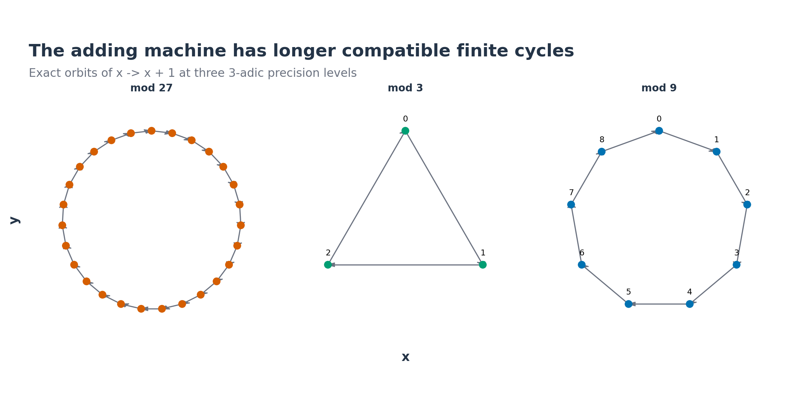

# p-Adic dynamics

**Level and prerequisites: L3–L4.** Prepare iteration of polynomial maps, derivative estimates and residue classes. The [reader guide](index.md) links the Euler arithmetic, algebra and analysis preparation and distinguishes the graduate continuation.

## Goals

Dynamics asks what repeated application of a map does. Over $\mathbb Q_p$,
ultrametric balls often remain intact under iteration, and reduction modulo
$p^N$ gives finite, computable shadows. We study contractions, derivative tests,
polynomial orbits, the adding machine, and Newton basins.

## Iteration and invariant balls

Given $F:X\to X$, the forward orbit of $x$ is

$$
x,\ F(x),\ F^2(x),\ldots.
$$

A fixed point satisfies $F(a)=a$; a point has period $r$ if
$F^r(a)=a$ and $r$ is the least positive such integer. When
$F\in\mathbb Z_p[x]$, congruent inputs have congruent outputs:

$$
x\equiv y\pmod {p^N}
\quad\Longrightarrow\quad
F(x)\equiv F(y)\pmod {p^N}.
$$

Thus $F$ induces a finite map on every ring $\mathbb Z/p^N\mathbb Z$, and the
finite systems are compatible under reduction. A *p*-adic orbit is a coherent
thread through all these finite shadows.

## Contractions

<div class="callout callout-note">
<p class="callout-title">Ultrametric contraction theorem</p>

Let $B$ be a complete closed ball and suppose $F(B)\subseteq B$. If there is
$0<c<1$ such that

$$
|F(x)-F(y)|_p\le c|x-y|_p
$$

for all $x,y\in B$, then $F$ has a unique fixed point in $B$, and every orbit in
$B$ converges to it.

</div>

Starting from $x_0\in B$, put $x_{n+1}=F(x_n)$. Then

$$
|x_{n+1}-x_n|_p\le c^n|x_1-x_0|_p.
$$

For $m>n$, the strong triangle inequality bounds
$|x_m-x_n|_p$ by the largest successive jump, at most
$c^n|x_1-x_0|_p$. Hence $(x_n)$ is Cauchy. Continuity makes the limit fixed, and
the same inequality makes two fixed points impossible.

For example, $F(x)=a+px$ maps $\mathbb Z_p$ to itself and contracts distances by
$p^{-1}$. Its unique fixed point is $a/(1-p)$, and the orbit from zero is the
geometric truncation $a(1+p+\cdots+p^{n-1})$.

## Derivative tests

Let $F$ be analytic near a fixed point $a$. Taylor expansion suggests

$$
F(x)-a=F'(a)(x-a)+O((x-a)^2).
$$

If $|F'(a)|_p<1$, a sufficiently small ball around $a$ is contracted and $a$ is
**attracting**. If $|F'(a)|_p>1$, nearby nonfixed points move away and $a$ is
**repelling**. If $|F'(a)|_p=1$, the point is **indifferent**; higher terms and
residue dynamics decide what happens.

An analytic map with unit derivative can be locally an isometry. Translation
$T(x)=x+1$ on $\mathbb Z_p$ is the central example:
$|T(x)-T(y)|_p=|x-y|_p$. It has no fixed point, and its orbit structure is not
captured by attraction or repulsion.

## Finite shadows and the adding machine

Modulo $p^N$, $T(x)=x+1$ is a single cycle of length $p^N$. Therefore the orbit
of any $x\in\mathbb Z_p$ visits every residue class modulo $p^N$ before
repeating at that precision. In the full compact space the orbit never repeats,
but it is dense: every ball is one of those residue classes and is eventually
visited. This system is called the **$p$-adic adding machine** or odometer.

<figure id="fig-dynamics-orbits">


<figcaption>

Figure 13.1: The orbit of zero under addition by one is shown modulo 3, 9, and 27; compatible colors and arrows display longer finite cycles at finer precision.

</figcaption>
</figure>

[Figure 13.1](#fig-dynamics-orbits) shows exact finite permutations. Refining precision does not
approximate a Euclidean curve; it replaces each state by three children and
lengthens the compatible cycle. The full orbit is the inverse-limit behavior of
all panels.

## Quadratic maps

Consider $F_c(x)=x^2+c$ on $\mathbb Z_p$ with $c\in\mathbb Z_p$. It preserves
$\mathbb Z_p$. Fixed points solve

$$
x^2-x+c=0,
$$

so their existence can be decided by the local square class of $1-4c$. At a
fixed point $a$, the multiplier is $2a$. For odd $p$, a unit fixed point has unit
multiplier. If instead $p\mid a$, then $|2a|_p<1$ and the fixed point is
attracting.

At $p=3$ with $c=0$, both $0$ and $1$ are fixed. The point $0$ is attracting
because $F'(0)=0$. Every $x\in3\mathbb Z_3$ satisfies
$v_3(F(x))=2v_3(x)$, so valuations double along the orbit. The point $1$ has
$|F'(1)|_3=1$ and is indifferent. These two behaviors coexist in disjoint
clopen balls.

Reduction is a strong diagnostic but not a complete classification. A cycle
modulo $p$ may grow in length, split into several cycles, or acquire attracting
directions as it is lifted through higher powers. Tracking both the cycle and
the derivative product of $F^r$ distinguishes these possibilities.

## Newton dynamics

For a polynomial $f$, Newton's map

$$
N_f(x)=x-\frac{f(x)}{f'(x)}
$$

is a rational dynamical system. A simple root $\alpha$ is a superattracting fixed
point: differentiating formally gives $N_f'(\alpha)=0$. Hensel's lemma identifies
balls contained in its basin of attraction. Different roots often own disjoint
residue balls, matching the ultrametric rule that overlapping basins cannot have
complicated Euclidean boundaries at the same scale.

Poles where $f'(x)=0$ must be excluded, and a point outside a certified Hensel
ball may wander or hit a pole. Newton's familiar real convergence picture should
not be assumed. The safe procedure is local: verify the valuation inequality,
then invoke the contraction estimate.

<div class="callout callout-warning">
<p class="callout-title">Finite-shadow pitfall</p>

A periodic orbit modulo $p^N$ need not be periodic in $\mathbb Z_p$. It records
agreement only to $N$ digits. Exact periodicity requires compatibility at every
precision level.

</div>

## A local derivative theorem with a quantitative neighborhood

The multiplier test needs control of the nonlinear terms.
Write an analytic map near a fixed point in the coordinate
$h=x-a$ as
$F(a+h)-a=\lambda h+\sum_{j\ge2}c_jh^j$.
Choose a closed disc strictly inside its convergence radius.
On a sufficiently smaller radius $r$, the numbers
$|c_j|_p r^{j-1}$ for $j\ge2$ are uniformly as small as
desired. Indeed a bound for $|c_j|_pR^j$ on a larger
disc bounds them by a constant times $r/R^2$.

For two inputs in the smaller disc, factor the difference of each
power. The strong inequality gives a Lipschitz bound whose constant
is the maximum of $|\lambda|_p$ and those nonlinear bounds.
If $|\lambda|_p<1$, choose the disc so that this maximum
is some $c<1$. Since its center is fixed, the disc is
invariant and the contraction theorem applies.

If $|\lambda|_p>1$, make every nonlinear bound strictly smaller than
$|\lambda|_p$. Then
$|F(a+h)-a|_p=|\lambda|_p|h|_p$ for nonzero $h$
in the disc. A nonfixed orbit that stays there would have
distance growing by that fixed factor at every step.
It must eventually leave. This is a local repulsion statement,
not a classification of its later orbit after leaving the disc.

If $|\lambda|_p=1$, make the nonlinear difference bounds smaller than
one. The difference quotient between any two nearby points has unit
linear part and smaller nonlinear remainder. Their distance is preserved.
Thus an analytic unit multiplier gives a local isometry on a
sufficiently small ball. It does not make the map globally a
translation or determine all of its finer cycle behavior.

### Worked example 1: an affine contraction with an exact error

For $F(x)=2+5x$, the fixed point is
$2/(1-5)=-1/2\in\mathbb Z_5$.
Starting at zero, the first four images are
$2,12,62,312$.
Induction gives
$F^n(0)=2(1+5+\cdots+5^{n-1})$.
Subtracting the fixed point leaves an error of valuation exactly
$n$, because its remaining factor is a five-adic unit.

The same formula for two starting points gives
$F^n(x)-F^n(y)=5^n(x-y)$.
Every input in the integral ring converges to the same fixed
point, and their mutual distances shrink by exactly five to the
minus n. This is stronger information than observing several
residue iterates agree.

## Finite periodicity versus exact periodicity

A finite map on a finite residue ring makes every orbit
eventually periodic. The period belongs to that finite quotient.
An exact periodic point in $\mathbb Z_p$ must satisfy one
fixed equation $F^r(x)-x=0$ for a positive integer $r$.
Being periodic at every finite level with periods allowed to
grow does not supply such an equation.

The adding machine demonstrates the distinction sharply.
Its period at level $N$ is $p^N$, increasing without bound.
An exact period $r$ would give $x+r=x$ in a
characteristic-zero field, hence the positive integer $r$ would
be zero, impossible. Nevertheless its orbit is dense:
for each residue ball there is an ordinary nonnegative integer
iterate reaching its required residue.

Density and recurrence are not the same as exact repetition.
The iterates $T^{p^N}(x)=x+p^N$ approach $x$, providing
returns arbitrarily close to the starting point.
There is still no positive time at which equality holds.
A finite display cannot distinguish those two notions unless
its conclusion names the precision and the period being observed.

### Worked example 2: one cycle growing through every precision

At three, addition by one is the cycle
$0\to1\to2\to0$ modulo three.
Modulo nine it visits all nine residues; modulo twenty-seven
all twenty-seven; modulo eighty-one all eighty-one.
Reducing any one of these cycles gives the preceding cycle,
but each old state has three children and the period grows
by a factor three.

These are exact finite statements because the nth iterate is
$x+n$. The formula simultaneously proves the growing period,
compatibility of the shadows and density of the infinite orbit.
It does not rely on extrapolating the first four levels.
This supplies a complete model for the cycle-tracking project.

## Periodic multipliers and Hensel lifting

For an exact cycle $a,F(a),\ldots,F^{r-1}(a)$,
the return map $G=F^r$ fixes $a$.
The chain rule gives
$G'(a)=\prod_{j=0}^{r-1}F'(F^j(a))$.
The local derivative theorem applies to this product.
An attracting product contracts a neighborhood under the return
map; the original iterates approach the cycle in their
corresponding time classes.

For a cycle modulo $p$, use the polynomial
$H(T)=F^r(T)-T$.
If the derivative of the return map is not one modulo
$p$, then $H'$ is a unit at the chosen residue.
Simple-root Hensel produces a unique exact fixed point of
the return map in that class.
If the residue cycle has exactly $r$ distinct states,
the lifted point also has least period $r$.
A smaller exact period would reduce to a smaller residue
period, contradicting that assumption.

When the derivative condition fails, the simple-root theorem
does not answer the question.
A cycle may split or grow, and singular root trees may
contain finite branches that later die.
One must analyze the next residual equations or another
specific theorem. Failure of a sufficient hypothesis is
not proof that a cycle fails to lift.

### Worked example 3: there may be no fixed point to classify

For $F(x)=x^2-1$, fixed points satisfy
$x^2-x-1=0$.
The discriminant is five, whose five-adic valuation is one.
It is not a square in $\mathbb Q_5$, so the map has
no fixed points in that field. There are consequently no
fixed-point multipliers over $\mathbb Q_5$ to classify.

After adjoining a square root of five, the two fixed points
become $(1+\sqrt5)/2$ and $(1-\sqrt5)/2$.
Their multipliers are $1+\sqrt5$ and $1-\sqrt5$,
both units, so they are locally indifferent there.
This extension calculation is optional, but it illustrates why
one must establish field-valued existence before applying
a derivative classification.

## Invariant subsets and information from reduction

An integral polynomial is one-Lipschitz on the integral ring.
Therefore the inverse image of a residue class at level $N$
is a union of classes at that same level.
An invariant collection of residue states lifts to a
clopen invariant set, and a cycle with incoming trees
describes which coarse states eventually enter that collection.

The finite graph has one outgoing edge from every state.
It need not have one incoming edge. Several residue
classes can merge under the map, and a state can have
no predecessor. A permutation such as the adding machine
is a special case, not the default polynomial behavior.

Refinement preserves the forward rule, but does not force
a finite cycle to keep its length.
Nor does a visible coarse attraction prove convergence to
one exact point. To obtain that conclusion, supply either
a uniform contraction estimate or a compatible exact-root
argument for the return map. The graph provides a finite
constraint; the theorem controls the infinite tail.

## Newton maps and their poles

For a simple root of a polynomial, the derivative is nonzero
in a neighborhood. Expanding the Newton map shows that its
linear error term vanishes at the root.
The corrected error is therefore at least quadratic locally.
The Hensel conditions supply an explicit ball where the
iteration remains defined and the error improves.

A zero of the derivative is a pole only when the
rational expression does not cancel there.
Either way, the displayed quotient formula cannot be
evaluated by dividing by zero. Any cancellation and
extension must be justified as a separate rational-function
identity, not silently imposed by an algorithm.

The local basin certified by Hensel is a sufficient safe
region. Outside it an orbit can converge by another
argument, fail to converge or reach a point where the
chosen formula is undefined. A few favorable iterates
do not replace a proof that all subsequent steps remain
in a valid region.

## When finite periods do certify an exact period

Let $F\in\mathbb Z_p[T]$ and fix $x\in\mathbb Z_p$. Suppose its
residue is periodic modulo every $p^N$, with least period $r_N$.
Compatibility of reduction implies $r_N\mid r_{N+1}$: a return
modulo the finer modulus is also a return modulo the coarser one,
whose least period divides every return time on that finite orbit.

If these periods are bounded, divisibility forces them eventually
to stabilize at an integer $r$. Every iterate difference
$F^r(x)-x$ is then divisible by arbitrarily large powers of $p$,
so it is zero. The point is genuinely periodic. Its least period
is $r$, because any exact period must be divisible by every
$r_N$, including the stabilized value. Conversely, an exact
period bounds all the residue periods by that integer.

Thus bounded compatible periods, rather than periodicity at each
separate precision, are the exact certificate. For the adding
machine $F(x)=x+1$, every residue is periodic and $r_N=p^N$.
The periods are unbounded, and there is no exact periodic point
in characteristic zero. This provides a precise reason that a
finite cycle display alone does not establish a periodic orbit
of the completed system.

<!-- inline-formula-code:start -->
## Formula and finite computation

A useful formula in this chapter is

$$
x_{n+1}=f(x_n)\pmod{p^N}
$$

The bounded orbit computation records state and detects repetition. The following standalone Python block expresses that finite rule with its inputs and stopping conditions visible.

```python
from math import isqrt

def is_prime(number: int) -> bool:
    """Return whether number is prime by exact trial division."""
    if number < 2:
        return False
    return all(number % divisor != 0 for divisor in range(2, isqrt(number) + 1))

def residue_orbit_certificate(
    start: int, prime: int, precision: int
) -> tuple[list[int], int, int]:
    """Return the finite orbit, preperiod, and period modulo prime**precision."""
    if not is_prime(prime) or precision <= 0:
        raise ValueError("prime must be prime and precision positive")
    modulus = prime**precision
    value = start % modulus
    positions: dict[int, int] = {}
    orbit: list[int] = []
    while value not in positions:
        positions[value] = len(orbit)
        orbit.append(value)
        value = (value * value + 1) % modulus
    preperiod = positions[value]
    period = len(orbit) - preperiod
    return orbit, preperiod, period

for precision in range(1, 7):
    orbit, preperiod, period = residue_orbit_certificate(0, prime=3, precision=precision)
    print(precision, len(orbit), preperiod, period, orbit[-1])
```

**What the computation establishes.** The calculation checks a declared finite instance; the surrounding argument explains what is true beyond those inputs.
<!-- inline-formula-code:end -->

## Summary

Polynomial maps on $\mathbb Z_p$ descend to compatible finite dynamical systems.
Contractions have unique attracting fixed points, while derivative norm
classifies simple local behavior. The adding machine is an isometric dense
orbit system. Newton iteration is dynamics whose attracting balls are certified
by Hensel estimates.

## Exercises

### Exercise 13.1 {#ex-padic-13-01}

Find the fixed point of $F(x)=2+5x$ in $\mathbb Z_5$ and compute four orbit steps from zero.

<details>
<summary>Hint 1</summary>

Solve the linear fixed-point equation.

</details>

<details>
<summary>Hint 2</summary>

The orbit values are finite geometric sums.

</details>

<details>
<summary>Full solution</summary>

The equation $(1-5)x=2$ gives $x=-1/2$, a five-adic integer. Starting at zero gives $2,12,62,312$. The nth image is $2(1+5+\cdots+5^{n-1})$ and its error from the fixed point has valuation $n$. Multiplication by five makes the map a contraction, so the fixed point is unique in the integral ring.

</details>

### Exercise 13.2 {#ex-padic-13-02}

Prove that $x\mapsto x+1$ has no periodic point in $\mathbb Z_p$.

<details>
<summary>Hint 1</summary>

Write its rth iterate.

</details>

<details>
<summary>Hint 2</summary>

A positive integer is nonzero in characteristic zero.

</details>

<details>
<summary>Full solution</summary>

The rth iterate is $x+r$. Equality with $x$ for a positive period would force $r=0$ in $\mathbb Q_p$, impossible because the field has characteristic zero. This does not contradict periodicity modulo $p^N$, where the nonzero integer $p^N$ does vanish.

</details>

### Exercise 13.3 {#ex-padic-13-03}

Describe every orbit of $x\mapsto px$ on $\mathbb Z_p$.

<details>
<summary>Hint 1</summary>

The nth iterate is a scalar multiple.

</details>

<details>
<summary>Hint 2</summary>

Track the valuation of a nonzero starting point.

</details>

<details>
<summary>Full solution</summary>

Zero is fixed. For nonzero $x$, the nth iterate is $p^nx$ and has valuation $n+v_p(x)$, tending to infinity, so the orbit converges to zero. Such an orbit has no nonzero periodic point: $p^rx=x$ would imply $(p^r-1)x=0$, impossible for nonzero $x$. Every integral starting point is in the attracting basin of zero.

</details>

### Exercise 13.4 {#ex-padic-13-04}

Analyze the fixed points of $x^2-1$ over $\mathbb Q_5$ and classify their multipliers.

<details>
<summary>Hint 1</summary>

Fixed points solve a quadratic different from the equation defining zeros of the map.

</details>

<details>
<summary>Hint 2</summary>

Its discriminant is five.

</details>

<details>
<summary>Full solution</summary>

Fixed points satisfy $x^2-x-1=0$, whose discriminant five has odd five-adic valuation. It is not a square in $\mathbb Q_5$, so there are no fixed points and no multipliers to classify over that field. In the ramified quadratic extension, the two points have multipliers $1\pm\sqrt5$, both units, but that is a different field-valued question.

</details>

### Exercise 13.5 {#ex-padic-13-05}

Draw the functional graph of $x\mapsto x^2+1$ modulo $3^3$.

<details>
<summary>Hint 1</summary>

Every state has one outgoing edge; begin with the cycles.

</details>

<details>
<summary>Hint 2</summary>

Three cycles have vertex sets {2,5,26}, {17,20,23} and {8,11,14}.

</details>

<details>
<summary>Full solution</summary>

The cycles are $2\to5\to26\to2$, $17\to20\to23\to17$ and $8\to11\to14\to8$. All remaining edges are: $0,9,18\to1\to2$; $3,6,12,15,21,24\to10\to20$; $4\to17$; $7\to23$; $13\to8$; $16\to14$; $19\to11$; $22\to26$; and $25\to5$. These nine cycle vertices and eighteen other vertices exhaust all twenty-seven residues, specifying the entire directed graph. Each edge is checked by squaring and reducing modulo twenty-seven.

</details>

### Exercise 13.6 {#ex-padic-13-06}

Show that a polynomial in $\mathbb Z_p[x]$ is $1$-Lipschitz on $\mathbb Z_p$.

<details>
<summary>Hint 1</summary>

Factor the difference of each pair of equal powers.

</details>

<details>
<summary>Hint 2</summary>

Every remaining coefficient and input factor is integral.

</details>

<details>
<summary>Full solution</summary>

For each degree $j\ge1$, $x^j-y^j=(x-y)\sum_{k=0}^{j-1}x^{j-1-k}y^k$. The second factor is integral, of norm at most one. Multiplying by an integral polynomial coefficient preserves the bound by $|x-y|_p$. Summing the finitely many monomial differences with the strong inequality gives $|F(x)-F(y)|_p\le|x-y|_p$.

</details>

### Exercise 13.7 {#ex-padic-13-07}

**Project.** Track one cycle modulo $p$ through four precision levels and classify its splitting or growth.

<details>
<summary>Hint 1</summary>

Use the adding machine as a fully specified model.

</details>

<details>
<summary>Hint 2</summary>

At level N its period is exactly p to the N.

</details>

<details>
<summary>Full solution</summary>

Choose $F(x)=x+1$ and the cycle beginning at zero. At levels one through four its periods are $p,p^2,p^3,p^4$, each one cycle covering the entire residue ring. Reduction maps each larger cycle onto the preceding cycle, with every old state having $p$ children. The cycle grows by factor $p$ at every refinement and does not split. The iterate formula $F^n(0)=n$ proves all these claims and their continuation, while also ruling out any exact positive period in $\mathbb Z_p$.

</details>

### Exercise 13.8 {#ex-padic-13-08}

Prove that the adding-machine orbit of any point is dense in $\mathbb Z_p$.

<details>
<summary>Hint 1</summary>

Every residue ball prescribes one congruence for the iterate number.

</details>

<details>
<summary>Hint 2</summary>

Choose a nonnegative representative of that residue.

</details>

<details>
<summary>Full solution</summary>

A basic ball is a class $a+p^N\mathbb Z_p$. Choose an integer $n\ge0$ satisfying $n\equiv a-x\pmod{p^N}$. Then $F^n(x)=x+n$ lies in the ball. Every nonempty open set contains such a ball, so every forward orbit meets every nonempty open set and is dense. Exact equality of a positive iterate with the start is not needed.

</details>

### Exercise 13.9 {#ex-padic-13-09}

For a period-r cycle, derive the multiplier of the return map.

<details>
<summary>Hint 1</summary>

Apply the chain rule to r compositions.

</details>

<details>
<summary>Hint 2</summary>

Evaluate each derivative at its corresponding cycle point.

</details>

<details>
<summary>Full solution</summary>

The derivative of $F^r$ at $a$ is $\prod_{j=0}^{r-1}F'(F^j(a))$. The return map fixes $a$, so its local fixed-point classification uses this product. A product norm less than one gives contraction for a sufficiently small return neighborhood; product norm greater than one gives local repulsion. Unit norm gives a local isometry after shrinking the analytic neighborhood.

</details>

### Exercise 13.10 {#ex-padic-13-10}

Explain why a cycle modulo p with return derivative not equal to one modulo p lifts to an exact cycle of the same length.

<details>
<summary>Hint 1</summary>

Apply Hensel to F composed r times minus the identity.

</details>

<details>
<summary>Hint 2</summary>

A smaller exact period would reduce to a smaller residue period.

</details>

<details>
<summary>Full solution</summary>

At a residue point of the cycle, $H=F^r-T$ vanishes modulo $p$, while $H'=(F^r)'-1$ is a unit by hypothesis. Hensel gives a unique exact root in that residue class. Its period divides $r$. If it were smaller, reduction would give a shorter period for the original residue cycle, contrary to its assumed least length $r$. Thus the exact period is $r$.

</details>
