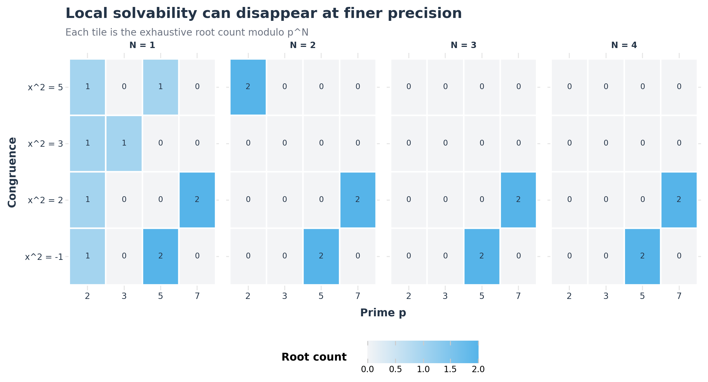
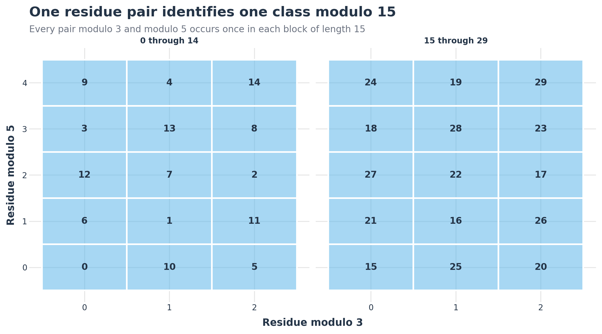

# Local information in global arithmetic

**Level and prerequisites: L3–L4.** Prepare rational congruences, local completions and elementary Diophantine equations. The [reader guide](index.md) links the Euler arithmetic, algebra and analysis preparation and distinguishes the graduate continuation.

## Goals

A rational solution must survive every completion of $\mathbb Q$. This simple
observation creates powerful obstructions and, for quadratic forms, a remarkable
local-to-global theorem. We develop careful uses of local tests, state their
limits, and introduce the adelic viewpoint.

## Local obstruction

Suppose a polynomial equation with rational coefficients has a rational
solution. The same tuple defines a solution in $\mathbb R$ and in every
$\mathbb Q_p$. Therefore failure at even one place proves there is no rational
solution.

For example, $x^2+y^2=3z^2$ has no nonzero rational solution. Clear
denominators and divide by the common gcd to obtain a primitive integer solution.
Modulo $3$, squares are $0$ or $1$, so $x^2+y^2\equiv0$ forces both $x$ and $y$
divisible by $3$. The original equation then forces $z$ divisible by $3$, a
contradiction. This is a $3$-adic obstruction expressed as infinite descent.

A first congruence failure is enough, but success modulo $p$ may not be enough.
One should test higher powers or use Hensel's lemma. The equation
$x^2+1=0$ has a solution modulo $2$ but none modulo $4$, hence none in
$\mathbb Q_2$.

<figure id="fig-local-solvability">


<figcaption>

Figure 14.1: For x squared congruent to selected integers, exact root counts are shown across primes and precision levels using exhaustive finite searches.

</figcaption>
</figure>

[Figure 14.1](#fig-local-solvability) records exhaustive finite congruence data. A zero count at
any level is a rigorous local obstruction. A positive count is evidence to
investigate, not by itself a proof of a compatible root; simple roots, however,
are certified by Hensel's lemma.

The Chinese remainder theorem gives a complementary constructive picture:
compatible residue data at coprime moduli determine one class modulo their
product.

<figure id="fig-congruence-crt-grid">


<figcaption>

Figure 14.2: Residues modulo 3 and modulo 5 form a complete coordinate grid for residues modulo 15.

</figcaption>
</figure>

[Figure 14.2](#fig-congruence-crt-grid) shows the finite mechanism. It does not turn arbitrary
local solutions into a global rational solution: coprime congruences are the
special setting in which the reconstruction theorem applies directly.

## Rational squares at every place

A nonzero rational $a$ is a square in $\mathbb Q$ if and only if it is positive
in $\mathbb R$ and is a square in every $\mathbb Q_p$. Necessity is immediate.
For sufficiency, write the prime factorization of $a$. Local squareness forces
every $v_p(a)$ to be even. Thus $a$ is a positive rational times a rational
square with no remaining prime factors, hence itself a rational square.

For this literal rational-square criterion, the proof does not require checking
an uncontrolled family of residue symbols: local squareness forces even
valuation at each prime, and positivity at the real place then finishes the
global factorization argument. The familiar reduction to finitely many relevant
places is a separate feature of local tests for a fixed quadratic form, developed
below; there, coefficients, discriminants, and the prime $2$ identify the places
that need explicit work, while reciprocity organizes the remaining local
invariants.

## Conics and quadratic forms

<div class="callout callout-note">
<p class="callout-title">Hasse–Minkowski theorem</p>

A quadratic form over $\mathbb Q$ represents zero nontrivially over $\mathbb Q$
if and only if it represents zero nontrivially over $\mathbb R$ and every
$\mathbb Q_p$.

</div>

Equivalently, a smooth projective conic over $\mathbb Q$ has a rational point if
and only if it has a point over every completion. The forward implication is the
local-obstruction principle. The reverse implication is deep: local
compatibility is sufficient for quadratic forms. A full proof uses classification
of local quadratic forms, Hilbert symbols, reciprocity, and descent.

The theorem makes local computation decisive. Diagonalize the form, check the
real signature, then inspect finitely many relevant primes. At odd primes the
square criterion and valuation reductions often settle the question; the prime
$2$ requires the finer unit classes from Chapter 10.

For nonzero $a,b$, a **Hilbert symbol** $(a,b)_p\in\{1,-1\}$ records whether
$z^2=ax^2+by^2$ has a nontrivial solution over $\mathbb Q_p$, under a standard
equivalent definition. Its exact formulas are compact encodings of valuation and
residue tests. Hilbert reciprocity asserts

$$
\prod_{v}(a,b)_v=1,
$$

with $v$ over all finite and infinite places. The resemblance to the product
formula for absolute values is structural: local invariants are constrained
globally.

For an odd prime, the symbol is completely explicit. Write

$$
a=p^\alpha u,\qquad b=p^\beta v,
$$

where $u,v$ are $p$-adic units, and let
$\left(\frac{\cdot}{p}\right)$ denote the Legendre symbol of a unit residue.
Then

$$
(a,b)_p
=(-1)^{\alpha\beta (p-1)/2}
\left(\frac{u}{p}\right)^\beta
\left(\frac{v}{p}\right)^\alpha.
$$

Only the parities of $\alpha$ and $\beta$ matter in the last two exponents.
At the real place, $(a,b)_\infty=-1$ exactly when both $a$ and $b$ are
negative. The prime $2$ has a separate unit formula depending on residues
modulo $8$; using the odd-prime expression there is wrong.

The following implementation accepts exact rational inputs. It strips their
valuation factors before taking unit residues, so denominators and negative
valuations are handled rather than silently rounded.

```python
from fractions import Fraction
from math import isqrt

def is_odd_prime(number: int) -> bool:
    """Return whether number is an odd prime."""
    if number < 3 or number % 2 == 0:
        return False
    return all(number % divisor for divisor in range(3, isqrt(number) + 1, 2))

def rational_valuation(value: Fraction, prime: int) -> int:
    """Return v_p(value) for a nonzero rational value."""
    if value == 0:
        raise ValueError("the Hilbert symbol requires nonzero inputs")
    numerator = abs(value.numerator)
    denominator = value.denominator
    exponent = 0
    while numerator % prime == 0:
        numerator //= prime
        exponent += 1
    while denominator % prime == 0:
        denominator //= prime
        exponent -= 1
    return exponent

def unit_residue(value: Fraction, prime: int) -> int:
    """Return the nonzero residue of p**(-v_p(value)) * value."""
    exponent = rational_valuation(value, prime)
    if exponent >= 0:
        unit = value / prime**exponent
    else:
        unit = value * prime ** (-exponent)
    return unit.numerator * pow(unit.denominator, -1, prime) % prime

def legendre_unit(residue: int, prime: int) -> int:
    """Return the Legendre symbol of a nonzero residue."""
    residue %= prime
    if residue == 0:
        raise ValueError("a unit residue must be nonzero")
    power = pow(residue, (prime - 1) // 2, prime)
    return 1 if power == 1 else -1

def odd_hilbert_symbol(
    first_value: Fraction, second_value: Fraction, prime: int
) -> int:
    """Return the quadratic Hilbert symbol (a,b)_p for an odd prime p."""
    if not is_odd_prime(prime) or first_value == 0 or second_value == 0:
        raise ValueError("use nonzero rationals and an odd prime")
    alpha = rational_valuation(first_value, prime)
    beta = rational_valuation(second_value, prime)
    sign = -1 if alpha * beta * ((prime - 1) // 2) % 2 else 1
    first_unit_symbol = legendre_unit(unit_residue(first_value, prime), prime)
    second_unit_symbol = legendre_unit(unit_residue(second_value, prime), prime)
    return sign * (first_unit_symbol if beta % 2 else 1) * (
        second_unit_symbol if alpha % 2 else 1
    )

for local_prime in (3, 5, 7):
    row = [
        odd_hilbert_symbol(Fraction(first), Fraction(second), local_prime)
        for first, second in ((-1, -1), (local_prime, local_prime), (2, local_prime))
    ]
    print(local_prime, row)
```

**What this code proves and does not prove.** Each output is an exact evaluation
of the displayed odd-prime formula. It neither implements the $2$-adic case nor
proves that the formula agrees with norm solvability; that agreement and Hilbert
reciprocity are theorems.

## Adeles

An adele is a tuple

$$
(x_\infty,x_2,x_3,x_5,\ldots)
\in\mathbb R\times\prod_p'\mathbb Q_p
$$

whose $p$-adic component lies in $\mathbb Z_p$ for all but finitely many primes.
The prime on the product means **restricted product**. This restriction makes
the adelic ring locally compact. A rational number embeds diagonally by using
the same rational at every place.

Adeles do not claim that a real number and a *p*-adic number can be added across
components. Operations are coordinatewise. Their advantage is organizational:
one object holds every local approximation while remembering that almost all
finite components are integral. The quotient of the adeles by diagonally
embedded $\mathbb Q$ is compact, a global fact underlying harmonic analysis and
modern number theory.

### Ideles and strong approximation

The multiplicative companion is the idele group

$$
\mathbb A_{\mathbb Q}^{\times}
=\mathbb R^\times\times\prod_p'\mathbb Q_p^\times,
$$

where now $x_p\in\mathbb Z_p^\times$ for almost all $p$. Requiring only
$x_p\ne0$ would be insufficient: the componentwise inverse must also be an
adele. The quotient

$$
\mathbb A_{\mathbb Q}^{\times}/\mathbb Q^\times
$$

is the idele class group. It is the global home for reciprocity characters and
explains why Chapter 44 asks for an idele-class character rather than unrelated
local logarithms.

For an idele $x$, its module is the finite product

$$
|x|_{\mathbb A}=|x_\infty|\prod_p|x_p|_p.
$$

The product is finite because almost every $x_p$ is a unit. A diagonal
$r\in\mathbb Q^\times$ has $|r|_{\mathbb A}=1$ by the product formula.

There are two approximation statements worth keeping distinct:

- $\mathbb Q$ is dense in the finite adeles
  $\mathbb A_{\mathbb Q,f}$; simultaneous finite-place neighborhoods reduce
  to a Chinese-remainder construction with denominators.
- $\mathbb Q$ is discrete, not dense, in the full adele ring because the real
  component is present; nevertheless $\mathbb A_{\mathbb Q}/\mathbb Q$ is
  compact.

The first statement is strong approximation away from the infinite place. The
second supplies the compact quotient used in adelic Fourier analysis. Neither
asserts that an arbitrary tuple of exact local solutions comes from one rational
solution.

## When local data is not enough

The Hasse principle is special, not universal. Some higher-degree equations and
some genus-one curves have points over $\mathbb R$ and every $\mathbb Q_p$ but no
rational point. Such failures are not contradictions: completion forgets part
of the global gluing problem.

For an elliptic curve, local solvability participates in a descent calculation.
The resulting Selmer group gives a finite, computable container for the quotient
of rational points by multiplication and for part of the Tate–Shafarevich
group. Nontrivial elements of the latter encode certain everywhere locally
solvable torsors without rational points. These statements are an outlook, not a
claim that local checks alone solve arbitrary Diophantine equations.

<div class="callout callout-important">
<p class="callout-title">Logic of a local test</p>

No local solution implies no rational solution. Local solutions everywhere imply
a rational solution only when a theorem supplies that implication, as
Hasse–Minkowski does for quadratic forms.

</div>

## A practical local workflow

For an equation over $\mathbb Q$:

1. clear denominators and remove common factors;
2. check real sign or size obstructions;
3. identify primes dividing coefficients, denominators, discriminants, and often
   $2$;
4. test congruences at increasing powers;
5. use Hensel at nonsingular residue solutions;
6. treat singular solutions separately; and
7. invoke a local-to-global theorem only after verifying its hypotheses.

This workflow converts an infinite search into finitely many targeted local
calculations whenever the surrounding theorem permits.

## Homogeneous equations and primitive local inputs

An affine rational equation is often best tested after homogenization.
For $x^2+y^2=3$, clear denominators to obtain
$A^2+B^2=3C^2$ with integers having no common factor and
$C\ne0$. Any rational solution would give such a primitive triple.
A congruence obstruction should be applied to that triple,
rather than assuming the original rational coordinates were integral.

### Worked example 1: a complete two-adic obstruction

Modulo four, a square is zero or one.
If $C$ is odd, the right side is three modulo four,
which cannot be the sum of two squares.
If $C$ is even, the right side is zero modulo four.
The left side is zero only when both $A$ and $B$
are even. All three coordinates would then have a common
factor two, contradicting primitivity.
Thus no rational solution exists.

The same proof gives no nontrivial solution over $\mathbb Q_2$.
Scale a hypothetical local triple by a power of two
so that all coordinates are integral and at least one
is a unit. The two cases above force every coordinate
to be even, a contradiction.
This explicitly shows how a finite congruence supports a
completed-field impossibility conclusion.

The direction of inference matters. A contradiction modulo four
rules out all exact solutions because an exact solution
would reduce to one. Finding a residue solution supplies
only a necessary condition unless a lifting theorem or a
compatible all-level argument supplies the converse.

## A local-to-global statement proved by factorisation

For a nonzero rational $a$, write
$a=\varepsilon\prod_p p^{m_p}$ with sign
$\varepsilon\in\{1,-1\}$ and finitely many nonzero integer
exponents. If $a$ is a square in every local field,
each $m_p$ is even. If it is also positive at the
real place, the sign is one. Then
$\prod_p p^{m_p/2}$ is a rational square root.

This proof is finite despite the all-place statement.
Only primes appearing in the numerator or denominator can
have nonzero valuation. A negative rational is excluded by
the real place. For a positive rational whose exponents
are all even, the constructed global root automatically
gives roots at every other prime, including their unit conditions.
There is no need to test an unbounded sequence of
residue symbols after the global factorisation has finished.

### Worked example 2: one number at four places

For six, valuations at two and three are odd,
so neither completion contains a square root.
At five it is a unit with residue one,
so a simple square root lifts.
At seven it is a unit with residue six,
not among the nonzero squares one, two and four.
Thus one local success coexists with several local failures.

The number six is positive, so its real square root
exists. This real success also cannot remove a finite-place
obstruction. The square criterion combines the sign and
all finite exponents because each records independent
necessary information about a rational square.

## What is imported for conics?

The reverse Hasse–Minkowski implication is a named deep input
in this chapter. We do not prove Hilbert reciprocity
or the full classification of local quadratic forms here.
The rational-square proof above is a complete special case
and should not be mistaken for a proof of the
higher-dimensional theorem.

For a nonsingular ternary diagonal form, however, we can
prove why almost all odd primes are automatically harmless.
At a prime not dividing its three coefficients or two,
write the reduction as $aX^2+bY^2+cZ^2$.
The sets $\{aX^2\}$ and $\{-c-bY^2\}$ in
$\mathbb F_p$ each have $(p+1)/2$ elements.
Their sizes sum to more than $p$, so they intersect.
This gives a solution with $Z=1$.

Fix the chosen residues of $X,Y$ as integers and lift
the variable $Z$. Its derivative at one is $2c$,
a unit. Simple-root Hensel gives a nontrivial integral
local solution. Thus only the real place, two,
and primes dividing those coefficients need explicit
work for this ternary form.
The argument does not assert that every binary
quadratic form is automatically soluble at good odd primes.

For an affine problem, also check that the projective
solution lies in the required chart.
A point on the homogenizing hyperplane may not answer
the original affine question.
The theorem concerns nontrivial homogeneous zeroes or
projective points; translating it into another formulation
requires keeping that domain distinction visible.

## Proving finite-adelic approximation by CRT

A basic finite-adelic neighborhood prescribes congruences
$r-x_p\in p^{N_p}\mathbb Z_p$ at finitely many primes
$S$ and asks for integrality outside $S$.
Enlarge $S$ to include every nonintegral target component.
Choose $D=\prod_{p\in S}p^{m_p}$ so that
$Dx_p$ is integral and $L_p=N_p+m_p\ge0$.

Choose an integer $a$ with
$a\equiv Dx_p\pmod{p^{L_p}}$ at each constrained prime.
Each right side is an ordinary finite residue.
The moduli are coprime, so CRT supplies $a$.
Then $r=a/D$ has the requested local precision.
Outside $S$, its denominator is a unit, so it is integral.
This proves density of the diagonal rationals in the
finite adeles with the actual restricted-product topology.

This density statement does not ask for an independently
prescribed real approximation at the same time.
For finitely many finite-place constraints and one real
interval, weak approximation can introduce an auxiliary
denominator prime outside $S$.
That additional denominator may violate the integrality
condition at its own place, so this is a different
neighborhood problem.

### Worked example 3: include a real interval without losing the distinction

Require $r\equiv1\pmod9$, $r\equiv2\pmod{25}$ and
$0<r<1/100$. The rational $r=97/65536$ works.
The denominator has residues seven modulo nine and
eleven modulo twenty-five. The numerator has residues
seven and twenty-two respectively, giving the required
quotients. The real bound follows from $9700<65536$.

The auxiliary denominator is a power of two.
Thus this rational is not integral at two.
It satisfies the three selected approximation requirements,
but it does not lie in a finite-adelic neighborhood
that also requires integrality at every unlisted prime.
This concrete example explains why weak approximation,
finite-adelic strong approximation and full-adelic density
are not interchangeable phrases.

For the general weak-approximation construction, use
denominator $Dq^M$ with an auxiliary prime $q\notin S$.
The same CRT constraints determine a numerator class
modulo a fixed integer $L$.
Varying its representative changes the rational by
steps $L/(Dq^M)$, which tend to zero ordinarily.
For large $M$, one such representative falls in any
specified nonempty real interval.

## Discreteness and a compact adelic quotient

In the full adeles, the neighborhood
$(-1/2,1/2)\times\prod_p\mathbb Z_p$
contains no nonzero rational diagonal.
Integrality at every finite place forces a rational
to be an integer; the real bound then forces zero.
Thus the diagonal subgroup is discrete.
This is exactly the restriction absent from density
in the finite adeles.

Every adele can be adjusted by a rational so that
all its finite components become integral.
Apply CRT to clear its finitely many nonintegral
components, with precision chosen only to achieve integrality.
Then subtract an integer to put the real component
in $[0,1]$, preserving finite integrality.

Consequently every coset has a representative in
$[0,1]\times\prod_p\mathbb Z_p$.
That set is compact by countable-product compactness.
One may prove this instance by diagonal subsequences
and the standard product metric, since all its factors
are compact metric spaces.
Its continuous image is the entire adelic quotient,
so that quotient is compact.

These proofs explain the elementary topology claimed above.
They do not prove class field theory or show that
an arbitrary family of exact local solutions comes
from a rational point. Approximation supplies finite
precision agreement; equality in a nonlinear equation
is an additional requirement.

<!-- inline-formula-code:start -->
## Formula and finite computation

A useful formula in this chapter is

$$
ax\equiv b\pmod{p^N}
$$

The solver returns all solution classes, including nonunit cases. The following standalone Python block expresses that finite rule with its inputs and stopping conditions visible.

```python
from math import gcd, isqrt

def is_prime(number: int) -> bool:
    """Return whether number is prime by exact trial division."""
    if number < 2:
        return False
    return all(number % divisor != 0 for divisor in range(2, isqrt(number) + 1))

def linear_congruence_solutions(
    coefficient: int, target: int, prime: int, precision: int
) -> list[int]:
    """Return every x modulo p**precision satisfying coefficient*x = target."""
    if not is_prime(prime) or precision <= 0:
        raise ValueError("prime must be prime and precision positive")
    modulus = prime**precision
    common = gcd(coefficient, modulus)
    if target % common:
        return []
    reduced_modulus = modulus // common
    reduced_coefficient = coefficient // common
    reduced_target = target // common
    first = (pow(reduced_coefficient, -1, reduced_modulus) * reduced_target) % (
        reduced_modulus
    )
    solutions = sorted(
        (first + offset * reduced_modulus) % modulus
        for offset in range(common)
    )
    if any((coefficient * value - target) % modulus for value in solutions):
        raise ArithmeticError("a reported solution failed its congruence")
    return solutions

solutions = linear_congruence_solutions(9, 18, prime=3, precision=5)
print(len(solutions), solutions)
print(linear_congruence_solutions(9, 20, prime=3, precision=5))
```

**What the computation establishes.** The calculation checks a declared finite instance; the surrounding argument explains what is true beyond those inputs.
<!-- inline-formula-code:end -->

## Summary

Every rational solution gives a solution at each place, so one local obstruction
proves global impossibility. For rational squares and quadratic forms, suitable
local conditions are also sufficient. Product and reciprocity laws coordinate
the places, while adeles package them. Beyond quadratic settings, everywhere
local solvability can fail to glue globally.

## Exercises

### Exercise 14.1 {#ex-padic-14-01}

Use a congruence modulo $4$ (a $2$-adic obstruction) to show $x^2+y^2=3$ has no rational solution.

<details>
<summary>Hint 1</summary>

Clear denominators to a primitive integer triple.

</details>

<details>
<summary>Hint 2</summary>

Separate odd and even values of the homogenizing coordinate.

</details>

<details>
<summary>Full solution</summary>

A rational solution gives primitive integers with $A^2+B^2=3C^2$ and $C\ne0$. If $C$ is odd, the right side is three modulo four, impossible for a sum of two squares. If $C$ is even, the sum is zero modulo four, forcing both $A$ and $B$ even. Then all coordinates are even, contradicting primitivity. Thus no rational solution exists.

</details>

### Exercise 14.2 {#ex-padic-14-02}

Determine whether $6$ is a square in $\mathbb Q_p$ for $p=2,3,5,7$.

<details>
<summary>Hint 1</summary>

Begin with the valuation at each place.

</details>

<details>
<summary>Hint 2</summary>

At the remaining odd primes, test the unit residue.

</details>

<details>
<summary>Full solution</summary>

At two and three its valuation is one, so it is not a square. At five it is a unit congruent to one, so Hensel gives square roots. At seven it is congruent to six, not among the nonzero squares one, two and four, so no square root exists. Exactly one of the four listed places, $p=5$, gives a square root.

</details>

### Exercise 14.3 {#ex-padic-14-03}

Find all primes $p\le13$ for which $x^2=-1$ has a solution in $\mathbb Q_p$.

<details>
<summary>Hint 1</summary>

At two use the unit test modulo eight.

</details>

<details>
<summary>Hint 2</summary>

For odd primes, minus one is a square exactly when the cyclic residue group has an element of order four.

</details>

<details>
<summary>Full solution</summary>

At two, minus one is seven modulo eight and is not a square. At an odd prime, the residue condition is $p\equiv1\pmod4$; its simple roots then lift. Among $3,5,7,11,13$, this holds exactly for five and thirteen. Hence the answer is $p=5,13$. The finite-group condition follows because the cyclic multiplicative group has an element of order four precisely when four divides its order.

</details>

### Exercise 14.4 {#ex-padic-14-04}

Explain why an adele may have $x_p=p^{-1}$ at only finitely many primes.

<details>
<summary>Hint 1</summary>

Recall the integrality restriction defining the finite restricted product.

</details>

<details>
<summary>Hint 2</summary>

Each such component has valuation minus one.

</details>

<details>
<summary>Full solution</summary>

The component $p^{-1}$ is outside $\mathbb Z_p$. An adele must be integral at all but finitely many finite places, so infinitely many such components violate its defining condition. A tuple can exist in the unrestricted Cartesian product without belonging to the adele ring.

</details>

### Exercise 14.5 {#ex-padic-14-05}

Give an example where a root modulo $p$ does not lift modulo $p^2$.

<details>
<summary>Hint 1</summary>

Use x squared plus one at two.

</details>

<details>
<summary>Hint 2</summary>

Every odd square is one modulo four.

</details>

<details>
<summary>Full solution</summary>

For $f(x)=x^2+1$, the residue one is a root modulo two. Every lift is odd and has square one modulo four, so its polynomial value is two modulo four. There is no lift modulo four. Its derivative is zero modulo two, so the simple-root Hensel hypothesis fails exactly where the obstruction appears.

</details>

### Exercise 14.6 {#ex-padic-14-06}

Prove the local-to-global criterion for a rational number to be a square.

<details>
<summary>Hint 1</summary>

Use even prime exponents forced by local squareness.

</details>

<details>
<summary>Hint 2</summary>

Use the real place to determine the sign.

</details>

<details>
<summary>Full solution</summary>

A rational square is a square at every completion and is positive when nonzero. Conversely, factor a nonzero rational as a sign times a finite product of prime powers. Local squareness makes every exponent even. Real positivity makes the sign positive. The finite product of the half-exponent prime powers is a rational square root. Zero is an additional trivial square if included in the statement.

</details>

### Exercise 14.7 {#ex-padic-14-07}

**Project.** For a diagonal conic, implement local searches and document which conclusions are rigorous obstructions and which require a theorem.

<details>
<summary>Hint 1</summary>

Use a fixed homogeneous form and separate primitive residue tests from arbitrary zero tuples.

</details>

<details>
<summary>Hint 2</summary>

For a complete supplied model use A squared plus B squared minus3C squared.

</details>

<details>
<summary>Full solution</summary>

Choose $A^2+B^2-3C^2=0$ and require a primitive triple. The modulo-four argument in Exercise1 rules out every such local triple at two, so it already proves global impossibility. A search specification must reject the all-zero residue when testing a projective point and must prove coverage of the finite residue domain. In a different conic where finite searches succeed, document Hensel hypotheses or all-level compatibility; rational existence then requires the stated Hasse–Minkowski input and a valid affine chart when relevant. No search or implementation was executed for this model.

</details>

### Exercise 14.8 {#ex-padic-14-08}

Prove that the diagonal rational subgroup is discrete in the full adele ring.

<details>
<summary>Hint 1</summary>

Choose a neighborhood with all finite components integral.

</details>

<details>
<summary>Hint 2</summary>

A sufficiently short real interval excludes all nonzero integers.

</details>

<details>
<summary>Full solution</summary>

Use $(-1/2,1/2)\times\prod_p\mathbb Z_p$. A rational diagonal in it has no denominator prime and is an integer. Its ordinary absolute value is less than one half, forcing zero. Translation gives an isolating neighborhood for every rational diagonal point, so the subgroup is discrete.

</details>

### Exercise 14.9 {#ex-padic-14-09}

Verify that $97/65536$ satisfies the three approximation conditions in the worked example and name its exceptional denominator place.

<details>
<summary>Hint 1</summary>

Reduce numerator and denominator modulo9 and25.

</details>

<details>
<summary>Hint 2</summary>

Check the ordinary inequality by multiplying by the positive denominator.

</details>

<details>
<summary>Full solution</summary>

Modulo nine the numerator and denominator both equal seven, so the quotient is one. Modulo twenty-five they are twenty-two and eleven, so the quotient is two. The inequalities follow from positivity and $100\cdot97<65536$. The denominator is a power of two, and the numerator is odd, so the rational is not integral at two. Thus it does not satisfy an additional all-unlisted-primes integrality condition.

</details>

### Exercise 14.10 {#ex-padic-14-10}

For a nonsingular ternary diagonal form at a good odd prime, prove existence of a nonsingular residue zero and a local lift.

<details>
<summary>Hint 1</summary>

Intersect the two square-value sets with Z fixed to one.

</details>

<details>
<summary>Hint 2</summary>

Their sizes add to p+1, and the Z derivative is a unit.

</details>

<details>
<summary>Full solution</summary>

If $a,b,c$ are units modulo the odd prime, each of $\{aX^2\}$ and $\{-c-bY^2\}$ has $(p+1)/2$ elements. They intersect, giving $aX^2+bY^2+c=0$ with $Z=1$. Fix those first two residues as integral representatives and lift $Z$ in the one-variable equation. Its derivative $2c$ at one is a unit, so Hensel gives a local solution with nonzero Z. The coefficient-unit and odd-prime hypotheses are necessary for this argument.

</details>
