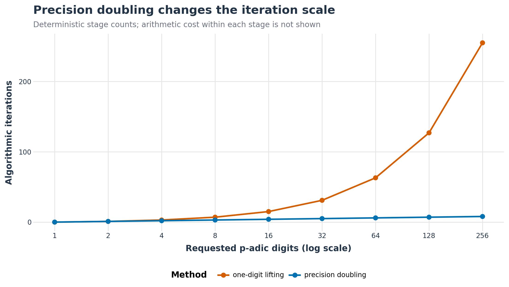

# Algorithms, projects, and further vistas

**Level and prerequisites: L3–L4.** Prepare finite-precision arithmetic, Hensel lifting and algorithm correctness. The [reader guide](index.md) links the Euler arithmetic, algebra and analysis preparation and distinguishes the graduate continuation.

## Goals

We consolidate the computational ideas into precision-safe algorithms, design
tests that express mathematical invariants, and map routes into more advanced
subjects. This chapter is both a capstone and a launch point.

## A certified representation

Represent a nonzero approximation by a record

```text
PadicApprox(
    prime = p,
    valuation = m,
    unit = u modulo p^N,
    relative_precision = N
)
```

with $0\le u<p^N$ and $p\nmid u$. Its meaning is

$$
x\in p^m(u+p^N\mathbb Z_p).
$$

A zero-like result needs `ZeroBall(prime=p, absolute_precision=K)`, meaning only
$x\in p^K\mathbb Z_p$. It must not pretend that $x=0$ exactly. Normalization
removes leading zero digits from $u$, increases $m$, and decreases relative
precision while keeping absolute precision $m+N$ fixed.

For addition, align powers, add residues at the common absolute precision, and
normalize. For multiplication, add valuations and multiply unit residues modulo
the smaller usable precision. For inversion, negate the valuation and invert the
unit modulo $p^N$. Each operation should return a mathematical postcondition as
well as a value.

## Core algorithms

### Valuation

Repeated exact division computes $v_p(n)$ without factoring $n$. Binary inputs
permit faster bit operations for $p=2$. For rational $a/b$, reduce if convenient
and subtract the two integer valuations. A denominator of zero is an input error;
the valuation of a zero numerator is $+\infty$.

### Digit extraction

For $a/b\in\mathbb Z_p$ with $p\nmid b$, calculate $b^{-1}\pmod {p^N}$ and
return $a b^{-1}\pmod {p^N}$. Iterative extraction is slower but streams digits
and exposes carries. The postcondition is

$$
b r\equiv a\pmod {p^N}.
$$

### Fast Hensel lifting

Maintain an approximation $a$ and modulus $p^N$ satisfying the theorem's
valuation hypotheses. Compute a Newton correction using an inverse of $f'(a)$
to enough precision, reduce the result modulo $p^{2N}$, and independently verify
the new residual. Precision doubling gives quasi-logarithmic iteration count in
the requested number of digits; polynomial and big-integer arithmetic dominate
the actual cost.

<figure id="fig-lifting-cost">


<figcaption>

Figure 15.1: Deterministic iteration counts for one-digit and precision-doubling lifts are shown against requested p-adic digits.

</figcaption>
</figure>

[Figure 15.1](#fig-lifting-cost) plots algorithmic iteration counts, not wall-clock benchmarks.
Newton's curve counts precision-doubling stages under valid hypotheses. For small
inputs overhead can dominate, but asymptotically the number of stages is far
smaller.

## Rational reconstruction

Given $r\pmod {p^N}$, rational reconstruction seeks relatively small integers
$a,b$ with $p\nmid b$ and

$$
a\equiv br\pmod {p^N}.
$$

The extended Euclidean algorithm or lattice reduction in dimension two can find
candidates. Uniqueness requires ordinary absolute-value bounds: if
$|a|,|a'|\le A$ and $1\le|b|,|b'|\le B$ with $2AB<p^N$, then two reduced
candidates satisfying the congruence must coincide. Indeed,
$p^N$ divides $ab'-a'b$, while the absolute value of this integer is strictly
less than $p^N$.

Reconstruction is a hypothesis, followed by verification. A short residue can
fit many rationals when no size bound is stated. After finding $a/b$, recompute
its digits to the full modulus.

## Tests as mathematics

Good property tests mirror the theory:

- normalization preserves the represented residue ball;
- $v_p(xy)=v_p(x)+v_p(y)$ whenever both are certified nonzero;
- $(x+y)-x$ agrees with $y$ at the predicted common precision;
- a reported inverse satisfies $uv\equiv1\pmod {p^N}$;
- truncating from precision $N$ to $M<N$ commutes with arithmetic;
- every Hensel output satisfies both compatibility and the residual congruence;
- changing representatives inside input balls does not change certified output
  digits.

Random examples should use a fixed seed and include adversarial cancellation,
negative valuations, $p=2$, and singular derivatives. Exact small exhaustive
tests often catch more errors than large random integers.

<div class="callout callout-warning">
<p class="callout-title">Implementation pitfall</p>

Never use ordinary floating-point division to decide divisibility or extract a
digit. All certificates are exact integer congruences. A plot may display a
normalized real coordinate, but the algorithm behind it must retain exact data.

</div>

## Three substantial projects

### Project A: polynomial residue tree

Choose $f\in\mathbb Z[x]$ and a prime $p$. Enumerate roots modulo $p^N$ for
successive $N$, joining each root to its reductions. Mark simple and singular
nodes using $f'$. Prove that every infinite path defines a root in $\mathbb Z_p$,
then compare brute force with Hensel lifting.

### Project B: Haar experiment

Generate independent base-$p$ digits, estimate the distribution of $v_p(X)$,
and compare it to $p^{-k}(1-p^{-1})$. Add confidence intervals only for the
simulation; display the exact probabilities separately. Extend the experiment
to $v_p(f(X))$ for a polynomial and formulate a conjecture before attempting a
proof by residue classes.

### Project C: roots across primes

For a fixed integral polynomial, count roots modulo $p$ across the first several
hundred primes, mark which are simple, and lift selected roots. Relate observed
patterns to factorization over finite fields. Any density claim should be labeled
empirical unless justified by an appropriate theorem such as Chebotarev's.

## Further vistas

Classical power-series analysis works naturally on discs, but gluing analytic
functions across *p*-adic domains leads to **rigid analytic geometry**. Its
Grothendieck topology compensates for pathological open covers. **Berkovich
spaces** enlarge the point set so analytic spaces become path-connected in a
meaningful topology; the extra points encode nested discs and valuations.

In arithmetic geometry, **$p$-adic Hodge theory** compares representations of
local Galois groups with linear-algebra objects carrying Frobenius and
filtrations. It is one of the main bridges between etale, de Rham, and crystalline
cohomology. Reaching it requires algebraic number theory, homological algebra,
and algebraic geometry beyond this text.

The *p*-adic logarithm and integration also help construct **$p$-adic
$L$-functions**, which interpolate special values in a *p*-adic variable.
Modular forms, Iwasawa theory, and deformation theory use complete local rings
and congruences as structural coordinates, not merely approximation tools.

In dynamics, one can study Julia sets, ergodicity, entropy, and Berkovich
dynamical systems. In mathematical physics and probability, ultrametric trees
model hierarchical interactions. These applications share the same foundational
lesson: proximity means agreement at deep levels of a branching structure.

## A route forward

For local algebra, continue with ramification, local class field theory, and
Galois cohomology. For analysis, study Mahler expansions, distributions, Fourier
analysis, and rigid spaces. For number theory, pair local fields with algebraic
number theory, quadratic forms, and adeles. For computation, implement a small
certified library before using a computer algebra system; the exercise makes
precision semantics impossible to ignore.

## A postcondition describes every represented input

The most important output of a precision-aware routine is a statement,
not a printed residue. For a nonzero record, the invariant says
that every represented element has the displayed valuation and the
specified unit digits. A zero ball instead records only a lower
valuation bound and may contain exact zero. Converting one type into
the other requires a visible nonzero digit below the absolute
precision threshold.

Suppose two inputs have valuations minus two and three and ten
relative digits each. Their absolute thresholds are eight and thirteen.
The smaller-valuation input cannot be cancelled by the other, so the
sum has valuation minus two and absolute threshold eight.
Its relative precision remains ten. This calculation uses both
error propagation and the unequal-valuation rule; either part alone
would leave the output record incomplete.

If two representatives do cancel at their common threshold, returning
a zero ball is a successful result. Guessing an exact zero would
be an unjustified stronger claim. Requesting more input precision
may later reveal a leading digit, but arithmetic cannot recover
digits that were never supplied.

### Worked example 1: certify a scaled input before inversion

Take $x=9(2+O(3^4))$. Its valuation is two and its absolute
precision is six. Invert the unit two modulo $3^4$, obtaining
the residue forty-one. The inverse record is
$3^{-2}(41+O(3^4))$, whose absolute threshold is two.
The product of the unit representatives is one modulo
$3^4$, certifying the unit inversion.

The original input and its inverse both have four relative
digits, although their absolute thresholds differ by four.
A verification that checks only the unit residue but forgets
the valuation shift would not certify the intended field element.
A record includes the scale precisely to avoid that mistake.

## Rational reconstruction as a lattice problem

Let $M=p^N$. The integer pairs satisfying the residue equation form
the lattice
$L=\{(a,b):a-rb\equiv0\pmod M\}$.
It has basis $(M,0)$ and $(r,1)$:
every pair is $(Mk+rb,b)$ for integers $k,b$.
Its determinant is $M$.

A candidate rational must additionally have nonzero denominator prime to
$p$, satisfy the stated ordinary size bounds, and be reduced.
These requirements are not consequences of lattice membership.
A very short numerator paired with a denominator divisible by $p$
may describe no invertible rational residue at the requested precision.

For two reduced candidates within bounds $A,B$, the cross difference
$a b'-a'b$ is divisible by $M$ and has ordinary absolute
value at most $2AB$. If $2AB<M$, it must vanish.
The two fractions are equal. A positive-denominator convention then
makes their reduced pairs equal as well.

Uniqueness does not imply existence. A residue might admit no
candidate in the box. A complete finite search can enumerate
positive denominators at most $B$ that are prime to $p$,
and for each one examine the numerator residues in $[-A,A]$.
Every permitted fraction appears in that search. Euclidean or lattice
methods can find candidates faster, but their returned pair still
needs the same residue, coprimality and size checks.

### Worked example 2: reconstruct one third, with a stated bound

At modulus $625$, the residue $417$ satisfies
$3\cdot417\equiv1\pmod{625}$.
With numerator bound ten and positive denominator bound ten,
$2AB=200<625$. The reduced fraction $1/3$ is an admissible
candidate, so it is the unique rational within those bounds
having that residue.

Without size bounds there are infinitely many possibilities:
every integer $417+625k$ has the same residue.
With a smaller permitted box there may be none.
For example at modulus five, residue two has no candidate
with numerator absolute value at most one and positive
denominator at most one. The uniqueness inequality holds,
but the three possible numerators give different residues.

These distinctions prevent reconstruction from being mistaken for an
automatic global identification. Finite local information specifies a
ball. An ordinary height bound is the additional information that
can isolate one rational inside it.

## Mathematical correctness and finite implementation evidence

An invariant proof covers every legal input under its declared
representation. A finite enumeration covers exactly its stated finite
domain. They can support one another, but they answer different
questions. The proof of Newton precision improvement comes from
an algebraic identity; a finite comparison of implementations can
detect a disagreement without establishing the identity universally.

For a valuation routine, termination follows because repeated exact
division decreases the ordinary magnitude of a nonzero integer.
For a digit extractor, each step has a unique next digit
because the denominator is a unit modulo the chosen prime.
For a root-lifting routine, the residual congruence and the
derivative-unit condition are the loop invariant. An error message
for a singular derivative is a correct refusal of that
routine's domain, not a proof that no root exists.

Specifications should describe zero inputs, negative valuations and
degenerate moduli before discussing performance.
They should also distinguish mathematical integers from machine
integers if a fixed-width implementation is intended.
The existing reference listings use exact integers; an implementation
with overflow would need additional reasoning about its arithmetic model.

No execution is supplied by the mathematical contracts in this
chapter. The project questions ask a learner to construct and
inspect implementations. Their universal correctness arguments, finite
output records and any empirical timings should remain separately
identified in the resulting work.

### Worked example 3: compare lifting stages by a theorem

For $f(T)=T^2+1$ at five and start two, the initial residual
has valuation one and the derivative is a unit.
Exact Newton iteration has
$f(N_f(a))=(f(a)/(2a))^2$.
Its residual valuations are therefore exactly
$1,2,4,8,16,32,64,128$ at successive exact iterates.

Seven updates suffice to certify at least one hundred
digits, with the last modular result reduced to that
requested precision. One-digit lifting from precision one
uses ninety-nine nominal digit upgrades.
These are stage counts, not wall-clock measurements.
The Newton stages manipulate increasingly large integers;
one cannot infer their actual relative runtimes from the
number of loop iterations alone.

## Complete project models at a manageable scale

For Project A, choose $f(T)=T^2-1$ and prime three.
The two roots modulo three have unit derivatives, so
every level has exactly two roots, the residues of one
and minus one. Through four levels their pairs are
$(1,2)$, $(1,8)$, $(1,26)$ and $(1,80)$.
The residue tree consists of two disjoint compatible
paths. The proof accounts for all roots, rather than
merely displaying two successful branches.

A visualization of that project can label every node by
its exact residue and draw its reduction edge. A text
table of levels, residues and parent residues supplies
the same mathematical information. Color may distinguish
branches but must not carry the only distinction.
There is no need to claim an experimental discovery:
the simple-root theorem already proves the all-level pattern.

For Project B, fix digit depth before interpreting a
sample. Valuation $k$ below that depth has probability
$p^{-k}(1-p^{-1})$; the all-zero word records a censored
valuation at least the depth. It is not exact zero.
A frequency table should retain that final category and
state sampling uncertainty separately from the exact law.

For Project C, a local root at one prime is not a
rational root. The polynomial $T^2-2$ has simple roots
at seven and no rational root, as its odd two-adic
valuation would contradict being a rational square.
A table of primes can suggest a splitting pattern,
but an asymptotic density conclusion needs its own
algebraic and distribution theorem.

## Extra points beyond classical coordinates

A closed disc with center $a$ and radius $r$ defines
a multiplicative polynomial seminorm by expanding in powers
of $T-a$ and taking the largest weighted coefficient norm.
The Gauss-norm argument of Chapter 19 proves the required
multiplicativity. Such a seminorm records the whole disc,
rather than selecting a single classical point inside it.

For a nested sequence of discs, these polynomial seminorm
values decrease. Their limits retain multiplicativity and
the strong inequality, because those identities and
inequalities pass to limits of nonnegative real numbers.
Even an empty intersection can therefore define meaningful
limiting polynomial data. This is part of the reason
Berkovich geometry enlarges the point set.

The classification and topology of those points belong to
the later geometric chapter. The elementary core has
provided the valuation, discs, polynomial norms and
precision distinctions needed to read that continuation
without treating an extra point as an undiscovered
ordinary coordinate.

<!-- inline-formula-code:start -->
## Formula and finite computation

A useful formula in this chapter is

$$
c_i\equiv a_i+b_i+\operatorname{carry}_i\pmod p
$$

The digit ledger exposes every carry instead of hiding machine arithmetic. The following standalone Python block expresses that finite rule with its inputs and stopping conditions visible.

```python
def add_digits(
    left: list[int], right: list[int], prime: int
) -> tuple[list[int], list[int]]:
    """Add equal-length base-p digit lists modulo p**N and expose carries."""
    if prime < 2 or len(left) != len(right) or not left:
        raise ValueError("use equal nonempty lists and prime >= 2")
    if any(not 0 <= digit < prime for digit in left + right):
        raise ValueError("digits must lie in the canonical range")
    result: list[int] = []
    carries: list[int] = []
    carry = 0
    for left_digit, right_digit in zip(left, right, strict=True):
        carry, digit = divmod(left_digit + right_digit + carry, prime)
        result.append(digit)
        carries.append(carry)
    return result, carries

result, carries = add_digits([2, 2, 1, 0], [2, 1, 2, 2], prime=3)
print(result, carries)
```

**What the computation establishes.** The calculation checks a declared finite instance; the surrounding argument explains what is true beyond those inputs.
<!-- inline-formula-code:end -->

## Summary

Reliable *p*-adic software stores valuation, residue, and precision together.
Core algorithms reduce to exact modular arithmetic, with Newton methods providing
rapid lifting and inversion. Tests should assert valuation and congruence
invariants. The same concepts lead onward to local class field theory, rigid and
Berkovich geometry, arithmetic geometry, dynamics, and $p$-adic $L$-functions.

## Capstone exercises

### Exercise 15.1 {#ex-padic-15-01}

Specify the exact precision returned when adding inputs of valuations $-2$ and $3$, each known to ten relative digits.

<details>
<summary>Hint 1</summary>

Convert relative precision to absolute thresholds.

</details>

<details>
<summary>Hint 2</summary>

Unequal valuations prevent leading-term cancellation.

</details>

<details>
<summary>Full solution</summary>

The absolute input thresholds are eight and thirteen. Addition is certified at their minimum, eight. The output valuation is minus two because the inputs have unequal visible valuations. Thus the output has $8-(-2)=10$ relative digits. The second input cannot cancel the leading term of the first.

</details>

### Exercise 15.2 {#ex-padic-15-02}

Prove the rational-reconstruction uniqueness bound stated above.

<details>
<summary>Hint 1</summary>

Cross-multiply two candidate fractions.

</details>

<details>
<summary>Hint 2</summary>

The cross difference is a multiple of the modulus but smaller in ordinary magnitude.

</details>

<details>
<summary>Full solution</summary>

For candidates $a/b,a'/b'$ with unit denominators, their residue equations imply $M\mid ab'-a'b$. The bounds give $|ab'-a'b|_\infty\le2AB<M$. Therefore the integer cross difference is zero and the fractions are equal. Reduced pairs with positive denominators are then identical. The argument proves at most one candidate; it does not guarantee existence.

</details>

### Exercise 15.3 {#ex-padic-15-03}

Design exhaustive tests for inversion modulo $p^N$ for all primes $p\le7$ and $N\le5$.

<details>
<summary>Hint 1</summary>

State the finite arithmetic domain without assuming every residue is invertible.

</details>

<details>
<summary>Hint 2</summary>

Bezout gives existence precisely for residues prime to p.

</details>

<details>
<summary>Full solution</summary>

The finite specification uses primes $2,3,5,7$, exponents one through five and all residues from zero to $p^N-1$. Exactly $p^N-p^{N-1}$ are units. For each unit a reported inverse must be in the residue range and multiply to one modulo the modulus; uniqueness follows by multiplying a difference by that unit. Every nonunit must be refused as having no inverse, including zero. One may compare a Euclidean construction with direct finite enumeration as independent discovery methods. This answer specifies the mathematics of the existing task; no executable suite or finite output was created or run.

</details>

### Exercise 15.4 {#ex-padic-15-04}

Compare one-digit and Newton lifts of a simple root through 100 digits, recording verified residual valuations.

<details>
<summary>Hint 1</summary>

Use x squared plus one at five, starting at two.

</details>

<details>
<summary>Hint 2</summary>

Exact Newton residual valuations double, while one-digit precision advances one level.

</details>

<details>
<summary>Full solution</summary>

For the fixed polynomial and start, exact Newton gives residual valuations $1,2,4,8,16,32,64,128$ by $f(N_f(a))=(f(a)/(2a))^2$ and the unit derivative. Seven updates therefore suffice, followed by reduction modulo $5^{100}$. One-digit lifting has nominal certified levels $1,2,\ldots,100$, using ninety-nine upgrades; a specific residual can sometimes exceed its nominal level. These are proved precision ledgers, not records of executed routines or timings. A supplied implementation must additionally verify its actual modular residuals and coefficient precision.

</details>

### Exercise 15.5 {#ex-padic-15-05}

Explain which extra point data lets a Berkovich line represent a nested family of discs; consult the reading guide for a rigorous treatment.

<details>
<summary>Hint 1</summary>

A disc determines values of a polynomial seminorm.

</details>

<details>
<summary>Hint 2</summary>

A nested sequence can have limiting seminorms even if its classical intersection is empty.

</details>

<details>
<summary>Full solution</summary>

Expand each polynomial in the disc coordinate and take its weighted Gauss norm. This is multiplicative and extends the coefficient absolute value. For a nested sequence, take the decreasing limit of those values for each polynomial; products and the strong inequality survive that limit. These seminorm data can describe a point associated with the family even without a classical coordinate in every disc. The full equivalence and topology of such data require the later Berkovich treatment; an arbitrary label for a hidden classical point would not provide the needed structure.

</details>

### Exercise 15.6 {#ex-padic-15-06}

Give a one-page proposal for one of Projects A–C, including a theorem to verify and a visualization plan.

<details>
<summary>Hint 1</summary>

Choose the fully specified simple-root tree of T squared minus one at three.

</details>

<details>
<summary>Hint 2</summary>

List precision levels and reduction edges, then use Hensel to justify completeness.

</details>

<details>
<summary>Full solution</summary>

A complete Project A proposal fixes $f(T)=T^2-1$, prime three and four displayed precision levels. Its theorem is that each level has exactly the two roots $\pm1$, each lifting uniquely. The data table records residues $(1,2),(1,8),(1,26),(1,80)$ and parent reductions. A two-branch tree displays the same information, with all labels in text. The proof checks the two initial roots and their unit derivatives, then invokes simple-root uniqueness. Further output may compare exhaustive discovery with lifting, but the mathematical conclusion does not depend on such an execution.

</details>

### Exercise 15.7 {#ex-padic-15-07}

**Synthesis.** Starting from a congruence root, narrate every structural layer used to reach an exact local root and then a global arithmetic conclusion.

<details>
<summary>Hint 1</summary>

For T squared minus two at seven, begin with the simple residue three.

</details>

<details>
<summary>Hint 2</summary>

A global conclusion may be impossibility, rather than existence.

</details>

<details>
<summary>Full solution</summary>

The residue three solves $T^2-2$ modulo seven and has unit derivative. The next-digit rule produces compatible roots at every power. Their representatives are Cauchy; completion gives a seven-adic limit, and polynomial continuity proves it is an exact root. Unequal-valuation reasoning and Hensel uniqueness identify its branch. For the global conclusion, a rational square root of two would have an even two-adic valuation when squared, but two has odd valuation one. Thus the local root exists while no rational root does. Local construction alone would not justify global existence.

</details>

### Exercise 15.8 {#ex-padic-15-08}

At modulus625 and bounds A=B=10, prove that residue417 reconstructs uniquely to one third.

<details>
<summary>Hint 1</summary>

Verify the candidate residue first.

</details>

<details>
<summary>Hint 2</summary>

The ordinary cross-difference bound is200, below625.

</details>

<details>
<summary>Full solution</summary>

The reduced candidate $1/3$ satisfies $3\cdot417=1251\equiv1\pmod{625}$, and its numerator and denominator meet the bounds. Since $2AB=200<625$, the proved uniqueness argument excludes every distinct rational in that box. Without those bounds, the infinitely many integers $417+625k$ are additional compatible rationals.

</details>

### Exercise 15.9 {#ex-padic-15-09}

Describe a lattice basis for all integer pairs satisfying a-rb divisible by M.

<details>
<summary>Hint 1</summary>

Solve a=rb+Mk.

</details>

<details>
<summary>Hint 2</summary>

The two free integer parameters give two generators.

</details>

<details>
<summary>Full solution</summary>

Every pair has the form $k(M,0)+b(r,1)$, and every such combination satisfies the congruence. These independent vectors form a basis with determinant $M$. Unit denominator, coprimality and ordinary bounds are additional reconstruction conditions, not automatic lattice properties.

</details>

### Exercise 15.10 {#ex-padic-15-10}

Why must an all-zero word of depth N remain a censored valuation category in a Haar experiment?

<details>
<summary>Hint 1</summary>

The word represents the whole ball p to the N times Zp.

</details>

<details>
<summary>Hint 2</summary>

That ball contains exact zero and all higher valuation shells.

</details>

<details>
<summary>Full solution</summary>

Its probability is $p^{-N}$. Every represented input has valuation at least $N$, but it can have valuation exactly $N$, any larger integer, or be zero. A finite word therefore supplies no exact valuation or exact-zero conclusion. Keeping this category separate preserves the total probability and avoids assigning the probability of a large residue ball to one null singleton.

</details>
