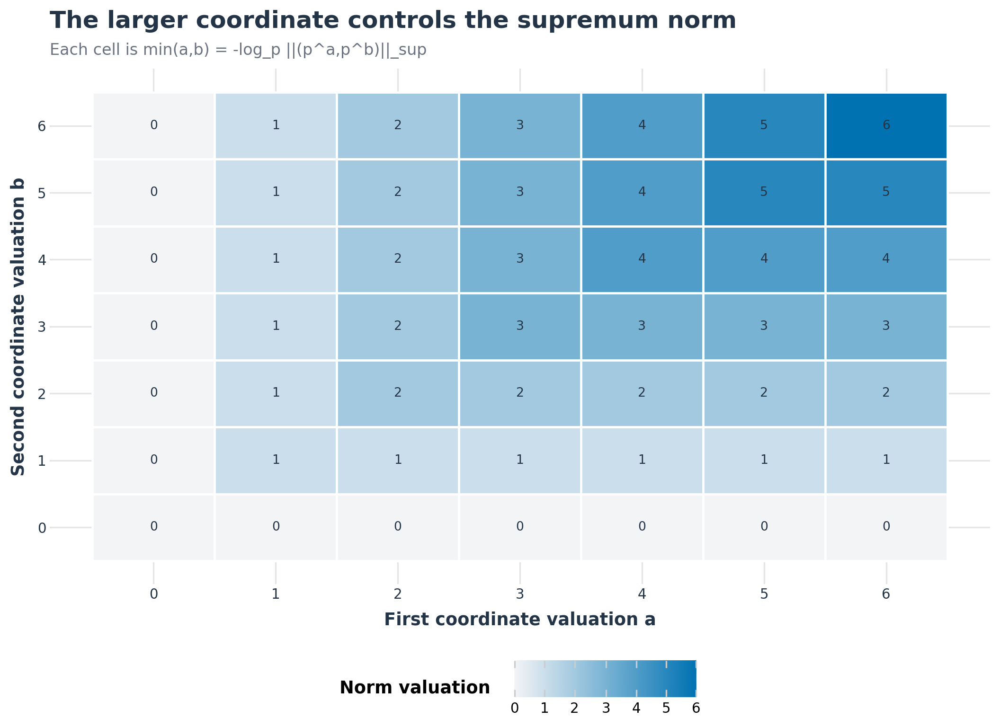

# Non-Archimedean Banach spaces {#sec-banach-spaces}

**Level and prerequisites: L5.** Prepare normed vector spaces, Banach spaces and complete valued fields. The [reader guide](index.md) links the Euler arithmetic, algebra and analysis preparation and distinguishes the graduate continuation.

## Goals and prerequisites

Chapters 3, 4, and 7 supplied ultrametric distance, completeness, and convergent
series. We now let points be vectors and functions rather than single numbers.
The result is functional analysis over $\mathbb Q_p$: a language for linear
operators, infinite-dimensional spaces, and nonlinear fixed-point equations.

## Normed vector spaces over a valued field

Let $K$ be a complete non-Archimedean field, such as $\mathbb Q_p$ or a finite
extension. A **vector space over $K$** is a set whose vectors can be added and
multiplied by scalars in $K$, with the familiar distributive and associative
laws. A non-Archimedean norm is a function $\|\cdot\|:V\to\mathbb R_{\ge0}$ such
that

$$
\|v\|=0\Longleftrightarrow v=0,
\qquad \|av\|=|a|\,\|v\|,
\qquad \|v+w\|\le\max\{\|v\|,\|w\|\}.
$$

The induced distance is $d(v,w)=\|v-w\|$. The basic example on $K^n$ is the
**supremum norm**

$$
\|(x_1,\ldots,x_n)\|_{\sup}=\max_i|x_i|.
$$

The strong triangle inequality follows coordinate by coordinate. Weighted
versions $\max_i c_i|x_i|$ are also norms when $c_i>0$.

<figure id="fig-banach-sup">


<figcaption>

Figure 16.1: Vectors with coordinates p to the a and p to the b are colored by the valuation of their supremum norm, which is the smaller coordinate valuation.

</figcaption>
</figure>

In [Figure 16.1](#fig-banach-sup), a vector $(p^a,p^b)$ has
$-\log_p\|(p^a,p^b)\|_{\sup}=\min\{a,b\}$. Moving only the more divisible
coordinate does not shrink the vector. Both coordinates must become small.

## Orthogonality without angles

Vectors $e_1,\ldots,e_r$ are **orthogonal** in the ultrametric sense if

$$
\left\|\sum_{i=1}^r a_i e_i\right\|
=\max_i |a_i|\,\|e_i\|
$$

for all scalars $a_i$. The standard basis of $K^n$ is orthogonal for the
supremum norm. This definition uses no dot product or angle. It says that terms
of different sizes cannot hide one another and that equal-size cancellation is
ruled out by the chosen basis.

Finite-dimensional normed spaces over a complete non-Archimedean field are
complete, and all norms on a fixed finite-dimensional space are equivalent.
One proves this by choosing a basis, comparing the given norm with a weighted
supremum norm, and using compactness of a suitable unit sphere when the base
field is locally compact. Over more general complete fields the theorem remains
true, but the proof uses a careful basis estimate rather than real compactness.

<div class="callout callout-warning">
<p class="callout-title">Orthogonality pitfall</p>

There is no automatic *p*-adic version of the Euclidean inner product. A
Gram–Schmidt algorithm may require square roots or divisions whose norms are
uncontrolled. Use the norm identity above, and state separately when an inner
product is present.

</div>

## Banach spaces and sequence examples

A complete normed vector space is a **Banach space**. Let

$$
c_0(K)=\{(x_n)_{n\ge0}:x_n\to0\}
$$

with $\|x\|=\sup_n|x_n|$. This is a Banach space. To see completeness, take a
Cauchy sequence of sequences $x^{(m)}$. Each coordinate is Cauchy in $K$ and has
a limit $x_n$. Uniform Cauchy control shows $x^{(m)}\to x$ in the supremum norm.
The same control, followed by one fixed approximant in $c_0(K)$, shows
$x_n\to0$.

The larger space $\ell^\infty(K)$ of bounded sequences is also Banach. Unlike
real analysis, summability in a complete non-Archimedean field is governed by
terms tending to zero. The map

$$
(x_n)\longmapsto\sum_{n\ge0}x_n
$$

is therefore defined on $c_0(K)$ and has operator norm at most $1$.

## Bounded linear operators

A linear map $T:V\to W$ is **bounded** if some $C$ satisfies
$\|Tv\|\le C\|v\|$ for every $v$. Its operator norm is

$$
\|T\|=\sup_{v\ne0}\frac{\|Tv\|}{\|v\|}.
$$

Boundedness and continuity are equivalent. Operator norms are
non-Archimedean:

$$
\|S+T\|\le\max\{\|S\|,\|T\|\},
\qquad \|ST\|\le\|S\|\,\|T\|.
$$

For a matrix $A=(a_{ij})$ acting on $K^n$ with the supremum norm,
$\|A\|\le\max_{i,j}|a_{ij}|$, and equality is obtained by applying $A$ to an
appropriate standard basis vector.

### Neumann series

<div class="callout callout-note">
<p class="callout-title">Operator inversion theorem</p>

If $V$ is Banach and $T:V\to V$ is bounded with $\|T\|<1$, then $I-T$ is
invertible and

$$
(I-T)^{-1}=I+T+T^2+T^3+\cdots.
$$

</div>

The terms $T^n$ tend to zero in operator norm because
$\|T^n\|\le\|T\|^n$. The non-Archimedean series criterion gives convergence in
the Banach algebra of bounded operators. Multiplying a finite partial sum gives

$$
(I-T)(I+T+\cdots+T^N)=I-T^{N+1},
$$

and the remainder tends to zero. This proves both left and right inversion.

For example, if $A$ is a matrix with every entry in $p\mathbb Z_p$, then
$I-A$ is invertible over $\mathbb Z_p$, and successive sums certify its inverse
modulo growing powers of $p$.

## Nonlinear contractions

Linearity is not required for the contraction theorem. If $F$ maps a nonempty closed
subset of a Banach space to itself and

$$
\|F(v)-F(w)\|\le c\|v-w\|,\qquad c<1,
$$

then iteration from any chosen point of that subset converges to its unique fixed point. Systems of analytic equations can
often be rewritten in this form after a Hensel or Newton estimate. The vector
norm packages simultaneous coordinate precision.

## Infinite-dimensional cautions

Some familiar real theorems need extra hypotheses. A closed bounded set need not
be compact. Continuous linear functionals may not extend with unchanged norm
over every valued field; spherical completeness becomes relevant. Orthogonal
bases need not exist in arbitrary Banach spaces. These are warnings about
scope, not failures of the elementary operator results proved above.

<!-- inline-formula-code:start -->
## Formula and finite computation

A useful formula in this chapter is

$$
\|(x_1,\ldots,x_n)\|_p=\max_i|x_i|_p
$$

A finite coordinate norm exhibits the non-Archimedean maximum rule. The following standalone Python block expresses that finite rule with its inputs and stopping conditions visible.

```python
from fractions import Fraction

def valuation(number: int, prime: int) -> int:
    if number == 0:
        raise ValueError("valuation of zero is represented separately")
    exponent, remaining = 0, abs(number)
    while remaining % prime == 0:
        remaining //= prime
        exponent += 1
    return exponent

prime = 3
coordinates = [9, 27, 6]
norms = [Fraction(1, prime**valuation(value, prime)) for value in coordinates]
print(norms, max(norms))
```

**What the computation establishes.** The output certifies only the declared finite case. The theorem, if one is claimed, still requires the argument developed in the chapter.
<!-- inline-formula-code:end -->

## Summary

Non-Archimedean norms replace sums of sizes by maxima. Supremum norms make
coordinate precision explicit, Banach spaces supply limits, and bounded
operators form a complete normed algebra. Neumann series invert small
perturbations of the identity, while contraction estimates solve nonlinear
fixed-point problems.

## Exercises

<div class="exercise" id="p_adic_numbers-16-banach-spaces-ex-1">
<p class="exercise-title"><strong>Exercise 1</strong></p>

Prove directly that the supremum norm on $K^n$ is non-Archimedean.

</div>

<div class="exercise" id="p_adic_numbers-16-banach-spaces-ex-2">
<p class="exercise-title"><strong>Exercise 2</strong></p>

Compute the operator norm of a matrix on $K^n$ with the supremum norm.

</div>

<div class="exercise" id="p_adic_numbers-16-banach-spaces-ex-3">
<p class="exercise-title"><strong>Exercise 3</strong></p>

Show that the right-shift map on $c_0(K)$ has norm $1$.

</div>

<div class="exercise" id="p_adic_numbers-16-banach-spaces-ex-4">
<p class="exercise-title"><strong>Exercise 4</strong></p>

If $\|T\|<1$, bound the error after truncating the Neumann series at $T^N$.

</div>

<div class="exercise" id="p_adic_numbers-16-banach-spaces-ex-5">
<p class="exercise-title"><strong>Exercise 5</strong></p>

Prove that a closed subspace of a Banach space is Banach.

</div>

<div class="exercise" id="p_adic_numbers-16-banach-spaces-ex-6">
<p class="exercise-title"><strong>Exercise 6</strong></p>

Give two vectors that are linearly independent but not orthogonal for a
chosen norm.

</div>

**Support.** For Exercise 2, test standard basis vectors after proving the upper
bound. In Exercise 4 the error operator is
$T^{N+1}(I-T)^{-1}$ and has norm at most $\|T\|^{N+1}$ because the inverse has
norm at most $1$. For Exercise 5, a Cauchy sequence in the subspace converges in
the ambient space, and closedness keeps its limit inside.
