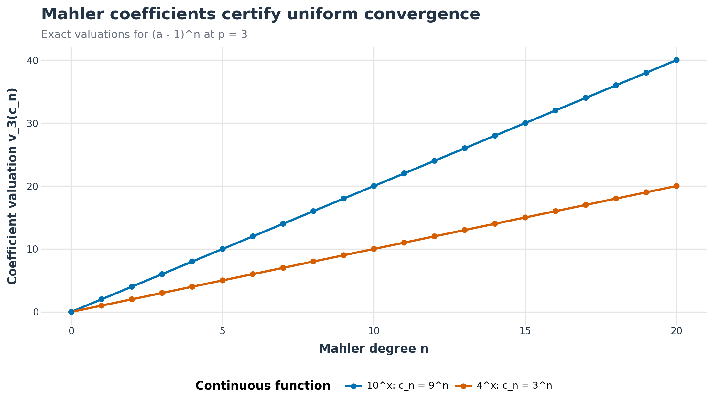

# Continuous functions and Mahler expansions {#sec-mahler}

**Level and prerequisites: L5.** Prepare continuous functions on compact spaces, finite differences and Banach norms. The [reader guide](index.md) links the Euler arithmetic, algebra and analysis preparation and distinguishes the graduate continuation.

## Goals and motivation

Power series describe analytic functions, but continuity is much broader.
Mahler's theorem gives every continuous function on $\mathbb Z_p$ a canonical
series in binomial polynomials. The coefficients come from finite differences,
so the theory connects exact integer data, uniform continuity, and *p*-adic
analysis.

## Binomial polynomials are integer-valued

For $n\ge0$, define

$$
\binom{x}{n}=\frac{x(x-1)\cdots(x-n+1)}{n!},
\qquad \binom{x}{0}=1.
$$

The coefficients are rational, yet $\binom{m}{n}$ is an integer whenever
$m\ge0$ is an integer. The Pascal identity

$$
\binom{x+1}{n}-\binom{x}{n}=\binom{x}{n-1}
$$

holds as a polynomial identity. Since nonnegative integers are dense in
$\mathbb Z_p$ and the polynomial is continuous, its values lie in
$\mathbb Z_p$ for every $x\in\mathbb Z_p$.

These polynomials are adapted to translation by $1$, just as monomials are
adapted to multiplication and differentiation.

## Finite differences

For a function $f$ on nonnegative integers, define

$$
(\Delta f)(m)=f(m+1)-f(m).
$$

Iterating gives $\Delta^n f$. The $n$th **Mahler coefficient** is

$$
c_n=(\Delta^n f)(0)
=\sum_{j=0}^n(-1)^{n-j}\binom{n}{j}f(j).
$$

The finite Newton interpolation identity says

$$
f(m)=\sum_{n=0}^m c_n\binom{m}{n}
$$

for every nonnegative integer $m$. One proof inducts on $m$ using Pascal's
identity. Another observes that $\Delta$ lowers the binomial basis exactly:
$\Delta\binom{x}{n}=\binom{x}{n-1}$.

### Polynomial example

For $f(x)=x^2$, the values $0,1,4,9,\ldots$ have first differences
$1,3,5,\ldots$ and constant second difference $2$. Hence

$$
x^2=\binom{x}{1}+2\binom{x}{2}.
$$

All later coefficients vanish, as they must for a polynomial of degree $2$.

## Mahler's theorem

<div class="callout callout-note">
<p class="callout-title">Mahler expansion theorem</p>

A function $f:\mathbb Z_p\to\mathbb Q_p$ is continuous if and only if it has a
unique uniformly convergent expansion

$$
f(x)=\sum_{n=0}^{\infty}c_n\binom{x}{n}
$$

with $c_n\to0$. The coefficients are $c_n=(\Delta^n f)(0)$, computed from the
values of $f$ on nonnegative integers.

</div>

If $c_n\to0$, the series converges uniformly because
$|\binom{x}{n}|_p\le1$ on $\mathbb Z_p$. Uniform limits of continuous functions
are continuous. Conversely, uniform continuity says that sufficiently close
integers have close function values. Combining this with the alternating-sum
formula and congruence properties of binomial coefficients forces
$c_n\to0$. The finite interpolation identity first proves equality on
$\mathbb Z_{\ge0}$; density and continuity extend it to all $\mathbb Z_p$.

The difficult direction is the decay estimate. A full proof groups the index
$n$ by powers of $p$ and rewrites high differences using translations small in
the *p*-adic metric. The theorem's scope here is one variable on $\mathbb Z_p$;
multivariable and vector-valued versions require corresponding completeness
hypotheses.

## Exponential data as a worked expansion

Let $a\in1+p\mathbb Z_p$. The binomial theorem on nonnegative integers gives

$$
a^m=(1+(a-1))^m
=\sum_{n=0}^m(a-1)^n\binom{m}{n}.
$$

Because $(a-1)^n\to0$, Mahler's theorem extends this formula continuously:

$$
a^x=\sum_{n\ge0}(a-1)^n\binom{x}{n},
\qquad x\in\mathbb Z_p.
$$

For $p=3$, the functions $4^x$ and $10^x$ have coefficient valuations $n$ and
$2n$, respectively.

<figure id="fig-mahler-decay">


<figcaption>

Figure 17.1: Mahler coefficient valuations for two continuous exponential functions on the 3-adic integers grow linearly, certifying uniform convergence.

</figcaption>
</figure>

[Figure 17.1](#fig-mahler-decay) plots coefficient information, not ordinary function height.
Higher valuation means a smaller coefficient. The steeper sequence therefore
converges more rapidly in the uniform *p*-adic norm.

## Interpolation and regularity

Finite differences make interpolation constructive: compute $f(0),f(1),\ldots$
and successive difference rows, then read the first entry in each row. Mere
decay $c_n\to0$ characterizes continuity. Faster decay characterizes stronger
regularity. For example, analytic functions have coefficient decay constrained
relative to $n!$; Lipschitz conditions impose quantitative divisibility on
blocks of coefficients. We state this only as a guide because exact criteria
depend on normalization.

### Locally constant functions as a test case

Let $f$ be constant on every residue class modulo $p^r$. Such a function is
continuous because each point has a whole radius-$p^{-r}$ ball on which the
value does not change. Its integer values repeat with period $p^r$, yet its
Mahler expansion is usually infinite. Periodic ordinary data can therefore have
an infinite but convergent *p*-adic interpolation.

Uniform continuity gives a practical coefficient estimate. If

$$
x\equiv y\pmod {p^r}\Longrightarrow
f(x)\equiv f(y)\pmod {p^s},
$$

then sufficiently high finite differences are divisible by $p^s$. Increasing
$s$ and selecting a corresponding $r$ forces $c_n\to0$. This is the engine in
the hard direction of Mahler's theorem: coefficient decay is a compressed record
of every continuity modulus.

Conversely, truncate at a degree $N$ after which $|c_n|_p<\varepsilon$. The
finite initial sum is uniformly continuous, and the whole tail has norm below
$\varepsilon$. This supplies an explicit approximation scheme: a continuous
function is uniformly approximated by integer-valued binomial polynomials, with
the first omitted coefficient norms certifying the error.

<div class="callout callout-warning">
<p class="callout-title">Interpolation pitfall</p>

Arbitrary values assigned to nonnegative integers do not automatically extend
continuously to $\mathbb Z_p$. The values must respect *p*-adic nearness. The
coefficient test $c_n\to0$ detects precisely this compatibility.

</div>

## Measures and dynamics

A bounded *p*-adic measure can be studied through its integrals of
$\binom{x}{n}$. If these moments are $b_n$, then integrating a Mahler expansion
formally gives $\int f=\sum c_n b_n$ whenever the bounds justify convergence.
This turns continuous-function questions into coefficient questions.

For a continuous dynamical map $F:\mathbb Z_p\to\mathbb Z_p$, expanding
coordinate functions in the Mahler basis can test whether $F$ is
$1$-Lipschitz or measure preserving. Full classification theorems are beyond
this chapter, but finite differences provide exact data for experiments.

<!-- inline-formula-code:start -->
## Formula and finite computation

A useful formula in this chapter is

$$
a_k=(\Delta^kf)(0)
$$

Successive finite differences are precisely the Mahler coefficients. The following standalone Python block expresses that finite rule with its inputs and stopping conditions visible.

```python
def mahler_coefficients(values: list[int]) -> list[int]:
    """Return forward-difference coefficients from consecutive integer samples."""
    if not values:
        raise ValueError("provide at least one sample")
    row = values.copy()
    coefficients: list[int] = []
    while row:
        coefficients.append(row[0])
        row = [right - left for left, right in zip(row, row[1:])]
    return coefficients

samples = [n * n for n in range(7)]
print(samples)
print(mahler_coefficients(samples))
```

**What the computation establishes.** The calculation checks a declared finite instance; the surrounding argument explains what is true beyond those inputs.
<!-- inline-formula-code:end -->

## Summary

Binomial polynomials form the natural coordinate system for continuous
functions on $\mathbb Z_p$. Finite differences compute the unique coefficients,
and convergence to zero is exactly the continuity condition. Polynomial and
exponential examples show how algebraic data becomes a uniformly convergent
interpolation.

## Exercises

<div class="exercise" id="p_adic_numbers-17-mahler-expansions-ex-1">
<p class="exercise-title"><strong>Exercise 1</strong></p>

Prove the Pascal identity as a polynomial identity.

</div>

<div class="exercise" id="p_adic_numbers-17-mahler-expansions-ex-2">
<p class="exercise-title"><strong>Exercise 2</strong></p>

Find the Mahler expansion of $x^3$.

</div>

<div class="exercise" id="p_adic_numbers-17-mahler-expansions-ex-3">
<p class="exercise-title"><strong>Exercise 3</strong></p>

Compute the first five coefficients for $f(m)=(-1)^m$ at $p=3$. Do they
suggest a continuous extension to $\mathbb Z_3$?

</div>

<div class="exercise" id="p_adic_numbers-17-mahler-expansions-ex-4">
<p class="exercise-title"><strong>Exercise 4</strong></p>

Prove that $c_n=(a-1)^n$ for the data $f(m)=a^m$.

</div>

<div class="exercise" id="p_adic_numbers-17-mahler-expansions-ex-5">
<p class="exercise-title"><strong>Exercise 5</strong></p>

Show uniqueness by evaluating the first index at which two coefficient
sequences differ.

</div>

<div class="exercise" id="p_adic_numbers-17-mahler-expansions-ex-6">
<p class="exercise-title"><strong>Exercise 6</strong></p>

Write an exact finite-difference algorithm and state its arithmetic cost for
the first $N$ coefficients.

</div>

<div class="exercise" id="p_adic_numbers-17-mahler-expansions-ex-7">
<p class="exercise-title"><strong>Exercise 7</strong></p>

Explain why a function constant modulo $p^r$ can still have infinitely many
nonzero Mahler coefficients.

</div>

**Support.** For Exercise 2 use
$x^3=\binom{x}{1}+6\binom{x}{2}+6\binom{x}{3}$.
In Exercise 3 the coefficients are $(-2)^n$, whose $3$-adic norms do not tend to
zero; parity is not continuous on $\mathbb Z_3$. Exercise 5 can first be checked
on nonnegative integers, where the interpolation matrix is triangular with
diagonal entries $1$.
For Exercise 7, finite support in the Mahler basis would make the function an
ordinary polynomial; a nonconstant polynomial over a characteristic-zero field
cannot be periodic on all nonnegative integers.
