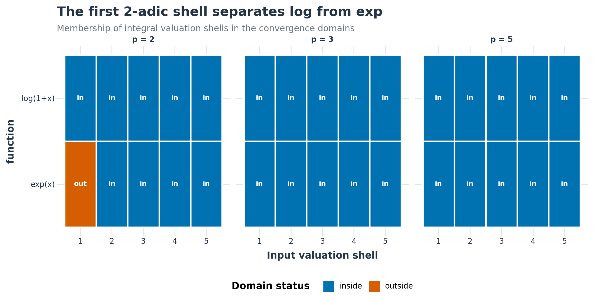

# Exponential, logarithm, and analytic groups {#sec-analytic-groups}

**Level and prerequisites: L5.** Prepare matrix groups, convergent exponential and logarithm series, and Lie algebras. The [reader guide](index.md) links the Euler arithmetic, algebra and analysis preparation and distinguishes the graduate continuation.

## Goals and scope

Chapters 7 and 8 introduced the *p*-adic exponential and logarithm. Here we make
their convergence domains sharp, use them as coordinates on groups, and explain
why $p=2$ requires a smaller neighborhood. The base field is $\mathbb Q_p$;
similar statements over a finite extension require replacing the valuation
threshold by its normalized value group.

## Sharp convergence domains

Recall

$$
\exp(x)=\sum_{n\ge0}\frac{x^n}{n!},
\qquad
\log(1+x)=\sum_{n\ge1}(-1)^{n+1}\frac{x^n}{n}.
$$

Legendre's formula gives

$$
v_p(n!)=\frac{n-s_p(n)}{p-1},
$$

where $s_p(n)$ is the base-$p$ digit sum. Consequently the exponential
converges exactly when

$$
v_p(x)>\frac{1}{p-1}.
$$

For $x\in\mathbb Q_p$, this is $x\in p\mathbb Z_p$ when $p$ is odd and
$x\in4\mathbb Z_2$ when $p=2$. At the boundary the terms fail to approach zero
along suitable indices.

The logarithm converges exactly for $v_p(x)>0$, or $x\in p\mathbb Z_p$. Since
$v_p(n)$ grows much more slowly than $n$, the term valuation
$n v_p(x)-v_p(n)$ tends to infinity.

<figure id="fig-exp-log-domains">


<figcaption>

Figure 18.1: Valuation shells included in the convergence domains of p-adic logarithm and exponential are compared for the primes two, three, and five.

</figcaption>
</figure>

[Figure 18.1](#fig-exp-log-domains) encodes membership by valuation. The only discrepancy at
the displayed integral shells is the first $2$-adic shell: logarithm converges on
$1+2\mathbb Z_2$, while exponential begins on $4\mathbb Z_2$.

## Formal identities become analytic identities

Formal power series satisfy

$$
\exp(X+Y)=\exp(X)\exp(Y),
\qquad
\log((1+X)(1+Y))=\log(1+X)+\log(1+Y).
$$

Inside the convergence domains, uniform convergence permits rearrangement and
substitution, so the identities hold for *p*-adic arguments. One may also
differentiate term by term and compare initial values.

The leading terms dominate:

$$
v_p(\exp(x)-1)=v_p(x),
\qquad
v_p(\log(1+x))=v_p(x)
$$

on the common domains. Every later term has strictly larger valuation. This
shows both maps are local isometries in valuation coordinates.

## Additive and multiplicative balls

<div class="callout callout-note">
<p class="callout-title">Local analytic group isomorphism</p>

For odd $p$, exponential and logarithm are inverse analytic group isomorphisms

$$
p\mathbb Z_p\longleftrightarrow1+p\mathbb Z_p.
$$

For $p=2$, they are inverse on

$$
4\mathbb Z_2\longleftrightarrow1+4\mathbb Z_2.
$$

</div>

To prove inversion, compose the formal series on a smaller variable and use the
identities $\log(\exp X)=X$ and $\exp(\log(1+X))=1+X$. Analytic convergence
justifies evaluation. The valuation equalities show injectivity and preservation
of neighborhoods; the formal inverse identity gives surjectivity.

Thus multiplication near $1$ is addition in logarithmic coordinates. Solving
$u^n=a$ near $1$ becomes solving $n\log u=\log a$. If $n$ is a unit in
$\mathbb Z_p$, division by $n$ preserves the neighborhood. If $p\mid n$, the
image shrinks and additional divisibility is necessary.

## Roots of unity and unit decomposition

For odd $p$, every unit has a unique decomposition

$$
u=\omega(u)\langle u\rangle,
\qquad \omega(u)^{p-1}=1,
\qquad \langle u\rangle\in1+p\mathbb Z_p.
$$

The Teichmüller factor records the residue class and the principal factor is
handled by logarithm. Hence

$$
\mathbb Z_p^\times\cong\mu_{p-1}\times p\mathbb Z_p
$$

as a product of a finite group and an analytic additive group, where the second
factor is identified through logarithm rather than literal equality.

For $p=2$, every odd unit is uniquely

$$
u=\varepsilon\langle u\rangle,
\qquad \varepsilon\in\{1,-1\},
\qquad \langle u\rangle\in1+4\mathbb Z_2.
$$

The sign is chosen from the residue modulo $4$. This is why restricting to
$1+4\mathbb Z_2$ loses no infinite analytic direction.

## One-parameter subgroups

For $u$ in the logarithm–exponential domain and $s\in\mathbb Z_p$, define

$$
u^s=\exp(s\log u).
$$

Then $u^{s+t}=u^s u^t$ and the definition agrees with ordinary integer powers.
For $u=1+a$ it also equals the binomial series

$$
(1+a)^s=\sum_{n\ge0}\binom{s}{n}a^n.
$$

This constructs a continuous homomorphism from the additive group
$\mathbb Z_p$ to a multiplicative unit ball. It is a basic example of a
*p*-adic analytic one-parameter group.

## Power equations and the torsion layer

For odd $p$, write $a=\omega(a)\langle a\rangle$. Solving $u^n=a$ splits into
two independent questions:

1. does $z^n=\omega(a)$ have a solution in the finite cyclic group
   $\mu_{p-1}$; and
2. does $n y=\log\langle a\rangle$ have a solution in $p\mathbb Z_p$?

If $p\nmid n$, the second equation always has one solution because $n$ is a
unit. The number of roots is then controlled by the finite torsion equation. If
$p\mid n$, multiplication by $n$ has image
$p^{1+v_p(n)}\mathbb Z_p$, so the principal unit must lie deeper in the unit
filtration.

For example, every element of $1+5\mathbb Z_5$ has a unique seventh root there,
because $7$ is a $5$-adic unit. An element of $1+5\mathbb Z_5$ has a fifth root
in that same ball exactly when its logarithm lies in $25\mathbb Z_5$, which is
equivalent to the element lying in $1+25\mathbb Z_5$. This recovers a Hensel-type
power criterion through analytic coordinates.

### Worked 3-adic estimate

Take $u=4=1+3$. Then

$$
\log4=3-\frac{3^2}{2}+\frac{3^3}{3}-\frac{3^4}{4}+\cdots.
$$

The first term has valuation $1$ and every later combined contribution has
valuation at least $2$, so $v_3(\log4)=1$. For $s=5$, the element
$4^5=1024$ satisfies

$$
\log(4^5)=5\log4,
$$

and the valuation remains $1$ because $5$ is a $3$-adic unit.

<div class="callout callout-warning">
<p class="callout-title">Domain pitfall</p>

The symbolic identities do not grant convergence. In particular, the $2$-adic
series $\exp(2)$ diverges even though $2\in2\mathbb Z_2$, and logarithm cannot
be applied directly to a Teichmüller root of unity outside its principal-unit
ball.

</div>

<!-- inline-formula-code:start -->
## Formula and finite computation

A useful formula in this chapter is

$$
\log(1+x)=\sum_{n\ge1}(-1)^{n+1}\frac{x^n}{n}
$$

Exact partial sums and term valuations keep convergence separate from real magnitude. The following standalone Python block expresses that finite rule with its inputs and stopping conditions visible.

```python
from fractions import Fraction

prime, x, terms = 3, 3, 8
partial = sum((Fraction((-1) ** (n + 1) * x**n, n) for n in range(1, terms + 1)), start=Fraction(0))
print(partial)
```

**What the computation establishes.** The output certifies only the declared finite case. The theorem, if one is claimed, still requires the argument developed in the chapter.
<!-- inline-formula-code:end -->

## Summary

Factorial and denominator valuations give the sharp domains of exponential and
logarithm. On their common balls the maps are inverse analytic isometries and
turn multiplication into addition. Unit groups split into a finite torsion
part and a principal analytic part, with a stricter neighborhood at $p=2$.

## Exercises

<div class="exercise" id="p_adic_numbers-18-analytic-groups-ex-1">
<p class="exercise-title"><strong>Exercise 1</strong></p>

Use Legendre's formula to show that $\exp(2)$ diverges in $\mathbb Q_2$.

</div>

<div class="exercise" id="p_adic_numbers-18-analytic-groups-ex-2">
<p class="exercise-title"><strong>Exercise 2</strong></p>

Prove $v_p(\log(1+x))=v_p(x)$ for $x\in p\mathbb Z_p$ when $p$ is odd, and for $x\in4\mathbb Z_2$ when $p=2$. Give a counterexample on $2\mathbb Z_2$.

</div>

<div class="exercise" id="p_adic_numbers-18-analytic-groups-ex-3">
<p class="exercise-title"><strong>Exercise 3</strong></p>

Solve $u^7=a$ uniquely in $1+5\mathbb Z_5$ for arbitrary
$a\in1+5\mathbb Z_5$, using logarithms.

</div>

<div class="exercise" id="p_adic_numbers-18-analytic-groups-ex-4">
<p class="exercise-title"><strong>Exercise 4</strong></p>

Determine the image of the map $u\mapsto u^p$ on $1+p\mathbb Z_p$ for odd
$p$.

</div>

<div class="exercise" id="p_adic_numbers-18-analytic-groups-ex-5">
<p class="exercise-title"><strong>Exercise 5</strong></p>

Verify that the sign decomposition of a $2$-adic unit is unique.

</div>

<div class="exercise" id="p_adic_numbers-18-analytic-groups-ex-6">
<p class="exercise-title"><strong>Exercise 6</strong></p>

Compare the Mahler and exponential definitions of $4^s$ on $\mathbb Z_3$.

</div>

<div class="exercise" id="p_adic_numbers-18-analytic-groups-ex-7">
<p class="exercise-title"><strong>Exercise 7</strong></p>

For odd $p$, state the two conditions for $a\in\mathbb Z_p^\times$ to be an
$n$th power using its Teichmüller and principal-unit factors.

</div>

**Support.** In Exercise 1, evaluate term valuations along $n=2^k$.
For Exercise 3, set $\log u=7^{-1}\log a$. For Exercise 4, logarithm turns the
map into multiplication by $p$, so its image corresponds to
$p^2\mathbb Z_p$ and is $1+p^2\mathbb Z_p$. In Exercise 5 reduce modulo $4$.
For Exercise 7, solve separately in $\mu_{p-1}$ and in $p\mathbb Z_p$ after
applying logarithm.
