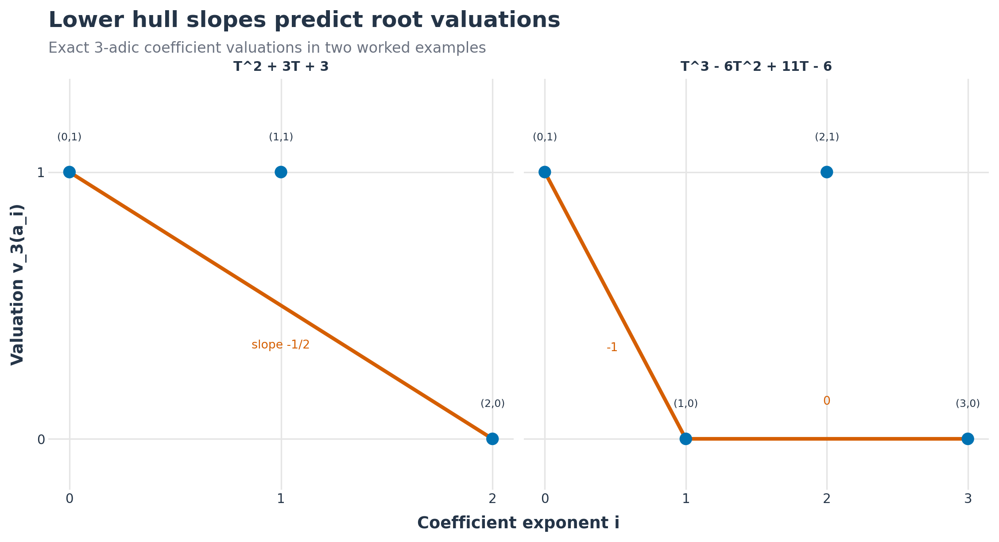

# Newton polygons {#sec-newton-polygons}

**Level and prerequisites: L3–L4.** Prepare polynomial factorisation, finite field extensions and p-adic valuations. The [reader guide](index.md) links the Euler arithmetic, algebra and analysis preparation and distinguishes the graduate continuation.

## Goals and motivation

Hensel's lemma begins with a root modulo $p$. A Newton polygon begins with all
coefficient valuations and predicts the valuations of roots, even when no root
lies in $\mathbb Q_p$. It is a finite convex-geometric summary of a polynomial.

## Plotting coefficient valuations

Let

$$
f(T)=a_0+a_1T+\cdots+a_nT^n
$$

over a complete discretely valued field $K$. For each nonzero coefficient plot
the point $(i,v(a_i))$. A zero coefficient is treated as having valuation
$+\infty$ and is omitted. The **Newton polygon** is the lower convex hull of
these points: looking upward from below, stretch a taut string from the leftmost
to the rightmost point.

Its segments have nondecreasing slopes. Horizontal length is measured by the
difference of exponent coordinates, so it is always a positive integer. The
vertical coordinate depends on valuation normalization; state that normalization
before comparing polygons over extensions.

<figure id="fig-newton-polygons">


<figcaption>

Figure 19.1: Coefficient-valuation points and lower hulls are shown for an Eisenstein quadratic and a split cubic, with exact segment slopes labelled.

</figcaption>
</figure>

In [Figure 19.1](#fig-newton-polygons), points above a lower segment do not alter the polygon.
The quadratic's fractional slope signals roots in an extension with a finer value
group. The cubic's two segments separate one divisible root from two unit roots.

## Slopes predict root valuations

<div class="callout callout-note">
<p class="callout-title">Newton polygon theorem</p>

Let $f$ split over an algebraic closure of the complete field $K$. For every
segment of the Newton polygon having slope $-\lambda$ and horizontal length
$r$, the polynomial has exactly $r$ roots of valuation $\lambda$, counted with
multiplicity.

</div>

This statement uses an extension of the valuation to the algebraic closure. It
predicts valuations, not the roots themselves and not necessarily factors over
$K$. A rational slope with denominator $e$ indicates that the value group of a
field containing such a root must allow multiples of $1/e$.

### Why the theorem is plausible

If

$$
f(T)=a_n\prod_{j=1}^n(T-\alpha_j),
$$

then coefficients are elementary symmetric sums of the roots. Ordering the root
valuations makes the lowest possible valuation contributions visible. Where no
cancellation occurs, cumulative sums of root valuations give polygon vertices.
The full proof handles possible cancellation by using the multiplicativity of
Gauss norms

$$
\left\|\sum a_iT^i\right\|_r=\max_i |a_i|r^i.
$$

As $r$ varies, the coefficient attaining the maximum changes exactly at polygon
slopes. Multiplicativity turns these changes into a count of root norms.

## Two worked examples

Consider

$$
f(T)=T^2+3T+3\in\mathbb Q_3[T].
$$

The points are $(0,1),(1,1),(2,0)$. The middle point lies above the line from
$(0,1)$ to $(2,0)$, so the polygon is one segment of slope $-1/2$ and length
$2$. Both roots have valuation $1/2$ in an algebraic closure. They cannot lie in
$\mathbb Q_3$, whose nonzero valuations are integers. The polynomial is also
Eisenstein, so it is irreducible and adjoining one root gives a ramified
quadratic extension.

Now factor

$$
g(T)=(T-3)(T-1)(T-2)=T^3-6T^2+11T-6.
$$

At $p=3$ the coefficient points are
$(0,1),(1,0),(2,1),(3,0)$. The lower polygon has a segment of slope $-1$ and
length $1$, then a horizontal segment of length $2$. It predicts one root of
valuation $1$ and two roots of valuation $0$, exactly matching $3,1,2$.

## Factorization information and its limit

A segment often leads to a factor whose roots have the corresponding valuation.
Over a complete discretely valued field, a break in the polygon produces a
factorization separating distinct slope groups. Within one segment, a
**residual polynomial** records leading unit information and can split the group
further.

The polygon alone cannot distinguish roots with the same valuation. For example,
$T^2-1$ and $T^2-u$ for a nonsquare unit $u$ have the same horizontal polygon at
an odd prime, but only the first splits over $\mathbb Q_p$. Residue data supplies
what the valuations omit.

## Changing scale and taking reciprocals

Substituting $T=cU$ replaces $a_i$ by $a_ic^i$, so the point
$(i,v(a_i))$ moves to

$$
(i,v(a_i)+i v(c)).
$$

Geometrically, the polygon is tilted by adding the linear function
$i v(c)$. Segment slopes increase by $v(c)$, while roots change from
$\alpha$ to $\alpha/c$ and their valuations decrease by $v(c)$. This agreement
is a useful sign check.

The reciprocal polynomial

$$
f^*(T)=T^n f(T^{-1})
$$

reverses the coefficient points horizontally. Its nonzero roots are
$\alpha^{-1}$, so root valuations change sign. A polygon describing very large
roots can therefore be converted into one describing small roots. Leading or
constant zero coefficients must first be removed so that degree and reciprocal
are unambiguous.

These transformations also help computation. Choose $c$ so a target slope
becomes horizontal, divide out the common coefficient valuation, and reduce the
terms on that segment modulo the maximal ideal. The resulting residual
polynomial determines leading residues of roots with that valuation.

<div class="callout callout-warning">
<p class="callout-title">Sign and hull pitfalls</p>

- Root valuation is the negative of segment slope.
- Use the lower hull, not a line joining every plotted point.
- Omit zero coefficients rather than assigning them height zero.
- Fractional predicted valuations may live only after extending the field.
- Equal slopes do not determine residue classes or multiplicities beyond the
  stated horizontal length.

</div>

## Eisenstein polynomials revisited

For an Eisenstein polynomial

$$
T^n+a_{n-1}T^{n-1}+\cdots+a_0,
$$

the endpoints are $(0,1)$ and $(n,0)$, while every intermediate coefficient
point has height at least $1$. Its Newton polygon is one segment of slope
$-1/n$. Every root has valuation $1/n$ relative to $v_p$. This both reflects
irreducibility and explains total ramification after a root is adjoined.

## An exact construction algorithm

Sort the finite points by exponent. Maintain a stack of proposed vertices. Add
one point at a time; while the last two segment slopes fail to increase, remove
the middle of the last three points. Exact rational arithmetic compares slopes
by cross multiplication, avoiding floating error. Points vertically above an
existing exponent never occur because each coefficient supplies at most one
point.

After finding the hull, report each segment as

$$
(i_0,v_0)\longrightarrow(i_1,v_1),
\qquad
\text{slope}=\frac{v_1-v_0}{i_1-i_0},
\qquad
\text{length}=i_1-i_0.
$$

This is a certificate that can be checked independently.

## A multiplicative coefficient norm

The weighted Gauss norm is a norm of a polynomial's coefficients,
not the supremum of its values on a selected set of points.
Chapter 8 showed that those quantities can differ.
For every positive real $r$, the coefficient norm is nevertheless
multiplicative.

Let $A=\max_i|a_i|r^i$ and $B=\max_j|b_j|r^j$
for two nonzero polynomials. Choose the largest index $i_0$
attaining $A$ and the largest $j_0$ attaining $B$.
Every term contributing to the product coefficient at degree
$i_0+j_0$ has weighted norm at most $AB$.

The term $a_{i_0}b_{j_0}$ has exactly that weighted norm.
Any different pair with the same degree has either its first
index larger than $i_0$, making its first weight smaller than
$A$, or its second index larger than $j_0$, making its
second weight smaller than $B$.
Thus the chosen term is uniquely maximal in that coefficient
and cannot cancel. The coefficient norm of the product is
at least $AB$; the strong inequality gives the reverse bound
for every coefficient. Hence the norm is multiplicative.

This proof works for arbitrary positive real weights, even when
$r$ is not an attained field norm.
There is no need to enlarge the field merely to define
the coefficient norm. Enlarging may be needed later to
interpret a fractional root valuation as the valuation of
an actual root.

## A full proof of the root-valuation theorem

Work in a splitting field carrying the chosen extension of the
valuation. For the core local fields, existence and uniqueness
of that extension were proved in Chapter 12.
First remove a factor $T^k$ if the constant coefficient is
zero; its $k$ zero roots have infinite valuation and are
recorded separately from finite polygon slopes.

For a real parameter $t$, define
$M_f(t)=\min_i(v(a_i)+it)$ over nonzero coefficients.
It is the negative base-$p$ logarithm of the weighted
Gauss norm at radius $p^{-t}$ when the base valuation is
normalized by $v(p)=1$. With another normalization one uses
the corresponding exponential base; the minimum formula itself
does not change.

Multiplicativity gives
$M_{fg}(t)=M_f(t)+M_g(t)$.
For a linear factor $T-\alpha$ the minimum is
$\min(t,v(\alpha))$.
Factoring a polynomial therefore gives

$$
M_f(t)=v(a_n)+\sum_{j=1}^n\min(t,v(\alpha_j)).
$$

Root multiplicities are included in the factor list.
Each summand has slope one below its root valuation
and slope zero above it. The downward change in slope
at a value $\lambda$ is exactly the number of roots
of that valuation.

On the coefficient side, $M_f$ is the lower envelope
of the lines $v(a_i)+it$.
A supporting line to the coefficient polygon of slope
$-\lambda$ reaches a segment with endpoints at degrees
$i_0<i_1$ exactly when those endpoint expressions tie
at $t=\lambda$ and are minimal.
Just below that parameter the larger degree is selected;
just above it the smaller degree is selected.
The downward slope change is $i_1-i_0$.

Equating the two descriptions proves that a segment of
slope $-\lambda$ and horizontal length $r$ accounts for
exactly $r$ roots of valuation $\lambda$.
Coefficients lying strictly above the lower hull never
minimize any supporting expression, so they do not affect
the count. Cancellation among elementary symmetric terms
has already been handled by Gauss multiplicativity; it
is not being assumed absent.

### Worked example 3: read three different scales

At three, take
$f(T)=(T-9)(T-3)(T-1)=T^3-13T^2+39T-27$.
The coefficient points are
$(0,3),(1,1),(2,0),(3,0)$.
Their lower slopes are minus two, minus one and zero,
each of length one. The theorem gives root valuations
two, one and zero, agreeing with the displayed factorisation.

If only the coefficients were supplied, the polygon would
still prove those valuations without first finding the
three roots. The known factorisation makes this a
check of the sign and horizontal-length conventions,
rather than evidence needed for the general theorem.

## What a break says over the base field

For a finite extension of $\mathbb Q_p$, distinct valuation
groups of roots give factors over the base field.
Here is a proof using finite Galois theory.
In a finite normal splitting field, every base-field
automorphism preserves the extended valuation by uniqueness.
It therefore permutes roots only within their valuation
groups, including multiplicity.

The monic product of the linear factors in one group
has coefficients fixed by the Galois group.
The fixed-field theorem puts those coefficients in the
base field. Multiplying the groups gives the slope
factorisation. This paragraph uses the finite Galois
correspondence as an algebra input; the preceding
root-valuation count did not require that descent theorem.

A segment of length one consequently gives a base-field
root in this characteristic-zero local setting.
A longer segment can still be irreducible or split into
several factors of the same slope.
The horizontal polygon of two nonsquare-unit and
square-unit quadratics illustrates why slopes alone
do not determine full splitting.

For general complete discretely valued fields, the
corresponding slope-factor theorem is a standard
Henselian factorisation result. The proof just given
establishes the characteristic-zero local case used
here. No assertion about an arbitrary noncomplete
valued field is inferred from it.

## Residual polynomials after scaling

Suppose a slope predicts valuation $\lambda$ and choose
an extension element $c$ with that valuation.
Substituting $T=cU$ shifts that segment to horizontal.
Divide the polynomial by a coefficient of its smallest
new valuation, then reduce the terms on the horizontal
segment in the residue field. The resulting nonzero
polynomial records leading residues for roots of that
valuation.

If such a residue root is simple, Hensel lifting
constructs a root of the scaled polynomial in that
extension. Multiplying by $c$ returns a root of the
original polynomial. If the residue root is singular,
one needs further analysis; the polygon and this
first reduction are not an automatic full factorisation
algorithm.

For example, scale $T^2-3T-3$ at three by
$c=\sqrt3$. After dividing by three the polynomial is
$U^2-\sqrt3\,U-1$.
Its reduction is $U^2-1$, with two simple roots in
the residue field. They lift in $\mathbb Q_3(\sqrt3)$.
The original polynomial therefore splits there,
although its two roots have fractional valuation
and neither lies in $\mathbb Q_3$.

This operation must keep the valuation normalization
visible. In the integer-valued extension normalization,
$c$ has value one and the base prime has value two.
In the extending normalization their values are
one half and one. The geometric tilt and the
reduction use one convention consistently.

## Certifying a lower hull

The stack construction maintains increasing exponents
and increasing segment slopes.
If a newly added point makes the last slope no
larger than its predecessor, the intermediate point
lies on or above the chord joining its neighbors.
Removing it cannot remove a lower-hull vertex.
Repeat until the local slopes increase.

Every point is pushed once and removed at most once,
so the hull stage takes a linear number of exact
orientation comparisons after the points are ordered.
Computing the coefficient valuations has its own cost.
Each comparison can use an integer cross product,
so no approximate slope or tolerance is needed.

A returned list can be checked by verifying increasing
slopes and that every input point lies on or above
the relevant supporting segments. Horizontal lengths
then count multiplicities, including any degree gaps
caused by zero coefficients. Assigning a zero
coefficient height zero instead of omitting it would
insert false lower points and can change the answer.

## A ramification constraint, not a field identification

If a root has valuation $a/b$ in lowest terms
relative to the base normalization, the value group
of a finite field containing it is $(1/e)\mathbb Z$.
Thus $b$ divides $e$. This is a useful lower
divisibility constraint on ramification.

It does not identify the extension or its residue
degree. Distinct fields can have equal ramification
indices and identical root-valuation data.
The next chapter supplies trace, different and
Galois information that the polygon deliberately
forgets.

<!-- inline-formula-code:start -->
## Formula and finite computation

A useful formula in this chapter is

$$
\mathcal N(f)=\operatorname{lowerHull}\{(i,v_p(a_i))\}
$$

Coefficient valuations are converted into the finite lower hull. The following standalone Python block expresses that finite rule with its inputs and stopping conditions visible.

```python
from math import isqrt

def is_prime(number: int) -> bool:
    """Return whether number is prime by exact trial division."""
    if number < 2:
        return False
    return all(number % divisor != 0 for divisor in range(2, isqrt(number) + 1))

def valuation(integer: int, prime: int) -> int:
    """Return v_p(integer) for a nonzero coefficient."""
    if integer == 0:
        raise ValueError("zero coefficients have no finite plotted valuation")
    exponent = 0
    integer = abs(integer)
    while integer % prime == 0:
        integer //= prime
        exponent += 1
    return exponent

def newton_polygon(
    coefficients: list[int], prime: int
) -> list[tuple[int, int]]:
    """Return lower-hull vertices for ascending polynomial coefficients."""
    if len(coefficients) < 2 or not is_prime(prime):
        raise ValueError("provide a nonconstant polynomial and a prime")
    points = [
        (degree, valuation(coefficient, prime))
        for degree, coefficient in enumerate(coefficients)
        if coefficient != 0
    ]
    if len(points) < 2:
        raise ValueError("at least two coefficients must be nonzero")
    hull: list[tuple[int, int]] = []
    for point in points:
        while len(hull) >= 2:
            first, second = hull[-2], hull[-1]
            cross = (second[0] - first[0]) * (point[1] - first[1]) - (
                second[1] - first[1]
            ) * (point[0] - first[0])
            if cross > 0:
                break
            hull.pop()
        hull.append(point)
    return hull

vertices = newton_polygon([9, 3, 0, 1], prime=3)
print(vertices)
print(
    [
        (right[1] - left[1]) / (right[0] - left[0])
        for left, right in zip(vertices, vertices[1:])
    ]
)
```

**What the computation establishes.** The calculation checks a declared finite instance; the surrounding argument explains what is true beyond those inputs.
<!-- inline-formula-code:end -->

## Summary

The lower convex hull of coefficient valuations encodes root valuations. A
segment of slope $-\lambda$ and length $r$ accounts for $r$ roots of valuation
$\lambda$. Breaks separate slope factors, while residual polynomials carry the
unit information a polygon cannot see.

## Exercises

### Exercise 19.1 {#ex-padic-19-01}

Draw the $5$-adic Newton polygon of $T^3+5T+25$ and list predicted root valuations.

<details>
<summary>Hint 1</summary>

Plot only the three nonzero coefficient points.

</details>

<details>
<summary>Hint 2</summary>

The middle point lies below the endpoint chord.

</details>

<details>
<summary>Full solution</summary>

The points are $(0,2),(1,1),(3,0)$. Both segments occur on the lower hull: the first has slope minus one and length one, the second slope minus one half and length two. Thus there is one root of valuation one and two roots of valuation one half, counted with multiplicity in a splitting field. The fractional roots cannot lie in $\mathbb Q_5$.

</details>

### Exercise 19.2 {#ex-padic-19-02}

Explain the polygon of $T^n-p$.

<details>
<summary>Hint 1</summary>

Only the constant and leading coefficients are nonzero.

</details>

<details>
<summary>Hint 2</summary>

The segment joins heights one and zero across horizontal length n.

</details>

<details>
<summary>Full solution</summary>

The polygon consists of the segment from $(0,1)$ to $(n,0)$, with slope $-1/n$ and length $n$. Every root has extending valuation $1/n$. For $n\ge2$, Eisenstein proves irreducibility and the generated degree-$n$ extension is totally ramified, so its integer-valued root valuation is one. These normalization statements are consistent.

</details>

### Exercise 19.3 {#ex-padic-19-03}

Compute the $2$-adic polygon of $T^2+2T+8$.

<details>
<summary>Hint 1</summary>

Compare the middle point with the chord between endpoints.

</details>

<details>
<summary>Hint 2</summary>

Its two lower slopes are different.

</details>

<details>
<summary>Full solution</summary>

The points are $(0,3),(1,1),(2,0)$. The middle point is below the endpoint chord, giving slopes minus two and minus one, each of length one. Thus the two root valuations are two and one. The polygon answers the valuation question; a separate factorisation or the local slope-factor theorem addresses their fields of definition.

</details>

### Exercise 19.4 {#ex-padic-19-04}

Give two polynomials with identical Newton polygons but different splitting behavior over $\mathbb Q_3$.

<details>
<summary>Hint 1</summary>

Use a square unit and a nonsquare unit as constant terms.

</details>

<details>
<summary>Hint 2</summary>

The unit two is not a square modulo three.

</details>

<details>
<summary>Full solution</summary>

The polynomials $T^2-1$ and $T^2-2$ both have horizontal polygons from $(0,0)$ to $(2,0)$. The first splits into $T-1$ and $T+1$. The second has nonsquare unit constant two in the square-root equation and is irreducible over $\mathbb Q_3$. Both pairs of roots have valuation zero in a splitting field, so identical polygons do not force identical splitting.

</details>

### Exercise 19.5 {#ex-padic-19-05}

Prove that multiplying a polynomial by $T^k$ adds $k$ roots of infinite valuation and shifts coefficient exponents.

<details>
<summary>Hint 1</summary>

The factor contributes zero roots and no nonzero roots.

</details>

<details>
<summary>Hint 2</summary>

Every coefficient degree increases by k while its height stays fixed.

</details>

<details>
<summary>Full solution</summary>

The product has the same nonzero roots with their old multiplicities and acquires zero as a root of multiplicity $k$. By convention its valuation is infinite. Every nonzero coefficient point moves from $(i,v(a_i))$ to $(i+k,v(a_i))$, so the finite polygon translates horizontally and keeps every slope and segment length. The added zero roots are accounted for separately, not by a finite-slope edge.

</details>

### Exercise 19.6 {#ex-padic-19-06}

Implement the lower-hull stack using rational slopes.

<details>
<summary>Hint 1</summary>

Use exact orientation comparisons rather than decimal division.

</details>

<details>
<summary>Hint 2</summary>

A point on or above the neighbor chord is removable from the lower stack.

</details>

<details>
<summary>Full solution</summary>

The specification reads nonzero coefficient points in increasing degree. Push the next point, and while the last two slopes fail to increase strictly, remove the middle of the last three. Compare slopes by cross multiplication of their positive horizontal denominators. At termination the stack has increasing slopes and every discarded point lies on or above its supporting chord. Each point is pushed and popped at most once. The existing chapter listing supplies a finite implementation; no program was executed for this answer.

</details>

### Exercise 19.7 {#ex-padic-19-07}

Describe how the Newton polygon changes under $T=p^rU$ and verify the predicted root-valuation shift.

<details>
<summary>Hint 1</summary>

Every coefficient height gains degree times r.

</details>

<details>
<summary>Hint 2</summary>

The new root is the old root divided by p to the r.

</details>

<details>
<summary>Full solution</summary>

The point at degree $i$ gains height $ir$, adding the same linear tilt to the whole lower hull. Each segment slope increases by $r$. Its negative, the predicted new root valuation, therefore decreases by $r$. This agrees with $U=\alpha/p^r$, whose valuation is $v(\alpha)-r$. Horizontal lengths and root multiplicities remain unchanged.

</details>

### Exercise 19.8 {#ex-padic-19-08}

Prove multiplicativity of the weighted Gauss norm.

<details>
<summary>Hint 1</summary>

Choose the largest maximizing coefficient index in each factor.

</details>

<details>
<summary>Hint 2</summary>

At their sum degree, only that pair can attain the product bound.

</details>

<details>
<summary>Full solution</summary>

Let those indices be $i,j$, with maxima $A,B$. Every product coefficient has weighted norm at most $AB$. In degree $i+j$, the chosen pair attains $AB$. Any different pair of the same degree has either first index greater than $i$ or second index greater than $j$, making one weight strictly smaller. The maximal term cannot cancel, so that coefficient attains $AB$. This proves equality of the product norm and the product of the norms.

</details>

### Exercise 19.9 {#ex-padic-19-09}

Explain why a root of valuation a/b in lowest terms forces b to divide the ramification index of any finite field containing it.

<details>
<summary>Hint 1</summary>

The extending value group of that field is one over e times the integers.

</details>

<details>
<summary>Hint 2</summary>

Compare the two rational descriptions of the root valuation.

</details>

<details>
<summary>Full solution</summary>

Write $a/b=m/e$ with integers $m,e$ and $\gcd(a,b)=1$. Then $ae=bm$. Coprimality forces $b\mid e$. This is only a ramification divisibility condition; it determines neither the residue degree nor the isomorphism class of the field.

</details>

### Exercise 19.10 {#ex-padic-19-10}

For $(T-9)(T-3)(T-1)$ at three, compute its polygon directly from its coefficients.

<details>
<summary>Hint 1</summary>

Expand to T cubed minus13T squared plus39T minus27.

</details>

<details>
<summary>Hint 2</summary>

The four heights are three, one, zero and zero.

</details>

<details>
<summary>Full solution</summary>

The points are $(0,3),(1,1),(2,0),(3,0)$. Their increasing lower slopes are minus two, minus one and zero, each across one degree. Thus the root valuations are two, one and zero, matching nine, three and one. The coefficient calculation independently verifies the polygon conventions without relying on a drawing.

</details>

<details>
<summary>Earlier selected support</summary>

Exercise 1 uses points $(0,2),(1,1),(3,0)$; both segments belong to
the lower hull. For Exercise 2 the single slope is $-1/n$. In Exercise 3 compare
$(0,3),(1,1),(2,0)$: the middle point lies below the endpoint line, so two
segments occur. For Exercise 4 use $T^2-1$ and $T^2-u$ with a nonsquare unit
$u$.
For Exercise 7, every segment slope gains $r$, while the new $U$-roots have
valuation $v(\alpha)-r$.

</details>
