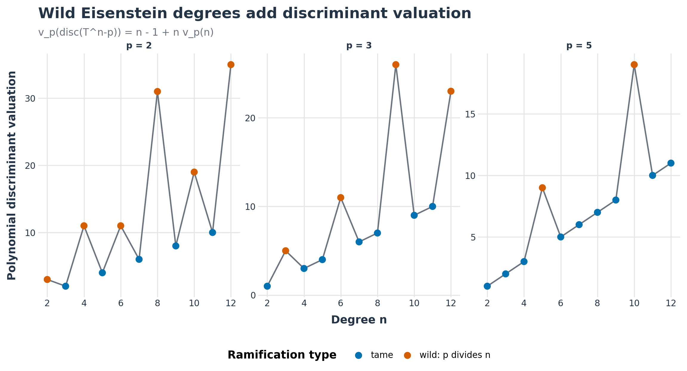

# Ramification and local extensions {#sec-ramification}

**Level and prerequisites: L3–L4.** Prepare finite Galois theory, normal extensions, valuation rings, residue degrees and ramification indices. Use [Galois Theory Chapters 1–5](#/books/galois-theory) for the finite correspondence and the [reader guide](index.md) for linked arithmetic, algebra and analysis preparation. The infinite Galois continuation requires the later profinite chapter.

## Goals and prerequisites

Chapter 12 introduced finite extensions, uniformizers, and the identity
$[L:K]=ef$. We now examine what ramification measures, how the different and
discriminant record it, why tame and wild extensions behave differently, and
how local data describes prime factorization in number fields.

## Extending valuations carefully

Let $L/K$ be a finite extension of local fields. Normalize $v_K$ and $v_L$ so
their value groups are $\mathbb Z$. Then

$$
v_L(x)=e(L/K)v_K(x)\qquad(x\in K^\times).
$$

The residue extension has degree
$f(L/K)=[k_L:k_K]$, and

$$
[L:K]=e(L/K)f(L/K).
$$

If $e=1$, the extension is **unramified**. If $f=1$ and $e=[L:K]$, it is
**totally ramified**. In a tower $M/L/K$, the invariants multiply:

$$
e(M/K)=e(M/L)e(L/K),
\qquad
f(M/K)=f(M/L)f(L/K).
$$

These identities follow by restricting valuations and composing residue-field
extensions.

## Different and discriminant

The trace pairing on $L$ is

$$
(x,y)\longmapsto\operatorname{Tr}_{L/K}(xy).
$$

A **fractional ideal** of $L$ is a nonzero $\mathcal O_L$-submodule that becomes
an ordinary ideal after multiplication by some element of $L^\times$. It allows
negative as well as positive powers of a uniformizer.

The **inverse different** is the fractional ideal

$$
\mathfrak D_{L/K}^{-1}
=\{x\in L:\operatorname{Tr}_{L/K}(x\mathcal O_L)\subseteq\mathcal O_K\}.
$$

Its inverse $\mathfrak D_{L/K}$ is the different. It measures how far the
integral trace pairing is from self-dual. Taking its norm gives the discriminant
ideal.

If $\mathcal O_L=\mathcal O_K[\alpha]$ and $g$ is the minimal polynomial of
$\alpha$, then

$$
\mathfrak D_{L/K}=(g'(\alpha)).
$$

The monogenic hypothesis matters. Without it, the derivative still describes
the order generated by $\alpha$, and an index correction separates that order's
discriminant from the field discriminant.

For $g(T)=T^n-p$ over $\mathbb Q_p$, the polynomial discriminant has valuation

$$
v_p(\operatorname{disc}(g))=(n-1)+n v_p(n).
$$

When $p\nmid n$, the first term is the expected tame contribution. When
$p\mid n$, the extra $n v_p(n)$ signals wild behavior.

<figure id="fig-ramification-discriminants">


<figcaption>

Figure 20.1: Discriminant valuations of the Eisenstein polynomials T to the n minus p are compared for several primes, with wild cases marked by the extra contribution from p dividing n.

</figcaption>
</figure>

[Figure 20.1](#fig-ramification-discriminants) uses polynomial discriminants for a controlled
family. The visible jumps do not classify every extension, but they honestly
show the derivative contribution distinguishing these tame and wild examples.

## Tame and wild ramification

A finite extension is **tamely ramified** when the residue characteristic $p$
does not divide $e$ and the residue extension is separable. For finite residue
fields separability is automatic. Ramification is **wild** when $p\mid e$.

The extension $\mathbb Q_p(p^{1/n})/\mathbb Q_p$ is totally ramified of degree
$n$ when $T^n-p$ is used. It is tame if $p\nmid n$ and wild if $p\mid n$.
Tame extensions have a relatively simple inertia action: after an unramified
extension they are generated by roots of a uniformizer of order prime to $p$.
Wild extensions contain additional higher ramification layers and are the source
of more complicated discriminants.

For a finite Galois extension, the inertia subgroup $I$ consists of automorphisms
acting trivially on the residue field. There is an exact sequence

$$
1\longrightarrow I\longrightarrow\operatorname{Gal}(L/K)
\longrightarrow\operatorname{Gal}(k_L/k_K)\longrightarrow1.
$$

Inside inertia, wild inertia is the unique Sylow $p$-subgroup. Quotienting it
leaves tame inertia of order prime to $p$. Higher ramification groups refine
wild inertia by measuring how strongly automorphisms fix a uniformizer.

## Unramified extensions and Frobenius

If $L/K$ is unramified of degree $f$, then $k_L/k_K$ has degree $f$. For a
residue field of size $q$, the map

$$
x\longmapsto x^q
$$

generates its cyclic Galois group. It lifts uniquely to an automorphism of the
unramified extension called **arithmetic Frobenius** under one common convention.
Some authors call its inverse geometric Frobenius. Always state the convention.

Teichmüller representatives make the lift concrete: Frobenius raises each
residue root of unity to its $q$th power and fixes a uniformizer from $K$.

### A quadratic unramified example

Over $\mathbb F_3$, the polynomial $T^2+1$ has no root, so it is irreducible.
Adjoin a root $i$ of the same polynomial over $\mathbb Q_3$. Its discriminant
$-4$ is a $3$-adic unit, and reduction remains separable and irreducible.
Consequently

$$
\mathbb Q_3(i)/\mathbb Q_3
$$

is unramified with $e=1$ and $f=2$. The residue field is $\mathbb F_9$, while
$3$ remains a uniformizer. Arithmetic Frobenius sends the residue of $i$ to
$i^3=-i$, so its lift interchanges the two roots $i$ and $-i$.

Compare this with $\mathbb Q_3(\sqrt3)$: the polynomial $T^2-3$ is Eisenstein,
so the extension is totally ramified with $e=2,f=1$. Both fields have degree
$2$, but one enlarges residue information and the other refines valuation
information. The pair makes the identity $[L:K]=ef$ tangible.

## Prime decomposition in number fields

Let $F/\mathbb Q$ be a number field of degree $n$ and let $p$ be a rational
prime. Its ideal factorization is

$$
p\mathcal O_F=\mathfrak p_1^{e_1}\cdots\mathfrak p_g^{e_g}.
$$

Each residue field degree is
$f_i=[\mathcal O_F/\mathfrak p_i:\mathbb F_p]$, and

$$
\sum_{i=1}^g e_i f_i=n.
$$

Completing at $\mathfrak p_i$ produces the local field $F_{\mathfrak p_i}$ with
degree $e_i f_i$ over $\mathbb Q_p$. Thus one global prime becomes several
local lenses. Factoring a defining polynomial modulo $p$ predicts these lenses
when the chosen order has index prime to $p$; repeated factors signal possible
ramification and require an index check.

<div class="callout callout-warning">
<p class="callout-title">Ramification pitfalls</p>

- Do not mix $v_L(\pi_L)=1$ with an extension valuation taking values in
  $(1/e)\mathbb Z$.
- Polynomial discriminant equals field discriminant only for an integral basis.
- A repeated factor modulo $p$ suggests ramification but may partly reflect a
  bad generator.
- “Frobenius” can mean one automorphism or its inverse.

</div>

## A proof of the monogenic different formula

The derivative formula deserves a proof because an unnoticed change of order
would otherwise corrupt the discriminant calculation. Assume throughout this
section that $L/K$ is finite and separable, that $\alpha$ is integral, and that
$\mathcal O_L=\mathcal O_K[\alpha]$. Write its monic minimal polynomial as

$$
g(T)=T^n+a_{n-1}T^{n-1}+\cdots+a_0.
$$

For $0\leq i<n$, let

$$
q_i(T)=T^{n-1-i}+a_{n-1}T^{n-2-i}+\cdots+a_{i+1},
$$

where the final polynomial is $q_{n-1}=1$. These are precisely the coefficients
of $X^i$ in $g(X)/(X-T)$ when $T$ is a root of $g$. Their degrees, in reverse
order, are zero through $n-1$, with leading coefficient one. Consequently
$q_0(\alpha),\ldots,q_{n-1}(\alpha)$ form another integral basis: the change
from the power basis is triangular after reversing its order and has unit
determinant.

Let $\beta$ range through the distinct conjugates of $\alpha$ in a splitting
field. Lagrange interpolation applied to $X^j$, for $0\leq j<n$, gives

$$
X^j=\sum_{\beta}
 \frac{\beta^j}{g'(\beta)}\frac{g(X)}{X-\beta}.
$$

Compare coefficients of $X^i$. The result is the exact trace identity

$$
\operatorname{Tr}_{L/K}
 \left(\frac{\alpha^j q_i(\alpha)}{g'(\alpha)}\right)=\delta_{ij}.
$$

Thus the trace-dual basis to $1,\alpha,\ldots,\alpha^{n-1}$ consists of the
elements $q_i(\alpha)/g'(\alpha)$. An element of $L$ pairs integrally with
every integral element exactly when its coordinates in this dual basis lie
in $\mathcal O_K$. Since the numerators themselves form an integral basis,
the whole trace-dual lattice is $g'(\alpha)^{-1}\mathcal O_L$. Taking inverse
fractional ideals proves the claimed formula. Separability ensured that the
derivative at each conjugate was nonzero; the integral power-basis hypothesis
identified the lattice to which the calculation applies.

This argument also explains the index warning without relying on a slogan.
Let $A=\mathcal O_K[\alpha]\subseteq\mathcal O_L$, with integral bases related
by a matrix $B$ whose columns express a basis of $A$ in a basis of
$\mathcal O_L$. The trace Gram matrices satisfy $G_A=B^{\mathsf t}G_LB$.
Their determinants therefore differ by $(\det B)^2$. In valuation language,
the discriminant exponent of the order exceeds that of the full ring of
integers by twice the length of $\mathcal O_L/A$. An integral generator
whose index is a unit gives equality. An arbitrary integral generator need
not do so.

## From the different to a discriminant exponent

Here is the local meaning of taking the ideal norm. Write
$\mathfrak D_{L/K}=\pi_L^d\mathcal O_L$. Since integral elements have integral
traces, the trace-dual lattice contains $\mathcal O_L$, so $d\geq0$. The
quotient $\pi_L^{-d}\mathcal O_L/\mathcal O_L$ has a filtration of length $d$
whose successive quotients are the residue field $k_L$. Each such quotient
has dimension $f$ over $k_K$. Its length as an $\mathcal O_K$-module is
therefore $fd$.

The determinant of a matrix for the integral trace pairing has exactly this
valuation: diagonalizing a matrix over the discrete valuation ring expresses
the cokernel length as the sum of the valuations of its diagonal invariant
factors. Hence

$$
v_K(\mathfrak d_{L/K})=f\,d.
$$

Here $\mathfrak d_{L/K}$ is the discriminant ideal, and $v_K$ of an ideal
means its exponent relative to the normalized uniformizer of $K$. This is
also the ideal norm of the different, since the norm of the prime ideal of
$L$ is the $f$th power of the prime ideal of $K$. The ingredients used here
are finite freeness of the integral closure in a finite extension of local
fields and elementary diagonal reduction over a discrete valuation ring.
The integral-basis construction of Chapter 12, with the base residue field
in place of $\mathbb F_p$, proves the required finite freeness.

### Worked example 1: a tame cubic and a wild cubic

Let $\pi^3=5$ over $\mathbb Q_5$. Eisenstein's criterion and the integral
basis argument give degree three, $e=3$, $f=1$, and
$\mathcal O_L=\mathbb Z_5[\pi]$. The derivative is $3\pi^2$.
Its normalized $L$-valuation is two, because three is a unit. Therefore the
different exponent and the base discriminant exponent are both two. This is
a tame totally ramified cubic.

Now let $\rho^3=3$ over $\mathbb Q_3$. The same degree and residue calculation
holds, but $v_L(3)=3$, so $v_L(3\rho^2)=5$. The discriminant exponent is five.
Both fields have three integral basis elements and the same residue degree;
the extra contribution comes from the derivative coefficient losing unit
status. It cannot be detected by extension degree alone.

More generally, for $\pi^n=p$ over $\mathbb Q_p$, the integral basis is the
power basis, and the derivative gives

$$
d=v_L(n\pi^{n-1})=n v_p(n)+n-1.
$$

Since $f=1$, this is also the discriminant exponent over $\mathbb Q_p$.
This proves the displayed family formula, including its wild correction.
The general theorem that a tame finite extension of local fields has
different exponent $e-1$ is a further ramification theorem. The calculation
above proves that conclusion for this binomial family; it does not substitute
for the general theorem.

## Why residue automorphisms lift in a Galois extension

Suppose now that $L/K$ is finite Galois and put $q=|k_K|$. The residue
extension is finite, hence separable and cyclic. Choose a generator of $k_L$
over $k_K$ and lift its irreducible polynomial to a monic polynomial over
$\mathcal O_K$. Hensel's lemma inside $L$ lifts the chosen simple residue
root. The resulting subfield $F$ has degree $f$ and residue degree $f$, so
it is unramified. The unramified-extension uniqueness argument of Chapter 12
shows that it is the maximal unramified subfield of $L$: another unramified
subextension embeds in the unique unramified extension determined by its
residue field and is contained in this one.

Every $K$-automorphism of $F$ extends to a $K$-automorphism of $L$, by the
embedding-extension theorem for finite normal separable extensions. This is
the finite Galois-theory input. Restriction is therefore a surjection
$\operatorname{Gal}(L/K)\to\operatorname{Gal}(F/K)$. On residues it is exactly
the map to $\operatorname{Gal}(k_L/k_K)$. Its kernel consists of the
automorphisms acting trivially on residues, namely inertia. Since $F/K$ has
degree $f$, the kernel has order $[L:K]/f=e$. In particular, the inertia
sequence is not merely a map into a residue Galois group: it is surjective.

The extension $L/F$ is totally ramified. If $\pi$ is a uniformizer of $L$,
then $F(\pi)=L$: its value forces its ramification index over $F$ to be at
least $e$. Its minimal polynomial is Eisenstein, and
$\mathcal O_L=\mathcal O_F[\pi]$. These facts let us measure inertia on one
element without ignoring the rest of the ring.

For $\sigma\in I$, define

$$
\theta(\sigma)=\overline{\sigma(\pi)/\pi}\in k_L^\times.
$$

Inertia acts trivially on the residue field, so reduction of the product rule
for $\sigma\tau(\pi)/\pi$ proves that $\theta$ is a homomorphism. Its image
has order prime to $p$, since the multiplicative group of a finite field has
order $|k_L|-1$. Let $G_1$ be its kernel. For $i\geq1$ put

$$
G_i=\{\sigma\in I:v_L(\sigma(\pi)-\pi)\geq i+1\}.
$$

This agrees with requiring the same inequality for every element of
$\mathcal O_L$. Indeed inertia fixes $F$, and the integral power basis in
$\pi$ reduces the assertion to the identity for differences of powers.
This intrinsic description also proves normality under the full Galois
group: conjugation preserves valuations and the integral ring.

For $i\geq1$ the map

$$
G_i\longrightarrow k_L,\qquad
\sigma\longmapsto
\overline{\frac{\sigma(\pi)-\pi}{\pi^{i+1}}}
$$

is additive under composition, with kernel $G_{i+1}$. To check additivity,
expand $\sigma\tau(\pi)-\pi$ into the two increments. Inertia fixes
residue coefficients and, within $G_1$, the quotient $\sigma(\pi)/\pi$ is
one modulo the maximal ideal; these facts remove all additional factors
after reduction. Every successive quotient is consequently a subgroup of
the additive group of $k_L$, hence a finite $p$-group. The filtration
eventually becomes trivial because there are only finitely many
automorphisms and a nonidentity element of $I$ cannot fix the generator
$\pi$ of $L/F$. It follows that $G_1$ is a $p$-group. Its quotient in $I$
has order prime to $p$, so it is the unique Sylow $p$-subgroup of $I$.
This proves the wild-inertia assertion and describes the first layers of
its filtration.

### Worked example 2: distinguish uniformizers from residue generators

In $\mathbb Q_3(i)$, the integral basis is $1,i$, and the derivative of
$T^2+1$ is $2i$, a unit. The different is the unit ideal. The element three
still has normalized valuation one and is a uniformizer. The extra degree
is carried entirely by the two-dimensional residue field. The Frobenius
automorphism fixes three and sends $i$ to $-i$; its square fixes both
basis elements and is the identity.

In $\mathbb Q_3(\sqrt3)$, three instead has normalized valuation two.
The element $\sqrt3$ is a uniformizer, the residue field is unchanged,
and the derivative $2\sqrt3$ has valuation one. In this quadratic case
the ramification is tame, since two is prime to three. The different
exponent is one. Thus a nontrivial different does not by itself mean
wild ramification; it records all ramification, including the tame part.

## Reading a global factorization with the correct order

For a number field, the existence and uniqueness of prime-ideal
factorization in its ring of integers, and the identity
$\sum e_i f_i=[F:\mathbb Q]$, are inputs from algebraic number theory.
They are not consequences of simply reducing any defining polynomial.
Under the index condition, the calculation does become precise. If
$A=\mathbb Z[\alpha]$ and $p\nmid[\mathcal O_F:A]$, localization at $p$
makes $A$ and $\mathcal O_F$ equal. Reduction therefore identifies

$$
\mathcal O_F/p\mathcal O_F\simeq
\mathbb F_p[T]/(\overline g).
$$

Factor $\overline g=\prod h_i^{e_i}$ with distinct monic irreducible $h_i$.
The Chinese remainder theorem decomposes this algebra into the factors
$\mathbb F_p[T]/(h_i^{e_i})$. Each has a unique maximal ideal, residue field
of degree $\deg h_i$, and length $e_i$ over that residue field. The prime
factorization theorem identifies those local factors with the primes above
$p$. Thus $f_i=\deg h_i$ and the exponents are the displayed $e_i$.
Without the index condition, the algebra on the right describes the order
$A$, which may have different singular behavior from the maximal order.

### Worked example 3: quadratic splitting with an index check

Take $F=\mathbb Q(\sqrt5)$. Its ring of integers is
$\mathbb Z[(1+\sqrt5)/2]$; this elementary quadratic-integer description
comes from the algebraic-number-theory preparation. The order
$\mathbb Z[\sqrt5]$ has index two. Consequently the polynomial
$T^2-5$ may be used at every odd prime, although it should not be used
blindly at two.

At three it becomes $T^2+1$, irreducible over $\mathbb F_3$, so three
is inert: there is one prime with $e=1,f=2$. At seven the squares of
nonzero residues are one, two, and four, so five is again a nonsquare
and seven is inert. At eleven the roots are four and minus four;
the two distinct linear factors give two primes, each with $e=f=1$.
At five the polynomial is $T^2$, giving one prime with $e=2,f=1$.
This last calculation is legitimate despite a repeated factor because
the index two remains prime to five. Each case has total contribution
two to the degree formula, but the local fields and residue fields
differ.

There is a useful diagnostic at the excluded prime. Modulo two the
polynomial $T^2-5$ has a repeated factor, whereas the integral generator
$(1+\sqrt5)/2$ has minimal polynomial $T^2-T-1$, irreducible modulo two.
Thus two is actually unramified and inert. The repeated factor from
the nonmaximal order was a generator defect, exactly the situation
the index condition prevents.

<!-- inline-formula-code:start -->
## Formula and finite computation

A useful formula in this chapter is

$$
v_p(\operatorname{disc}(T^n-p))=(n-1)+n\,v_p(n).
$$

The first term is the tame baseline and the second is the extra derivative
contribution visible when $p\mid n$. This code evaluates the chapter's
discriminant family and labels, but does not classify, the wild cases.

```python
from math import isqrt

def is_prime(number: int) -> bool:
    """Return whether number is prime by exact trial division."""
    if number < 2:
        return False
    return all(number % divisor != 0 for divisor in range(2, isqrt(number) + 1))

def integer_valuation(integer: int, prime: int) -> int:
    """Return v_p(integer) for a positive integer."""
    if integer <= 0 or not is_prime(prime):
        raise ValueError("integer must be positive and prime must be prime")
    exponent = 0
    while integer % prime == 0:
        integer //= prime
        exponent += 1
    return exponent

def eisenstein_binomial_discriminant_valuation(degree: int, prime: int) -> int:
    """Return v_p(disc(T**degree - p)) from the exact discriminant formula."""
    if degree <= 0 or not is_prime(prime):
        raise ValueError("degree must be positive and prime must be prime")
    return degree - 1 + degree * integer_valuation(degree, prime)

for local_prime in (2, 3, 5):
    rows = [
        (
            degree,
            eisenstein_binomial_discriminant_valuation(degree, local_prime),
            "wild" if degree % local_prime == 0 else "tame",
        )
        for degree in range(2, 9)
    ]
    print(local_prime, rows)
```

**What the computation establishes.** Each valuation follows from the displayed
polynomial-discriminant identity. The word “wild” here uses the already-proved
fact that $T^n-p$ is Eisenstein and hence has ramification index $n$; the same
numerical pattern alone would not classify an arbitrary extension.
<!-- inline-formula-code:end -->

## Summary

Ramification is the refinement of valuation scale measured by $e$. The different
and discriminant quantify the failure of trace self-duality. Tame ramification
avoids the residue characteristic; wild ramification carries higher layers.
Unramified extensions are controlled by residue-field Frobenius, and the local
invariants $e_i,f_i$ describe how a global prime decomposes.

## Exercises

### Exercise 20.1 {#ex-padic-20-01}

Verify multiplicativity of $e$ in a tower by restricting normalized valuations.

<details>
<summary>Hint 1</summary>

Evaluate the top valuation on an element of the bottom field.

</details>

<details>
<summary>Hint 2</summary>

Apply the restriction rule first through the middle field and then directly.

</details>

<details>
<summary>Full solution</summary>

For $x\in K^\times$, restriction through $L$ gives $v_M(x)=e(M/L)e(L/K)v_K(x)$. Direct restriction gives $e(M/K)v_K(x)$. Choose a uniformizer of $K$, whose bottom valuation is one, and compare. Hence $e(M/K)=e(M/L)e(L/K)$. Residue fields form a tower as well, so their ordinary field degrees multiply, proving the analogous statement for $f$.

</details>

### Exercise 20.2 {#ex-padic-20-02}

Classify $\mathbb Q_5(5^{1/3})$ and $\mathbb Q_3(3^{1/3})$ as tame or wild.

<details>
<summary>Hint 1</summary>

Use Eisenstein before deciding what the degree is.

</details>

<details>
<summary>Hint 2</summary>

Compare the ramification index with the residue characteristic, rather than with the residue degree.

</details>

<details>
<summary>Full solution</summary>

Both defining polynomials are Eisenstein at the indicated prime. Each extension has degree and ramification index three and residue degree one. At five, three is prime to the residue characteristic, so the extension is tame. At three, the residue characteristic divides the ramification index, so it is wild. These are statements about finite separable local extensions; neither assertion requires the cubic extension to be Galois.

</details>

### Exercise 20.3 {#ex-padic-20-03}

Compute the polynomial discriminant valuation of $T^4-2$ at $p=2$.

<details>
<summary>Hint 1</summary>

Use the derivative at a root whose fourth power is two.

</details>

<details>
<summary>Hint 2</summary>

Remember that the normalized extension valuation assigns value four to two.

</details>

<details>
<summary>Full solution</summary>

Eisenstein gives $e=4,f=1$ and an integral power basis. For a root $\pi$, the derivative is $4\pi^3$. Its extension valuation is $v_L(4)+3=8+3=11$. The discriminant exponent over $\mathbb Q_2$ is $f$ times this different exponent, hence eleven. Equivalently, the family formula gives $(4-1)+4v_2(4)=3+8=11$. The additional eight is the wild derivative contribution.

</details>

### Exercise 20.4 {#ex-padic-20-04}

Factor $T^2-5$ modulo several odd primes and predict splitting types away from the discriminant.

<details>
<summary>Hint 1</summary>

Try three, seven, and eleven.

</details>

<details>
<summary>Hint 2</summary>

The order generated by the square root has index two; explain why that index is harmless here.

</details>

<details>
<summary>Full solution</summary>

Modulo three the polynomial is $T^2+1$ and has no root. Modulo seven, five is not among the squares zero, one, two, and four. These two irreducible quadratic reductions give an inert prime with residue degree two and ramification index one. Modulo eleven the factorization is $(T-4)(T+4)$ with distinct factors, giving two primes with residue degrees and ramification indices all one. These primes avoid the polynomial discriminant twenty, and the index two of the chosen order is a unit at each. The modular calculation therefore describes the full ring of integers.

</details>

### Exercise 20.5 {#ex-padic-20-05}

Explain why an unramified extension can use the old uniformizer.

<details>
<summary>Hint 1</summary>

Write the restriction formula for the old uniformizer.

</details>

<details>
<summary>Hint 2</summary>

A uniformizer is characterized by its normalized valuation, not by generating the whole extension.

</details>

<details>
<summary>Full solution</summary>

If $\pi_K$ is a uniformizer, then $v_L(\pi_K)=e(L/K)v_K(\pi_K)=1$ in an unramified extension. Thus it generates the maximal ideal of $\mathcal O_L$ and is also a uniformizer there. This does not say that it generates $L$ as a field over $K$: residue-field generators supply the additional degree. In an unramified extension of degree greater than one, the old uniformizer remains in the base field.

</details>

### Exercise 20.6 {#ex-padic-20-06}

State the data needed before a modular polynomial factorization determines the factorization of $p\mathcal O_F$.

<details>
<summary>Hint 1</summary>

Distinguish a defining polynomial over the rationals from an integral generator.

</details>

<details>
<summary>Hint 2</summary>

State an index condition connecting its order with the full ring of integers.

</details>

<details>
<summary>Full solution</summary>

One needs an integral element $\alpha$ generating the number field, its monic minimal polynomial $g\in\mathbb Z[T]$, and the fact that $p$ does not divide $[\mathcal O_F:\mathbb Z[\alpha]]$. A theorem providing the same localized equality can replace the numerical index calculation. Then $\mathcal O_F/p\mathcal O_F$ is the polynomial quotient modulo $\overline g$. Distinct irreducible factor degrees give residue degrees and their multiplicities give ramification indices by prime-ideal factorization. Without the index hypothesis, repeated factors may describe defects of the order rather than field ramification.

</details>

### Exercise 20.7 {#ex-padic-20-07}

Verify directly that Frobenius in the unramified quadratic example has order $2$.

<details>
<summary>Hint 1</summary>

Determine its effect on the integral basis $1,i$.

</details>

<details>
<summary>Hint 2</summary>

Check both that its square is the identity and that it is not already the identity.

</details>

<details>
<summary>Full solution</summary>

Over $\mathbb F_3$, arithmetic Frobenius sends the residue of $i$ to $i^3=-i$. The unique lift sends $i$ to $-i$ and fixes $\mathbb Q_3$. Applying it twice sends $i$ back to itself, so it fixes every $a+bi$ and its square is the identity. It is not the identity because $i\ne-i$ in characteristic zero. Its order is therefore exactly two, in agreement with the residue extension degree.

</details>

### Exercise 20.8 {#ex-padic-20-08}

Prove the monogenic different formula using the trace-dual basis.

<details>
<summary>Hint 1</summary>

Apply Lagrange interpolation to each monomial of degree below the minimal-polynomial degree.

</details>

<details>
<summary>Hint 2</summary>

Compare its coefficients with those of the quotient by a linear factor.

</details>

<details>
<summary>Full solution</summary>

Let $q_i$ be the quotient-coefficient polynomials defined in the proof. Interpolation gives $\operatorname{Tr}(\alpha^j q_i(\alpha)/g'(\alpha))=\delta_{ij}$, so these elements are dual to the integral power basis. The $q_i(\alpha)$ themselves form an integral basis by their triangular monic degrees. The integral trace dual is consequently $g'(\alpha)^{-1}\mathcal O_L$, and its inverse fractional ideal is $g'(\alpha)\mathcal O_L$. The argument uses separability and $\mathcal O_L=\mathcal O_K[\alpha]$; omitting the latter changes the lattice and invalidates this field-different conclusion.

</details>

### Exercise 20.9 {#ex-padic-20-09}

Explain why the first higher inertia subgroup is the unique Sylow $p$-subgroup of inertia.

<details>
<summary>Hint 1</summary>

Map inertia into the multiplicative residue group by its action on a uniformizer.

</details>

<details>
<summary>Hint 2</summary>

Use the additive residue maps on the successive kernels.

</details>

<details>
<summary>Full solution</summary>

The homomorphism $\theta(\sigma)=\overline{\sigma(\pi)/\pi}$ has image in $k_L^\times$, a group of order prime to $p$, and kernel $G_1$. For each $i\ge1$, reduction of $(\sigma(\pi)-\pi)/\pi^{i+1}$ injects $G_i/G_{i+1}$ into the additive residue group. These quotients are $p$-groups. The filtration ends at the identity because inertia is finite and a uniformizer generates the totally ramified extension over its fixed unramified field. Hence $G_1$ is a normal $p$-group of prime-to-$p$ index in inertia. It contains every Sylow $p$-subgroup, and its own order is the full $p$-part, proving uniqueness.

</details>

### Exercise 20.10 {#ex-padic-20-10}

Use $\mathbb Q(\sqrt5)$ at two to exhibit the danger of a nonmaximal order.

<details>
<summary>Hint 1</summary>

Compare $T^2-5$ with the polynomial of $(1+\sqrt5)/2$.

</details>

<details>
<summary>Hint 2</summary>

Decide which integral generator gives the actual residue algebra.

</details>

<details>
<summary>Full solution</summary>

The order $\mathbb Z[\sqrt5]$ has index two in the full ring of integers. Its polynomial reduces to $(T-1)^2$ modulo two, so this order has a nonreduced quotient. The full ring is generated by $\theta=(1+\sqrt5)/2$, with polynomial $T^2-T-1$. Its reduction $T^2+T+1$ has no root over $\mathbb F_2$ and is separable. Thus the full residue algebra is $\mathbb F_4$: two is inert and unramified. The apparent ramification in the first calculation records the index defect rather than ramification of the field.

</details>

<details>
<summary>Earlier selected support</summary>

**Support.** Exercise 2 gives a tame totally ramified cubic at $5$ and a wild
one at $3$. Exercise 3 uses $(n-1)+n v_2(n)=3+8=11$. For Exercise 5,
$e=1$ means $v_L(\pi_K)=1$. Exercise 6 needs an integral generator whose order
has index not divisible by $p$, or a theorem replacing that assumption.
For Exercise 7, apply $i\mapsto-i$ twice and check that it fixes
$\mathbb Q_3$.

</details>
