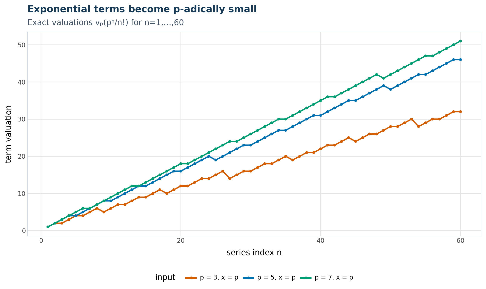

# Algebraic closures and C_p {#sec-cp}

**Level and prerequisites: L3–L4.** Prepare algebraic closures, extensions of valuations and metric completion. The [reader guide](index.md) links the Euler arithmetic, algebra and analysis preparation and distinguishes the graduate continuation.

## Goals and perspective

The complex numbers arise by algebraically closing and completing the reals.
Starting from $\mathbb Q_p$ leads to a field denoted $\mathbb C_p$, but the route
contains an extra surprise: the algebraic closure is not complete. We construct
the completion, state its main properties, and separate completeness from the
stronger condition of spherical completeness.

## The algebraic closure is not complete

An extension is **algebraic** when each of its elements satisfies a nonzero
polynomial over the base field. An **algebraic closure** is an algebraic
extension that is algebraically closed. Choose one and denote it by
$\overline{\mathbb Q}_p$. The valuation on
$\mathbb Q_p$ extends uniquely to it, although the extension contains many
different finite subfields. Its value group is $\mathbb Q$: adjoining an
$e$th root of $p$ produces valuation $1/e$. Its residue field is an algebraic
closure $\overline{\mathbb F}_p$.

Despite containing every algebraic root, $\overline{\mathbb Q}_p$ is not
complete. The unramified-digit construction below gives an explicit Cauchy
sequence and proves that its limit cannot belong to any finite extension.

The important distinction is logical: **algebraically closed** means every
nonconstant polynomial has a root; **complete** means every Cauchy sequence has
a limit. Neither property implies the other.

## Constructing the completion

Define

$$
\mathbb C_p=\widehat{\overline{\mathbb Q}_p},
$$

the metric completion of the algebraic closure. Its elements are equivalence
classes of Cauchy sequences of algebraic *p*-adic numbers. The absolute value
extends continuously, and $\overline{\mathbb Q}_p$ is dense.

<div class="callout callout-note">
<p class="callout-title">Krasner's theorem on the completed closure</p>

The field $\mathbb C_p$ is both complete and algebraically closed.

</div>

Completeness is true by construction. Algebraic closedness requires a
separate argument. The root-selection proof below approximates monic
coefficients, chooses consecutive roots with distances tending to zero,
and uses completeness to obtain a root of the target polynomial.

The theorem does not say every element of $\mathbb C_p$ is algebraic. Most are
limits not contained in any finite extension of $\mathbb Q_p$.

## Topological and valued-field properties

$\mathbb C_p$ has characteristic zero, residue characteristic $p$, value group
$\mathbb Q$, and residue field $\overline{\mathbb F}_p$. Because $\mathbb Q$ is
dense in $\mathbb R$, the possible norm values $p^q$ are dense in
$\mathbb R_{>0}$. This contrasts with the discrete shells of $\mathbb Q_p$.

The field is not locally compact. One reason is that its residue field is
infinite: the unit ball cannot be covered by finitely many balls of radius less
than $1$, since distinct residue classes are that far apart. Therefore closed
bounded sets need not be compact.

Analytic power series over $\mathbb C_p$ can have roots with fractional
valuations of arbitrarily large denominators. Newton polygons still control the
root norms, now without requiring a further algebraic extension.

## Spherical completeness

A valued field is **spherically complete** if every nested family of closed balls
has nonempty intersection. Ordinary metric completeness guarantees intersection
for a nested sequence whose radii tend to zero. Spherical completeness also
covers families whose radii approach a positive limit and families indexed by
more complicated ordered sets.

<div class="callout callout-warning">
<p class="callout-title">A crucial warning</p>

$\mathbb C_p$ is complete but not spherically complete. A nested family of
closed balls can have empty intersection even though no Cauchy sequence has
been left without a limit.

</div>

This distinction affects functional analysis. Certain Hahn–Banach extension
statements and orthogonal-basis theorems hold cleanly over spherically complete
fields but can fail over $\mathbb C_p$. One can embed $\mathbb C_p$ into larger
spherically complete fields, although such an enlargement is not canonical in
the same way as metric completion.

## Comparison with the complex numbers

Both $\mathbb C$ and $\mathbb C_p$ are complete and algebraically closed fields
of characteristic zero. As abstract fields they share many algebraic features,
but their topologies are profoundly different.

| Feature | $\mathbb C$ | $\mathbb C_p$ |
|---|---|---|
| Triangle law | Archimedean | ultrametric |
| Connectedness | connected | totally disconnected |
| Local compactness | yes | no |
| Value group | all positive real norms | $p^{\mathbb Q}$ plus zero |
| Residue field | not part of the usual structure | $\overline{\mathbb F}_p$ |
| Spherical completeness | not the relevant notion | false |

There is no continuous field isomorphism between them. Writing the letter
$\mathbb C$ in both names signals analogous algebraic closure and completion,
not analogous geometry.

## Analytic phenomena

Over $\mathbb C_p$, a polynomial splits completely, so zero counting can be
related directly to Newton polygons. Analytic functions on discs still obey
strong coefficient bounds. Yet naive global topology is too disconnected for
some geometric purposes, motivating the rigid and Berkovich spaces of Chapter
23.

Completeness also lets one integrate, solve differential equations locally, and
study Galois representations after extending scalars. It does not erase
arithmetic: the action of
$\operatorname{Gal}(\overline{\mathbb Q}_p/\mathbb Q_p)$ extends continuously
to $\mathbb C_p$ and remains central to *p*-adic Hodge theory.

## Visual checkpoint: analytic terms become small by valuation

<figure id="fig-padic-cp-exponential-terms">


<figcaption>

Figure 21.1: Valuations of p-adic exponential terms rise across a finite precision ledger.

</figcaption>
</figure>

[Figure 21.1](#fig-padic-cp-exponential-terms) shows the mechanism behind analytic
convergence: term valuations rise, so absolute values fall. A finite ledger
cannot prove convergence in $\mathbb C_p$; the valuation bound and completeness
do that work.

## Compatible valuations and what completion can change

Every finite subextension of $\overline{\mathbb Q}_p$ has the unique
absolute value extending the one on $\mathbb Q_p$, by Chapter 12. Two such
extensions agree on their intersection because they agree inside their finite
compositum. This constructs the absolute value on the union, without choosing
a new normalization separately in each field. In this chapter we use
$v(p)=1$, so values in a ramified extension may be fractional. The finite
extension theorem puts every algebraic valuation in $\mathbb Q$. Conversely,
roots of $T^e-p$ realize $1/e$, and taking integer powers and inverses realizes
every rational value.

Every residue of an algebraic integral element lies in the finite residue
field of some finite extension. Conversely every finite field
$\mathbb F_{p^f}$ occurs as the residue field of an unramified extension.
The residue field of the union is therefore $\overline{\mathbb F}_p$.
One must not confuse this union of finite fields with a finite residue
field of a very large but fixed degree.

There are two useful completion facts. If a Cauchy sequence converges to a
nonzero element in a nonarchimedean completion, its norms are eventually equal
to the norm of its limit. Once the error is smaller than the limit's norm,
the strict triangle principle proves equality. Thus completing a valued
field adds no nonzero norm values. Also, an element of the completed unit
ball can be approximated with error less than one by an element of the
original field. That approximant is integral and has exactly the same
residue. Density consequently adds no residue classes. These two arguments
prove the asserted value group and residue field for $\mathbb C_p$ after
completion; they do not rely on completeness somehow enlarging either
invariant.

### Worked example 1: fractional valuations do not imply convergence

Choose a root $b_n=p^{1/n}$ for every positive integer $n$. Their valuations
are $1/n$, so their norms approach one from below. Nevertheless the sequence
is not Cauchy, regardless of which roots were chosen. For distinct indices
the norms differ, and hence

$$
|b_n-b_m|_p=\max(p^{-1/n},p^{-1/m}).
$$

These distances approach one rather than zero as both indices grow. The
existence of arbitrarily fine valuation denominators says nothing by itself
about the distances between the elements realizing them. In particular,
this sequence cannot demonstrate incompleteness: a missing limit must
first be the limit of a Cauchy sequence.

## An explicit Cauchy sequence with no algebraic limit

We now prove the noncompleteness statement by choosing unramified digits.
For each $n\geq0$, choose an element $\overline u_n$ of exact degree $n+1$
over $\mathbb F_p$ in $\overline{\mathbb F}_p$. Finite fields have generators
of their extensions, so such elements exist; take the nonzero element one
when the degree is one if necessary. In the unramified extension of degree
$n+1$, let $u_n$ be its Teichmüller lift. Thus $u_n$ is a unit and

$$
u_n^{p^{n+1}-1}=1.
$$

This lift is unique for its chosen nonzero residue, because the derivative
of this polynomial is a unit at every residue root. Existence is the
simple-root form of Hensel's lemma.

Consider the partial sums

$$
s_N=\sum_{0\leq n<N}p^n u_n.
$$

Each is algebraic: finitely many finite extensions lie in a finite
compositum. Their consecutive differences have valuation $N$, and all
tails starting at $N$ have valuation at least $N$. The sequence is Cauchy.

Suppose that its limit $\alpha$ were algebraic and put
$K=\mathbb Q_p(\alpha)$. Its residue field has some finite degree $f$ over
$\mathbb F_p$. We will prove inductively that every $u_n$ lies in $K$.
Assume that the earlier ones do. The element

$$
\beta_n=\frac{\alpha-\sum_{j<n}p^j u_j}{p^n}
$$

lies in $K$ and is integral. In the common completion its residue is
$\overline u_n$, because the remaining tail after the term $u_n$ is
divisible by $p$. Therefore $\overline u_n$ belongs to $k_K$.
Apply Hensel inside the complete field $K$ to
$T^{p^{n+1}-1}-1$ at that residue root. It produces a root in $K$ with
the same residue as $u_n$. The uniqueness part of Hensel, applied in a
finite compositum containing this root and $u_n$, makes the two roots
equal. Hence $u_n\in K$, completing the induction.

This is impossible once $n+1>f$, because an element of the finite field
$k_K$ cannot have degree greater than $f$ over its prime field. Thus
the Cauchy sequence has no limit in $\overline{\mathbb Q}_p$.
The proof identifies the obstruction: successive digits demand residue
extensions of unbounded degree, while a single algebraic element belongs
to one finite extension. It uses no claim that an increasing sequence of
field degrees alone automatically prevents convergence.

### Worked example 2: what the transcendental limit remembers

For $p=2$, the first digit may be one, the next a Teichmüller lift of an
element of $\mathbb F_4\setminus\mathbb F_2$, and the third a lift of a
generator of $\mathbb F_8$. Continue with exact degrees four, five, and
so on. The first two partial sums are $1$ and $1+2u_1$; the next adds
$4u_2$. The error after retaining $N$ digits has norm exactly $2^{-N}$,
since its leading coefficient $u_N$ is a unit and later terms are
strictly smaller. The resulting element of $\mathbb C_2$ is not
algebraic over $\mathbb Q_2$.

No finite numerical display distinguishes this element from its algebraic
partial sums. The transcendence assertion follows from the infinite
residue-degree argument, not from a finite ledger. At any fixed precision,
an algebraic approximation works perfectly well. This is a useful example
of a global field-membership statement invisible at any single finite
precision.

## A root-selection proof of algebraic closedness

Here is a complete proof of the completion theorem in the present setting.
More generally, let $E$ be an algebraically closed nonarchimedean valued
field and let $\widehat E$ be its metric completion. Take a monic
polynomial

$$
f(T)=T^d+c_{d-1}T^{d-1}+\cdots+c_0
$$

over $\widehat E$, with $d\geq1$. Approximate its coefficients by elements
of $E$ to obtain monic polynomials $f_n$ of the same degree with
coefficient errors tending to zero. Their coefficients are uniformly
bounded, say in norm by $R$, where $R\geq1$ also bounds the coefficients
of $f$.

Every root of every $f_n$ has norm at most $R$. Indeed, if a root had
norm greater than $R$, its leading term would have strictly greater norm
than each lower term, making cancellation impossible. Choose any root
$\alpha_1$ of $f_1$. Suppose that a root $\alpha_n$ of $f_n$ has been
chosen, and write $\delta_n$ for the maximum coefficient norm of
$f_{n+1}-f_n$. Evaluation at the bounded element $\alpha_n$ gives

$$
|f_{n+1}(\alpha_n)|\leq
\delta_n\max(1,R^{d-1}).
$$

Factor $f_{n+1}$ into its $d$ linear factors in $E$. The product of
the distances from $\alpha_n$ to its roots is the left side. At least
one root, chosen as $\alpha_{n+1}$, therefore satisfies

$$
|\alpha_{n+1}-\alpha_n|
 \leq\bigl(\delta_n\max(1,R^{d-1})\bigr)^{1/d}.
$$

If $\delta_n=0$, reuse the same root. Since the coefficients converge,
$\delta_n$ tends to zero. The successive differences consequently tend
to zero, and the ultrametric Cauchy criterion of Chapter 7 makes
$\alpha_n$ a Cauchy sequence. Let its limit in $\widehat E$ be $\alpha$.

The coefficient errors and the uniform root bound also give
$|f(\alpha_n)-f_n(\alpha_n)|\to0$. The second term is zero, so polynomial
continuity implies $f(\alpha)=0$. Thus every monic polynomial of positive
degree over $\widehat E$ has a root. Divide by $T-\alpha$ and repeat on
the monic quotient of smaller degree to obtain a complete splitting.
Scaling handles a nonmonic polynomial. Applying this result to
$E=\overline{\mathbb Q}_p$ proves that $\mathbb C_p$ is algebraically
closed.

The argument does not require the approximating roots to be simple.
It uses a product bound rather than dividing by a derivative, so it
survives collisions of roots. Separability and a Newton starting value
would be unnecessary restrictions here. Nor is an unproved consistency
choice hidden in the phrase “approximate a root”: each stage explicitly
chooses one of finitely many roots near the previous one.

### Worked example 3: a square root of a completed coefficient

Let $a\in\mathbb C_p$ satisfy $|a|_p\leq1$, without assuming that it is
algebraic. Choose algebraic integral $a_n$ converging to it with
$|a_{n+1}-a_n|_p\leq p^{-2n}$. A starting root of $T^2-a_1$ is
integral. Given a chosen root $\alpha_n$, the two roots of
$T^2-a_{n+1}$ have distances from it whose product is at most
$p^{-2n}$. Choose one at distance at most $p^{-n}$. The chosen roots
are Cauchy, and their limit squares to $a$.

This works at two as well as at odd primes. There was no division by
two, no assertion that the derivative was a unit, and no assumption
that the target coefficient was nonzero. The price is a root-selection
argument in the algebraic closure rather than a canonical branch.
Changing a compatible sequence of branch choices can change the
limiting square root, as expected.

## Local compactness and a countable dense subset

The completed unit ball has infinitely many residue classes. Distinct
classes have distance one, so balls of radius less than one cannot
cover more than one class each. This prevents total boundedness and
therefore compactness of the unit ball. To infer failure of local
compactness, rather than merely failure of one large set to be compact,
suppose that zero had a compact neighborhood $C$. It contains a ball
around zero. For sufficiently large $N$, the closed ball
$p^N\mathcal O_{\mathbb C_p}$ lies inside $C$. This is a closed subset
of the compact set and would be compact. Multiplication by $p^{-N}$
would make the whole unit ball compact, a contradiction.

An apparently contrasting property will be useful: $\mathbb C_p$ has
a countable dense subset. Let $A$ consist of all roots in the fixed
algebraic closure of all monic polynomials over $\mathbb Q$. There
are countably many such polynomials and finitely many roots for each,
so $A$ is countable.

To show density, take an algebraic element $\alpha$ and a monic
polynomial $f\in\mathbb Q_p[T]$ having it as a root, of degree $d$.
Approximate the coefficients by rationals to get a monic
$g\in\mathbb Q[T]$ with $|g(\alpha)|_p<\varepsilon^d$.
This is possible because evaluation at the fixed element $\alpha$
depends continuously on the finitely many coefficients. Factor $g$
in $\overline{\mathbb Q}_p$. The product of its distances from
$\alpha$ is less than $\varepsilon^d$, so at least one root lies at
distance less than $\varepsilon$. That root belongs to $A$. Thus $A$
is dense in the algebraic closure and, by taking one further
approximation, in its completion. Countability of a dense subset is
compatible with the uncountability of a complete field; even
$\mathbb Q_p$ already illustrates this distinction.

## A nested family with empty intersection

We can now prove the failure of spherical completeness directly.
Enumerate a countable dense subset as $a_1,a_2,\ldots$.
Set $r_0=p$ and, for $n\geq1$, set
$r_n=p^{1/(n+1)}$. These are attained norm values, decrease strictly,
and tend to the positive number one.

Begin with any closed ball $B_0$ of radius $r_0$.
Suppose a closed ball $B_{n-1}$ of radius $r_{n-1}$ has been chosen.
The dense value group supplies an attained value $s_n$ strictly
between $r_n$ and $r_{n-1}$. If $c$ is the center of the parent
ball, choose an element $h$ of norm $s_n$. The two closed balls
of radius $r_n$ centered at $c$ and $c+h$ both lie in the parent,
and they are disjoint: otherwise the distance between their centers
would be at most $r_n$.

At most one of those two child balls contains $a_n$. Choose the
other as $B_n$. If neither contains it, choose either one.
This constructs a nested sequence of nonempty closed balls such
that $B_n$ excludes $a_n$. Once excluded, an element remains
excluded at every later stage.

If $x$ belonged to their intersection, the open ball of radius one
around $x$ would be contained in every $B_n$, because their radii
are all greater than one. Density would put some $a_j$ in that open
ball, and hence in $B_j$, contradicting its exclusion. The intersection
is empty. These radii do not tend to zero, so the construction does
not contradict metric completeness. The proof also shows precisely
which features matter: a countable dense subset and enough norm
values to keep splitting balls while their radii approach a positive
limit.

For comparison, in any complete ultrametric field, a nested sequence
of nonempty closed balls with radii tending to zero has nonempty
intersection. Choose a point from each ball. Later points lie
in every earlier ball, so the sequence is Cauchy. Its limit belongs
to each fixed closed ball and therefore to the intersection.
The extra radius condition is exactly what is absent above.

The existence of suitable larger spherically complete valued
extensions, mentioned earlier, is a separate valued-field extension
theorem. We use neither its construction nor a canonical choice
of such an enlargement in this chapter.

## Polynomials and analytic functions have different zero sets

Algebraic closedness splits a polynomial into finitely many linear
factors because the degree decreases after each division. An analytic
function on an open disc has no such finite degree bound. A concrete
example is

$$
\log(1+T)=\sum_{n\geq1}(-1)^{n+1}\frac{T^n}{n}
\qquad (|T|_p<1)
$$

over $\mathbb C_p$. For a primitive $p^m$th root of unity $\zeta$,
the element $\zeta-1$ lies in this open disc and the logarithm vanishes
there. Here are the necessary justifications, including why these
zeros do not violate restricted-series zero counting.

The polynomial $\Phi_{p^m}(1+T)$ is Eisenstein of degree
$d=p^{m-1}(p-1)$. Its constant term is $p$. Modulo $p$, use
$\Phi_{p^m}(X)=\sum_{j=0}^{p-1}X^{j p^{m-1}}$ and the characteristic
$p$ binomial identity to obtain the reduction $T^d$. Thus every
nonleading coefficient is divisible by $p$, while the constant
term is not divisible by $p^2$. The Newton-polygon theorem gives

$$
v_p(\zeta-1)=1/d.
$$

In particular these differences have norm less than one but their
norms tend to one as $m$ increases.

For $|x-1|_p<1$, the logarithm satisfies
$\log(x^N)=N\log(x)$ for every positive integer $N$.
One can verify this without assuming that an exponential inverse
converges: the formal identity
$\log((1+T)^N)=N\log(1+T)$ follows by differentiating and comparing
the zero constant terms. Substitution is legitimate on each strictly
smaller closed disc, where the series and the relevant compositions
converge. Apply it to $x=\zeta$ and $N=p^m$. The left side is
$\log 1=0$, and characteristic zero then gives $\log\zeta=0$.

These give infinitely many distinct zeros of a nonzero analytic
function, since its linear coefficient is one. But on any fixed
closed disc of radius strictly below one only finitely many of
these roots occur: their norms approach the excluded boundary.
On a closed disc of attained radius below one, scaling makes the
logarithm a restricted power series, so Strassmann applies. There
is no conflict between finite control on each such compact-radius
analytic domain and infinitely many zeros on their open union.
The domain itself is not being asserted compact; over $\mathbb C_p$
a closed bounded disc is already noncompact in its metric topology.

<!-- inline-formula-code:start -->
## Formula and finite computation

A useful formula in this chapter is

$$
v_p(x_{n+1}-x_n)\longrightarrow\infty
$$

A finite precision ledger records how consecutive approximations become $p$-adically close. The following standalone Python block expresses that finite rule with its inputs and stopping conditions visible.

```python
prime = 3
approximations = [1, 1 + 3, 1 + 3 + 3**3, 1 + 3 + 3**3 + 3**6]
differences = [right - left for left, right in zip(approximations, approximations[1:])]
valuations: list[int] = []
for difference in differences:
    exponent = 0
    while difference % prime == 0:
        difference //= prime
        exponent += 1
    valuations.append(exponent)
print(valuations)
```

**What the computation establishes.** The output certifies only the declared finite case. The theorem, if one is claimed, still requires the argument developed in the chapter.
<!-- inline-formula-code:end -->

## Summary

The algebraic closure of $\mathbb Q_p$ contains all algebraic roots but misses
some metric limits. Completing it gives $\mathbb C_p$, which is again
algebraically closed. Its dense rational value group, infinite residue field,
failure of local compactness, and failure of spherical completeness distinguish
it sharply from both $\mathbb Q_p$ and $\mathbb C$.

## Exercises

### Exercise 21.1 {#ex-padic-21-01}

Explain why $v(p^{1/e})=1/e$ in a compatible extension valuation.

<details>
<summary>Hint 1</summary>

Apply the valuation to the defining power equation.

</details>

<details>
<summary>Hint 2</summary>

Keep the base normalization $v(p)=1$, rather than renormalizing each extension to integer values.

</details>

<details>
<summary>Full solution</summary>

For any chosen root $\alpha$ of $T^e-p$, multiplicativity gives $e\,v(\alpha)=v(\alpha^e)=v(p)=1$. Hence $v(\alpha)=1/e$. The extended valuation takes fractional values; the integer-normalized valuation of the totally ramified degree-$e$ extension would instead assign value one to $\alpha$ and value $e$ to $p$. These two conventions describe the same absolute-value topology but must not be substituted into one another without the scaling factor.

</details>

### Exercise 21.2 {#ex-padic-21-02}

Prove that an infinite residue field prevents the unit ball from being totally bounded.

<details>
<summary>Hint 1</summary>

Choose one integral representative of each residue class.

</details>

<details>
<summary>Hint 2</summary>

Two distinct representatives cannot fit in the same ball of radius strictly less than one.

</details>

<details>
<summary>Full solution</summary>

Distinct residue classes have representatives whose difference is a unit, so their mutual distance is one. A ball of radius less than one contains at most one chosen representative, by the ultrametric inequality. An infinite set of representatives therefore cannot be covered by finitely many such balls. This contradicts total boundedness of the unit ball. Since a compact metric space is totally bounded, the unit ball cannot be compact. To conclude failure of local compactness, use the scaling argument from a hypothetical compact neighborhood to a small closed ball and then to the unit ball.

</details>

### Exercise 21.3 {#ex-padic-21-03}

Distinguish algebraic closedness, metric completeness, and spherical completeness with one sentence each.

<details>
<summary>Hint 1</summary>

Ask whether the condition concerns polynomials, sequences, or families of balls.

</details>

<details>
<summary>Hint 2</summary>

Spherical completeness does not restrict nested radii to tend to zero.

</details>

<details>
<summary>Full solution</summary>

Algebraic closedness means that every nonconstant polynomial over the field has a root in the field. Metric completeness means that every Cauchy sequence for its absolute-value metric converges in the field. Spherical completeness means that every nested family of nonempty closed balls has nonempty intersection. The algebraic closure of $\mathbb Q_p$ illustrates the first without the second, while $\mathbb C_p$ has the first two but fails the third. The explicit constructions in the chapter justify these distinctions rather than merely assigning names to them.

</details>

### Exercise 21.4 {#ex-padic-21-04}

Show that the norm values $p^{\mathbb Q}$ are dense in $\mathbb R_{>0}$.

<details>
<summary>Hint 1</summary>

Use the ordinary real logarithm to base $p$.

</details>

<details>
<summary>Hint 2</summary>

Approximate that real number by rationals and use continuity of real exponentiation.

</details>

<details>
<summary>Full solution</summary>

For a positive real number $r$, write $r=p^t$ with $t=\log_p r$. Given any real neighborhood of $r$, continuity of $s\mapsto p^s$ supplies an interval around $t$ mapped into that neighborhood. A rational $q$ lies in the interval, so $p^q$ lies in the original neighborhood. Every such value is attained by an algebraic element: write $q=a/b$ with $b>0$, choose a $b$th root of $p$, and take its power $-a$. Its norm is $p^{a/b}$. Thus the dense set consists of actual norm values, not merely formal exponents.

</details>

### Exercise 21.5 {#ex-padic-21-05}

Explain why a polynomial over $\mathbb C_p$ has all of its roots in $\mathbb C_p$ but a convergent power series need not factor into finitely many linear terms.

<details>
<summary>Hint 1</summary>

Polynomial division reduces a finite degree at each step.

</details>

<details>
<summary>Hint 2</summary>

Use the logarithm on its open unit disc and roots of unity approaching the boundary.

</details>

<details>
<summary>Full solution</summary>

The completed-closure theorem gives one root of a positive-degree polynomial, and division followed by induction splits the polynomial into exactly its degree many linear factors, counted with multiplicity. A power series has no finite degree to decrease. The nonzero analytic function $\log(1+T)$ on $|T|_p<1$ vanishes at every $\zeta-1$ for a $p$-power root of unity $\zeta$. The chapter proves both this vanishing and the valuations tending to zero, so these infinitely many distinct zeros escape toward the boundary. A finite product of linear factors, even multiplied by a nowhere-zero analytic unit, has only finitely many zeros. It cannot represent this function on the whole open disc. Restricted-series zero bounds on each strictly smaller attained-radius closed disc remain valid.

</details>

### Exercise 21.6 {#ex-padic-21-06}

Identify which parts of the comparison table are algebraic and which are topological.

<details>
<summary>Hint 1</summary>

Separate statements about field equations from statements about the chosen absolute value.

</details>

<details>
<summary>Hint 2</summary>

Value group and residue field use the valuation, even though each is also an algebraic object.

</details>

<details>
<summary>Full solution</summary>

Characteristic zero and algebraic closedness are properties of the underlying fields. Completeness, connectedness, local compactness, and the form of the triangle law concern their absolute values and topologies. The value group and residue field are invariants of a valued field, so they cannot be recovered simply by forgetting its absolute value. Spherical completeness concerns its family of closed balls. In particular, the shared algebraic properties do not produce a continuous field isomorphism: the connected space $\mathbb C$ cannot be homeomorphic to the totally disconnected space $\mathbb C_p$. A continuous field isomorphism here would already be a continuous bijection from a connected space onto a disconnected one, which is impossible.

</details>

### Exercise 21.7 {#ex-padic-21-07}

Give the root-selection proof that the metric completion of an algebraically closed nonarchimedean field is algebraically closed.

<details>
<summary>Hint 1</summary>

Approximate monic coefficients and first obtain a uniform root bound.

</details>

<details>
<summary>Hint 2</summary>

Factor the next approximating polynomial at the previous chosen root and bound one of the distances by the geometric mean.

</details>

<details>
<summary>Full solution</summary>

For a monic degree-$d$ polynomial over the completion, choose monic approximants over the algebraically closed field with coefficients bounded by $R\ge1$. Every approximating root has norm at most $R$ by the unique-largest-term argument. If $\alpha_n$ is a root of the current polynomial and $\delta_n$ bounds the next coefficient change, evaluation of the next polynomial at $\alpha_n$ has norm at most $\delta_n\max(1,R^{d-1})$. Factoring it shows that some next root lies within the $d$th root of this bound. The bound tends to zero, so the chosen roots are Cauchy by ultrametricity. Their limit is a root of the target by coefficient convergence and continuity. Division and induction finish the proof. No derivative or simple-root assumption is needed.

</details>

### Exercise 21.8 {#ex-padic-21-08}

Construct a countable dense subset of $\mathbb C_p$ using roots of polynomials over $\mathbb Q$.

<details>
<summary>Hint 1</summary>

There are countably many rational-coefficient polynomials, each with finitely many roots.

</details>

<details>
<summary>Hint 2</summary>

Evaluate a nearby rational-coefficient polynomial at a fixed algebraic element and factor its value.

</details>

<details>
<summary>Full solution</summary>

Let $A$ be the roots in the fixed algebraic closure of all monic rational-coefficient polynomials. This is countable. Given algebraic $\alpha$ with a monic degree-$d$ polynomial over $\mathbb Q_p$, approximate its coefficients by rationals until the new polynomial $g$ satisfies $|g(\alpha)|<\varepsilon^d$. Factoring $g$ shows that one of its roots is within $\varepsilon$ of $\alpha$, because otherwise every distance factor would be at least $\varepsilon$. That root belongs to $A$. Hence $A$ is dense in the algebraic closure, and its density persists in the completion by one additional approximation and the triangle inequality.

</details>

### Exercise 21.9 {#ex-padic-21-09}

Construct a nested sequence of closed balls in $\mathbb C_p$ with empty intersection.

<details>
<summary>Hint 1</summary>

Enumerate a countable dense set and choose decreasing attained radii with positive limit one.

</details>

<details>
<summary>Hint 2</summary>

At each stage choose between two disjoint child balls to exclude the next enumerated point.

</details>

<details>
<summary>Full solution</summary>

Take radii $r_0=p$ and $r_n=p^{1/(n+1)}$. Inside the preceding ball choose two centers at an attained distance strictly between $r_n$ and $r_{n-1}$. The closed $r_n$ balls around them are disjoint and lie in their parent. Choose one omitting the next point $a_n$ of a countable dense set. If a point $x$ belonged to every chosen ball, its open radius-one ball would also belong to each, since all radii exceed one. Density would put some $a_j$ in that open ball, contradicting its exclusion at stage $j$. This proves empty intersection while leaving ordinary completeness untouched, since the radii do not tend to zero.

</details>

### Exercise 21.10 {#ex-padic-21-10}

Prove that completing a nonarchimedean valued field changes neither its value group nor its residue field.

<details>
<summary>Hint 1</summary>

Approximate a nonzero completed element with error smaller than its norm.

</details>

<details>
<summary>Hint 2</summary>

For residues, approximate an integral element with error strictly less than one.

</details>

<details>
<summary>Full solution</summary>

For nonzero $x$ in the completion choose an original-field element $a$ with $|x-a|<|x|$. The strict triangle principle gives $|a|=|x|$, so every nonzero completed norm was already attained. Conversely all old norms remain. For an integral $x$, choose $a$ with $|x-a|<1$. Then $a$ is integral and has the same residue, proving surjectivity on residue fields. Injectivity follows because an original integral element has residue zero in either field exactly when its norm is less than one. These arguments use the immediate-extension property of metric completion; they do not say that arbitrary valued-field extensions preserve these invariants.

</details>

<details>
<summary>Earlier selected support</summary>

**Support.** Exercise 2 chooses one unit representative from each residue class;
balls of radius below $1$ contain at most one. For Exercise 4 approximate any
real logarithm base $p$ by rationals. In Exercise 5 a polynomial has finite
degree, whereas a nonzero analytic function may have infinitely many zeros on a
noncompact domain even though Strassmann-type arguments give finite control on
each disc where the relevant restricted-series hypotheses hold.

</details>
