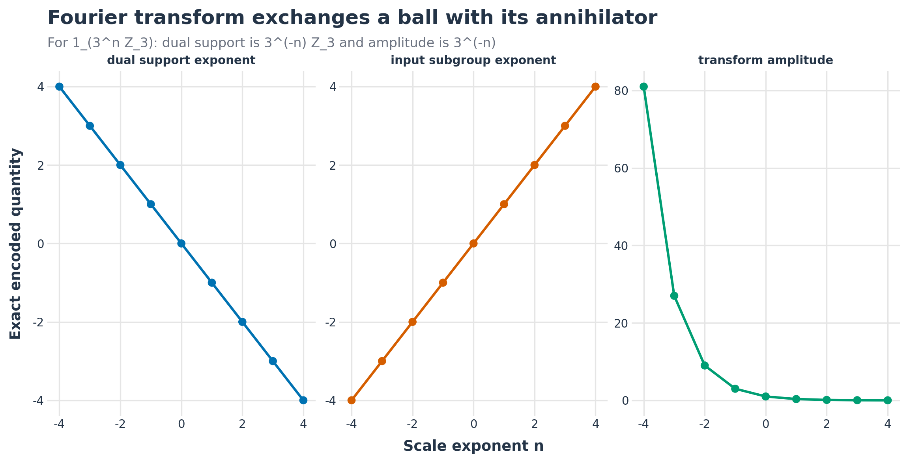

# Local Fourier analysis and zeta integrals {#sec-fourier-zeta}

**Level and prerequisites: L5.** Prepare Haar integration, characters of locally compact abelian groups and Fourier transforms. The [reader guide](index.md) links the Euler arithmetic, algebra and analysis preparation and distinguishes the graduate continuation.

## Goals and prerequisites

Chapter 11 constructed additive Haar measure and introduced characters. We now
build a Fourier transform on $\mathbb Q_p$, beginning with locally constant,
compactly supported functions. Indicator functions of balls make every formula
exact. The final section explains how a geometric series becomes a local zeta
factor.

## Additive characters

Write $x\in\mathbb Q_p$ as

$$
x=\sum_{n=m}^{\infty}a_np^n,
\qquad 0\le a_n<p.
$$

Its finite **fractional part** is the rational number modulo $1$

$$
\{x\}_p=\sum_{m\le n<0}a_np^n\pmod {\mathbb Z}.
$$

Define the standard additive character

$$
\psi(x)=\exp(2\pi i\{x\}_p).
$$

This complex exponential is applied only to a rational class modulo $1$; it is
not the *p*-adic exponential. The character satisfies
$\psi(x+y)=\psi(x)\psi(y)$. Its kernel is $\mathbb Z_p$, so it is locally
constant.

For $a\in\mathbb Q_p$, the function $x\mapsto\psi(ax)$ is another character.
Every continuous additive character of $\mathbb Q_p$ has this form for a unique
$a$. This is the self-duality of the additive group at the level of characters.

## Schwartz–Bruhat functions

A **Schwartz–Bruhat function** on $\mathbb Q_p$ is a complex-valued, locally
constant function with compact support. Such a function is constant on cosets of
$p^N\mathbb Z_p$ for some $N$ and vanishes outside
$p^{-M}\mathbb Z_p$ for some $M$. It is therefore specified by finitely many
values.

Indicators of balls span this function space. Indeed, refine a compact support
into sufficiently small residue balls; the function is constant on each. This
finite description is the local analogue of using rapidly decreasing smooth
functions in real Fourier analysis.

## Fourier transform

Normalize additive Haar measure by $\mu(\mathbb Z_p)=1$. For a
Schwartz–Bruhat function $f$, define

$$
\widehat f(\xi)
=\int_{\mathbb Q_p}f(x)\psi(-x\xi)\,dx.
$$

The integral is a finite sum after partitioning support into balls on which the
integrand is constant. Linearity, translation, and scaling follow from Haar
measure. For example, if $f_a(x)=f(x-a)$, then

$$
\widehat{f_a}(\xi)=\psi(-a\xi)\widehat f(\xi).
$$

The transform of a ball contains the whole theory in miniature:

$$
\widehat{\mathbf 1_{p^n\mathbb Z_p}}(\xi)
=p^{-n}\mathbf 1_{p^{-n}\mathbb Z_p}(\xi).
$$

If $\xi\in p^{-n}\mathbb Z_p$, the character is trivial on the input ball, so
the integral equals its measure $p^{-n}$. Otherwise translation by a point on
which the character is nontrivial multiplies the integral by a nontrivial complex
phase (different from 1) while leaving it unchanged; therefore it is zero.

<figure id="fig-fourier-ball">


<figcaption>

Figure 22.1: A p-adic ball and the support of its Fourier transform are compared across integer scale exponents, showing reciprocal radii and the exact Haar amplitude.

</figcaption>
</figure>

[Figure 22.1](#fig-fourier-ball) uses valuation exponents rather than Euclidean widths. A
smaller input ball has less mass but a larger annihilator in frequency space,
an exact local uncertainty tradeoff.

## Inversion and self-dual normalization

With the chosen standard character and measure, applying the transform twice
gives reflection:

$$
\widehat{\widehat f}(x)=f(-x).
$$

For indicators of balls, the formula follows immediately from the transform
above. Translation and modulation extend it to indicators of cosets. Since
these span the Schwartz–Bruhat functions, inversion follows by linearity.

For a different initial character, Haar measure must be rescaled to remain
self-dual. This dependence is why a Fourier formula should always state both the
character and the measure normalization.

## Pontryagin duality and annihilators

For a locally compact abelian group $G$, its **Pontryagin dual** is

$$
\widehat G=\operatorname{Hom}_{\mathrm{cont}}(G,S^1),
$$

with the compact-open topology and pointwise multiplication. Evaluation gives a
canonical map $G\to\widehat{\widehat G}$; Pontryagin duality says this map is an
isomorphism of topological groups.

If $H\subseteq G$ is a closed subgroup, its annihilator is

$$
H^\perp=\{\chi\in\widehat G:\chi(h)=1\text{ for all }h\in H\}.
$$

Under the identification
$\mathbb Q_p\cong\widehat{\mathbb Q_p}$ given by
$a\mapsto(x\mapsto\psi(ax))$, one has

$$
(p^n\mathbb Z_p)^\perp=p^{-n}\mathbb Z_p.
$$

This is exactly the support statement in the ball-transform formula. It is also
an instance of the dual exactness rules

$$
\widehat{G/H}\cong H^\perp,
\qquad
\widehat H\cong\widehat G/H^\perp.
$$

The locally compact hypotheses matter. Treating the dual as the set of all
abstract homomorphisms discards continuity and produces a much larger object.

## Convolution and Plancherel

For Schwartz–Bruhat functions define convolution by

$$
(f*g)(x)=\int_{\mathbb Q_p}f(y)g(x-y)\,dy.
$$

Compact support and local constancy make the integral finite. A change of order
in a finite residue sum proves

$$
\widehat{f*g}(\xi)=\widehat f(\xi)\widehat g(\xi).
$$

Thus convolution in position becomes multiplication in frequency. For the
compact-open subgroup $H=p^n\mathbb Z_p$,

$$
\mathbf 1_H*\mathbf 1_H=\mu(H)\mathbf 1_H.
$$

If $x\in H$, every $y\in H$ also has $x-y\in H$, so the integral is
$\mu(H)$. If $x\notin H$, the two conditions cannot hold simultaneously.

With self-dual measure the transform also preserves the complex $L^2$ norm:

$$
\int|\widehat f(\xi)|^2\,d\xi
=\int|f(x)|^2\,dx.
$$

For Schwartz–Bruhat functions, this Plancherel identity follows from inversion
and finite orthogonality of characters. Extending it to the completed
$L^2$ space is a functional-analytic step.

## Multiplicative measure and local zeta integrals

On $\mathbb Q_p^\times$, choose multiplicative Haar measure $d^\times x$ with

$$
\operatorname{vol}(\mathbb Z_p^\times)=1.
$$

Multiplication by $p^k$ preserves multiplicative mass, so every shell
$p^k\mathbb Z_p^\times$ has mass $1$. For a Schwartz–Bruhat function $f$ and a
**quasicharacter** $\chi$, meaning a continuous multiplicative homomorphism into
$\mathbb C^\times$, a Tate-style local zeta integral is

$$
Z(f,\chi,s)=\int_{\mathbb Q_p^\times}
f(x)\chi(x)|x|_p^s\,d^\times x,
$$

initially in a region where it converges.

Take $f=\mathbf 1_{\mathbb Z_p}$ and the trivial character. Only shells with
$k\ge0$ contribute, giving

$$
Z(f,1,s)=\sum_{k=0}^{\infty}p^{-ks}
=\frac{1}{1-p^{-s}}
$$

for $\operatorname{Re}(s)>0$. This differs from the additive-measure integral in
Chapter 11, whose shell masses include $p^{-k}(1-p^{-1})$. Measure choice
explains the shift.

Chapter 43 studies a related but distinct construction: an Igusa integral uses
additive Haar measure on $\mathcal O_K^n$ and inserts the size of a polynomial
$f(x)$. Its congruence counts and rational generating functions should not be
identified with the multiplicative Tate integral above merely because both are
called local zeta functions.

## Functional-equation vista

Fourier transform exchanges behavior near zero with behavior at large norm.
Tate's local theory proves meromorphic continuation of zeta integrals and a
functional equation relating $Z(f,\chi,s)$ to an integral involving
$\widehat f$, the inverse character, and $1-s$. A local gamma factor accounts
for normalization.

We do not prove that theorem here. Its mechanism combines Fourier inversion,
shell decomposition, and exact analysis of characters. Multiplying compatible
local factors across all places produces global functional equations for zeta
and $L$-functions.

## Adelic Fourier transform and Poisson summation

Chapter 14 constructed

$$
\mathbb A_{\mathbb Q}
=\mathbb R\times\prod_p'\mathbb Q_p.
$$

Choose the real character $x\mapsto e^{-2\pi i x}$ and the local standard
characters compatibly, so their product is trivial on diagonally embedded
$\mathbb Q$. With the corresponding self-dual Haar measure, the additive adele
group is self-dual. The annihilator of the diagonal copy of $\mathbb Q$ is that
same diagonal copy.

An adelic Schwartz–Bruhat function is a finite linear combination of restricted
tensors

$$
\Phi(x)=\Phi_\infty(x_\infty)\prod_p\Phi_p(x_p),
$$

where $\Phi_\infty$ is a real Schwartz function and
$\Phi_p=\mathbf1_{\mathbb Z_p}$ for almost every $p$. The restricted condition
makes the product meaningful. Fourier transformation is componentwise and
preserves this space.

Poisson summation then states

$$
\sum_{r\in\mathbb Q}\Phi(r)
=\sum_{r\in\mathbb Q}\widehat\Phi(r).
$$

This is a theorem about the lattice $\mathbb Q\subset\mathbb A_{\mathbb Q}$,
not the limit of a rectangular numerical grid. Its proof uses compactness of
$\mathbb A_{\mathbb Q}/\mathbb Q$, character orthogonality, and control of the
real Schwartz factor. Together with carefully normalized local zeta integrals,
it is the mechanism behind the global functional equation in Tate's thesis.

<div class="callout callout-warning">
<p class="callout-title">Fourier-analysis pitfalls</p>

- The complex character exponential and the *p*-adic exponential are different
  functions with different codomains.
- Additive and multiplicative Haar measures scale differently.
- A Fourier transform formula is incomplete without character and measure
  normalization.
- “Compact support” is essential in the definition used here.

</div>

<!-- inline-formula-code:start -->
## Formula and finite computation

A useful formula in this chapter is

$$
\widehat{\mathbf1_{p^n\mathbb Z_p}}(\xi)
=p^{-n}\mathbf1_{p^{-n}\mathbb Z_p}(\xi).
$$

The exact finite analogue lives in
$\mathbb Z/p^N\mathbb Z$. The indicator of the subgroup of multiples of $p^n$
has normalized character sum $p^{-n}$ exactly on its annihilator and zero
elsewhere. No floating-point complex phases are needed: a complete cycle of
nontrivial roots of unity cancels.

```python
from fractions import Fraction
from math import isqrt

def is_prime(number: int) -> bool:
    """Return whether number is prime by exact trial division."""
    if number < 2:
        return False
    return all(number % divisor for divisor in range(2, isqrt(number) + 1))

def finite_ball_fourier(
    prime: int, ambient_precision: int, ball_depth: int
) -> list[tuple[int, Fraction]]:
    """Return exact normalized Fourier values on Z/p^N for p^n multiples."""
    if not is_prime(prime):
        raise ValueError("prime must be prime")
    if ambient_precision <= 0 or not 0 <= ball_depth <= ambient_precision:
        raise ValueError("require 0 <= ball_depth <= ambient_precision")
    modulus = prime**ambient_precision
    subgroup_size = prime ** (ambient_precision - ball_depth)
    annihilator_step = subgroup_size
    amplitude = Fraction(subgroup_size, modulus)
    return [
        (
            frequency,
            amplitude if frequency % annihilator_step == 0 else Fraction(0),
        )
        for frequency in range(modulus)
    ]

transform = finite_ball_fourier(prime=3, ambient_precision=4, ball_depth=2)
support = [(frequency, value) for frequency, value in transform if value]
print(support)
```

**What the computation establishes.** The support and amplitude are proved for
the complete finite quotient, the exact character-orthogonality model of the
ball formula. Pontryagin duality for $\mathbb Q_p$ and adelic Poisson summation
still require the topological arguments stated above.
<!-- inline-formula-code:end -->

## Summary

The standard character identifies $\mathbb Q_p$ with its additive dual.
Schwartz–Bruhat functions reduce integration to finite residue sums. Fourier
transform sends a ball indicator to the scaled indicator of its annihilator and
squares to reflection. Multiplicative shell integration yields the elementary
local factor $(1-p^{-s})^{-1}$ and opens the route to local functional equations.

## Exercises

<div class="exercise" id="p_adic_numbers-22-fourier-zeta-ex-1">
<p class="exercise-title"><strong>Exercise 1</strong></p>

Compute $\psi(p^{-2})$ and $\psi(1+p^{-1})$ from the digit definition.

</div>

<div class="exercise" id="p_adic_numbers-22-fourier-zeta-ex-2">
<p class="exercise-title"><strong>Exercise 2</strong></p>

Prove the Fourier transform formula for $\mathbf 1_{a+p^n\mathbb Z_p}$.

</div>

<div class="exercise" id="p_adic_numbers-22-fourier-zeta-ex-3">
<p class="exercise-title"><strong>Exercise 3</strong></p>

Verify Fourier inversion first for $\mathbf 1_{p^n\mathbb Z_p}$.

</div>

<div class="exercise" id="p_adic_numbers-22-fourier-zeta-ex-4">
<p class="exercise-title"><strong>Exercise 4</strong></p>

Compare additive measures of shells with their multiplicative measures.

</div>

<div class="exercise" id="p_adic_numbers-22-fourier-zeta-ex-5">
<p class="exercise-title"><strong>Exercise 5</strong></p>

Compute $Z(\mathbf 1_{p^r\mathbb Z_p},1,s)$.

</div>

<div class="exercise" id="p_adic_numbers-22-fourier-zeta-ex-6">
<p class="exercise-title"><strong>Exercise 6</strong></p>

Explain why every Schwartz–Bruhat function is a finite linear combination
of residue-ball indicators.

</div>

<div class="exercise" id="p_adic_numbers-22-fourier-zeta-ex-7">
<p class="exercise-title"><strong>Exercise 7</strong></p>

Verify the convolution formula for $\mathbf 1_{p^n\mathbb Z_p}$ directly.

</div>

**Support.** Exercise 2 contributes the phase $\psi(-a\xi)$ to the ball formula.
Exercise 4 gives additive mass $p^{-k}(1-p^{-1})$ and multiplicative mass $1$.
For Exercise 5 only $k\ge r$ occurs, so the answer is
$p^{-rs}/(1-p^{-s})$. Exercise 6 chooses one common local-constancy radius on
the compact support and partitions into finitely many balls.
Exercise 7 reduces to whether two cosets of the same subgroup intersect.
