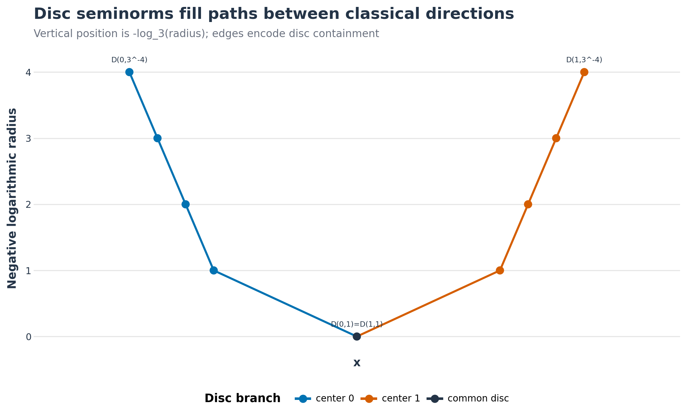

# Rigid and Berkovich analytic geometry {#sec-rigid-berkovich}

**Level and prerequisites: L5.** Prepare commutative algebra, localisation, affinoid algebras and sheaves. The [reader guide](index.md) links the Euler arithmetic, algebra and analysis preparation and distinguishes the graduate continuation.

## Goals and motivation

Analytic functions on *p*-adic discs behave strongly, yet the underlying field
is totally disconnected. Ordinary point-set topology does not provide the right
notion of analytic gluing or a satisfying path between classical points. Rigid
geometry changes the allowable covers; Berkovich geometry enriches the points.
This chapter gives a precise first model of both approaches.

## Why naive topology is insufficient

Every point of a *p*-adic ball is a center and residue balls are clopen. If one
used all ordinary open covers without restriction, analytic continuation would
fragment into too many unrelated pieces. A closed unit disc could be expressed
as an increasing union of smaller ordinary opens in ways that defeat maximum
principles and finite algebraic control.

Rigid analytic geometry keeps algebraic domains and declares selected covers
**admissible**. A cover is useful when analytic data can be checked on a finite
subcover after appropriate refinement. This is a Grothendieck topology: the
collection of allowable covers, not just the collection of open sets, carries
the geometry.

## Tate algebras

Let $K$ be a complete non-Archimedean field. The one-variable Tate algebra is

$$
K\langle T\rangle
=\left\{\sum_{n\ge0}a_nT^n:a_n\to0\right\}.
$$

Its series converge on the closed unit disc $|T|\le1$. The Gauss norm is

$$
\left\|\sum a_nT^n\right\|_{\mathrm G}=\max_n|a_n|.
$$

It is multiplicative, not merely submultiplicative. This nontrivial fact follows
by reducing suitably normalized coefficients modulo the maximal ideal: the
leading nonzero reductions of two series cannot multiply to zero in the residue
polynomial ring.

The multivariable algebra $K\langle T_1,\ldots,T_n\rangle$ uses coefficients
tending to zero as total degree grows. Tate's theorem says these algebras are
Noetherian, so every ideal is finitely generated. This is a foundational result,
stated here without its division-algorithm proof.

## Affinoid domains and functions

An **affinoid algebra** is a quotient of a Tate algebra. Its rigid spectrum is
built from maximal ideals, which over an algebraically closed field correspond
largely to classical points. Rational inequalities such as

$$
|f_i(x)|\le|g(x)|
$$

define rational subdomains and have explicit coordinate algebras. Analytic
functions glue across admissible affinoid covers.

This finite algebraic control restores versions of maximum modulus, coherent
sheaf theory, and analytic continuation. Rigid spaces can describe curves,
groups, and moduli problems that are invisible to one isolated power-series
disc.

### An annulus as an affinoid model

The unit annulus $|T|=1$ can be described by two coordinates with
$TU=1$:

$$
K\langle T,U\rangle/(TU-1).
$$

Its functions may be viewed as Laurent series
$\sum_{n\in\mathbb Z}a_nT^n$ whose coefficients tend to zero in both directions.
The extra inverse coordinate is not a formal trick: it records that $T$ never
vanishes on the annulus. More general closed annuli
$r\le|T|\le1$ use a weighted Tate algebra and form the edges of many curve
skeleta.

Covering a projective line by two discs with reciprocal coordinates is the
non-Archimedean analogue of the familiar algebraic construction. The admissible
overlap is an annulus, and analytic functions must agree there. This is the first
example of gluing local affinoid data into a global analytic space.

## Berkovich points as seminorms

For an affine algebra $A$ over $K$, a Berkovich point is a multiplicative
seminorm

$$
|\cdot|_x:A\to\mathbb R_{\ge0}
$$

that extends the absolute value of $K$. A classical point $a$ gives evaluation
$|f|_a=|f(a)|$. But there are additional points.

For a closed disc $D(a,r)$, define

$$
\left|\sum_{n\ge0}c_n(T-a)^n\right|_{a,r}
=\max_n |c_n|r^n.
$$

This **disc seminorm** remembers the whole ball rather than choosing one center.
When the base field is algebraically closed and $r>0$, a radius in the value
group gives a type II point; a radius outside the value group gives a type III
point. Type I points are classical evaluations. Type IV points arise from
decreasing discs with no common point, a possibility related to failure of
spherical completeness. Over a non-algebraically closed base the classification
requires passing to completed residue fields and has additional bookkeeping.

<figure id="fig-berkovich-tree">


<figcaption>

Figure 23.1: Two families of nested p-adic discs form branches that meet at their smallest common containing disc, illustrating the tree-like Berkovich line.

</figcaption>
</figure>

[Figure 23.1](#fig-berkovich-tree) is a finite diagram of disc containment. Classical points
sit toward branch ends; disc seminorms fill the connecting path. The drawing
encodes inclusion and radius, not a Euclidean embedding of the field.

## The analytic line as a tree-like continuum

The Berkovich affine line is locally path connected even though its classical
$K$-points are totally disconnected. Two classical points are joined by
expanding the disc around one until it contains the other, then shrinking toward
the second. Branch points correspond to discs with multiple residue directions.

On a path, $-\log|f|_x$ often becomes piecewise affine with integer slopes.
Zeros and poles create slope changes. This turns non-Archimedean analytic data
into potential theory on a tree.

Rigid and Berkovich spaces are complementary. Rigid geometry is efficient for
algebraic covers and sheaves. Berkovich spaces provide an honest topological
space with extra points, paths, compactness properties, and measures. Many
results can be translated between the two languages.

## Dynamics and arithmetic applications

A rational map acts continuously on the Berkovich projective line. Its Julia set
can include nonclassical points and can be connected in the enriched topology.
The Gauss point, representing the unit disc, detects good reduction of a
rational map.

Analytic curves admit skeleta: finite metric graphs inside the Berkovich space
onto which suitable domains retract. Degeneration and reduction data live on
these graphs. Tropical geometry, local heights, and non-Archimedean potential
theory use this passage from analytic spaces to piecewise-linear structures.

Chapter 40 builds a second non-Archimedean tree directly from homothety classes
of rank-two lattices. Its boundary is the projective line, while its vertices
record integral models rather than Berkovich seminorms. Chapter 44 then returns
to skeleta as the piecewise-linear component of local height calculations. These
links are useful precisely because the three constructions are related but not
identical.

<div class="callout callout-warning">
<p class="callout-title">Geometric pitfalls</p>

- A Berkovich point need not be an element of an algebraic closure.
- The center of a disc is not unique when another point lies inside it.
- A rigid admissible cover is not merely an arbitrary ordinary open cover.
- Tree pictures encode containment and seminorms, not an ordering of numbers.

</div>

<!-- inline-formula-code:start -->
## Formula and finite computation

A useful formula in this chapter is

$$
D(a,p^{-N})=a+p^N\mathbb Z_p
$$

Residue prefixes encode nested closed disks at successive depths. The following standalone Python block expresses that finite rule with its inputs and stopping conditions visible.

```python
prime, center = 3, 137
disks = [(depth, center % prime**depth, prime**depth) for depth in range(1, 7)]
for depth, residue, modulus in disks:
    print(depth, f"x = {residue} mod {modulus}")
```

**What the computation establishes.** The output certifies only the declared finite case. The theorem, if one is claimed, still requires the argument developed in the chapter.
<!-- inline-formula-code:end -->

## Summary

Tate algebras describe functions on closed polydiscs and retain finite algebraic
control. Rigid geometry organizes these algebras with admissible covers.
Berkovich geometry adds seminorm points representing discs and limiting disc
families, producing path-connected tree-like analytic lines. Both viewpoints
support dynamics, reduction, and arithmetic geometry.

## Exercises

<div class="exercise" id="p_adic_numbers-23-rigid-berkovich-ex-1">
<p class="exercise-title"><strong>Exercise 1</strong></p>

Prove convergence on the unit disc for every series in $K\langle T\rangle$.

</div>

<div class="exercise" id="p_adic_numbers-23-rigid-berkovich-ex-2">
<p class="exercise-title"><strong>Exercise 2</strong></p>

Compute the Gauss norm of $1+pT+p^{-1}T^2$ and decide whether the series lies
in $K\langle T\rangle$.

</div>

<div class="exercise" id="p_adic_numbers-23-rigid-berkovich-ex-3">
<p class="exercise-title"><strong>Exercise 3</strong></p>

Show that $|\cdot|_{a,r}$ does not change when $a$ is replaced by another
center in the same closed disc.

</div>

<div class="exercise" id="p_adic_numbers-23-rigid-berkovich-ex-4">
<p class="exercise-title"><strong>Exercise 4</strong></p>

Describe the path between two distinct points $a,b\in K$ in terms of discs.

</div>

<div class="exercise" id="p_adic_numbers-23-rigid-berkovich-ex-5">
<p class="exercise-title"><strong>Exercise 5</strong></p>

Explain how a decreasing family with empty intersection can still determine
a type IV point.

</div>

<div class="exercise" id="p_adic_numbers-23-rigid-berkovich-ex-6">
<p class="exercise-title"><strong>Exercise 6</strong></p>

Compare one task for which rigid language is natural with one task for which
Berkovich language is natural.

</div>

<div class="exercise" id="p_adic_numbers-23-rigid-berkovich-ex-7">
<p class="exercise-title"><strong>Exercise 7</strong></p>

Explain why the relation $TU=1$ models a unit annulus and why neither
coordinate can vanish.

</div>

**Support.** Exercise 1 uses $|a_nx^n|\le|a_n|\to0$. In Exercise 2 the Gauss
norm is $p$, and the displayed polynomial belongs to the Tate algebra despite
one large coefficient. Exercise 3 expands $T-a$ around the new center and uses
the ultrametric maximum bound. In Exercise 4 the joining disc has radius
$|a-b|$.
For Exercise 7, a multiplicative seminorm sends $TU$ to $1$, forcing both
$|T|$ and $|U|$ to be nonzero reciprocals.
