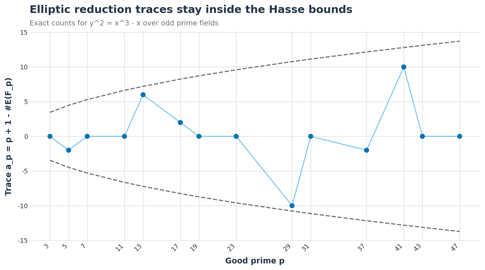

# Arithmetic geometry and p-adic periods {#sec-arithmetic-periods}

**Level and prerequisites: L5.** Prepare algebraic varieties, elliptic curves, differentials and Galois representations. The [reader guide](index.md) links the Euler arithmetic, algebra and analysis preparation and distinguishes the graduate continuation.

## Goals and scope

This final chapter shows where local analysis meets algebraic geometry. We begin
with elliptic curves and reduction, introduce formal groups and Galois
representations, and then explain what period rings are designed to compare.
The last sections are a map, not a compressed proof of *p*-adic Hodge theory.

## Elliptic curves over local fields

Over a field of characteristic not $2$ or $3$, an elliptic curve can be written

$$
E:y^2=x^3+Ax+B
$$

with nonzero discriminant

$$
\Delta=-16(4A^3+27B^2).
$$

Nonzero discriminant means the cubic curve has no singular point. Adding one
point at infinity gives a projective curve with a group law. The points
$E(\mathbb Q_p)$ form a compact *p*-adic analytic group.

An integral equation can be reduced modulo $p$. If the reduced curve remains
nonsingular, the model has **good reduction**. A minimal integral model with
$v_p(\Delta)=0$ has good reduction. If the reduction has a node, it is
multiplicative; if it has a cusp or worse singularity, it is additive. For a
nonminimal equation, divisibility of its displayed discriminant may reflect the
coordinates rather than the curve, so minimality matters.

### Exact finite data

For $E:y^2=x^3-x$, the discriminant is $64$, so every odd prime is a prime of
good reduction. Count affine solutions modulo $p$ and add the point at infinity.
Write

$$
a_p=p+1-\#E(\mathbb F_p).
$$

Hasse's theorem states $|a_p|\le2\sqrt p$.

### Counting with the quadratic character

For odd $p$, let $\chi$ be the quadratic character on $\mathbb F_p$, extended
by $\chi(0)=0$. The equation $y^2=r$ has $1+\chi(r)$ solutions: two for a
nonzero square, one for zero, and none for a nonsquare. Therefore

$$
\#E(\mathbb F_p)
=1+\sum_{x\in\mathbb F_p}\bigl(1+\chi(x^3+Ax+B)\bigr),
$$

where the initial $1$ is the point at infinity. Equivalently,

$$
a_p=-\sum_{x\in\mathbb F_p}\chi(x^3+Ax+B).
$$

This is an exact finite algorithm. For $y^2=x^3-x$ modulo $5$, the right sides
for $x=0,1,2,3,4$ are $0,0,1,4,0$, giving $1,1,2,2,1$ affine points. With the
point at infinity there are $8$ points and $a_5=-2$. The character formula is
also the first bridge from point counts to exponential sums and cohomological
trace formulas.

<figure id="fig-elliptic-counts">


<figcaption>

Figure 24.1: Exact point-count traces for the elliptic curve y squared equals x cubed minus x are plotted across odd primes inside the Hasse bounds.

</figcaption>
</figure>

[Figure 24.1](#fig-elliptic-counts) displays exhaustive finite-field counts. The bounds are a
theorem; the pattern $a_p=0$ at many primes reflects extra endomorphisms of this
particular curve and should not be generalized to every elliptic curve.

## Reduction subgroups and formal groups

For good reduction there is a reduction homomorphism

$$
E(\mathbb Q_p)\longrightarrow E(\mathbb F_p).
$$

Its kernel $E_1(\mathbb Q_p)$ consists of points close to the identity. Using the
local parameter $t=-x/y$, the group law becomes a formal power series

$$
F(X,Y)=X+Y+\text{terms of total degree at least }2.
$$

A **one-dimensional commutative formal group law** is a series satisfying formal
identity, inverse, and associativity equations. On a sufficiently small
*p*-adic neighborhood, the formal logarithm

$$
\log_F(T)=T+\cdots
$$

converges and satisfies
$\log_F(F(X,Y))=\log_F(X)+\log_F(Y)$. Thus a nonlinear geometric group is locally
linearized, generalizing Chapter 18.

For bad reduction one inserts $E_0(\mathbb Q_p)$, the points reducing to the
nonsingular part. The finite quotient $E/E_0$ is the component group; its size
is the local Tamagawa number appearing in arithmetic formulas.

## Galois representations

Let $\overline{\mathbb Q}_p$ be an algebraic closure. The points killed by
$p^n$ form

$$
E[p^n]\cong(\mathbb Z/p^n\mathbb Z)^2
$$

in characteristic zero. Compatible torsion points form the Tate module

$$
T_p(E)=\lim_{\leftarrow n}E[p^n],
$$

a free $\mathbb Z_p$-module of rank $2$. Every local Galois automorphism acts on
the coordinates of torsion points and respects compatibility, giving

$$
\rho_{E,p}:G_{\mathbb Q_p}\longrightarrow
\operatorname{GL}_2(\mathbb Z_p).
$$

Here
$G_{\mathbb Q_p}=\operatorname{Gal}(\overline{\mathbb Q}_p/\mathbb Q_p)$ is
the absolute Galois group, equipped with its profinite topology.

This representation packages infinitely many algebraic extensions into one
continuous linear action. Ramification of the action reflects reduction of the
curve.

## Why C_p is not the only period field

Tensoring a representation with $\mathbb C_p$ reveals some invariants but loses
structures needed to distinguish geometric origins. Fontaine's period rings add
extra operators and filtrations.

- $B_{\mathrm{dR}}$ carries a decreasing filtration and supports de Rham
  comparison.
- $B_{\mathrm{cris}}$ carries Frobenius and supports crystalline comparison.
- $B_{\mathrm{st}}$ also carries a monodromy operator and supports semistable
  comparison.

A representation is called de Rham, crystalline, or semistable when its
invariants after tensoring with the corresponding period ring have the expected
dimension. These definitions are deliberately schematic here; constructing the
rings requires Witt vectors, divided powers, and completed topological rings.

<div class="callout callout-note">
<p class="callout-title">Good reduction and a crystalline representation</p>

If an elliptic curve over $\mathbb Q_p$ has good reduction, its rational Tate
module $V_p(E)=T_p(E)\otimes_{\mathbb Z_p}\mathbb Q_p$ is crystalline.

</div>

This theorem is a deep comparison result, not a consequence of the elementary
point-count criterion alone. It says that good geometric reduction is visible
inside the linear Galois representation through the correct period ring.

## Modular forms and p-adic L-functions

For an elliptic curve over $\mathbb Q$, modularity attaches a modular form whose
Fourier coefficients include the traces $a_p$ at good primes. Its complex
$L$-function assembles Euler factors

$$
(1-a_pp^{-s}+p^{1-2s})^{-1}.
$$

At a chosen prime $p$, *p*-adic measures and analytic interpolation construct
*p*-adic $L$-functions that vary special values over *p*-adic families of
characters. The variable and codomain are *p*-adic even though the original
complex $L$-function is not simply evaluated at a *p*-adic number.

Iwasawa theory studies how arithmetic invariants change through towers of
extensions. Families of modular forms and Galois representations lead to
eigenvarieties and deformation spaces, which are rigid analytic objects. The
subjects of Chapters 20–23 therefore meet rather than proceed in isolation.

## A continued-study map

- For **elliptic curves**, Chapters 34, 36, and 44 develop Tate uniformisation,
  descent, and local $p$-adic heights; continue from there to global regulators.
- For **Galois representations**, Chapters 26, 35, 37, 38, and 42 develop
  profinite groups, cohomology, deformation, and finite-etale geometry before
  the full comparison-theorem route.
- For **periods**, learn Witt vectors, filtered modules, Frobenius modules, and
  then *p*-adic Hodge theory.
- For **analytic geometry**, continue with affinoid spaces, adic spaces, and
  perfectoid spaces.
- For **automorphic arithmetic**, Chapters 40 and 41 construct the local
  building, smooth representations, and spherical Hecke operators; Chapters 30
  and 31 connect these themes to modular forms and Iwasawa theory.

<div class="callout callout-warning">
<p class="callout-title">Final scope warning</p>

A finite-field point count is not a proof of a global rank statement. Good
reduction does not mean trivial Galois action. A period ring is not merely a
larger coefficient field; its filtration, Frobenius, topology, and invariants are
the point.

</div>

<!-- inline-formula-code:start -->
## Formula and finite computation

A useful formula in this chapter is

$$
\dim V=\sum_i\dim\operatorname{gr}^iV
$$

A finite filtration ledger checks the dimension identity behind graded pieces. The following standalone Python block expresses that finite rule with its inputs and stopping conditions visible.

```python
filtration_dimensions = {2: 1, 1: 3, 0: 5, -1: 5}
levels = sorted(filtration_dimensions, reverse=True)
graded_dimensions = {
    level: filtration_dimensions[level] - filtration_dimensions.get(level + 1, 0)
    for level in levels
}
print(graded_dimensions, sum(graded_dimensions.values()))
```

**What the computation establishes.** The output certifies only the declared finite case. The theorem, if one is claimed, still requires the argument developed in the chapter.
<!-- inline-formula-code:end -->

## Summary

Reduction turns an elliptic curve into finite arithmetic data, while a formal
group describes points near the identity. Tate modules convert torsion into
linear Galois representations. Period rings compare those representations with
geometric cohomology, and modularity coordinates local traces with global
$L$-functions. These are advanced bridges whose rigorous study grows directly
from valuations, completion, analytic functions, and ramification.

## Exercises

<div class="exercise" id="p_adic_numbers-24-arithmetic-periods-ex-1">
<p class="exercise-title"><strong>Exercise 1</strong></p>

Count $E(\mathbb F_5)$ for $E:y^2=x^3-x$ and compute $a_5$.

</div>

<div class="exercise" id="p_adic_numbers-24-arithmetic-periods-ex-2">
<p class="exercise-title"><strong>Exercise 2</strong></p>

Verify that the displayed curve has good reduction at every odd prime.

</div>

<div class="exercise" id="p_adic_numbers-24-arithmetic-periods-ex-3">
<p class="exercise-title"><strong>Exercise 3</strong></p>

Explain why compatible Galois actions on $E[p^n]$ induce an action on the
inverse limit.

</div>

<div class="exercise" id="p_adic_numbers-24-arithmetic-periods-ex-4">
<p class="exercise-title"><strong>Exercise 4</strong></p>

Distinguish the roles of filtration, Frobenius, and monodromy in the three
named period rings.

</div>

<div class="exercise" id="p_adic_numbers-24-arithmetic-periods-ex-5">
<p class="exercise-title"><strong>Exercise 5</strong></p>

Show that the local Euler polynomial has roots whose complex absolute values
are $\sqrt p$ when Hasse's theorem is strengthened to the usual Frobenius
statement.

</div>

<div class="exercise" id="p_adic_numbers-24-arithmetic-periods-ex-6">
<p class="exercise-title"><strong>Exercise 6</strong></p>

Design a reading project linking one theorem from Chapters 19–23 to one
structure in this chapter.

</div>

<div class="exercise" id="p_adic_numbers-24-arithmetic-periods-ex-7">
<p class="exercise-title"><strong>Exercise 7</strong></p>

Derive the quadratic-character point-count formula and apply it at $p=7$.

</div>

**Support.** In Exercise 1, direct enumeration gives seven affine points and the
point at infinity, so $\#E(\mathbb F_5)=8$ and $a_5=-2$. A reproducible residue
table is the intended method. Exercise 2 uses $\Delta=64$. Exercise 3 applies
the universal meaning of an inverse limit.
For Exercise 4, associate filtration with de Rham, Frobenius with crystalline,
and monodromy in addition to Frobenius with semistable comparison.
For Exercise 7, list the seven cubic values and use the square residues
$0,1,2,4$ modulo $7$; include the point at infinity only once.
