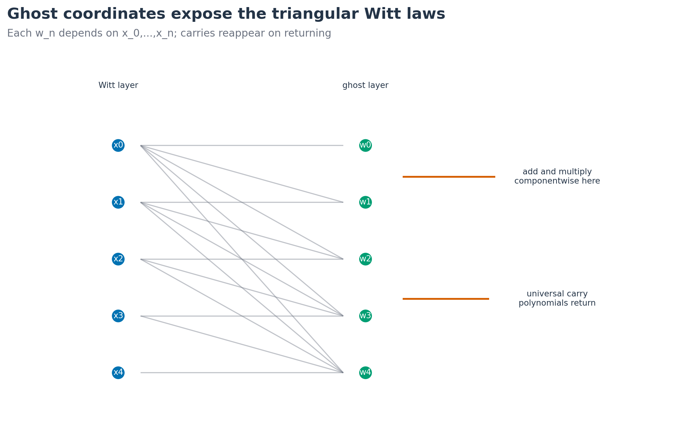

# Frobenius, Teichmüller Lifts, and Witt Vectors {#sec-witt-vectors}

**Level and prerequisites: L5.** Prepare complete discrete valuation rings, residue fields, Frobenius and formal polynomial identities. The [reader guide](index.md) links the Euler arithmetic, algebra and analysis preparation and distinguishes the graduate continuation.

Reducing an integer modulo $p$ forgets its higher $p$-adic digits. Witt
vectors reverse that loss in a canonical, functorial way. Their coordinates do
not add digit by digit; specially designed carry polynomials make a sequence of
residue-field elements behave like a characteristic-zero ring.

**Prerequisites.** Finite fields and inverse limits from [sec-local-fields](12-local-fields.md#sec-local-fields),
$p$-adic digits from [sec-digits](05-digits.md#sec-digits), and complete valuation rings from Chapter [sec-ramification](20-ramification.md#sec-ramification).

## Frobenius and perfect fields

In characteristic $p$, the binomial coefficients
$\binom pk$ vanish for $0<k<p$, so

$$
(x+y)^p=x^p+y^p.
$$

The map

$$
\operatorname{Frob}:k\to k,\qquad x\mapsto x^p
$$

is therefore a ring homomorphism. A field $k$ is **perfect** if Frobenius is
surjective, hence an automorphism. Every finite field is perfect; indeed
$x\mapsto x^p$ permutes its finite elements. In
$\mathbb F_q$, $q=p^f$, every element satisfies $x^q=x$.

The field $\mathbb F_p(t)$ is not perfect: $t$ has no $p$th root there.
Adjoining compatible roots
$t^{1/p},t^{1/p^2},\ldots$ and taking their union gives its perfection.

Perfectness lets Witt coordinates use inverse Frobenius without arbitrary
choices. Later, perfectoid tilting will build compatible $p$-power roots on a
much larger scale.

## Teichmüller representatives

Every $a\in\mathbb F_p$ has a unique lift
$[a]\in\mathbb Z_p$ satisfying

$$
[a]\equiv a\pmod p,
\qquad
[a]^p=[a].
$$

For $a\ne0$, apply Hensel's lemma to $X^{p-1}-1$; its derivative is a unit
at every nonzero residue root. Define $[0]=0$.

These **Teichmüller lifts** are multiplicative:

$$
[ab]=[a][b],
$$

because both sides lift $ab$ and satisfy the same fixed-point property.
They are generally not additive. For example in $\mathbb Z_5$,
$[2]+[3]$ is not $[0]=0$, even though $2+3=0$ in $\mathbb F_5$.
The discrepancy is a carry into higher powers of $5$.

For a perfect residue field $k$, the Teichmüller map similarly chooses
multiplicative representatives in its canonical unramified characteristic-zero
lift.

Every $x\in\mathbb Z_p$ has a unique Teichmüller expansion

$$
x=[a_0]+p[a_1]+p^2[a_2]+\cdots,
\qquad a_i\in\mathbb F_p.
$$

These $a_i$ are not usually the ordinary digits $0,\ldots,p-1$.

## Why coordinatewise arithmetic fails

The set $k^{\mathbb N}$ is easy to add coordinatewise, but that produces a
ring of characteristic $p$. We want a ring where $p\ne0$ and reduction
modulo $p$ is $k$. Ordinary base-$p$ arithmetic shows what is missing:
carries couple one coordinate to the next.

Choosing integer representatives and performing carries is not functorial. A
field homomorphism $k\to k'$ should induce a canonical ring homomorphism on
lifts without referring to arbitrary representatives. Witt's construction
encodes carries by universal polynomials with integer coefficients.

## Ghost components

For a sequence $X=(X_0,X_1,\ldots)$, define the $p$-typical Witt polynomials

$$
w_n(X)
=X_0^{p^n}
+pX_1^{p^{n-1}}
+\cdots
+p^nX_n.
$$

The first three are

$$
w_0=X_0,
$$

$$
w_1=X_0^p+pX_1,
$$

$$
w_2=X_0^{p^2}+pX_1^p+p^2X_2.
$$

The sequence $(w_0,w_1,\ldots)$ consists of **ghost components**. Witt addition
and multiplication are the unique universal polynomial operations $S,P$
satisfying

$$
w_n(S(X,Y))=w_n(X)+w_n(Y),
$$

$$
w_n(P(X,Y))=w_n(X)w_n(Y)
$$

for every $n$.

For a truncated vector, the triangular ghost map is a finite nested sum.  The
code uses exact integers so each coefficient $p^i$ and Frobenius exponent
$p^{n-i}$ remains visible.

```python
from math import isqrt

def ghost_components(coordinates: list[int], prime: int) -> list[int]:
    """Evaluate all p-typical ghost polynomials for a truncated vector."""
    if not coordinates:
        raise ValueError("provide at least one Witt coordinate")
    if prime < 2 or any(
        prime % divisor == 0 for divisor in range(2, isqrt(prime) + 1)
    ):
        raise ValueError("prime must be prime")
    return [
        sum(
            prime**coordinate_index
            * coordinates[coordinate_index]
            ** (prime ** (ghost_index - coordinate_index))
            for coordinate_index in range(ghost_index + 1)
        )
        for ghost_index in range(len(coordinates))
    ]

ghosts = ghost_components([2, 3, 1], 5)
expected = [2, 2**5 + 5 * 3, 2**25 + 5 * 3**5 + 25]
if ghosts != expected:
    raise RuntimeError("ghost-polynomial evaluation failed")
print(ghosts)
```

This evaluates $w_0,w_1,w_2$ for one integer lift.  It does not invert the
ghost map over a ring with $p$-torsion or construct the universal Witt addition
polynomials; the text's torsion warning remains essential.

The ghost map need not be injective over a ring with $p$-torsion, but the
universal polynomials are first constructed over a torsion-free polynomial ring
and then evaluated everywhere.

<figure id="fig-witt-ghost">


<figcaption>

Figure 25.1: Witt coordinates interact through carry polynomials while ghost components add coordinatewise.

</figcaption>
</figure>

The diagram [Figure 25.1](#fig-witt-ghost) is a dependency map, not a claim that division by powers of
$p$ is valid in the residue field. The integral universal polynomials are what
make the return route legitimate.

## Low-length addition

Write $Z=X+Y$. From $w_0(Z)=w_0(X)+w_0(Y)$,

$$
Z_0=X_0+Y_0.
$$

The $w_1$ identity gives

$$
Z_1=
X_1+Y_1
-\frac{(X_0+Y_0)^p-X_0^p-Y_0^p}{p}.
$$

The numerator's intermediate binomial coefficients are divisible by $p$, so
this is an integer polynomial before reduction to $k$.

For $p=2$,

$$
Z_1=X_1+Y_1-X_0Y_0.
$$

Over $\mathbb F_2$, minus equals plus. Thus adding
$(1,0)$ to itself gives first coordinate $0$ and second coordinate $1$:
the Witt carry represents $1+1=2$, not zero.

This example is the shortest proof that Witt addition is not coordinatewise.

## Truncated and infinite Witt vectors

The length-$n$ ring $W_n(k)$ uses coordinates
$(X_0,\ldots,X_{n-1})$. Dropping the last coordinate gives compatible maps

$$
\cdots\to W_3(k)\to W_2(k)\to W_1(k)=k.
$$

The inverse limit is

$$
W(k)=\lim_{\leftarrow\,n}W_n(k).
$$

For $k=\mathbb F_p$,

$$
W(\mathbb F_p)\cong\mathbb Z_p.
$$

For $k=\mathbb F_{p^f}$, $W(k)$ is the ring of integers in the unique
unramified extension of $\mathbb Q_p$ of degree $f$. Its residue field is
$k$, its uniformizer is $p$, and its fraction field has ramification index
one.

## Frobenius and Verschiebung

The Witt Frobenius $F$ is characterised on ghost coordinates by shifting:

$$
w_n(FX)=w_{n+1}(X).
$$

Over a perfect field of characteristic $p$, it acts on Witt coordinates by

$$
F(X_0,X_1,\ldots)
=(X_0^p,X_1^p,\ldots).
$$

The Verschiebung is

$$
V(X_0,X_1,\ldots)
=(0,X_0,X_1,\ldots).
$$

It satisfies

$$
w_n(VX)=p\,w_{n-1}(X)\quad(n\ge1),
$$

and, in the appropriate generality,

$$
FV=VF=p.
$$

Teichmüller representatives are
$[a]=(a,0,0,\ldots)$. Every Witt vector over a perfect field has the expansion

$$
X=\sum_{n=0}^{\infty}p^n[a_n].
$$

This formula resembles digits, while the Teichmüller coefficients preserve
multiplication under Frobenius.

## Universal lifting property

Let $A$ be a complete discrete valuation ring of characteristic zero with
uniformizer $p$ and perfect residue field $k$. Under the unramified
hypotheses, there is a unique isomorphism

$$
W(k)\cong A
$$

compatible with reduction and Teichmüller lifts. Witt vectors therefore classify
unramified complete discrete valuation rings with perfect residue field.

Ramified rings need extra data: adjoining a root of an Eisenstein polynomial to
$W(k)$ produces finite totally ramified extensions. The unramified and
ramified steps separate residue-field growth from value-group growth.

<!-- inline-formula-code:start -->
## Formula and finite computation

A useful formula in this chapter is

$$
[a]\equiv a\pmod p,\qquad [a]^p=[a]
$$

Repeated Frobenius powers lift a residue to finite precision. The following standalone Python block expresses that finite rule with its inputs and stopping conditions visible.

```python
from math import isqrt

def is_prime(number: int) -> bool:
    """Return whether number is prime by exact trial division."""
    if number < 2:
        return False
    return all(number % divisor != 0 for divisor in range(2, isqrt(number) + 1))

def teichmuller_lift(residue: int, prime: int, precision: int) -> int:
    """Return the Teichmüller lift of a nonzero residue modulo prime**precision."""
    if not is_prime(prime) or precision <= 0:
        raise ValueError("use a prime and positive precision")
    if residue % prime == 0:
        raise ValueError("residue must be nonzero modulo prime")
    modulus = prime**precision
    value = residue % modulus
    for _ in range(precision):
        value = pow(value, prime, modulus)
    if pow(value, prime, modulus) != value or value % prime != residue % prime:
        raise RuntimeError("lift certificate failed")
    return value

for residue in range(1, 5):
    lifted = teichmuller_lift(residue, prime=5, precision=7)
    print(residue, lifted, pow(lifted, 5, 5**7) == lifted)
```

**What the computation establishes.** The calculation checks a declared finite instance; the surrounding argument explains what is true beyond those inputs.
<!-- inline-formula-code:end -->

## Summary

- Frobenius is an automorphism precisely on perfect fields.
- Teichmüller lifts preserve multiplication but not addition.
- Ghost components turn Witt operations into coordinatewise arithmetic.
- Universal integral polynomials encode carries functorially.
- $W(\mathbb F_p)=\mathbb Z_p$, and $W(k)$ canonically lifts any perfect
  residue field to an unramified characteristic-zero ring.

## Exercises

<div class="exercise" id="p_adic_numbers-25-witt-vectors-ex-1">
<p class="exercise-title"><strong>Exercise 1</strong></p>

Prove Frobenius is additive in characteristic $p$.

<details class="solution"><summary>Solution</summary>

Expand $(x+y)^p$ and use divisibility of intermediate binomial
coefficients.

</details>

</div>

<div class="exercise" id="p_adic_numbers-25-witt-vectors-ex-2">
<p class="exercise-title"><strong>Exercise 2</strong></p>

Show a finite field is perfect.

<details class="solution"><summary>Solution</summary>

An injective map of a finite set to itself is surjective.

</details>

</div>

<div class="exercise" id="p_adic_numbers-25-witt-vectors-ex-3">
<p class="exercise-title"><strong>Exercise 3</strong></p>

Prove Teichmüller lifts are multiplicative by uniqueness.

<details class="solution"><summary>Solution</summary>

The product reduces to $ab$ and satisfies the same Frobenius fixed equation.

</details>

</div>

<div class="exercise" id="p_adic_numbers-25-witt-vectors-ex-4">
<p class="exercise-title"><strong>Exercise 4</strong></p>

Derive the displayed formula for $Z_1$.

<details class="solution"><summary>Solution</summary>

Substitute $Z_0=X_0+Y_0$ into the $w_1$ identity and divide the universal
integer polynomial by $p$.

</details>

</div>

<div class="exercise" id="p_adic_numbers-25-witt-vectors-ex-5">
<p class="exercise-title"><strong>Exercise 5</strong></p>

Compute length-two addition over $\mathbb F_2$ for all four pairs of
first-coordinate bits with zero second coordinates.

<details class="solution"><summary>Solution</summary>

Only $1+1$ creates a carry, producing $(0,1)$.

</details>

</div>

<div class="exercise" id="p_adic_numbers-25-witt-vectors-ex-6">
<p class="exercise-title"><strong>Exercise 6</strong></p>

Verify $w_n(VX)=p\,w_{n-1}(X)$.

<details class="solution"><summary>Solution</summary>

Substitute the shifted coordinates into the definition of $w_n$.

</details>

</div>

<div class="exercise" id="p_adic_numbers-25-witt-vectors-ex-7">
<p class="exercise-title"><strong>Exercise 7</strong></p>

Explain why coordinatewise addition would leave the ring in characteristic
$p$.

<details class="solution"><summary>Solution</summary>

Repeated addition of $1$ would still give zero after $p$ steps.

</details>

</div>

<div class="exercise" id="p_adic_numbers-25-witt-vectors-ex-8">
<p class="exercise-title"><strong>Exercise 8</strong></p>

Identify the unramified and ramified data in an extension generated by an
Eisenstein polynomial over $W(k)$.

<details class="solution"><summary>Solution</summary>

$W(k)$ fixes the residue lift; the Eisenstein root supplies total
ramification.

</details>

</div>

### Answer support

1. Expand $(x+y)^p$ and use divisibility of intermediate binomial
   coefficients.
2. An injective map of a finite set to itself is surjective.
3. The product reduces to $ab$ and satisfies the same Frobenius fixed equation.
4. Substitute $Z_0=X_0+Y_0$ into the $w_1$ identity and divide the universal
   integer polynomial by $p$.
5. Only $1+1$ creates a carry, producing $(0,1)$.
6. Substitute the shifted coordinates into the definition of $w_n$.
7. Repeated addition of $1$ would still give zero after $p$ steps.
8. $W(k)$ fixes the residue lift; the Eisenstein root supplies total
   ramification.
