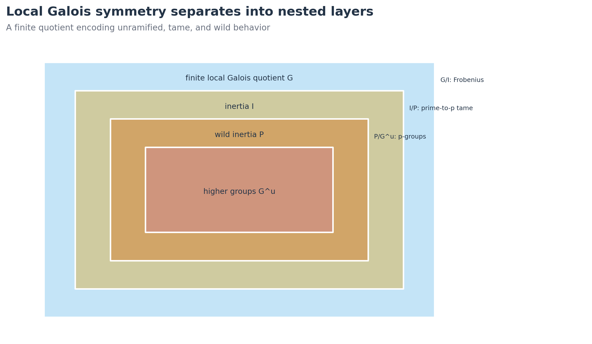

# Profinite Groups and Local Galois Theory {#sec-profinite-galois}

**Level and prerequisites: L5.** Prepare finite Galois theory, inverse limits, compact topological groups and ramification. The [reader guide](index.md) links the Euler arithmetic, algebra and analysis preparation and distinguishes the graduate continuation.

The Galois group of an infinite algebraic extension is not merely an abstract
group. Its topology records which automorphisms are already determined on a
finite subextension. Profinite groups are exactly the compact, totally
disconnected groups built from compatible finite quotients.

**Prerequisites.** Inverse limits and compactness from [sec-compactness-measure](11-compactness-measure.md#sec-compactness-measure),
finite extensions and residue fields from [sec-local-fields](12-local-fields.md#sec-local-fields), and ramification
from [sec-ramification](20-ramification.md#sec-ramification).

## Inverse limits of finite groups

Let finite groups $G_i$ be connected by compatible transition maps. Their
inverse limit is

$$
G=\lim_{\leftarrow\,i}G_i
= \{(g_i)\in\prod_iG_i:
g_i\text{ is compatible under every transition map}\}.
$$

Give each finite $G_i$ the discrete topology and the product its product
topology. The compatibility equations define a closed subset, so $G$ is
compact by the product compactness theorem. It is totally disconnected because
finite-coordinate conditions produce clopen neighbourhoods.

Examples include

$$
\mathbb Z_p=\lim_{\leftarrow\,n}\mathbb Z/p^n\mathbb Z
$$

under addition and

$$
\widehat{\mathbb Z}
=\lim_{\leftarrow\,n}\mathbb Z/n\mathbb Z
\cong\prod_{\ell}\mathbb Z_\ell.
$$

A **profinite group** is a topological group isomorphic to an inverse limit of
finite groups. Equivalently, it is compact, Hausdorff, and totally disconnected.

Open normal subgroups form a neighbourhood basis at the identity. Every open
subgroup has finite index, and every continuous map from a profinite group to a
finite discrete group factors through a finite quotient.

## Continuous actions

Suppose a profinite group $G$ acts on a discrete set $S$. The action is
continuous exactly when every point stabilizer

$$
G_s=\{g:gs=s\}
$$

is open. Hence each orbit is finite: it is identified with a quotient by an open
subgroup.

If $V$ is a finite-dimensional vector space over a topological field, a
representation

$$
\rho:G\to\operatorname{GL}(V)
$$

must be declared continuous. For finite coefficient fields, continuity means the
kernel is open, so the representation factors through a finite quotient. For
$\ell$-adic coefficients, the image can be infinite while its reductions
modulo $\ell^n$ are compatible finite images.

## Absolute Galois groups

Fix a separable closure $K^{\mathrm{sep}}$ of a field $K$. Its absolute
Galois group is

$$
G_K=\operatorname{Gal}(K^{\mathrm{sep}}/K).
$$

For every finite Galois extension $L/K$ inside $K^{\mathrm{sep}}$, restriction
gives a finite quotient. The **Krull topology** identifies

$$
G_K\cong
\lim_{\leftarrow\,L/K\text{ finite Galois}}
\operatorname{Gal}(L/K).
$$

The subgroup fixing a finite extension $E/K$ is open. If $E/K$ is Galois, it
is open normal and the quotient is $\operatorname{Gal}(E/K)$. This gives the
infinite Galois correspondence:

- finite extensions correspond to open subgroups;
- finite Galois extensions correspond to open normal subgroups;
- arbitrary intermediate extensions correspond to closed subgroups, with
  reversed inclusion.

Ignoring “closed” creates false correspondences with dense proper subgroups.

## Reduction, inertia, and Frobenius

Let $K$ be a non-Archimedean local field with residue field
$k=\mathbb F_q$. Extending the valuation to $K^{\mathrm{sep}}$ and reducing
integral elements gives an exact sequence

$$
1\longrightarrow I_K
\longrightarrow G_K
\longrightarrow G_k
\longrightarrow1.
$$

The kernel $I_K$ is the **inertia group**. The residue-field group is

$$
G_k\cong\widehat{\mathbb Z},
$$

topologically generated by Frobenius. This book calls
$x\mapsto x^q$ **arithmetic Frobenius**; its inverse is geometric Frobenius.
Sources use both normalisations, so reciprocity formulas must declare which.

For a finite Galois extension $L/K$, choose a prime above the valuation. The
decomposition group preserves it, inertia acts trivially on the residue field,
and the quotient maps to the residue extension's cyclic Galois group. Because a
local field has one extended prime in a fixed embedding, the absolute local
decomposition group is the whole $G_K$.

## Tame and wild inertia

Inertia contains a unique maximal pro-$p$ normal subgroup $P_K$, the **wild
inertia group**. The quotient $I_K/P_K$ is tame inertia; noncanonically and with
the cyclotomic action remembered, it resembles

$$
\prod_{\ell\ne p}\mathbb Z_\ell.
$$

Thus the local Galois group has three layers:

1. unramified Frobenius in $G_K/I_K$;
2. prime-to-$p$ tame inertia;
3. pro-$p$ wild inertia.

<figure id="fig-galois-filtration">


<figcaption>

Figure 26.1: Local Galois structure separates Frobenius, tame inertia, and deeper wild ramification.

</figcaption>
</figure>

The diagram [Figure 26.1](#fig-galois-filtration) is schematic: higher groups and their break positions
depend on the chosen finite quotient. The containment and quotient types are the
structural claims.

## Ramification filtrations

For a finite Galois extension $L/K$ with group $G$, the lower ramification
groups can be defined by

$$
G_i=
\{\sigma\in G:
v_L(\sigma(a)-a)\ge i+1
\text{ for every }a\in\mathcal O_L\},
\qquad i\ge0.
$$

Here $G_0$ is inertia and $G_1$ is wild inertia. The groups eventually become
trivial. Jumps measure how closely automorphisms act to the identity.

Lower numbering behaves naturally for subgroups but not quotients. The Herbrand
function reindexes it to the **upper numbering** $G^u$, which behaves well
under quotients. This is why both conventions exist.

For $i\ge1$, successive quotients $G_i/G_{i+1}$ are elementary abelian
$p$-groups. Tame ramification has $G_1=1$; wild ramification produces
positive-depth groups.

The different exponent can be recovered from the filtration:

$$
v_L(\mathfrak D_{L/K})
=\sum_{i\ge0}(|G_i|-1).
$$

This links the group action to the discriminant calculations in Chapter [sec-ramification](20-ramification.md#sec-ramification).

## Continuous cohomology

Let $M$ be a topological $G$-module. A continuous $1$-cocycle is a
continuous map $c:G\to M$ satisfying

$$
c(gh)=c(g)+g\,c(h)
$$

in additive notation. A coboundary has form

$$
c(g)=g\,m-m.
$$

The quotient is $H^1_{\mathrm{cont}}(G,M)$. Higher cohomology measures further
obstructions to solving compatible descent equations.

**Theorem 26.1 (Hilbert 90, multiplicative form).** For a finite Galois extension
$L/K$,

$$
H^1(\operatorname{Gal}(L/K),L^\times)=0.
$$

Every multiplicative cocycle is $c(\sigma)=\sigma(a)/a$. This theorem is a key
input to class field theory. The chapter states it as a destination; a full
cohomological proof is beyond the present route.

## Galois representations

Arithmetic objects produce representations of $G_K$.

- Roots of unity give the cyclotomic character
  $\chi_{\mathrm{cyc}}:G_K\to\mathbb Z_p^\times$.
- Torsion points of an elliptic curve give finite representations.
- The inverse limit of $p^n$-torsion gives the Tate module
  $T_pE$, a rank-two $\mathbb Z_p$-module with continuous action.
- Étale cohomology produces higher-dimensional $\ell$-adic representations.

Chapter 42 constructs the finite-etale and cohomological entry point behind the
last item, including Frobenius traces in examples. Chapter 41 develops a
different representation category: smooth complex representations of a
$p$-adic matrix group. The acting groups, coefficient topologies, and meanings
of continuity must not be conflated.

Unramified representations have trivial inertia action. Tame, finite-inertia,
crystalline, semistable, and de Rham conditions encode progressively subtler
local geometry. Their definitions will be built rather than guessed from these
names.

Continuity ensures finite-precision data factor through finite quotients. Without
it, an abstract homomorphism can ignore the field's topology and carry no
controlled arithmetic variation.

<!-- inline-formula-code:start -->
## Formula and finite computation

A useful formula in this chapter is

$$
x_{n+1}\bmod p^n=x_n
$$

Compatibility across finite quotients is checked at every available level. The following standalone Python block expresses that finite rule with its inputs and stopping conditions visible.

```python
prime = 2
system = {1: 1, 2: 3, 3: 7, 4: 7, 5: 23}
checks = [system[level + 1] % prime**level == system[level] for level in range(1, 5)]
print(checks)
```

**What the computation establishes.** The output certifies only the declared finite case. The theorem, if one is claimed, still requires the argument developed in the chapter.
<!-- inline-formula-code:end -->

## Summary

- Profinite groups are inverse limits of finite groups with a compact topology.
- Krull topology makes the absolute Galois group the limit of finite Galois
  groups.
- Local Galois structure separates unramified, tame, and wild layers.
- Ramification filtrations quantify how close automorphisms are to identity.
- Continuous cohomology records descent obstructions.
- Galois representations translate field symmetries into linear algebra with
  topology.

## Exercises

<div class="exercise" id="p_adic_numbers-26-profinite-galois-ex-1">
<p class="exercise-title"><strong>Exercise 1</strong></p>

Prove $\mathbb Z_p$ is compact from its inverse-limit presentation.

<details class="solution"><summary>Solution</summary>

It is a closed subset of a product of finite compact discrete spaces.

</details>

</div>

<div class="exercise" id="p_adic_numbers-26-profinite-galois-ex-2">
<p class="exercise-title"><strong>Exercise 2</strong></p>

Show an open subgroup of a profinite group has finite index.

<details class="solution"><summary>Solution</summary>

Its cosets form a disjoint open cover of a compact group, hence have a finite
subcover.

</details>

</div>

<div class="exercise" id="p_adic_numbers-26-profinite-galois-ex-3">
<p class="exercise-title"><strong>Exercise 3</strong></p>

Explain why a continuous action on a discrete set has finite orbits.

<details class="solution"><summary>Solution</summary>

The stabilizer is open, and the orbit is the finite coset space.

</details>

</div>

<div class="exercise" id="p_adic_numbers-26-profinite-galois-ex-4">
<p class="exercise-title"><strong>Exercise 4</strong></p>

Identify the open subgroup corresponding to a finite extension.

<details class="solution"><summary>Solution</summary>

It is the subgroup fixing that extension pointwise.

</details>

</div>

<div class="exercise" id="p_adic_numbers-26-profinite-galois-ex-5">
<p class="exercise-title"><strong>Exercise 5</strong></p>

Describe the quotient $G_K/I_K$ for residue field $\mathbb F_q$.

<details class="solution"><summary>Solution</summary>

It is $\widehat{\mathbb Z}$, generated topologically by Frobenius.

</details>

</div>

<div class="exercise" id="p_adic_numbers-26-profinite-galois-ex-6">
<p class="exercise-title"><strong>Exercise 6</strong></p>

Distinguish arithmetic from geometric Frobenius.

<details class="solution"><summary>Solution</summary>

They are inverse elements; this book uses $x\mapsto x^q$ as arithmetic.

</details>

</div>

<div class="exercise" id="p_adic_numbers-26-profinite-galois-ex-7">
<p class="exercise-title"><strong>Exercise 7</strong></p>

Verify the cocycle identity for $c(g)=gm-m$.

<details class="solution"><summary>Solution</summary>

Expand $g(hm-m)+(gm-m)$.

</details>

</div>

<div class="exercise" id="p_adic_numbers-26-profinite-galois-ex-8">
<p class="exercise-title"><strong>Exercise 8</strong></p>

Explain why upper numbering, rather than lower numbering, is used when
passing to quotient extensions.

<details class="solution"><summary>Solution</summary>

Herbrand reindexing makes the filtration compatible with quotient maps.

</details>

</div>

### Answer support

1. It is a closed subset of a product of finite compact discrete spaces.
2. Its cosets form a disjoint open cover of a compact group, hence have a finite
   subcover.
3. The stabilizer is open, and the orbit is the finite coset space.
4. It is the subgroup fixing that extension pointwise.
5. It is $\widehat{\mathbb Z}$, generated topologically by Frobenius.
6. They are inverse elements; this book uses $x\mapsto x^q$ as arithmetic.
7. Expand $g(hm-m)+(gm-m)$.
8. Herbrand reindexing makes the filtration compatible with quotient maps.
