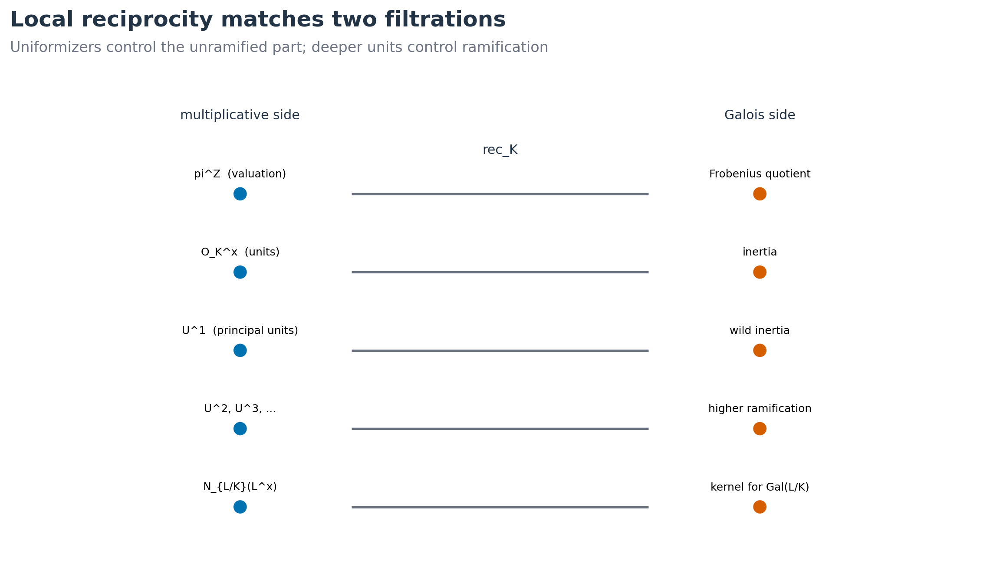

# Local Class Field Theory {#sec-local-class-field}

**Level and prerequisites: L5.** Prepare local fields, profinite Galois groups, norm maps and finite abelian extensions. The [reader guide](index.md) links the Euler arithmetic, algebra and analysis preparation and distinguishes the graduate continuation.

Local class field theory classifies finite abelian extensions of a local field
using open finite-index subgroups of its multiplicative group. Its central map
turns multiplication in $K^\times$ into Galois action.

**Prerequisites.** Local fields and norms from [sec-local-fields](12-local-fields.md#sec-local-fields), unit filtrations
and ramification from [sec-ramification](20-ramification.md#sec-ramification), and profinite Galois groups from Chapter [sec-profinite-galois](26-profinite-galois.md#sec-profinite-galois).

## The multiplicative group of a local field

Let $K$ have valuation ring $\mathcal O_K$, maximal ideal
$\mathfrak m=(\pi)$, and residue field $\mathbb F_q$. Valuation gives

$$
K^\times\cong
\pi^{\mathbb Z}\times\mathcal O_K^\times.
$$

Reduction gives

$$
1\longrightarrow U^1
\longrightarrow\mathcal O_K^\times
\longrightarrow\mathbb F_q^\times
\longrightarrow1,
$$

where

$$
U^n=1+\mathfrak m^n
$$

is the principal-unit filtration. The factor $\pi^{\mathbb Z}$ records
valuation, $\mathbb F_q^\times$ records tame residue units, and $U^1$ carries
pro-$p$ information.

For $K=\mathbb Q_p$ with odd $p$,

$$
\mathbb Q_p^\times
\cong
p^{\mathbb Z}
\times\mu_{p-1}
\times(1+p\mathbb Z_p).
$$

The $p$-adic logarithm identifies $1+p\mathbb Z_p$ locally with the additive
group $p\mathbb Z_p$.

## Norm subgroups

For a finite extension $L/K$, the norm is

$$
N_{L/K}(x)
=\prod_{\sigma}\sigma(x)
$$

over $K$-embeddings into a normal closure, with the determinant definition
covering non-Galois extensions. Its image $N_{L/K}(L^\times)$ is an open
finite-index subgroup of $K^\times$.

If $L/K$ is unramified of degree $n$, then

$$
v_K(Nx)=n\,v_L(x),
$$

under normalized valuations, and the norm on units is surjective. Hence

$$
K^\times/NL^\times\cong\mathbb Z/n\mathbb Z,
$$

represented by valuation classes.

For finite totally ramified extensions, valuations of norms are unrestricted; for a
nontrivial totally ramified abelian extension, unit norms form a proper subgroup. Thus unramified information lives in the
uniformizer factor and ramified information in unit filtrations.

## The reciprocity map

Choose the normalization that sends a uniformizer to arithmetic Frobenius on the
maximal unramified extension. Local reciprocity is a continuous homomorphism

$$
\operatorname{rec}_K:
K^\times\longrightarrow G_K^{\mathrm{ab}}
=\operatorname{Gal}(K^{\mathrm{ab}}/K).
$$

Its image is dense, and it induces an isomorphism from the profinite completion
of $K^\times$ to $G_K^{\mathrm{ab}}$.

**Theorem 27.1 (Finite local reciprocity).** For every finite abelian extension
$L/K$, reciprocity induces an isomorphism

$$
K^\times/N_{L/K}(L^\times)
\ \xrightarrow{\ \sim\ }\
\operatorname{Gal}(L/K).
$$

The map is functorial with respect to norm and restriction. If $E/L/K$ is a
tower, the reciprocity element of $N_{L/K}x$ restricts in the compatible way
from the reciprocity element of $x$.

Using geometric Frobenius instead changes reciprocity to its inverse. Many texts
make that choice; neither convention is safe to infer from an unlabeled
“Frobenius.”

<figure id="fig-local-reciprocity">


<figcaption>

Figure 27.1: Local reciprocity matches valuation and unit filtrations with unramified and ramified Galois layers.

</figcaption>
</figure>

The diagram [Figure 27.1](#fig-local-reciprocity) is a filtration dictionary. The exact index at which a
unit subgroup maps into a ramification group depends on conductor conventions
and upper numbering.

## The unramified case

Let $L/K$ be unramified of degree $n$. Its Galois group is cyclic, generated
by arithmetic Frobenius. Reciprocity gives

$$
\operatorname{rec}_{L/K}(\pi)
=\operatorname{Frob}_{L/K},
$$

while every unit maps to identity. The quotient is therefore valuation modulo
$n$.

This example determines the normalization and provides the simplest proof that
the uniformizer coordinate of $K^\times$ detects unramified extensions.

## Ramified abelian extensions

Units map into inertia. Deeper principal units map into deeper ramification, in
a manner formalized by the conductor.

For a finite-order character

$$
\chi:K^\times\to\mathbb C^\times
$$

or into another coefficient field, its conductor exponent is the least $n$
such that $\chi$ is trivial on $U^n$. Under reciprocity this equals the
ramification conductor of the associated abelian Galois character, after
normalizations are aligned.

Tame characters factor through
$\mathcal O_K^\times/U^1\cong\mathbb F_q^\times$. Wild characters detect
positive-depth principal units. The filtration makes “ramified” quantitative.

For $K$ containing enough roots of unity, Kummer theory describes cyclic
extensions by adjoining $n$th roots. Reciprocity then becomes an explicit
pairing on $K^\times/K^{\times n}$.

## Existence and uniqueness

The **existence theorem** says every open finite-index subgroup
$N\subset K^\times$ is the norm group of a unique finite abelian extension
$L/K$ inside a fixed abelian closure. Inclusion reverses:

$$
L_1\subset L_2
\quad\Longleftrightarrow\quad
N_{L_2/K}(L_2^\times)
\subset
N_{L_1/K}(L_1^\times).
$$

Degrees match indices:

$$
[L:K]
= [K^\times:N_{L/K}(L^\times)].
$$

This is a classification theorem, not merely a way to attach one character to
one known extension.

Proof routes include cohomology of the multiplicative group, Brauer groups, and
explicit Lubin–Tate formal groups. This book states the classification
precisely and develops the Lubin–Tate construction in [sec-lubin-tate](28-lubin-tate.md#sec-lubin-tate); a full
proof of all existence and compatibility assertions remains a further course.

## Hilbert and norm-residue symbols

Assume $K$ contains the $n$th roots of unity and $n$ is prime to the
residue characteristic for the simplest form. For $a,b\in K^\times$, let
$L=K(\sqrt[n]{a})$. The norm-residue symbol can be written

$$
(a,b)_n
= \frac{\operatorname{rec}_K(b)(\sqrt[n]{a})}
{\sqrt[n]{a}}
\in\mu_n.
$$

It is bimultiplicative and descends to a pairing

$$
K^\times/K^{\times n}
\times
K^\times/K^{\times n}
\longrightarrow\mu_n.
$$

Moreover,

$$
(a,b)_n=1
\quad\Longleftrightarrow\quad
b\in N_{K(\sqrt[n]{a})/K}(L^\times).
$$

For $n=2$, this is the Hilbert symbol. It answers whether

$$
z^2=ax^2+by^2
$$

has a nontrivial local solution and is a key component of global reciprocity.

At $p=2$, square classes and explicit formulas require extra cases; odd-prime
mnemonics must not be transferred unchanged.

## Explicit quadratic checks

For odd $p$,

$$
\mathbb Q_p^\times/\mathbb Q_p^{\times2}
$$

has four elements, represented by

$$
1,\quad u,\quad p,\quad up,
$$

where $u$ is a fixed nonsquare unit. These give three nontrivial quadratic
extensions: unramified from $\sqrt u$, and two ramified extensions from
$\sqrt p$ and $\sqrt{up}$.

The norm subgroup of each has index two. A quadratic character of
$\mathbb Q_p^\times$ cuts it out, and reciprocity identifies that character
with the corresponding quotient of $G_{\mathbb Q_p}^{\mathrm{ab}}$.

For an unramified quadratic extension, an element is a norm exactly when its
valuation is even. Unit surjectivity supplies no extra obstruction.

<!-- inline-formula-code:start -->
## Formula and finite computation

A useful formula in this chapter is

$$
K^\times/N_{L/K}(L^\times)
$$

Quadratic norm residues modulo a prime give a small finite model of a norm subgroup. The following standalone Python block expresses that finite rule with its inputs and stopping conditions visible.

```python
from math import isqrt

def is_odd_prime(number: int) -> bool:
    """Return whether number is an odd prime."""
    if number < 3 or number % 2 == 0:
        return False
    return all(number % divisor for divisor in range(3, isqrt(number) + 1, 2))

def quadratic_norm_residues(prime: int, nonsquare: int) -> set[int]:
    """Return nonzero norms from F_p(sqrt(nonsquare)) to F_p."""
    if not is_odd_prime(prime):
        raise ValueError("prime must be an odd prime")
    nonsquare %= prime
    if nonsquare == 0 or pow(nonsquare, (prime - 1) // 2, prime) != prime - 1:
        raise ValueError("nonsquare must represent a quadratic nonsquare")
    norms = {
        (a * a - nonsquare * b * b) % prime
        for a in range(prime)
        for b in range(prime)
        if (a, b) != (0, 0)
    }
    if 0 in norms:
        raise ArithmeticError("the chosen quadratic polynomial was not irreducible")
    return norms

prime = 7
norm_residues = quadratic_norm_residues(prime=prime, nonsquare=3)
print(sorted(norm_residues), norm_residues == set(range(1, prime)))
```

**What the computation establishes.** Exhaustion proves residue-field norm
surjectivity for the declared quadratic example. Lifting unit norms in an
unramified local extension and identifying the resulting quotient with a Galois
group still use Hensel lifting and local reciprocity.
<!-- inline-formula-code:end -->

## Summary

- $K^\times$ splits into valuation, residue-unit, and principal-unit layers.
- Norm images are open finite-index subgroups.
- Local reciprocity identifies finite abelian Galois groups with norm quotients.
- Uniformizers detect unramified Frobenius; units detect inertia.
- Conductors quantify how deeply a character sees the unit filtration.
- Hilbert symbols encode norm solvability and local quadratic equations.

## Exercises

<div class="exercise" id="p_adic_numbers-27-local-class-field-ex-1">
<p class="exercise-title"><strong>Exercise 1</strong></p>

Derive $K^\times\cong\pi^{\mathbb Z}\times\mathcal O_K^\times$.

<details class="solution"><summary>Solution</summary>

Write $x=\pi^{v(x)}u$ with $u$ a unit; uniqueness is immediate.

</details>

</div>

<div class="exercise" id="p_adic_numbers-27-local-class-field-ex-2">
<p class="exercise-title"><strong>Exercise 2</strong></p>

Compute the norm-quotient index for an unramified degree-$n$ extension.

<details class="solution"><summary>Solution</summary>

Units are norms and norm valuations are multiples of $n$, so the index is
$n$.

</details>

</div>

<div class="exercise" id="p_adic_numbers-27-local-class-field-ex-3">
<p class="exercise-title"><strong>Exercise 3</strong></p>

State reciprocity under the arithmetic Frobenius convention.

<details class="solution"><summary>Solution</summary>

A uniformizer maps to arithmetic Frobenius and finite norm quotients map
isomorphically to finite abelian Galois groups.

</details>

</div>

<div class="exercise" id="p_adic_numbers-27-local-class-field-ex-4">
<p class="exercise-title"><strong>Exercise 4</strong></p>

Explain how switching Frobenius convention changes the map.

<details class="solution"><summary>Solution</summary>

Every reciprocity element is inverted.

</details>

</div>

<div class="exercise" id="p_adic_numbers-27-local-class-field-ex-5">
<p class="exercise-title"><strong>Exercise 5</strong></p>

Show norm subgroups reverse extension inclusion.

<details class="solution"><summary>Solution</summary>

Norms through a larger field factor through the intermediate norm.

</details>

</div>

<div class="exercise" id="p_adic_numbers-27-local-class-field-ex-6">
<p class="exercise-title"><strong>Exercise 6</strong></p>

Identify the conductor-zero and conductor-one parts of a tame character.

<details class="solution"><summary>Solution</summary>

Tame unit characters factor through $\mathbb F_q^\times$ and are trivial on
$U^1$.

</details>

</div>

<div class="exercise" id="p_adic_numbers-27-local-class-field-ex-7">
<p class="exercise-title"><strong>Exercise 7</strong></p>

List the four odd-$p$ square classes and their quadratic extensions.

<details class="solution"><summary>Solution</summary>

$1,u,p,up$, with the three nontrivial representatives adjoining their
square roots.

</details>

</div>

<div class="exercise" id="p_adic_numbers-27-local-class-field-ex-8">
<p class="exercise-title"><strong>Exercise 8</strong></p>

Translate $(a,b)_n=1$ into a norm statement.

<details class="solution"><summary>Solution</summary>

It says $b$ lies in the norm group from $K(\sqrt[n]{a})$.

</details>

</div>

### Answer support

1. Write $x=\pi^{v(x)}u$ with $u$ a unit; uniqueness is immediate.
2. Units are norms and norm valuations are multiples of $n$, so the index is
   $n$.
3. A uniformizer maps to arithmetic Frobenius and finite norm quotients map
   isomorphically to finite abelian Galois groups.
4. Every reciprocity element is inverted.
5. Norms through a larger field factor through the intermediate norm.
6. Tame unit characters factor through $\mathbb F_q^\times$ and are trivial on
   $U^1$.
7. $1,u,p,up$, with the three nontrivial representatives adjoining their
   square roots.
8. It says $b$ lies in the norm group from $K(\sqrt[n]{a})$.
