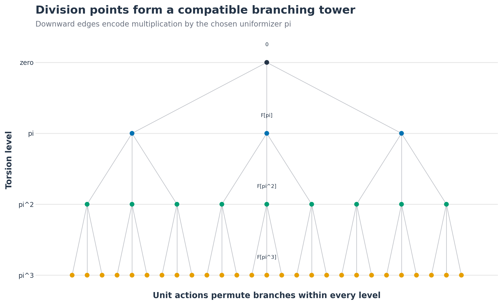

# Formal Groups and Lubin–Tate Theory {#sec-lubin-tate}

**Level and prerequisites: L5.** Prepare formal power series, formal group laws, local reciprocity and valuation rings. The [reader guide](index.md) links the Euler arithmetic, algebra and analysis preparation and distinguishes the graduate continuation.

Near the identity, an algebraic group can be described by power series. A formal
logarithm straightens its group law, while its torsion points generate field
extensions. Lubin–Tate theory uses these formal groups, one for each uniformizer,
to construct every totally ramified finite abelian extension of a local field.

**Prerequisites.** Convergent $p$-adic power series from [sec-analysis](08-analysis.md#sec-analysis), analytic
groups from [sec-analytic-groups](18-analytic-groups.md#sec-analytic-groups), local reciprocity from
[sec-local-class-field](27-local-class-field.md#sec-local-class-field), and ramification from [sec-ramification](20-ramification.md#sec-ramification).

## Formal power series as algebra

For a ring $R$, the ring $R[[T]]$ contains formal sums

$$
f(T)=a_0+a_1T+a_2T^2+\cdots.
$$

No convergence is assumed. Addition is coefficientwise, and the coefficient of
$T^n$ in a product is a finite sum, so multiplication is defined.

Composition $f(g(T))$ is defined when $g(0)=0$: each output coefficient
depends on only finitely many input coefficients. If

$$
f(T)=a_1T+a_2T^2+\cdots
$$

with $a_1$ a unit, there is a unique formal inverse $g$ satisfying
$f(g(T))=T=g(f(T))$. Solve its coefficients recursively.

A formal identity can later be evaluated only where the series converge.
“Formal inverse” and “analytic inverse on a disk” are related but distinct
statements.

## One-dimensional commutative formal groups

A one-dimensional commutative formal group law over $R$ is

$$
F(X,Y)\in R[[X,Y]]
$$

satisfying

$$
F(X,0)=X,\qquad F(0,Y)=Y,
$$

$$
F(F(X,Y),Z)=F(X,F(Y,Z)),
$$

$$
F(X,Y)=F(Y,X).
$$

There is a unique formal inverse $i_F(T)=-T+\cdots$ with
$F(T,i_F(T))=0$.

The additive formal group is

$$
\widehat{\mathbb G}_a(X,Y)=X+Y.
$$

The multiplicative formal group, using $T=u-1$ near $u=1$, is

$$
\widehat{\mathbb G}_m(X,Y)
=X+Y+XY,
$$

because
$(1+X)(1+Y)-1=X+Y+XY$.

A homomorphism $h:F\to G$ is a series
$h(T)\in TR[[T]]$ such that

$$
h(F(X,Y))=G(h(X),h(Y)).
$$

Endomorphisms form a ring under formal addition and composition.

## Formal logarithms

Over a characteristic-zero field, every one-dimensional commutative formal group
has a unique logarithm

$$
\log_F(T)=T+\cdots
$$

satisfying

$$
\log_F(F(X,Y))
=\log_F(X)+\log_F(Y).
$$

It can be constructed by integrating an invariant differential. Its inverse
$\exp_F$ gives

$$
F(X,Y)
=\exp_F(\log_FX+\log_FY).
$$

For $\widehat{\mathbb G}_m$,

$$
\log_F(T)=\log(1+T)
=T-\frac{T^2}{2}+\frac{T^3}{3}-\cdots.
$$

Denominators mean the logarithm may not have coefficients in the original
integer ring, and its analytic convergence disk must be checked. The group law
itself remains integral.

## Elliptic formal groups

For an elliptic curve given near its identity point $O$, a local parameter such
as

$$
t=-x/y
$$

turns the addition law into a formal group

$$
F_E(t_1,t_2)
=t_1+t_2+\text{higher terms}.
$$

Points reducing to $O$ correspond to parameters in the maximal ideal. The
formal group describes this kernel of reduction and its $p$-power torsion.

The multiplication-by-$n$ map becomes a series

$$
[n]_F(T)=nT+\cdots.
$$

When $n$ is a unit, the inverse function theorem makes it locally invertible.
When $n=p$, higher coefficients encode height and reduction type.

## Lubin–Tate data

Let $K$ be a finite extension of $\mathbb Q_p$, with ring
$\mathcal O_K$, uniformizer $\pi$, and residue field of size $q$. Choose a
power series

$$
f(T)\in\mathcal O_K[[T]]
$$

such that

$$
f(T)\equiv\pi T\pmod{T^2},
\qquad
f(T)\equiv T^q\pmod\pi.
$$

**Theorem 28.1 (Lubin–Tate, formal-group form).** There is a unique one-dimensional
formal group $F$ over $\mathcal O_K$, unique up to the appropriate strict
isomorphism, for which $f$ is the endomorphism $[\pi]_F$. Moreover every
$a\in\mathcal O_K$ acts by an endomorphism $[a]_F$ with linear term $aT$.

For $K=\mathbb Q_p$, the multiplicative formal group works with

$$
[p](T)=(1+T)^p-1,
$$

because its linear term is $pT$ and it reduces to $T^p$ modulo $p$.

## Division points and extension towers

Define the $\pi^n$-torsion

$$
F[\pi^n]
= \{x\in\overline{\mathfrak m}_K:
[\pi^n]_F(x)=0\}.
$$

It is a free rank-one
$\mathcal O_K/\pi^n\mathcal O_K$-module. Let

$$
K_n=K(F[\pi^n]).
$$

Then $K_n/K$ is finite, totally ramified, and abelian, with

$$
\operatorname{Gal}(K_n/K)
\cong
(\mathcal O_K/\pi^n\mathcal O_K)^\times.
$$

The Galois action is explicit:

$$
\sigma_a(x)=[a]_F(x)
$$

for a unit class $a$.

<figure id="fig-lubin-tate">


<figcaption>

Figure 28.1: Lubin–Tate division points form a branching tower whose Galois action is multiplication by units.

</figcaption>
</figure>

[Figure 28.1](#fig-lubin-tate) is schematic and suppresses embeddings and repeated residue
symmetry. The module size and compatible downward maps are exact.

## Reciprocity from the torsion action

The inverse limit

$$
T_\pi F=\lim_{\leftarrow\,n}F[\pi^n]
$$

is a free rank-one $\mathcal O_K$-module, the Lubin–Tate Tate module. Galois
acts through a character

$$
\chi_F:G_K\to\mathcal O_K^\times.
$$

The extensions $K_n$ exhaust the maximal totally ramified abelian extension
associated with the unit factor. Under local reciprocity, a unit
$a\in\mathcal O_K^\times$ acts on torsion through $[a]_F$, up to the inverse
dictated by the chosen Frobenius convention.

Adjoining the maximal unramified extension supplies the uniformizer/Frobenius
factor. Together, unramified Frobenius and Lubin–Tate torsion construct
$K^{\mathrm{ab}}$.

The formal group depends on the choice of $\pi$ and $f$, but the resulting
reciprocity law is canonical after normalization. Different choices give
compatible constructions of the same abelian extension theory.

## Low-degree calculation

For $\widehat{\mathbb G}_m$ over $\mathbb Q_p$,

$$
[p](T)=(1+T)^p-1.
$$

Its nonzero $p$-torsion points are

$$
T=\zeta_p-1
$$

for nontrivial $p$th roots of unity. Hence

$$
\mathbb Q_p(F[p])
=\mathbb Q_p(\zeta_p),
$$

a totally ramified extension of degree $p-1$. At higher levels,
$\zeta_{p^n}-1$ gives the cyclotomic tower and unit Galois action
$\zeta\mapsto\zeta^a$.

General Lubin–Tate groups replace the multiplicative cyclotomic tower by the
canonical totally ramified abelian tower for any local field $K$.

<!-- inline-formula-code:start -->
## Formula and finite computation

A useful formula in this chapter is

$$
F(X,Y)=X+Y+XY
$$

A formal group law can be composed modulo a declared power of $p$. The following standalone Python block expresses that finite rule with its inputs and stopping conditions visible.

```python
prime, precision = 3, 5
modulus = prime**precision

def formal_add(left: int, right: int) -> int:
    return (left + right + left * right) % modulus

x, y, z = 3, 6, 9
print(formal_add(formal_add(x, y), z), formal_add(x, formal_add(y, z)))
```

**What the computation establishes.** The output certifies only the declared finite case. The theorem, if one is claimed, still requires the argument developed in the chapter.
<!-- inline-formula-code:end -->

## Summary

- Formal group laws encode group operations near the identity by power series.
- Formal logarithms linearise the law in characteristic zero, with denominator
  and convergence caveats.
- Elliptic formal groups describe the kernel of reduction.
- A Lubin–Tate series produces a formal $\mathcal O_K$-module and compatible
  torsion tower.
- Unit classes act on division points, constructing the ramified half of local
  reciprocity.

## Exercises

<div class="exercise" id="p_adic_numbers-28-lubin-tate-ex-1">
<p class="exercise-title"><strong>Exercise 1</strong></p>

Verify the multiplicative formal group axioms directly from multiplication.

<details class="solution"><summary>Solution</summary>

Substitute $1+F(X,Y)=(1+X)(1+Y)$.

</details>

</div>

<div class="exercise" id="p_adic_numbers-28-lubin-tate-ex-2">
<p class="exercise-title"><strong>Exercise 2</strong></p>

Compute its formal inverse.

<details class="solution"><summary>Solution</summary>

It is $-T/(1+T)$.

</details>

</div>

<div class="exercise" id="p_adic_numbers-28-lubin-tate-ex-3">
<p class="exercise-title"><strong>Exercise 3</strong></p>

Check $\log(1+F(X,Y))=\log(1+X)+\log(1+Y)$.

<details class="solution"><summary>Solution</summary>

Use the same product identity formally.

</details>

</div>

<div class="exercise" id="p_adic_numbers-28-lubin-tate-ex-4">
<p class="exercise-title"><strong>Exercise 4</strong></p>

Verify $(1+T)^p-1$ satisfies the Lubin–Tate congruences over
$\mathbb Z_p$.

<details class="solution"><summary>Solution</summary>

The linear coefficient is $p$, and the freshman's dream gives $T^p$
modulo $p$.

</details>

</div>

<div class="exercise" id="p_adic_numbers-28-lubin-tate-ex-5">
<p class="exercise-title"><strong>Exercise 5</strong></p>

Identify its nonzero $p$-torsion points.

<details class="solution"><summary>Solution</summary>

$T=\zeta_p-1$.

</details>

</div>

<div class="exercise" id="p_adic_numbers-28-lubin-tate-ex-6">
<p class="exercise-title"><strong>Exercise 6</strong></p>

Explain why the torsion extensions are totally ramified rather than
unramified.

<details class="solution"><summary>Solution</summary>

Their residue fields do not grow; the uniformizer valuation of torsion
produces ramification.

</details>

</div>

<div class="exercise" id="p_adic_numbers-28-lubin-tate-ex-7">
<p class="exercise-title"><strong>Exercise 7</strong></p>

Show the inverse-limit Tate module has a unit Galois action.

<details class="solution"><summary>Solution</summary>

Galois commutes with all $[\pi]$ transition maps and preserves generators
up to units.

</details>

</div>

<div class="exercise" id="p_adic_numbers-28-lubin-tate-ex-8">
<p class="exercise-title"><strong>Exercise 8</strong></p>

Separate the uniformizer and unit factors in the Lubin–Tate construction of
reciprocity.

<details class="solution"><summary>Solution</summary>

Frobenius from $\pi^{\mathbb Z}$ is unramified; formal torsion realizes
$\mathcal O_K^\times$.

</details>

</div>

### Answer support

1. Substitute $1+F(X,Y)=(1+X)(1+Y)$.
2. It is $-T/(1+T)$.
3. Use the same product identity formally.
4. The linear coefficient is $p$, and the freshman's dream gives $T^p$
   modulo $p$.
5. $T=\zeta_p-1$.
6. Their residue fields do not grow; the uniformizer valuation of torsion
   produces ramification.
7. Galois commutes with all $[\pi]$ transition maps and preserves generators
   up to units.
8. Frobenius from $\pi^{\mathbb Z}$ is unramified; formal torsion realizes
   $\mathcal O_K^\times$.
