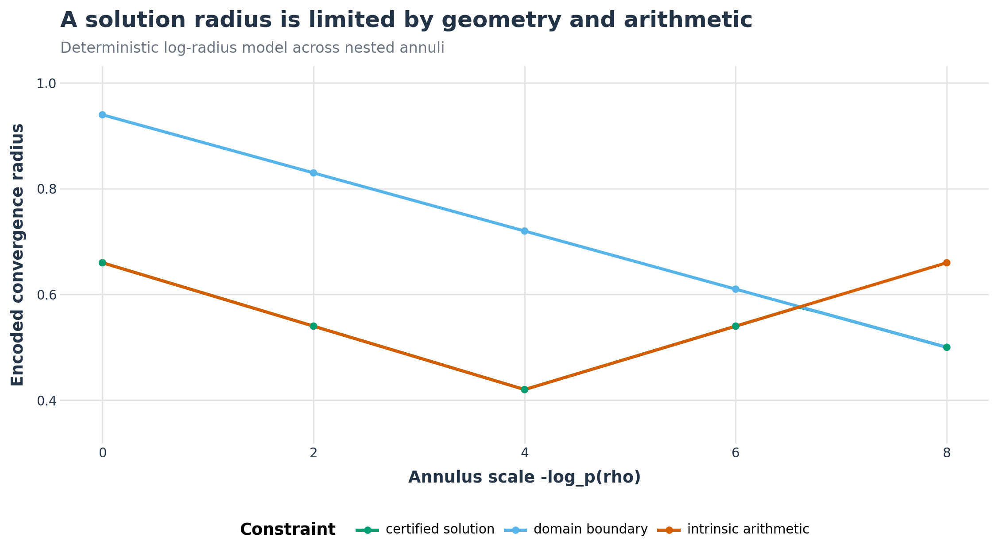

# p-Adic Differential Equations {#sec-padic-differential-equations}

**Level and prerequisites: L5.** Prepare differential equations, non-Archimedean Banach spaces and convergence radii. The [reader guide](index.md) links the Euler arithmetic, algebra and analysis preparation and distinguishes the graduate continuation.

Formal differentiation looks familiar over a non-Archimedean field, but
convergence radii, singularities, and continuation behave differently.
Frobenius symmetry often supplies the arithmetic control that complex monodromy
provides in classical differential equations.

**Prerequisites.** Power series from [sec-analysis](08-analysis.md#sec-analysis), Banach spaces from
[sec-banach-spaces](16-banach-spaces.md#sec-banach-spaces), Newton polygons from [sec-newton-polygons](19-newton-polygons.md#sec-newton-polygons), and rigid annuli
from [sec-rigid-berkovich](23-rigid-berkovich.md#sec-rigid-berkovich).

## Derivations and differential modules

On $K[[T]]$, define

$$
\frac d{dT}\sum_{n=0}^{\infty}a_nT^n
=\sum_{n=1}^{\infty}na_nT^{n-1}.
$$

Formal differentiation preserves the radius of convergence in characteristic
zero non-Archimedean fields. The integers $n$ never have absolute value above
one, so coefficients do not grow as they can under Archimedean norms.

A linear system is

$$
Y'=A(T)Y.
$$

Equivalently, a **differential module** over a differential ring $R$ is a
finite free $R$-module $M$ with a connection

$$
\nabla:M\to M\,dT
$$

satisfying

$$
\nabla(fm)=f'm\,dT+f\nabla(m).
$$

Changing basis transforms the matrix by

$$
A\longmapsto
G^{-1}AG-G^{-1}G'.
$$

The module formulation keeps the equation independent of a chosen basis.

## Initial-value equations on a disk

If $A(T)$ is analytic on a disk, coefficient recursion constructs a formal
fundamental matrix $U(T)$ with $U(t_0)=I$. Convergence needs an estimate.
The scalar equation

$$
y'=ay,\qquad y(0)=1
$$

has formal solution

$$
y(T)=\exp(aT).
$$

Over a field extending $\mathbb Q_p$, the $p$-adic exponential converges when

$$
|aT|_p<p^{-1/(p-1)}.
$$

Thus a constant-coefficient equation can have a finite solution radius even
though its coefficient is entire. The factorial denominators, not a coefficient
singularity, create the boundary.

For a system, a fundamental matrix satisfies

$$
U'=AU,\qquad U(t_0)=I.
$$

Every solution is $Uc$. Its determinant obeys

$$
(\det U)'=(\operatorname{tr}A)\det U,
$$

so invertibility persists on the convergence disk.

## Radii of convergence

At each center $t$, solutions have a generic convergence radius bounded by the
distance to the coefficient domain's boundary and by intrinsic arithmetic
growth. On an ultrametric disk, all points sufficiently close to $t$ define
the same disk, producing locally constant-looking radius geometry.

<figure id="fig-padic-de-radii">


<figcaption>

Figure 29.1: Solution radii over nested p-adic annuli are controlled by both domain boundary and arithmetic growth.

</figcaption>
</figure>

[Figure 29.1](#fig-padic-de-radii) is a model radius function. Actual differential modules can
have several subsidiary radii whose slope filtration requires deeper theorems.

The **spectral norm** of the derivation on a Banach algebra helps express the
intrinsic radius. Normalizations differ across sources; any numerical radius
formula must declare the coordinate and absolute value.

## Singular points

An equation has a singularity where its coefficient matrix is not analytic. The
scalar model

$$
Ty'=\lambda y
$$

formally suggests $y=T^\lambda$. If $\lambda$ is an integer, this is an
ordinary monomial. For general $p$-adic $\lambda$, defining $T^\lambda$
requires choosing a multiplicative decomposition and logarithm on an appropriate
annulus.

A regular singular system resembles

$$
Y'=\frac ATY+\text{analytic terms},
$$

with controlled pole order after gauge change. Eigenvalues of $A$ play the role
of exponents. Resonant exponent differences can create logarithmic terms, while
the $p$-adic logarithm has restricted local definitions.

Irregular singularities exhibit faster growth and slope data. Complex Stokes
sectors do not transfer literally to ultrametric geometry; annuli and Frobenius
replace angular sectors.

## Frobenius structures

Let $\varphi$ lift residue-field Frobenius, for example

$$
\varphi(T)=T^p.
$$

Pulling a differential module back by $\varphi$ changes both coefficients and
the differential:

$$
d(T^p)=pT^{p-1}\,dT.
$$

A **Frobenius structure** is an isomorphism

$$
\Phi:\varphi^*M\longrightarrow M
$$

compatible with connections. It relates solutions on different radii and imposes
strong arithmetic recurrence on coefficients.

Frobenius can improve continuation: repeated pullback moves information among
nested annuli. In arithmetic geometry, Frobenius structures arise from
cohomology of varieties over finite fields and are not arbitrary extra
symmetries.

## The Robba ring

The Robba ring $\mathcal R_K$ consists of Laurent series

$$
\sum_{n\in\mathbb Z}a_nT^n
$$

that converge on some punctured annulus

$$
r<|T|<1
$$

with $r$ depending on the series. It is a union over inner radii, not one
single Banach algebra. Norms on closed subannuli provide its locally convex
structure.

Differential modules over $\mathcal R_K$ capture behavior near the boundary of
the open unit disk. **Overconvergent** objects converge on an annulus larger than
the minimal formal domain, giving room for Frobenius and cohomological
operations.

The Robba ring is not the ring of all functions on a punctured disk; its
outer-boundary and convergence conditions are essential.

## Newton polygons for differential operators

For a twisted polynomial in the derivation,

$$
P=\sum_{i=0}^na_i(T)\partial^i,
\qquad
\partial a=a\partial+a',
$$

coefficient norms produce a Newton polygon. Its slopes predict intrinsic
solution radii, much as polynomial Newton polygons predict root valuations.

The full theory is subtler because derivation and coefficients do not commute.
Under suitable hypotheses, differential modules admit slope filtrations whose
pieces have uniform radii. Breaks vary piecewise affinely with the logarithmic
annulus radius.

This chapter uses the polygon as an organized diagnostic and states the
filtration as a theorem destination; it does not replace the noncommutative proof
with a suggestive sketch.

## Arithmetic applications

Families of algebraic varieties produce differential equations through
Gauss–Manin connections. Periods vary with a parameter and satisfy a
Picard–Fuchs equation. Over $p$-adic bases, Frobenius acts simultaneously,
creating a differential equation with arithmetic symmetry.

Dwork used $p$-adic analytic operators and Frobenius to prove rationality of
zeta functions over finite fields. Rigid cohomology packages this strategy:
overconvergent functions make cohomology finite-dimensional, and Frobenius traces
encode point counts.

These applications require substantial cohomology beyond this chapter. The
logical chain is:

$$
\text{family}
\to
\text{connection}
\to
\text{Frobenius module}
\to
\text{trace formula}.
$$

Every arrow is a theorem or construction, not an analogy.

<!-- inline-formula-code:start -->
## Formula and finite computation

A useful formula in this chapter is

$$
y'=y\Longrightarrow a_{n+1}=\frac{a_n}{n+1}
$$

Exact rational coefficients realize the power-series recurrence. The following standalone Python block expresses that finite rule with its inputs and stopping conditions visible.

```python
from fractions import Fraction

coefficients = [Fraction(1)]
for degree in range(8):
    coefficients.append(coefficients[-1] / (degree + 1))
print(coefficients)
```

**What the computation establishes.** The output certifies only the declared finite case. The theorem, if one is claimed, still requires the argument developed in the chapter.
<!-- inline-formula-code:end -->

## Summary

- Differential modules make linear equations basis-independent.
- Formal solutions can have arithmetic convergence boundaries even for entire
  coefficients.
- Singular equations require annular functions, exponent data, and logarithm
  care.
- Frobenius structures relate scales and encode arithmetic origin.
- The Robba ring is the natural home near a punctured boundary.
- Differential Newton polygons organize generic radii and slope filtrations.

## Exercises

<div class="exercise" id="p_adic_numbers-29-differential-equations-ex-1">
<p class="exercise-title"><strong>Exercise 1</strong></p>

Prove formal differentiation does not reduce a power series radius.

<details class="solution"><summary>Solution</summary>

Since $|n|_p\le1$, differentiated coefficients have no worse exponential
growth.

</details>

</div>

<div class="exercise" id="p_adic_numbers-29-differential-equations-ex-2">
<p class="exercise-title"><strong>Exercise 2</strong></p>

Find the exact convergence disk of $\exp(aT)$.

<details class="solution"><summary>Solution</summary>

$|T|_p<p^{-1/(p-1)}/|a|_p$.

</details>

</div>

<div class="exercise" id="p_adic_numbers-29-differential-equations-ex-3">
<p class="exercise-title"><strong>Exercise 3</strong></p>

Derive the change-of-basis formula for $A$.

<details class="solution"><summary>Solution</summary>

Substitute $Y=GZ$ into $Y'=AY$ and solve for $Z'$.

</details>

</div>

<div class="exercise" id="p_adic_numbers-29-differential-equations-ex-4">
<p class="exercise-title"><strong>Exercise 4</strong></p>

Prove the determinant identity for a fundamental matrix.

<details class="solution"><summary>Solution</summary>

Use the adjugate derivative or Jacobi determinant formula.

</details>

</div>

<div class="exercise" id="p_adic_numbers-29-differential-equations-ex-5">
<p class="exercise-title"><strong>Exercise 5</strong></p>

Explain why $T^\lambda$ is not globally automatic for
$\lambda\in\mathbb Z_p$.

<details class="solution"><summary>Solution</summary>

A branch of logarithm and a compatible multiplicative component are needed.

</details>

</div>

<div class="exercise" id="p_adic_numbers-29-differential-equations-ex-6">
<p class="exercise-title"><strong>Exercise 6</strong></p>

Compute the connection factor introduced by $T\mapsto T^p$.

<details class="solution"><summary>Solution</summary>

It is $pT^{p-1}$.

</details>

</div>

<div class="exercise" id="p_adic_numbers-29-differential-equations-ex-7">
<p class="exercise-title"><strong>Exercise 7</strong></p>

Give a Laurent series converging on one punctured annulus but not the whole
punctured unit disk.

<details class="solution"><summary>Solution</summary>

Choose coefficients whose negative tail converges only above a positive inner
radius.

</details>

</div>

<div class="exercise" id="p_adic_numbers-29-differential-equations-ex-8">
<p class="exercise-title"><strong>Exercise 8</strong></p>

Compare polynomial and differential Newton polygons without claiming their
proofs are identical.

<details class="solution"><summary>Solution</summary>

Both use lower convex hulls of valuation data; the differential operator is
noncommutative and its slopes describe solution radii.

</details>

</div>

### Answer support

1. Since $|n|_p\le1$, differentiated coefficients have no worse exponential
   growth.
2. $|T|_p<p^{-1/(p-1)}/|a|_p$.
3. Substitute $Y=GZ$ into $Y'=AY$ and solve for $Z'$.
4. Use the adjugate derivative or Jacobi determinant formula.
5. A branch of logarithm and a compatible multiplicative component are needed.
6. It is $pT^{p-1}$.
7. Choose coefficients whose negative tail converges only above a positive inner
   radius.
8. Both use lower convex hulls of valuation data; the differential operator is
   noncommutative and its slopes describe solution radii.
