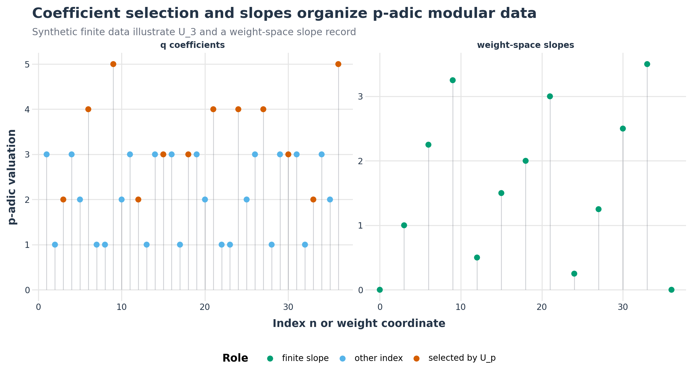

# p-Adic Modular Forms and Coleman Integration {#sec-padic-modular-coleman}

**Level and prerequisites: L5.** Prepare modular curves, modular forms, rigid analytic functions and differentials. The [reader guide](index.md) links the Euler arithmetic, algebra and analysis preparation and distinguishes the graduate continuation.

Modular forms have Fourier coefficients carrying arithmetic information. When
those coefficients and weights vary $p$-adically, isolated classical forms
join analytic families. On curves, Frobenius can also select canonical
$p$-adic integrals where ordinary path integration is unavailable.

**Prerequisites.** $p$-adic analytic functions from [sec-analysis](08-analysis.md#sec-analysis), Haar and
Fourier ideas from [sec-fourier-zeta](22-fourier-zeta.md#sec-fourier-zeta), rigid curves from
[sec-rigid-berkovich](23-rigid-berkovich.md#sec-rigid-berkovich), and elliptic curves from [sec-arithmetic-periods](24-arithmetic-periods.md#sec-arithmetic-periods).

## Classical modular forms recalled

Let

$$
\mathfrak H=\{\tau\in\mathbb C:\operatorname{Im}\tau>0\}
$$

and let

$$
\gamma=
\begin{pmatrix}a&b\\c&d\end{pmatrix}
\in\operatorname{SL}_2(\mathbb Z)
$$

act by
$\gamma\tau=(a\tau+b)/(c\tau+d)$. A classical modular form of integer weight
$k$ and chosen level satisfies

$$
f(\gamma\tau)=(c\tau+d)^k f(\tau)
$$

for the relevant subgroup, and is holomorphic at its cusps.

Near the cusp at infinity, use

$$
q=e^{2\pi i\tau}
$$

and write

$$
f(q)=\sum_{n=0}^{\infty}a_nq^n.
$$

The **$q$-expansion principle** says that, with appropriate level and
coefficient ring, the expansion determines the form and detects integrality.

Hecke operators reorganise coefficients. For primes away from the level, a
normalized eigenform satisfies multiplicative recurrences among $a_n$. The
coefficients produce Galois representations and $L$-functions.

## p-Adic coefficientwise limits

Suppose classical forms $f_j=\sum_na_n^{(j)}q^n$ have coefficients converging
in a $p$-adic field for every fixed $n$. Under suitable boundedness and
weight compatibility, their limit is a $p$-adic modular form.

The weights themselves can converge $p$-adically. A continuous character

$$
\kappa:\mathbb Z_p^\times\to\mathbb C_p^\times
$$

is a $p$-adic weight. Integer weight $k$ gives
$\kappa(x)=x^k$. The space of characters decomposes according to the finite
torsion part of $\mathbb Z_p^\times$ and an open unit disk parameterising the
principal-unit part.

Two large positive integers can be close as weights when congruent modulo
$(p-1)p^m$. Their monomials agree closely on $p$-adic units, which makes
weight interpolation possible.

## The $U_p$ operator and slopes

On $q$-expansions, a basic normalization is

$$
U_p\left(\sum_{n=0}^{\infty}a_nq^n\right)
=\sum_{n=0}^{\infty}a_{pn}q^n.
$$

The geometric definition depends on level and moduli interpretation, but the
coefficient formula is the computational entry point.

An eigenform with $U_p$-eigenvalue $\alpha$ has slope

$$
v_p(\alpha).
$$

Slope zero forms are **ordinary**. Positive finite slopes belong naturally to
spaces of **overconvergent** modular forms, defined on strict neighbourhoods of
the ordinary locus in a rigid modular curve.

The operator $U_p$ is compact on suitable overconvergent Banach spaces. Its
Fredholm determinant organises eigenvalues by slope. Compactness is a theorem
about the chosen radius and norm, not a property of the coefficient-shift
formula in every space.

<figure id="fig-padic-modular">


<figcaption>

Figure 30.1: p-Adic valuations of q-expansion coefficients and U-p selection expose slope structure.

</figcaption>
</figure>

[Figure 30.1](#fig-padic-modular) uses synthetic finite data designed to illustrate the
definitions. It does not claim to compute an eigencurve or a named eigenform.

## Families and eigenvarieties

An ordinary Hida family interpolates ordinary eigenforms across a component of
weight space. Fourier coefficients become analytic functions of weight, and
classical integer weights appear as a dense arithmetic subset.

Finite-slope forms are organized by the **eigencurve**, a rigid-analytic space
mapping to weight space. A point records a system of Hecke eigenvalues plus a
weight. Locally, branches can cross or ramify; the weight map need not be
one-to-one.

The construction uses a Fredholm determinant, spectral varieties, and coherent
modules. This chapter treats the eigenvariety as a theorem-backed destination,
not as an ordinary graph of eigenvalue versus real weight.

Classicality theorems state that an overconvergent eigenform of sufficiently
small slope relative to its integer weight is classical. The exact slope bound
depends on normalization and level.

## Why ordinary path integration fails

In real or complex calculus, an integral can be built along a continuous path.
The classical $K$-points of a $p$-adic curve are totally disconnected, so
that construction supplies almost no paths.

Locally, a differential form

$$
\omega=f(t)\,dt
$$

on a residue disk has a power-series primitive obtained by integrating
coefficients. Different disks produce primitives differing by constants. A
global integral must choose those constants compatibly.

Exact differentials should satisfy

$$
\int_P^Qdg=g(Q)-g(P),
$$

and integrals should be additive:

$$
\int_P^Q\omega+\int_Q^R\omega
=\int_P^R\omega.
$$

These requirements alone do not always select a unique global theory.

## Coleman integration

For a suitable smooth curve with good reduction, Frobenius supplies the missing
normalization. A Frobenius lift relates local primitives after pullback; solving
the resulting linear equations fixes their constants.

The **Coleman integral**

$$
\int_P^Q\omega
$$

is locally analytic in endpoints, additive, satisfies the fundamental theorem
for exact forms, and is Frobenius-equivariant. It depends on choices such as a
branch of the $p$-adic logarithm for forms with logarithmic behavior.

**Example on $\mathbb G_m$.** For

$$
\omega=\frac{dT}{T},
$$

$$
\int_P^Q\omega
=\log_p(Q)-\log_p(P)
$$

under a chosen logarithm branch. On principal units this is the convergent
power-series logarithm.

Coleman integration is not a measure integral and not a sum over a topological
path. It is a rigid-analytic primitive theory.

## Chabauty–Coleman method

Let $C/\mathbb Q$ be a curve of genus $g\ge2$ with Jacobian $J$, and suppose
the Mordell–Weil rank satisfies

$$
\operatorname{rank}J(\mathbb Q)<g.
$$

Linear algebra then finds a nonzero regular differential $\omega$ whose Coleman
integral vanishes on the closure of $J(\mathbb Q)$ inside $J(\mathbb Q_p)$.
Fixing a base point $P_0$, rational points lie among zeros of

$$
P\longmapsto\int_{P_0}^{P}\omega.
$$

On each residue disk this is a $p$-adic analytic function, so zero estimates
give a finite bound. Further arithmetic filters can identify the rational
points.

The rank condition is sufficient, not necessary for finiteness: Faltings'
theorem proves finiteness for every genus-$\ge2$ curve, but Chabauty–Coleman
provides an explicit method only in favourable rank situations or through later
extensions.

Computations must certify:

- good reduction and residue disks;
- precision of points and differentials;
- the annihilating linear relations;
- zero counts with error control;
- completeness of any rational-point search.

Chapter 41 supplies the local group-theoretic model behind spherical Hecke
recurrences, beginning with double cosets and the Bruhat–Tits tree rather than
with modular $q$-expansions. Chapter 44 develops the local-height pairing that
can be combined with Coleman integration in arithmetic applications. Both
handoffs require their stated normalisations; a familiar operator name or
integral sign does not determine one automatically.

<!-- inline-formula-code:start -->
## Formula and finite computation

A useful formula in this chapter is

$$
\int_a^b\sum_{n=0}^Nc_nx^n\,dx=\sum_{n=0}^N\frac{c_n}{n+1}(b^{n+1}-a^{n+1})
$$

For a polynomial, termwise integration is exact over the rationals. The following standalone Python block expresses that finite rule with its inputs and stopping conditions visible.

```python
from fractions import Fraction

coefficients = [Fraction(1), Fraction(-2), Fraction(3)]
left, right = Fraction(1), Fraction(4)
integral = sum(
    coefficient * (right ** (degree + 1) - left ** (degree + 1)) / (degree + 1)
    for degree, coefficient in enumerate(coefficients)
)
print(integral)
```

**What the computation establishes.** The output certifies only the declared finite case. The theorem, if one is claimed, still requires the argument developed in the chapter.
<!-- inline-formula-code:end -->

## Summary

- Classical modular forms are encoded by $q$-expansions and Hecke actions.
- $p$-adic weights are continuous characters of $\mathbb Z_p^\times$.
- $U_p$ slopes distinguish ordinary and finite-slope forms.
- Hida families and eigenvarieties interpolate eigenforms over weight space.
- Coleman integration glues local primitives using Frobenius rather than paths.
- Chabauty–Coleman converts a rank inequality into finite analytic zero
  problems.

## Exercises

<div class="exercise" id="p_adic_numbers-30-modular-coleman-ex-1">
<p class="exercise-title"><strong>Exercise 1</strong></p>

Explain why a $q$-expansion is a local coordinate at a cusp.

<details class="solution"><summary>Solution</summary>

The exponential parameter identifies a punctured cusp neighbourhood with a
disk after compactification.

</details>

</div>

<div class="exercise" id="p_adic_numbers-30-modular-coleman-ex-2">
<p class="exercise-title"><strong>Exercise 2</strong></p>

Compute $U_p$ on a finite displayed series.

<details class="solution"><summary>Solution</summary>

Retain coefficients whose indices are divisible by $p$ and divide their
indices by $p$.

</details>

</div>

<div class="exercise" id="p_adic_numbers-30-modular-coleman-ex-3">
<p class="exercise-title"><strong>Exercise 3</strong></p>

Show integer weights congruent modulo $(p-1)p^m$ are close on units.

<details class="solution"><summary>Solution</summary>

Split a unit into its finite Teichmüller part and principal-unit part, then
use exponent continuity.

</details>

</div>

<div class="exercise" id="p_adic_numbers-30-modular-coleman-ex-4">
<p class="exercise-title"><strong>Exercise 4</strong></p>

Distinguish ordinary from finite positive slope.

<details class="solution"><summary>Solution</summary>

Ordinary means eigenvalue valuation zero; finite positive slope means a
nonzero finite valuation in an overconvergent space.

</details>

</div>

<div class="exercise" id="p_adic_numbers-30-modular-coleman-ex-5">
<p class="exercise-title"><strong>Exercise 5</strong></p>

Verify the fundamental theorem for $dT/T$ on principal units.

<details class="solution"><summary>Solution</summary>

It is the difference of a chosen $p$-adic logarithm.

</details>

</div>

<div class="exercise" id="p_adic_numbers-30-modular-coleman-ex-6">
<p class="exercise-title"><strong>Exercise 6</strong></p>

Explain which constants Frobenius must fix when gluing primitives.

<details class="solution"><summary>Solution</summary>

Pullback by Frobenius must make local primitives differ by controlled
constants satisfying the equivariance equation.

</details>

</div>

<div class="exercise" id="p_adic_numbers-30-modular-coleman-ex-7">
<p class="exercise-title"><strong>Exercise 7</strong></p>

State the Chabauty rank condition and its role.

<details class="solution"><summary>Solution</summary>

$\operatorname{rank}J(\mathbb Q)<g$; it leaves a nonzero differential
annihilating the Mordell–Weil closure.

</details>

</div>

<div class="exercise" id="p_adic_numbers-30-modular-coleman-ex-8">
<p class="exercise-title"><strong>Exercise 8</strong></p>

List the certificates required before a finite-precision zero search proves a
rational-point list complete.

<details class="solution"><summary>Solution</summary>

Reduction, precision, annihilator, zero-count, and search-completeness
certificates.

</details>

</div>

### Answer support

1. The exponential parameter identifies a punctured cusp neighbourhood with a
   disk after compactification.
2. Retain coefficients whose indices are divisible by $p$ and divide their
   indices by $p$.
3. Split a unit into its finite Teichmüller part and principal-unit part, then
   use exponent continuity.
4. Ordinary means eigenvalue valuation zero; finite positive slope means a
   nonzero finite valuation in an overconvergent space.
5. It is the difference of a chosen $p$-adic logarithm.
6. Pullback by Frobenius must make local primitives differ by controlled
   constants satisfying the equivariance equation.
7. $\operatorname{rank}J(\mathbb Q)<g$; it leaves a nonzero differential
   annihilating the Mordell–Weil closure.
8. Reduction, precision, annihilator, zero-count, and search-completeness
   certificates.
