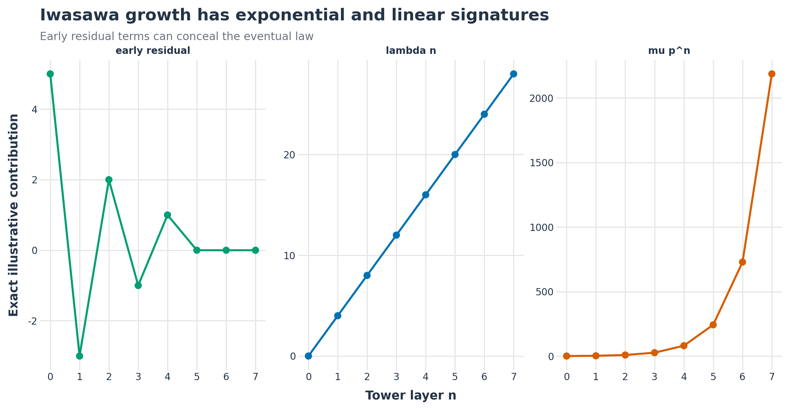

# Iwasawa Theory and *p*-Adic L-Functions {#sec-iwasawa}

**Level and prerequisites: L5.** Prepare local class field theory, inverse limits, completed group rings and modules. The [reader guide](index.md) links the Euler arithmetic, algebra and analysis preparation and distinguishes the graduate continuation.

Finite extensions reveal local arithmetic one layer at a time. Iwasawa theory
asks what happens when the layers form an infinite tower. Class groups, units,
and special values that look unrelated at each finite level can then become one
module or one analytic function over a power-series ring.

**Prerequisites.** Inverse limits from [sec-digits](05-digits.md#sec-digits), compact groups and Haar
measure from [sec-compactness-measure](11-compactness-measure.md#sec-compactness-measure), continuous characters from
[sec-fourier-zeta](22-fourier-zeta.md#sec-fourier-zeta), and local reciprocity from [sec-local-class-field](27-local-class-field.md#sec-local-class-field). The
necessary commutative algebra is developed as it appears.

**Goals.** By the end of the chapter, you should be able to construct a
cyclotomic $\mathbb Z_p$-tower, identify its completed group algebra with
$\mathbb Z_p[[T]]$, interpret the invariants $\mu$ and $\lambda$, pass
between measures and power series, and state a main conjecture without erasing
its hypotheses.

## Infinite towers of number fields

Fix an odd prime $p$. The fields

$$
\mathbb Q(\zeta_p)\subset \mathbb Q(\zeta_{p^2})
\subset \mathbb Q(\zeta_{p^3})\subset\cdots
$$

are obtained by adjoining compatible $p$-power roots of unity. Their union is
infinite, but every element lies in some finite layer. The full Galois group
over $\mathbb Q$ contains a finite factor of order $p-1$ and a pro-$p$
factor. Removing the finite factor produces the **cyclotomic
$\mathbb Z_p$-extension**

$$
K=K_0\subset K_1\subset K_2\subset\cdots\subset K_\infty,
\qquad [K_n:K]=p^n,
$$

with

$$
\Gamma=\operatorname{Gal}(K_\infty/K)\cong\mathbb Z_p.
$$

The isomorphism is topological. A topological generator $\gamma$ determines
every element through compatible powers modulo $p^n$. At $p=2$, one starts
far enough up the cyclotomic tower to separate the extra finite torsion; the
pro-$2$ mechanism is then the same.

For each $n$, let

$$
\Gamma_n=\operatorname{Gal}(K_\infty/K_n)=\Gamma^{p^n}.
$$

The quotient $\Gamma/\Gamma_n$ is cyclic of order $p^n$. Norm maps travel
down the tower, while extension maps travel up. An infinite-level object is
useful only when those maps are recorded, not when the finite groups are merely
placed in a list.

## The completed group algebra

For a finite group $G$, the group ring $\mathbb Z_p[G]$ consists of finite
formal sums with convolution multiplication. The **Iwasawa algebra** completes
these rings across the tower:

$$
\Lambda(\Gamma)
=\mathbb Z_p[[\Gamma]]
=\lim_{\leftarrow\,n} \mathbb Z_p[\Gamma/\Gamma_n].
$$

Choose $\gamma$. Sending $\gamma$ to $1+T$ gives an isomorphism

$$
\Lambda(\Gamma)\cong\mathbb Z_p[[T]].
$$

This coordinate is not canonical: replacing $\gamma$ changes $T$. The
completed group algebra is canonical; the power-series parameter is a chart.

Suppose finite $p$-groups $A_n$ are linked by norm maps. Their inverse
limit

$$
X=\lim_{\leftarrow\,n} A_n
$$

inherits a continuous $\Gamma$-action and hence a $\Lambda$-module
structure. In the class-group application, $A_n$ is the $p$-primary part
of the ideal class group of $K_n$. One infinite module now holds all finite
layers and all transition maps.

## Torsion modules and characteristic ideals

The analogy is

$$
\text{integer module over }\mathbb Z
\quad\longleftrightarrow\quad
\text{tower module over }\mathbb Z_p[[T]].
$$

A finitely generated torsion $\Lambda$-module is not generally a direct sum
of cyclic modules. Nevertheless, up to finite kernels and cokernels, its large
scale structure is governed by factors

$$
\Lambda/(p^{a_i})
\quad\text{and}\quad
\Lambda/(f_j(T)^{e_j}),
$$

where each $f_j$ is a distinguished polynomial: monic, with every lower
coefficient divisible by $p$. The product of these factors generates the
**characteristic ideal**, up to a unit.

Define

$$
\mu=\sum_i a_i,
\qquad
\lambda=\sum_j e_j\deg f_j.
$$

If $|A_n|=p^{e_n}$ and the usual torsion and finiteness hypotheses hold, then
for all sufficiently large $n$,

$$
e_n=\mu p^n+\lambda n+\nu
$$

for a constant integer $\nu$. This is an eventual theorem, not a regression
formula that may be imposed on a few data points.

<figure id="fig-iwasawa-growth">


<figcaption>

Figure 31.1: The two Iwasawa growth terms have different signatures across finite layers.

</figcaption>
</figure>

[Figure 31.1](#fig-iwasawa-growth) separates the $\mu p^n$ and $\lambda n$ signatures.
Synthetic data illustrate the theorem's form; they are not class-number claims
for a named field.

## Measures on $\mathbb Z_p$

A bounded $\mathbb Z_p$-valued measure $\mu$ assigns compatible values to
compact open residue balls. Compatibility means

$$
\mu(a+p^N\mathbb Z_p)
=\sum_{b=0}^{p-1}
\mu(a+bp^N+p^{N+1}\mathbb Z_p).
$$

For a continuous function $f$, its integral is obtained from increasingly
fine locally constant approximations. The **Amice transform** packages every
binomial moment into one series:

$$
\mathcal A_\mu(T)
=\int_{\mathbb Z_p}(1+T)^x\,d\mu(x)
=\sum_{m=0}^{\infty}
\left(\int_{\mathbb Z_p}\binom{x}{m}\,d\mu(x)\right)T^m.
$$

Mahler's theorem from [sec-mahler](17-mahler-expansions.md#sec-mahler) explains why the binomial functions are the
right coordinates. Bounded measures correspond to bounded-coefficient power
series. Convolution of measures becomes multiplication of transforms.

On $\mathbb Z_p^\times$, integration against a continuous character
$\kappa$ produces a Mellin transform

$$
\kappa\longmapsto
\int_{\mathbb Z_p^\times}\kappa(x)\,d\mu(x).
$$

Thus one measure is an analytic family of values over weight space.

## Interpolating special values

A complex $L$-function is first defined where an infinite series converges
and then analytically continued. At selected integers, its values often have an
algebraic part after dividing by a suitable complex period. Congruences among
those algebraic parts suggest a $p$-adic interpolation.

A **$p$-adic $L$-function** is a measure or analytic function satisfying
formulas of the schematic form

$$
L_p(\kappa_n)
=E_p(n,\chi)\,
\frac{L(1-n,\chi')}{\Omega_{\chi,n}},
$$

for arithmetic characters $\kappa_n$. Here $E_p$ is a local Euler factor,
$\chi'$ may include a Teichmüller twist, and $\Omega_{\chi,n}$ is the
chosen period or algebraic normalization. These decorations are part of the
theorem. Omitting them can turn a correct interpolation statement into a false
one.

The construction has two stages:

1. prove congruences among normalized special values;
2. show that those congruences define a bounded distribution, hence a measure.

Different components of weight space have different parity or finite-character
conditions. There is no single power series that ignores all components and
interpolates every integer indiscriminately.

## Trivial and exceptional zeros

An Euler factor in an interpolation formula can vanish even when the underlying
complex value does not. Such a **trivial zero** records the local modification
used to make interpolation possible. In important settings, the first
derivative at that zero contains new arithmetic information, such as a
$p$-adic logarithm or an $\mathcal L$-invariant.

The phrase **exceptional-zero formula** names a family of precise theorems, not
one universal identity. A valid statement must specify the representation or
modular form, its reduction type, the normalization of the $p$-adic
$L$-function, and the invariant appearing in the derivative.

## Main conjectures

The analytic side of Iwasawa theory is generated by a $p$-adic $L$-function.
The algebraic side is the characteristic ideal of a tower module such as $X$.
A cyclotomic **main conjecture** asserts an equality of ideals

$$
\operatorname{char}_\Lambda(X)
=(L_p)
$$

after choosing the correct character component and making the conventional
local modifications.

An equality of ideals is stronger than agreement at finitely many characters.
It simultaneously controls zeros, multiplicities, and finite-layer growth.
Many foundational cyclotomic cases are theorems, proved through work of Mazur,
Wiles, and others; broader noncommutative and geometric versions include both
theorems and open conjectures. Every use must say which setting is meant.

### A finite-data laboratory

Given exact values $e_0,\ldots,e_N$, one may compare candidate pairs
$(\mu,\lambda)$ by examining

$$
e_{n+1}-e_n
=\mu(p^{n+1}-p^n)+\lambda
$$

on a proposed stable range. This can falsify a candidate. It cannot prove that
the range has stabilized, nor can it establish the hypotheses behind the
Iwasawa growth theorem. A certificate should therefore record the field tower,
class-group computation method, exact group orders, candidate stable range, and
the theorem used to pass from finite data to a conclusion.

## Control theorems and descent

The module $X$ lives at infinite level, while arithmetic questions are usually
asked at a finite field $K_n$. A **control theorem** compares the coinvariants

$$
X_{\Gamma_n}=X/(\gamma^{p^n}-1)X
$$

with a finite-level Selmer group, class group, or related arithmetic object.
The comparison map need not be an isomorphism in every degree. A useful theorem
states hypotheses under which its kernel and cokernel are finite and uniformly
bounded, or describes their exact exceptional contribution.

For an elliptic curve $E/K$, a Selmer group sits between global Galois
cohomology and products of local conditions. Passing up the tower and taking a
Pontryagin dual produces a compact $\Lambda$-module. Ordinary reduction at
$p$ gives one classical control setting; supersingular reduction requires
modified plus/minus local conditions. Thus "the Selmer module is torsion" is a
hypothesis or theorem tied to a reduction type and chosen local condition, not
an automatic property of every elliptic curve.

Descent proceeds in three logically distinct steps:

1. identify the infinite-level $\Lambda$-module;
2. prove a control theorem relating its coinvariants to finite-level objects;
3. use the structure theorem to extract asymptotic or rank information.

Skipping step 2 confuses a formal quotient of a module with the arithmetic
group one hoped to compute.

## Several variables and noncommutative towers

If the Galois group is $\mathbb Z_p^d$, choosing generators identifies the
completed group algebra with

$$
\mathbb Z_p[[T_1,\ldots,T_d]].
$$

Characteristic ideals still make sense for suitable torsion modules, but
codimension-two phenomena and pseudonull submodules now carry information that
one-variable invariants can miss. Specializing a variable corresponds to
descending along a quotient of the tower; a specialization can create or erase
zeros, so generic and exceptional directions must be separated.

For a nonabelian compact $p$-adic Lie group $G$, the algebra
$\mathbb Z_p[[G]]$ is generally noncommutative. Ordinary ideals and
determinants no longer suffice. Noncommutative main conjectures use localized
$K$-theory and carefully chosen Ore sets. This is an active framework with
major theorems and open cases. The one-variable cyclotomic theory is the model,
not a proof by analogy for these larger towers.

<!-- inline-formula-code:start -->
## Formula and finite computation

A useful formula in this chapter is

$$
F(T)=\sum_{n=0}^Na_nT^n
$$

A truncated Iwasawa power series is evaluated with Horner's exact recurrence. The following standalone Python block expresses that finite rule with its inputs and stopping conditions visible.

```python
coefficients = [3, -1, 6, 2, 1]
argument = 5
value = 0
for coefficient in reversed(coefficients):
    value = value * argument + coefficient
print(value)
```

**What the computation establishes.** The output certifies only the declared finite case. The theorem, if one is claimed, still requires the argument developed in the chapter.
<!-- inline-formula-code:end -->

## Summary

- A $\mathbb Z_p$-extension turns finite layers into one profinite tower.
- Choosing a generator identifies its Iwasawa algebra with
  $\mathbb Z_p[[T]]$.
- Torsion modules have characteristic ideals and growth invariants $\mu$ and
  $\lambda$.
- Measures become power series under the Amice transform.
- $p$-adic $L$-functions interpolate normalized special values, including
  their local Euler factors.
- A main conjecture compares an analytic ideal with an algebraic characteristic
  ideal in a precisely specified component.
- Control theorems justify passage between infinite modules and finite arithmetic
  layers; multivariable and noncommutative towers require richer algebra.

## Exercises

<div class="exercise" id="p_adic_numbers-31-iwasawa-ex-1">
<p class="exercise-title"><strong>Exercise 1</strong></p>

Show that $\Gamma/\Gamma_n$ has order $p^n$.

<details class="solution"><summary>Solution</summary>

Its kernel is $p^n\mathbb Z_p$ after identifying $\Gamma$ with
$\mathbb Z_p$.

</details>

</div>

<div class="exercise" id="p_adic_numbers-31-iwasawa-ex-2">
<p class="exercise-title"><strong>Exercise 2</strong></p>

Under $\gamma\mapsto1+T$, write $\gamma^{p^n}-1$ as a power series.

<details class="solution"><summary>Solution</summary>

It is $(1+T)^{p^n}-1$.

</details>

</div>

<div class="exercise" id="p_adic_numbers-31-iwasawa-ex-3">
<p class="exercise-title"><strong>Exercise 3</strong></p>

Explain why changing $\gamma$ changes the coordinate but not $\Lambda$.

<details class="solution"><summary>Solution</summary>

A new generator applies an invertible power-series change of parameter.

</details>

</div>

<div class="exercise" id="p_adic_numbers-31-iwasawa-ex-4">
<p class="exercise-title"><strong>Exercise 4</strong></p>

Compute the $\mu$- and $\lambda$-contributions to
$e_{n+1}-e_n$.

<details class="solution"><summary>Solution</summary>

The difference is $\mu p^n(p-1)+\lambda$.

</details>

</div>

<div class="exercise" id="p_adic_numbers-31-iwasawa-ex-5">
<p class="exercise-title"><strong>Exercise 5</strong></p>

Verify the residue-ball compatibility equation for normalized Haar measure.

<details class="solution"><summary>Solution</summary>

Each ball is the disjoint union of its $p$ children, whose measures sum to
the parent measure.

</details>

</div>

<div class="exercise" id="p_adic_numbers-31-iwasawa-ex-6">
<p class="exercise-title"><strong>Exercise 6</strong></p>

Read the coefficient of $T^m$ in an Amice transform.

<details class="solution"><summary>Solution</summary>

It is $\int\binom{x}{m}\,d\mu(x)$.

</details>

</div>

<div class="exercise" id="p_adic_numbers-31-iwasawa-ex-7">
<p class="exercise-title"><strong>Exercise 7</strong></p>

Explain why a vanishing Euler factor can create a zero not visible in the
complex $L$-value.

<details class="solution"><summary>Solution</summary>

The interpolation deliberately inserts that local factor.

</details>

</div>

<div class="exercise" id="p_adic_numbers-31-iwasawa-ex-8">
<p class="exercise-title"><strong>Exercise 8</strong></p>

List four choices or hypotheses that must accompany a main-conjecture
statement.

<details class="solution"><summary>Solution</summary>

The tower, character component, local conditions, normalization, and module
hypotheses are all relevant; any four suffice.

</details>

</div>

### Answer support

1. Its kernel is $p^n\mathbb Z_p$ after identifying $\Gamma$ with
   $\mathbb Z_p$.
2. It is $(1+T)^{p^n}-1$.
3. A new generator applies an invertible power-series change of parameter.
4. The difference is $\mu p^n(p-1)+\lambda$.
5. Each ball is the disjoint union of its $p$ children, whose measures sum to
   the parent measure.
6. It is $\int\binom{x}{m}\,d\mu(x)$.
7. The interpolation deliberately inserts that local factor.
8. The tower, character component, local conditions, normalization, and module
   hypotheses are all relevant; any four suffice.
