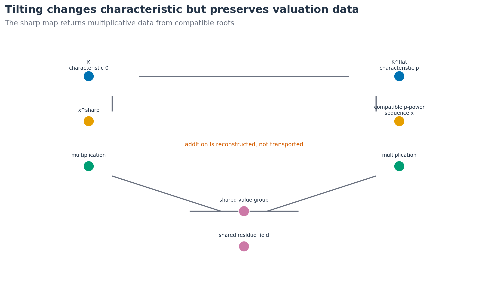

# Perfectoid Fields and Tilting {#sec-perfectoid}

**Level and prerequisites: L5.** Prepare complete valued fields, Witt vectors, Frobenius and commutative algebra. The [reader guide](index.md) links the Euler arithmetic, algebra and analysis preparation and distinguishes the graduate continuation.

Ramified extensions can be stacked until the value group becomes densely
divisible and ordinary discrete-valuation arguments stop working. Perfectoid
fields turn this apparently unruly limit into a bridge between characteristic
zero and characteristic $p$. The bridge preserves multiplicative and Galois
information with astonishing fidelity, while addition must be rebuilt.

**Prerequisites.** Complete valued fields from [sec-local-fields](12-local-fields.md#sec-local-fields), algebraic
closures from [sec-cp](21-cp.md#sec-cp), Frobenius and Witt vectors from [sec-witt-vectors](25-witt-vectors.md#sec-witt-vectors), and
profinite Galois groups from [sec-profinite-galois](26-profinite-galois.md#sec-profinite-galois).

**Goals.** You will learn a working definition of a perfectoid field, construct
its tilt, compute the sharp map on compatible sequences, state the finite-
extension equivalence, and explain why almost mathematics occurs naturally.

## Deep ramification

A finite extension $K/\mathbb Q_p$ has a discrete value group. After a
normalization it is $\mathbb Z$, and a uniformizer gives a smallest positive
valuation. Now adjoin compatible roots

$$
p^{1/p},\quad p^{1/p^2},\quad p^{1/p^3},\ldots
$$

and complete. The resulting field has values containing
$p^{-n}\mathbb Z$ for every $n$. There is no smallest positive value.

This is **deep ramification**: increasingly fine ramification appears at every
scale. The old uniformizer-by-uniformizer classification is no longer adequate,
but Frobenius modulo $p$ becomes much closer to being reversible.

Let $K$ be a complete non-Archimedean field with valuation ring
$\mathcal O_K$ and residue characteristic $p$. A standard field-level
definition says that $K$ is **perfectoid** when:

1. its rank-one valuation is nondiscrete;
2. the Frobenius map
   $x\mapsto x^p$ on $\mathcal O_K/p$ is surjective.

Equivalent definitions use a topologically nilpotent element $\varpi$ with
$p\in(\varpi^p)$ and a Frobenius isomorphism between suitable quotients.
Those formulations are useful for rings and integral structures. The rank-one
hypothesis matters: the word perfectoid does not mean merely "complete and
highly ramified."

## Examples and nonexamples

The completed field

$$
\widehat{\mathbb Q_p(p^{1/p^\infty})}
$$

is perfectoid. So is $\mathbb C_p$. In characteristic $p$, the completion
of

$$
\mathbb F_p((t))(t^{1/p},t^{1/p^2},\ldots)
$$

is perfectoid. Its Frobenius is already bijective.

By contrast, $\mathbb Q_p$ itself is not perfectoid: its valuation is
discrete. Frobenius on $\mathbb Z_p/p=\mathbb F_p$ is the identity and hence surjective;
it is the nondiscreteness condition that fails. A finite extension of $\mathbb Q_p$ is likewise not perfectoid.
Perfectoidness belongs to an infinite-level completed object, not to an
arbitrarily large but finite ramified layer.

## Constructing the tilt

For a perfectoid field $K$ of characteristic zero, define the underlying
integral multiplicative system

$$
\mathcal O_{K^\flat}
=\lim_{\leftarrow\,x\mapsto x^p}\mathcal O_K/p.
$$

An element is a compatible sequence

$$
x=(x^{(0)},x^{(1)},x^{(2)},\ldots),
\qquad (x^{(n+1)})^p=x^{(n)}.
$$

Multiplication is coordinatewise. Coordinatewise addition is generally wrong:
Frobenius on a characteristic-zero lift is not additive. Instead, addition is
the unique operation whose finite-level representatives satisfy the limiting
formula

$$
(x+y)^{(n)}
=\lim_{m\to\infty}
\left(\widetilde{x}^{(n+m)}+
\widetilde{y}^{(n+m)}\right)^{p^m}
\pmod p,
$$

where tildes are arbitrary lifts to $\mathcal O_K$. Perfectoid estimates make
the limit exist and independent of the lifts.

The fraction field of $\mathcal O_{K^\flat}$ is the **tilt** $K^\flat$.
It has characteristic $p$, is perfectoid, and has the same value group as
$K$. Their residue fields are canonically the same.

<figure id="fig-perfectoid-tilting">


<figcaption>

Figure 32.1: Tilting preserves residue and value data while rebuilding addition in characteristic p.

</figcaption>
</figure>

[Figure 32.1](#fig-perfectoid-tilting) is a dictionary, not a claim that elements retain the
same ordinary sum after crossing the bridge.

## The sharp map

Choose lifts $\widetilde{x}^{(n)}\in\mathcal O_K$ of the coordinates. The
limit

$$
x^\sharp
=\lim_{n\to\infty}
\left(\widetilde{x}^{(n)}\right)^{p^n}
$$

exists in $\mathcal O_K$, is independent of the lifts, and defines a map

$$
(\cdot)^\sharp:K^\flat\longrightarrow K.
$$

It is multiplicative and preserves absolute values:

$$
(xy)^\sharp=x^\sharp y^\sharp,
\qquad |x^\sharp|=|x|_\flat.
$$

It is not additive in general. This single warning prevents one of the most
common misconceptions about tilting. The tilt is not the same field with its
characteristic label changed; its additive law is genuinely new.

**Example.** A compatible system

$$
p,p^{1/p},p^{1/p^2},\ldots
$$

determines an element $p^\flat\in K^\flat$, despite $K^\flat$ having
characteristic $p$. The symbol labels the system; it is not the image of the
integer $p$, which is zero in characteristic $p$. Its sharp is
$(p^\flat)^\sharp=p$.

## Witt vectors and untilting

The ring of Witt vectors $W(\mathcal O_{K^\flat})$ lifts the perfect
characteristic-$p$ ring back toward characteristic zero. There is a
surjective map

$$
\theta:W(\mathcal O_{K^\flat})\longrightarrow\mathcal O_K
$$

that sends a Teichmüller element $[x]$ to $x^\sharp$. For perfectoid fields,
the kernel is generated by a distinguished primitive element $\xi$, after
the appropriate integral setup. Thus $K$ can be presented as an **untilt**
of $K^\flat$, but a characteristic-$p$ perfectoid field may have multiple
nonisomorphic untilts. The tilt does not remember one unique characteristic-
zero field as an abstract field.

This construction links [sec-witt-vectors](25-witt-vectors.md#sec-witt-vectors) to the period rings of
[sec-padic-hodge-depth](33-hodge-depth.md#sec-padic-hodge-depth). Completing or localizing Witt-vector rings in different
ways produces comparison environments with Frobenius and filtrations.

## Finite extensions and Galois groups

The tilting equivalence states that finite extensions of $K$ and finite
extensions of $K^\flat$ correspond, with degrees and Galois structures
preserved. In particular,

$$
G_K\cong G_{K^\flat}
$$

as profinite groups. The isomorphism is compatible with finite extension
categories, not obtained by applying $(\cdot)^\sharp$ coefficient by
coefficient to a polynomial.

This theorem is remarkable because characteristic zero and characteristic
$p$ fields can have the same absolute Galois theory at perfectoid level. It
extends the field-of-norms philosophy: an infinitely ramified tower in
characteristic zero can be represented by a characteristic-$p$ field where
Frobenius is easier to use.

### A polynomial caution

If

$$
f(X)=\sum_i a_iX^i
$$

has coefficients in $K^\flat$, the polynomial
$\sum_i a_i^\sharp X^i$ need not preserve roots because sharp is not
additive. Finite extensions correspond through valuation-theoretic and
almost-purity arguments. Naive coefficient transport is not the theorem.

## Almost mathematics

Let $\mathfrak m\subset\mathcal O_K$ be the ideal of topologically nilpotent
elements. Because the value group is nondiscrete, $\mathfrak m$ contains
elements of arbitrarily small positive valuation and often satisfies
$\mathfrak m^2=\mathfrak m$.

An $\mathcal O_K$-module $M$ is **almost zero** when

$$
\mathfrak mM=0.
$$

A map is an almost isomorphism when its kernel and cokernel are almost zero.
This does not mean numerically small, finite, or safe to discard without a
specified ideal. It means annihilated by every element in a designated ideal of
tiny valuation.

Almost purity says, roughly, that finite étale extensions at the field level
induce integral extensions that are almost finite étale. Ordinary integral
étaleness can fail because infinite ramification accumulates; the almost
category records exactly the controlled defect.

## Geometric applications

Perfectoid affinoid algebras extend the field definition to analytic spaces.
Inverse towers such as adjoining all $p$-power roots of coordinates can have
a perfectoid limit even when no finite stage does. Tilting transfers the limit
to characteristic $p$, where Frobenius becomes an automorphism.

This mechanism supports:

- comparison theorems in $p$-adic Hodge theory;
- almost-purity and étale-cohomology calculations;
- infinite-level modular and Shimura varieties;
- period maps from perfectoid spaces;
- characteristic-changing arguments in arithmetic geometry.

These applications use adic spaces, sheaves, and cohomology beyond this
chapter. The field theory here supplies the vocabulary and the exact theorem
boundary.

## Perfectoid algebras

Let $K$ be a perfectoid field. A Banach $K$-algebra $R$ has a subring
$R^\circ$ of power-bounded elements and an ideal $R^{\circ\circ}$ of
topologically nilpotent elements. A working definition of a **perfectoid
$K$-algebra** requires uniformity—the power-bounded elements are bounded—
and surjective Frobenius on an appropriate quotient of $R^\circ$.

The model example is the completed algebra

$$
K\langle T^{1/p^\infty}\rangle
=\widehat{\bigcup_{n\ge0}K\langle T^{1/p^n}\rangle}.
$$

At every finite stage, only finitely many root levels are present. At the
completion, Frobenius can shift the tower:

$$
T^{1/p^{n+1}}\longmapsto T^{1/p^n}.
$$

Its tilt is the analogous algebra over $K^\flat$. This example explains why
perfectoid spaces naturally appear at infinite level in towers of rigid spaces.

Uniformity prevents the topology from hiding unbounded power-bounded elements.
Frobenius surjectivity supplies compatible roots. Both conditions are needed:
a Banach algebra over a perfectoid field is not automatically perfectoid.

## Rational localizations and sheaves

An affinoid perfectoid space is written

$$
\operatorname{Spa}(R,R^+),
$$

where $R^+\subset R^\circ$ is an open integrally closed ring of definition.
Its points are continuous valuations, extending the Berkovich and adic
viewpoints of [sec-rigid-berkovich](23-rigid-berkovich.md#sec-rigid-berkovich). Rational subsets impose inequalities such as

$$
|f_i(x)|\le |g(x)|\ne0.
$$

Localizing to such a subset gives another perfectoid algebra. A fundamental
theorem says that the structure presheaf is a sheaf and has controlled higher
cohomology, often in an almost sense integrally. This is not formal point-set
topology; it is one of the places where almost purity does real work.

Tilting preserves the underlying topological space of an affinoid perfectoid
space and matches rational subsets. Functions and residue fields change
characteristic, but the valuation-theoretic incidence pattern survives.

## Infinite limits without a fictitious pointwise limit

Suppose spaces $X_n$ form a tower with finite transition maps. The notation

$$
X_\infty\sim\lim_{\leftarrow\,n} X_n
$$

in perfectoid geometry often means that the underlying topological spaces and
dense coordinate rings satisfy precise limit conditions. It need not be a
categorical inverse limit in every category of adic spaces.

This distinction matters computationally. A point of $X_\infty$ includes a
compatible system of finite-level points plus completion data. Sampling a large
finite level can suggest the shape of the tower, but no fixed level contains
all compatible $p$-power roots or validates the perfectoid Frobenius theorem.

<!-- inline-formula-code:start -->
## Formula and finite computation

A useful formula in this chapter is

$$
\varphi:x\longmapsto x^p
$$

On the residue field, enumerating Frobenius images verifies surjectivity in the finite model. The following standalone Python block expresses that finite rule with its inputs and stopping conditions visible.

```python
prime = 7
images = {pow(value, prime, prime) for value in range(prime)}
print(sorted(images), images == set(range(prime)))
```

**What the computation establishes.** The output certifies only the declared finite case. The theorem, if one is claimed, still requires the argument developed in the chapter.
<!-- inline-formula-code:end -->

## Summary

- A perfectoid field is complete, rank one, nondiscretely valued, and has
  surjective Frobenius modulo $p$.
- The tilt consists of compatible $p$-power sequences and has characteristic
  $p$.
- Multiplication is coordinatewise; addition is reconstructed by a limit.
- The sharp map is multiplicative and norm-preserving but generally not
  additive.
- Tilting preserves finite extensions and absolute Galois groups.
- Almost mathematics measures a precise integral defect caused by deep
  ramification.
- Perfectoid affinoid algebras arise as uniform completions of infinite root
  towers, and tilting matches their rational-localization topology.

## Exercises

<div class="exercise" id="p_adic_numbers-32-perfectoid-ex-1">
<p class="exercise-title"><strong>Exercise 1</strong></p>

Explain why a finite extension of $\mathbb Q_p$ has discrete value group.

<details class="solution"><summary>Solution</summary>

Its valuation group is $(1/e)\mathbb Z$ for a finite ramification index
$e$.

</details>

</div>

<div class="exercise" id="p_adic_numbers-32-perfectoid-ex-2">
<p class="exercise-title"><strong>Exercise 2</strong></p>

Find valuations in $\mathbb Q_p(p^{1/p^n})$ approaching zero from above.

<details class="solution"><summary>Solution</summary>

They include $1/p^n$.

</details>

</div>

<div class="exercise" id="p_adic_numbers-32-perfectoid-ex-3">
<p class="exercise-title"><strong>Exercise 3</strong></p>

Check that compatible sequences multiply coordinatewise.

<details class="solution"><summary>Solution</summary>

Taking $p$th powers commutes with multiplication.

</details>

</div>

<div class="exercise" id="p_adic_numbers-32-perfectoid-ex-4">
<p class="exercise-title"><strong>Exercise 4</strong></p>

Explain why coordinatewise addition cannot define the desired lift.

<details class="solution"><summary>Solution</summary>

Lifted Frobenius in mixed characteristic fails to preserve sums.

</details>

</div>

<div class="exercise" id="p_adic_numbers-32-perfectoid-ex-5">
<p class="exercise-title"><strong>Exercise 5</strong></p>

Compute the sharp of the compatible system labeled $p^\flat$.

<details class="solution"><summary>Solution</summary>

It is $p$.

</details>

</div>

<div class="exercise" id="p_adic_numbers-32-perfectoid-ex-6">
<p class="exercise-title"><strong>Exercise 6</strong></p>

State three structures preserved by tilting.

<details class="solution"><summary>Solution</summary>

The value group, residue field, and finite-extension category are preserved.

</details>

</div>

<div class="exercise" id="p_adic_numbers-32-perfectoid-ex-7">
<p class="exercise-title"><strong>Exercise 7</strong></p>

Distinguish "almost zero" from "small norm."

<details class="solution"><summary>Solution</summary>

Almost zero means annihilated by a specified ideal; it is algebraic, not a
numerical estimate.

</details>

</div>

<div class="exercise" id="p_adic_numbers-32-perfectoid-ex-8">
<p class="exercise-title"><strong>Exercise 8</strong></p>

Explain why coefficientwise sharp does not prove the finite-extension
equivalence.

<details class="solution"><summary>Solution</summary>

Sharp is not additive, so it does not transport polynomial equations term by
term.

</details>

</div>

### Answer support

1. Its valuation group is $(1/e)\mathbb Z$ for a finite ramification index
   $e$.
2. They include $1/p^n$.
3. Taking $p$th powers commutes with multiplication.
4. Lifted Frobenius in mixed characteristic fails to preserve sums.
5. It is $p$.
6. The value group, residue field, and finite-extension category are preserved.
7. Almost zero means annihilated by a specified ideal; it is algebraic, not a
   numerical estimate.
8. Sharp is not additive, so it does not transport polynomial equations term by
   term.
