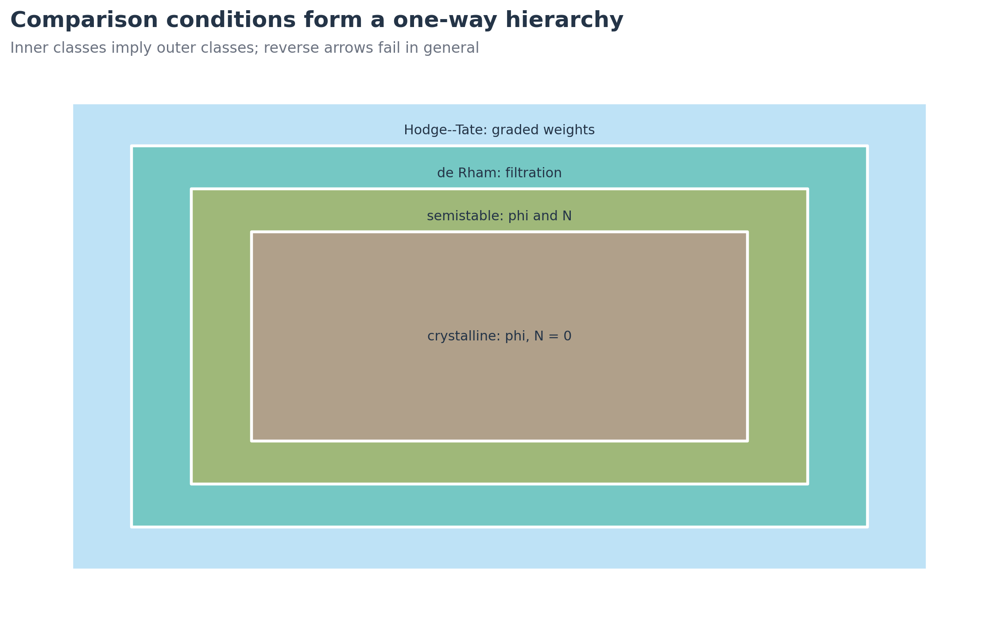

# *p*-Adic Hodge Theory in Depth {#sec-padic-hodge-depth}

**Level and prerequisites: L5.** Prepare continuous Galois representations, period rings, filtered modules and tensor products. The [reader guide](index.md) links the Euler arithmetic, algebra and analysis preparation and distinguishes the graduate continuation.

An algebraic variety over a $p$-adic field produces several cohomology
theories. One sees continuous Galois symmetry; another sees differential forms
and a filtration; another sees Frobenius; semistable reduction also introduces
monodromy. *p*-Adic Hodge theory builds period rings large enough for these
descriptions to become comparable.

**Prerequisites.** Local Galois theory from [sec-profinite-galois](26-profinite-galois.md#sec-profinite-galois), ramification
from [sec-ramification](20-ramification.md#sec-ramification), arithmetic periods from [sec-arithmetic-periods](24-arithmetic-periods.md#sec-arithmetic-periods), Witt
vectors from [sec-witt-vectors](25-witt-vectors.md#sec-witt-vectors), and perfectoid tilting from [sec-perfectoid](32-perfectoid.md#sec-perfectoid).

**Goals.** You will learn to form period invariants, distinguish Hodge–Tate,
de Rham, crystalline, and semistable representations, track filtration,
Frobenius, and monodromy, and connect the hierarchy to reduction of varieties.

## Representations, continuity, and lattices

Let $K$ be a finite extension of $\mathbb Q_p$, let
$G_K=\operatorname{Gal}(\overline K/K)$, and let $V$ be a finite-dimensional
$\mathbb Q_p$-vector space. A **$p$-adic representation** is a continuous
homomorphism

$$
\rho:G_K\longrightarrow\operatorname{GL}(V).
$$

Continuity uses the profinite topology on $G_K$ and the $p$-adic topology
on matrices. Compactness of $G_K$ implies that $V$ has a
$G_K$-stable $\mathbb Z_p$-lattice $T$ after choosing a basis suitably.
Reducing $T$ modulo $p^n$ gives finite representations

$$
G_K\longrightarrow\operatorname{GL}(T/p^nT)
$$

compatible as $n$ varies. The rational representation $V$ forgets which
lattice was chosen; integral questions do not.

The basic example is the Tate twist $\mathbb Q_p(1)$, on which $G_K$ acts
through the cyclotomic character. We use the convention that
$\mathbb Q_p(1)$ has Hodge–Tate weight $-1$. Some authors use the opposite
sign, so a weight statement should always declare its convention.

## The comparison-ring method

Let $B$ be a topological $\mathbb Q_p$-algebra with a continuous
$G_K$-action and additional structures. Define

$$
D_B(V)=(B\otimes_{\mathbb Q_p}V)^{G_K}.
$$

There is a natural comparison map

$$
B\otimes_{B^{G_K}}D_B(V)
\longrightarrow B\otimes_{\mathbb Q_p}V.
$$

Usually

$$
\dim_{B^{G_K}}D_B(V)\le \dim_{\mathbb Q_p}V.
$$

The representation is **$B$-admissible** when equality holds and the
comparison map is an isomorphism. A period ring is therefore a device for
turning some Galois representations into linear algebra while retaining the
extra structures needed to reconstruct them.

No single ring captures every useful representation. The main environments
are:

- $B_{\mathrm{HT}}$, a graded ring for Hodge–Tate weights;
- $B_{\mathrm{dR}}$, a filtered field for de Rham comparison;
- $B_{\mathrm{cris}}$, carrying Frobenius for crystalline comparison;
- $B_{\mathrm{st}}$, carrying Frobenius and monodromy for semistable
  comparison.

Their constructions use $\mathbb C_p$, the tilt, Witt vectors, divided
powers, and completions. The details are substantial; here we state enough of
each structure to use the classification correctly.

<figure id="fig-period-ring-hierarchy">


<figcaption>

Figure 33.1: Period rings form a hierarchy of increasingly restrictive comparison conditions.

</figcaption>
</figure>

[Figure 33.1](#fig-period-ring-hierarchy) gives implications, not converses. Extra hypotheses
may collapse parts of the hierarchy in special families, but none of the
reverse arrows is valid in general.

## Hodge–Tate representations

The graded ring can be pictured as

$$
B_{\mathrm{HT}}=\bigoplus_{i\in\mathbb Z}\mathbb C_p(i),
$$

where the formal grading records powers of the cyclotomic character. A
representation $V$ is **Hodge–Tate** if, after extending scalars to
$\mathbb C_p$, it decomposes as

$$
\mathbb C_p\otimes_{\mathbb Q_p}V
\cong
\bigoplus_{i\in\mathbb Z}
\mathbb C_p(-i)^{m_i}
$$

as a semilinear $G_K$-representation. The integers $i$, counted with
multiplicity $m_i$, are the Hodge–Tate weights under the chosen convention.

For an elliptic curve $E/K$, the representation

$$
V_p(E)=T_p(E)\otimes_{\mathbb Z_p}\mathbb Q_p
$$

is Hodge–Tate with weights $0$ and $1$ if one works with the dual
étale-cohomology convention, or $0$ and $-1$ for the corresponding Tate
module convention. The apparent discrepancy comes from duals and twists, not
from different geometry.

Hodge–Tate weights resemble eigenvalues only superficially. They are grading
indices in a comparison decomposition. They need not describe the eigenvalues
of a single Galois element.

## de Rham representations

The ring $B_{\mathrm{dR}}$ is a complete discretely valued field with residue
field $\mathbb C_p$. It has a decreasing filtration

$$
\operatorname{Fil}^iB_{\mathrm{dR}}=t^iB_{\mathrm{dR}}^+,
$$

where $t$ is a $p$-adic analogue of $2\pi i$ satisfying
$g(t)=\chi_{\mathrm{cyc}}(g)t$.

Set

$$
D_{\mathrm{dR}}(V)
=(B_{\mathrm{dR}}\otimes_{\mathbb Q_p}V)^{G_K}.
$$

This is a filtered $K$-vector space. The representation is **de Rham** when

$$
\dim_KD_{\mathrm{dR}}(V)=\dim_{\mathbb Q_p}V.
$$

For a smooth proper variety $X/K$, the de Rham comparison theorem relates
$p$-adic étale cohomology to algebraic de Rham cohomology:

$$
B_{\mathrm{dR}}\otimes_{\mathbb Q_p}
H^i_{\acute{e}t}(X_{\overline K},\mathbb Q_p)
\cong
B_{\mathrm{dR}}\otimes_KH^i_{\mathrm{dR}}(X/K),
$$

compatibly with Galois action and filtration. Smoothness and properness are
part of this clean statement; nonproper or singular varieties require modified
cohomology and extra boundary data.

The jumps in the de Rham filtration recover the Hodge–Tate weights, with sign
depending on convention. Consequently every de Rham representation is
Hodge–Tate.

## Crystalline representations

The ring $B_{\mathrm{cris}}$ sits inside $B_{\mathrm{dR}}$ and carries a
Frobenius endomorphism $\varphi$. Define

$$
D_{\mathrm{cris}}(V)
=(B_{\mathrm{cris}}\otimes_{\mathbb Q_p}V)^{G_K}.
$$

Its scalar field is the maximal unramified subfield $K_0\subset K$, and it is
a $K_0$-vector space with semilinear Frobenius. A representation is
**crystalline** when

$$
\dim_{K_0}D_{\mathrm{cris}}(V)=\dim_{\mathbb Q_p}V.
$$

Crystalline means that the representation has enough periods in a ring built
for good reduction. It does not mean that the matrices of $\rho(g)$ are
constant, diagonal, or unramified. The cyclotomic character is ramified but
crystalline.

For a smooth proper variety with good reduction, the crystalline comparison
theorem relates its étale cohomology to crystalline cohomology of the special
fiber. The Frobenius on the special fiber becomes the $\varphi$ on the
filtered module, while the generic fiber supplies the de Rham filtration.

## Semistable representations and monodromy

Good reduction is too restrictive. A semistable variety may acquire normal-
crossing components, and loops around those components leave a monodromy
trace. The ring $B_{\mathrm{st}}$ extends $B_{\mathrm{cris}}$ and carries
both Frobenius $\varphi$ and a nilpotent monodromy operator $N$, related by

$$
N\varphi=p\varphi N
$$

under a common normalization.

Define

$$
D_{\mathrm{st}}(V)
=(B_{\mathrm{st}}\otimes_{\mathbb Q_p}V)^{G_K}.
$$

A representation is **semistable** when this space has full dimension. It is
crystalline precisely when it is semistable with $N=0$, within this
admissible setting.

A representation is **potentially semistable** when it becomes semistable
after restricting to the Galois group of a finite extension of $K$. The
$p$-adic monodromy theorem says that every de Rham representation is
potentially semistable. It does not say every de Rham representation is already
semistable over the original field.

## Filtered $\varphi$-modules and admissibility

A filtered $\varphi$-module $D$ over $K$ has:

- a finite-dimensional $K_0$-vector space;
- a bijective semilinear Frobenius $\varphi$;
- a decreasing exhaustive separated filtration on $K\otimes_{K_0}D$.

For semistable objects, add a nilpotent $N$ satisfying the Frobenius relation.
Two numerical quantities compare the Frobenius slopes and filtration jumps:

$$
t_N(D)=v_p(\det\varphi)
\quad\text{and}\quad
t_H(D)=\sum_i i\,\dim_K\operatorname{gr}^iD_K,
$$

with normalization adjusted when $K_0\ne\mathbb Q_p$.

Weak admissibility requires

$$
t_H(D)=t_N(D)
$$

and an inequality $t_H(D')\le t_N(D')$ for every $\varphi$-stable
subobject $D'$. A deep theorem identifies weakly admissible filtered
$\varphi$-modules with admissible ones in the crystalline setting. Checking
only the total equality is insufficient; all stable subobjects matter.

## Reading reduction from a representation

Let $E/K$ be an elliptic curve.

- If $E$ has good reduction, $V_p(E)$ is crystalline.
- If $E$ has semistable multiplicative reduction, $V_p(E)$ is semistable
  but generally not crystalline; monodromy records the degeneration.
- After a finite extension, every elliptic curve becomes semistable, so its
  representation is potentially semistable.

The converses require careful formulations. The good-reduction criterion uses
the correct Tate module, polarization or comparison results, and an integral
theorem such as Néron–Ogg–Shafarevich or its $p$-adic refinements. A label
such as "crystalline" is powerful, but it is not a substitute for declaring
the geometric hypotheses.

The hierarchy for representations arising in geometry is

$$
\text{crystalline}
\Longrightarrow
\text{semistable}
\Longrightarrow
\text{de Rham}
\Longrightarrow
\text{Hodge--Tate}.
$$

Potential semistability belongs beside this chain: de Rham implies potentially
semistable, not necessarily semistable over $K$.

## A comparison workflow

When confronted with a geometric representation, ask in order:

1. Which variety, cohomological degree, dual, and Tate twist produced $V$?
2. Over which field is the reduction good, semistable, or merely potential?
3. Which period ring supplies enough invariants?
4. What filtration, Frobenius, and monodromy appear on $D_B(V)$?
5. Are dimension and admissibility conditions verified?
6. Which comparison theorem, with which smoothness and properness hypotheses,
   turns the linear algebra back into geometry?

This workflow prevents a period-ring name from floating free of the
representation and theorem it is meant to classify.

## Sen theory and infinitesimal weights

The cyclotomic extension $K_\infty/K$ has Galois group locally isomorphic to
$\mathbb Z_p$. Restricting $V$ to this tower turns part of the Galois action
into a $p$-adic analytic one-parameter action. For $\gamma$ sufficiently
close to the identity, a logarithm can be formed and normalized by the
cyclotomic character:

$$
\Theta_V
=\frac{\log\rho(\gamma)}{\log\chi_{\mathrm{cyc}}(\gamma)}.
$$

After passing to the correct finite-dimensional $K_\infty$-space, this is the
**Sen operator**. Its generalized eigenvalues are the Sen weights. For a
Hodge–Tate representation they are integers and agree, up to the declared sign
convention, with Hodge–Tate weights. General representations can have
nonintegral Sen weights and need not split into Hodge–Tate pieces.

The displayed quotient is a guide to the construction, not a license to take a
matrix logarithm for an arbitrary Galois element. One first chooses an open
subgroup on which the logarithm converges and proves independence of the
auxiliary generator.

Sen theory is useful because it detects an infinitesimal shadow of the Galois
action before the larger period rings are introduced. It also explains why
weights vary analytically in families.

## $(\varphi,\Gamma)$-modules

The cyclotomic tower has both an arithmetic Frobenius and an action of
$\Gamma$. A **$(\varphi,\Gamma)$-module** packages a $p$-adic
representation into a module over a period ring equipped with commuting
semilinear actions of $\varphi$ and $\Gamma$.

Étale $(\varphi,\Gamma)$-modules over the appropriate coefficient ring are
equivalent to $p$-adic representations of $G_K$. This equivalence refines
the field-of-norms and tilting ideas of [sec-perfectoid](32-perfectoid.md#sec-perfectoid): the infinite cyclotomic
tower removes much of the Galois action, while Frobenius and $\Gamma$ remember
what remains.

Different coefficient rings reveal different regularity classes:

- an étale ring classifies all $p$-adic representations;
- the Robba ring connects with overconvergent modules and
  [sec-padic-differential-equations](29-differential-equations.md#sec-padic-differential-equations);
- differential operators derived from $\Gamma$ detect de Rham and
  semistable conditions;
- integral subrings retain lattice information.

The Cherbonnier–Colmez overconvergence theorem says that every $p$-adic
representation gives an overconvergent $(\varphi,\Gamma)$-module. This is a
deep theorem, not an automatic consequence of writing down Frobenius matrices.

## Families and variation

Let coefficients vary over a rigid analytic space. A family of representations
can have Hodge–Tate or Frobenius data that vary analytically on some locus and
jump on another. Eigenvarieties from [sec-padic-modular-coleman](30-modular-coleman.md#sec-padic-modular-coleman) provide a major
source: a Hecke eigenpacket supplies a Galois representation whose weights and
Frobenius eigenvalues vary along the eigenvariety.

Three distinct questions should not be conflated:

1. Is every individual fiber de Rham or crystalline?
2. Do the period modules assemble into a vector bundle?
3. Are weights and slopes locally constant, merely continuous, or allowed to
   jump?

Answers depend on restricting to suitable loci and controlling dimensions of
period invariants. Fiberwise dimension equality alone may not give a well-
behaved family without flatness or coherence hypotheses.

## The conjectural frontier

The Fontaine–Mazur philosophy predicts which global $p$-adic Galois
representations come from geometry or automorphic forms. A common formulation
requires a global representation to be irreducible, unramified outside finitely
many primes, and potentially semistable at primes above $p$. It then predicts
a geometric origin, subject to dimension, parity, and coefficient-field
qualifications.

This is a conjectural organizing principle with many proved cases, not a theorem
for every representation. Similarly, integral $p$-adic Hodge theory, prismatic
cohomology, and the Fargues–Fontaine curve greatly strengthen the comparison
picture. They are natural next subjects, but invoking their names does not
replace their constructions:

- integral theories retain torsion lost after tensoring with $\mathbb Q_p$;
- prismatic cohomology organizes several comparison theories in one object;
- the Fargues–Fontaine curve translates representations and isocrystals into
  vector bundles on a geometric curve.

The durable lesson is methodological: choose the comparison object that retains
the structure relevant to the question, then state exactly what information is
lost.

<!-- inline-formula-code:start -->
## Formula and finite computation

A useful formula in this chapter is

$$
h_i=\dim\operatorname{gr}^iD
$$

A filtration-dimension table is converted into its Hodge-number profile. The following standalone Python block expresses that finite rule with its inputs and stopping conditions visible.

```python
filtration = {3: 0, 2: 1, 1: 3, 0: 4, -1: 4}
hodge_numbers = {
    degree: filtration[degree] - filtration.get(degree + 1, 0)
    for degree in sorted(filtration, reverse=True)
}
print(hodge_numbers)
```

**What the computation establishes.** The output certifies only the declared finite case. The theorem, if one is claimed, still requires the argument developed in the chapter.
<!-- inline-formula-code:end -->

## Summary

- Period rings turn selected $p$-adic Galois representations into linear
  algebra with grading, filtration, Frobenius, or monodromy.
- Full dimension defines the relevant admissibility condition.
- Crystalline implies semistable, which implies de Rham, which implies
  Hodge–Tate; converses fail in general.
- De Rham representations become semistable after a finite extension.
- Weak admissibility tests both total numerical equality and every stable
  subobject.
- Good and semistable reduction appear as crystalline and semistable comparison
  behavior.
- Sen operators, $(\varphi,\Gamma)$-modules, and families expose weights and
  comparison structures beyond a single fixed representation.

## Exercises

<div class="exercise" id="p_adic_numbers-33-hodge-depth-ex-1">
<p class="exercise-title"><strong>Exercise 1</strong></p>

Explain why a stable lattice gives compatible finite representations.

<details class="solution"><summary>Solution</summary>

Reducing the lattice modulo $p^n$ respects both the action and transition
maps.

</details>

</div>

<div class="exercise" id="p_adic_numbers-33-hodge-depth-ex-2">
<p class="exercise-title"><strong>Exercise 2</strong></p>

Compute $D_B(\mathbb Q_p)$ when $B^{G_K}$ is the stated base field.

<details class="solution"><summary>Solution</summary>

It is $B^{G_K}$, because the representation is trivial.

</details>

</div>

<div class="exercise" id="p_adic_numbers-33-hodge-depth-ex-3">
<p class="exercise-title"><strong>Exercise 3</strong></p>

State the full-dimension condition for a de Rham representation.

<details class="solution"><summary>Solution</summary>

$\dim_KD_{\mathrm{dR}}(V)=\dim_{\mathbb Q_p}V$.

</details>

</div>

<div class="exercise" id="p_adic_numbers-33-hodge-depth-ex-4">
<p class="exercise-title"><strong>Exercise 4</strong></p>

Name the extra operators on $D_{\mathrm{cris}}$ and
$D_{\mathrm{st}}$.

<details class="solution"><summary>Solution</summary>

Crystalline invariants have Frobenius; semistable invariants have Frobenius
and monodromy.

</details>

</div>

<div class="exercise" id="p_adic_numbers-33-hodge-depth-ex-5">
<p class="exercise-title"><strong>Exercise 5</strong></p>

Explain why crystalline does not mean unramified.

<details class="solution"><summary>Solution</summary>

The cyclotomic character is ramified yet crystalline.

</details>

</div>

<div class="exercise" id="p_adic_numbers-33-hodge-depth-ex-6">
<p class="exercise-title"><strong>Exercise 6</strong></p>

Distinguish semistable from potentially semistable.

<details class="solution"><summary>Solution</summary>

The latter becomes semistable only after a finite base extension.

</details>

</div>

<div class="exercise" id="p_adic_numbers-33-hodge-depth-ex-7">
<p class="exercise-title"><strong>Exercise 7</strong></p>

Why is $t_H(D)=t_N(D)$ alone not weak admissibility?

<details class="solution"><summary>Solution</summary>

The slope inequality must also hold for every stable subobject.

</details>

</div>

<div class="exercise" id="p_adic_numbers-33-hodge-depth-ex-8">
<p class="exercise-title"><strong>Exercise 8</strong></p>

Give the expected classification for the Tate module of an elliptic curve
with good and with multiplicative reduction.

<details class="solution"><summary>Solution</summary>

Good reduction gives crystalline; multiplicative semistable reduction gives
semistable and usually noncrystalline.

</details>

</div>

### Answer support

1. Reducing the lattice modulo $p^n$ respects both the action and transition
   maps.
2. It is $B^{G_K}$, because the representation is trivial.
3. $\dim_KD_{\mathrm{dR}}(V)=\dim_{\mathbb Q_p}V$.
4. Crystalline invariants have Frobenius; semistable invariants have Frobenius
   and monodromy.
5. The cyclotomic character is ramified yet crystalline.
6. The latter becomes semistable only after a finite base extension.
7. The slope inequality must also hold for every stable subobject.
8. Good reduction gives crystalline; multiplicative semistable reduction gives
   semistable and usually noncrystalline.
