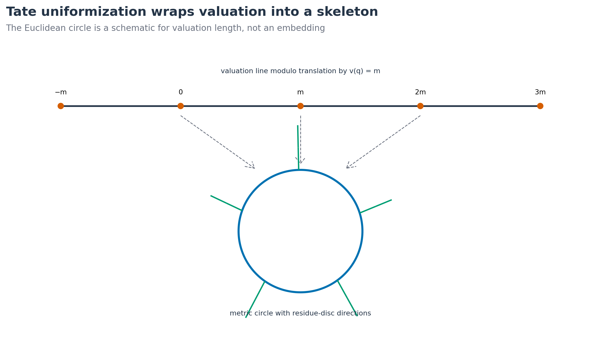

# Tate Curves and *p*-Adic Uniformization {#sec-tate-curves}

**Level and prerequisites: L5.** Prepare elliptic curves, convergent products, rigid analytic functions and valuations. The [reader guide](index.md) links the Euler arithmetic, algebra and analysis preparation and distinguishes the graduate continuation.

Over the complex numbers, an elliptic curve can be described as a quotient of
the complex plane by a lattice. Near a prime of multiplicative reduction, a
different quotient appears:

$$
E(K)\cong K^\times/q^{\mathbb Z}.
$$

The Tate curve makes this statement explicit with convergent series. It turns
a seemingly singular reduction problem into multiplicative coordinates.

This chapter rebuilds elliptic curves, quotient groups, and convergence.
Chapter 20 of the Number Theory volume and Chapters 12 and 23 of this book give
longer routes, but no unintroduced result is silently required here.

## Repair kit: elliptic curves and local fields

Let $K$ be a finite extension of $\mathbb Q_p$, with absolute value normalized
so $|p|_p=p^{-1}$. Its valuation ring is

$$
\mathcal O_K=\{x:|x|_p\le1\},
$$

with maximal ideal $\mathfrak m_K=\{x:|x|_p<1\}$ and finite residue field
$k=\mathcal O_K/\mathfrak m_K$.

An elliptic curve over $K$ is a smooth projective genus-one curve with a chosen
$K$-rational point. When the residue characteristic is not $2$ or $3$, a
convenient equation is

$$
E:y^2=x^3+Ax+B,
\qquad
\Delta=-16(4A^3+27B^2)\ne0.
$$

The chosen point at infinity is the group identity. Lines intersect the cubic
in three points counted with multiplicity; reflecting the third intersection
defines addition.

After choosing an integral equation with minimal discriminant valuation,
reduction modulo $\mathfrak m_K$ is:

- **good** if the reduced cubic is smooth;
- **multiplicative** if it has a node;
- **additive** if it has a cusp or a more degenerate configuration.

Multiplicative reduction is **split** when the two tangent directions at the
node are defined over the residue field.

## The quotient parameter

Choose $q\in K^\times$ with

$$
0<|q|_p<1.
$$

The subgroup

$$
q^{\mathbb Z}=\{q^n:n\in\mathbb Z\}
$$

acts on $K^\times$ by multiplication. The quotient identifies

$$
u\sim q^nu.
$$

Every class has a representative whose valuation lies in one interval of
length $v(q)$. If $v(q)=m$, choose $n$ so

$$
0\le v(q^{-n}u)<m.
$$

The valuation coordinate is therefore a circle of circumference $m$, while
the unit part retains finer $p$-adic information.

The quotient is a group because multiplication respects the equivalence
relation:

$$
[u][v]=[uv].
$$

The identity is $[1]$ and inverse is $[u^{-1}]$.

## Explicit coordinate series

For $u\in\overline K^\times$ not in $q^{\mathbb Z}$, define

$$
X(u,q)
=\sum_{n\in\mathbb Z}
\frac{q^nu}{(1-q^nu)^2}
-2\sum_{n\ge1}\frac{nq^n}{1-q^n},
$$

and

$$
Y(u,q)
=\sum_{n\in\mathbb Z}
\frac{(q^nu)^2}{(1-q^nu)^3}
+\sum_{n\ge1}\frac{nq^n}{1-q^n}.
$$

Equivalent conventions shift $Y$ or change Weierstrass coordinates. The
important facts are:

$$
X(qu,q)=X(u,q),
\qquad
Y(qu,q)=Y(u,q),
$$

and the pair satisfies a cubic equation

$$
y^2+xy=x^3+a_4(q)x+a_6(q),
$$

where $a_4,a_6$ are convergent power series in $q$.

Why do bilateral terms converge? As $n\to+\infty$, $q^nu\to0$, so terms become
small. As $n\to-\infty$, set $z=q^nu$; then $|z|\to\infty$ and

$$
\left|\frac z{(1-z)^2}\right|
=|z|^{-1}\to0
$$

by the ultrametric rule $|1-z|=|z|$ for $|z|>1$. Convergence is uniform on
annuli avoiding $q^{\mathbb Z}$.

## The Tate curve theorem

**Theorem 34.1 (Tate uniformization).** The above series define an elliptic curve
$E_q/K$ and a surjective analytic group homomorphism

$$
\overline K^\times\longrightarrow E_q(\overline K)
$$

with kernel $q^{\mathbb Z}$. Hence

$$
E_q(\overline K)\cong
\overline K^\times/q^{\mathbb Z}.
$$

Over $K$, one obtains
$E_q(K)\cong K^\times/q^{\mathbb Z}$.

Conversely, every elliptic curve over $K$ with split multiplicative reduction
is isomorphic over $K$ to a Tate curve for a uniquely determined $q$ with
$|q|<1$. Nonsplit multiplicative reduction becomes split after a quadratic
extension and corresponds to a twisted form.

The theorem is not merely a bijection of sets: it respects analytic structure
and the group law.

## Invariants and reduction

The discriminant has product expansion

$$
\Delta(q)
=q\prod_{n\ge1}(1-q^n)^{24}.
$$

Every factor $1-q^n$ is a unit, so

$$
v(\Delta(q))=v(q).
$$

The $j$-invariant begins

$$
j(q)=q^{-1}+744+196884q+\cdots.
$$

Thus $|j(q)|>1$, or equivalently $v(j)<0$, characterises potentially
multiplicative behavior. The leading term gives $v(j(q))=-v(q)$.

The special fibre of a minimal split multiplicative model has a nodal
component configuration. The integer $v(q)$ controls the number of components
in Kodaira type $I_{v(q)}$ when the valuation is normalized discretely.

These identities are exact valuation statements. Truncating a $q$-series is
safe only after bounding the omitted terms.

## Torsion and isogenies

An $n$-torsion class satisfies

$$
[u]^n=[1],
$$

so $u^n\in q^{\mathbb Z}$. After adjoining suitable roots, representatives have
the form

$$
u=\zeta_n^a q^{b/n},
\qquad a,b\in\mathbb Z/n\mathbb Z.
$$

This displays two torsion directions: roots of unity and fractional powers of
$q$. Galois action on these coordinates leads to the familiar upper-triangular
shape of the Tate-module representation at a multiplicative prime.

Maps $u\mapsto u^n$ and inclusions between $q$-power subgroups produce explicit
isogenies. Kernels must be tracked in the quotient, because different
representatives can describe the same point.

## The analytic skeleton

The valuation map sends

$$
K^\times/q^{\mathbb Z}
\longrightarrow
\mathbb R/v(q)\mathbb Z.
$$

For discretely valued $K$, $K$-rational valuations occupy a finite cyclic
subset; over larger complete fields the Berkovich analytic curve contains a
literal metric circle of length $v(q)$. Trees of open discs attach along this
circle.

<figure id="fig-tate-skeleton">


<figcaption>

Figure 34.1: The Tate quotient wraps the valuation line into a circle while unit discs attach along it.

</figcaption>
</figure>

[Figure 34.1](#fig-tate-skeleton) is a schematic of analytic structure, not an embedding into
the Euclidean plane. Circle distance represents valuation length.

## Worked example and precision audit

Take $K=\mathbb Q_5$ and $q=5^3$. Then
$v_5(q)=3$, $v_5(\Delta)=3$, and $v_5(j)=-3$. Every class has a representative
with valuation $0$, $1$, or $2$.

To compute $X(u,q)$ modulo $5^N$, truncate positive $n$ once
$v(q^nu)\ge N$ and negative $n$ once the transformed valuation bound is at
least $N$. Denominators $1-q^nu$ must be checked: when $u$ is close to
$q^{-n}$, the point is close to the identity and more precision is required.

<div class="callout callout-warning">
<p class="callout-title">The parameter q is not a point coordinate</p>

$q$ determines the entire Tate curve and its period subgroup. The variable
$u$ represents a point modulo $q^{\mathbb Z}$. Confusing them breaks both the
series and the group law.

</div>

## Local repair: quotient arithmetic and certified truncation

The notation $K^\times/q^{\mathbb Z}$ combines two ideas that are easy to blur.
First, its elements are equivalence classes, not numbers in a preferred interval.
Second, choosing a valuation representative does not choose a unique field
element, because all units have valuation zero. Let us make both points explicit.

Take $K=\mathbb Q_5$ and $q=5^3$. If

$$
u=2\cdot5^{-8},
$$

then multiplying by $q^3=5^9$ gives $2\cdot5$, whose valuation is $1$. Hence

$$
[2\cdot5^{-8}]=[10]
\quad\text{in }\mathbb Q_5^\times/125^{\mathbb Z}.
$$

This is just Euclidean division of $-8$ by $3$: write
$-8=(-3)3+1$. In general, if $v(q)=m>0$ and
$v(u)=am+r$ with $0\le r<m$, multiplication by $q^{-a}$ moves the valuation to
$r$. The residue $r$ is unique, but the representative is not. For instance,
all units $1,2,3,\ldots$ have valuation zero and usually represent different
classes.

The group law can now be computed without coordinates on the cubic. In the same
quotient,

$$
[5][25]=[125]=[1],
$$

so the valuation components add modulo $3$. This does **not** say the entire
quotient is the cyclic group of order three: the unit coordinate remains. It says
only that the valuation map onto $\mathbb Z/3\mathbb Z$ records the component.

Here is a finite-precision coordinate computation. Put $u=2$, $q=125$, and ask
for $X(u,q)$ modulo $5^3$. The $n=0$ bilateral term is

$$
\frac{u}{(1-u)^2}=\frac2{(-1)^2}=2.
$$

For $n\ge1$, $v_5(q^nu)=3n$, while $1-q^nu$ is a unit, so every such term has
valuation at least $3$. For $n=-k<0$, set $z=q^{-k}u$. Since $|z|_5>1$,

$$
\frac{z}{(1-z)^2}
=\frac{z^{-1}}{(1-z^{-1})^2},
$$

whose valuation is $3k$. Finally,

$$
v_5\!\left(\frac{nq^n}{1-q^n}\right)
=v_5(n)+3n\ge3
$$

for every $n\ge1$. All omitted contributions therefore lie in
$5^3\mathbb Z_5$, and the certified conclusion is

$$
X(2,125)=2+O(5^3).
$$

Notice what made this short: the denominators were units. If $u$ is close to
$1$, the $n=0$ denominator $1-u$ has positive valuation and division magnifies
uncertainty. One must evaluate that exceptional term at extra precision rather
than applying the generic tail bound to it.

### Theorem-status and precision audit

There are four different levels of assertion in this chapter.

1. Quotient arithmetic and the valuation-normalisation argument are elementary
   group and integer calculations.
2. Convergence of an individual tail follows from explicit valuation estimates.
   Uniform convergence on a declared annulus requires one bound valid for every
   $u$ on that annulus.
3. The coordinate identities and product expansions are analytic identities once
   convergence has been established. A truncated computation proves them only to
   its stated precision.
4. Tate uniformisation and the converse classification of split multiplicative
   curves are deep theorems. The test $v(j)<0$ detects potentially multiplicative
   reduction; it does not by itself certify that the reduction is already split
   over $K$.

A reusable truncation certificate starts by normalizing $0\le r=v(u)<m=v(q)$.
For the positive $X$-tail, the $n$th term has valuation at least $mn+r$. For the
negative term indexed by $-k$, after the rewrite above its valuation is at least
$mk-r$. Thus, away from a denominator exceptional at a retained index, it is safe
to discard positive indices with $mn+r\ge N$ and negative indices with
$mk-r\ge N$ when working modulo $\pi^N$. The correction series is discarded once
$mn\ge N$. A certificate records these inequalities, the retained index interval,
and the precision used for every denominator inversion.

### Selected exercise solution clinic

For Exercise 1, write $v(u)=am+r$ by Euclidean division and use
$u'=q^{-a}u$. Then $[u']=[u]$ and $v(u')=r$. If two integers in
$[0,m)$ differed by a multiple of $m$, their difference would have absolute value
less than $m$ and therefore be zero; this proves uniqueness of the valuation
representative.

For Exercise 2, choose different representatives
$u'=q^a u$ and $v'=q^b v$. Their product satisfies

$$
u'v'=q^{a+b}uv,
$$

so $[u'v']=[uv]$. This one line is the well-definedness check: changing either
input representative changes the output only by another element of the subgroup
being quotiented out. Associativity descends from $K^\times$, the class $[1]$ is
an identity, and $[u^{-1}]$ is inverse to $[u]$. No choice of valuation-normalised
representative is required to define the group. Normalisation is a computational
convenience applied after the quotient law is already valid.

For Exercise 4, each factor $1-q^n$ is a unit because $v(q^n)>0$. Every finite
partial product therefore has valuation zero. The infinite product converges to a
unit: its difference from $1$ is controlled by terms tending to zero. Consequently

$$
v\!\left(q\prod_{n\ge1}(1-q^n)^{24}\right)=v(q).
$$

For Exercise 8, a numerical cutoff without the valuation inequalities above is
only a guess. A complete answer names $N$, $m$, and $r$; lists the retained
indices; proves both tail bounds; checks that retained denominators do not contain
zero at the working precision; and reports the result as a ball
$x_0+O(\pi^N)$ rather than as invented exact digits.

<!-- inline-formula-code:start -->
## Formula and finite computation

A useful formula in this chapter is

$$
\Delta(q)=q\prod_{n\ge1}(1-q^n)^{24}
$$

A declared truncation gives an exact integer polynomial value, not an infinite product. The following standalone Python block expresses that finite rule with its inputs and stopping conditions visible.

```python
from fractions import Fraction

# q = 9 has v_3(q) = 2, so |q|_3 < 1 as Tate uniformization requires.
q = Fraction(9)
truncation = 5
delta = q
for degree in range(1, truncation + 1):
    delta *= (1 - q**degree) ** 24
print(delta)
```

**What the computation establishes.** The output certifies only the declared finite case. The theorem, if one is claimed, still requires the argument developed in the chapter.
<!-- inline-formula-code:end -->

## Summary, exercises, and support

The Tate curve uniformises split multiplicative elliptic curves by a
multiplicative quotient. Its convergent coordinate series, discriminant, and
$j$-invariant expose reduction data; its valuation quotient forms the analytic
skeleton; torsion becomes roots of unity times fractional periods.

<div class="exercise" id="p_adic_numbers-34-tate-curves-ex-1">
<p class="exercise-title"><strong>Exercise 1</strong></p>

Prove every class in $K^\times/q^{\mathbb Z}$ has a representative with
valuation in $[0,v(q))$.

</div>

<div class="exercise" id="p_adic_numbers-34-tate-curves-ex-2">
<p class="exercise-title"><strong>Exercise 2</strong></p>

Prove multiplication on the quotient is well defined.

</div>

<div class="exercise" id="p_adic_numbers-34-tate-curves-ex-3">
<p class="exercise-title"><strong>Exercise 3</strong></p>

Check convergence of the negative-index tail in $X(u,q)$.

</div>

<div class="exercise" id="p_adic_numbers-34-tate-curves-ex-4">
<p class="exercise-title"><strong>Exercise 4</strong></p>

Verify $v(\Delta(q))=v(q)$ from the product.

</div>

<div class="exercise" id="p_adic_numbers-34-tate-curves-ex-5">
<p class="exercise-title"><strong>Exercise 5</strong></p>

For $q=5^3$, list valuation representatives for the component classes.

</div>

<div class="exercise" id="p_adic_numbers-34-tate-curves-ex-6">
<p class="exercise-title"><strong>Exercise 6</strong></p>

Solve the quotient condition for $n$-torsion after adjoining $q^{1/n}$.

</div>

<div class="exercise" id="p_adic_numbers-34-tate-curves-ex-7">
<p class="exercise-title"><strong>Exercise 7</strong></p>

Explain why a curve with $v(j)\ge0$ cannot be identified as a split Tate
curve from this criterion.

</div>

<div class="exercise" id="p_adic_numbers-34-tate-curves-ex-8">
<p class="exercise-title"><strong>Exercise 8</strong></p>

Design a truncation certificate for $X(u,q)$ at precision $p^N$.

</div>

<div class="exercise" id="p_adic_numbers-34-tate-curves-ex-9">
<p class="exercise-title"><strong>Exercise 9</strong></p>

Compare the quotient skeleton lengths for $q=p^2$ and $q=p^7$.

</div>

For Exercise 1 use Euclidean division of $v(u)$ by $v(q)$. For Exercise 3,
replace $z=q^nu$ and use $|1-z|=|z|$ once $|z|>1$.
