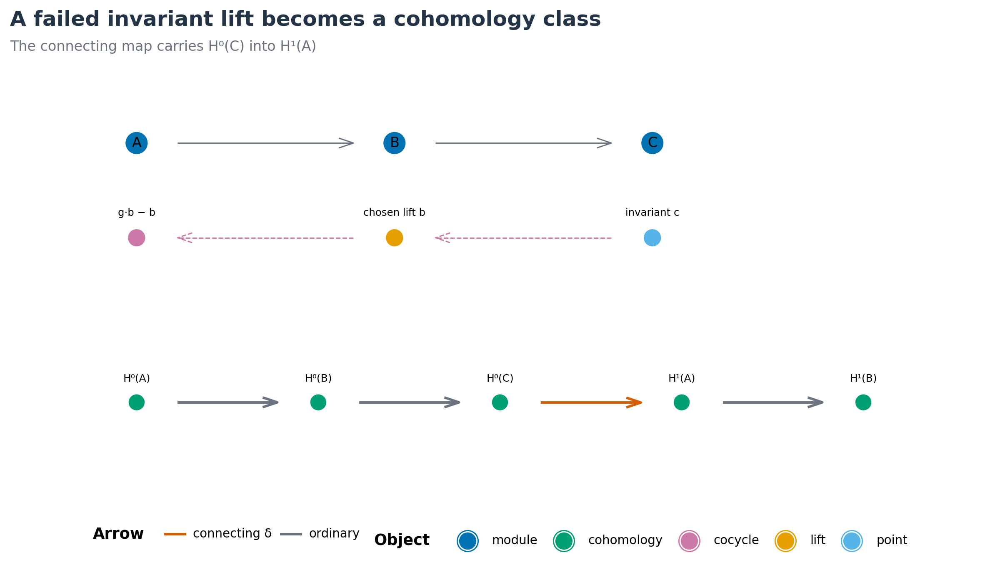

# Group Cohomology and Local Galois Cohomology {#sec-local-galois-cohomology}

**Level and prerequisites: L5.** Prepare continuous profinite group actions, exact sequences, cochains and homological algebra. The [reader guide](index.md) links the Euler arithmetic, algebra and analysis preparation and distinguishes the graduate continuation.

When a group acts on arithmetic data, elements fixed by the action are only the
first layer. Cohomology measures failures of fixedness, failures to lift, and
obstructions to gluing local information. The definitions begin with functions
on a finite group; continuity and absolute Galois groups are added later.

No previous homological algebra is assumed. Groups, quotient groups, and field
automorphisms are repaired as they appear.

## Groups acting on abelian groups

Let $G$ be a group and $M$ an abelian group written additively. A
$G$-action assigns an automorphism $m\mapsto g m$ such that

$$
1m=m,\qquad (gh)m=g(hm).
$$

Then $M$ is a **$G$-module**. Its invariant subgroup is

$$
M^G=\{m:gm=m\text{ for every }g\in G\}.
$$

Examples:

- $G$ acts trivially, so $M^G=M$;
- a Galois group acts on an extension field by automorphisms;
- complex conjugation acts on $\mathbb C^\times$;
- a matrix representation $G\to\operatorname{GL}_n(R)$ acts on $R^n$.

An equivariant homomorphism $f:M\to N$ satisfies
$f(gm)=gf(m)$. Cohomology is functorial for such maps.

## First cocycles

A **one-cocycle** is a function $c:G\to M$ satisfying

$$
c(gh)=c(g)+g\,c(h).
$$

This is a twisted homomorphism. If the action is trivial, it reduces to
$c(gh)=c(g)+c(h)$.

For any $m\in M$, the function

$$
c_m(g)=gm-m
$$

is a cocycle:

$$
c_m(gh)=ghm-m
=g(hm-m)+(gm-m).
$$

Such cocycles are **coboundaries**. Define

$$
H^1(G,M)=Z^1(G,M)/B^1(G,M).
$$

A class records a twisted displacement that cannot be removed by changing the
base point $m$.

The zeroth cohomology group is simply

$$
H^0(G,M)=M^G.
$$

Higher groups can be defined from cochains
$G^n\to M$ with an alternating coboundary operator. Rather than memorising the
full formula immediately, we build their role through exact sequences.

## Cyclic examples

Let $G=\langle\sigma\rangle$ be cyclic of order $n$. A cocycle is determined by
$a=c(\sigma)$. The relation $\sigma^n=1$ forces

$$
(1+\sigma+\cdots+\sigma^{n-1})a=0.
$$

Coboundaries have $a=(\sigma-1)m$. Therefore

$$
H^1(G,M)
\cong
\frac{\ker N}{(\sigma-1)M},
\qquad
N=1+\sigma+\cdots+\sigma^{n-1}.
$$

If $G=C_2$ acts on $\mathbb Z$ by $\sigma m=-m$, then $N=1+\sigma=0$ and
$(\sigma-1)M=2\mathbb Z$, so

$$
H^1(C_2,\mathbb Z_{\mathrm{sign}})
\cong\mathbb Z/2\mathbb Z.
$$

With trivial action on $\mathbb Z$, $\ker N=\ker(2)=0$, so $H^1=0$.
The action changes the answer even though the underlying groups are the same.

The quotient can be enumerated exactly for a finite cyclic action. In the code
below, multiplication by $s$ represents $\sigma$ on
$M=\mathbb Z/m\mathbb Z$. The condition $s^n=1$ is checked before the norm,
cocycles, coboundaries, and quotient representatives are constructed.

```python
def cyclic_h1_data(
    group_order: int, module_modulus: int, action_multiplier: int
) -> dict[str, list[int]]:
    """Return exact Z^1, B^1, and H^1 representatives for a cyclic action."""
    if group_order <= 0 or module_modulus <= 1:
        raise ValueError("group_order must be positive and modulus at least two")
    action_multiplier %= module_modulus
    if pow(action_multiplier, group_order, module_modulus) != 1 % module_modulus:
        raise ValueError("the multiplier does not define an action of C_n")

    norm_multiplier = sum(
        pow(action_multiplier, exponent, module_modulus)
        for exponent in range(group_order)
    ) % module_modulus
    cocycles = [
        value
        for value in range(module_modulus)
        if norm_multiplier * value % module_modulus == 0
    ]
    coboundaries = sorted(
        {
            (action_multiplier - 1) * value % module_modulus
            for value in range(module_modulus)
        }
    )
    if any(value not in cocycles for value in coboundaries):
        raise ArithmeticError("computed coboundaries are not cocycles")

    unseen = set(cocycles)
    representatives: list[int] = []
    while unseen:
        representative = min(unseen)
        representatives.append(representative)
        coset = {
            (representative + boundary) % module_modulus
            for boundary in coboundaries
        }
        unseen.difference_update(coset)
    return {
        "cocycles": cocycles,
        "coboundaries": coboundaries,
        "class_representatives": representatives,
    }

print(cyclic_h1_data(2, 4, action_multiplier=1))
print(cyclic_h1_data(2, 4, action_multiplier=-1))
```

The first output has two cocycles and one coboundary; the second has four
cocycles and two coboundaries. Both quotients have two classes, matching the
hand calculations below. This enumerates a complete finite group and module,
not a sampled approximation to an absolute Galois group.

## Exact sequences and connecting maps

A sequence

$$
0\longrightarrow A\stackrel{i}{\longrightarrow}
B\stackrel{\pi}{\longrightarrow}C\longrightarrow0
$$

is **short exact** when $i$ is injective, $\pi$ is surjective, and
$\operatorname{im}i=\ker\pi$.

Taking invariants is left exact but may fail to preserve surjectivity:

$$
0\to A^G\to B^G\to C^G.
$$

If $c\in C^G$, choose a lift $b\in B$. Because $c$ is invariant,
$gb-b$ lies in $A$. The assignment

$$
g\longmapsto gb-b
$$

is a cocycle. Changing the lift changes it by a coboundary, so it defines a
class $\delta(c)\in H^1(G,A)$. This **connecting map** measures failure of an
invariant element to have an invariant lift.

Continuing produces the long exact sequence

$$
0\to H^0(G,A)\to H^0(G,B)\to H^0(G,C)
\stackrel{\delta}{\to}H^1(G,A)\to H^1(G,B)\to\cdots.
$$

Exactness means the image of each map equals the kernel of the next.

<figure id="fig-cohomology-exact">


<figcaption>

Figure 35.1: A failed invariant lift becomes a cocycle and enters the next cohomology group.

</figcaption>
</figure>

[Figure 35.1](#fig-cohomology-exact) visualises the construction of $\delta$, not a proof that
all later cohomology groups exist. The cochain complex supplies that general
construction.

## Galois cohomology and continuity

For a field $K$, choose a separable closure $\overline K$. The absolute Galois
group is

$$
G_K=\operatorname{Gal}(\overline K/K).
$$

It is profinite: an inverse limit of finite Galois groups, with a topology in
which stabilisers of finite extensions are open. A **continuous
$G_K$-module** has a compatible topology and continuous action.

Galois cohomology uses continuous cochains. If $M$ is finite and discrete, a
continuous cochain factors through a finite quotient locally; arbitrary set
maps would create far too many classes.

For a finite Galois extension $L/K$ with group $G$, Hilbert's Theorem 90 says

$$
H^1(G,L^\times)=0.
$$

A multiplicative cocycle $c(g)$ therefore has the form

$$
c(g)=\frac{g(b)}b
$$

for some $b\in L^\times$. This vanishing is the algebraic engine behind Kummer
descent.

## Kummer theory

Assume $n$ is not divisible by the characteristic. The exact sequence

$$
1\to\mu_n\to\overline K^\times
\stackrel{(\cdot)^n}{\longrightarrow}\overline K^\times\to1
$$

has kernel the $n$th roots of unity. Its long exact sequence and Hilbert 90
give

$$
H^1(G_K,\mu_n)\cong K^\times/(K^\times)^n.
$$

Concretely, choose $\alpha$ with $\alpha^n=a$. Then

$$
c_a(g)=\frac{g(\alpha)}{\alpha}\in\mu_n
$$

is a cocycle. Changing $\alpha$ or multiplying $a$ by an $n$th power does not
change the cohomology class.

For $K=\mathbb Q_p$ and $n=2$, square classes can be analysed by valuation,
residue-unit class, and special care at $p=2$. A finite cohomology group has
become explicit local arithmetic.

## Local duality

For a finite $G_K$-module $M$ killed by $n$, define its dual twist

$$
M^\vee(1)=\operatorname{Hom}(M,\mu_n).
$$

Cup products pair cohomology:

$$
H^i(K,M)\times H^{2-i}(K,M^\vee(1))
\longrightarrow H^2(K,\mu_n).
$$

For a non-Archimedean local field, the invariant map identifies the last group
with a subgroup of $\mathbb Q/\mathbb Z$, and Tate local duality says the
pairing is perfect.

For $M=\mu_n$, the pairing is related to the Hilbert symbol. If
$n$ is invertible in $K$ and $\mu_n\subset K$, the chosen roots of unity
identify the two degree-one Kummer groups and give

$$
K^\times/(K^\times)^n
\times K^\times/(K^\times)^n
\longrightarrow\mu_n.
$$

Without $\mu_n\subset K$, the Tate-dual factor is not canonically another copy
of the same Kummer quotient. For $n=2$ in residue characteristic other than
two, the required roots $\{\pm1\}$ are already present.

Perfectness means each nonzero class is detected by some class on the other
side. It is a theorem with finiteness and topology hypotheses, not merely a
nondegenerate-looking matrix from sampled elements.

## Euler characteristics

For finite $M$, local cohomology vanishes above degree two. An Euler
characteristic formula relates

$$
\chi(K,M)=
\frac{|H^0(K,M)|\,|H^2(K,M)|}{|H^1(K,M)|}
$$

to $|M|$ and the local field. Exact normalization depends on whether $K$ is
Archimedean and on the residue characteristic. Such formulas are powerful
consistency checks: two independently computed groups must satisfy the required
size relation.

They do not identify group structure from cardinalities alone.

## Cocycle computation protocol

For a finite quotient $G$ acting on a finite module $M$:

1. fix explicit encodings of group and module elements;
2. list functions $c:G\to M$ or solve the linear cocycle equations;
3. verify $c(gh)=c(g)+gc(h)$ for every pair;
4. generate coboundaries $gm-m$;
5. compute the quotient in exact finite algebra;
6. retain representatives and maps, not only the final order.

<div class="callout callout-warning">
<p class="callout-title">Cohomology is action-sensitive</p>

Writing $H^1(G,M)$ without specifying the action leaves the object
undetermined. In Galois cohomology, the topology and continuity of the action
are also part of the data.

</div>

## Local repair: compute cocycles before naming the quotient

The notation $Z^1/B^1$ can feel remote until every set is written down. Let
$G=C_2=\{1,\sigma\}$ and $M=\mathbb Z/4\mathbb Z$. A normalized cocycle has
$c(1)=0$ because

$$
c(1)=c(1\cdot1)=c(1)+c(1).
$$

It is therefore determined by $a=c(\sigma)$. The one nontrivial group relation
$\sigma^2=1$ imposes

$$
0=c(\sigma^2)=a+\sigma a.
$$

For the trivial action this becomes $2a=0$, so

$$
Z^1=\{a=0,2\}.
$$

Every coboundary has $a=\sigma m-m=0$. Hence

$$
H^1(C_2,(\mathbb Z/4\mathbb Z)_{\mathrm{triv}})
\cong\{0,2\}\cong\mathbb Z/2\mathbb Z.
$$

For the sign action, $\sigma a=-a$, so the cocycle relation is automatic and
$Z^1=M$. Coboundaries are

$$
\sigma m-m=-2m\in\{0,2\}.
$$

Thus

$$
H^1(C_2,(\mathbb Z/4\mathbb Z)_{\mathrm{sign}})
\cong(\mathbb Z/4\mathbb Z)/\{0,2\}
\cong\mathbb Z/2\mathbb Z.
$$

The two cohomology groups happen to have the same order, but for different
reasons. In the trivial case there are only two cocycles and no nonzero
coboundaries; in the sign case there are four cocycles and two coboundaries.
Reporting only the final cardinality would hide the action-sensitive mechanism.

For this cyclic example the cocycle relation and all coboundaries can be
enumerated exactly.  The action is encoded by multiplication by `1` or `-1`
modulo the declared module order.

```python
def cyclic_two_h1_counts(
    module_order: int, action_sign: int
) -> tuple[int, int, int]:
    """Return |Z^1|, |B^1|, and |H^1| for C2 acting on Z/module_order."""
    if module_order <= 0 or action_sign not in (-1, 1):
        raise ValueError("require a positive module order and action sign ±1")
    cocycles = {
        value
        for value in range(module_order)
        if (value + action_sign * value) % module_order == 0
    }
    coboundaries = {
        (action_sign * value - value) % module_order
        for value in range(module_order)
    }
    if not coboundaries <= cocycles or len(cocycles) % len(coboundaries) != 0:
        raise RuntimeError("the finite coboundaries do not form a cocycle subgroup")
    return len(cocycles), len(coboundaries), len(cocycles) // len(coboundaries)

trivial_counts = cyclic_two_h1_counts(4, 1)
sign_counts = cyclic_two_h1_counts(4, -1)
print(trivial_counts, sign_counts)
```

The outputs `(2, 1, 2)` and `(4, 2, 2)` expose why the two quotients have the
same order for different reasons.  This finite discrete enumeration is not a
replacement for continuity and factorization through finite quotients in
profinite Galois cohomology.

### A connecting map calculated by hand

Let $C_2$ act by sign on both copies of $\mathbb Z$ in

$$
0\longrightarrow\mathbb Z
\stackrel{\times2}{\longrightarrow}\mathbb Z
\longrightarrow\mathbb Z/2\mathbb Z
\longrightarrow0.
$$

The induced action on $\mathbb Z/2\mathbb Z$ is trivial. Its nonzero element
$\bar1$ is invariant, but it has no invariant integer lift because the sign-fixed
subgroup of $\mathbb Z$ is zero. Choose the lift $b=1$. Then

$$
\sigma b-b=-1-1=-2.
$$

Under the injection $a\mapsto2a$, this difference corresponds to $a=-1$ in the
left copy of $\mathbb Z$. The connecting cocycle is therefore determined by
$c(\sigma)=-1$. Its class is nonzero in
$H^1(C_2,\mathbb Z_{\mathrm{sign}})\cong\mathbb Z/2\mathbb Z$. The calculation
exhibits exactness: the class is nonzero precisely because $\bar1$ does not come
from an invariant lift.

### Continuity and theorem-status audit

For a finite discrete module, a continuous action has open stabilisers. A
continuous cocycle is locally constant, and a finite computation is legitimate
only after finding an open normal subgroup through which both the relevant action
and cocycle factor. Enumerating functions on an arbitrary sampled set of Galois
elements is not an approximation to continuous cohomology.

The cyclic formula is an elementary consequence of one generator and one
relation. The connecting map follows from exactness and a direct lift calculation.
Hilbert 90, the cohomological dimension statement, and Tate local duality are
theorems rather than definitions. In particular, a computed pairing matrix proves
perfectness only if its rows and columns are certified bases of the complete finite
groups and the invariant-map normalization is fixed.

There is also a useful precision distinction. A class in
$K^\times/(K^\times)^n$ is exact, even if a representative is stored with
$p$-adic precision. One must prove that the stored ball lies in a single power
class. At odd $p$ for square classes, an exact valuation parity plus a nonzero
residue class is enough for a unit. A ball whose leading unit digit is unknown
does not yet determine a square class.

### Selected exercise solution clinic

Exercises 3 and 4 are the two computations above. They also show why a program
should output cocycle and coboundary representatives, not merely the number two.

For Exercise 5, suppose $b'$ is another lift of the same invariant $c\in C^G$.
Then $b'-b=i(a)$ for some $a\in A$. The two connecting cocycles differ by

$$
g b'-b'-(gb-b)=g i(a)-i(a)=i(ga-a),
$$

which is the image of a coboundary. Hence their classes agree. The cocycle law
itself follows by inserting and subtracting $gb$:

$$
(gh)b-b=g(hb-b)+(gb-b).
$$

For Exercise 9, every $x\in\mathbb Q_5^\times$ is
$5^r u$ with $u\in\mathbb Z_5^\times$. Squares have even $r$. A unit is a square
exactly when its residue is a square in $\mathbb F_5^\times$, because a simple
residue root lifts by Hensel's lemma. The residue squares are $1$ and $4$, while
$2$ represents the nonsquare unit class. Thus

$$
\mathbb Q_5^\times/(\mathbb Q_5^\times)^2
=\{[1],[2],[5],[10]\}.
$$

This four-element answer depends on $p$ being odd. Reusing it at $p=2$ would miss
additional unit classes detected modulo $8$.

Finite precision can still certify one of these exact classes. If

$$
x=10+O(5^2),
$$

then every admissible value has valuation one, and after division by $5$ its unit
part is $2+O(5)$, whose residue is the nonsquare $2$. Thus the whole ball lies in
the class $[10]$. In contrast, $10+O(5)$ contains values with different leading
unit residues and even contains zero; it determines neither a valuation nor a
square class. Increasing a display's digit count is useful only when the new error
radius becomes strictly smaller than the leading term being classified.

<!-- inline-formula-code:start -->
## Formula and finite computation

A useful formula in this chapter is

$$
c(gh)=c(g)+g\cdot c(h)
$$

With a trivial finite action, a cocycle becomes an additive homomorphism check. The following standalone Python block expresses that finite rule with its inputs and stopping conditions visible.

```python
modulus = 5
cocycle = {group_element: (2 * group_element) % modulus for group_element in range(modulus)}
checks = [
    cocycle[(g + h) % modulus] == (cocycle[g] + cocycle[h]) % modulus
    for g in range(modulus)
    for h in range(modulus)
]
print(all(checks))
```

**What the computation establishes.** The output certifies only the declared finite case. The theorem, if one is claimed, still requires the argument developed in the chapter.
<!-- inline-formula-code:end -->

## Summary, exercises, and support

Zeroth cohomology records invariants. First cohomology records cocycles modulo
changes of base point. Connecting maps measure failed lifts, Kummer theory
turns root extraction into cohomology, and local duality pairs complementary
degrees.

<div class="exercise" id="p_adic_numbers-35-galois-cohomology-ex-1">
<p class="exercise-title"><strong>Exercise 1</strong></p>

Verify that $c_m(g)=gm-m$ is a cocycle.

</div>

<div class="exercise" id="p_adic_numbers-35-galois-cohomology-ex-2">
<p class="exercise-title"><strong>Exercise 2</strong></p>

Show that cocycles form an abelian group and coboundaries a subgroup.

</div>

<div class="exercise" id="p_adic_numbers-35-galois-cohomology-ex-3">
<p class="exercise-title"><strong>Exercise 3</strong></p>

Compute $H^1(C_2,M)$ for trivial action on $M=\mathbb Z/4\mathbb Z$.

</div>

<div class="exercise" id="p_adic_numbers-35-galois-cohomology-ex-4">
<p class="exercise-title"><strong>Exercise 4</strong></p>

Repeat for the sign action.

</div>

<div class="exercise" id="p_adic_numbers-35-galois-cohomology-ex-5">
<p class="exercise-title"><strong>Exercise 5</strong></p>

Construct the connecting cocycle and prove independence from the chosen
lift.

</div>

<div class="exercise" id="p_adic_numbers-35-galois-cohomology-ex-6">
<p class="exercise-title"><strong>Exercise 6</strong></p>

Derive the cyclic-group formula for $H^1$.

</div>

<div class="exercise" id="p_adic_numbers-35-galois-cohomology-ex-7">
<p class="exercise-title"><strong>Exercise 7</strong></p>

Build the Kummer cocycle for $a=2$, $n=2$ over $\mathbb Q$.

</div>

<div class="exercise" id="p_adic_numbers-35-galois-cohomology-ex-8">
<p class="exercise-title"><strong>Exercise 8</strong></p>

Explain where Hilbert 90 enters the Kummer isomorphism.

</div>

<div class="exercise" id="p_adic_numbers-35-galois-cohomology-ex-9">
<p class="exercise-title"><strong>Exercise 9</strong></p>

Enumerate square classes of $\mathbb Q_5^\times$ using valuation parity and
residue units.

</div>

<div class="exercise" id="p_adic_numbers-35-galois-cohomology-ex-10">
<p class="exercise-title"><strong>Exercise 10</strong></p>

Write a finite cocycle checker and test it against hand calculations.

</div>

For Exercise 3, trivial-action cocycles are homomorphisms
$C_2\to\mathbb Z/4\mathbb Z$ and coboundaries vanish. For Exercise 4 use
$N=1+\sigma=0$ and $(\sigma-1)m=-2m$.
