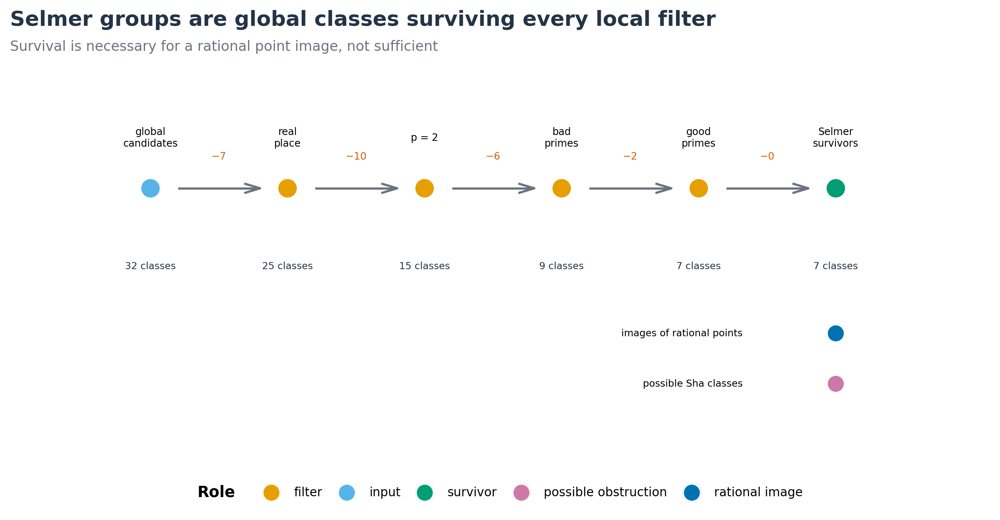

# Selmer Groups, Descent, and Local Conditions {#sec-selmer-descent}

**Level and prerequisites: L5.** Prepare elliptic curves, Galois cohomology, local conditions and descent. The [reader guide](index.md) links the Euler arithmetic, algebra and analysis preparation and distinguishes the graduate continuation.

An elliptic curve may have infinitely many rational points, yet its group is
finitely generated. Descent turns the problem of finding generators into a
finite cohomological search constrained at every completion of the number
field. The Selmer group is the finite space of classes that pass all prescribed
local tests.

This chapter rebuilds elliptic curves, quotients, and the required first
cohomology. Chapter [sec-local-galois-cohomology](35-galois-cohomology.md#sec-local-galois-cohomology) supplies a longer cohomology
route, but the construction below can be read independently.

## Rational points and multiplication

Let $E/K$ be an elliptic curve over a number field. Its rational points form an
abelian group. Mordell–Weil says

$$
E(K)\cong E(K)_{\mathrm{tors}}\oplus\mathbb Z^r.
$$

The integer $r$ is the rank. To learn about it, fix $n\ge2$ and consider

$$
E(K)/nE(K).
$$

If the torsion and this finite quotient were known with certified
representatives, one could search for generators and repeat at selected
primes to prove saturation.

The geometric multiplication map

$$
[n]:E(\overline K)\to E(\overline K)
$$

has kernel $E[n]$, the $n$-torsion points. In characteristic zero,
$E[n]\cong(\mathbb Z/n\mathbb Z)^2$ over an algebraic closure.

## The Kummer map

For $P\in E(K)$, choose $Q\in E(\overline K)$ with $nQ=P$. For
$g\in G_K$,

$$
gQ-Q\in E[n]
$$

because $n(gQ-Q)=gP-P=0$. The function

$$
c_P(g)=gQ-Q
$$

is a cocycle. Changing $Q$ changes the cocycle by a coboundary, and replacing
$P$ by $P+nR$ does not change its class. Hence there is an injective Kummer
map

$$
\delta_K:E(K)/nE(K)\hookrightarrow H^1(K,E[n]).
$$

The ambient cohomology group is usually too large to enumerate directly.
Local conditions cut it down.

For every place $v$ of $K$, completion gives a local map

$$
\delta_v:E(K_v)/nE(K_v)\longrightarrow H^1(K_v,E[n]).
$$

A global cohomology class restricts to each local group.

## Selmer groups

The $n$-Selmer group is

$$
\operatorname{Sel}^{(n)}(E/K)
=\left\{
c\in H^1(K,E[n]):
\operatorname{res}_v(c)\in\operatorname{im}\delta_v
\text{ for every }v
\right\}.
$$

Equivalently, it is the kernel of the map to the product of local quotient
groups

$$
H^1(K,E[n])
\longrightarrow
\prod_v
\frac{H^1(K_v,E[n])}{\operatorname{im}\delta_v}.
$$

Although infinitely many places appear, the condition is automatically
unramified at almost all primes. Only a finite set—typically primes dividing
$n$, the discriminant, and Archimedean places—needs explicit special
treatment.

There is an exact sequence

$$
0\to E(K)/nE(K)
\to\operatorname{Sel}^{(n)}(E/K)
\to\operatorname{Sha}(E/K)[n]\to0.
$$

The group $\operatorname{Sha}$, read “Sha”, is the Tate–Shafarevich group. It measures
torsors that have a point over every completion but no global point.

Thus the Selmer dimension gives an upper bound on rank after accounting for
torsion, but equality requires knowledge of $\operatorname{Sha}[n]$.

## Two-descent in concrete form

Suppose

$$
E:y^2=(x-e_1)(x-e_2)(x-e_3)
$$

has rational two-torsion. Away from torsion points, send

$$
P=(x,y)
\longmapsto
(x-e_1,x-e_2,x-e_3)
$$

in a product of square-class groups. Their product equals $y^2$, so the three
classes satisfy one relation. Modulo squares, this produces finite
representatives supported at a finite set of primes.

Each candidate corresponds to a covering curve. A class lies in the Selmer
group if its covering has a point over $\mathbb R$ and every $\mathbb Q_p$.
The curve need not have a rational point.

For a curve with only one rational two-torsion point or no rational
two-torsion, the explicit descent algebra uses étale algebras or isogenies.
The same pattern survives: global square classes, norm constraints, and local
solubility.

## Local-solubility tables

A two-descent calculation should make its finite scope visible:

| candidate | real | $2$-adic | $3$-adic | $5$-adic | other primes | status |
|---|---:|---:|---:|---:|---:|---|
| $d_1$ | pass | pass | fail | pass | automatic | rejected |
| $d_2$ | pass | pass | pass | pass | proved unramified | survives |

The labels require certificates:

- a local point with enough Hensel precision can prove “pass”;
- a congruence obstruction or valuation argument proves “fail”;
- “automatic” cites a theorem and verifies its hypotheses.

Searching modulo $p^N$ without finding a point does not prove local
nonsolubility unless a completeness bound is supplied.

<figure id="fig-selmer-local-global">


<figcaption>

Figure 36.1: Global cohomology classes pass through place-by-place local filters to form the Selmer group.

</figcaption>
</figure>

[Figure 36.1](#fig-selmer-local-global) emphasises that Selmer survival is necessary for
coming from a rational point, not sufficient.

## Isogeny descent

If

$$
\phi:E\to E'
$$

is an isogeny defined over $K$, then its finite kernel $E[\phi]$ gives a Kummer
map

$$
E'(K)/\phi E(K)\hookrightarrow H^1(K,E[\phi]).
$$

The $\phi$-Selmer group imposes local image conditions. The dual isogeny
$\widehat\phi:E'\to E$ supplies a complementary descent. For a rational
two-torsion point, a degree-two isogeny often reduces the computation to
$K^\times/(K^\times)^2$ with explicit homogeneous spaces.

Combining the two Selmer groups bounds the rank. Exact formulas include kernel
and cokernel terms, so dimensions cannot simply be added without deriving the
sequence used.

## Cassels–Tate perspective

The Cassels–Tate pairing is a bilinear pairing on $\operatorname{Sha}$ with values in
$\mathbb Q/\mathbb Z$. Under finiteness assumptions it is nondegenerate modulo
the divisible subgroup. It can show that certain Selmer classes must pair and
therefore cannot all contribute independently to $\operatorname{Sha}$.

For principally polarised abelian varieties, alternating properties often
force the order of finite $\operatorname{Sha}$ to be a square, with qualifications at
$2$. This is a consistency condition, not a general proof that $\operatorname{Sha}$ is
finite or trivial.

## From a bound to generators

A rank upper bound becomes a certified Mordell–Weil group only after matching
lower and upper bounds and proving saturation.

1. Find independent rational points to obtain a lower bound.
2. Compute a Selmer group for an upper bound.
3. If bounds match, the points span a subgroup of finite index not divisible
   by primes excluded through descent.
4. Test remaining possible index primes using reduction, heights, or further
   descent.
5. Verify torsion separately.

Height pairings certify independence by a nonzero determinant. Floating-point
height matrices need rigorous error bounds or exact auxiliary arguments.
Chapter 44 constructs local $p$-adic height symbols after elliptic curves,
divisors and $p$-adic logarithms; the [preparation guide](#/books/p-adic-numbers)
links the underlying arithmetic, algebra and analysis. It works through a
cross-ratio computation and explains why a global
regulator certificate must record branches, local data, precision, and a
nonvanishing ball rather than only a printed decimal or residue.

## Selmer structures beyond elliptic curves

For a Galois representation $M$, a **Selmer structure** chooses a subgroup

$$
H^1_{\mathcal F}(K_v,M)\subseteq H^1(K_v,M)
$$

at each place. The global Selmer group consists of classes whose restrictions
lie in these subgroups. Choices include unramified, finite, ordinary,
crystalline, or image-defined conditions.

Poitou–Tate duality relates a Selmer group to the dual Selmer group for
$M^\vee(1)$. This is the global counterpart of local Tate duality and explains
why changing one local condition changes a dual dimension.

<div class="callout callout-warning">
<p class="callout-title">A Selmer rank is an upper bound</p>

Reporting the dimension of a Selmer group as the Mordell–Weil rank silently
assumes the relevant part of $\operatorname{Sha}$ vanishes. State the exact sequence and the
additional evidence.

</div>

## Local repair: reading a descent bound without overclaiming

For a finitely generated group

$$
E(K)\cong\mathbb Z^r\oplus T,
$$

reduction modulo $2$ gives

$$
E(K)/2E(K)
\cong(\mathbb Z/2\mathbb Z)^r\oplus T/2T.
$$

For finite $T$, the vector spaces $T/2T$ and $T[2]$ have the same dimension.
Taking dimensions in the Selmer exact sequence therefore yields

$$
\dim_{\mathbb F_2}\operatorname{Sel}^{(2)}(E/K)
=r+\dim_{\mathbb F_2}E(K)[2]
+\dim_{\mathbb F_2}\operatorname{Sha}(E/K)[2].
$$

Consequently

$$
r\le
\dim\operatorname{Sel}^{(2)}(E/K)-\dim E(K)[2].
$$

Suppose, for example, that $E/\mathbb Q$ has full rational two-torsion, so
$\dim E(\mathbb Q)[2]=2$, and a certified computation gives Selmer dimension
$4$. The conclusion is $r\le2$. It is not $r=2$. If two independent rational
points are then found, the lower bound $r\ge2$ matches and proves the rank, but a
separate saturation argument is still needed before those particular points can
be declared a basis for the free part.

This is a useful three-column ledger:

| datum | what it proves | what it does not prove |
|---|---|---|
| Selmer dimension $4$ | rank at most $2$ | existence of two rational points |
| two independent points | rank at least $2$ | that their span is saturated |
| saturation and torsion checks | certified generators | triviality of all of $\operatorname{Sha}$ |

The final row may determine the Mordell–Weil group without determining the full
Tate–Shafarevich group.

### A local pass certificate worked to finite precision

Local solubility is often established by freezing all but one variable and using
Hensel's lemma. Consider the affine equation

$$
C:\quad y^2=x^3-x+6
$$

over $\mathbb Q_5$. Set $x=0$ and let $f(y)=y^2-6$. At $y_0=1$,

$$
f(1)=-5\equiv0\pmod5,
\qquad
f'(1)=2\not\equiv0\pmod5.
$$

Hensel's lemma gives a unique $y\in1+5\mathbb Z_5$ with $y^2=6$, so
$(0,y)\in C(\mathbb Q_5)$. This is already a proof of “pass.” Extra digits are
useful as an independently checkable witness. Write $y=1+5t$ modulo $25$:

$$
(1+5t)^2\equiv1+10t\equiv6\pmod{25},
$$

so $2t\equiv1\pmod5$ and $t\equiv3$. Hence $y\equiv16\pmod{25}$.
Two exact Newton steps give

$$
a_1=\frac72,
\qquad
a_2=\frac12\left(\frac72+\frac{12}{7}\right)=\frac{73}{28}.
$$

Since $28^{-1}\equiv67\pmod{625}$, the second approximation is
$a_2\equiv516\pmod{625}$, and direct substitution verifies
$516^2\equiv6\pmod{625}$. The theorem supplies an actual local point; the modular
digits merely audit the lift.

A failed search has the opposite logic. If no solution appears modulo $5^4$, one
has not proved $C(\mathbb Q_5)=\varnothing$ unless every possible residue branch
has been exhausted and a theorem shows that any $5$-adic point would reduce to one
of them. Precision without a completeness argument is not an obstruction.

### Why only finitely many places are exceptional

In an explicit two-descent, candidate square classes may be represented by numbers
whose valuations outside a finite set $S$ are even. The set $S$ contains the
Archimedean places and primes dividing $2$ or the discriminant, together with any
primes introduced by the chosen model. Outside $S$, the curve and covering have
good integral models, and the local image is governed by an unramified condition.

This statement has theorem content. A computation must display $S$, verify good
reduction and integrality outside it, and cite the unramified local-image result
being used. The phrase “all other primes pass” is not a certificate by itself.
Nor does checking the first hundred primes establish an almost-all-primes theorem.

### Selected exercise solution clinic

For Exercise 3, the first map sends a rational point class to its Kummer class.
Its injectivity says a point maps to zero exactly when it is globally divisible by
$n$. The second map sends a locally soluble cohomology class to the corresponding
class in $\operatorname{Sha}(E/K)[n]$. Its kernel consists precisely of point
images, and the displayed exact sequence says this map is surjective. Exactness is
the reason the Selmer group is an upper bound rather than the Mordell–Weil
quotient itself.

For Exercise 4, if
$P=(x,y)$ and $d_i=[x-e_i]$ in the square-class group, then

$$
d_1d_2d_3
=[(x-e_1)(x-e_2)(x-e_3)]
=[y^2]=[1].
$$

Only two of the three coordinates are therefore independent. Torsion points,
where one factor vanishes, require the separately defined limiting classes used by
the explicit descent map; substituting zero into $K^\times/(K^\times)^2$ is not
legal.

For Exercise 9, a complete checklist is: certify torsion, exhibit points, prove
their independence with exact or rigorously bounded heights, match the Selmer
upper bound, list possible index primes, eliminate each by saturation tests, and
record all local and precision certificates. Stopping when the rank bounds match
proves the rank but not automatically the claimed generating set.

<!-- inline-formula-code:start -->
## Formula and finite computation

A useful formula in this chapter is

$$
y^2\equiv f(x)\pmod{p^N}
$$

Local residue searches can eliminate candidates but cannot alone construct a global point. The following standalone Python block expresses that finite rule with its inputs and stopping conditions visible.

```python
candidate = 10
for prime in (3, 5, 7, 11):
    squares = {value * value % prime for value in range(prime)}
    print(prime, candidate % prime in squares)
```

**What the computation establishes.** The output certifies only the declared finite case. The theorem, if one is claimed, still requires the argument developed in the chapter.
<!-- inline-formula-code:end -->

## Summary, exercises, and support

Kummer maps embed rational points modulo multiplication into cohomology.
Selmer groups retain global classes satisfying every local image condition.
They are finite and computable in many cases, but possible
Tate–Shafarevich classes separate local survival from global points.

<div class="exercise" id="p_adic_numbers-36-selmer-descent-ex-1">
<p class="exercise-title"><strong>Exercise 1</strong></p>

Verify directly that $gQ-Q$ is an $E[n]$-valued cocycle.

</div>

<div class="exercise" id="p_adic_numbers-36-selmer-descent-ex-2">
<p class="exercise-title"><strong>Exercise 2</strong></p>

Show changing $Q$ by an $n$-torsion point changes the cocycle by a
coboundary.

</div>

<div class="exercise" id="p_adic_numbers-36-selmer-descent-ex-3">
<p class="exercise-title"><strong>Exercise 3</strong></p>

Explain every map in the Selmer exact sequence.

</div>

<div class="exercise" id="p_adic_numbers-36-selmer-descent-ex-4">
<p class="exercise-title"><strong>Exercise 4</strong></p>

For a full-rational-two-torsion curve, derive the product relation among the
three square classes.

</div>

<div class="exercise" id="p_adic_numbers-36-selmer-descent-ex-5">
<p class="exercise-title"><strong>Exercise 5</strong></p>

Design a local-solubility certificate at an odd prime using Hensel's lemma.

</div>

<div class="exercise" id="p_adic_numbers-36-selmer-descent-ex-6">
<p class="exercise-title"><strong>Exercise 6</strong></p>

Give a reason only finitely many primes need special local computation.

</div>

<div class="exercise" id="p_adic_numbers-36-selmer-descent-ex-7">
<p class="exercise-title"><strong>Exercise 7</strong></p>

Explain why a surviving covering curve may have no rational point.

</div>

<div class="exercise" id="p_adic_numbers-36-selmer-descent-ex-8">
<p class="exercise-title"><strong>Exercise 8</strong></p>

Trace kernel and cokernel terms in a degree-two isogeny descent.

</div>

<div class="exercise" id="p_adic_numbers-36-selmer-descent-ex-9">
<p class="exercise-title"><strong>Exercise 9</strong></p>

Write a checklist converting a rank bound into certified generators.

</div>

<div class="exercise" id="p_adic_numbers-36-selmer-descent-ex-10">
<p class="exercise-title"><strong>Exercise 10</strong></p>

Compare unramified and image-defined local conditions in one example.

</div>

For Exercise 2, if $Q'=Q+T$, then
$gQ'-Q'=(gQ-Q)+(gT-T)$. For Exercise 4, multiply the three coordinates and
use the curve equation.
