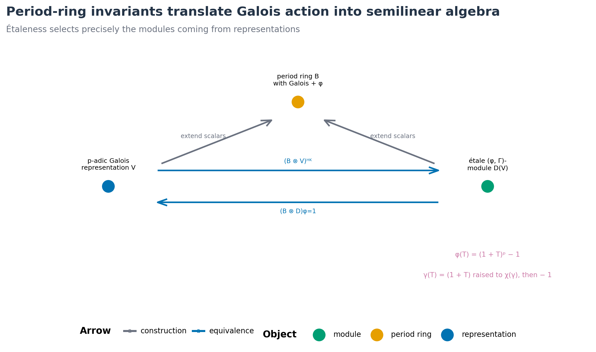

# $(\varphi,\Gamma)$-Modules {#sec-phi-gamma-modules}

**Level and prerequisites: L5.** Prepare Galois representations, Frobenius modules, local fields and p-adic Hodge theory. The [reader guide](index.md) links the Euler arithmetic, algebra and analysis preparation and distinguishes the graduate continuation.

A continuous representation of the absolute Galois group of a $p$-adic field
contains infinitely much group action. A $(\varphi,\Gamma)$-module repackages
that action as semilinear algebra over a ring of convergent Laurent series. The
Frobenius map $\varphi$ records arithmetic scaling; the group $\Gamma$ records
motion through the cyclotomic tower.

This is an advanced destination, so every component is introduced before the
equivalence theorem is stated. Chapters 26 and 33 supply the profinite and
period-ring routes.

## Representations and semilinear maps

Let $K=\mathbb Q_p$ for the first construction, and let $E$ be a finite
extension of $\mathbb Q_p$. An $E$-linear $p$-adic representation is a
finite-dimensional $E$-vector space $V$ with a continuous action of

$$
G_K=\operatorname{Gal}(\overline K/K).
$$

A map $\varphi:D\to D$ over a ring $R$ with endomorphism
$\varphi_R$ is **semilinear** if

$$
\varphi(rd)=\varphi_R(r)\varphi(d).
$$

It is not represented by an ordinary matrix until the scalar twisting is
remembered. After choosing a basis, a matrix $\Phi$ gives

$$
\varphi(\mathbf d)=\Phi\,\varphi_R(\mathbf d)
$$

with $\varphi_R$ applied coefficientwise.

The **linearisation**

$$
\varphi^\ast D=R\otimes_{\varphi_R,R}D
\longrightarrow D
$$

is $R$-linear. Requiring it to be an isomorphism is the correct invertibility
condition.

## The cyclotomic tower

Choose compatible primitive roots of unity

$$
\zeta_{p},\zeta_{p^2},\ldots,
\qquad
\zeta_{p^{n+1}}^p=\zeta_{p^n}.
$$

Let

$$
K_\infty=\bigcup_{n\ge1}K(\mu_{p^n}),
\qquad
H_K=\operatorname{Gal}(\overline K/K_\infty),
$$

and

$$
\Gamma_K=\operatorname{Gal}(K_\infty/K).
$$

For $K=\mathbb Q_p$,
$\Gamma_K$ is an open subgroup of $\mathbb Z_p^\times$ through the cyclotomic
character

$$
g(\zeta_{p^n})=\zeta_{p^n}^{\chi_{\mathrm{cyc}}(g)}.
$$

The absolute Galois action has been split into the subgroup $H_K$ and the
quotient-like cyclotomic direction $\Gamma_K$.

## The coefficient ring

Introduce a variable $T$ corresponding morally to a compatible system
$\zeta_{p^n}-1$. A basic period ring contains Laurent series

$$
\sum_{n\in\mathbb Z}a_nT^n
$$

with bounded coefficients and convergence conditions toward the negative tail.
One standard integral ring is completed from
$\mathbb Z_p[[T]][1/T]$; inverting $p$ gives a field-like coefficient ring
$\mathcal E$.

The actions are

$$
\varphi(T)=(1+T)^p-1
$$

and, for $\gamma\in\Gamma_K$,

$$
\gamma(T)=(1+T)^{\chi_{\mathrm{cyc}}(\gamma)}-1.
$$

They commute because exponentiation by $p$ commutes with exponentiation by a
$p$-adic unit.

Different authors use $\mathcal E$, $\mathbf B_K$, Robba rings, and integral
variants. A statement must name the ring and its convergence topology.

## Definition and étaleness

A $(\varphi,\Gamma)$-module $D$ over $R$ is a finite free $R$-module with:

1. a semilinear Frobenius $\varphi$ whose linearisation is an isomorphism;
2. a continuous semilinear action of $\Gamma_K$;
3. commuting actions

   $$
   \varphi(\gamma d)=\gamma(\varphi d).
   $$

It is **étale** when it has a Frobenius-stable lattice over the integral
coefficient ring on which Frobenius has slope zero. In a chosen lattice basis,
the Frobenius matrix and its inverse have integral bounded coefficients.

Étaleness is the condition selecting objects that come from actual Galois
representations.

## The equivalence theorem

Given a representation $V$, enlarge scalars to a large period ring
$\mathbf B$ carrying both Galois and Frobenius actions and take invariants:

$$
D(V)=(\mathbf B\otimes_{\mathbb Q_p}V)^{H_K}.
$$

The remaining $\Gamma_K$ action and Frobenius make $D(V)$ an étale
$(\varphi,\Gamma)$-module.

**Fontaine's equivalence, cyclotomic form.** The functor $V\mapsto D(V)$ is an
equivalence between finite-dimensional $p$-adic representations of $G_K$ and
étale $(\varphi,\Gamma)$-modules over the appropriate coefficient ring.

An inverse functor takes simultaneous Frobenius-fixed elements after extending
scalars:

$$
V(D)=
(\mathbf B\otimes_R D)^{\varphi=1}.
$$

The theorem proves dimensions match and the two constructions recover the
original object. Omitting “étale” would include many slope-bearing
Frobenius modules that are not representations.

<figure id="fig-phi-gamma-actions">


<figcaption>

Figure 37.1: A Galois representation and a semilinear module are connected by period-ring extension and two invariant operations.

</figcaption>
</figure>

[Figure 37.1](#fig-phi-gamma-actions) is a dependency diagram. The period ring is not erased
by the equivalence; it is the comparison environment that makes both invariant
constructions possible.

## Rank-one examples

A continuous character

$$
\delta:K^\times\to E^\times
$$

produces a rank-one module $R(\delta)$ generated by $e_\delta$. In a common
normalization,

$$
\varphi(e_\delta)=\delta(p)e_\delta,
\qquad
\gamma(e_\delta)=
\delta(\chi_{\mathrm{cyc}}(\gamma))e_\delta.
$$

Exact formulas depend on reciprocity conventions.

The trivial representation gives a trivial action on its basis. The
cyclotomic character produces a Tate twist; depending on whether arithmetic or
geometric Frobenius is used, the displayed power of $p$ may invert. This is
why convention declarations are mathematically substantive.

Rank-one modules are building blocks for **trianguline** representations,
those admitting a filtration with rank-one successive quotients.

## Herr complexes

Choose a topological generator $\gamma$ of a suitable procyclic part of
$\Gamma_K$. The Herr complex is

$$
0\longrightarrow D
\stackrel{d_0}{\longrightarrow}D\oplus D
\stackrel{d_1}{\longrightarrow}D
\longrightarrow0,
$$

with

$$
d_0(x)=((\varphi-1)x,(\gamma-1)x)
$$

and

$$
d_1(y,z)=(\gamma-1)y-(\varphi-1)z.
$$

Commutativity gives $d_1d_0=0$. Its cohomology computes
$H^i(G_K,V)$ for the representation corresponding to $D$, with adjustments
for the finite torsion part of $\Gamma_K$.

An infinite profinite cohomology problem has become a length-two complex of
semilinear operators. Euler characteristic and Tate duality can also be
expressed in this language.

## Overconvergence

The Robba ring consists of Laurent series converging on some annulus

$$
r<|T|_p<1,
$$

where $r$ may depend on the series. Overconvergent
$(\varphi,\Gamma)$-modules live on such annuli and support analytic tools.

The Cherbonnier–Colmez theorem says every $p$-adic Galois representation is
overconvergent: its étale module descends to an overconvergent ring. This is a
deep theorem, not an immediate consequence of finite dimensionality.

Families over rigid analytic parameter spaces let coefficients and characters
vary. Uniform annuli, finite projectivity, and base-change compatibility become
essential; pointwise étaleness alone may not control a family.

## Computation and scope

Finite precision stores Laurent coefficients in a declared exponent range and
modulo $p^N$. Applying
$T\mapsto(1+T)^p-1$ changes both exponent range and precision. A certified
calculation tracks:

- coefficient ring and annulus;
- basis and action matrices;
- truncation in positive and negative directions;
- $p$-adic precision loss;
- commutator residual
  $\varphi\gamma-\gamma\varphi$;
- invertibility of the linearised Frobenius.

<div class="callout callout-warning">
<p class="callout-title">Matrices alone do not define semilinear actions</p>

A Frobenius matrix must be paired with the ring endomorphism applied to
coefficients. Multiplying matrices as though every action were linear produces
the wrong compatibility equation.

</div>

## Local repair: semilinear matrices with the scalar action visible

Fix a basis and use column vectors. Suppose

$$
\varphi(\mathbf d)=\Phi\,\varphi_R(\mathbf d),
\qquad
\gamma(\mathbf d)=G_\gamma\,\gamma_R(\mathbf d).
$$

Applying the two operators in opposite orders gives

$$
\varphi(\gamma(\mathbf d))
=\Phi\,\varphi_R(G_\gamma)\,
\varphi_R\gamma_R(\mathbf d)
$$

and

$$
\gamma(\varphi(\mathbf d))
=G_\gamma\,\gamma_R(\Phi)\,
\gamma_R\varphi_R(\mathbf d).
$$

Because the ring endomorphisms commute, the module actions commute exactly when

$$
\Phi\,\varphi_R(G_\gamma)
=G_\gamma\,\gamma_R(\Phi).
$$

The twists on the matrix entries are indispensable. The ordinary-looking test
$\Phi G_\gamma=G_\gamma\Phi$ is valid only when both matrices are fixed by the
relevant scalar actions.

In rank one, write $\varphi(e)=a e$ and $\gamma(e)=b_\gamma e$. The same equation
becomes

$$
a\,\varphi_R(b_\gamma)
=b_\gamma\,\gamma_R(a).
$$

For the trivial representation, $a=b_\gamma=1$, but the action on a general
element is still not trivial:

$$
\varphi(f e)=\varphi_R(f)e,
\qquad
\gamma(f e)=\gamma_R(f)e.
$$

“Trivial module” refers to the basis vector; the coefficient ring continues to
move.

### A substitution computation at low order

Let $p=3$ and take a cyclotomic element with
$\chi_{\mathrm{cyc}}(\gamma)=4$. Then

$$
\varphi(T)=(1+T)^3-1=3T+3T^2+T^3
$$

and

$$
\gamma(T)=(1+T)^4-1
=4T+6T^2+4T^3+T^4.
$$

Rather than compose these expanded polynomials blindly, retain the coordinate
$1+T$. Both orders send it to

$$
(1+T)^{3\cdot4}=(1+T)^{12}.
$$

Consequently, modulo $T^4$,

$$
(\varphi\gamma)(T)
=(\gamma\varphi)(T)
\equiv12T+66T^2+220T^3\pmod{T^4}.
$$

The retained coefficients come straight from the binomial theorem. The cutoff
is explicit so omitted powers are never printed as exact zeros.

```python
from math import comb

def truncated_cyclotomic_substitution(
    exponent: int, exclusive_degree: int
) -> list[int]:
    """Return coefficients of (1+T)**exponent - 1 below the cutoff."""
    if exponent <= 0 or exclusive_degree <= 1:
        raise ValueError("require a positive exponent and cutoff above degree one")
    return [
        comb(exponent, degree)
        for degree in range(1, min(exponent, exclusive_degree - 1) + 1)
    ]

phi_then_gamma = truncated_cyclotomic_substitution(3 * 4, 4)
gamma_then_phi = truncated_cyclotomic_substitution(4 * 3, 4)
if phi_then_gamma != gamma_then_phi:
    raise RuntimeError("the scalar substitutions failed to commute")
print(phi_then_gamma)
```

The result `[12, 66, 220]` verifies the displayed congruence through degree
three. It checks only the scalar ring actions; a module still needs the
twisted matrix equation and certified coefficient and annulus precision.

This computation checks the ring actions to the displayed $T$-adic order. It does
not prove a module's matrix compatibility until the twisted matrix equation is
also checked.

### Precision ledger for a Laurent-series action

Suppose coefficients are known modulo $p^N$ and exponents are retained from
$-A$ through $B$. Three losses must be separated.

1. Coefficient precision may fall when a matrix inverse or a nonunit coefficient
   is used.
2. Substituting $(1+T)^p-1$ raises positive degrees, so terms above $B$ can feed
   back only if a later operation has negative powers; the full pipeline matters.
3. A negative power such as $T^{-j}$ becomes the inverse of a power series. Its
   expansion has an infinite positive tail, whose size is controlled by the
   chosen annulus rather than by formal degree alone.

A certified commutator statement should therefore say that every retained
coefficient of

$$
C=\Phi\varphi_R(G_\gamma)-G_\gamma\gamma_R(\Phi)
$$

from exponent $-A$ through $B$ lies in $p^N\mathcal O_E$, together with a norm
bound for the omitted negative and positive tails on the declared annulus. This
coefficientwise formulation matters because $T$ is invertible in a Laurent ring,
so a formal claim involving the ideal $T^{B+1}R$ would convey no truncation
information. Printing a zero matrix after silently discarding coefficients is not
an exact commuting-action proof.

### Theorem-status audit

Semilinearity, the twisted matrix equation, and $d_1d_0=0$ are direct algebra.
The construction $D(V)=(\mathbf B\otimes V)^{H_K}$ requires the period ring and a
proof that the invariant module has the asserted finite rank. Fontaine's
equivalence is a theorem, not a change of notation. The assertion that every
representation is overconvergent is the deeper Cherbonnier–Colmez theorem.

Rank-one formulas also carry convention risk. Local reciprocity may send a
uniformiser to arithmetic Frobenius or its inverse, and Tate twists may be indexed
covariantly or contravariantly. Before comparing two formulas, write the image of
a uniformiser, the chosen Frobenius, and the action on a compatible root of unity.
A power of $p$ that appears inverted may reflect conventions rather than an error.

### Selected exercise solution clinic

Exercise 1 is solved by the two-order derivation above. It is useful to test the
formula on a scalar multiple $r e_j$: if the scalar endomorphism does not appear,
the proposed matrix rule cannot be semilinear.

For Exercise 4,

$$
\begin{aligned}
d_1d_0(x)
&=(\gamma-1)(\varphi-1)x-(\varphi-1)(\gamma-1)x\\
&=(\gamma\varphi-\gamma-\varphi+1)x
 -(\varphi\gamma-\varphi-\gamma+1)x\\
&=0,
\end{aligned}
$$

because $\gamma\varphi=\varphi\gamma$. This calculation explains why the Herr
arrows form a complex; identifying its cohomology with Galois cohomology is the
separate comparison theorem.

For Exercise 8, the test must apply $\varphi_R$ and $\gamma_R$ to matrix entries,
not just multiply stored matrices. The output should include the modulus, exponent
window, annulus, residual matrix, and tail bound. Only then can another reader
decide whether “commutes to precision” is meaningful.

<!-- inline-formula-code:start -->
## Formula and finite computation

A useful formula in this chapter is

$$
\varphi\gamma=\gamma\varphi
$$

Finite matrices provide a strict commutator check for the compatibility relation. The following standalone Python block expresses that finite rule with its inputs and stopping conditions visible.

```python
import numpy as np

phi = np.array([[2, 1], [0, 2]], dtype=int)
gamma = np.array([[1, 3], [0, 1]], dtype=int)
commutator = phi @ gamma - gamma @ phi
print(commutator)
```

**What the computation establishes.** The output certifies only the declared finite case. The theorem, if one is claimed, still requires the argument developed in the chapter.
<!-- inline-formula-code:end -->

## Summary, exercises, and support

The cyclotomic tower separates $G_K$ into $H_K$ and $\Gamma_K$. Period-ring
invariants turn representations into finite free modules carrying commuting
semilinear Frobenius and Gamma actions. Étaleness characterises those coming
from representations; Herr complexes recover cohomology.

<div class="exercise" id="p_adic_numbers-37-phi-gamma-modules-ex-1">
<p class="exercise-title"><strong>Exercise 1</strong></p>

Verify the semilinear composition rule for matrices.

</div>

<div class="exercise" id="p_adic_numbers-37-phi-gamma-modules-ex-2">
<p class="exercise-title"><strong>Exercise 2</strong></p>

Prove the formulas for $\varphi(T)$ and $\gamma(T)$ commute.

</div>

<div class="exercise" id="p_adic_numbers-37-phi-gamma-modules-ex-3">
<p class="exercise-title"><strong>Exercise 3</strong></p>

Explain why $\Gamma_{\mathbb Q_p}$ is related to
$\mathbb Z_p^\times$.

</div>

<div class="exercise" id="p_adic_numbers-37-phi-gamma-modules-ex-4">
<p class="exercise-title"><strong>Exercise 4</strong></p>

Check $d_1d_0=0$ in the Herr complex.

</div>

<div class="exercise" id="p_adic_numbers-37-phi-gamma-modules-ex-5">
<p class="exercise-title"><strong>Exercise 5</strong></p>

Describe the trivial rank-one module.

</div>

<div class="exercise" id="p_adic_numbers-37-phi-gamma-modules-ex-6">
<p class="exercise-title"><strong>Exercise 6</strong></p>

Compare two Frobenius conventions and track the cyclotomic twist.

</div>

<div class="exercise" id="p_adic_numbers-37-phi-gamma-modules-ex-7">
<p class="exercise-title"><strong>Exercise 7</strong></p>

Explain why an arbitrary Frobenius module need not be étale.

</div>

<div class="exercise" id="p_adic_numbers-37-phi-gamma-modules-ex-8">
<p class="exercise-title"><strong>Exercise 8</strong></p>

Test finite matrices for the commuting-action relation at a declared
precision.

</div>

<div class="exercise" id="p_adic_numbers-37-phi-gamma-modules-ex-9">
<p class="exercise-title"><strong>Exercise 9</strong></p>

State exactly what overconvergence adds to mere Laurent-series convergence.

</div>

<div class="exercise" id="p_adic_numbers-37-phi-gamma-modules-ex-10">
<p class="exercise-title"><strong>Exercise 10</strong></p>

Build a glossary connecting representation, period ring, invariants,
Frobenius, Gamma, and recovered cohomology.

</div>

For Exercise 2, both substitutions send $1+T$ to
$(1+T)^{p\chi_{\mathrm{cyc}}(\gamma)}$. For Exercise 4 expand both terms and
cancel using commutativity.
