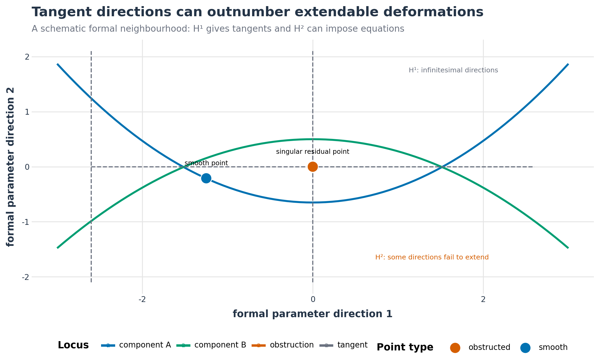

# Deformation Rings and Families of Representations {#sec-deformation-rings}

**Level and prerequisites: L5.** Prepare local commutative algebra, complete local rings, Galois representations and deformation functors. The [reader guide](index.md) links the Euler arithmetic, algebra and analysis preparation and distinguishes the graduate continuation.

A representation over a finite field can be the shadow of many
$p$-adic representations. Deformation theory organises all compatible lifts
into a universal ring. Infinitesimal lifts are controlled by first cohomology;
obstructions to extending them are controlled by second cohomology.

The chapter begins with congruent matrices and dual numbers. Rings are always
commutative with identity, and all continuity conditions are stated.

## Residual representations and coefficient rings

Let $k$ be a finite field of characteristic $p$, let $W(k)$ be its Witt-vector
ring, and let $G$ be a profinite group such as a local or global Galois group.
A **residual representation** is a continuous homomorphism

$$
\overline\rho:G\to\operatorname{GL}_n(k).
$$

We study complete Noetherian local $W(k)$-algebras $A$ with residue field $k$:

$$
A/\mathfrak m_A\cong k.
$$

A lift to $A$ is a continuous

$$
\rho_A:G\to\operatorname{GL}_n(A)
$$

whose reduction modulo $\mathfrak m_A$ is $\overline\rho$.

Examples of test rings include $k$, the dual numbers
$k[\varepsilon]/(\varepsilon^2)$, $W(k)/p^mW(k)$ for $m\ge1$, and power-series
quotients. When $k=\mathbb F_p$, $W(k)/p^mW(k)\cong\mathbb Z/p^m\mathbb Z$. Completeness lets compatible finite-level data assemble into a
$p$-adic object.

## Equivalence and framing

Two lifts are **strictly equivalent** if

$$
\rho_A'(g)=M\rho_A(g)M^{-1}
$$

for some $M\equiv I\pmod{\mathfrak m_A}$. The unframed deformation functor
$D_{\overline\rho}(A)$ consists of strict-equivalence classes of lifts.

Automorphisms can make this functor fail to be representable. A standard
sufficient hypothesis is

$$
\operatorname{End}_{k[G]}(\overline\rho)=k,
$$

the scalar-endomorphism or Schur condition. Absolute irreducibility implies
this condition; they should not be treated as definitions of one another
without the coefficient-field hypotheses.

A **framed deformation** retains a chosen lift of the basis and does not
quotient by strict conjugacy. The framed functor is more often representable,
at the price of extra formally smooth variables corresponding to basis change.

This is not cosmetic bookkeeping: whether a ring parametrises matrices with a
basis or isomorphism classes without one changes its dimension and universal
property.

## Functors and universal rings

A deformation problem is a functor from coefficient rings to sets. A universal
deformation ring $R_{\overline\rho}$ comes with a universal representation
$\rho^{\mathrm{univ}}$ such that for every $A$,

$$
\operatorname{Hom}_{\mathrm{local}}(R_{\overline\rho},A)
\longrightarrow D_{\overline\rho}(A)
$$

is a natural bijection.

Thus a lift to $A$ is obtained uniquely by applying a local ring map to the
coefficients of the universal matrices. “Universal” means this mapping
property, not merely a ring large enough to contain many examples.

Schlessinger's criteria test representability by examining fibre products and
small extensions. In Galois settings, Mazur's finiteness condition on
cohomology ensures the tangent space is finite-dimensional and a universal
ring exists under the scalar-endomorphism hypothesis.

## Tangent space from dual numbers

Let $A=k[\varepsilon]/(\varepsilon^2)$. A lift can be written

$$
\rho_\varepsilon(g)
=(I+\varepsilon c(g))\overline\rho(g).
$$

The homomorphism condition gives

$$
c(gh)=c(g)+
\overline\rho(g)c(h)\overline\rho(g)^{-1}.
$$

Thus $c$ is a one-cocycle with values in

$$
\operatorname{ad}\overline\rho
=\operatorname{End}_k(k^n),
$$

where $G$ acts by conjugation. Changing basis by
$I+\varepsilon X$ changes $c$ by a coboundary. Therefore the unframed tangent
space is

$$
D_{\overline\rho}(k[\varepsilon]/(\varepsilon^2))
\cong H^1(G,\operatorname{ad}\overline\rho).
$$

For fixed determinant, replace the adjoint module by the trace-zero part under
appropriate hypotheses.

## Obstructions in second cohomology

Consider a small extension of coefficient rings

$$
0\to I\to A'\to A\to0,
\qquad
\mathfrak m_{A'}I=0.
$$

Choose arbitrary matrix lifts of a representation over $A$. Their failure to
respect multiplication is an $I\otimes\operatorname{ad}\overline\rho$-valued
two-cocycle. Its class in

$$
H^2(G,\operatorname{ad}\overline\rho)\otimes I
$$

is the obstruction to a lift over $A'$. If it vanishes, the set of lifts is a
torsor under the corresponding $H^1\otimes I$.

If $H^2=0$, the deformation problem is unobstructed and the universal ring is
formally smooth:

$$
R_{\overline\rho}\cong
W(k)[[x_1,\ldots,x_d]]
$$

with $d$ the tangent dimension, subject to framing adjustments. If $H^2$ is
nonzero, relations may occur; its dimension is an upper bound on the number of
relations in a presentation, not always the exact number.

<figure id="fig-deformation-space">


<figcaption>

Figure 38.1: First cohomology supplies tangent directions while second cohomology supplies possible equations cutting out the deformation space.

</figcaption>
</figure>

[Figure 38.1](#fig-deformation-space) is an algebraic schematic. Formal spectra are not
ordinary Euclidean surfaces, and tangent dimension can exceed the dimension of
every irreducible component at a singular point.

## A one-dimensional example

Let $\overline\chi:G_K\to k^\times$ be a residual character. A lift is a
continuous character $\chi:G_K\to A^\times$. Infinitesimally,

$$
\chi_\varepsilon(g)
=\overline\chi(g)(1+\varepsilon c(g)),
$$

and because conjugation is trivial in dimension one,

$$
c(gh)=c(g)+c(h).
$$

The tangent space is $\operatorname{Hom}_{\mathrm{cont}}(G_K,k)$, or an
appropriate subspace if determinant, ramification, or Hodge conditions are
imposed.

Local class field theory translates characters of $G_K^{\mathrm{ab}}$ into
characters of $K^\times$. The factors

$$
K^\times\cong
\pi^{\mathbb Z}\times\mathcal O_K^\times
$$

separate an unramified parameter from unit-character parameters. This makes
rank-one deformation spaces explicit.

## Imposing arithmetic conditions

A deformation condition selects subfunctors:

- fixed determinant;
- unramified outside a finite set;
- ordinary with a stable filtration;
- finite flat;
- crystalline with specified Hodge–Tate weights;
- prescribed inertial type.

When representable, each condition corresponds to a quotient

$$
R_{\overline\rho}\twoheadrightarrow R_{\mathcal D}.
$$

The direction is reversed because fewer permitted maps require more equations.

Conditions must be stable under base change and satisfy appropriate lifting
properties. The phrase “crystalline deformation ring” suppresses choices of
weights, coefficient field, determinant, and framing unless they are declared.

Local tangent conditions are subspaces

$$
L_v\subseteq H^1(G_{K_v},\operatorname{ad}\overline\rho).
$$

In a global problem these assemble into a Selmer group; the dual Selmer group
controls relations and patching defects.

## Pseudorepresentations

The trace of a representation is invariant under conjugacy. A
two-dimensional pseudorepresentation records trace and determinant satisfying
polynomial identities that every matrix representation obeys.

Pseudorepresentations can be representable even when residual representations
have too many automorphisms. Under absolute irreducibility, a
pseudorepresentation usually comes from a unique representation up to
isomorphism. In reducible cases, distinct nonsplit extensions can have the same
trace and determinant.

Thus trace data organize families without a basis, but can forget extension
classes.

## Families and rigid generic fibres

After inverting $p$, the generic fibre of a deformation ring becomes a rigid
analytic space. A point with values in a finite extension $E/\mathbb Q_p$
corresponds to a homomorphism

$$
R_{\overline\rho}\to\mathcal O_E
$$

and hence an $E$-valued representation.

Eigenvarieties combine Hecke eigenvalues with Galois deformations and weight
space. Classical modular forms give special points, while the rigid space also
contains nonclassical $p$-adic points. Density of classical points is a theorem
under particular constructions, not a definition.

Families may have multiple components, intersections, nilpotents, and
nonreduced structure. A plot of valuations of sampled parameters cannot reveal
the full local ring.

## Computation and presentation checks

To propose

$$
R\cong W(k)[[x_1,\ldots,x_d]]/(f_1,\ldots,f_r),
$$

record:

1. the residual matrices and topological generators of $G$;
2. all relations imposed on those generators;
3. the equivalence or framing convention;
4. determinant and local conditions;
5. tangent-space calculation;
6. obstruction or lifting tests through successive small extensions;
7. proof that the presentation has the universal mapping property.

Solving relations to finite precision produces evidence about finite quotients
$R/\mathfrak m^N$, not by itself the complete power-series ring.

<div class="callout callout-warning">
<p class="callout-title">Tangent dimension is not component dimension</p>

At a singular point, many infinitesimal directions may fail to extend. The
difference is precisely why obstruction theory and defining equations are
needed.

</div>

## Local repair: dual numbers are first-order microscopes

The ring $k[\varepsilon]/(\varepsilon^2)$ contains a nonzero element whose
square is zero. It records a direction and discards every term of second order.
For matrices this gives the exact rules

$$
(I+\varepsilon X)^{-1}=I-\varepsilon X
$$

and

$$
(I+\varepsilon X)(I+\varepsilon Y)
=I+\varepsilon(X+Y).
$$

A dual number is represented by its constant and $\varepsilon$ coefficients.
Discarding the quadratic coefficient is not a floating-point approximation; it
is the exact relation $\varepsilon^2=0$ in the quotient ring.

```python
from fractions import Fraction

def multiply_dual_numbers(
    left: tuple[Fraction, Fraction],
    right: tuple[Fraction, Fraction],
) -> tuple[Fraction, Fraction]:
    """Multiply (a + b epsilon)(c + d epsilon) with epsilon squared zero."""
    left_constant, left_tangent = left
    right_constant, right_tangent = right
    return (
        left_constant * right_constant,
        left_constant * right_tangent + left_tangent * right_constant,
    )

first_order_x = (Fraction(1), Fraction(7))
first_order_y = (Fraction(1), Fraction(-3))
product = multiply_dual_numbers(first_order_x, first_order_y)
inverse_check = multiply_dual_numbers(first_order_x, (Fraction(1), Fraction(-7)))
print(product, inverse_check)
```

The outputs are $(1,4)$ and $(1,0)$, exactly the displayed product and inverse
rules in rank one.  Matrix-valued tangents use the same first-order expansion
with noncommutative multiplication; deformation classes additionally impose
group relations and quotient by the appropriate basis changes.

Now derive the cocycle equation without skipping a multiplication. Write

$$
\rho_\varepsilon(g)
=(I+\varepsilon c(g))\overline\rho(g).
$$

Then

$$
\begin{aligned}
\rho_\varepsilon(g)\rho_\varepsilon(h)
&=(I+\varepsilon c(g))\overline\rho(g)
  (I+\varepsilon c(h))\overline\rho(h)\\
&=\left(I+\varepsilon c(g)
 +\varepsilon\overline\rho(g)c(h)\overline\rho(g)^{-1}\right)
 \overline\rho(gh).
\end{aligned}
$$

Equality with $\rho_\varepsilon(gh)$ is therefore exactly the cocycle law for
the conjugation action. Next conjugate by $M=I+\varepsilon X$:

$$
M\rho_\varepsilon(g)M^{-1}
=\left(I+\varepsilon\bigl(c(g)+X-gX\bigr)\right)
\overline\rho(g),
$$

where $gX=\overline\rho(g)X\overline\rho(g)^{-1}$. Thus strict basis change adds
the negative of the standard coboundary $gX-X$. Since coboundaries form a
subspace, the sign does not change the quotient $H^1$. This calculation explains
both the tangent cocycles and why unframed deformations divide by coboundaries.

Framed deformations do not perform this final quotient. Their tangent space keeps
matrix directions corresponding to infinitesimal basis motion, subject to any
fixed determinant or other conditions. The difference between framed and
unframed dimensions is therefore expected data, not a contradiction.

### Two cyclic character calculations

Let $G=C_\ell=\langle\sigma\rangle$ with a positive integer $\ell$ satisfying $\gcd(\ell,p)=1$, and consider the trivial
one-dimensional residual character. A lift sends $\sigma$ to a unit
$u\equiv1\pmod{\mathfrak m_A}$ satisfying $u^\ell=1$. The polynomial
$F(X)=X^\ell-1$ has

$$
F(1)=0,
\qquad
F'(1)=\ell\in A^\times.
$$

Hensel uniqueness forces $u=1$. In this unrestricted toy problem there is no
nontrivial infinitesimal direction, in agreement with

$$
H^1(C_\ell,k)=\operatorname{Hom}(C_\ell,k^+)=0,
$$

because the additive group $k^+$ has $p$-power order. The deformation functor is
represented by the coefficient ring with no power-series variable.

The contrast with $C_p$ is immediate over the dual numbers. Every

$$
u=1+\varepsilon a,
\qquad a\in k,
$$

satisfies $u^p=1$: in characteristic $p$, the linear binomial term contains the
coefficient $p$, and all higher terms contain $\varepsilon^2$. Thus the tangent
space has one $k$-direction. This first-order calculation does not say that every
direction lifts through every mixed-characteristic ring. Higher relations and
obstructions still have to be tested.

### A singular ring whose tangent space is too large

Consider

$$
R=k[[x,y]]/(xy).
$$

A local map to the dual numbers may send

$$
x\longmapsto a\varepsilon,
\qquad
y\longmapsto b\varepsilon
$$

for arbitrary $a,b\in k$, because their product is
$ab\varepsilon^2=0$. The tangent space is therefore two-dimensional. Yet the
reduced geometric picture has two one-dimensional branches, $x=0$ and $y=0$.
An infinitesimal direction with both $a$ and $b$ nonzero lies in the tangent
space but cannot continue along either reduced branch with both coordinates
nonzero, since the exact equation $xy=0$ intervenes at second order.

This toy ring is not asserted to be a particular Galois deformation ring. It is a
local-algebra model showing why $H^1$ gives tangent directions while relations and
$H^2$ govern extension.

### Theorem-status and finite-precision audit

The dual-number derivation is formal matrix algebra. Identifying the quotient with
$H^1$ uses the declared equivalence convention. Representability is a theorem
requiring finiteness and automorphism hypotheses; it is not guaranteed by writing
down several compatible lifts. Likewise, $H^2=0$ is a sufficient unobstructedness
criterion in the stated deformation problem, while nonzero $H^2$ supplies a space
where obstructions may live rather than proving every lift is obstructed.

Suppose computation suggests relations modulo $\mathfrak m^N$. The honest output
is a presentation of a finite quotient, plus maps verifying its property for the
tested Artinian rings. A relation of order $N$ or higher is invisible at lower
precision, and nilpotents can disappear after sampling only field-valued points.
No finite cloud of rigid points proves that a complete local ring is reduced,
irreducible, or equal to the proposed power-series quotient.

### Selected exercise solution clinic

Exercises 2 and 3 are the two calculations at the start of this section. For
Exercise 5, a formally smooth example with tangent dimension three is

$$
W(k)[[x_1,x_2,x_3]].
$$

Its maps to the dual numbers are determined by the three independent images
$x_i\mapsto a_i\varepsilon$. The statement is about the ring as a formal object;
additional framing or determinant conditions could change which deformation
problem it represents.

For Exercise 7, use

$$
\det(I+\varepsilon X)
=1+\varepsilon\operatorname{tr}(X).
$$

If the determinant is fixed, its first-order change must vanish, so the tangent
matrix lies in the trace-zero adjoint submodule. At primes or ranks where trace
splittings behave badly, one should retain this kernel description rather than
silently assuming a direct-sum decomposition.

For Exercise 10, the universal-property check is decisive. Generators and
relations must produce every permitted lift to every coefficient ring, and two
maps producing strictly equivalent unframed lifts must already be identified in
the claimed way. Agreement on dual numbers checks only the tangent space, not
universality.

<!-- inline-formula-code:start -->
## Formula and finite computation

A useful formula in this chapter is

$$
\rho_A(g)\bmod\mathfrak m_A=\bar\rho(g)
$$

Reducing an integral matrix modulo $p$ checks the residual-representation condition. The following standalone Python block expresses that finite rule with its inputs and stopping conditions visible.

```python
import numpy as np

prime = 5
lift = np.array([[1 + prime, 2], [3 * prime, 4 - prime]], dtype=int)
residual = lift % prime
print(residual)
```

**What the computation establishes.** The output certifies only the declared finite case. The theorem, if one is claimed, still requires the argument developed in the chapter.
<!-- inline-formula-code:end -->

## Summary, exercises, and support

Deformations lift a residual representation through complete local rings.
Dual-number lifts form first cohomology; second cohomology contains
obstructions. Universal rings represent the entire functor, while quotients
impose arithmetic conditions and rigid generic fibres organize
$p$-adic families.

<div class="exercise" id="p_adic_numbers-38-deformation-rings-ex-1">
<p class="exercise-title"><strong>Exercise 1</strong></p>

Verify that reducing a lift modulo the maximal ideal recovers
$\overline\rho$.

</div>

<div class="exercise" id="p_adic_numbers-38-deformation-rings-ex-2">
<p class="exercise-title"><strong>Exercise 2</strong></p>

Derive the cocycle equation for a dual-number lift.

</div>

<div class="exercise" id="p_adic_numbers-38-deformation-rings-ex-3">
<p class="exercise-title"><strong>Exercise 3</strong></p>

Compute the basis-change coboundary.

</div>

<div class="exercise" id="p_adic_numbers-38-deformation-rings-ex-4">
<p class="exercise-title"><strong>Exercise 4</strong></p>

Explain why framing removes conjugacy ambiguity.

</div>

<div class="exercise" id="p_adic_numbers-38-deformation-rings-ex-5">
<p class="exercise-title"><strong>Exercise 5</strong></p>

Describe a formally smooth ring with tangent dimension three.

</div>

<div class="exercise" id="p_adic_numbers-38-deformation-rings-ex-6">
<p class="exercise-title"><strong>Exercise 6</strong></p>

Construct the two-cocycle measuring failure of arbitrary lifted matrices to
multiply.

</div>

<div class="exercise" id="p_adic_numbers-38-deformation-rings-ex-7">
<p class="exercise-title"><strong>Exercise 7</strong></p>

Show why a fixed-determinant infinitesimal variation is trace zero.

</div>

<div class="exercise" id="p_adic_numbers-38-deformation-rings-ex-8">
<p class="exercise-title"><strong>Exercise 8</strong></p>

Compare an unramified character deformation with a ramified one through
local class field theory.

</div>

<div class="exercise" id="p_adic_numbers-38-deformation-rings-ex-9">
<p class="exercise-title"><strong>Exercise 9</strong></p>

Give two nonsplit upper-triangular representations with the same
semisimplified trace.

</div>

<div class="exercise" id="p_adic_numbers-38-deformation-rings-ex-10">
<p class="exercise-title"><strong>Exercise 10</strong></p>

Audit a claimed deformation-ring presentation against the seven-item
checklist.

</div>

For Exercise 3 conjugate by $I+\varepsilon X$ and discard
$\varepsilon^2$. For Exercise 7 use
$\det(I+\varepsilon X)=1+\varepsilon\operatorname{tr}X$.
