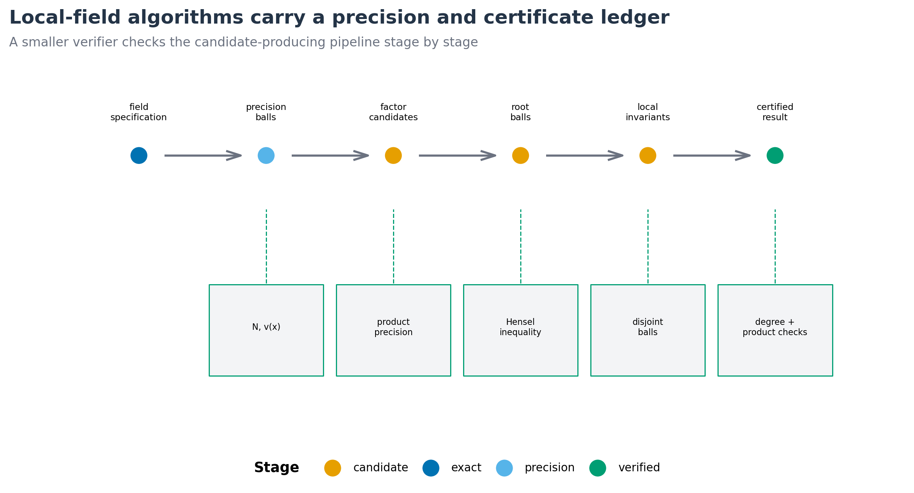

# Computational Local Fields and Certified Algorithms {#sec-computational-local-fields}

**Level and prerequisites: L5.** Prepare finite extensions, Newton polygons, ramification and finite-precision error bounds. The [reader guide](index.md) links the Euler arithmetic, algebra and analysis preparation and distinguishes the graduate continuation.

An element of a $p$-adic field has infinitely many digits, yet computations
store finitely many. Correct software must distinguish the exact mathematical
object, the finite approximation currently known, and the precision guaranteed
after each operation. This chapter develops that discipline for arithmetic,
polynomial factorisation, extensions, and root certificates.

Chapters 5, 9, 12, 19, and 20 provide the mathematical theory. Here it is
assembled into a reproducible computational workflow.

## Exact objects versus stored approximations

A local field $K$ can be described by:

- base prime $p$;
- an unramified extension through a residue polynomial;
- a totally ramified extension through an Eisenstein or more general defining
  polynomial;
- a chosen basis and uniformiser $\pi$;
- normalization $v_K(\pi)=1$.

The exact field is not a floating-point root of the polynomial. A finite
element record may store

$$
x=\sum_{i=0}^{n-1}a_i\alpha^i+O(\pi^N).
$$

This means the true element lies in a ball, not that omitted digits are zero.
Two displayed approximations are provably equal only when their difference is
known to vanish to the required precision; exact equality of arbitrary
$p$-adic inputs is undecidable from finite prefixes alone.

An API should distinguish:

- exact rationals or algebraic elements embedded in $K$;
- balls $x+O(\pi^N)$;
- zero known only modulo $\pi^N$;
- a certified nonzero element with known valuation.

## Absolute and relative precision

If

$$
x=\pi^v u,\qquad u\in\mathcal O_K^\times,
$$

is known modulo $\pi^N$, its absolute precision is $N$ and relative precision
is $N-v$ digits beyond the leading term.

For addition,

$$
x+O(\pi^N)+y+O(\pi^M)
=(x+y)+O(\pi^{\min(N,M)}).
$$

Cancellation may raise the valuation of the sum, reducing relative precision.

For multiplication, if $v(x)$ and $v(y)$ are known,

$$
(x+O(\pi^N))(y+O(\pi^M))
=xy+
O\left(\pi^{\min(N+v(y),M+v(x))}\right).
$$

Inversion of a certified nonzero $x$ transforms uncertainty:
relative precision is approximately preserved, while absolute precision shifts
by $-2v(x)$ under the derivative

$$
d(x^{-1})=-x^{-2}dx.
$$

Division must reject a denominator ball containing zero.

The multiplication cap and resulting relative precision can be planned before
any digits are multiplied:

```python
def product_precision(
    value_x: int,
    absolute_x: int,
    value_y: int,
    absolute_y: int,
) -> tuple[int, int]:
    """Return (absolute, relative) precision for a certified product."""
    if absolute_x <= value_x or absolute_y <= value_y:
        raise ValueError("each nonzero input needs positive relative precision")
    product_value = value_x + value_y
    product_absolute = min(
        absolute_x + value_y,
        absolute_y + value_x,
    )
    return product_absolute, product_absolute - product_value

print(product_precision(value_x=2, absolute_x=7, value_y=-1, absolute_y=3))
```

This returns absolute precision $5$ and relative precision $4$, exactly as in
the later laboratory. It assumes the two input valuations are certified; if a
ball may contain zero, those integers are not available and the function
correctly cannot be called.

## Guard digits and precision planning

A computation that needs output modulo $\pi^N$ may require more input
precision. Plan backwards through valuations and derivatives. Guard digits
cover predictable loss, not unknown instability.

For a polynomial $f$,

$$
f(x+\delta)=f(x)+f'(x)\delta+\cdots.
$$

If $v(f'(x))=s$, a Newton correction divides by a quantity of valuation $s$ and
may lose $s$ digits before quadratic improvement. Multiple or nearly multiple
roots are intrinsically ill-conditioned.

A precision object should carry provenance: which input precisions and
valuation bounds justify the current cap.

### Plan a polynomial calculation backwards {#sec-polynomial-precision-plan}

For a complete precision plan, both the input and the coefficients may be
uncertain. Repeated appearances of an input also represent the same unknown
number. We can preserve that information by expanding the whole expression
before bounding its error.

Work in $\mathbb Q_3$ and consider
$$
F(x,c)=\frac{x^3-3x+c}{9},\qquad
x=1+O(3^N),\quad c=29+O(3^M),
\quad N\ge1,\ M\ge3.
$$
The nominal value is $F(1,29)=3$. Put $x=1+\delta$ and $c=29+\varepsilon$,
where $v_3(\delta)\ge N$ and $v_3(\varepsilon)\ge M$. Exact expansion gives
$$
F(x,c)-3=\frac{\varepsilon+3\delta^2+\delta^3}{9}.
$$
The linear terms in $\delta$ cancel. The three remaining terms have valuation
at least $M-2$, $2N-1$, and $3N-2$, respectively. Since $N\ge1$,
$3N-2\ge2N-1$. Thus every admissible input satisfies
$$
F(x,c)\in3+3^P\mathbb Z_3,\qquad
P=\min(M-2,\,2N-1).
$$
This is a **sharp enclosing ball**: it is the smallest ball centered at $3$
that works uniformly over the stated inputs. To see sharpness, first set
$\delta=0$ and $\varepsilon=3^M$, obtaining error of valuation $M-2$.
Alternatively set $\varepsilon=0$ and $\delta=3^N$. The error is
$3^{2N-1}(1+3^{N-1})$, of valuation exactly $2N-1$, including $N=1$.
These two admissible choices show that neither bound can be increased.

For example, $N=3,M=9$ gives $F(x,c)=3+O(3^5)$. The admissible choice
$x=28,c=29$ gives $F=2433$, and
$$
2433-3=2430=10\cdot3^5.
$$
Using only the zero derivative with respect to $x$ at the nominal point would
miss this error. A vanishing linear term makes the higher terms decisive.

An enclosure does not necessarily describe the entire image. In this example,
write $\delta=27u$ and $\varepsilon=3^9v$. Then
$$
\frac{F(x,c)-3}{3^5}=u^2(1+9u)+9v.
$$
Its residue modulo $3$ is $0$ or $1$, whereas the enclosing ball also contains
numbers for which this residue is $2$. Sharpness of the radius does not prove
that every point in the ball occurs as an output.

**Allocate the input digits.** Suppose the requested absolute output precision
is $K$, meaning a result modulo $3^K$. The requirements are
$$
M\ge K+2,\qquad
N\ge\left\lceil\frac{K+1}{2}\right\rceil.
$$
For $K=6$, the minimum caps are $N=4,M=8$. The output is $3+O(3^6)$.
Every member has valuation $1$, because its error has higher valuation, so
the result has absolute precision $6$ and relative precision $5$.

The allocation is necessary as well as sufficient. Reducing $N$ to $3$ admits
the error $10\cdot3^5$ above. Reducing $M$ to $7$ admits $x=1,c=2216$,
giving error $3^5$. At the selected caps, $x=1,c=6590=29+3^8$ gives error
exactly $3^6$, so an extra output digit is not uniformly justified.

**Keep the same unknown input.** The cancellation used one $\delta$ in both
$x^3$ and $-3x$. Replacing these by independent inputs changes the problem.
For $x_1,x_2=1+O(3^4)$ and $c=29+O(3^8)$, the admissible values
$x_1=1,x_2=82,c=29$ give
$$
\frac{x_1^3-3x_2+c}{9}=-24,
\qquad -24-3=-27.
$$
The output now differs from the nominal value at valuation $3$, rather than
being guaranteed modulo $3^6$. Applying the scalar ball rules separately is
safe, but can discard dependence that a whole-expression calculation retains.

**An exact finite certificate.** To verify an output modulo $3^K$, examine the
numerator modulo $3^{K+2}$ before dividing by $9$. The coefficient is fixed
modulo that modulus when $M\ge K+2$. Enumerating every admissible input residue
then checks the stated finite conclusion. The verifier supports the two
specific centers used in this clinic; the displayed run checks the worked case.

```python
def cubic_input_plan(
    input_center: int, target_precision: int
) -> tuple[int, int]:
    """Return minimum input and coefficient caps for the two stated centres."""
    if type(input_center) is not int or type(target_precision) is not int:
        raise TypeError("the centre and target precision must be integers")
    if input_center not in (1, 2) or target_precision < 1:
        raise ValueError("use centre 1 or 2 and a positive target precision")
    input_cap = (
        (target_precision + 2) // 2
        if input_center == 1 else target_precision
    )
    return input_cap, target_precision + 2

def cubic_certificate(
    input_center: int,
    input_precision: int,
    coefficient_precision: int,
    target_precision: int,
    max_residues: int = 10000,
) -> tuple[int, int, int]:
    """Return (enclosing cap, inspected classes, output residue modulo 3**K)."""
    required_input, required_coefficient = cubic_input_plan(
        input_center, target_precision
    )
    parameters = (input_precision, coefficient_precision, max_residues)
    if any(type(parameter) is not int for parameter in parameters):
        raise TypeError("input caps and the residue budget must be integers")
    if input_precision < 1 or coefficient_precision < 3 or max_residues < 1:
        raise ValueError("require N >= 1, M >= 3, and a positive residue budget")
    if target_precision > 10:
        raise ValueError("this finite verifier accepts target precisions 1 to 10")
    if input_precision < required_input or coefficient_precision < required_coefficient:
        raise ValueError("source precision does not certify the requested output")
    numerator_digits = target_precision + 2
    residue_count = 3 ** max(0, numerator_digits - input_precision)
    if residue_count > max_residues:
        raise ValueError("the exhaustive check exceeds the residue budget")
    numerator_modulus = 3**numerator_digits
    input_step = 3 ** min(input_precision, numerator_digits)
    coefficient_center = 29 if input_center == 1 else 25
    for offset in range(residue_count):
        argument = input_center + input_step * offset
        numerator = argument**3 - 3 * argument + coefficient_center
        if numerator % numerator_modulus != 27 % numerator_modulus:
            raise ArithmeticError("the quotient residue certificate failed")
    input_cap = (
        2 * input_precision - 1
        if input_center == 1 else input_precision
    )
    enclosing_cap = min(coefficient_precision - 2, input_cap)
    return enclosing_cap, residue_count, 3 % (3**target_precision)

input_cap, coefficient_cap = cubic_input_plan(1, 6)
print((input_cap, coefficient_cap))
print(cubic_certificate(1, input_cap, coefficient_cap, 6))
```

The run prints the plan $(4,8)$ and certificate $(6,81,3)$.
Every inspected numerator residue is $27$ modulo $3^8$, so division gives
output residue $3$ modulo $3^6$.
The verifier deliberately limits the target and the number of inspected
classes; it rejects an unaffordable request before enumeration. Higher input
caps are reduced only to the finite modulus actually being checked.

These outputs establish the declared finite congruences. The exact expansions
and necessity witnesses establish the general precision laws. The listing does
not construct an arbitrary $3$-adic input, prove the laws by testing, or certify
that a nonlinear image fills its enclosing ball.

#### Changed task: move the centre {#sec-polynomial-precision-task}

Keep the same function $F$, but now take
$$
x=2+O(3^N),\qquad c=25+O(3^M),\qquad N\ge1,\ M\ge3.
$$
The nominal output is still $3$. Derive a sharp enclosing precision, find the
minimum $N,M$ for output modulo $3^6$, and prove that decreasing either
required cap permits failure. Explain which Taylor term changes the plan and
state the resulting absolute and relative precision. Finally use the finite
certificate and explain why its residue count differs from the first case.

Try the task before following the separate
[hint](appendix-c-solutions.md#sec-polynomial-precision-hint) or
[full solution](appendix-c-solutions.md#sec-polynomial-precision-solution).
The general backward-planning context and dependent-arithmetic references are
listed in the [computational reading path](appendix-d-bibliography.md#sec-padic-precision-reading).

## Hensel lifting and root balls

A simple Hensel condition is

$$
v(f(a))>2v(f'(a)).
$$

Then Newton iteration

$$
a_{n+1}=a_n-\frac{f(a_n)}{f'(a_n)}
$$

converges to a unique root in a specified ball. The valuations of residuals
roughly double.

A root certificate contains:

1. polynomial with exact coefficients;
2. center $a$ and radius $\pi^N$;
3. valuations of $f(a)$ and $f'(a)$;
4. the precise Hensel theorem used;
5. conclusion of existence and uniqueness in that ball.

Two root certificates with disjoint balls prove distinct roots. A degree count
plus enough disjoint balls can prove completeness.

When $f'(a)$ is not a unit, stronger Hensel variants, Newton polygons, or factor
lifting are needed. Repeating simple-root iteration without checking its
hypothesis is not a fallback.

## Polynomial factorisation

For $f\in\mathcal O_K[x]$:

1. reduce modulo the maximal ideal;
2. factor $\overline f$ over the finite residue field;
3. if factors are coprime, lift them by Hensel factorisation;
4. recurse and verify the exact product to target precision.

If

$$
\overline f=\overline g\,\overline h,
\qquad
\gcd(\overline g,\overline h)=1,
$$

there are unique monic lifts $g,h$ with $f=gh$. Bézout coefficients for the
residue factors drive the corrections.

Repeated residue factors do not mean $f$ is irreducible or has repeated roots
over $K$. Newton polygons and residual polynomials split slopes and handle
clusters before another lift.

A factorisation certificate provides monic factors, their product congruence,
coprimality or slope data, and a theorem proving uniqueness or completeness.

## Building extensions

An unramified extension of degree $f$ is built by lifting an irreducible
degree-$f$ polynomial from the residue field. Its uniformiser can remain $p$
and its residue field has $q^f$ elements.

A monic **Eisenstein polynomial**

$$
x^e+a_{e-1}x^{e-1}+\cdots+a_0
$$

has every nonleading coefficient divisible by $\pi$, and $a_0$ not divisible
by $\pi^2$. It is irreducible, and a root generates a totally ramified extension
of degree $e$ under standard hypotheses.

A general finite separable extension combines unramified and totally ramified
parts. Stored data should include:

- defining polynomials;
- proof of irreducibility;
- ramification index $e$ and residue degree $f$;
- integral basis;
- uniformiser;
- maps from base field and between alternative presentations.

The check $ef=[L:K]$ is necessary but not sufficient to certify an integral
basis.

## Newton polygons and ramification

For

$$
f(x)=\sum_i a_ix^i,
$$

plot $(i,v(a_i))$ and take the lower convex hull. A segment of slope
$-\lambda$ and horizontal length $m$ predicts $m$ roots of valuation
$\lambda$, counted with multiplicity, over an algebraic closure.

Residual polynomials attached to segments refine this information. If they are
separable, factor lifting is controlled; inseparability signals further
refinement and possible wild ramification.

Ramification groups and discriminants can be computed from conjugate
differences, integral bases, or defining polynomial data with index
corrections. Wild ramification is precision-hungry because close conjugates
create large discriminant valuations.

## Norms, traces, and embeddings

Relative to a basis $(b_1,\ldots,b_n)$, multiplication by $x$ is an $n$-by-$n$
matrix $M_x$. Then

$$
\operatorname{Tr}_{L/K}(x)=\operatorname{tr}M_x,
\qquad
N_{L/K}(x)=\det M_x.
$$

These calculations are exact over finite-precision coefficient balls only if
determinant precision is tracked. Near a singular matrix, determinant relative
precision can collapse.

For the quadratic presentation $L=K(\alpha)$ with $\alpha^2=d$, multiplication
by $a+b\alpha$ has matrix

$$
\begin{pmatrix}a&db\\b&a\end{pmatrix},
$$

so trace and norm are executable without approximating either embedding:

```python
from fractions import Fraction

def quadratic_trace_norm(
    scalar: Fraction, coefficient: Fraction, radicand: Fraction
) -> tuple[Fraction, Fraction]:
    """Return trace and norm of scalar + coefficient*sqrt(radicand)."""
    trace = 2 * scalar
    norm = scalar * scalar - radicand * coefficient * coefficient
    return trace, norm

trace, norm = quadratic_trace_norm(
    scalar=Fraction(2),
    coefficient=Fraction(1),
    radicand=Fraction(5),
)
print(trace, norm)
```

The output $(4,-1)$ is exact for the abstract quadratic algebra. Calling it a
field norm additionally requires $T^2-d$ to be irreducible over $K$; calling
the basis integral requires a separate integral-basis check.

To certify an embedding between

$$
L_1=K[x]/(f),\qquad L_2=K[y]/(g),
$$

give an element $\beta\in L_2$ satisfying $f(\beta)=0$ with a uniqueness ball,
then map $x\mapsto\beta$. Check degree and image generation for an isomorphism.

## Complexity and deterministic choices

Complexity depends on:

- extension degree;
- requested precision;
- residue-field arithmetic;
- ramification;
- coefficient valuations and root separation.

Algorithms that are quasi-linear in precision under fast multiplication may
still have costly degree dependence. Report wall time with hardware, but also
count algebraic operations or display scaling slopes.

Determinism requires fixed factor ordering, canonical residue lifts, specified
tie-breaking, and fixed random seeds for probabilistic subroutines.

<figure id="fig-local-field-certificates">


<figcaption>

Figure 39.1: Certified local-field computation carries a precision ledger and independently checkable output at every stage.

</figcaption>
</figure>

[Figure 39.1](#fig-local-field-certificates) distinguishes a fast candidate-producing engine
from a smaller verifier. Both consume an explicit field presentation.

## Failure branches

A robust algorithm returns a typed failure rather than a plausible value:

- insufficient input precision;
- denominator ball contains zero;
- residue factorisation not squarefree;
- Newton polygon has unresolved residual factor;
- Hensel inequality not certified;
- root balls overlap;
- extension presentation not proven isomorphic;
- resource limit reached before completeness.

The caller may increase precision or choose a different method, but the original
failure remains in the audit log.

<div class="callout callout-warning">
<p class="callout-title">Big O is information, not decoration</p>

The term $O(\pi^N)$ is part of the value. Replacing it by zeros invents digits
and can turn an uncertain equality, valuation, or factorisation into a false
exact claim.

</div>

## Worked certification: a square root

Find a square root of $6$ in $\mathbb Q_5$. Modulo $5$, $1^2\equiv6$, so take
$a_0=1$ for $f(x)=x^2-6$. Then

$$
v_5(f(1))=v_5(-5)=1,
\qquad
v_5(f'(1))=v_5(2)=0.
$$

The strict Hensel inequality holds. There is a unique root in
$1+5\mathbb Z_5$. Newton gives

$$
a_1=1-\frac{-5}{2}=\frac72.
$$

This rational expression is exact; its residue modulo higher powers of $5$ can
be computed by modular inversion. A second root lies in
$-1+5\mathbb Z_5$, and the two balls are disjoint. Degree two plus the two
simple roots certifies complete splitting over $\mathbb Q_5$.

## Precision laboratory: follow the ball, not just the centre

Begin with addition in $\mathbb Q_5$. Suppose

$$
x=6+O(5^4),
\qquad
y=19+O(5^4).
$$

Both centers are units and each input has four digits of relative precision.
Their sum is

$$
x+y=25+O(5^4).
$$

The absolute precision remains $4$, but the center has valuation $2$, so only two
relative digits remain beyond the leading term. Cancellation did not make the
answer less accurate as a ball; it made its leading nonzero scale smaller relative
to the fixed error radius. By contrast,

$$
(6+O(5^4))+(2+O(5^3))=8+O(5^3)
$$

has valuation zero and three relative digits.

For a multiplication example, let $v(x)=2$ with
$x=x_0+O(5^7)$, and let $v(y)=-1$ with
$y=y_0+O(5^3)$. The two error products have bounds

$$
O(5^{7-1})=O(5^6),
\qquad
O(5^{3+2})=O(5^5).
$$

The product is therefore known only modulo $5^5$. Its valuation is $1$, so it has
four relative digits. The less accurate cross-term controls the output; adding
the two input precision caps would invent information.

The two cross-term exponents give a reusable precision rule.  Naming absolute
precisions and valuations separately prevents the common mistake of adding
relative digit counts.

```python
def product_absolute_precision(
    left_valuation: int,
    left_absolute_precision: int,
    right_valuation: int,
    right_absolute_precision: int,
) -> int:
    """Return the certified absolute precision of a product of two balls."""
    if left_absolute_precision <= left_valuation:
        raise ValueError("the left input must contain positive relative precision")
    if right_absolute_precision <= right_valuation:
        raise ValueError("the right input must contain positive relative precision")
    return min(
        left_absolute_precision + right_valuation,
        right_absolute_precision + left_valuation,
    )

precision = product_absolute_precision(2, 7, -1, 3)
relative_digits = precision - (2 + -1)
print(precision, relative_digits)
```

The output `(5, 4)` reproduces the stated absolute and relative precision.  It
tracks first-order ball propagation only after the two input valuations have
been certified; it cannot recover digits already lost to an uncertain zero.

Inverting the first input gives another check. Write
$x=5^2u+O(5^7)$ with $u$ a unit. The derivative estimate multiplies the error by
$x^{-2}$, of valuation $-4$, so

$$
x^{-1}=x_0^{-1}+O(5^3).
$$

The inverse has valuation $-2$ and still has five relative digits. Relative
precision is preserved because the denominator ball was certified not to contain
zero.

### Continue the square-root lift exactly

For $f(x)=x^2-6$, Newton iteration can be written

$$
a_{n+1}=\frac12\left(a_n+\frac6{a_n}\right).
$$

Starting from the chapter's $a_1=7/2$, two further exact iterates are

$$
a_2=\frac12\left(\frac72+\frac{12}{7}\right)
=\frac{73}{28}
$$

and

$$
a_3
=\frac12\left(\frac{73}{28}+\frac{168}{73}\right)
=\frac{10033}{4088}.
$$

There is no need to expand large base-five digit strings to certify improvement.
If $b=(a+6/a)/2$, direct algebra gives

$$
b^2-6=\frac{(a^2-6)^2}{4a^2}.
$$

Every iterate here is a $5$-adic unit, so the residual valuation doubles. Indeed,

$$
v_5(a_1^2-6)=2,
\qquad
v_5(a_2^2-6)=4,
\qquad
v_5(a_3^2-6)=8.
$$

As a digit-level check, $28^{-1}\equiv67\pmod{625}$, so
$a_2\equiv73\cdot67\equiv516\pmod{625}$, and
$516^2\equiv6\pmod{625}$. The residual identity is the proof of precision growth;
the congruence is a compact verifier.

### Repeated reduction need not mean a repeated local root

Consider

$$
f(x)=(x-1)(x-(1+p)).
$$

Modulo $p$, this becomes $(x-1)^2$, so the residue factor is repeated. Over
$\mathbb Q_p$, however, the roots $1$ and $1+p$ are distinct and their difference
has valuation one. The discriminant is $p^2$, nonzero but divisible by $p$.

The simple coprime-factor version of Hensel lifting does not apply to the repeated
residue factor. That is a failure of one theorem's hypothesis, not proof that the
polynomial is irreducible or inseparable. Newton polygons, cluster methods, extra
precision, or—as in this constructed example—an exact factorisation can resolve
the two nearby roots.

### Division guards and a norm computation

A nonzero displayed center does not guarantee that a denominator ball is
invertible. The ball

$$
d=25+O(5^2)
$$

means $25+25\mathbb Z_5$, which contains zero. Its valuation is not certified:
one admissible value is $25$, another is $0$, and others have still higher
valuation. Division by $d$ must return a typed “denominator may contain zero”
failure. With one more absolute digit,

$$
d=25+O(5^3),
$$

every admissible value has valuation exactly two, because the error has strictly
higher valuation than the center. This ball is invertible. The comparison shows
why an API must test the entire ball rather than the printed center.

For a concrete version of Exercise 9, take

$$
L=\mathbb Q_5(\alpha),
\qquad \alpha^2=5,
$$

with basis $(1,\alpha)$. Multiplication by $x=a+b\alpha$ sends

$$
1\longmapsto a+b\alpha,
\qquad
\alpha\longmapsto5b+a\alpha.
$$

Its matrix, with image coordinates as columns, is

$$
M_x=
\begin{pmatrix}
a&5b\\
b&a
\end{pmatrix}.
$$

Therefore

$$
\operatorname{Tr}_{L/\mathbb Q_5}(x)=2a,
\qquad
N_{L/\mathbb Q_5}(x)=a^2-5b^2.
$$

For $x=2+\alpha$, the trace is $4$ and the norm is $-1$. Multiplying by the
conjugate $2-\alpha$ checks the norm directly. At finite precision, the same
matrix calculation remains valid with ball entries, but the determinant's output
cap must be derived from the entry valuations; writing the exact symbolic formula
does not create missing digits in $a$ or $b$.

### Theorem-status and completeness audit

Ball propagation formulas follow from direct expansion once valuations are known.
Hensel's lemma upgrades a finite residual inequality to existence and uniqueness
of an exact root. Newton polygons determine root valuations counted with
multiplicity over an algebraic closure, but a slope alone does not provide the
field of definition or distinct root balls. Eisenstein's criterion proves
irreducibility; the equality $ef=[L:K]$ then checks degree bookkeeping but not an
integral-basis claim.

A complete root list needs more than successful Newton iterations. Each ball must
carry an existence-and-uniqueness theorem, balls must be disjoint, and the sum of
certified multiplicities must equal the polynomial degree. If a residual factor
remains unresolved, the correct output is a cluster or a typed precision failure,
not an arbitrary choice of approximate roots.

### Selected exercise solution clinic

Exercise 4 is the exact Newton computation above. For Exercise 7, the relevant
points for $x^3+px+p$ are

$$
(0,1),\quad(1,1),\quad(3,0).
$$

The point $(1,1)$ lies above the line joining $(0,1)$ to $(3,0)$, so the lower
hull has one segment of slope $-1/3$ and horizontal length $3$. The polygon
predicts three roots of valuation $1/3$, counted with multiplicity, over an
algebraic closure. It does not assert that those roots lie in the base field,
whose normalized value group is $\mathbb Z$.

For Exercise 8, let an Eisenstein polynomial of degree $e>1$ have a hypothetical
root $x\in K$ with integer valuation $r$. If $r\ge1$, the constant term has
valuation $1$ while every other term has larger valuation, so their sum cannot be
zero. If $r\le0$, the leading term has valuation $er$, strictly smaller than every
other term. Again the ultrametric minimum occurs uniquely, which is impossible in
a zero sum. Thus there is no base-field root. Full irreducibility requires the
standard Eisenstein argument, not only this no-linear-factor check.

For Exercise 10, a minimal root certificate stores the exact polynomial, field
presentation, center ball, residual and derivative valuations, theorem version,
and uniqueness radius. An invalid test case can use
$f(x)=x(x-p)$ at $0+O(p)$ while claiming a unique root. Both $0$ and $p$ lie in
that ball, and $f'(0)=-p$ is not a unit. The verifier should reject the certificate
at the hypothesis check before trusting its uniqueness claim or proposed digits.

<!-- inline-formula-code:start -->
## Formula and finite computation

A useful formula in this chapter is

$$
x_{k+1}=x_k(2-ax_k)\pmod{p^{2^k}}
$$

Newton inversion doubles certified precision under the stated unit condition. The following standalone Python block expresses that finite rule with its inputs and stopping conditions visible.

```python
from math import gcd
from math import isqrt

def is_prime(number: int) -> bool:
    """Return whether number is prime by exact trial division."""
    if number < 2:
        return False
    return all(number % divisor != 0 for divisor in range(2, isqrt(number) + 1))

def inverse_lifts(value: int, prime: int, precision: int) -> list[tuple[int, int]]:
    """Return (modulus, inverse) certificates up to p**precision."""
    if not is_prime(prime) or precision <= 0 or gcd(value, prime) != 1:
        raise ValueError("value must be a unit and precision positive")
    inverse = pow(value, -1, prime)
    digits = 1
    certificates = [(prime, inverse)]
    while digits < precision:
        digits = min(2 * digits, precision)
        modulus = prime**digits
        inverse = (inverse * (2 - value * inverse)) % modulus
        if value * inverse % modulus != 1:
            raise ArithmeticError("inverse certificate failed")
        certificates.append((modulus, inverse))
    return certificates

print(inverse_lifts(value=10, prime=3, precision=8))
```

**What the computation establishes.** The calculation checks a declared finite instance; the surrounding argument explains what is true beyond those inputs.
<!-- inline-formula-code:end -->

## Summary, exercises, and support

Certified local computation represents elements as balls with tracked
precision, validates divisions, lifts simple factors and roots under explicit
Hensel hypotheses, constructs extensions from proved polynomials, and emits
independently checkable certificates.

Appendix F continues this discipline for Chapters 40–45: it records protocols
for lattice neighbours and Hecke recurrences, finite-etale/Frobenius checks,
Igusa congruence counts, local-height precision, and definable-volume tables.
Those later computations inherit every ball-arithmetic warning of this chapter.

<div class="exercise" id="p_adic_numbers-39-computational-local-fields-ex-1">
<p class="exercise-title"><strong>Exercise 1</strong></p>

Compute precision propagation for sums with and without cancellation.

</div>

<div class="exercise" id="p_adic_numbers-39-computational-local-fields-ex-2">
<p class="exercise-title"><strong>Exercise 2</strong></p>

Derive the multiplication precision formula.

</div>

<div class="exercise" id="p_adic_numbers-39-computational-local-fields-ex-3">
<p class="exercise-title"><strong>Exercise 3</strong></p>

Explain why inversion cannot accept a ball containing zero.

</div>

<div class="exercise" id="p_adic_numbers-39-computational-local-fields-ex-4">
<p class="exercise-title"><strong>Exercise 4</strong></p>

Lift the square root of $6$ two more Newton steps in $\mathbb Q_5$.

</div>

<div class="exercise" id="p_adic_numbers-39-computational-local-fields-ex-5">
<p class="exercise-title"><strong>Exercise 5</strong></p>

Factor $x^2-1$ modulo $7$ and describe its Hensel lift.

</div>

<div class="exercise" id="p_adic_numbers-39-computational-local-fields-ex-6">
<p class="exercise-title"><strong>Exercise 6</strong></p>

Give an example with repeated reduction but distinct $p$-adic roots.

</div>

<div class="exercise" id="p_adic_numbers-39-computational-local-fields-ex-7">
<p class="exercise-title"><strong>Exercise 7</strong></p>

Draw the Newton polygon of $x^3+p x+p$.

</div>

<div class="exercise" id="p_adic_numbers-39-computational-local-fields-ex-8">
<p class="exercise-title"><strong>Exercise 8</strong></p>

Prove an Eisenstein polynomial has no root in the base field by valuation.

</div>

<div class="exercise" id="p_adic_numbers-39-computational-local-fields-ex-9">
<p class="exercise-title"><strong>Exercise 9</strong></p>

Build a multiplication matrix in a quadratic extension and compute norm and
trace.

</div>

<div class="exercise" id="p_adic_numbers-39-computational-local-fields-ex-10">
<p class="exercise-title"><strong>Exercise 10</strong></p>

Design a root-certificate schema and a deliberately invalid certificate
your verifier rejects.

</div>

<div class="exercise" id="p_adic_numbers-39-computational-local-fields-ex-11">
<p class="exercise-title"><strong>Exercise 11</strong></p>

Benchmark arithmetic at increasing precision and separate setup time from
operation time.

</div>

<div class="exercise" id="p_adic_numbers-39-computational-local-fields-ex-12">
<p class="exercise-title"><strong>Exercise 12</strong></p>

Explain why matching $e f$ with the extension degree does not certify an
integral basis.

</div>

For Exercise 5, the residue roots $\pm1$ are simple. For Exercise 7, plot
$(0,1),(1,1),(3,0)$ and take the lower hull. For Exercise 8 compare the
valuation of the leading term with the possible minimum among the remaining
terms.
