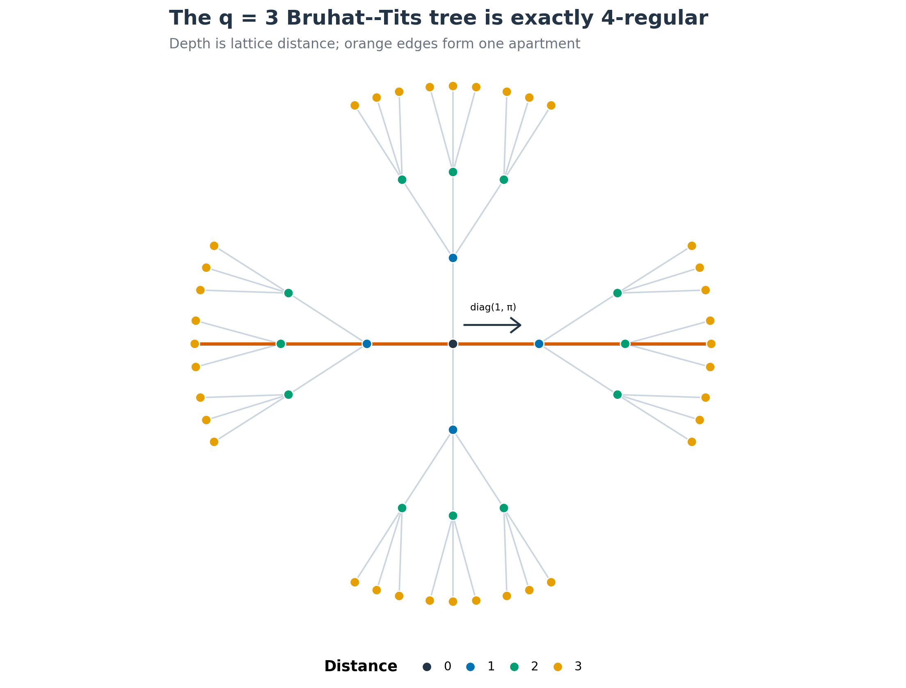

# Bruhat–Tits Trees and Buildings {#sec-bruhat-tits-buildings}

**Level and prerequisites: L5.** Prepare discrete valuation rings, lattices, simplicial graphs and linear algebraic groups. The [reader guide](index.md) links the Euler arithmetic, algebra and analysis preparation and distinguishes the graduate continuation.

The ultrametric ball tree records how residue classes refine. A different tree
records how integral coordinate systems in a two-dimensional vector space differ.
That second tree is the Bruhat–Tits tree. It turns matrices over a local field
into motions of a discrete geometric object, and it is the entry point to the
geometry of reductive groups over local fields.

This chapter constructs the tree from scratch. The construction uses lattices,
but here a lattice is not a Euclidean grid. It is an $\mathcal O_K$-module inside
$K^2$. We prove the neighbour count, distance formula, tree property, and basic
matrix action before stating the higher-dimensional theory.

## Preparation from this book

Let $K$ be a finite extension of $\mathbb Q_p$. Chapter 12 supplied its valuation
$v$, ring of integers

$$
\mathcal O=\{x\in K:v(x)\ge0\},
$$

maximal ideal $\mathfrak m=\pi\mathcal O$, uniformizer $\pi$, and residue field
$k=\mathcal O/\pi\mathcal O$ of size $q$. Chapter 5 explained reduction modulo
powers of a uniformizer. Chapter 3 built trees from nested residue balls, while
Chapter 23 built Berkovich paths from disc seminorms. Those two constructions
prepare intuition, but neither is the tree constructed below.

We need four small pieces of linear algebra.

1. A vector in $K^2$ is a pair $(x,y)$ with coordinatewise addition and scalar
   multiplication.
2. Two vectors $e_1,e_2$ are a basis if every vector is uniquely $xe_1+ye_2$.
3. A $2$-by-$2$ matrix acts by sending column vectors to column vectors.
4. A line in $k^2$ is a one-dimensional $k$-subspace. The set of such lines is
   the projective line $\mathbf P^1(k)$.

Every line in $k^2$ is either

$$
\langle(1,a)\rangle\quad(a\in k)
\qquad\text{or}\qquad
\langle(0,1)\rangle.
$$

There are therefore $q+1$ lines. This elementary count will become the valency
of the tree.

## Lattices and homothety classes

An **$\mathcal O$-lattice** in $K^2$ is a submodule of the form

$$
L=\mathcal O e_1\oplus\mathcal O e_2
$$

for some $K$-basis $e_1,e_2$. It spans $K^2$ but permits only integral
coefficients in that basis. The standard lattice is
$L_0=\mathcal O(1,0)\oplus\mathcal O(0,1)$.

Multiplying by $a\in K^\times$ gives another lattice $aL$. We declare $L$ and
$aL$ **homothetic**, written $L\sim aL$. A vertex of the Bruhat–Tits tree is a
homothety class $[L]$.

Why quotient by scaling? The lattices $L$ and $\pi L$ encode the same integral
coordinate system with every scale shifted once. Matrix geometry should remember
their relative elementary divisors, not an arbitrary common scale.

**Example.** The lattices

$$
L_0=\mathcal O e_1\oplus\mathcal O e_2,
\qquad
L_1=\mathcal O e_1\oplus\pi\mathcal O e_2
$$

are not homothetic. Scaling both coordinates cannot change only the second
coordinate's divisibility.

**Nonexample.** The submodule $\mathcal O e_1$ is not a lattice in $K^2$: it
does not span the second coordinate. Nor is an arbitrary dense additive subgroup
a lattice; the finite free $\mathcal O$-module condition matters.

## Edges from one-step inclusions

Two distinct vertices $[L]$ and $[M]$ are adjacent if representatives can be
chosen so that

$$
\pi L\subsetneq M\subsetneq L.
$$

The quotient $L/\pi L$ is a two-dimensional $k$-vector space. The intermediate
module $M$ maps to a nonzero proper subspace $M/\pi L$, hence to a line. Conversely,
the inverse image of any line in $L/\pi L$ is an intermediate lattice. Thus
neighbours of $[L]$ are in bijection with $\mathbf P^1(k)$.

This also proves independence from representatives. If $L$ is replaced by $aL$,
multiply the entire chain by $a$. Replacing an intermediate $M$ by a homothetic
representative does not create a new vertex.

### Complete neighbour calculation

Reduce $L_0$ modulo $\pi$. For $a\in k$, let $M_a$ be the inverse image of
$\langle(1,a)\rangle$, and let $M_\infty$ be the inverse image of
$\langle(0,1)\rangle$. Choosing lifts of $a$ to $\mathcal O$ gives

$$
M_a=\mathcal O(e_1+ae_2)\oplus\pi\mathcal Oe_2,
\qquad
M_\infty=\pi\mathcal Oe_1\oplus\mathcal Oe_2.
$$

Different residue lines give different homothety classes: each $M/\pi L_0$
can be recovered from the intermediate lattice. Hence every vertex has exactly
$q+1$ neighbours.

## Distance through elementary divisors

The elementary-divisor theorem over the discrete valuation ring $\mathcal O$
says that for any two lattices $L,M$, there is a basis $e_1,e_2$ of $L$ and
integers $a\le b$ such that

$$
M=\pi^a\mathcal Oe_1\oplus\pi^b\mathcal Oe_2.
$$

Scaling $M$ by $\pi^{-a}$ leaves its vertex unchanged, so the pair has normal
form

$$
L=\mathcal Oe_1\oplus\mathcal Oe_2,
\qquad
M'=\mathcal Oe_1\oplus\pi^{b-a}\mathcal Oe_2.
$$

The integer

$$
d([L],[M])=b-a
$$

is independent of all choices. Indeed, the difference between the largest and
smallest elementary-divisor exponents is unchanged by common scaling or by
invertible changes of integral basis.

There is an explicit path of this length:

$$
[L_i]=[\mathcal Oe_1\oplus\pi^i\mathcal Oe_2],
\qquad 0\le i\le b-a.
$$

Consecutive vertices are adjacent. No shorter path can change the exponent gap
by more than one at each edge, so the displayed path is geodesic.

The elementary-divisor theorem itself follows by valuation-aware row and column
operations: choose an entry of least valuation in a matrix taking a basis of
$L$ to generators of $M$, move it to the first diagonal position, clear its row
and column using division in the DVR, and repeat on the remaining entry. This is
the same mechanism as Smith normal form over the integers.

## Why the graph is a tree

Connectedness follows from the explicit elementary-divisor path. Fix $[L_0]$.
A vertex at distance $n>0$ can be written
$[L_n]=[\mathcal Oe_1\oplus\pi^n\mathcal Oe_2]$ in a basis adapted to
$L_0$. Neighbours are represented by inverse images of lines in
$L_n/\pi L_n$. The line generated by $\pi^ne_2$ gives
$\pi\mathcal Oe_1\oplus\pi^n\mathcal Oe_2=\pi L_{n-1}$, hence the unique
neighbour at distance $n-1$. Each of the other $q$ residue lines contains a
vector with unit $e_1$-coordinate and produces elementary-divisor gap $n+1$.
Thus the remaining $q$ neighbours increase the distance by one.

If a cycle existed, choose on that cycle a vertex farthest from $[L_0]$. Its two
cycle neighbours could not be farther away, so both would have to be the unique
neighbour one step closer. They would be the same vertex, contradicting that the
cycle has distinct adjacent vertices. Thus the connected graph has no cycles.

The sphere sizes now follow without approximation:

$$
|S_0|=1,\qquad |S_1|=q+1,\qquad
|S_n|=(q+1)q^{n-1}\quad(n\ge1).
$$

Every vertex after the first has one inward edge and $q$ outward edges.

## Apartments and diagonal motion

For a fixed basis $e_1,e_2$, the vertices

$$
L_n=\mathcal Oe_1\oplus\pi^n\mathcal Oe_2,
\qquad n\in\mathbb Z,
$$

form a bi-infinite geodesic called an **apartment**. Changing $n$ by one follows
one edge. The diagonal matrix

$$
g=\begin{pmatrix}1&0\\0&\pi\end{pmatrix}
$$

sends $[L_n]$ to $[L_{n+1}]$, so it translates this apartment by one step.

Diagonal matrices preserve the apartment because they preserve its two coordinate
lines. Other matrices send it to apartments determined by other pairs of lines.
Any two vertices lie in some apartment: their elementary-divisor basis constructs
one.

## The group action and stabilisers

Every $g\in GL_2(K)$ sends a lattice $L$ to $gL$. It preserves inclusions and
homothety, so it acts by tree automorphisms. Scalar matrices act trivially on
homothety classes. The effective group is therefore

$$
PGL_2(K)=GL_2(K)/K^\times.
$$

The stabiliser of $[L_0]$ in $GL_2(K)$ is
$K^\times GL_2(\mathcal O)$. After quotienting scalars, this is the standard
maximal compact subgroup of $PGL_2(K)$. To see the claim, scale a stabilising
matrix until it sends $L_0$ exactly to itself; its matrix and inverse then have
integral entries, so it lies in $GL_2(\mathcal O)$.

The action is transitive on vertices because a basis of any lattice is the image
of the standard basis under some invertible matrix. It is also transitive on
oriented edges.

## Cartan decomposition from distance

Let $K_0=GL_2(\mathcal O)$. Elementary divisors give the disjoint decomposition

$$
GL_2(K)
=\coprod_{\substack{a\in\mathbb Z\\ n\ge0}}
\pi^a K_0
\begin{pmatrix}\pi^n&0\\0&1\end{pmatrix}
K_0
$$

and, after quotienting central scalars,

$$
PGL_2(K)=\coprod_{n\ge0}\overline K_0
\begin{pmatrix}\pi^n&0\\0&1\end{pmatrix}\overline K_0.
$$

The integer $n$ is the distance from $[L_0]$ to $g[L_0]$. Together with $n$,
the determinant valuation determines $a$ through
$v(\det g)=2a+n$. Left and right multiplication by $K_0$ changes integral
bases but not these invariants.

This is more than a matrix factorisation. It says bi-$K_0$-invariant functions
on the group are radial functions on the tree. Chapter 41 turns their convolution
into an adjacency calculation.

## Boundary points and geodesic rays

A geodesic ray is an infinite path that never backtracks. Two rays define the
same end if they eventually remain at bounded distance. The ends of the
Bruhat–Tits tree identify naturally with $\mathbf P^1(K)$.

One direction can be seen concretely. A line $\ell\subset K^2$ determines
lattices that become progressively more concentrated along $\ell$. In the
standard apartment, the two ends correspond to the coordinate lines
$Ke_1$ and $Ke_2$. Applying $PGL_2(K)$ produces every line in $K^2$.

The full topological boundary identification is stated here with this construction
as its proof map. It requires checking independence from lattice representatives
and showing every ray determines a unique limiting line.

## Buildings and Berkovich spaces are not the same object

The Berkovich affine line of Chapter 23 has points that are multiplicative
seminorms. Its tree paths encode inclusion among discs. A Bruhat–Tits vertex is
a homothety class of rank-two lattices, and its edges encode index-$q$ changes of
integral structure. The two trees can interact—for example, buildings occur as
skeleta of certain analytic spaces—but their points and universal properties
are different.

For $GL_n(K)$, lattices in $K^n$ produce a higher-dimensional simplicial complex.
Apartments resemble copies of $\mathbb R^{n-1}$ tiled by simplices. Reductive
groups have Bruhat–Tits buildings assembled from apartments associated with
maximal split tori. We do not construct that general theory here; the rank-one
tree exhibits its local incidence, group action, compact stabilisers, and
apartment geometry without suppressing definitions.

## Retractions, height, and horospheres

Fix the standard apartment and one of its ends, say the end represented by the
line $Ke_1$. Every vertex has a unique closest route toward that end. Projecting
along those routes defines a **retraction** onto the apartment once a suitable
sector is fixed. In rank one this operation can be described without general
building axioms: follow the unique geodesic from a vertex toward the selected end
until it first meets the standard apartment.

The associated integer-valued height is a **Busemann function**. Choose apartment
coordinates so $b([L_n])=n$. If two adjacent vertices are compared, their
Busemann values differ by one. Sets on which $b$ is constant are horospheres.
They are the tree analogue of level sets perpendicular to a direction, although
no angle or Euclidean perpendicularity is present.

Upper-triangular matrices preserve the end $Ke_1$. Their diagonal entries change
height, while their unipotent entries move within or among horospheres. This is
the geometric shadow of the decomposition

$$
\begin{pmatrix}a&u\\0&d\end{pmatrix}
= \begin{pmatrix}a&0\\0&d\end{pmatrix}
\begin{pmatrix}1&a^{-1}u\\0&1\end{pmatrix}.
$$

The height change of the diagonal part is $v(d)-v(a)$ under the displayed
orientation. Reversing the chosen end reverses the sign. A statement involving
height is therefore incomplete until the end and sign convention are declared.

## Quotient graphs and finite fundamental domains

If a subgroup $\Gamma\subset PGL_2(K)$ acts on the tree, its quotient records
orbits of vertices and edges. Stabilizers may be nontrivial, so a quotient is
often naturally a graph with vertex and edge weights rather than a plain graph.
An edge can fold onto itself, and several edges can share one quotient image.

When $\Gamma$ is discrete and has a finite fundamental domain, the infinite tree
is recovered by translating finitely many orbit representatives. Arithmetic
groups produce important examples, but discreteness depends on the ambient
global construction; an arbitrary dense subgroup of $PGL_2(K)$ does not give a
locally finite quotient of the desired kind.

There is a useful finite identity. Let a finite group $H$ act on a finite
truncation $X$. Burnside's lemma gives

$$
|H\backslash X|
=\frac1{|H|}\sum_{h\in H}|X^h|.
$$

This counts vertex orbits exactly from fixed-point data. It does not by itself
describe quotient adjacency, because edge orbits and incidence maps must also be
stored. The distinction is the graph-theoretic analogue of reporting only the
order of a cohomology group while discarding its maps.

### The Drinfeld upper half-plane {#the-drinfeld-upper-half-plane-handoff}

Over a complete algebraic closure, remove the $K$-rational points
$\mathbf P^1(K)$ from the analytic projective line. The resulting Drinfeld
upper half-plane carries an action of $PGL_2(K)$. It has a canonical retraction
onto the Bruhat–Tits tree. Roughly, a suitable analytic point determines a norm
on $K^2$, and the integral unit ball of that norm determines lattice data.

This statement explains why the same tree appears in analytic geometry and
representation theory. It does not identify every analytic point with a vertex:
whole analytic regions retract to one vertex or edge. The tree is a skeleton,
not the full space.

The boundary removed from the upper half-plane is exactly $\mathbf P^1(K)$,
matching the end space of the tree. Matrices act compatibly on the analytic
domain, skeleton, and boundary. Establishing the retraction rigorously uses
Berkovich or rigid analytic geometry beyond Chapter 23's first models, so this
chapter records the compatibility as a theorem map.

Arithmetic quotients of the Drinfeld space lead to uniformization of certain
curves, just as the Tate quotient in Chapter 34 uniformizes split multiplicative
elliptic curves. The groups and domains differ, and one quotient construction
must not be substituted for the other.

## A second worked comparison of lattices

Let

$$
g=\begin{pmatrix}\pi&1\\0&1\end{pmatrix}.
$$

The off-diagonal entry may make the image lattice look unrelated to the standard
apartment. The formal factorisation

$$
g=\begin{pmatrix}\pi&0\\0&1\end{pmatrix}
\begin{pmatrix}1&\pi^{-1}\\0&1\end{pmatrix}
$$

is algebraically correct but is not an integral double-coset certificate because
the final matrix contains $\pi^{-1}$. Instead, inspect the columns $\pi e_1$ and
$e_1+e_2$. They lie in $L_0$, their reductions span the single line
$\langle e_1+e_2\rangle$, and the determinant has valuation one. Hence $gL_0$
is an index-$q$ sublattice of $L_0$. Equivalently, the valid factorisation

$$
g=\begin{pmatrix}1&1\\0&1\end{pmatrix}
\begin{pmatrix}\pi&0\\0&1\end{pmatrix}
$$

has its first factor in $K_0$. Both arguments certify
$d([L_0],[gL_0])=1$.

This example illustrates a safe rule: a formal matrix factorisation is useful
only when the claimed compact factors and their inverses are integral. Determinant
valuation alone is not enough in general, because a central scalar changes it by
an even amount without moving the vertex. The elementary-divisor gap, not the
determinant by itself, is the invariant.

The same audit works algorithmically. Store the two column vectors, perform only
row and column operations whose determinants are units, record the two diagonal
valuations, and subtract them. A verifier can multiply the recorded operations
back together and check the original matrix exactly. If a division by a nonunit
appears, the operation is not an integral basis change and the certificate must
be rejected. This links the geometric distance directly to Chapter 39's rule
that every finite local-field computation must expose its precision and its
allowed transformations.

## Reproducible case: the radius-two tree over $\mathbb Q_3$

Take $K=\mathbb Q_3$, $\pi=3$, and $q=3$. The standard vertex has four
neighbours corresponding to

$$
\langle(1,0)\rangle,
\langle(1,1)\rangle,
\langle(1,2)\rangle,
\langle(0,1)\rangle
\subset\mathbb F_3^2.
$$

Each neighbour has one edge back and three new outward edges. Thus the first
three sphere sizes are $1,4,12$, and the closed radius-two ball has $17$
vertices and $16$ edges. Those two numbers certify that the finite truncation is
a tree: a connected finite graph with $V-1$ edges has no cycles.

<figure id="fig-bruhat-tits-tree">


<figcaption>

Figure 40.1: A finite Bruhat–Tits tree records lattice distance, a highlighted apartment, and translation by a diagonal matrix.

</figcaption>
</figure>

[Figure 40.1](#fig-bruhat-tits-tree) uses a planar layout only to make adjacency legible. Angles
and Euclidean edge lengths carry no arithmetic meaning. Sphere, edge, and
highlighted-path data are generated from exact integer recursion.

A reproducible certificate stores, for every displayed vertex, its parent, depth,
branch label, and whether it lies on the selected apartment. A checker verifies
one parent at positive depth, $q$ outward children below the cutoff, and the
counts above. No random graph layout is needed.

## Theorem-scope and failure audit

- The neighbour count, distance formula, tree proof, sphere sizes, stabiliser,
  and rank-two Cartan decomposition were derived here.
- Elementary divisors use that $\mathcal O$ is a DVR. An arbitrary local ring
  need not provide the same diagonal normal form.
- A finite plotted truncation illustrates a building; it does not prove global
  contractibility or identify the full boundary.
- The end space $\mathbf P^1(K)$ is a theorem about rays, not a claim that tree
  vertices themselves are field elements.
- The higher-rank building and its compatibility axioms are stated destinations.
- A Berkovich skeleton can resemble a building without making their point sets
  interchangeable.

<!-- inline-formula-code:start -->
## Formula and finite computation

A useful formula in this chapter is

$$
\deg(v)=q+1
$$

The first layers of a regular tree can be counted without drawing an infinite building. The following standalone Python block expresses that finite rule with its inputs and stopping conditions visible.

```python
residue_size = 3
layers = [1]
for depth in range(1, 6):
    count = residue_size + 1 if depth == 1 else layers[-1] * residue_size
    layers.append(count)
print(layers)
```

**What the computation establishes.** The output certifies only the declared finite case. The theorem, if one is claimed, still requires the argument developed in the chapter.
<!-- inline-formula-code:end -->

## Exercises

<div class="exercise" id="p_adic_numbers-40-bruhat-tits-buildings-ex-1">
<p class="exercise-title"><strong>Exercise 1</strong></p>

List $\mathbf P^1(\mathbb F_2)$ and construct the three neighbours of the
standard vertex over $\mathbb Q_2$.

<details class="solution"><summary>Solution</summary>

The lines in $\mathbb F_2^2$ are
$\langle(1,0)\rangle$, $\langle(1,1)\rangle$, and
$\langle(0,1)\rangle$. Their inverse images are

$$
\mathcal Oe_1\oplus2\mathcal Oe_2,
\quad
\mathcal O(e_1+e_2)\oplus2\mathcal Oe_2,
\quad
2\mathcal Oe_1\oplus\mathcal Oe_2.
$$

Each lies strictly between $2L_0$ and $L_0$, and the recovered residue lines
show that the vertices are distinct.

</details>

</div>

<div class="exercise" id="p_adic_numbers-40-bruhat-tits-buildings-ex-2">
<p class="exercise-title"><strong>Exercise 2</strong></p>

Prove that inverse images of distinct residue lines give distinct neighbouring
vertices.

</div>

<div class="exercise" id="p_adic_numbers-40-bruhat-tits-buildings-ex-3">
<p class="exercise-title"><strong>Exercise 3</strong></p>

Derive the sphere formula $(q+1)q^{n-1}$.

<details class="solution"><summary>Solution</summary>

There are $q+1$ choices at distance one. At every later step, one of the
$q+1$ adjacent edges returns toward the root. Taking it would backtrack, so
there are exactly $q$ outward choices. Multiplication gives
$(q+1)q^{n-1}$ for $n\ge1$.

</details>

</div>

<div class="exercise" id="p_adic_numbers-40-bruhat-tits-buildings-ex-4">
<p class="exercise-title"><strong>Exercise 4</strong></p>

Count vertices and edges in the radius-three ball when $q=2$.

</div>

<div class="exercise" id="p_adic_numbers-40-bruhat-tits-buildings-ex-5">
<p class="exercise-title"><strong>Exercise 5</strong></p>

Put $M=\pi^{-2}\mathcal Oe_1\oplus\pi^3\mathcal Oe_2$ and compute
$d([L_0],[M])$.

<details class="solution"><summary>Solution</summary>

Scale $M$ by $\pi^2$. Its class has representative

$$
\mathcal Oe_1\oplus\pi^5\mathcal Oe_2.
$$

The elementary-divisor gap is $5-0=5$, so the distance is $5$. Treating the
two original exponents separately would incorrectly make distance depend on a
common scale.

</details>

</div>

<div class="exercise" id="p_adic_numbers-40-bruhat-tits-buildings-ex-6">
<p class="exercise-title"><strong>Exercise 6</strong></p>

Prove that scalar matrices act trivially and that the action factors through
$PGL_2(K)$.

</div>

<div class="exercise" id="p_adic_numbers-40-bruhat-tits-buildings-ex-7">
<p class="exercise-title"><strong>Exercise 7</strong></p>

Show that $\operatorname{diag}(1,\pi^r)$ translates the standard apartment
by $r$ steps, with direction determined by the sign of $r$.

</div>

<div class="exercise" id="p_adic_numbers-40-bruhat-tits-buildings-ex-8">
<p class="exercise-title"><strong>Exercise 8</strong></p>

Prove that the stabiliser of $[L_0]$ is $K^\times GL_2(\mathcal O)$.

</div>

<div class="exercise" id="p_adic_numbers-40-bruhat-tits-buildings-ex-9">
<p class="exercise-title"><strong>Exercise 9</strong></p>

Explain why every vertex at positive distance has one inward neighbour and
$q$ outward neighbours.

</div>

<div class="exercise" id="p_adic_numbers-40-bruhat-tits-buildings-ex-10">
<p class="exercise-title"><strong>Exercise 10</strong></p>

Derive the rank-two Cartan decomposition from elementary divisors.

<details class="solution"><summary>Solution</summary>

For $g\in GL_2(K)$, apply elementary divisors to $L_0$ and $gL_0$. Integral
basis changes on the source and target give $k_1,k_2\in K_0$ and integers
$a\le b$ with

$$
g=k_1\operatorname{diag}(\pi^a,\pi^b)k_2.
$$

Put $n=b-a$. Up to swapping the two diagonal entries by integral permutation
matrices, this gives
$g\in\pi^aK_0\operatorname{diag}(\pi^n,1)K_0$. The distance recovers $n$,
and $v(\det g)=2a+n$ then recovers $a$, so the union is disjoint. Quotienting
by scalar matrices removes $a$ and gives the stated $PGL_2$ decomposition.

The next chapter makes these double cosets into operators on smooth
representations.

</details>

</div>

<div class="exercise" id="p_adic_numbers-40-bruhat-tits-buildings-ex-11">
<p class="exercise-title"><strong>Exercise 11</strong></p>

Give two precise differences between a Berkovich disc point and a
Bruhat–Tits vertex.

</div>

<div class="exercise" id="p_adic_numbers-40-bruhat-tits-buildings-ex-12">
<p class="exercise-title"><strong>Exercise 12</strong></p>

Design a deterministic certificate for a radius-$R$ truncation and state
the expected numbers of vertices and edges.

</div>

## Selected solutions

### Solution to Exercise 1

The lines in $\mathbb F_2^2$ are
$\langle(1,0)\rangle$, $\langle(1,1)\rangle$, and
$\langle(0,1)\rangle$. Their inverse images are

$$
\mathcal Oe_1\oplus2\mathcal Oe_2,
\quad
\mathcal O(e_1+e_2)\oplus2\mathcal Oe_2,
\quad
2\mathcal Oe_1\oplus\mathcal Oe_2.
$$

Each lies strictly between $2L_0$ and $L_0$, and the recovered residue lines
show that the vertices are distinct.

### Solution to Exercise 3

There are $q+1$ choices at distance one. At every later step, one of the
$q+1$ adjacent edges returns toward the root. Taking it would backtrack, so
there are exactly $q$ outward choices. Multiplication gives
$(q+1)q^{n-1}$ for $n\ge1$.

### Solution to Exercise 5

Scale $M$ by $\pi^2$. Its class has representative

$$
\mathcal Oe_1\oplus\pi^5\mathcal Oe_2.
$$

The elementary-divisor gap is $5-0=5$, so the distance is $5$. Treating the
two original exponents separately would incorrectly make distance depend on a
common scale.

### Solution to Exercise 10

For $g\in GL_2(K)$, apply elementary divisors to $L_0$ and $gL_0$. Integral
basis changes on the source and target give $k_1,k_2\in K_0$ and integers
$a\le b$ with

$$
g=k_1\operatorname{diag}(\pi^a,\pi^b)k_2.
$$

Put $n=b-a$. Up to swapping the two diagonal entries by integral permutation
matrices, this gives
$g\in\pi^aK_0\operatorname{diag}(\pi^n,1)K_0$. The distance recovers $n$,
and $v(\det g)=2a+n$ then recovers $a$, so the union is disjoint. Quotienting
by scalar matrices removes $a$ and gives the stated $PGL_2$ decomposition.

The next chapter makes these double cosets into operators on smooth
representations.
