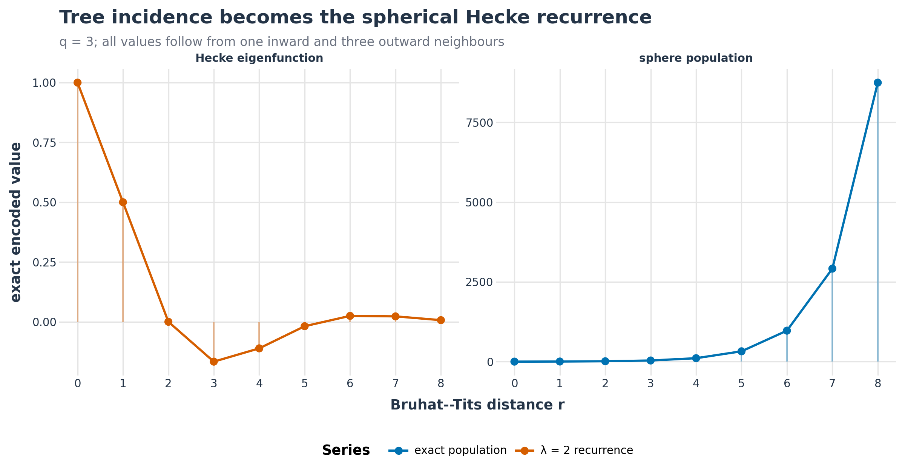

# Smooth Representations and Hecke Algebras {#sec-smooth-representations}

**Level and prerequisites: L5.** Prepare locally compact groups, smooth group actions, Hecke algebras and Haar measure. The [reader guide](index.md) links the Euler arithmetic, algebra and analysis preparation and distinguishes the graduate continuation.

Chapter 26 represented the absolute Galois group by continuous $p$-adic
matrices. We now change both the group and the meaning of continuity. The group
is $GL_2(K)$ or $PGL_2(K)$, and the vector space is usually complex. A
representation is called smooth when every individual vector is fixed by some
open subgroup. That condition turns the group's compact-open geometry into
finite linear algebra.

The Bruhat–Tits tree from Chapter 40 makes the first Hecke operator visible: it
is adjacency. From that exact calculation we build the language of spherical
vectors, principal series, conductors, and local factors, then state the boundary
of the local Langlands correspondence.

## Preparation from this book

We use these earlier constructions.

- Chapter 11 supplied locally compact groups and Haar measure.
- Chapter 22 defined convolution and local zeta integrals.
- Chapter 26 distinguished topological group actions and open stabilizers.
- Chapter 27 decomposed $K^\times$ into valuation and unit factors.
- Chapter 40 constructed the $(q+1)$-regular tree of $PGL_2(K)$.

A representation of a group $G$ on a vector space $V$ is a homomorphism

$$
\rho:G\longrightarrow GL(V).
$$

Equivalently, it is an action satisfying $1v=v$ and
$g(hv)=(gh)v$. A subspace stable under every $g$ is a subrepresentation. The
representation is **irreducible** if its only stable subspaces are $0$ and $V$.
No previous representation theory is assumed.

## Two meanings of representation

A $p$-adic Galois representation from Chapter 33 is a continuous map

$$
G_K\longrightarrow GL_n(\mathbb Q_p)
$$

between topological groups. A smooth representation in this chapter is typically
an action of $GL_2(K)$ on a complex vector space $V$, possibly infinite
dimensional, such that

$$
V=\bigcup_{U}V^U,
$$

where $U$ ranges over open compact subgroups and
$V^U=\{v:uv=v\text{ for every }u\in U\}$.

Thus every vector has an open stabilizer. We do not put a norm or topology on
$V$ and ask for matrix continuity. The word **smooth** means locally constant
orbit maps.

**Example.** Let $G$ act on locally constant, compactly supported functions on
$G$ by right translation. Each function is constant on right cosets of some
open compact subgroup, so its stabilizer contains such a subgroup.

**Nonexample.** An arbitrary function $f:G\to\mathbb C$ whose values change on
every arbitrarily small neighbourhood need not generate a smooth vector under
translation. Nor does a continuous $p$-adic Galois representation become a
smooth complex representation merely by changing notation.

## Smoothness, admissibility, and irreducibility

A smooth representation is **admissible** if $V^U$ is finite-dimensional for
every open compact $U$. Smoothness says each vector is visible at some finite
level; admissibility says each fixed level contains only finitely many independent
directions.

Finite-dimensional smooth representations are automatically trivial on an open
subgroup: choose a basis, take one open stabilizer for each basis vector, and
intersect the finitely many stabilizers. Infinite-dimensional representations
carry most of the interesting theory. Irreducibility and
admissibility are separate: a direct sum of infinitely many copies of the
trivial representation is smooth but not admissible because $V^U=V$ is
infinite-dimensional.

For a compact open $U$, averaging

$$
e_Uv=\frac1{\operatorname{vol}(U)}\int_Uuv\,du
$$

projects suitable smooth vectors onto $V^U$. The integral is a finite sum after
passing to an open subgroup fixing $v$. This is exact local averaging, not a
numerical quadrature.

## Induction and compact induction

Let $H$ be a closed subgroup of $G$ and let $(\sigma,W)$ be a smooth
representation of $H$. The induced representation consists of suitable
functions $f:G\to W$ satisfying

$$
f(hg)=\sigma(h)f(g).
$$

The group acts by right translation. Smooth induction imposes local constancy;
compact induction additionally requires support compact modulo $H$. We write

$$
\operatorname{c-Ind}_H^G\sigma
$$

for compact induction.

Compact induction from an open compact-mod-centre subgroup is a major source of
supercuspidal representations. We will not classify those sources. The important
entry-level point is that equivariant functions turn a representation of a
smaller subgroup into one of the full group, while a support condition controls
size.

## Haar measure and convolution

For locally constant compactly supported functions on $G$, define

$$
(f_1*f_2)(g)
=\int_G f_1(h)f_2(h^{-1}g)\,dh.
$$

Fix a left Haar measure. If $G$ is unimodular, as $GL_2(K)$ is, left and right
translations interact without a modular correction. The integral reduces to a
finite coset sum because both functions have compact support and open local
constancy subgroups.

Associativity follows by changing the order of a finite sum. The identity is not
an ordinary function on a nondiscrete group, but for $U$ open compact the
normalized indicator

$$
e_U=\frac{\mathbf1_U}{\operatorname{vol}(U)}
$$

is an idempotent: $e_U*e_U=e_U$. Acting by $e_U$ extracts $U$-fixed vectors.

## Spherical Hecke algebras

Let $G=PGL_2(K)$ and let $K_0=PGL_2(\mathcal O)$, with
$\operatorname{vol}(K_0)=1$. The **spherical Hecke algebra**

$$
\mathcal H(G,K_0)
$$

consists of compactly supported, complex-valued functions that are invariant
under left and right multiplication by $K_0$. Its basis indicators are indexed
by the double cosets

$$
K_0a_nK_0,
\qquad
a_n=\begin{pmatrix}\pi^n&0\\0&1\end{pmatrix},\quad n\ge0.
$$

Chapter 40 proved that $n$ is distance in the tree. Consequently the algebra is
radial: a basis element sees one distance sphere.

A representation with a nonzero vector fixed by $K_0$ is **spherical**. Its
$K_0$-fixed subspace is acted on by $\mathcal H(G,K_0)$. In an irreducible
admissible spherical representation, this fixed subspace is one-dimensional;
then every Hecke operator acts by a scalar.

### Multiplication from path counting

Let $T_n$ be the indicator of the distance-$n$ double coset. Multiplying by
$T_1$ means take one tree step and then inspect distance from the original root.
For $n\ge2$, a vertex at distance $n$ has one neighbour at distance $n-1$ and
$q$ neighbours at distance $n+1$. With compatible indicator normalizations this
gives

$$
T_1*T_n=T_{n+1}+qT_{n-1}.
$$

At $n=1$ the root is exceptional: all $q+1$ first steps can return along their
own reversed edge, so

$$
T_1*T_1=T_2+(q+1)T_0.
$$

These identities can also be checked from right-coset representatives. They
show that the entire spherical Hecke algebra is generated by $T_1$: solve the
recurrence successively for every $T_n$. The exceptional root coefficient is
why blindly applying the $n\ge2$ formula at $n=1$ gives a wrong constant term.

Commutativity follows in rank one because every product reduces to a polynomial
in the one generator. For a general reductive group, commutativity of the
spherical Hecke algebra is part of the Satake theory rather than a consequence
of one tree recurrence.

### Iwahori level and oriented edges

The subgroup $K_0$ stabilizes a vertex. The **Iwahori subgroup** $I$ is the
inverse image of the upper-triangular Borel subgroup of $GL_2(k)$ under
reduction

$$
GL_2(\mathcal O)\longrightarrow GL_2(k).
$$

Geometrically, $I$ stabilizes an oriented edge adjacent to the standard vertex.
Thus passing from $K_0$-fixed vectors to $I$-fixed vectors remembers one extra
residue direction.

The Iwahori–Hecke algebra consists of compactly supported bi-$I$-invariant
functions. Unlike the one-generator spherical algebra, it remembers reflections
and translations in the affine Weyl group. Its basic generator associated with a
simple reflection satisfies a quadratic relation of the form

$$
(T_s+1)(T_s-q)=0
$$

under the standard indicator normalization. Rescaling the generator changes the
displayed constants.

This algebra detects representations with no spherical vector. The Steinberg
representation, for example, has an Iwahori-fixed line. A finite computation can
recover the quadratic relation by partitioning two-step edge galleries according
to whether they fold or move forward. We state the full affine-Weyl presentation
as a theorem map; the vertex and edge stabilizer interpretations are immediate
from reduction modulo $\pi$.

## Double cosets as tree adjacency

Put $a=a_1$. There is a disjoint right-coset decomposition

$$
K_0aK_0
=\coprod_{u\in k}
\begin{pmatrix}\pi&\widetilde u\\0&1\end{pmatrix}K_0
\;\coprod\;
\begin{pmatrix}1&0\\0&\pi\end{pmatrix}K_0,
$$

where $\widetilde u$ is any lift of $u$. There are $q+1$ cosets. Their images
of the standard vertex are precisely its $q+1$ neighbours.

Let $T=\mathbf1_{K_0aK_0}$. On functions on the vertex set $G/K_0$, right
convolution gives

$$
(T*f)(x)=\sum_{y\sim x}f(y),
$$

with the chosen normalization. Thus $T$ is the adjacency operator. Changing
Haar measure or multiplying the indicator by a power of $q$ changes the
eigenvalue normalization but not the neighbour relation.

## Radial eigenfunction recurrence

Suppose $f$ is radial about a root and has value $a_r$ at distance $r$. At the
root all $q+1$ neighbours lie in sphere one, so

$$
(Tf)(0)=(q+1)a_1.
$$

At distance $r\ge1$, a vertex has one inward neighbour and $q$ outward
neighbours. Therefore

$$
(Tf)(r)=a_{r-1}+qa_{r+1}.
$$

If $Tf=\lambda f$ and $a_0=1$, then

$$
\lambda=(q+1)a_1,
\qquad
\lambda a_r=a_{r-1}+qa_{r+1}.
$$

This is a complete derivation from incidence counts. It is the local analogue of
a second-order differential equation, but its independent variable is discrete
tree distance.

For $q=3$ and $\lambda=2$,

$$
a_1=\frac12,\qquad
a_2=0,\qquad
a_3=-\frac16,\qquad
a_4=-\frac19.
$$

Each value follows exactly from the recurrence. A formal sequence for an
arbitrary $\lambda$ need not be a matrix coefficient of a unitary representation;
growth and representation-theoretic conditions remain to be checked.

<figure id="fig-spherical-hecke">


<figcaption>

Figure 41.1: Sphere populations and an exact radial Hecke eigenfunction are compared across Bruhat–Tits distance.

</figcaption>
</figure>

[Figure 41.1](#fig-spherical-hecke) plots exact recurrence data. The real vertical position of a
complex representation coefficient is a display convention; the graph-distance
and rational values are the mathematical data.

## Principal series and normalisation

Return to $G=GL_2(K)$ and let $B$ be the upper-triangular subgroup. For

$$
b=\begin{pmatrix}a&*\\0&d\end{pmatrix},
$$

the modulus character is $\delta_B(b)=|a/d|$. Given quasicharacters
$\chi_1,\chi_2:K^\times\to\mathbb C^\times$, normalized induction uses

$$
f(bg)=\delta_B(b)^{1/2}\chi_1(a)\chi_2(d)f(g).
$$

The resulting representation is a **principal series**. It is unramified when
both characters are trivial on $\mathcal O^\times$. Then it has a spherical
vector determined by its value at the identity.

Write $\alpha=\chi_1(\pi)$ and $\beta=\chi_2(\pi)$. Under one standard
normalized Hecke convention the spherical eigenvalue is
$q^{1/2}(\alpha+\beta)$. Under the unnormalized adjacency convention above,
the scalar is rescaled. A formula without its induction, Frobenius, and Hecke
normalizations is incomplete.

Reducibility occurs at special character ratios. The one-dimensional character
representations and the Steinberg representation arise as special subquotients.
The Steinberg representation is infinite-dimensional and has an Iwahori-fixed
line but no nonzero $GL_2(\mathcal O)$-fixed vector; the same holds for its
unramified twists.

### A fully specified unramified example

Let $\chi_1=|\cdot|^{t}$ and $\chi_2=|\cdot|^{-t}$ for a fixed complex number
$t$. Both are trivial on $\mathcal O^\times$, so the normalized induced
representation is unramified. Because $|\pi|=q^{-1}$,

$$
\alpha=q^{-t},\qquad \beta=q^t.
$$

The standard normalized spherical eigenvalue is therefore

$$
q^{1/2}(q^t+q^{-t}).
$$

At $t=0$ this becomes $2q^{1/2}$. This is not the constant function's
unnormalized adjacency eigenvalue $q+1$: normalized induction from the two
trivial characters is not the trivial representation. Reducibility in this
one-parameter family occurs at $t=\pm1/2$, because then
$\chi_1\chi_2^{-1}=|\cdot|^{\pm1}$. At either endpoint the displayed Hecke
eigenvalue is $q+1$, and the trivial representation appears as a subquotient
for the appropriate ordering. Keeping the operator normalization and the
subquotient distinction visible resolves the apparent contradiction.

An **intertwining operator** between representations $V$ and $W$ is a linear map
$A:V\to W$ satisfying $A(gv)=gA(v)$. Principal series have standard
intertwining integrals that exchange the two inducing characters. Their poles
and kernels detect reducibility. The integral construction and meromorphic
continuation are theorem-level here, but the intertwining identity is a direct
algebraic check whenever the integral converges.

## Duals and matrix coefficients

The algebraic dual $V^*=\operatorname{Hom}_{\mathbb C}(V,\mathbb C)$ is usually
too large to be smooth. The **smooth contragredient** $V^\vee$ consists of
functionals fixed by some open compact subgroup under

$$
(g\ell)(v)=\ell(g^{-1}v).
$$

For admissible representations, the natural map from $V$ to its smooth double
dual behaves well. This is one reason admissibility is the correct finiteness
condition.

Given $v\in V$ and $\ell\in V^\vee$, the function

$$
m_{v,\ell}(g)=\ell(gv)
$$

is a **matrix coefficient**. It is locally constant because $v$ and $\ell$ have
open stabilizers. Coefficient decay modulo the center separates tempered and
square-integrable behavior after precise measure conditions are imposed.

For the trivial representation every matrix coefficient is constant. That is a
useful nonexample to the statement that all coefficients decay. Supercuspidal
representations have coefficients compactly supported modulo the center, while
principal-series coefficients generally do not. These classification properties
are stated as theorem-backed directions, not derived from a single plotted radial
function.

## Representation types as a decision map

For irreducible admissible representations of $GL_2(K)$ over $\mathbb C$, the
broad cases are:

1. one-dimensional characters through the determinant;
2. irreducible principal series induced from two characters;
3. twists of the Steinberg representation;
4. supercuspidal representations.

The cases are not detected solely by the dimension of one fixed-vector space.
A spherical representation is unramified and lies in the principal-series side
or a special subquotient. Positive conductor may indicate a ramified principal
series, a Steinberg twist, or a supercuspidal representation. Central character,
Jacquet module, conductor, and local factors supply additional tests.

The **Jacquet module** takes coinvariants under the upper unipotent subgroup and
records the representation's parabolic part. It is nonzero for principal series
and zero for supercuspidals. Constructing its exact functorial properties would
require more category theory, so we use this only as a correctly scoped
classification criterion.

## Whittaker models and local factors

Fix a nontrivial additive character $\psi$ of $K$. A Whittaker function satisfies

$$
W\!\left(\begin{pmatrix}1&x\\0&1\end{pmatrix}g\right)
=\psi(x)W(g).
$$

For a generic irreducible representation, the Whittaker model is unique up to
scale. Integrals of $W$ along the diagonal produce local $L$-factors and
functional equations. This is where Chapter 22's additive characters and Tate
integrals re-enter.

We state uniqueness and the general zeta-integral theory as theorems. The
equivariance equation itself is directly checkable, and finite-support models
can be audited on compact quotients.

## Conductors and newvectors

Define

$$
K_1(\pi^n)=
\left\{
\begin{pmatrix}a&b\\c&d\end{pmatrix}
\in GL_2(\mathcal O):
c\equiv0,\ d\equiv1\pmod{\pi^n}
\right\}.
$$

The conductor exponent of an irreducible admissible generic representation is
the least $n$ for which a suitable $K_1(\pi^n)$-fixed vector exists. That fixed
line is generated by a **newvector**. Larger levels contain oldvectors obtained
from it by translations.

This least-level definition is exact. Searching levels up to $N$ and finding no
fixed vector proves a lower bound only if the fixed-space computation is complete.
A sampled set of matrices is not the whole subgroup.

## Local Langlands theorem map

The local Langlands correspondence for $GL_2(K)$ matches irreducible admissible
representations with two-dimensional Frobenius-semisimple Weil–Deligne
representations, preserving central characters, conductors, and local $L$- and
epsilon factors after normalizations are aligned. Principal series, Steinberg
twists, and supercuspidals correspond to distinct parameter types.

This chapter does not construct the Weil group or prove the correspondence. Its
role is to make the representation side meaningful and calculable before naming
the theorem. The continuous Galois representations in Chapters 33 and 37 enter a
related but coefficient-sensitive $p$-adic Langlands landscape, which is not the
same theorem as classical complex local Langlands.

## Reproducible case: finite radial computation

For $q=3$, build the tree through radius $R$. Store every vertex's depth and
parent. For a radial vector, no adjacency matrix needs to be stored: the two
incidence counts $4$ at the root and $(1,3)$ thereafter determine the operator.

With $a_0=1$ and $\lambda=2$, compute each next value by

$$
a_{r+1}=\frac{\lambda a_r-a_{r-1}}3.
$$

A certificate contains $q,\lambda,a_0,a_1$, the rational list, and for every
$r$ the zero residual

$$
3a_{r+1}-\lambda a_r+a_{r-1}=0.
$$

This proves the displayed recurrence values exactly. It does not prove that a
chosen boundary condition extends them to a named global representation.

One can audit the Hecke product at the same time. Enumerate all length-two paths
from the root. Exactly $q+1$ return immediately, while the remaining
$(q+1)q$ end at distance two. No endpoint at distance one is possible because
tree distance changes parity at every step. For $q=3$ the ledger reads
$4+12=16$, equal to the total number $4^2$ of ordered two-step choices. This is
an independent finite verification of
$T_1*T_1=T_2+4T_0$ under the indicator convention. A program should store the
endpoint distance of every path, not merely the final totals, so another checker
can reconstruct the partition.

There is also a boundary warning. Truncating the tree at radius $R$ removes the
outward neighbours of sphere $R$. An adjacency matrix of that finite ball
therefore imposes an artificial boundary condition. Its eigenvalues approximate
features of a finite graph, not automatically the spherical spectrum of the
infinite building. Radial recurrence certificates avoid that confusion by
checking only equations whose required neighbours are present.

## Theorem-scope and failure audit

- Smoothness is open-stabilizer smoothness, not differentiability and not matrix
  continuity on a normed vector space.
- The double-coset and adjacency calculations were proved under
  $\operatorname{vol}(K_0)=1$.
- Principal-series formulas depend on normalized induction.
- A spherical Hecke eigenvalue does not by itself identify a representation
  without central-character and irreducibility data.
- Whittaker uniqueness, newvector theory, Satake classification, and local
  Langlands are scoped theorems.
- Mod-$p$, Banach, and locally analytic representation categories behave
  differently and are not silently included.

<!-- inline-formula-code:start -->
## Formula and finite computation

A useful formula in this chapter is

$$
\lambda a_0=(q+1)a_1,\qquad
\lambda a_r=a_{r-1}+qa_{r+1}\quad(r\ge1).
$$

Exact rational recurrence data retain the exceptional root coefficient. A
second ledger counts all two-step paths and independently checks the convolution
constant in $T_1*T_1=T_2+(q+1)T_0$.

```python
from fractions import Fraction

def radial_eigenfunction(
    residue_size: int, eigenvalue: Fraction, radius: int
) -> list[Fraction]:
    """Return the exact normalized radial Hecke recurrence through radius."""
    if residue_size < 2 or radius < 0:
        raise ValueError("residue_size must be at least two and radius nonnegative")
    values = [Fraction(1)]
    if radius == 0:
        return values
    values.append(eigenvalue / (residue_size + 1))
    for depth in range(1, radius):
        next_value = (
            eigenvalue * values[depth] - values[depth - 1]
        ) / residue_size
        values.append(next_value)
    for depth in range(1, radius):
        residual = (
            residue_size * values[depth + 1]
            - eigenvalue * values[depth]
            + values[depth - 1]
        )
        if residual:
            raise ArithmeticError("radial recurrence certificate failed")
    return values

def two_step_distance_counts(residue_size: int) -> dict[int, int]:
    """Count two-step paths from a root by endpoint distance."""
    if residue_size < 2:
        raise ValueError("residue_size must be at least two")
    counts = {
        0: residue_size + 1,
        2: residue_size * (residue_size + 1),
    }
    if sum(counts.values()) != (residue_size + 1) ** 2:
        raise ArithmeticError("two-step path partition is incomplete")
    return counts

print(radial_eigenfunction(3, Fraction(2), radius=8))
print(two_step_distance_counts(3))
```

**What the computation establishes.** The output certifies every displayed
recurrence residual and the complete length-two path partition. It does not
prove that an arbitrary eigenvalue belongs to a unitary representation, nor
does it construct Satake parameters, newvectors, or local Langlands.
<!-- inline-formula-code:end -->

## Exercises

<div class="exercise" id="p_adic_numbers-41-smooth-representations-ex-1">
<p class="exercise-title"><strong>Exercise 1</strong></p>

Explain why a locally constant compactly supported function is a smooth
vector under right translation.

</div>

<div class="exercise" id="p_adic_numbers-41-smooth-representations-ex-2">
<p class="exercise-title"><strong>Exercise 2</strong></p>

Give a smooth nonadmissible representation.

</div>

<div class="exercise" id="p_adic_numbers-41-smooth-representations-ex-3">
<p class="exercise-title"><strong>Exercise 3</strong></p>

Verify $e_U*e_U=e_U$ when $\operatorname{vol}(U)$ is finite and nonzero.

<details class="solution"><summary>Solution</summary>

For $g\in G$,

$$
(\mathbf1_U*\mathbf1_U)(g)
=\int_U\mathbf1_U(h^{-1}g)\,dh.
$$

If $g\notin U$, the integrand is always zero. If $g\in U$, it is one for every
$h\in U$, so the result is $\operatorname{vol}(U)\mathbf1_U(g)$. Dividing both
indicators by $\operatorname{vol}(U)$ gives $e_U*e_U=e_U$.

</details>

</div>

<div class="exercise" id="p_adic_numbers-41-smooth-representations-ex-4">
<p class="exercise-title"><strong>Exercise 4</strong></p>

Check the $q+1$ right cosets in the displayed spherical double coset.

</div>

<div class="exercise" id="p_adic_numbers-41-smooth-representations-ex-5">
<p class="exercise-title"><strong>Exercise 5</strong></p>

Derive the radial recurrence from the tree's inward and outward edges.

<details class="solution"><summary>Solution</summary>

At radius zero all $q+1$ edges go to radius one, giving
$\lambda a_0=(q+1)a_1$. At radius $r>0$, the unique geodesic to the root begins
with one inward edge. Every other edge goes outward, and there are $q$ of them.
Summing neighbour values gives
$\lambda a_r=a_{r-1}+qa_{r+1}$.

</details>

</div>

<div class="exercise" id="p_adic_numbers-41-smooth-representations-ex-6">
<p class="exercise-title"><strong>Exercise 6</strong></p>

Continue the $q=3,\lambda=2$ sequence through $a_6$.

<details class="solution"><summary>Solution</summary>

Starting with $1,1/2,0,-1/6,-1/9$, the recurrence gives

$$
a_5=\frac{2(-1/9)-(-1/6)}3=-\frac1{54},
$$

and

$$
a_6=\frac{2(-1/54)-(-1/9)}3=\frac2{81}.
$$

Substitution checks every residual exactly.

</details>

</div>

<div class="exercise" id="p_adic_numbers-41-smooth-representations-ex-7">
<p class="exercise-title"><strong>Exercise 7</strong></p>

Find the eigenvalue belonging to the constant radial function.

<details class="solution"><summary>Solution</summary>

If $a_r=1$ for all $r$, the root equation gives $\lambda=q+1$. The later
equation gives the same value because $1+q=q+1$. This is the adjacency
eigenfunction associated with the trivial representation under the unnormalized
convention.

Chapter 42 now returns to Galois symmetry and constructs the geometric covers
whose cohomology produces many Galois representations.

</details>

</div>

<div class="exercise" id="p_adic_numbers-41-smooth-representations-ex-8">
<p class="exercise-title"><strong>Exercise 8</strong></p>

Explain how multiplying $T$ by $q^{-1/2}$ changes every eigenvalue.

</div>

<div class="exercise" id="p_adic_numbers-41-smooth-representations-ex-9">
<p class="exercise-title"><strong>Exercise 9</strong></p>

Verify that normalized principal-series functions remain in the space after
right translation.

</div>

<div class="exercise" id="p_adic_numbers-41-smooth-representations-ex-10">
<p class="exercise-title"><strong>Exercise 10</strong></p>

Distinguish a spherical vector, an Iwahori-fixed vector, and a newvector.

</div>

<div class="exercise" id="p_adic_numbers-41-smooth-representations-ex-11">
<p class="exercise-title"><strong>Exercise 11</strong></p>

Check the Whittaker equivariance after right translating $W$.

</div>

<div class="exercise" id="p_adic_numbers-41-smooth-representations-ex-12">
<p class="exercise-title"><strong>Exercise 12</strong></p>

State the data that local Langlands preserves and list the theorem inputs
not constructed here.

</div>

## Selected solutions

### Solution to Exercise 3

For $g\in G$,

$$
(\mathbf1_U*\mathbf1_U)(g)
=\int_U\mathbf1_U(h^{-1}g)\,dh.
$$

If $g\notin U$, the integrand is always zero. If $g\in U$, it is one for every
$h\in U$, so the result is $\operatorname{vol}(U)\mathbf1_U(g)$. Dividing both
indicators by $\operatorname{vol}(U)$ gives $e_U*e_U=e_U$.

### Solution to Exercise 5

At radius zero all $q+1$ edges go to radius one, giving
$\lambda a_0=(q+1)a_1$. At radius $r>0$, the unique geodesic to the root begins
with one inward edge. Every other edge goes outward, and there are $q$ of them.
Summing neighbour values gives
$\lambda a_r=a_{r-1}+qa_{r+1}$.

### Solution to Exercise 6

Starting with $1,1/2,0,-1/6,-1/9$, the recurrence gives

$$
a_5=\frac{2(-1/9)-(-1/6)}3=-\frac1{54},
$$

and

$$
a_6=\frac{2(-1/54)-(-1/9)}3=\frac2{81}.
$$

Substitution checks every residual exactly.

### Solution to Exercise 7

If $a_r=1$ for all $r$, the root equation gives $\lambda=q+1$. The later
equation gives the same value because $1+q=q+1$. This is the adjacency
eigenfunction associated with the trivial representation under the unnormalized
convention.

Chapter 42 now returns to Galois symmetry and constructs the geometric covers
whose cohomology produces many Galois representations.
