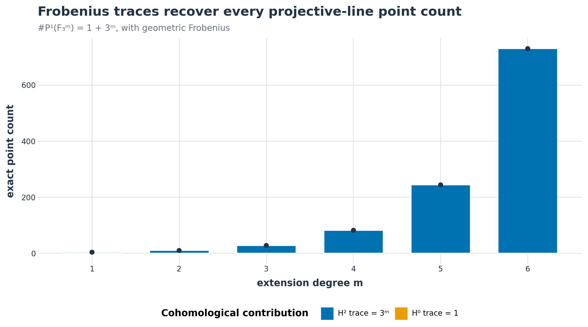

# Finite Étale Algebras and Étale Cohomology {#sec-etale-cohomology}

**Level and prerequisites: L5.** Prepare commutative algebra, finite étale algebras, schemes, sheaves and cohomology. The [reader guide](index.md) links the Euler arithmetic, algebra and analysis preparation and distinguishes the graduate continuation.

Polynomial equations often acquire roots only after extending the field. Galois
theory records how those roots are permuted, but geometry needs the same idea
over spaces whose coefficients vary from point to point. Étale maps are the
algebraic substitute for local covering maps. Étale cohomology then measures how
local algebraic data fail to glue globally.

Earlier chapters used étale cohomology to produce Galois representations and to
state comparison theorems. This chapter supplies the missing entrance. We begin
with finite algebras and a derivative test, build covers and torsors, identify the
cohomology of a field with Galois cohomology, and finish with one complete
Frobenius trace calculation.

## Preparation from this book

Chapter 12 developed finite separable extensions and trace and norm. Chapter 23
used coordinate algebras to describe affinoid spaces. Chapter 26 constructed the
absolute Galois group as an inverse limit, while Chapter 35 defined cocycles,
connecting maps, and Kummer theory. Those are the substantive prerequisites.

We also need a minimal geometric dictionary. For a commutative ring $A$, write
$\operatorname{Spec}A$ for its affine scheme. A ring map $A\to B$ reverses
direction and produces

$$
\operatorname{Spec}B\longrightarrow\operatorname{Spec}A.
$$

Elements of $A$ are functions on this space. An ideal gives equations, and
localization permits denominators on regions where they do not vanish. A full
scheme course develops prime points, structure sheaves, and gluing. Here we state
that infrastructure and carry every actual calculation through explicit rings.

## Finite algebras and separability

An $A$-algebra $B$ is **finite** if finitely many elements generate it as an
$A$-module. If

$$
B=A[T]/(f)
$$

with $f$ monic of degree $d$, then $1,T,\ldots,T^{d-1}$ form an $A$-basis of
$B$: division by a monic polynomial gives a unique remainder of degree below
$d$. Thus this is a finite free algebra.

Over a field $K$, a polynomial is separable when it has no repeated root in an
algebraic closure. The familiar derivative criterion is

$$
\gcd(f,f')=1.
$$

Equivalently, the image of $f'$ is invertible in $K[T]/(f)$. Bézout's identity
$uf+vf'=1$ proves the equivalence.

A finite-dimensional $K$-algebra is **finite étale** exactly when it is a finite
product of finite separable field extensions:

$$
B\cong L_1\times\cdots\times L_r.
$$

Products are necessary because a finite cover can have several connected
components.

**Examples.** A finite separable extension $L/K$ is finite étale. The split
algebra $K^d$ is finite étale and represents $d$ separate points over
$\operatorname{Spec}K$.

**Nonexamples.** The algebra $K[T]/(T^2)$ contains a nonzero nilpotent and is not
étale. In characteristic $p$, $K[T]/(T^p-a)$ has zero derivative and is not
étale when it is a nontrivial purely inseparable extension.

## The derivative criterion over a ring

Suppose $f\in A[T]$ is monic and its derivative is invertible in
$B=A[T]/(f)$. Then $B$ is finite étale over $A$. This is the monogenic
derivative criterion.

Its mechanism can be seen through first-order lifting. Let $C\to C/I$ be a
surjection with $I^2=0$, and suppose a root $x_0\in C/I$ of $f$ is given. Pick
any lift $x\in C$. We seek a correction $h\in I$. Because $I^2=0$, Taylor's
formula is exact at first order:

$$
f(x+h)=f(x)+f'(x)h.
$$

If $f'(x)$ is a unit, the unique correction is

$$
h=-f'(x)^{-1}f(x).
$$

Thus roots lift uniquely across square-zero thickenings. General nilpotent ideals
are handled one layer at a time. Existence together with uniqueness is the
formal-etaleness property; uniqueness alone would express formal
unramifiedness.

Finiteness alone is insufficient: $A[T]/(T^2)$ is finite but the root at zero
admits many first-order lifts. Derivative invertibility is what removes branching
and infinitesimal collision.

## Étale and ramified integral extensions

The distinction becomes especially concrete over a local field. Let $L/K$ be a
finite extension and compare rings of integers $\mathcal O_L/\mathcal O_K$. If
$L/K$ is unramified, then $\mathcal O_L$ is finite étale over $\mathcal O_K$.
Its residue extension is separable, and a lifted residue polynomial has derivative
a unit.

By contrast, if $L=K(\alpha)$ with Eisenstein equation

$$
f(T)=T^e+\cdots+a_0,
$$

then reduction modulo $\pi$ collapses to $T^e$. The special fiber has a repeated
root at zero, and the integral map is not étale. The generic field extension may
still be separable: ramification is visible in the integral model, not by asking
only whether $L/K$ is separable.

For example, with odd $p$ the field $\mathbb Q_p(\sqrt p)$ is separable over
$\mathbb Q_p$, but

$$
\mathbb Z_p[T]/(T^2-p)
$$

is not étale over $\mathbb Z_p$. Its derivative $2T$ reduces to zero at the
special-fiber root. In contrast, adjoining a root of a monic polynomial whose
reduction is irreducible and separable constructs an unramified extension and an
étale ring of integers.

The discriminant gives an audit. For a finite free monogenic algebra, a unit
discriminant is equivalent to the derivative being a unit at all geometric roots.
Positive discriminant valuation signals collision modulo $\pi$. Chapter 20's
different ideal measures the same failure in a basis-independent way.

## A complete finite étale cover

Let $n$ be a positive integer invertible in $A$. On the multiplicative group, consider

$$
[n]:\mathbb G_m\longrightarrow\mathbb G_m,
\qquad T\longmapsto T^n.
$$

On coordinate rings this sends $A[U,U^{-1}]$ to $A[T,T^{-1}]$ by
$U\mapsto T^n$. Equivalently,

$$
A[T,T^{-1}]
\cong A[U,U^{-1}][T]/(T^n-U).
$$

The polynomial is monic, and its derivative $nT^{n-1}$ is a unit because both
$n$ and $T$ are units. Therefore $[n]$ is finite étale of degree $n$.

If $n>1$ and zero is restored, the map $\mathbb A^1\to\mathbb A^1$
ramifies at $T=0$: the derivative vanishes there. Removing zero was structural,
not cosmetic. For $n=1$, the map is the identity, including at zero. If the residue characteristic divides $n$, the derivative may
also fail everywhere on the special fiber.

## Covers and the étale site

An étale morphism is, locally on source and target, flat, finitely presented,
and unramified. The derivative example is the main model. A family
$\{U_i\to X\}$ is an **étale cover** if every map is étale and their images
jointly cover $X$.

The **étale site** $X_{\acute et}$ has étale maps $U\to X$ as its objects and
étale covering families as covers. It is not merely a set of extra open subsets.
A single $U$ can map several-to-one onto $X$, so new roots may exist locally on
the site even when no Zariski open subset contains them.

A **sheaf** assigns data $\mathcal F(U)$ to every object and satisfies:

1. compatible local sections agree uniquely when glued;
2. every compatible family on a cover comes from a global section.

The sheaf condition is the formal local-to-global rule. Cohomology measures its
failures after taking derived invariants or attempting higher gluing.

## Geometric points and the fundamental group

A geometric point of $X$ is a map $\operatorname{Spec}\Omega\to X$ with
$\Omega$ separably closed. Choosing one gives a fiber functor from finite étale
covers to finite sets. Automorphisms of that fiber functor form the étale
fundamental group $\pi_1^{\acute et}(X)$.

For $X=\operatorname{Spec}K$ and a chosen separable closure $K^{\mathrm{sep}}$,

$$
\pi_1^{\acute et}(\operatorname{Spec}K)
\cong G_K.
$$

Finite étale covers correspond to finite continuous $G_K$-sets. A connected
cover $\operatorname{Spec}L$ corresponds to a transitive set of embeddings
$L\hookrightarrow K^{\mathrm{sep}}$. This recovers the infinite Galois
correspondence from geometric fibers.

Changing the geometric base point changes the fundamental group by an inner
isomorphism. Consequently constructions should be invariant under conjugation
rather than depend on a named embedding.

### Finite fields as a complete fiber example

For $X=\operatorname{Spec}\mathbb F_q$, the absolute Galois group is
$\widehat{\mathbb Z}$, topologically generated by arithmetic Frobenius. Finite
étale $\mathbb F_q$-algebras correspond to finite sets with a permutation.
Every orbit of length $d$ gives the field $\mathbb F_{q^d}$; several orbits give
a product of fields.

Thus a five-element fiber on which Frobenius has cycles of lengths two and three
corresponds to

$$
\mathbb F_{q^2}\times\mathbb F_{q^3}.
$$

This is a fully finite version of the fiber-functor equivalence. The orbit
decomposition determines connected components, while the chosen generator
determines descent back to $\mathbb F_q$.

## Torsors and first cohomology

Let $G$ be a sheaf of groups. A **$G$-torsor** is a space locally isomorphic to
$G$, with a simply transitive $G$-action, but possibly lacking a global chosen
identity point. First cohomology classifies torsors:

$$
H^1_{\acute et}(X,G)
\longleftrightarrow
\{G\text{-torsors on }X\}/\text{isomorphism}
$$

when the usual hypotheses and nonabelian pointed-set interpretation are used.
For abelian $G$, this is a group.

Čech cocycles on a chosen cover describe descent maps on pairwise overlaps. They
give concrete representatives, but a single cover need not compute all higher
cohomology. Refinements and the derived-functor construction supply the general
definition. This distinction mirrors Chapter 35: one finite Galois quotient can
compute a class only after continuity and factorization have been proved.

## The Kummer sequence revisited

When $n$ is invertible on $X$, the étale sheaves fit into an exact sequence

$$
1\longrightarrow\mu_n
\longrightarrow\mathbb G_m
\stackrel{[n]}{\longrightarrow}\mathbb G_m
\longrightarrow1.
$$

Surjectivity is local in the étale topology because adjoining an $n$th root is
the finite étale cover just constructed. Over $X=\operatorname{Spec}K$, the
long exact sequence begins

$$
K^\times\stackrel{(\cdot)^n}{\longrightarrow}K^\times
\longrightarrow H^1_{\acute et}(K,\mu_n)
\longrightarrow H^1_{\acute et}(K,\mathbb G_m).
$$

Hilbert 90 gives $H^1(K,\mathbb G_m)=0$, so

$$
H^1_{\acute et}(K,\mu_n)
\cong K^\times/K^{\times n}.
$$

For $a\in K^\times$, choose $\alpha^n=a$. The associated torsor is
$T^n=a$, and the corresponding Galois cocycle is

$$
g\longmapsto\frac{g(\alpha)}{\alpha}\in\mu_n.
$$

Thus Chapter 35's cocycle and the present finite cover are two descriptions of
one class.

### Picard and Brauer groups in the same sequence

For a general scheme $X$,

$$
H^1_{\acute et}(X,\mathbb G_m)\cong\operatorname{Pic}(X),
$$

the group of line bundles, and the torsion subgroup of
$H^2_{\acute et}(X,\mathbb G_m)$ is the cohomological Brauer group $\operatorname{Br}'(X)$.  The Kummer
long exact sequence therefore contains

$$
\operatorname{Pic}(X)/n\operatorname{Pic}(X)
\longrightarrow H^2_{\acute et}(X,\mu_n)
\longrightarrow\operatorname{Br}'(X)[n].
$$

Over $\operatorname{Spec}K$, the Picard group vanishes because every
one-dimensional vector space is trivial after choosing a basis. The Brauer group
need not vanish. For a non-Archimedean local field, the invariant map identifies

$$
\operatorname{Br}(K)\cong\mathbb Q/\mathbb Z.
$$

This is the target behind Chapter 35's local duality and Hilbert-symbol pairings.
It is a theorem of local class field theory, not a consequence of the elementary
Kummer cocycle alone.

Line bundles, Azumaya algebras, and torsors thus occupy successive cohomological
levels. Their interpretations also prevent a notation trap: $H^1(\mathbb G_m)$
vanishes over a field by Hilbert 90, but it can be large on a curve because the
curve can have nontrivial line bundles.

## Higher cohomology and coefficient systems

For an abelian étale sheaf $\mathcal F$, the groups
$H^i_{\acute et}(X,\mathcal F)$ are derived functors of global sections. Zeroth
cohomology is ordinary global sections; first cohomology records torsors or
extensions; higher degrees record further gluing obstructions.

Fix a prime $\ell$ invertible on $X$. Compatible systems
$\mathbb Z/\ell^m\mathbb Z$ lead to

$$
H^i_{\acute et}(X,\mathbb Z_\ell)
=\lim_{\leftarrow m}
H^i_{\acute et}(X,\mathbb Z/\ell^m\mathbb Z),
$$

subject to the standard inverse-limit qualification. Tensoring with
$\mathbb Q_\ell$ gives rational $\ell$-adic cohomology. A Tate twist
$\mathbb Q_\ell(1)$ records the action on compatible $\ell$-power roots of
unity.

If $X$ is defined over $K$, then $G_K$ acts on the base change
$X_{K^{\mathrm{sep}}}$ and hence on its cohomology. This is the promised source
of the higher-dimensional Galois representations named in Chapter 26.

### Exact sequences and functoriality

A short exact sequence of abelian étale sheaves

$$
0\to\mathcal F'\to\mathcal F\to\mathcal F''\to0
$$

produces a long exact cohomology sequence. The connecting map has the same
lifting mechanism as in Chapter 35: lift a local section of $\mathcal F''$, take
its failure to glue, and obtain a cocycle in $\mathcal F'$. Kummer theory is the
multiplicative example.

A map $f:X\to Y$ pulls sheaves back and induces contravariant maps on ordinary
cohomology under the appropriate setup. Proper pushforward and compact support
go in the other direction. Keeping variance visible prevents a common error:
points map forward under $f$, while functions and ordinary cohomology classes
often pull back.

For smooth proper varieties of dimension $d$, Poincaré duality pairs degrees
$i$ and $2d-i$ with a twist. On a smooth projective curve, this explains the
three possible cohomological degrees $0,1,2$ and why the top degree carries a
Tate twist. We use the structure in the projective-line case but state the
general duality theorem without proof.

For a non-Archimedean local field and finite torsion coefficients of order prime
to the residue characteristic, cohomology is concentrated in degrees zero through
two. Chapter 35's local duality pairing is the field-level form of this
cohomological dimension statement. At residue-characteristic torsion, the same
degree bound has qualifications and the coefficient sheaves require greater
care. The lesson is not to extrapolate an $\ell\ne p$ calculation by merely
replacing the symbol $\ell$ with $p$.

Functoriality supplies another reproducibility check. If $X\to Y\to Z$, the
pullback on cohomology for the composite must equal the composite of the two
pullbacks in reverse geometric order. A computation that stores bases but omits
the induced maps cannot verify this condition.

## Frobenius and the trace formula

Let $X$ be a suitable variety over $\mathbb F_q$ and let $\ell\ne p$. The
Grothendieck–Lefschetz trace formula states

$$
\#X(\mathbb F_{q^m})
=\sum_i(-1)^i
\operatorname{Tr}\!\left(
\operatorname{Frob}_{q}^{m}\mid
H^i_{c,\acute et}(X_{\overline{\mathbb F}_q},\mathbb Q_\ell)
\right),
$$

using **geometric Frobenius** here. Compact supports are required for nonproper
$X$; for proper $X$ they agree with ordinary cohomology.

Chapter 26 called $x\mapsto x^q$ arithmetic Frobenius. Geometric Frobenius is
its inverse. Under the trace-formula convention,
$H^2(\mathbf P^1)=\mathbb Q_\ell(-1)$ has eigenvalue $q$ for geometric
Frobenius. Declaring this convention prevents the false answer $1+q^{-1}$.

## Reproducible case: the projective line

The étale cohomology of the geometric projective line is

$$
H^0=\mathbb Q_\ell,\qquad H^1=0,\qquad
H^2=\mathbb Q_\ell(-1).
$$

Geometric Frobenius has trace $1$ on $H^0$ and $q^m$ on $H^2$ after the
$m$th power. Therefore

$$
\#\mathbf P^1(\mathbb F_{q^m})=1+q^m.
$$

This agrees with direct counting: there are $q^m$ affine coordinates plus the
point at infinity.

<figure id="fig-etale-trace">


<figcaption>

Figure 42.1: Projective-line point counts split exactly into degree-zero and degree-two étale cohomology traces.

</figcaption>
</figure>

[Figure 42.1](#fig-etale-trace) contains exact integers. It checks the trace identity for a
known cohomology table; it does not compute cohomology from sampled points.

A reproducible ledger lists $m$, $q^m$, the two traces, their alternating sum,
and the direct count. Every row must satisfy equality. Changing to arithmetic
Frobenius without changing the twist convention deliberately fails this audit.

### A second check: zero-dimensional covers

Let $X=\operatorname{Spec}\mathbb F_{q^d}$. Its geometric points form one
$d$-cycle under arithmetic Frobenius. The number of $\mathbb F_{q^m}$-points is
$d$ if $d$ divides $m$ and zero otherwise: an embedding exists exactly when
$\mathbb F_{q^d}\subseteq\mathbb F_{q^m}$, and then there are $d$ embeddings.

The permutation representation on the geometric fiber has trace equal to the
number of fixed points of the $m$th Frobenius power. A $d$-cycle has all $d$
points fixed exactly when $d\mid m$. Thus the degree-zero trace formula recovers
the direct field count. This example requires no higher cohomology and shows that
even $H^0$ can carry nontrivial Frobenius action.

If one instead counts elements of $\mathbb F_{q^d}$, the answer is always
$q^d$. That is a different question from counting morphisms
$\operatorname{Spec}\mathbb F_{q^m}\to X$. A point-count table must declare
which functor of points is being used.

## Comparison-theorem handoffs

For a smooth proper variety over a $p$-adic field, Chapter 33 stated a de Rham
comparison between $p$-adic étale cohomology and algebraic de Rham cohomology.
Good reduction also gives crystalline comparison. The present chapter defines
the étale side conceptually but does not build period rings or prove comparison.

Proper base change, smooth base change, Poincaré duality, and the six-functor
formalism explain why cohomology behaves consistently in families. Their exact
hypotheses matter. Singular or nonproper varieties require compact support,
nearby cycles, logarithmic structures, or other corrections.

## Theorem-scope and failure audit

- The monogenic derivative test, square-zero lifting calculation, power-map
  cover, Kummer identification, and projective-line trace were derived.
- The general definition of étale morphism includes finite presentation and
  flatness; derivative invertibility is a convenient affine criterion, not the
  only definition.
- Kummer exactness as written requires $n$ invertible on the base.
- Čech cohomology for one cover need not equal derived étale cohomology.
- Trace formulas require coefficient and compact-support hypotheses and a named
  Frobenius convention.
- The words “étale algebra,” “étale cohomology,” and “étale
  $(\varphi,\Gamma)$-module” name related but different conditions.

<!-- inline-formula-code:start -->
## Formula and finite computation

A useful formula in this chapter is

$$
\gcd(f,f')=1\Longleftrightarrow f\text{ is square-free}
$$

A root scan can miss a repeated irreducible factor that has no root in the base
field. The correct finite-field test computes the polynomial gcd itself.

```python
from math import isqrt

def is_prime(number: int) -> bool:
    """Return whether number is prime by exact trial division."""
    if number < 2:
        return False
    return all(number % divisor for divisor in range(2, isqrt(number) + 1))

def trim_polynomial(coefficients: list[int], prime: int) -> list[int]:
    """Return low-to-high coefficients reduced modulo prime without leading zeros."""
    if not is_prime(prime) or not coefficients:
        raise ValueError("provide coefficients and a prime modulus")
    result = [coefficient % prime for coefficient in coefficients]
    while len(result) > 1 and result[-1] == 0:
        result.pop()
    return result

def polynomial_derivative(coefficients: list[int], prime: int) -> list[int]:
    """Differentiate a polynomial over F_p."""
    polynomial = trim_polynomial(coefficients, prime)
    if len(polynomial) == 1:
        return [0]
    return trim_polynomial(
        [degree * polynomial[degree] for degree in range(1, len(polynomial))],
        prime,
    )

def polynomial_remainder(
    dividend: list[int], divisor: list[int], prime: int
) -> list[int]:
    """Return the remainder of exact polynomial division over F_p."""
    remainder = trim_polynomial(dividend, prime)
    divisor = trim_polynomial(divisor, prime)
    if divisor == [0]:
        raise ValueError("polynomial divisor must be nonzero")
    inverse_lead = pow(divisor[-1], -1, prime)
    while remainder != [0] and len(remainder) >= len(divisor):
        shift = len(remainder) - len(divisor)
        scale = remainder[-1] * inverse_lead % prime
        for index, coefficient in enumerate(divisor):
            remainder[index + shift] -= scale * coefficient
        remainder = trim_polynomial(remainder, prime)
    return remainder

def polynomial_gcd(
    left: list[int], right: list[int], prime: int
) -> list[int]:
    """Return the monic gcd of two polynomials over F_p."""
    left = trim_polynomial(left, prime)
    right = trim_polynomial(right, prime)
    while right != [0]:
        left, right = right, polynomial_remainder(left, right, prime)
    if left == [0]:
        raise ValueError("gcd(0, 0) is not normalized here")
    inverse_lead = pow(left[-1], -1, prime)
    return [(coefficient * inverse_lead) % prime for coefficient in left]

def square_free_certificate(coefficients: list[int], prime: int) -> tuple[bool, list[int]]:
    """Return square-free status and the exact gcd with the derivative."""
    polynomial = trim_polynomial(coefficients, prime)
    common = polynomial_gcd(polynomial, polynomial_derivative(polynomial, prime), prime)
    return common == [1], common

print(square_free_certificate([1, -1, 0, 1], prime=5))
print(square_free_certificate([1, 0, 2, 0, 1], prime=5))
```

**What the computation establishes.** The Euclidean algorithm proves the first
polynomial square-free and detects the repeated factor $x^2+1$ in the second.
Over a field this is exactly the displayed derivative criterion. Étaleness over
a general base ring still requires the ring-theoretic condition developed in
the chapter.
<!-- inline-formula-code:end -->

## Exercises

<div class="exercise" id="p_adic_numbers-42-etale-cohomology-ex-1">
<p class="exercise-title"><strong>Exercise 1</strong></p>

Prove that $K^d$ is finite étale over $K$ and identify its geometric fiber.

</div>

<div class="exercise" id="p_adic_numbers-42-etale-cohomology-ex-2">
<p class="exercise-title"><strong>Exercise 2</strong></p>

Use the derivative criterion to test $K[T]/(T^2-a)$ when
$\operatorname{char}K\ne2$ and $a\ne0$.

</div>

<div class="exercise" id="p_adic_numbers-42-etale-cohomology-ex-3">
<p class="exercise-title"><strong>Exercise 3</strong></p>

Explain why $K[T]/(T^2)$ fails unique square-zero lifting.

<details class="solution"><summary>Solution</summary>

Let $C=K[\varepsilon]/(\varepsilon^2)$ and reduce to $C/(\varepsilon)=K$.
The root $0$ of $T^2$ has every $c\varepsilon$ as a lift because
$(c\varepsilon)^2=0$. The lift is not unique. Equivalently, the derivative
$2T$ vanishes at the root, so the correction equation cannot select one $h$.

</details>

</div>

<div class="exercise" id="p_adic_numbers-42-etale-cohomology-ex-4">
<p class="exercise-title"><strong>Exercise 4</strong></p>

Prove that $T\mapsto T^n$ on $\mathbb G_m$ is finite étale when $n$ is
invertible.

<details class="solution"><summary>Solution</summary>

The coordinate algebra is
$A[U,U^{-1}][T]/(T^n-U)$. It is free of rank $n$ with basis
$1,T,\ldots,T^{n-1}$. Its derivative $nT^{n-1}$ is a unit because $n$ and
$T$ are units. The monogenic criterion proves finite étaleness.

</details>

</div>

<div class="exercise" id="p_adic_numbers-42-etale-cohomology-ex-5">
<p class="exercise-title"><strong>Exercise 5</strong></p>

Locate the failure on $\mathbb A^1$ and in characteristic dividing $n$.

</div>

<div class="exercise" id="p_adic_numbers-42-etale-cohomology-ex-6">
<p class="exercise-title"><strong>Exercise 6</strong></p>

Translate a finite separable extension into a transitive $G_K$-set.

</div>

<div class="exercise" id="p_adic_numbers-42-etale-cohomology-ex-7">
<p class="exercise-title"><strong>Exercise 7</strong></p>

Construct the Kummer cocycle for $a$ and prove it is independent of the
chosen root up to coboundary.

<details class="solution"><summary>Solution</summary>

Choose $\alpha^n=a$. Then
$c(g)=g(\alpha)/\alpha$ lies in $\mu_n$ and satisfies

$$
c(gh)=\frac{g(h\alpha)}{\alpha}
=g\!\left(\frac{h\alpha}{\alpha}\right)
\frac{g\alpha}{\alpha}.
$$

Replacing $\alpha$ by $\zeta\alpha$ changes $c$ by the coboundary
$g\zeta/\zeta$. Replacing $a$ by $ab^n$ replaces $\alpha$ by $b\alpha$ with
$b\in K$, which leaves the class unchanged.

</details>

</div>

<div class="exercise" id="p_adic_numbers-42-etale-cohomology-ex-8">
<p class="exercise-title"><strong>Exercise 8</strong></p>

Explain exactly where Hilbert 90 enters the Kummer isomorphism.

</div>

<div class="exercise" id="p_adic_numbers-42-etale-cohomology-ex-9">
<p class="exercise-title"><strong>Exercise 9</strong></p>

Distinguish an étale cover from a Zariski open cover.

</div>

<div class="exercise" id="p_adic_numbers-42-etale-cohomology-ex-10">
<p class="exercise-title"><strong>Exercise 10</strong></p>

Reproduce the $\mathbf P^1$ trace calculation for $q=5$ and $m=1,2,3$.

<details class="solution"><summary>Solution</summary>

For $q=5$, direct counts are $6,26,126$. The cohomological traces are
$1+5$, $1+25$, and $1+125$. Since $\mathbf P^1$ is proper, compactly
supported and ordinary cohomology agree, and the missing $H^1$ contributes zero.

The next chapter uses Haar measure rather than cohomology to turn polynomial
congruences into rational generating functions.

</details>

</div>

<div class="exercise" id="p_adic_numbers-42-etale-cohomology-ex-11">
<p class="exercise-title"><strong>Exercise 11</strong></p>

Explain why geometric and arithmetic Frobenius cannot be swapped in one
formula without changing eigenvalues.

</div>

<div class="exercise" id="p_adic_numbers-42-etale-cohomology-ex-12">
<p class="exercise-title"><strong>Exercise 12</strong></p>

State the smoothness and properness hypotheses in the clean de Rham
comparison theorem from Chapter 33.

</div>

## Selected solutions

### Solution to Exercise 3

Let $C=K[\varepsilon]/(\varepsilon^2)$ and reduce to $C/(\varepsilon)=K$.
The root $0$ of $T^2$ has every $c\varepsilon$ as a lift because
$(c\varepsilon)^2=0$. The lift is not unique. Equivalently, the derivative
$2T$ vanishes at the root, so the correction equation cannot select one $h$.

### Solution to Exercise 4

The coordinate algebra is
$A[U,U^{-1}][T]/(T^n-U)$. It is free of rank $n$ with basis
$1,T,\ldots,T^{n-1}$. Its derivative $nT^{n-1}$ is a unit because $n$ and
$T$ are units. The monogenic criterion proves finite étaleness.

### Solution to Exercise 7

Choose $\alpha^n=a$. Then
$c(g)=g(\alpha)/\alpha$ lies in $\mu_n$ and satisfies

$$
c(gh)=\frac{g(h\alpha)}{\alpha}
=g\!\left(\frac{h\alpha}{\alpha}\right)
\frac{g\alpha}{\alpha}.
$$

Replacing $\alpha$ by $\zeta\alpha$ changes $c$ by the coboundary
$g\zeta/\zeta$. Replacing $a$ by $ab^n$ replaces $\alpha$ by $b\alpha$ with
$b\in K$, which leaves the class unchanged.

### Solution to Exercise 10

For $q=5$, direct counts are $6,26,126$. The cohomological traces are
$1+5$, $1+25$, and $1+125$. Since $\mathbf P^1$ is proper, compactly
supported and ordinary cohomology agree, and the missing $H^1$ contributes zero.

The next chapter uses Haar measure rather than cohomology to turn polynomial
congruences into rational generating functions.
