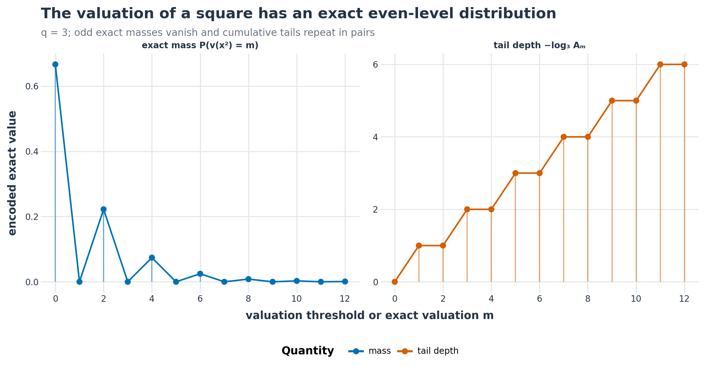

# Igusa Local Zeta Functions {#sec-igusa-zeta}

**Level and prerequisites: L5.** Prepare Haar measure, valuation strata, generating functions and local zeta integrals. The [reader guide](index.md) links the Euler arithmetic, algebra and analysis preparation and distinguishes the graduate continuation.

A polynomial can be small on a large or a tiny part of a $p$-adic domain. Igusa
local zeta functions record the whole distribution of that divisibility in one
generating function. Elementary cases reduce to geometric series; singular
zeros create the deeper geometry.

Chapter 22 integrated multiplicative characters against test functions on
$K^\times$. Here the domain is usually $\mathcal O_K^n$, the measure is additive
Haar measure, and the factor being measured is $|f(x)|^s$ for a polynomial.
Keeping those choices separate prevents a common shift by one in every exponent.

## Preparation from this book

Let $K$ be a non-Archimedean local field with ring $\mathcal O$, uniformizer
$\pi$, residue field of size $q$, and valuation $v(\pi)=1$. Normalize additive
Haar measure by

$$
\mu(\mathcal O^n)=1.
$$

Chapter 11 proved that $\mu(\pi^m\mathcal O)=q^{-m}$ and that the shell
$v(x)=m$ has measure $(1-q^{-1})q^{-m}$. Chapter 9 supplied Hensel lifting,
Chapter 19 supplied Newton polygons, and Chapter 22 supplied local zeta and
Fourier language. Chapter 39's precision objects will provide finite
certificates.

For a complex parameter $s$, write

$$
T=q^{-s}.
$$

Then $|f(x)|^s=T^{v(f(x))}$ whenever $f(x)\ne0$. The variable $T$ turns an
analytic integral into a formal distribution series before meromorphic
continuation is discussed.

## Tate integrals versus polynomial integrals

A basic Igusa local zeta function is

$$
Z_f(s)=\int_{\mathcal O^n}|f(x)|^s\,dx,
$$

initially where the integral converges. More generally one may include a
locally constant test function and a multiplicative character of the angular
component of $f$.

This differs from the Tate integral

$$
\int_{K^\times}\Phi(x)\chi(x)|x|^s\,d^\times x.
$$

Tate's measure is multiplicative, so every valuation shell has the same
multiplicative mass. Igusa's displayed measure is additive, so shell mass decays
by $q^{-m}$. Replacing one measure by the other changes both convergence and the
denominator.

**Example.** For $f(x)=x$, the additive integral over $\mathcal O$ is

$$
\frac{1-q^{-1}}{1-q^{-1}T}.
$$

**Nonexample.** Summing $T^m$ with coefficient one computes a multiplicative
shell series, not this Igusa integral.

## Valuation distributions

Assume $f$ is a nonzero polynomial. Its zero set in $\mathcal O^n$ has Haar
measure zero. For the congruence counts below, also assume
$f\in\mathcal O[x_1,\ldots,x_n]$. This loses no generality after multiplying a
$K$-coefficient polynomial by a scalar: one records the resulting shift because
$Z_{cf}(s)=|c|^sZ_f(s)$. Define

$$
p_r=\mu\{x\in\mathcal O^n:v(f(x))=r\},
\qquad r\ge0.
$$

Then

$$
Z_f(T)=\sum_{r\ge0}p_rT^r.
$$

The coefficients form a probability distribution: $p_r\ge0$ and
$\sum_rp_r=1$. The integral is therefore the probability-generating function of
the random variable $v(f(X))$ for Haar-random $X\in\mathcal O^n$.

It is often easier to count tails. Put

$$
A_m=\mu\{x:v(f(x))\ge m\},
\qquad A_0=1.
$$

Because the event of exact valuation $r$ is the difference of two tails,

$$
p_r=A_r-A_{r+1}.
$$

This equality is an exact partition, not an asymptotic estimate.

## Congruence counts and the distribution identity

The condition $v(f(x))\ge m$ depends only on $x$ modulo $\pi^m$. Let

$$
N_m=\#\{x\in(\mathcal O/\pi^m\mathcal O)^n:
f(x)\equiv0\pmod{\pi^m}\}.
$$

Every residue class has measure $q^{-mn}$, so

$$
A_m=q^{-mn}N_m.
$$

Now derive the relation with the zeta function:

$$
\begin{aligned}
Z_f(T)
&=\sum_{r\ge0}(A_r-A_{r+1})T^r\\
&=1+\sum_{r\ge1}A_rT^r
-\sum_{r\ge0}A_{r+1}T^r\\
&=1-(1-T)\sum_{m\ge1}A_mT^{m-1}.
\end{aligned}
$$

Thus a rational generating function for normalized congruence counts gives a
rational Igusa zeta function, and conversely. The shift by $m-1$ is forced by
the tail difference; dropping it is a frequent indexing error.

## Complete calculation for a monomial

Take $f(x)=x^a$ with $a\ge1$. On the shell $v(x)=k$,

$$
v(f(x))=ak
$$

and the shell has measure $(1-q^{-1})q^{-k}$. Therefore

$$
\begin{aligned}
Z_{x^a}(T)
&=(1-q^{-1})\sum_{k\ge0}q^{-k}T^{ak}\\
&=\frac{1-q^{-1}}{1-q^{-1}T^a}.
\end{aligned}
$$

As an analytic integral, the geometric series converges when
$|q^{-1}T^a|<1$, equivalently

$$
\operatorname{Re}(s)>-\frac1a.
$$

The rational expression then continues meromorphically beyond that half-plane.

The tail distribution gives an independent derivation:

$$
A_m=\mu\{av(x)\ge m\}
=q^{-\lceil m/a\rceil}.
$$

Substitution into the distribution identity recovers the same denominator.

For $a=2$, exact valuations are even:

$$
p_{2k}=(1-q^{-1})q^{-k},
\qquad p_{2k+1}=0.
$$

The zeros at odd indices are structural, not missing data.

Both the exact shell mass and the cumulative tail are rational numbers, so a
finite prefix can be evaluated without floating-point probability error.

```python
from fractions import Fraction

def monomial_valuation_mass(
    valuation_index: int, residue_field_size: int, exponent: int
) -> Fraction:
    """Return P(v(x**a) = r) for Haar-uniform x in the valuation ring."""
    if valuation_index < 0 or residue_field_size <= 1 or exponent <= 0:
        raise ValueError("require r >= 0, q > 1, and a > 0")
    if valuation_index % exponent != 0:
        return Fraction(0)
    shell_index = valuation_index // exponent
    return Fraction(residue_field_size - 1, residue_field_size ** (shell_index + 1))

def monomial_valuation_tail(
    depth: int, residue_field_size: int, exponent: int
) -> Fraction:
    """Return P(v(x**a) >= depth) from the ceiling formula."""
    if depth < 0 or residue_field_size <= 1 or exponent <= 0:
        raise ValueError("require depth >= 0, q > 1, and a > 0")
    ceiling = (depth + exponent - 1) // exponent
    return Fraction(1, residue_field_size**ceiling)

masses = [monomial_valuation_mass(index, 3, 2) for index in range(7)]
tails = [monomial_valuation_tail(depth, 3, 2) for depth in range(1, 7)]
print(masses)
print(tails)
```

The alternating zero masses and two-step tails reproduce the plotted $a=2$,
$q=3$ distribution through a declared cutoff.  A finite prefix does not prove
the rational continuation of the infinite zeta function.

<figure id="fig-igusa-distribution">


<figcaption>

Figure 43.1: Exact masses for the valuation of a square alternate with zero and their cumulative tails form a two-step staircase.

</figcaption>
</figure>

[Figure 43.1](#fig-igusa-distribution) plots probabilities and valuation-depth exponents. It
does not place $p$-adic numbers on an ordered real axis.

## A two-variable product calculation

Let $f(x,y)=xy$. Product Haar measure makes $v(x)$ and $v(y)$ independent.
Therefore

$$
\begin{aligned}
Z_{xy}(T)
&=\int_{\mathcal O^2}T^{v(x)+v(y)}\,dx\,dy\\
&=\left(\int_{\mathcal O}T^{v(x)}\,dx\right)^2\\
&=\left(\frac{1-q^{-1}}{1-q^{-1}T}\right)^2.
\end{aligned}
$$

The double pole of the rational expression reflects two independent coordinate
directions meeting at the singular zero $(0,0)$. By contrast, the polynomial
$x$ in two variables has one constrained direction and one free direction, so
its zeta function is only the one-variable factor.

The zero locus of $xy$ is the union of two axes. It still has measure zero in
$\mathcal O^2$, even though it contains infinitely many points.

## A polynomial with two simple roots

In any residue characteristic, take

$$
f(x)=x(x-1).
$$

Modulo $\pi$, the roots $0$ and $1$ are distinct and simple. Outside their two
residue balls, both factors are units, so $v(f(x))=0$. That region has measure
$1-2q^{-1}$ and contributes the same constant to $Z_f(T)$.

On the ball $x\in\pi\mathcal O$, write $x=\pi y$. The factor
$\pi y-1$ is a unit, so

$$
v(f(\pi y))=1+v(y),
\qquad dx=q^{-1}dy.
$$

The contribution is

$$
q^{-1}T Z_x(T)
=q^{-1}T\frac{1-q^{-1}}{1-q^{-1}T}.
$$

On the ball $x\in1+\pi\mathcal O$, write $x=1+\pi y$. Now $x$ is a unit and
$x-1=\pi y$, giving the same contribution. Hence

$$
Z_{x(x-1)}(T)
=1-2q^{-1}
+2q^{-1}T\frac{1-q^{-1}}{1-q^{-1}T}.
$$

At $T=1$ the answer is one, as every probability-generating function must be.
At $T=0$ it is $1-2q^{-1}$, the measure on which the polynomial is a unit.
These two substitutions are fast normalization checks.

At residue characteristic two the two root balls occupy all residue classes, so
$1-2q^{-1}=0$; the same formula remains valid and consists entirely of the two
root-ball contributions. More generally, roots that collide modulo $\pi$
cannot be treated as disjoint simple boxes. Their shared residue class is a
singular branch and must be analyzed at greater precision.

### Square classes change the integral

Let $p$ be odd and consider $f(x)=x^2-u$ for a unit $u$. If the residue of $u$
is a nonsquare, then $x^2-u$ is a unit for every $x\in\mathcal O$: otherwise a
positive valuation would give a square root modulo $\pi$. Therefore

$$
Z_{x^2-u}(T)=1.
$$

If $u$ is a square modulo $\pi$, choose its two distinct residue roots
$r,-r$. Hensel's lemma lifts both, and the derivative $2x$ is a unit on each
root ball. Outside those two balls the polynomial is a unit. The same
simple-root calculation gives

$$
Z_{x^2-u}(T)
=1-2q^{-1}
+2q^{-1}T\frac{1-q^{-1}}{1-q^{-1}T}.
$$

Thus two unit coefficients with the same valuation can have different zeta
functions because their angular components lie in different square classes.
Valuation data alone are insufficient.

At $p=2$, the derivative and square-class tests both change. The odd-prime
formula must not be extended merely by substituting $q=2$. This example links
Igusa integration directly to Chapter 10's unit classification and provides a
small-prime regression test.

## Stationary-phase recursion

The preceding example illustrates a reusable first step. Partition
$\mathcal O^n$ into residue boxes $a+\pi\mathcal O^n$.

- If $f(a)\not\equiv0\pmod\pi$, then $f$ is a unit on that box and the
  contribution is exactly its measure $q^{-n}$.
- If $f(a)\equiv0$ and some partial derivative is a unit, a coordinate change
  reduces the contribution to a one-dimensional geometric factor times a free
  $(n-1)$-dimensional measure.
- If $f(a)$ and every partial derivative vanish, the box is singular. Substitute
  $x=a+\pi y$, factor the largest common power of $\pi$, and recurse on the
  transformed polynomial.

This is the beginning of a $p$-adic stationary-phase formula. Termination is not
automatic for every recursive presentation. Resolution of singularities or a
separate complexity invariant is needed to prove that finitely many rational
patterns suffice.

Consider $f(x)=x^2$ at odd $p$. Modulo $p$, every nonzero residue is a unit box,
while the zero box is singular because $f'(0)=0$. Substitution $x=py$ gives

$$
f(py)=p^2y^2,
$$

so the zero-box contribution is $q^{-1}T^2Z_f(T)$. The unit boxes contribute
$1-q^{-1}$. Thus

$$
Z_f(T)=1-q^{-1}+q^{-1}T^2Z_f(T),
$$

and solving this equation recovers

$$
Z_f(T)=\frac{1-q^{-1}}{1-q^{-1}T^2}.
$$

This is a third derivation of the monomial formula. It also shows how a singular
residue class can generate a self-similar denominator.

## Poincaré series of congruence solutions

Define the normalized Poincaré series

$$
P_f(U)=\sum_{m\ge0}A_mU^m
=\sum_{m\ge0}N_mq^{-mn}U^m.
$$

The distribution identity can be written

$$
Z_f(T)=1-\frac{1-T}{T}\bigl(P_f(T)-1\bigr).
$$

Conversely, when $T\ne1$ as a formal rational expression,

$$
P_f(T)
=1+\frac{T(1-Z_f(T))}{1-T}.
$$

The apparent denominator $1-T$ is removable at $T=1$ because $Z_f(1)=1$.
These equations let a computation verify both series from one exact count table.

For $x^2$,

$$
P_{x^2}(U)
=\sum_{m\ge0}q^{-\lceil m/2\rceil}U^m
=\frac{1+q^{-1}U}{1-q^{-1}U^2}.
$$

Even and odd $m$ provide the two numerator terms. Chapter 45 will rederive this
series as the measure of a definable family.

## Exact table at $q=3$

For $f=x^2$ and $m=0,1,\ldots,6$, the count and normalized tail data are

| $m$ | $N_m=3^{\lfloor m/2\rfloor}$ | total residues $3^m$ | $A_m$ |
|---:|---:|---:|---:|
| 0 | 1 | 1 | $1$ |
| 1 | 1 | 3 | $1/3$ |
| 2 | 3 | 9 | $1/3$ |
| 3 | 3 | 27 | $1/9$ |
| 4 | 9 | 81 | $1/9$ |
| 5 | 9 | 243 | $1/27$ |
| 6 | 27 | 729 | $1/27$ |

The repeated tail values encode the ceiling function. Differences give
$p_0=2/3$, $p_1=0$, $p_2=2/9$, and so on. Every displayed rational is reduced
exactly; decimal rounding would conceal the probability sum and recurrence.

Fitting the first seven rows to a rational function is evidence, not proof. The
divisibility argument $2v(x)\ge m$ proves the formula for every $m$, and the
table then becomes a regression test for an implementation.

## Changes of variables and Jacobian factors

Let $\Phi:U\to V$ be an analytic bijection between compact-open subsets of
$K^n$ whose inverse is analytic. A $p$-adic change-of-variables theorem gives

$$
\int_V h(x)\,dx
=\int_U h(\Phi(y))
\left|\det D\Phi(y)\right|\,dy.
$$

If the Jacobian determinant is a unit everywhere, Haar measure is preserved.
This justifies translations and integral coordinate changes in the simple-root
calculations. If its valuation is $c>0$, the image measure acquires the factor
$q^{-c}$. Omitting that factor changes every residue density.

For a linear map $x=Ay+b$ with $A\in GL_n(K)$, the formula reduces to

$$
dx=|\det A|\,dy.
$$

It can be proved first for diagonal matrices, where scaling one coordinate by
$\pi^r$ multiplies measure by $q^{-r}$, then for integral elementary matrices,
which preserve residue boxes, and finally by elementary divisors.

As a concrete check, put $f(x)=x-c$ and substitute $x=c+\pi^ry$ on the ball
$c+\pi^r\mathcal O$. Then

$$
v(f(x))=r+v(y),
\qquad dx=q^{-r}dy,
$$

so that ball contributes

$$
q^{-r}T^r\frac{1-q^{-1}}{1-q^{-1}T}.
$$

The factor $T^r$ records polynomial valuation; $q^{-r}$ records measure. They
come from different structures and must not be merged.

Resolution-of-singularities formulas contain both kinds of exponent. If a local
chart has

$$
f\circ\Phi=u(y)\prod_i y_i^{N_i},
\qquad
\det D\Phi=u'(y)\prod_i y_i^{\nu_i-1},
$$

with $u,u'$ units, then $N_i$ controls the $T$ exponent and $\nu_i$ controls
the measure exponent. This explains the denominator
$1-q^{-\nu_i}T^{N_i}$ that appears in resolution formulas.

At finite precision a claimed analytic bijection needs a certificate too: give
the forward and inverse formulas, verify their compositions modulo the working
power of $\pi$, and prove the Jacobian determinant remains in one known unit or
valuation class throughout the box. Checking it only at the center is not enough
without a uniform derivative bound.

This also identifies a useful failure test. The map $y\mapsto y^2$ on
$\mathbb Z_p^\times$ for odd $p$ has unit derivative, but it is not a bijection
on the whole unit group: nonsquare units have no preimage and square units have
two. It becomes an analytic bijection only after restricting to a suitable
residue ball around one chosen root. A unit Jacobian proves local invertibility,
not global one-to-one behavior. Every use of the change-of-variables theorem
must therefore list a domain decomposition on which the map is actually
bijective, or include the correct multiplicity.

For $p=2$, even the derivative of squaring is never a unit. Square-class
decomposition from Chapter 10 replaces the odd-prime local argument, and extra
unit digits are needed. This is one reason a formula advertised as uniform in
all primes requires a separate small-prime audit.

The resulting partition, its multiplicities, and every Jacobian valuation belong
in the reproducibility record; none is recoverable from the final rational
function alone.
That ledger is part of the mathematical claim, not optional metadata.

## Nonsingular residue classes and Hensel coordinates

Suppose $a\in k^n$ satisfies

$$
f(a)\equiv0\pmod\pi
$$

and at least one partial derivative is nonzero modulo $\pi$. After relabelling,
assume $\partial f/\partial x_n$ is a unit. The multivariable Hensel or implicit
function theorem says that near $a$, the coordinate $f$ can replace $x_n$ in an
analytic coordinate system.

Consequently, inside that residue box, the condition $v(f(x))\ge m$ imposes one
independent congruence of depth $m-1$ beyond the first residue condition. Its
normalized measure decays like $q^{-m}$ up to the fixed box factor. This is why
nonsingular zeros contribute simple geometric denominators.

For a reproducible finite check, fix the first $n-1$ coordinates modulo
$\pi^m$ and lift the final coordinate one digit at a time. A unit derivative
gives one continuation at each level. The certificate stores the derivative
unit and the unique lifted digit.

If every derivative vanishes modulo $\pi$, this argument fails. It does not prove
that no lifts exist; it says the simple coordinate change is unavailable.

## Singularities and Newton data

Singular points can split into several valuation regimes. For a polynomial

$$
f(x)=\sum_{u}c_ux^u
$$

in several variables, the exponent vectors $u$ with nonzero coefficients form
the Newton polyhedron after adding the positive orthant. A weight vector
$w=(v(x_1),\ldots,v(x_n))$ predicts candidate dominant terms through

$$
v(c_u)+u\cdot w.
$$

Faces on which the minimum is attained control possible cancellation. This is a
multivariable relative of Chapter 19's Newton polygon. A face calculation is only
a candidate analysis: if the face polynomial has singular zeros in the residue
torus, further subdivision is necessary.

Resolution of singularities replaces the original domain by charts in which
$f$ and the Jacobian become monomials times units. Each chart then contributes
geometric series like the calculations above. That is the geometric mechanism
behind rationality in characteristic zero.

## Rationality and candidate poles

**Theorem 43.1 (Igusa rationality, basic form).** For a nonzero polynomial over a
characteristic-zero local field, $Z_f(s)$ is a rational function of $q^{-s}$.
Versions include test functions and characters.

A resolution chart with numerical data $(N_i,\nu_i)$ suggests denominators

$$
1-q^{-\nu_i}T^{N_i}
$$

and candidate real parts $-\nu_i/N_i$ for poles. Candidate does not mean actual:
contributions from different charts can cancel. Nor does a numerical pole list
prove rationality without a theorem establishing that all charts and exceptional
divisors were included.

For sufficiently large residue characteristic, model-theoretic cell decomposition
can also produce uniform rationality. Chapter 45 explains what “definable” and
“uniform” mean and why finitely many small primes may be excluded.

## Character twists and oscillatory integrals

Let $\chi$ be a finite-order character of $\mathcal O^\times$, extended by zero
at zero. A twisted zeta integral can include
$\chi(\operatorname{ac}(f(x)))$, where $\operatorname{ac}$ is an angular
component. Residue classes whose unit parts cancel under $\chi$ may disappear
from the integral.

Additive characters lead to oscillatory integrals

$$
\int_{\mathcal O^n}\psi(\pi^{-m}f(x))\,dx.
$$

They connect local zeta poles with exponential-sum decay. A count of zeros and an
oscillatory sum are different statistics: the latter retains phases. Taking
absolute values before summing destroys cancellation and cannot verify an
oscillatory estimate.

## Certified finite computation

For each $m\le M$, enumerate residues modulo $\pi^m$ deterministically and
record:

1. the field and polynomial coefficients;
2. the chosen canonical residue representatives;
3. $N_m$ and $q^{mn}$;
4. the exact rational tail $A_m=N_m/q^{mn}$;
5. the differences $p_r=A_r-A_{r+1}$ where available;
6. hashes or checksums of partitioned input blocks.

Compatibility requires every solution modulo $\pi^{m+1}$ to reduce to one
modulo $\pi^m$. A tree of solution fibers detects omitted or duplicated residues.
Finite data through $M$ do not prove a rational continuation; they test proposed
formulas through a declared coefficient range.

For $f=x^2$, the exact count is

$$
N_m=q^{m-\lceil m/2\rceil}=q^{\lfloor m/2\rfloor}.
$$

Indeed a residue class satisfies $x^2\equiv0\pmod{\pi^m}$ exactly when it is
divisible by $\pi^{\lceil m/2\rceil}$. This provides a deterministic test fixture
at every local field.

## Theorem-scope and failure audit

- Shell formulas, the tail identity, monomial and product integrals, and the
  $x^2$ congruence count were proved completely.
- Fubini was used with product Haar measure on a compact domain.
- The nonsingular coordinate statement requires a unit partial derivative.
- Resolution and Igusa rationality are scoped theorems, not consequences of a
  few fitted coefficients.
- Candidate poles may cancel.
- Character twists require a named angular component and conductor.
- Small residue characteristics may violate a uniform formula's hypotheses.

<!-- inline-formula-code:start -->
## Formula and finite computation

A useful formula in this chapter is

$$
N_m(x^a)=p^{m-\lceil m/a\rceil},
\qquad
A_m=p^{-\lceil m/a\rceil}.
$$

For a monomial, the exact count, normalized tail, and probability masses can
all be computed with integer arithmetic and `Fraction`. Exhaustion is retained
as an independent small-case verifier.

```python
from fractions import Fraction
from math import isqrt

def is_prime(number: int) -> bool:
    """Return whether number is prime by exact trial division."""
    if number < 2:
        return False
    return all(number % divisor for divisor in range(2, isqrt(number) + 1))

def ceiling_quotient(numerator: int, denominator: int) -> int:
    """Return ceil(numerator / denominator) for nonnegative integers."""
    if numerator < 0 or denominator <= 0:
        raise ValueError("require numerator nonnegative and denominator positive")
    return (numerator + denominator - 1) // denominator

def monomial_congruence_count(prime: int, exponent: int, precision: int) -> int:
    """Count x mod p**precision with x**exponent divisible by p**precision."""
    if not is_prime(prime) or exponent <= 0 or precision < 0:
        raise ValueError("require a prime, positive exponent, and nonnegative precision")
    required_depth = ceiling_quotient(precision, exponent)
    return prime ** (precision - required_depth)

def monomial_tail_mass(prime: int, exponent: int, precision: int) -> Fraction:
    """Return the exact Haar mass P(v_p(X**exponent) >= precision)."""
    count = monomial_congruence_count(prime, exponent, precision)
    return Fraction(count, prime**precision)

def exhaustive_monomial_count(prime: int, exponent: int, precision: int) -> int:
    """Exhaust the declared finite quotient as a regression check."""
    if precision < 0 or precision > 8:
        raise ValueError("exhaustive verification is capped at precision eight")
    if not is_prime(prime) or exponent <= 0:
        raise ValueError("require a prime and positive exponent")
    modulus = prime**precision
    return sum(pow(value, exponent, modulus) == 0 for value in range(modulus))

tails = [monomial_tail_mass(3, exponent=2, precision=m) for m in range(8)]
masses = [tails[m] - tails[m + 1] for m in range(len(tails) - 1)]
checks = [
    monomial_congruence_count(3, 2, m)
    == exhaustive_monomial_count(3, 2, m)
    for m in range(7)
]
print(tails)
print(masses)
print(all(checks))
```

**What the computation establishes.** The count formula follows from the proved
valuation inequality and agrees with complete quotient searches through the
declared range. These coefficients verify the monomial zeta series; they do not
prove resolution-based rationality for an arbitrary polynomial.
<!-- inline-formula-code:end -->

## Exercises

<div class="exercise" id="p_adic_numbers-43-igusa-zeta-ex-1">
<p class="exercise-title"><strong>Exercise 1</strong></p>

Derive the additive shell measure $(1-q^{-1})q^{-m}$.

</div>

<div class="exercise" id="p_adic_numbers-43-igusa-zeta-ex-2">
<p class="exercise-title"><strong>Exercise 2</strong></p>

Compute $Z_{x^a}(T)$ and its initial convergence half-plane.

<details class="solution"><summary>Solution</summary>

Partition $\mathcal O\setminus\{0\}$ by $v(x)=k$. On that shell,
$|x^a|^s=T^{ak}$ and the mass is $(1-q^{-1})q^{-k}$. Summing gives

$$
(1-q^{-1})\sum_{k\ge0}(q^{-1}T^a)^k
=\frac{1-q^{-1}}{1-q^{-1}T^a}.
$$

Convergence requires $q^{-1-a\operatorname{Re}(s)}<1$, or
$\operatorname{Re}(s)>-1/a$.

</details>

</div>

<div class="exercise" id="p_adic_numbers-43-igusa-zeta-ex-3">
<p class="exercise-title"><strong>Exercise 3</strong></p>

Derive $A_m=q^{-\lceil m/a\rceil}$ for $x^a$.

</div>

<div class="exercise" id="p_adic_numbers-43-igusa-zeta-ex-4">
<p class="exercise-title"><strong>Exercise 4</strong></p>

Verify the distribution identity from $p_r=A_r-A_{r+1}$.

<details class="solution"><summary>Solution</summary>

Using $A_0=1$,

$$
\sum_{r\ge0}(A_r-A_{r+1})T^r
=1+\sum_{r\ge1}A_rT^r-\sum_{m\ge1}A_mT^{m-1},
$$

which factors as
$1-(1-T)\sum_{m\ge1}A_mT^{m-1}$.

</details>

</div>

<div class="exercise" id="p_adic_numbers-43-igusa-zeta-ex-5">
<p class="exercise-title"><strong>Exercise 5</strong></p>

Compute $Z_{xy}(T)$ using product measure.

<details class="solution"><summary>Solution</summary>

Since $v(xy)=v(x)+v(y)$ and product Haar measure makes the two coordinates
independent,

$$
Z_{xy}(T)
=Z_x(T)Z_y(T)
=\left(\frac{1-q^{-1}}{1-q^{-1}T}\right)^2.
$$

The calculation also proves that neither coordinate may be discarded near the
singular crossing.

</details>

</div>

<div class="exercise" id="p_adic_numbers-43-igusa-zeta-ex-6">
<p class="exercise-title"><strong>Exercise 6</strong></p>

Compute the zeta function of $x$ as a polynomial on $\mathcal O^n$.

</div>

<div class="exercise" id="p_adic_numbers-43-igusa-zeta-ex-7">
<p class="exercise-title"><strong>Exercise 7</strong></p>

Count solutions to $x^2\equiv0\pmod{\pi^m}$.

<details class="solution"><summary>Solution</summary>

The congruence requires $2v(x)\ge m$, hence
$v(x)\ge\lceil m/2\rceil$. Modulo $\pi^m$, the admissible residues are
$\pi^{\lceil m/2\rceil}u$ with $u$ modulo
$\pi^{m-\lceil m/2\rceil}$. There are
$q^{m-\lceil m/2\rceil}=q^{\lfloor m/2\rfloor}$ of them.

Chapter 44 changes from distributions of polynomial values to logarithmic
pairings of arithmetic points and divisors.

</details>

</div>

<div class="exercise" id="p_adic_numbers-43-igusa-zeta-ex-8">
<p class="exercise-title"><strong>Exercise 8</strong></p>

Explain why a unit derivative gives one lifted coordinate branch.

</div>

<div class="exercise" id="p_adic_numbers-43-igusa-zeta-ex-9">
<p class="exercise-title"><strong>Exercise 9</strong></p>

Give a singular polynomial for which the unit-derivative argument fails but
roots still exist.

</div>

<div class="exercise" id="p_adic_numbers-43-igusa-zeta-ex-10">
<p class="exercise-title"><strong>Exercise 10</strong></p>

Distinguish a candidate pole from a proved pole.

</div>

<div class="exercise" id="p_adic_numbers-43-igusa-zeta-ex-11">
<p class="exercise-title"><strong>Exercise 11</strong></p>

Design a solution-tree certificate through precision $\pi^M$.

</div>

<div class="exercise" id="p_adic_numbers-43-igusa-zeta-ex-12">
<p class="exercise-title"><strong>Exercise 12</strong></p>

Explain why an additive character sum cannot be replaced by its termwise
absolute values.

</div>

## Selected solutions

### Solution to Exercise 2

Partition $\mathcal O\setminus\{0\}$ by $v(x)=k$. On that shell,
$|x^a|^s=T^{ak}$ and the mass is $(1-q^{-1})q^{-k}$. Summing gives

$$
(1-q^{-1})\sum_{k\ge0}(q^{-1}T^a)^k
=\frac{1-q^{-1}}{1-q^{-1}T^a}.
$$

Convergence requires $q^{-1-a\operatorname{Re}(s)}<1$, or
$\operatorname{Re}(s)>-1/a$.

### Solution to Exercise 4

Using $A_0=1$,

$$
\sum_{r\ge0}(A_r-A_{r+1})T^r
=1+\sum_{r\ge1}A_rT^r-\sum_{m\ge1}A_mT^{m-1},
$$

which factors as
$1-(1-T)\sum_{m\ge1}A_mT^{m-1}$.

### Solution to Exercise 5

Since $v(xy)=v(x)+v(y)$ and product Haar measure makes the two coordinates
independent,

$$
Z_{xy}(T)
=Z_x(T)Z_y(T)
=\left(\frac{1-q^{-1}}{1-q^{-1}T}\right)^2.
$$

The calculation also proves that neither coordinate may be discarded near the
singular crossing.

### Solution to Exercise 7

The congruence requires $2v(x)\ge m$, hence
$v(x)\ge\lceil m/2\rceil$. Modulo $\pi^m$, the admissible residues are
$\pi^{\lceil m/2\rceil}u$ with $u$ modulo
$\pi^{m-\lceil m/2\rceil}$. There are
$q^{m-\lceil m/2\rceil}=q^{\lfloor m/2\rfloor}$ of them.

Chapter 44 changes from distributions of polynomial values to logarithmic
pairings of arithmetic points and divisors.
