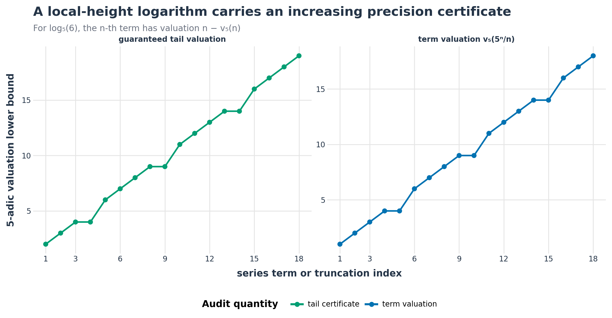

# $p$-Adic Heights and Arithmetic Geometry {#sec-padic-heights}

**Level and prerequisites: L5.** Prepare elliptic curves, divisors, local heights, p-adic logarithms and arithmetic geometry. The [reader guide](index.md) links the Euler arithmetic, algebra and analysis preparation and distinguishes the graduate continuation.

A height turns arithmetic complexity into a number that can be compared or
paired. Classical canonical heights on elliptic curves are real-valued. A
$p$-adic height instead takes values in a $p$-adic coefficient field and is
built from logarithms, local intersection data, and integration. The word
“height” does not make those two constructions interchangeable.

This chapter starts with a complete local symbol on the projective line. That
calculation contains divisors, rational functions, a cross ratio, a chosen
$p$-adic logarithm, and a precision certificate. We then explain how general
curves, Jacobians, regulators, and Selmer problems extend the same pattern.

## Preparation from this book

Chapter 18 developed the $p$-adic logarithm. Chapter 23 introduced analytic
curves and skeleta. Chapter 24 introduced elliptic curves, formal groups, and
Tate modules; Chapter 30 constructed Coleman integration; Chapter 34 developed
Tate uniformization; and Chapters 35–36 developed cohomological and Selmer
pairings.

We repair two additional ideas. A **divisor** on a smooth curve is a finite
formal integer sum

$$
D=\sum_Pn_P(P).
$$

Its degree is $\deg D=\sum_Pn_P[\kappa(P):K]$, which is simply
$\sum n_P$ when all points are $K$-rational. A rational function $f$ has a
principal divisor

$$
\operatorname{div}(f)=\sum_P\operatorname{ord}_P(f)(P),
$$

recording zeros positively and poles negatively.

## Evaluating functions on divisors

If the support of $D=\sum n_P(P)$ avoids all zeros and poles of $f$, define its evaluation in $K^\times$ by taking the norm of each nonzero residue value $f(P)\in\kappa(P)^\times$:

$$
f(D)=\prod_P N_{\kappa(P)/K}(f(P))^{n_P}.
$$

For a degree-zero divisor, multiplying $f$ by a constant $c$ does not change
the evaluation because

$$
(cf)(D)=c^{\deg D}f(D)=f(D).
$$

Here $N_{\kappa(P)/K}(u)$ is the determinant over $K$ of multiplication by $u$ on $\kappa(P)$ (the field norm from Chapter 12). Multiplication maps compose, so the norm is multiplicative; for $c\in K^\times$ its matrix is $cI$, giving $N_{\kappa(P)/K}(c)=c^{[\kappa(P):K]}$.
For $K$-rational points the norm is the identity, so the formulas below reduce to ordinary evaluation. This cancellation is essential because a rational function with a prescribed divisor is defined only up to a nonzero constant.

On $\mathbf P^1$, every degree-zero divisor is principal. For

$$
D=(a)-(b),
$$

one may take

$$
f_D(t)=\frac{t-a}{t-b}.
$$

If $E=(c)-(d)$ has disjoint support, then

$$
f_D(E)
=\frac{f_D(c)}{f_D(d)}
=\frac{(c-a)(d-b)}{(c-b)(d-a)}.
$$

This cross ratio is multiplicative in formal sums of divisors.

**Nonexample.** If $c=a$, then $f_D(c)=0$ and the supports are not disjoint.
The displayed local symbol is undefined without a moving lemma or a regularized
intersection construction. Substituting zero into a logarithm is not a harmless
limiting convention.

## Branches of the $p$-adic logarithm

The power series

$$
\log(1+z)=\sum_{n\ge1}(-1)^{n+1}\frac{z^n}{n}
$$

converges for $v_p(z)>0$. To extend it to $\mathbb Q_p^\times$, write for odd
$p$

$$
x=p^{v_p(x)}\omega(x)\langle x\rangle,
$$

where $\omega(x)$ is a Teichmüller root of unity and
$\langle x\rangle\in1+p\mathbb Z_p$. A continuous homomorphism
$\ell:\mathbb Q_p^\times\to\mathbb Q_p$ is fixed by choosing $\ell(p)$ and
putting

$$
\ell(x)=v_p(x)\ell(p)+\log\langle x\rangle.
$$

The common Iwasawa branch has $\ell(p)=0$. Roots of unity map to zero because
the additive target has no matching finite torsion.

Different choices of $\ell(p)$ give different height normalizations. A claimed
$p$-adic height value is incomplete without the branch.

## A local symbol on the projective line

For disjoint degree-zero divisors $D,E$ on $\mathbf P^1(K)$, define the
prototype local symbol

$$
\langle D,E\rangle_\ell=\ell(f_D(E)).
$$

It is additive in each divisor because function evaluation is multiplicative
and $\ell$ is a homomorphism. Weil reciprocity gives symmetry:

$$
f_D(E)=f_E(D)
$$

for principal degree-zero divisors with disjoint support, so the two orders give
the same local symbol.

This formula is a genuine local height model on $\mathbf P^1$. On a positive-
genus curve, not every degree-zero divisor is principal; differentials and
splittings replace the globally available function $f_D$.

## Complete $5$-adic cross-ratio calculation

Take

$$
D=(0)-(1),
\qquad
E=(2)-(-1/2).
$$

The supports are disjoint, and $f_D(t)=t/(t-1)$. Direct evaluation gives

$$
f_D(2)=2,
\qquad
f_D(-1/2)=\frac13,
$$

so

$$
f_D(E)=6.
$$

Use the standard branch with $\log_5(5)=0$. Since $6=1+5$,

$$
\log_5(6)
=5-\frac{25}{2}+\frac{125}{3}-\frac{625}{4}+\cdots.
$$

For the $n$th term,

$$
v_5\!\left(\frac{5^n}{n}\right)=n-v_5(n).
$$

Every term from $n=4$ onward has valuation at least four. Modulo $5^4=625$,

$$
5-\frac{25}{2}+\frac{125}{3}
\equiv5+300+250
\equiv555\pmod{625}.
$$

Thus the certified local value is

$$
\langle D,E\rangle_5=555+O(5^4).
$$

This is not a decimal approximation. It is the ball
$555+625\mathbb Z_5$.

Here is the complete exact computation. The logarithm routine accepts only a
principal unit, caps its finite work explicitly, converts rational terms modulo
$p^N$ only after cancelling their $p$-factors, and checks the same tail
inequality used in the proof.

```python
from fractions import Fraction
from math import isqrt

def is_prime(number: int) -> bool:
    """Return whether number is prime by exact trial division."""
    if number < 2:
        return False
    return all(number % divisor for divisor in range(2, isqrt(number) + 1))

def integer_valuation(integer: int, prime: int) -> int:
    """Return v_p(integer) for a nonzero integer."""
    if integer == 0:
        raise ValueError("valuation at zero is infinite")
    exponent = 0
    integer = abs(integer)
    while integer % prime == 0:
        integer //= prime
        exponent += 1
    return exponent

def rational_mod(value: Fraction, modulus: int) -> int:
    """Reduce a rational whose denominator is invertible modulo modulus."""
    if modulus <= 1:
        raise ValueError("modulus must exceed one")
    try:
        denominator_inverse = pow(value.denominator, -1, modulus)
    except ValueError as error:
        raise ValueError("denominator is not a unit modulo the modulus") from error
    return value.numerator * denominator_inverse % modulus

def principal_log_mod(unit: int, prime: int, precision: int) -> int:
    """Return log(unit) modulo p**precision on the principal-unit disk."""
    if not is_prime(prime) or precision <= 0:
        raise ValueError("prime must be prime and precision positive")
    increment = unit - 1
    if increment == 0:
        return 0
    required_depth = 2 if prime == 2 else 1
    if integer_valuation(increment, prime) < required_depth:
        raise ValueError("unit lies outside this logarithm series domain")

    cutoff = 2 * precision
    partial_sum = sum(
        Fraction((1 if term % 2 else -1) * increment**term, term)
        for term in range(1, cutoff + 1)
    )
    # For every n, v_p(n) <= n/2.  Since v_p(increment) >= 1,
    # all terms with n > 2*precision have valuation > precision.
    return rational_mod(partial_sum, prime**precision)

def cross_ratio(
    first_zero: Fraction,
    first_pole: Fraction,
    second_zero: Fraction,
    second_pole: Fraction,
) -> Fraction:
    """Evaluate f_(a-b)((c)-(d)) for four pairwise disjoint affine points."""
    points = (first_zero, first_pole, second_zero, second_pole)
    if len(set(points)) != 4:
        raise ValueError("the two degree-zero divisors must have disjoint support")
    return (second_zero - first_zero) * (second_pole - first_pole) / (
        (second_zero - first_pole) * (second_pole - first_zero)
    )

ratio = cross_ratio(Fraction(0), Fraction(1), Fraction(2), Fraction(-1, 2))
print(ratio, principal_log_mod(unit=ratio.numerator, prime=5, precision=4))
```

The output is $6$ and $555$. The routine is deliberately not an extended
logarithm on all of $\mathbb Q_p^\times$: a general input first needs a
certified valuation–Teichmüller–principal-unit decomposition and a declared
value of the branch on $p$.

<figure id="fig-padic-height-precision">


<figcaption>

Figure 44.1: Valuations of logarithm terms and the certified precision of a local height increase with truncation.

</figcaption>
</figure>

[Figure 44.1](#fig-padic-height-precision) encodes valuations and certified digits. Vertical
position does not order the $5$-adic height values themselves.

### What changes with the logarithm branch

The cross ratio $6$ is a $5$-adic unit, so changing the chosen value of
$\ell(5)$ does not alter this particular example. To see branch dependence,
keep $D=(0)-(1)$ and take $E'=(2)-(-1/14)$. Then
$f_D(-1/14)=1/15$, so the cross ratio is $30=5\cdot6$. Consequently

$$
\ell(30)=\ell(5)+\log_5(6).
$$

The Iwasawa branch gives the same value as for $6$, while a branch with
$\ell(5)=c$ shifts it by $c$. Neither branch is an arithmetic mistake; the
choice is part of the height datum.

One must also distinguish a logarithm branch from a finite-precision algorithm.
The branch defines an exact homomorphism. A truncated series returns a ball
containing its value. Increasing truncation precision refines the same branch; it
does not select a different one.

The Teichmüller decomposition provides an exact preprocessing certificate. For
a unit $u$, record its residue root of unity $\omega(u)$ and principal part
$\langle u\rangle=u/\omega(u)$. Verify
$\langle u\rangle\equiv1\pmod p$, discard the torsion logarithm, and apply the
series only to the principal part. Applying $\log(1+z)$ directly to a unit not
congruent to one can fall outside its convergence disk even though an extended
branch exists.

At $p=2$, the safe principal-unit domain begins deeper and the torsion
decomposition changes. The general height construction remains available, but
an odd-prime convergence certificate cannot simply be reused.

### Independent symmetry check

For $E=(2)-(-1/2)$, take

$$
f_E(t)=\frac{t-2}{t+1/2}.
$$

Then

$$
f_E(0)=-4,
\qquad
f_E(1)=-\frac23,
$$

and $f_E(D)=(-4)/(-2/3)=6$. The two exact evaluations agree before any
logarithm or finite precision is introduced.

## From local symbols to global heights

Let $F$ be a number field. A global $p$-adic idele-class character

$$
\ell:\mathbb A_F^\times/F^\times\longrightarrow\mathbb Q_p
$$

has local components $\ell_v:F_v^\times\to\mathbb Q_p$ whose values sum to
zero on a global element. Local height terms are constructed at every place and
summed:

$$
h_p(D,E)=\sum_vh_v(D,E).
$$

Away from places over $p$, a local term is controlled by intersection
multiplicities and $\ell_v$ of a uniformizer. At places over $p$, analytic
integration and a choice of splitting supply the term. The global character
ensures that changing a rational function by global principal data does not
change the global pairing.

The sum is finite in effect: at almost every place, integral models have disjoint
good reduction and the local contribution vanishes. “Almost every” is a theorem
after a model and finite bad set are specified, not a result of checking many
small primes.

## Differentials and Coleman integration

A differential of the third kind has only simple poles. The differential
attached to an integral degree-zero divisor has the divisor's integer
coefficients as its residues. Thus $D$ determines such a differential
$\omega_D$ with residue divisor $D$. To define a local height at a prime over
$p$, one chooses a
complement to holomorphic differentials in de Rham cohomology and normalizes
$\omega_D$ accordingly. Then a Coleman integral against $E$ gives the local
pairing.

On $\mathbf P^1$,

$$
d\log f_D
=\left(\frac1{t-a}-\frac1{t-b}\right)dt
$$

has residues $+1$ at $a$ and $-1$ at $b$. Integrating it from $d$ to $c$
recovers

$$
\log\frac{(c-a)(d-b)}{(c-b)(d-a)}.
$$

Thus the cross-ratio calculation is the genus-zero Coleman calculation in
elementary coordinates.

On higher-genus curves, the splitting is additional structure. For ordinary
good reduction, a unit-root splitting often supplies a natural choice. At
supersingular primes, alternative choices and plus/minus theories appear.

## Heights on Jacobians and elliptic curves

Degree-zero divisors modulo principal divisors form the Picard group
$\operatorname{Pic}^0(C)$, represented geometrically by the Jacobian $J$.
With compatible choices, the global construction descends to a bilinear pairing

$$
\langle\ ,\ \rangle_p:
J(F)\times J(F)\longrightarrow\mathbb Q_p
$$

after the choices above. When symmetry is claimed, the local splittings must
satisfy the corresponding isotropy condition; an arbitrary complement need not
produce the symmetric pairing used below. For an elliptic curve $E$, the
Jacobian is $E$ itself. A quadratic height can be defined by

$$
h_p(P)=\frac12\langle P,P\rangle_p
$$

when $2$ is invertible in the coefficient field.

The real Néron–Tate height satisfies positivity and gives a Euclidean-style
quadratic norm modulo torsion. A $p$-adic height has no positivity: $\mathbb Q_p$
is not ordered, and a nonzero value can have positive, zero, or negative
valuation. Reusing a real-height inequality in the $p$-adic setting is invalid.

## Quadratic laws and polarization

A quadratic height satisfies

$$
h_p(nP)=n^2h_p(P)
$$

for integers $n$. From a symmetric bilinear pairing, this follows immediately:

$$
h_p(nP)
=\frac12\langle nP,nP\rangle_p
=n^2h_p(P).
$$

Conversely, when $2$ is invertible, recover the bilinear pairing by polarization:

$$
\langle P,Q\rangle_p
=h_p(P+Q)-h_p(P)-h_p(Q).
$$

Different authors place a factor of two in either definition. A regulator formula
must state which convention it uses.

Torsion points have height zero under the quadratic law. If $mP=0$, then
$m^2h_p(P)=h_p(0)=0$, and the characteristic-zero target forces $h_p(P)=0$.
The converse need not hold for a degenerate $p$-adic pairing.

This is another contrast with the real canonical height. For a real Néron–Tate
height on an elliptic curve, zero characterizes torsion. A $p$-adic height may
vanish at a nontorsion point because its local contributions cancel $p$-adically.

### Isogenies and functoriality

Let $\phi:E\to E'$ be an isogeny of elliptic curves. With compatible
polarizations and height normalizations, functoriality takes the form

$$
h_{E',p}(\phi P)=\deg(\phi)h_{E,p}(P).
$$

For the multiplication map $[n]$, the degree is $n^2$, recovering the quadratic
law. This gives an independent audit for computed heights on isogenous curves.

Compatibility is essential. Pulling back the polarization, global idele
character, local logarithm branches, and de Rham splittings must be coordinated.
Two height functions built with unrelated choices need not satisfy the displayed
identity term by term.

At a finite level, one can verify the point map and compare height balls. If

$$
h_{E',p}(\phi P)-\deg(\phi)h_{E,p}(P)=O(p^N),
$$

the identity has passed through precision $p^N$; it is not thereby proved
exactly unless the construction theorem supplies functoriality and both error
bounds are valid. Conversely, a residual of valuation below $N$ exposes either
incompatible normalization or a computational error.

Isogeny descent in Chapter 36 uses related maps on rational points and Selmer
groups. Height functoriality supplies a quantitative check alongside the
cohomological one.

## Local-to-global cancellation in a principal example

Suppose $D=\operatorname{div}(f)$ is principal and $E$ is a disjoint
degree-zero divisor defined over a number field. A naïve local sum would contain
terms $\ell_v(f(E))$. Because $f(E)$ is a global nonzero element and the local
characters come from an idele-class character,

$$
\sum_v\ell_v(f(E))=0.
$$

Thus principal divisor classes pair trivially in the global height. This is the
descent step from divisors to the Jacobian.

The equation also explains why isolated local terms are not canonical. Changing
a local function or moving a divisor can shift contributions between places,
while the global sum remains fixed. A program that computes only the place above
$p$ has computed a local symbol, not automatically a global height.

At almost all finite places, both divisors extend to disjoint sections on a smooth
integral model and the local intersection multiplicity is zero. A finite bad set
contains primes of bad reduction, denominator primes of the coordinates, and
places where supports collide after reduction. Listing that set is part of a
global certificate.

## Tate curves and skeleton contributions

For a Tate curve $E_q$, a point is represented by $u\in K^\times/q^{\mathbb Z}$.
Local height formulas separate two kinds of data:

- a piecewise-quadratic Bernoulli term depending on
  $v(u)/v(q)$ along the circular skeleton;
- an analytic unit term built from a theta product in $u$ and $q$.

Changing $u$ to $q^nu$ must leave the complete height unchanged even though the
two displayed pieces may change separately. This invariance is a strong formula
audit. Chapter 34's truncation bounds apply to the theta products.

We do not state one universal formula because constants vary with the chosen
local-height normalization, logarithm branch, and minimal model. The structural
decomposition and quotient invariance are the reusable facts.

## Height matrices and regulators

Let $P_1,\ldots,P_r$ be points modulo torsion. Their height matrix is

$$
H=(\langle P_i,P_j\rangle_p)_{i,j},
$$

and the $p$-adic regulator is

$$
R_p(P_1,\ldots,P_r)=\det H.
$$

If new points are obtained from an integer matrix $M$ by $Q=PM$, bilinearity
gives

$$
H_Q=M^{\mathsf T}H_PM.
$$

Taking determinants yields

$$
R_p(Q)=\det(M)^2R_p(P).
$$

For a change of integral basis, $\det M=\pm1$, so the regulator is unchanged.
For a sublattice of index $m$, it changes by $m^2$.

A nonzero regulator proves the selected points are independent: an integer
linear relation would make the matrix singular. The converse fails if the
$p$-adic height pairing itself is degenerate; zero regulator need not exhibit a
point relation.

### Exact two-point regulator clinic

To isolate the linear algebra from the curve computation, suppose a symmetric
$5$-adic height matrix has been certified as

$$
H=
\begin{pmatrix}5&10\\10&30\end{pmatrix}.
$$

Then

$$
\det H=5\cdot30-10^2=50,
\qquad v_5(50)=2.
$$

It is nonzero. Replace the point basis by $Q_1=P_1$ and
$Q_2=P_1+P_2$, so

$$
M=\begin{pmatrix}1&1\\0&1\end{pmatrix}.
$$

Direct multiplication gives

$$
M^{\mathsf T}HM
=\begin{pmatrix}5&15\\15&55\end{pmatrix},
$$

whose determinant is $275-225=50$. This checks invariance under a unimodular
basis change.

Exact rational arithmetic can perform the same audit without silently rounding a
small regulator to zero.  The nested loops are the index formula for
$M^{\mathsf T}HM$.

```python
from fractions import Fraction

Matrix2 = tuple[
    tuple[Fraction, Fraction],
    tuple[Fraction, Fraction],
]

def determinant_2x2(matrix: Matrix2) -> Fraction:
    """Return the exact determinant of a two-by-two matrix."""
    return matrix[0][0] * matrix[1][1] - matrix[0][1] * matrix[1][0]

def transform_height_matrix(height: Matrix2, basis: Matrix2) -> Matrix2:
    """Return basis-transformed height matrix basis.T @ height @ basis."""
    entries = tuple(
        tuple(
            sum(
                basis[row][i] * height[row][column] * basis[column][j]
                for row in range(2)
                for column in range(2)
            )
            for j in range(2)
        )
        for i in range(2)
    )
    return (entries[0], entries[1])

H = (
    (Fraction(5), Fraction(10)),
    (Fraction(10), Fraction(30)),
)
M = (
    (Fraction(1), Fraction(1)),
    (Fraction(0), Fraction(1)),
)
transformed = transform_height_matrix(H, M)
predicted_regulator = determinant_2x2(M) ** 2 * determinant_2x2(H)
if determinant_2x2(transformed) != predicted_regulator:
    raise RuntimeError("the regulator basis-change identity failed")
print(transformed)
print(predicted_regulator)
```

The output reproduces the transformed matrix and regulator $50$.  The program
assumes its entries are already certified height values; it does not compute the
local symbols, logarithm branches, or their $p$-adic precision.

The matrix is an exact arithmetic illustration, not a claim about named points
on a curve. To turn it into a geometric result one must supply locally computed
height entries with their choices and precision.

## Precision in regulator calculations

Suppose every height entry is known modulo $p^N$. A determinant computed from
those balls may lose precision through cancellation. For a $2$-by-$2$ matrix,

$$
\det H=h_{11}h_{22}-h_{12}h_{21}.
$$

If the two products agree modulo a high power of $p$, their difference is known
less relatively accurately. The correct output is another ball with a proven
absolute precision, not a string of guessed leading zeros.

For the exact matrix above, suppose each entry is known modulo $5^4$. Every entry
is integral, so replacing one by an error in $5^4\mathbb Z_5$ changes each
determinant product by an element of $5^4\mathbb Z_5$. Hence

$$
\det H=50+O(5^4).
$$

Because $v_5(50)=2<4$, the entire determinant ball excludes zero. This certifies
nonvanishing. If only precision $5^2$ were known, the ball
$50+O(5^2)=O(5^2)$ would include zero and no conclusion would follow.

For nonintegral entries or larger matrices, determinant precision should be
propagated term by term or through fraction-free elimination. Dividing by a
pivot can lose precision; a pivot with unknown valuation must not be inverted.
Chapter 39's absolute-versus-relative precision distinction applies unchanged.

To certify nonvanishing, it suffices to know an approximation $d$ with
$v_p(d)<N_d$, where $p^{N_d}$ is the determinant error radius. If
$d=O(p^{N_d})$, the data do not distinguish zero from a nonzero determinant of
larger valuation.

## Selmer groups and arithmetic applications

Chapter 36 used real or rigorously bounded heights to prove independence and
saturation. $p$-adic height pairings also interact with Selmer groups through
local conditions and duality. Derived height pairings can measure classes that
ordinary first descent leaves unresolved.

The $p$-adic Birch–Swinnerton-Dyer conjecture relates the leading behavior of a
$p$-adic $L$-function to a $p$-adic regulator, arithmetic torsion, Tamagawa
factors, and the Tate–Shafarevich group, with exceptional-zero modifications in
some settings. This is a conjectural framework with many proved cases, not a
general algorithm for ranks.

## Reproducible height record

A complete computational record contains:

1. the curve and point or divisor coordinates;
2. disjointness or a declared moving procedure;
3. the logarithm branch and its value on a uniformizer;
4. local splittings and differential normalization;
5. the finite set of nonzero local contributions;
6. precision and tail bounds for every integral;
7. the height matrix, determinant ball, and nonvanishing test.

For the projective-line example, items 1–3 reduce to the four rational points,
the cross ratio $6$, and the branch $\log_5(5)=0$. The term-valuation bound
certifies item 6.

Two independent recomputations should be retained when possible: evaluate the
cross ratio in both divisor orders, or compute an elliptic height once from local
symbols and once from a quadratic duplication identity. Agreement at precision
$p^N$ is a consistency check only after both calculations have independent tail
bounds. Reusing the same truncated intermediate values in both paths can make an
implementation error reproduce itself. A useful audit records provenance for
every matrix entry as well as its residue ball.

Finally, a global height should report its coefficient field. When values lie in
a finite extension of $\mathbb Q_p$, valuations, embeddings, and basis
coordinates must be normalized before determinants from different computations
are compared.

## Theorem-scope and failure audit

- Divisor evaluation, the cross ratio, symmetry check, logarithm residue, and
  regulator basis-change formula were derived completely.
- General curve heights require choices of global character and local splitting.
- A local expression can change when representatives change; only the normalized
  total is invariant.
- $p$-adic heights are not positive real norms.
- A zero finite-precision determinant does not prove regulator vanishing.
- General $p$-adic BSD statements remain conjectural and normalization-sensitive.

<!-- inline-formula-code:start -->
## Formula and finite computation

A useful formula in this chapter is

$$
h(P,Q)=\mathbf p^{\mathsf T}H\mathbf q
$$

A symmetric rational matrix gives a finite bilinear-height model, a symmetry
check, and an exact regulator. The matrix is validated before evaluation.

```python
from fractions import Fraction

def bilinear_height(
    matrix: tuple[tuple[Fraction, ...], ...],
    left: tuple[int, ...],
    right: tuple[int, ...],
) -> Fraction:
    """Evaluate p^T H q for a validated symmetric rational matrix."""
    dimension = len(matrix)
    if dimension == 0 or len(left) != dimension or len(right) != dimension:
        raise ValueError("matrix and vectors must have the same positive dimension")
    if any(len(row) != dimension for row in matrix):
        raise ValueError("height matrix must be square")
    if any(matrix[i][j] != matrix[j][i] for i in range(dimension) for j in range(dimension)):
        raise ValueError("this height model requires a symmetric matrix")
    return sum(
        left[i] * matrix[i][j] * right[j]
        for i in range(dimension)
        for j in range(dimension)
    )

def determinant_two_by_two(
    matrix: tuple[tuple[Fraction, Fraction], tuple[Fraction, Fraction]],
) -> Fraction:
    """Return the exact determinant of a two-by-two matrix."""
    return matrix[0][0] * matrix[1][1] - matrix[0][1] * matrix[1][0]

height_matrix = (
    (Fraction(5), Fraction(10)),
    (Fraction(10), Fraction(30)),
)
left, right = (2, -1), (1, 3)
height = bilinear_height(height_matrix, left, right)
reverse = bilinear_height(height_matrix, right, left)
print(height, reverse, determinant_two_by_two(height_matrix))
```

**What the computation establishes.** Symmetry and determinant $50$ are exact
for the declared matrix. The code does not claim that its entries arise from a
curve; that requires the local integrations, global normalization, and error
balls described in the chapter.
<!-- inline-formula-code:end -->

## Exercises

<div class="exercise" id="p_adic_numbers-44-padic-heights-ex-1">
<p class="exercise-title"><strong>Exercise 1</strong></p>

Prove that scalar multiples of $f$ have the same evaluation on a degree-zero
divisor.

</div>

<div class="exercise" id="p_adic_numbers-44-padic-heights-ex-2">
<p class="exercise-title"><strong>Exercise 2</strong></p>

Derive the cross-ratio formula for $(a)-(b)$ and $(c)-(d)$.

<details class="solution"><summary>Solution</summary>

For $f_D(t)=(t-a)/(t-b)$,

$$
f_D((c)-(d))
=\frac{(c-a)/(c-b)}{(d-a)/(d-b)}
=\frac{(c-a)(d-b)}{(c-b)(d-a)}.
$$

Disjoint support makes every denominator nonzero.

</details>

</div>

<div class="exercise" id="p_adic_numbers-44-padic-heights-ex-3">
<p class="exercise-title"><strong>Exercise 3</strong></p>

Verify both evaluation orders in the displayed $5$-adic example.

</div>

<div class="exercise" id="p_adic_numbers-44-padic-heights-ex-4">
<p class="exercise-title"><strong>Exercise 4</strong></p>

Compute $\log_5(6)$ modulo $5^4$ and justify the tail bound.

<details class="solution"><summary>Solution</summary>

The first three terms are $5,-25/2,125/3$. Modulo $625$, the inverses give
$-25/2\equiv300$ and $125/3\equiv250$. Their sum is $555$. For
$n\ge4$, $v_5(5^n/n)=n-v_5(n)\ge4$, so the omitted tail lies in
$625\mathbb Z_5$.

</details>

</div>

<div class="exercise" id="p_adic_numbers-44-padic-heights-ex-5">
<p class="exercise-title"><strong>Exercise 5</strong></p>

Explain why overlapping divisor support makes the elementary symbol undefined.

</div>

<div class="exercise" id="p_adic_numbers-44-padic-heights-ex-6">
<p class="exercise-title"><strong>Exercise 6</strong></p>

Derive $d\log((t-a)/(t-b))$ and its residues.

</div>

<div class="exercise" id="p_adic_numbers-44-padic-heights-ex-7">
<p class="exercise-title"><strong>Exercise 7</strong></p>

Prove bilinearity of the projective-line local symbol.

<details class="solution"><summary>Solution</summary>

If $D=D_1+D_2$, choose $f_D=f_{D_1}f_{D_2}$ up to a constant. Degree zero
removes that constant, and

$$
\ell(f_D(E))
=\ell(f_{D_1}(E)f_{D_2}(E))
=\ell(f_{D_1}(E))+\ell(f_{D_2}(E)).
$$

Evaluation on $E_1+E_2$ is multiplicative by definition, proving additivity in
the second variable too.

</details>

</div>

<div class="exercise" id="p_adic_numbers-44-padic-heights-ex-8">
<p class="exercise-title"><strong>Exercise 8</strong></p>

Derive $H_Q=M^{\mathsf T}H_PM$ and the regulator transformation.

<details class="solution"><summary>Solution</summary>

Write $Q_j=\sum_iP_iM_{ij}$. Bilinearity gives

$$
\langle Q_j,Q_k\rangle
=\sum_{i,l}M_{ij}\langle P_i,P_l\rangle M_{lk},
$$

which is the $(j,k)$ entry of $M^{\mathsf T}H_PM$. Taking determinants gives
$\det(H_Q)=\det(M)^2\det(H_P)$.

Chapter 45 uses first-order logic to describe families of $p$-adic sets whose
volumes, like the Igusa tails, vary by rational rules.

</details>

</div>

<div class="exercise" id="p_adic_numbers-44-padic-heights-ex-9">
<p class="exercise-title"><strong>Exercise 9</strong></p>

Explain why nonzero regulator proves independence but zero regulator need not
prove dependence.

</div>

<div class="exercise" id="p_adic_numbers-44-padic-heights-ex-10">
<p class="exercise-title"><strong>Exercise 10</strong></p>

Design a determinant nonvanishing certificate from entry balls.

</div>

<div class="exercise" id="p_adic_numbers-44-padic-heights-ex-11">
<p class="exercise-title"><strong>Exercise 11</strong></p>

Distinguish a real canonical height from a $p$-adic height in four ways.

</div>

<div class="exercise" id="p_adic_numbers-44-padic-heights-ex-12">
<p class="exercise-title"><strong>Exercise 12</strong></p>

List the choices and theorem hypotheses needed before invoking $p$-adic BSD.

</div>

## Selected solutions

### Solution to Exercise 2

For $f_D(t)=(t-a)/(t-b)$,

$$
f_D((c)-(d))
=\frac{(c-a)/(c-b)}{(d-a)/(d-b)}
=\frac{(c-a)(d-b)}{(c-b)(d-a)}.
$$

Disjoint support makes every denominator nonzero.

### Solution to Exercise 4

The first three terms are $5,-25/2,125/3$. Modulo $625$, the inverses give
$-25/2\equiv300$ and $125/3\equiv250$. Their sum is $555$. For
$n\ge4$, $v_5(5^n/n)=n-v_5(n)\ge4$, so the omitted tail lies in
$625\mathbb Z_5$.

### Solution to Exercise 7

If $D=D_1+D_2$, choose $f_D=f_{D_1}f_{D_2}$ up to a constant. Degree zero
removes that constant, and

$$
\ell(f_D(E))
=\ell(f_{D_1}(E)f_{D_2}(E))
=\ell(f_{D_1}(E))+\ell(f_{D_2}(E)).
$$

Evaluation on $E_1+E_2$ is multiplicative by definition, proving additivity in
the second variable too.

### Solution to Exercise 8

Write $Q_j=\sum_iP_iM_{ij}$. Bilinearity gives

$$
\langle Q_j,Q_k\rangle
=\sum_{i,l}M_{ij}\langle P_i,P_l\rangle M_{lk},
$$

which is the $(j,k)$ entry of $M^{\mathsf T}H_PM$. Taking determinants gives
$\det(H_Q)=\det(M)^2\det(H_P)$.

Chapter 45 uses first-order logic to describe families of $p$-adic sets whose
volumes, like the Igusa tails, vary by rational rules.
