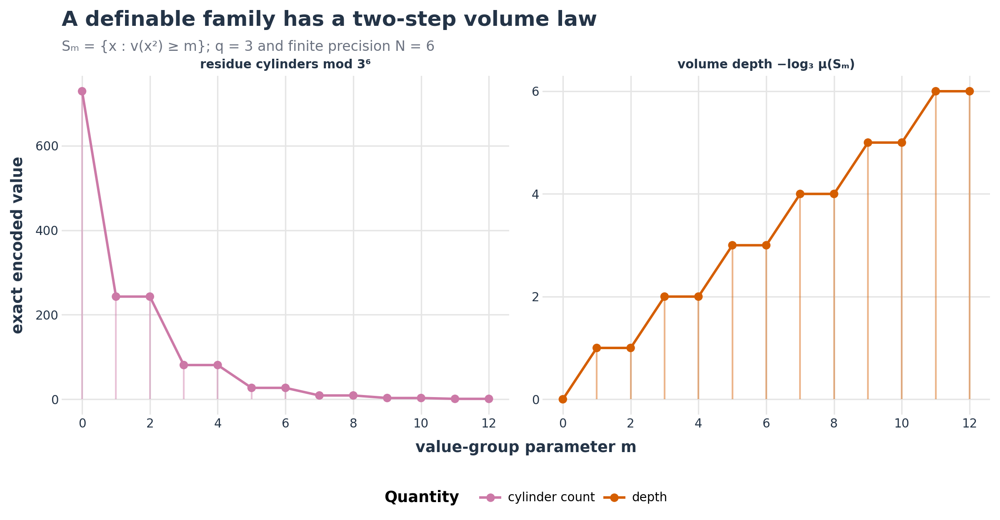

# $p$-Adic Model Theory and Definability {#sec-padic-model-theory}

**Level and prerequisites: L5.** Prepare first-order logic, definability, quantifiers, valuations and p-adic integration. The [reader guide](index.md) links the Euler arithmetic, algebra and analysis preparation and distinguishes the graduate continuation.

A formula can describe infinitely many $p$-adic points with finitely many
symbols. Model theory studies which sets and functions can be described in a
fixed language, how quantifiers can be eliminated, and which geometric or
measure-theoretic patterns follow uniformly. It is a theory of tame description,
not a replacement for proof or computation.

This final chapter begins with the concise primer's logic, adds valuation and residue
sorts, and derives an exact volume-generating series for a definable family. That
calculation reconnects Chapter 43's Igusa tails with a theorem framework that can
apply to whole families and, after qualifications, across many primes.

## Preparation from this book

The concise primer introduced statements, connectives, quantifiers, and counterexamples.
Chapter 3 described balls by valuation inequalities. Chapter 10 classified power
classes, Chapter 11 normalized Haar measure, Chapter 17 treated polynomial bases
for continuous functions, Chapter 39 required exact finite certificates, and
Chapter 43 related congruence counts to rational generating functions.

No formal logic course is assumed. We use:

- variables such as $x,y,m$;
- symbols such as $+$, multiplication, $v$, and residue;
- formulas built using equality, inequalities in the value group, Boolean
  connectives, and quantifiers $\forall,\exists$;
- a structure, such as $\mathbb Q_p$, in which those symbols receive meaning.

Syntax is the written formula. Semantics is whether it is true in the chosen
structure. Confusing them is like confusing a polynomial expression with one
numerical evaluation.

## Languages and structures

The **ring language** is

$$
\mathcal L_{\mathrm{ring}}=\{0,1,+,-,\cdot\}.
$$

Every field interprets these symbols. The formula

$$
\exists y\;(y^2=x)
$$

defines the square elements in that field. The same syntax defines different
sets in $\mathbb R$, $\mathbb Q_p$, and a finite field.

A formula may use parameters from the structure. For example,

$$
v(x-a)\ge n
$$

defines the ball centered at the parameter $a$ with depth $n$. Without
parameters, only centers and radii named or definable in the language are
available.

A **sentence** has no free variables and is either true or false. A formula with
$r$ free variables defines a subset of the $r$-fold Cartesian power of the
underlying set.

**Nonexample.** Saying “the interesting $p$-adic numbers” does not define a set
until “interesting” is replaced by a formula in a declared language.

## Definable sets, functions, and families

A set $S\subseteq K^n$ is **definable** if some formula $\varphi(x)$ holds
exactly for $x\in S$. A function is definable when its graph is definable. A
family

$$
S_t=\{x:\varphi(x,t)\}
$$

is described by one formula while the parameter $t$ varies.

Definable sets are closed under finite unions, intersections, and complements
because formulas are closed under $\lor$, $\land$, and $\neg$. Projection is
existential quantification:

$$
\{x:\exists y\;(x,y)\in S\}.
$$

This is the central reason quantifier elimination matters. It asks whether a
projected set can again be described without hidden quantified variables, in a
controlled normal form.

An infinite arbitrary union need not be definable. First-order formulas are
finite strings, so definability is a tameness restriction.

## One-sorted and many-sorted languages

Macintyre's language for $p$-adically closed fields enriches the ring language
with predicates $P_n(x)$ meaning that $x$ is a nonzero $n$th power. The theory
admits quantifier elimination in this enriched language. The predicates are
themselves ring-definable using an existential quantifier, but naming them makes
quantifier-free normal forms possible.

The Denef–Pas language uses three sorts:

1. a valued-field sort $K$;
2. a residue-field sort $k$;
3. a value-group sort, usually $\mathbb Z\cup\{\infty\}$.

It includes the convention $v(0)=\infty$ and a map

$$
v:K\to\mathbb Z\cup\{\infty\}
$$

and an angular-component map

$$
\operatorname{ac}:K\to k
$$

that records a leading residue unit. This separates size, leading digit, and
field arithmetic into the sorts where each is simplest.

An angular component depends on choices such as a uniformizer in a concrete
field. Uniform theorems formulate the compatible structure explicitly.

## Defining familiar $p$-adic sets

In the valued-field language,

$$
\mathcal O=\{x:v(x)\ge0\},
\qquad
\mathcal O^\times=\{x:v(x)=0\}.
$$

A ball is

$$
B(a,n)=\{x:v(x-a)\ge n\}.
$$

An annulus is a conjunction of two valuation inequalities. A residue condition
is expressed through $\operatorname{ac}(x-a)$. Polynomial zero sets and graphs
use ring equations.

Power classes require both valuation congruence and unit information. For odd
$p$, a square in $\mathbb Q_p^\times$ has even valuation and square angular
component. At $p=2$, more unit digits are required, exactly as Chapter 10 showed.

These examples show why “semialgebraic” in a $p$-adic field includes valuation
and power-class pieces rather than Euclidean sign intervals.

## Quantifier elimination and decidability

A theory has **quantifier elimination** if every formula is equivalent, in all
models of the theory, to a quantifier-free formula. The language is part of the
statement. Macintyre's theorem gives elimination for $p$-adically closed fields
after adding the power predicates.

Consequences include a structured description of definable sets and a decision
procedure for sentences in the theory of $\mathbb Q_p$. Decidable means an
algorithm eventually returns true or false for every sentence. It does not mean
the algorithm is fast, nor that it finds rational points on every globally
defined variety.

Denef–Pas elimination is relative: valued-field quantifiers can be removed while
residue-field and value-group formulas remain. Presburger arithmetic controls the
integer value group using addition, order, and congruence classes. Residue-field
questions remain finite-field algebra.

**Failure warning.** Quantifier elimination in an enriched language does not
mean every set has a short ring-language formula. Removing quantifiers can cause
large growth in formula size.

## A concrete quantified projection

Consider the ring-language formula

$$
\varphi(x):\quad\exists y\;(y^2=x).
$$

Its projection is the set of squares. For odd $p$ and nonzero $x$, Chapter 10
gives a quantifier-free valued description:

$$
v(x)\equiv0\pmod2
\quad\text{and}\quad
\operatorname{ac}(x)\text{ is a square in }k^\times.
$$

Include $x=0$ as a separate case. The forward implication follows because
$v(y^2)=2v(y)$ and the leading residue is a square. Conversely, divide by the
even power of $\pi$, choose a square root of the leading unit in $k$, and lift
it with Hensel's lemma because $2y$ is a unit.

This is quantifier elimination for one formula by an explicit arithmetic proof.
At $p=2$, the residue angular component alone is insufficient: a unit is a
square only after a deeper congruence test. The general theorem handles such
cases by the language's power predicates rather than by one odd-prime mnemonic.

The example also shows the role of projection. The plane curve $y^2=x$ is
defined without quantifiers in two variables. Forgetting $y$ creates an
existential formula in $x$; arithmetic analysis then replaces that hidden
witness by valuation and residue conditions.

## Cell decomposition

A $p$-adic cell decomposition partitions a definable set into finitely many
pieces on which one coordinate has controlled valuation and angular component
relative to a definable center. A schematic one-dimensional fiber has conditions

$$
\alpha(y)\;\square_1\;v(x-c(y))
\;\square_2\;\beta(y),
$$

together with

$$
\operatorname{ac}(x-c(y))\in C_y.
$$

Here each $\square_i$ is either a declared inequality or no condition. On such a
cell, integration reduces to geometric sums over integer valuation levels and
finite residue choices.

Cells are not unique. A decomposition must be adapted to the functions being
integrated. The theorem guarantees a finite controlled partition; it does not
claim one canonical partition or erase singularities without bookkeeping.

Piecewise descriptions of definable functions follow. In analytic expansions of
the language, functions can be prepared as units times monomials on cells. That
is the model-theoretic analogue of the resolution charts in Chapter 43.

### Dimension and boundaries

A definable subset of $K^n$ has a dimension: the largest number of coordinates
over which some projection contains an open set. A ball in $K$ has dimension
one, a finite set has dimension zero, and the graph of a definable function
$K\to K$ has dimension one inside $K^2$.

Lower-dimensional definable sets have Haar measure zero in the ambient dimension.
This explains, in a tame setting, why a nonzero polynomial hypersurface normally
has zero $n$-dimensional measure even though it can contain infinitely many
points. Singularities change local integrals near the hypersurface but do not
make the hypersurface itself acquire full-dimensional measure.

Dimension is not cardinality. Both a ball and a curve can be uncountable, yet
their ambient dimensions differ. Nor is it a Euclidean fractal dimension; it is
defined through definable projections and open cells.

### A piecewise definable function

Consider

$$
F(x)=
\begin{cases}
x^{-1},&v(x)<0,\\
x^2,&v(x)\ge0.
\end{cases}
$$

Its graph is definable in the valued-field language: split into the two
valuation conditions and use $xy=1$ on the first piece and $y=x^2$ on the
second. No symbol for a global reciprocal function is needed.

The pieces have different valuation behavior. On $v(x)<0$,
$v(F(x))=-v(x)>0$; on the valuation ring,
$v(F(x))=2v(x)$. A cell decomposition adapted to $F$ must retain this split.
Treating it as one monomial law would be wrong at the boundary.

This example also distinguishes total from partial functions. The equation
$xy=1$ defines reciprocal only when $x\ne0$. A definable graph must either
exclude zero or declare a value there on a separate piece. Logical formulas do
not silently ignore division by zero.

More complicated definable functions may require many cells, but each cell
comes with an explicit condition and formula. That finite case ledger is what
makes integration and specialization auditable.

## Definable measure and integration

Suppose $S_t\subseteq\mathcal O^n$ is a definable family. Cell decomposition
often makes

$$
t\longmapsto\mu(S_t)
$$

a constructible expression built from residue counts, powers of $q$, and
Presburger conditions. Summing over a value-group parameter produces rational
generating functions.

This is a structural result, not the assertion that every arbitrary subset is
measurable by a rational formula. Definability and the chosen language supply the
tameness. Haar normalization still has to be stated.

The integral of a definable function may require exponential or constructible
extensions of the coefficient ring. Additive characters add phase data and lead
to motivic-exponential frameworks.

## Complete definable-volume calculation

For $m\ge0$, define

$$
S_m=\{x\in\mathcal O:v(x^2)\ge m\}.
$$

This is one definable family: the parameter $m$ lives in the value-group sort.
Because $v(x^2)=2v(x)$,

$$
2v(x)\ge m
\quad\Longleftrightarrow\quad
v(x)\ge\left\lceil\frac m2\right\rceil.
$$

Hence

$$
S_m=\pi^{\lceil m/2\rceil}\mathcal O
$$

and

$$
\mu(S_m)=q^{-\lceil m/2\rceil}.
$$

Separate even and odd parameters:

$$
\begin{aligned}
\sum_{m\ge0}\mu(S_m)T^m
&=\sum_{r\ge0}q^{-r}T^{2r}
+\sum_{r\ge0}q^{-(r+1)}T^{2r+1}\\
&=\frac{1+q^{-1}T}{1-q^{-1}T^2}.
\end{aligned}
$$

The denominator comes from the two-step Presburger pattern. This is exactly the
normalized congruence-count series $P_{x^2}(T)$ from Chapter 43.

<figure id="fig-definable-volume">


<figcaption>

Figure 45.1: The measures of a definable family form a two-step valuation staircase and match exact finite-cylinder counts.

</figcaption>
</figure>

[Figure 45.1](#fig-definable-volume) shows value-group depth and finite counts, not a Euclidean
picture of the definable subset.

## Reproducible finite-cylinder case

Work modulo $\pi^N$. If $\lceil m/2\rceil\le N$, the residues satisfying the
condition are multiples of $\pi^{\lceil m/2\rceil}$, so

$$
\#(S_m\bmod\pi^N)
=q^{N-\lceil m/2\rceil}.
$$

For $q=3$, $N=6$, and $m=0,1,\ldots,12$, the counts are

$$
729,243,243,81,81,27,27,9,9,3,3,1,1.
$$

Every count divided by $3^6$ equals the exact Haar measure. For $m>12$, the
single zero residue modulo $3^6$ contains lifts with several deeper valuations,
so this finite representation cannot decide the condition. Returning zero or
one as if it were an exact count of $3$-adic points would be false precision.

A certificate stores $q,N,m$, the threshold $r=\lceil m/2\rceil$, and either
the exact count for $r\le N$ or an “insufficient precision” status. This is a
definability computation with an explicit information boundary.

## A second family: valuation congruence

Fix integers $a\ge1$ and $b$. The set

$$
U_{a,b}=\{x\in\mathcal O\setminus\{0\}:v(x)\equiv b\pmod a\}
$$

is definable because congruence belongs to Presburger arithmetic. If
$0\le b<a$, its measure is

$$
\sum_{r\ge0}(1-q^{-1})q^{-(b+ar)}
=\frac{(1-q^{-1})q^{-b}}{1-q^{-a}}.
$$

This derivation exhibits the general mechanism: a residue-class condition in the
value group becomes a geometric denominator. It also explains why denominators
in definable integrals involve powers of $q$.

### General power-threshold family

For an integer $a\ge1$, set

$$
S_m^{(a)}=\{x\in\mathcal O:v(x^a)\ge m\}.
$$

Exactly as before,

$$
\mu(S_m^{(a)})=q^{-\lceil m/a\rceil}.
$$

Write $m=ar+j$ with $0\le j<a$. The ceiling is $r$ for $j=0$ and
$r+1$ for $1\le j<a$. Therefore

$$
\sum_{m\ge0}\mu(S_m^{(a)})T^m
=\frac{1+q^{-1}(T+T^2+\cdots+T^{a-1})}
{1-q^{-1}T^a}.
$$

For $a=1$ this becomes $(1-q^{-1}T)^{-1}$; for $a=2$ it is the previous
two-step formula. Substitution into Chapter 43's tail identity recovers the
monomial Igusa factor

$$
\frac{1-q^{-1}}{1-q^{-1}T^a}.
$$

The two rational functions differ because one generates tail volumes and the
other generates exact valuation masses. Model-theoretic uniformity does not
remove this indexing distinction.

## Elementary equivalence and what it preserves

Two structures are **elementarily equivalent** if they satisfy the same
first-order sentences in the declared language. They need not be isomorphic.
First-order transfer preserves every definable statement but may not preserve
properties that require quantifying over arbitrary subsets or infinite sequences
outside the language.

Compactness in logic is also different from topological compactness of
$\mathbb Z_p$. Logical compactness says a set of sentences has a model if every
finite subset has one. Reusing a proof of sequential compactness from Chapter 11
would address the wrong notion. The shared word reflects an analogy about finite
consistency, not one theorem.

## Uniformity across primes

A Denef–Pas formula can be interpreted in many local fields. Under suitable
hypotheses, one obtains one finite collection of rational expressions whose
specializations give volumes for every sufficiently large residue
characteristic. Residue-field point counts may still vary with $q$ and with
congruence classes of the characteristic.

“Sufficiently large” permits a finite exceptional set depending on the formula.
Small primes can fail because coefficients vanish, derivatives lose invertibility,
or ramification changes. An implementation must either list the excluded primes
or run a separate proof for them.

Transfer principles compare local fields with elementarily equivalent residue
and value-group data. They do not assert that characteristic zero and positive
characteristic fields are isomorphic.

## Restricted analytic and motivic vistas

The basic ring language does not name every convergent power series. A restricted
analytic language adds functions represented by power series on $\mathcal O^n$
and extends them by zero outside their declared domains. Quantifier elimination
and cell decomposition then require analytic versions of the theorems.

Motivic integration packages definable volumes before specializing to one prime.
Its values remember residue varieties and powers of a formal Lefschetz symbol.
Specialization recovers many $p$-adic integrals. Motivic exponential integration
also records additive characters.

These subjects require Grothendieck rings and more scheme theory than this chapter
develops. Their role here is to explain the endpoint of uniformity, not to replace
the exact $S_m$ derivation with terminology.

A simple language-dependence test is the restricted exponential. On a sufficiently
small ball, the $p$-adic exponential is analytic and its graph can be named in a
restricted analytic language. It is not thereby a primitive symbol of the ring
language. A theorem proved after adding that function cannot be quoted as a
ring-language elimination theorem without a definability argument.

Parameters create a second dependence. The singleton $\{a\}$ is definable by
$x=a$ when $a$ is allowed as a parameter, but it may not be definable without
parameters if no formula singles it out. Uniform family statements should list
which coefficients are fixed constants, which vary as parameters, and which are
quantified variables. This bookkeeping is as essential as fixing a prime and
precision in local-field computation.
Without it, “definable” names no reproducible mathematical property at all.

## Algorithms and logical certificates

A decision or integration certificate should include:

1. the exact language and parameter set;
2. the input formula's syntax tree;
3. each equivalent formula or cell partition;
4. residue-field and Presburger subproblems;
5. excluded residue characteristics;
6. Haar normalization;
7. rational-function simplification checked symbolically;
8. finite specializations used as regression tests.

A program that samples points can refute an incorrect universal formula, but
passing samples does not prove quantifier equivalence. The equivalence steps need
a theorem-backed transformation or a separately checkable finite argument.

### Three questions that remain different

For a formula $\varphi(x,t)$, keep three tasks separate.

1. **Logical decision:** determine whether a sentence such as
   $\exists x\,\varphi(x,t)$ is true.
2. **Geometric description:** partition the solution set into cells and determine
   its dimension, closure, or singular loci.
3. **Quantitative integration:** compute its Haar measure or an integral over it.

Quantifier elimination addresses the first task and helps the second. Cell
decomposition organizes the second and third. Neither automatically supplies a
fast implementation. A decision algorithm can prove nonemptiness without
returning a convenient point, while a measure-zero set can still be nonempty and
arithmetically important.

For example, $x^2=a$ may define two points, no points, or a singular point at
$a=0$. Its ambient Haar measure is zero in every case, so integration alone
cannot decide which occurs. Conversely, a ball has positive measure but may
contain no rational point satisfying an additional global equation. The local
definable and global Diophantine questions must not be conflated.

## Theorem-scope and failure audit

- Definability of the examples, both volume calculations, the generating series,
  and finite-cylinder counts were derived completely.
- Quantifier elimination is language-specific.
- Decidability does not imply practical efficiency or solve arbitrary global
  Diophantine problems.
- Cell decomposition is finite but not canonical.
- Uniformity may exclude finitely many primes.
- Not every analytic function is definable in the ring language.
- Finite residue data cannot answer conditions deeper than their precision.

<!-- inline-formula-code:start -->
## Formula and finite computation

A useful formula in this chapter is

$$
X_N=\{x\bmod p^N:v_p(f(x))\ge k\}
$$

A finite residue set is an exact truncation of a valuation-definable family. The following standalone Python block expresses that finite rule with its inputs and stopping conditions visible.

```python
prime, precision, threshold = 3, 5, 2
modulus = prime**precision
defined_set = [x for x in range(modulus) if (x * x - 1) % prime**threshold == 0]
print(len(defined_set), defined_set[:12])
```

**What the computation establishes.** The output certifies only the declared finite case. The theorem, if one is claimed, still requires the argument developed in the chapter.
<!-- inline-formula-code:end -->

## Exercises

<div class="exercise" id="p_adic_numbers-45-padic-model-theory-ex-1">
<p class="exercise-title"><strong>Exercise 1</strong></p>

Identify the free and bound variables in three formulas of your choice.

</div>

<div class="exercise" id="p_adic_numbers-45-padic-model-theory-ex-2">
<p class="exercise-title"><strong>Exercise 2</strong></p>

Write valued-field formulas for a ball, a shell, and an annulus.

</div>

<div class="exercise" id="p_adic_numbers-45-padic-model-theory-ex-3">
<p class="exercise-title"><strong>Exercise 3</strong></p>

Express squarehood using an existential ring-language formula.

</div>

<div class="exercise" id="p_adic_numbers-45-padic-model-theory-ex-4">
<p class="exercise-title"><strong>Exercise 4</strong></p>

Prove that definable sets are closed under projection.

</div>

<div class="exercise" id="p_adic_numbers-45-padic-model-theory-ex-5">
<p class="exercise-title"><strong>Exercise 5</strong></p>

Derive $S_m=\pi^{\lceil m/2\rceil}\mathcal O$.

<details class="solution"><summary>Solution</summary>

Valuation multiplicativity gives $v(x^2)=2v(x)$. Since $v(x)$ is an integer,
$2v(x)\ge m$ is equivalent to
$v(x)\ge\lceil m/2\rceil$. The latter condition defines exactly the ideal
$\pi^{\lceil m/2\rceil}\mathcal O$.

</details>

</div>

<div class="exercise" id="p_adic_numbers-45-padic-model-theory-ex-6">
<p class="exercise-title"><strong>Exercise 6</strong></p>

Compute the volume-generating series for $S_m$.

<details class="solution"><summary>Solution</summary>

For $m=2r$, the measure is $q^{-r}$; for $m=2r+1$, it is
$q^{-(r+1)}$. Therefore

$$
\sum_{m\ge0}\mu(S_m)T^m
=\sum_{r\ge0}q^{-r}T^{2r}
+\sum_{r\ge0}q^{-(r+1)}T^{2r+1}
=\frac{1+q^{-1}T}{1-q^{-1}T^2}.
$$

</details>

</div>

<div class="exercise" id="p_adic_numbers-45-padic-model-theory-ex-7">
<p class="exercise-title"><strong>Exercise 7</strong></p>

Derive the finite-cylinder count and its precision boundary.

<details class="solution"><summary>Solution</summary>

At precision $\pi^N$, the multiples of $\pi^r$ number $q^{N-r}$ when
$0\le r\le N$. Put $r=\lceil m/2\rceil$. If $r>N$, the zero residue contains
both qualifying and nonqualifying lifts, so the stored class does not determine
membership and the correct status is “insufficient precision.”

</details>

</div>

<div class="exercise" id="p_adic_numbers-45-padic-model-theory-ex-8">
<p class="exercise-title"><strong>Exercise 8</strong></p>

Generalize the calculation to $v(x^a)\ge m$.

</div>

<div class="exercise" id="p_adic_numbers-45-padic-model-theory-ex-9">
<p class="exercise-title"><strong>Exercise 9</strong></p>

Compute the measure of $U_{a,b}$.

<details class="solution"><summary>Solution</summary>

The shell with valuation $b+ar$ has mass
$(1-q^{-1})q^{-(b+ar)}$. Summing over $r\ge0$ gives

$$
\frac{(1-q^{-1})q^{-b}}{1-q^{-a}}.
$$

The congruence condition in the value group is exactly what selects this
geometric progression.

Part VIII has now connected lattice geometry, smooth group actions, geometric
cohomology, local integration, arithmetic pairings, and definability. Each route
returns to the same discipline: declare the structure, compute exact finite data,
and state where a deep theorem begins.

</details>

</div>

<div class="exercise" id="p_adic_numbers-45-padic-model-theory-ex-10">
<p class="exercise-title"><strong>Exercise 10</strong></p>

Explain why Macintyre's theorem must name its enriched language.

</div>

<div class="exercise" id="p_adic_numbers-45-padic-model-theory-ex-11">
<p class="exercise-title"><strong>Exercise 11</strong></p>

Give two reasons a uniform formula may exclude small primes.

</div>

<div class="exercise" id="p_adic_numbers-45-padic-model-theory-ex-12">
<p class="exercise-title"><strong>Exercise 12</strong></p>

Distinguish definability, decidability, and efficient computability.

</div>

## Selected solutions

### Solution to Exercise 5

Valuation multiplicativity gives $v(x^2)=2v(x)$. Since $v(x)$ is an integer,
$2v(x)\ge m$ is equivalent to
$v(x)\ge\lceil m/2\rceil$. The latter condition defines exactly the ideal
$\pi^{\lceil m/2\rceil}\mathcal O$.

### Solution to Exercise 6

For $m=2r$, the measure is $q^{-r}$; for $m=2r+1$, it is
$q^{-(r+1)}$. Therefore

$$
\sum_{m\ge0}\mu(S_m)T^m
=\sum_{r\ge0}q^{-r}T^{2r}
+\sum_{r\ge0}q^{-(r+1)}T^{2r+1}
=\frac{1+q^{-1}T}{1-q^{-1}T^2}.
$$

### Solution to Exercise 7

At precision $\pi^N$, the multiples of $\pi^r$ number $q^{N-r}$ when
$0\le r\le N$. Put $r=\lceil m/2\rceil$. If $r>N$, the zero residue contains
both qualifying and nonqualifying lifts, so the stored class does not determine
membership and the correct status is “insufficient precision.”

### Solution to Exercise 9

The shell with valuation $b+ar$ has mass
$(1-q^{-1})q^{-(b+ar)}$. Summing over $r\ge0$ gives

$$
\frac{(1-q^{-1})q^{-b}}{1-q^{-a}}.
$$

The congruence condition in the value group is exactly what selects this
geometric progression.

Part VIII has now connected lattice geometry, smooth group actions, geometric
cohomology, local integration, arithmetic pairings, and definability. Each route
returns to the same discipline: declare the structure, compute exact finite data,
and state where a deep theorem begins.
