# Appendix H — Python laboratories for $p$-adic computation {#sec-padic-python-laboratory}

$p$-adic computation is finite-precision computation with an unusually clear
meaning: knowing $x$ to precision $p^N$ means knowing its residue modulo
$p^N$. This appendix develops that idea in twenty self-contained Python programs.
No programming experience is assumed. All arithmetic is exact integer or
`Fraction` arithmetic; a program never stores a $p$-adic number as an ordinary
floating decimal.

Each block states a precision or finite range. A congruence check is a theorem
about that range, not evidence that an unbounded iteration must converge. Copy
one block at a time, predict the result, run it, change the prime or precision,
and retain the final modular certificate.

## Python notation from the beginning

Python's `=` stores a value under a name, while `==` asks whether two computed
values are equal. `def` introduces a reusable finite procedure and `return`
reveals its result. An indented `for` or `while` block repeats an instruction;
an indented `if` block handles one mathematical case. `range(a, b)` contains
the integers from `a` through `b-1`. A tuple is a fixed ordered record and a
list is a finite ordered collection. None of these objects silently represents
an infinite $p$-adic expansion: precision must always appear as an input or in
the returned certificate.

## Lab 1 — Compute a valuation safely

The valuation $v_p(n)$ counts factors of a prime $p$. The value at zero is
$+\infty$, represented here by `None` so it cannot accidentally enter ordinary
integer arithmetic.

```python
from math import isqrt

def is_prime(number: int) -> bool:
    """Return whether number is prime by exact trial division."""
    if number < 2:
        return False
    return all(number % divisor != 0 for divisor in range(2, isqrt(number) + 1))

def valuation(integer: int, prime: int) -> int | None:
    """Return v_prime(integer), using None for v_prime(0) = infinity."""
    if not is_prime(prime):
        raise ValueError("prime must actually be prime")
    if integer == 0:
        return None
    exponent = 0
    remaining = abs(integer)
    while remaining % prime == 0:
        remaining //= prime
        exponent += 1
    return exponent

for integer in (0, 12, 24, 40, 81):
    print(integer, valuation(integer, 2), valuation(integer, 3))
```

The branch for zero is a mathematical design decision, not an error to hide.

<figure id="fig-code-valuation-profile">
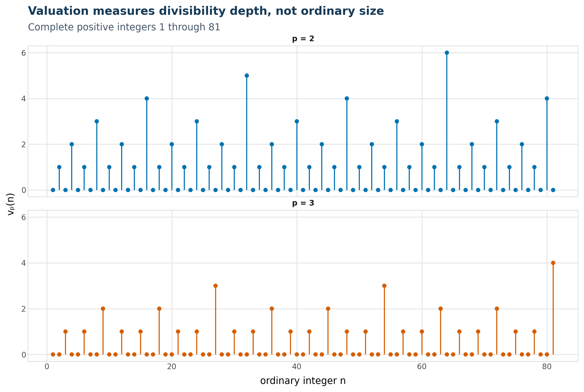

<figcaption>

Figure H.1: Two-adic and three-adic valuations create spikes at increasingly divisible integers.

</figcaption>
</figure>

[Figure H.1](#fig-code-valuation-profile) makes divisibility depth visible. The visual
height is a valuation, not an ordinary magnitude.

## Lab 2 — Exact $p$-adic absolute values and distances

For nonzero rational $a/b$, $v_p(a/b)=v_p(a)-v_p(b)$ and
$|a/b|_p=p^{-v_p(a/b)}$. `Fraction` keeps the result exact.

```python
from fractions import Fraction
from math import isqrt

def is_prime(number: int) -> bool:
    """Return whether number is prime by exact trial division."""
    if number < 2:
        return False
    return all(number % divisor != 0 for divisor in range(2, isqrt(number) + 1))

def integer_valuation(integer: int, prime: int) -> int:
    """Return v_prime(integer) for a nonzero integer and prime >= 2."""
    if integer == 0 or not is_prime(prime):
        raise ValueError("use a nonzero integer and an actual prime")
    exponent = 0
    remaining = abs(integer)
    while remaining % prime == 0:
        remaining //= prime
        exponent += 1
    return exponent

def padic_absolute(value: Fraction, prime: int) -> Fraction:
    """Return the exact p-adic absolute value of a nonzero rational."""
    if value == 0:
        return Fraction(0)
    exponent = integer_valuation(value.numerator, prime) - integer_valuation(
        value.denominator, prime
    )
    return Fraction(prime ** max(-exponent, 0), prime ** max(exponent, 0))

x, y = Fraction(1, 3), Fraction(10, 3)
print(padic_absolute(x, 3), padic_absolute(y, 3), padic_absolute(x - y, 3))
```

The helper makes primality part of the executable boundary rather than relying
on the parameter name.

## Lab 3 — Extract base-$p$ digits

Every residue modulo $p^N$ has exactly $N$ digits $a_0,\ldots,a_{N-1}$ with
$0\le a_i<p$. Least-significant-first order matches the $p$-adic series.

```python
from math import isqrt

def is_prime(number: int) -> bool:
    """Return whether number is prime by exact trial division."""
    if number < 2:
        return False
    return all(number % divisor != 0 for divisor in range(2, isqrt(number) + 1))

def base_p_digits(integer: int, prime: int, precision: int) -> list[int]:
    """Return the least-significant-first digits of integer modulo prime**precision."""
    if not is_prime(prime) or precision <= 0:
        raise ValueError("require an actual prime and positive precision")
    residue = integer % (prime**precision)
    digits: list[int] = []
    for _ in range(precision):
        residue, digit = divmod(residue, prime)
        digits.append(digit)
    return digits

print(base_p_digits(100, prime=3, precision=6))
print(base_p_digits(-1, prime=3, precision=6))
```

The second line prints six `2`s because
$-1\equiv2+2\cdot3+\cdots+2\cdot3^5\pmod{3^6}$.

## Lab 4 — Reconstruct and certify a truncation

Digit extraction should come with the inverse operation and a modular check.

```python
def reconstruct(digits: list[int], prime: int) -> int:
    """Return sum digit_i * prime**i after validating every digit."""
    if prime < 2 or not digits:
        raise ValueError("require prime >= 2 and at least one digit")
    if any(digit < 0 or digit >= prime for digit in digits):
        raise ValueError("every digit must lie between zero and prime minus one")
    return sum(digit * prime**index for index, digit in enumerate(digits))

digits = [2, 1, 0, 2, 2]
value = reconstruct(digits, prime=3)
modulus = 3 ** len(digits)
print(value, modulus, value % modulus)
```

<figure id="fig-code-digit-reconstruction">
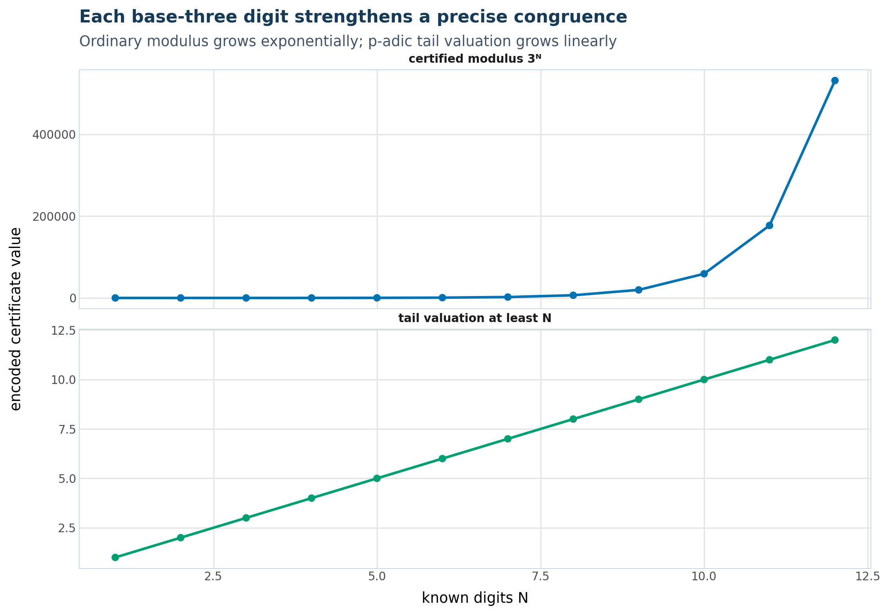

<figcaption>

Figure H.2: Each added base-three digit increases the certified modulus and the valuation of the unknown tail.

</figcaption>
</figure>

[Figure H.2](#fig-code-digit-reconstruction) shows why more digits mean greater
$p$-adic accuracy even though the ordinary representative may grow.

## Lab 5 — Addition with visible carries

This routine adds two fixed-precision digit lists and returns both the result
digits and every carry. It makes the local, left-to-right nature of $p$-adic
arithmetic explicit.

```python
def add_digits(
    left: list[int], right: list[int], prime: int
) -> tuple[list[int], list[int]]:
    """Add equal-length base-p digit lists modulo p**N and expose carries."""
    if prime < 2 or len(left) != len(right) or not left:
        raise ValueError("use equal nonempty lists and prime >= 2")
    if any(not 0 <= digit < prime for digit in left + right):
        raise ValueError("digits must lie in the canonical range")
    result: list[int] = []
    carries: list[int] = []
    carry = 0
    for left_digit, right_digit in zip(left, right, strict=True):
        carry, digit = divmod(left_digit + right_digit + carry, prime)
        result.append(digit)
        carries.append(carry)
    return result, carries

result, carries = add_digits([2, 2, 1, 0], [2, 1, 2, 2], prime=3)
print(result, carries)
```

Any carry beyond the final position is discarded because the declared result
is modulo $p^N$.

## Lab 6 — Invert a unit by Newton lifting

If $a$ is not divisible by $p$, an inverse modulo $p$ can be doubled in
precision using $x\leftarrow x(2-ax)$. The code verifies every new modulus.

```python
from math import gcd
from math import isqrt

def is_prime(number: int) -> bool:
    """Return whether number is prime by exact trial division."""
    if number < 2:
        return False
    return all(number % divisor != 0 for divisor in range(2, isqrt(number) + 1))

def inverse_lifts(value: int, prime: int, precision: int) -> list[tuple[int, int]]:
    """Return (modulus, inverse) certificates up to p**precision."""
    if not is_prime(prime) or precision <= 0 or gcd(value, prime) != 1:
        raise ValueError("value must be a unit and precision positive")
    inverse = pow(value, -1, prime)
    digits = 1
    certificates = [(prime, inverse)]
    while digits < precision:
        digits = min(2 * digits, precision)
        modulus = prime**digits
        inverse = (inverse * (2 - value * inverse)) % modulus
        if value * inverse % modulus != 1:
            raise ArithmeticError("inverse certificate failed")
        certificates.append((modulus, inverse))
    return certificates

print(inverse_lifts(value=10, prime=3, precision=8))
```

The congruence after every step is a checkable certificate. The number of
correct base-$p$ digits approximately doubles.

## Lab 7 — Hensel lift a square root

Starting from $3^2\equiv2\pmod7$, Newton's formula lifts a root of
$x^2-2$ to successively higher powers of $7$.

```python
from math import isqrt

def is_prime(number: int) -> bool:
    """Return whether number is prime by exact trial division."""
    if number < 2:
        return False
    return all(number % divisor != 0 for divisor in range(2, isqrt(number) + 1))

def hensel_square_root(
    target: int, prime: int, root_mod_prime: int, precision: int
) -> list[tuple[int, int]]:
    """Lift a simple root of x squared minus target through p-power moduli."""
    if precision <= 0 or not is_prime(prime):
        raise ValueError("use an actual prime and positive precision")
    root = root_mod_prime % prime
    if (root * root - target) % prime != 0 or (2 * root) % prime == 0:
        raise ValueError("the initial residue must be a simple root")
    certificates = [(prime, root)]
    for exponent in range(2, precision + 1):
        previous_modulus = prime ** (exponent - 1)
        error_digit = ((root * root - target) // previous_modulus) % prime
        correction = (-error_digit * pow(2 * root, -1, prime)) % prime
        root += correction * previous_modulus
        modulus = prime**exponent
        if (root * root - target) % modulus != 0:
            raise ArithmeticError("Hensel certificate failed")
        certificates.append((modulus, root))
    return certificates

print(hensel_square_root(target=2, prime=7, root_mod_prime=3, precision=6))
```

<figure id="fig-code-hensel-doubling">
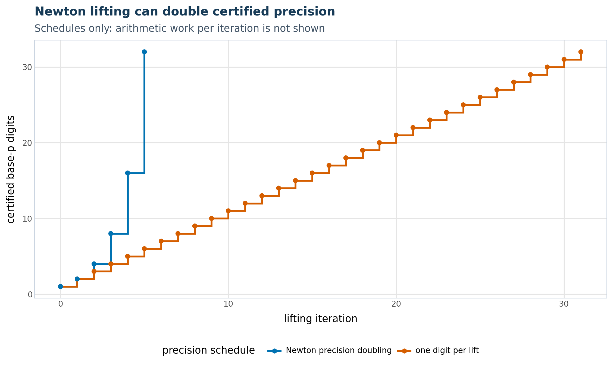

<figcaption>

Figure H.3: Hensel and Newton lifting increase the number of certified p-adic digits.

</figcaption>
</figure>

The plot compares precision schedules, not arithmetic operation costs.

## Lab 8 — Count roots modulo $p^N$

A brute-force search is legitimate when the complete finite domain is declared.
It can reveal singular behavior that simple-root Hensel theory does not cover.

```python
from collections.abc import Callable
from math import isqrt

def is_prime(number: int) -> bool:
    """Return whether number is prime by exact trial division."""
    if number < 2:
        return False
    return all(number % divisor != 0 for divisor in range(2, isqrt(number) + 1))

def roots_mod_prime_power(
    polynomial: Callable[[int], int], prime: int, precision: int
) -> list[int]:
    """Return every residue root modulo prime**precision by exhaustive search."""
    if not is_prime(prime) or precision <= 0:
        raise ValueError("require an actual prime and positive precision")
    modulus = prime**precision
    return [residue for residue in range(modulus) if polynomial(residue) % modulus == 0]

for precision in range(1, 6):
    roots = roots_mod_prime_power(lambda x: x * x, prime=2, precision=precision)
    print(precision, roots)
```

The growing **number of residue roots** contrasts with simple-root lifting.
It is not growing algebraic multiplicity: $0$ has multiplicity two for $x^2$
and is its only exact $p$-adic root. The compatible-branch argument in
[Section 9.7](09-hensel.md#sec-singular-root-tree) explains why the other finite residue roots eventually
die.

## Lab 9 — An ultrametric distance matrix

Residues modulo $3^3$ can be grouped by how many initial $3$-adic digits they
share. The matrix stores $v_3(x-y)$, capped at precision four on the diagonal.

```python
import numpy as np
from math import isqrt

def is_prime(number: int) -> bool:
    """Return whether number is prime by exact trial division."""
    if number < 2:
        return False
    return all(number % divisor != 0 for divisor in range(2, isqrt(number) + 1))

def capped_valuation_difference(left: int, right: int, prime: int, cap: int) -> int:
    """Return min(v_p(left-right), cap), with the diagonal assigned cap."""
    if not is_prime(prime) or cap < 0:
        raise ValueError("use an actual prime and nonnegative cap")
    difference = left - right
    if difference == 0:
        return cap
    exponent = 0
    while exponent < cap and difference % prime == 0:
        difference //= prime
        exponent += 1
    return exponent

residues = list(range(27))
matrix = np.array(
    [
        [capped_valuation_difference(x, y, prime=3, cap=4) for y in residues]
        for x in residues
    ]
)
print(matrix.shape, np.unique(matrix, return_counts=True))
```

<figure id="fig-code-ultrametric-distance-matrix">
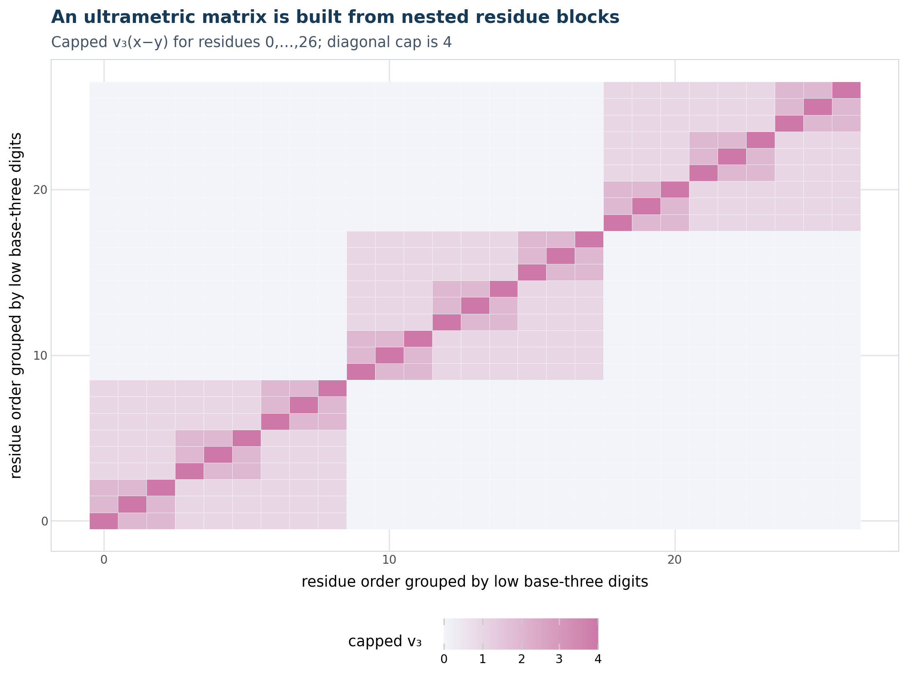

<figcaption>

Figure H.4: A tiled valuation matrix reveals nested three-adic residue blocks.

</figcaption>
</figure>

The block structure in [Figure H.4](#fig-code-ultrametric-distance-matrix) is the finite
shadow of nested $p$-adic balls.

## Lab 10 — Finite Mahler coefficients

For integer samples $f(0),f(1),\ldots$, the $k$th Mahler coefficient is the
$k$th forward difference at zero. A difference table computes the first finite
segment exactly.

```python
def mahler_coefficients(values: list[int]) -> list[int]:
    """Return forward-difference coefficients from consecutive integer samples."""
    if not values:
        raise ValueError("provide at least one sample")
    row = values.copy()
    coefficients: list[int] = []
    while row:
        coefficients.append(row[0])
        row = [right - left for left, right in zip(row, row[1:])]
    return coefficients

samples = [n * n for n in range(7)]
print(samples)
print(mahler_coefficients(samples))
```

The coefficient list begins `[0, 1, 2, 0, ...]`, agreeing with
$n^2=\binom n1+2\binom n2$. Finite samples determine only this finite
difference table; analytic decay claims require the theory in Chapter 17.

## Lab 11 — Compute $v_p(n!)$ without constructing the factorial

Legendre's formula counts how many multiples of $p,p^2,p^3,\ldots$ occur among
$1,\ldots,n$. Repeated integer division evaluates the finite sum and avoids
building the enormous integer $n!$.

```python
from math import factorial, isqrt

def is_prime(number: int) -> bool:
    """Return whether number is prime by exact trial division."""
    if number < 2:
        return False
    return all(number % divisor != 0 for divisor in range(2, isqrt(number) + 1))

def factorial_valuation(number: int, prime: int) -> int:
    """Return v_p(number!) from Legendre's finite sum."""
    if number < 0 or not is_prime(prime):
        raise ValueError("number must be nonnegative and prime must be prime")
    total = 0
    quotient = number
    while quotient:
        quotient //= prime
        total += quotient
    return total

def direct_valuation(integer: int, prime: int) -> int:
    """Return v_p of a positive integer for an independent small-case check."""
    if integer <= 0 or not is_prime(prime):
        raise ValueError("integer must be positive and prime must be prime")
    exponent = 0
    while integer % prime == 0:
        integer //= prime
        exponent += 1
    return exponent

for number in (5, 10, 25, 50):
    formula = factorial_valuation(number, prime=5)
    direct = direct_valuation(factorial(number), prime=5)
    print(number, formula, direct, formula == direct)
```

The direct factorial is included only as a small independent check. For large
$n$, the quotient sum is both clearer and far cheaper.

<figure id="fig-code-factorial-valuation">
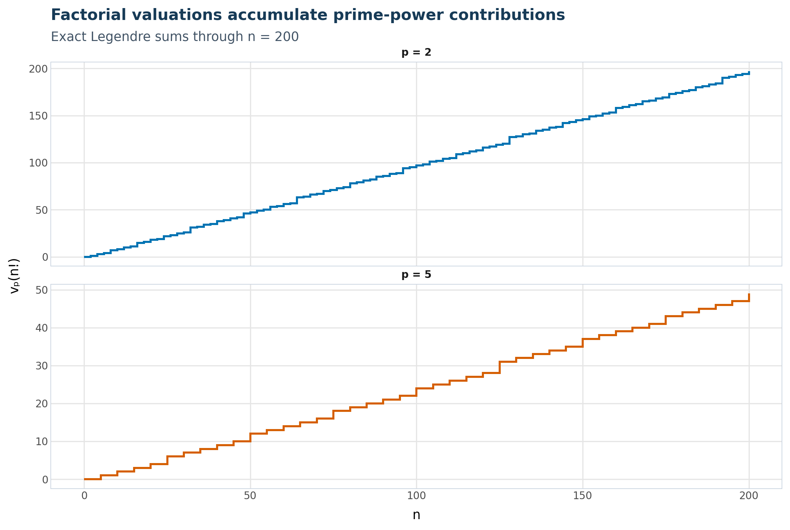

<figcaption>

Figure H.5: Factorial valuations rise in steps exactly when new multiples of prime powers enter the product.

</figcaption>
</figure>

## Lab 12 — Solve a linear congruence modulo $p^N$

The congruence $ax\equiv b\pmod m$ has a solution exactly when
$\gcd(a,m)$ divides $b$. After dividing by that gcd, the reduced coefficient is
a unit and can be inverted. The discarded gcd reappears as the exact number of
solutions modulo $m$.

```python
from math import gcd, isqrt

def is_prime(number: int) -> bool:
    """Return whether number is prime by exact trial division."""
    if number < 2:
        return False
    return all(number % divisor != 0 for divisor in range(2, isqrt(number) + 1))

def linear_congruence_solutions(
    coefficient: int, target: int, prime: int, precision: int
) -> list[int]:
    """Return every x modulo p**precision satisfying coefficient*x = target."""
    if not is_prime(prime) or precision <= 0:
        raise ValueError("prime must be prime and precision positive")
    modulus = prime**precision
    common = gcd(coefficient, modulus)
    if target % common:
        return []
    reduced_modulus = modulus // common
    reduced_coefficient = coefficient // common
    reduced_target = target // common
    first = (pow(reduced_coefficient, -1, reduced_modulus) * reduced_target) % (
        reduced_modulus
    )
    solutions = sorted(
        (first + offset * reduced_modulus) % modulus
        for offset in range(common)
    )
    if any((coefficient * value - target) % modulus for value in solutions):
        raise ArithmeticError("a reported solution failed its congruence")
    return solutions

solutions = linear_congruence_solutions(9, 18, prime=3, precision=5)
print(len(solutions), solutions)
print(linear_congruence_solutions(9, 20, prime=3, precision=5))
```

The empty list in the second case means “proved unsolvable at this modulus,”
not “the search happened not to find one.”

## Lab 13 — Build a precision ledger for $p$-adic logarithm terms

For $\log(1+p)=\sum_{k\geq1}(-1)^{k+1}p^k/k$, the $k$th term has valuation
$k-v_p(k)$. The valuations tend to infinity, but they need not increase at
every consecutive index because powers of $p$ enlarge the denominator.

```python
from math import isqrt

def is_prime(number: int) -> bool:
    """Return whether number is prime by exact trial division."""
    if number < 2:
        return False
    return all(number % divisor != 0 for divisor in range(2, isqrt(number) + 1))

def valuation(integer: int, prime: int) -> int:
    """Return v_p(integer) for a nonzero integer."""
    if integer == 0:
        raise ValueError("this ledger requires a nonzero integer")
    exponent = 0
    integer = abs(integer)
    while integer % prime == 0:
        integer //= prime
        exponent += 1
    return exponent

def logarithm_term_valuations(prime: int, terms: int) -> list[int]:
    """Return valuations of the first terms in log(1+p)."""
    if not is_prime(prime) or terms <= 0:
        raise ValueError("prime must be prime and terms positive")
    return [index - valuation(index, prime) for index in range(1, terms + 1)]

for prime in (3, 5, 7):
    print(prime, logarithm_term_valuations(prime, terms=16))
```

The ledger says which terms can still affect a requested precision. It does not
replace a proof that the tail is controlled; Chapter 8 provides the series
theory.

<figure id="fig-code-log-exp-precision">
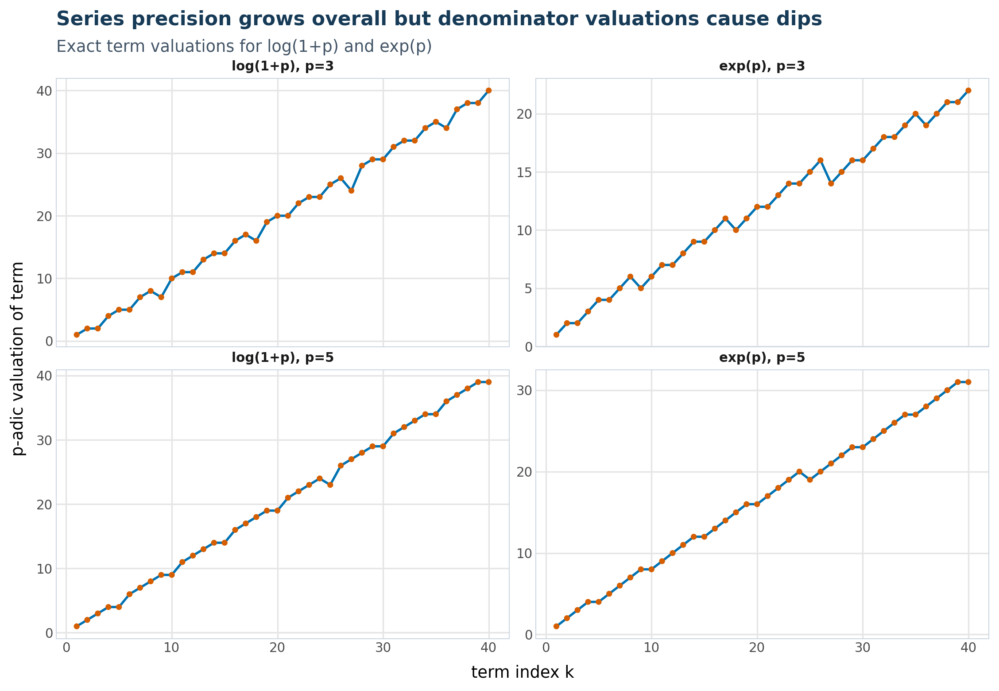

<figcaption>

Figure H.6: Term valuations for p-adic logarithm and exponential series expose how precision improves and where denominators cause dips.

</figcaption>
</figure>

## Lab 14 — Construct a Newton polygon from coefficient valuations

Write a polynomial as $\sum a_i x^i$. Plot the finite points
$(i,v_p(a_i))$ for nonzero coefficients and retain their lower convex hull.
The slopes of that hull constrain root valuations, subject to the theorem's
field and multiplicity hypotheses.

```python
from math import isqrt

def is_prime(number: int) -> bool:
    """Return whether number is prime by exact trial division."""
    if number < 2:
        return False
    return all(number % divisor != 0 for divisor in range(2, isqrt(number) + 1))

def valuation(integer: int, prime: int) -> int:
    """Return v_p(integer) for a nonzero coefficient."""
    if integer == 0:
        raise ValueError("zero coefficients have no finite plotted valuation")
    exponent = 0
    integer = abs(integer)
    while integer % prime == 0:
        integer //= prime
        exponent += 1
    return exponent

def newton_polygon(
    coefficients: list[int], prime: int
) -> list[tuple[int, int]]:
    """Return lower-hull vertices for ascending polynomial coefficients."""
    if len(coefficients) < 2 or not is_prime(prime):
        raise ValueError("provide a nonconstant polynomial and a prime")
    points = [
        (degree, valuation(coefficient, prime))
        for degree, coefficient in enumerate(coefficients)
        if coefficient != 0
    ]
    if len(points) < 2:
        raise ValueError("at least two coefficients must be nonzero")
    hull: list[tuple[int, int]] = []
    for point in points:
        while len(hull) >= 2:
            first, second = hull[-2], hull[-1]
            cross = (second[0] - first[0]) * (point[1] - first[1]) - (
                second[1] - first[1]
            ) * (point[0] - first[0])
            if cross > 0:
                break
            hull.pop()
        hull.append(point)
    return hull

vertices = newton_polygon([9, 3, 0, 1], prime=3)
print(vertices)
print(
    [
        (right[1] - left[1]) / (right[0] - left[0])
        for left, right in zip(vertices, vertices[1:])
    ]
)
```

The output slopes are exact rational quotients even though they are printed as
decimals here. Zero coefficients are omitted because their valuation is
$+\infty$.

<figure id="fig-code-newton-polygon">
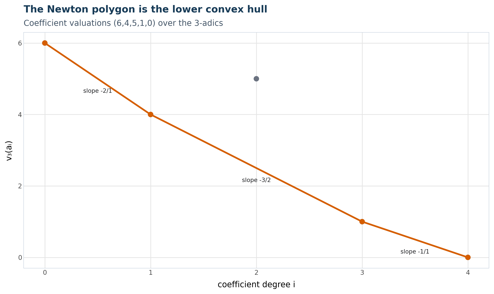

<figcaption>

Figure H.7: A lower convex hull selects the Newton polygon from all finite coefficient valuations.

</figcaption>
</figure>

## Lab 15 — Track root lifts and finite survival {#sec-root-lift-laboratory}

Enumerating every residue modulo $p^N$ is expensive but definitive for a small
declared range. Comparing $x^2-1$ with $x^2$ shows two different residue-count
patterns. To explain them, retain the reduction edges as well: a singular
root can have all next digits or no next digit, and a child can die later.
The first function preserves the independent exhaustive count. The tree
function instead tests only the $p$ candidates above each known parent; for
integer-coefficient polynomials, every higher root reduces to a lower root, so
this search is complete through its declared finite horizon.

```python
from collections.abc import Callable
from math import isqrt

def is_prime(number: int) -> bool:
    """Return whether number is prime by exact trial division."""
    if number < 2:
        return False
    return all(number % divisor != 0 for divisor in range(2, isqrt(number) + 1))

def root_counts(
    polynomial: Callable[[int], int], prime: int, max_precision: int
) -> list[int]:
    """Count roots modulo p, p squared, through p**max_precision."""
    if not is_prime(prime) or max_precision <= 0:
        raise ValueError("prime must be prime and precision positive")
    counts: list[int] = []
    for precision in range(1, max_precision + 1):
        modulus = prime**precision
        count = sum(polynomial(residue) % modulus == 0 for residue in range(modulus))
        counts.append(count)
    return counts

def root_lift_tree(
    coefficients: tuple[int, ...], prime: int, max_precision: int
) -> tuple[list[tuple[int, ...]], list[dict[int, tuple[int, ...]]]]:
    """Return root levels and parent-to-child maps through a finite horizon."""
    if not isinstance(coefficients, tuple) or not coefficients:
        raise ValueError("use a nonempty tuple of exact integer coefficients")
    if any(type(value) is not int for value in coefficients):
        raise ValueError("use a nonempty tuple of exact integer coefficients")
    if type(prime) is not int or type(max_precision) is not int:
        raise TypeError("prime and precision must be integers")
    if not is_prime(prime) or max_precision < 1:
        raise ValueError("prime must be prime and precision positive")

    def evaluate(residue: int) -> int:
        value = 0
        for coefficient in reversed(coefficients):
            value = value * residue + coefficient
        return value

    levels = [tuple(residue for residue in range(prime) if evaluate(residue) % prime == 0)]
    edges: list[dict[int, tuple[int, ...]]] = []
    for precision in range(1, max_precision):
        modulus = prime**precision
        children = {
            parent: tuple(
                parent + digit * modulus for digit in range(prime)
                if evaluate(parent + digit * modulus) % (prime * modulus) == 0
            )
            for parent in levels[-1]
        }
        edges.append(children)
        levels.append(tuple(sorted(child for values in children.values() for child in values)))
    return levels, edges

def finite_horizon_survivors(
    levels: list[tuple[int, ...]], edges: list[dict[int, tuple[int, ...]]]
) -> list[tuple[int, ...]]:
    """Return nodes having a path to the last supplied level, not to infinity."""
    if not levels or len(edges) != len(levels) - 1:
        raise ValueError("supply one edge map between each pair of root levels")
    for index, layer in enumerate(edges):
        if set(layer) != set(levels[index]):
            raise ValueError("every parent needs an explicit child tuple")
        children = {child for values in layer.values() for child in values}
        if children != set(levels[index + 1]):
            raise ValueError("children must agree with the next root level")
    survivors = [levels[-1]]
    for layer in reversed(edges):
        next_survivors = set(survivors[-1])
        survivors.append(tuple(sorted(
            parent for parent, children in layer.items()
            if any(child in next_survivors for child in children)
        )))
    return list(reversed(survivors))

print("x^2 - 1", root_counts(lambda x: x * x - 1, prime=3, max_precision=7))
print("x^2", root_counts(lambda x: x * x, prime=3, max_precision=7))
for constant in (0, 9, 18):
    levels, edges = root_lift_tree((-constant, 0, 1), prime=3, max_precision=4)
    print("x^2 -", constant, "root counts", [len(level) for level in levels])
    print("modulo 9 -> modulo 27:", edges[1])
    print("surviving through level 4 only:", finite_horizon_survivors(levels, edges))
```

<figure id="fig-code-root-lifting-counts">
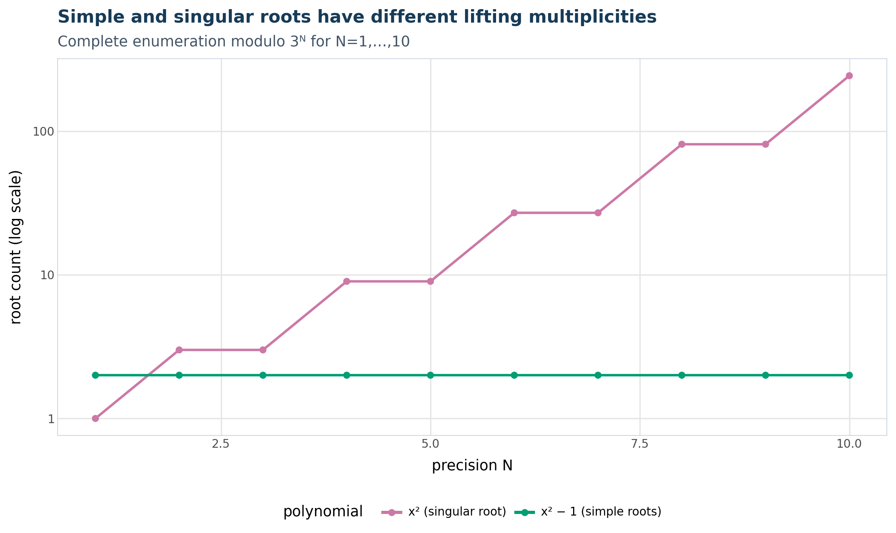

<figcaption>

Figure H.8: Simple roots and a singular root produce visibly different finite lifting counts.

</figcaption>
</figure>

The first enumeration certifies seven finite levels. The tree output certifies
four levels, using coefficient tuples in increasing degree order, so
`(-9, 0, 1)` means $x^2-9$. An empty child tuple means the parent was tested
and died at the next level. The last root level has no child map because that
next level was not inspected. Every terminal node vacuously survives to the
stated horizon; this does not claim that it survives forever.

For $x^2$, the roots $3,6$ modulo $9$ have no children modulo $27$, although
the total count remains three. For $x^2-9$, the six roots at later levels
contain only two forever-compatible paths. For $x^2-18$, every path dies by
level three. The proofs in [Section 9.7](09-hensel.md#sec-singular-root-tree) and its changed-task
explanation establish those infinite conclusions. The plot and finite pruning
output alone do not.

## Lab 16 — Certify a $p$-adic geometric series

For a prime $p$, the finite sum

$$
s_N=1+p+\cdots+p^{N-1}
$$

satisfies $(1-p)s_N=1-p^N$. Consequently it differs from
$(1-p)^{-1}$ by a rational number of valuation $N$.

```python
from fractions import Fraction
from math import isqrt

def is_prime(number: int) -> bool:
    """Return whether number is prime by exact trial division."""
    if number < 2:
        return False
    return all(number % divisor != 0 for divisor in range(2, isqrt(number) + 1))

def geometric_series_certificate(prime: int, terms: int) -> tuple[int, Fraction, int]:
    """Return the partial sum, exact tail, and tail valuation."""
    if not is_prime(prime) or terms <= 0:
        raise ValueError("prime must be prime and terms must be positive")
    partial = sum(prime**index for index in range(terms))
    if (1 - prime) * partial != 1 - prime**terms:
        raise RuntimeError("finite geometric identity failed")
    limit = Fraction(1, 1 - prime)
    tail = limit - partial
    return partial, tail, terms

for terms in (1, 2, 5, 10):
    print(terms, geometric_series_certificate(prime=3, terms=terms))
```

The tail valuation is exact because $1-p$ is a $p$-adic unit. Increasing
`terms` therefore certifies one additional base-$p$ digit each time; it is not
ordinary real convergence.

<figure id="fig-code-geometric-series-precision">
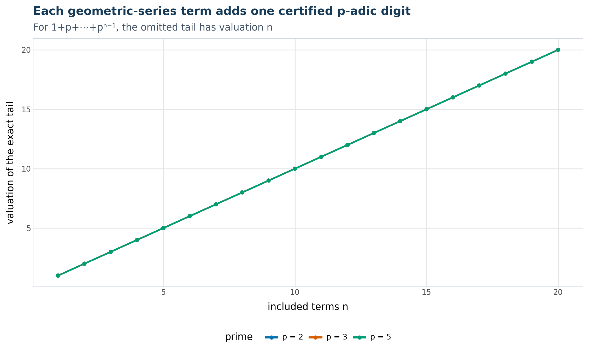

<figcaption>

Figure H.9: Geometric partial sums gain one certified p-adic digit per included term.

</figcaption>
</figure>

## Lab 17 — Read convergence from exponential-term valuations

The $n$th term of $\exp(x)$ is $x^n/n!$, so

$$
v_p\!\left(\frac{x^n}{n!}\right)=n\,v_p(x)-v_p(n!).
$$

When these valuations tend to $+\infty$, the terms tend to zero $p$-adically.

```python
from math import isqrt

def is_prime(number: int) -> bool:
    """Return whether number is prime by exact trial division."""
    if number < 2:
        return False
    return all(number % divisor != 0 for divisor in range(2, isqrt(number) + 1))

def factorial_valuation(number: int, prime: int) -> int:
    """Return v_prime(number factorial) from Legendre's finite sum."""
    if number < 0 or not is_prime(prime):
        raise ValueError("number must be nonnegative and prime must be prime")
    total = 0
    quotient = number
    while quotient:
        quotient //= prime
        total += quotient
    return total

def exponential_valuations(prime: int, input_valuation: int, terms: int) -> list[int]:
    """Return valuations of x**n/n! for n=1 through terms."""
    if not is_prime(prime) or input_valuation < 0 or terms <= 0:
        raise ValueError("use a prime, nonnegative input valuation, and positive terms")
    return [
        index * input_valuation - factorial_valuation(index, prime)
        for index in range(1, terms + 1)
    ]

for prime in (3, 5, 7):
    print(prime, exponential_valuations(prime, input_valuation=1, terms=15))
```

The list is a finite precision ledger. A proof of convergence must show that
the formula grows without bound, not merely that its first fifteen values rise.

<figure id="fig-code-exponential-term-valuations">
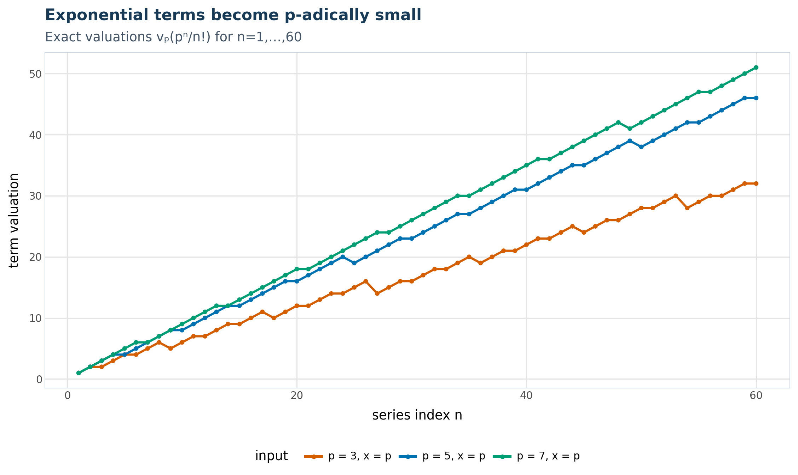

<figcaption>

Figure H.10: Valuations of p-adic exponential terms increase across the displayed range.

</figcaption>
</figure>

## Lab 18 — Lift a residue to a Teichmüller representative

For odd $p$ and a nonzero residue $a\pmod p$, the compatible unit
$\omega(a)$ satisfies

$$
\omega(a)\equiv a\pmod p,
\qquad
\omega(a)^p=\omega(a).
$$

Repeated Frobenius powers find its residue modulo $p^N$.

```python
from math import isqrt

def is_prime(number: int) -> bool:
    """Return whether number is prime by exact trial division."""
    if number < 2:
        return False
    return all(number % divisor != 0 for divisor in range(2, isqrt(number) + 1))

def teichmuller_lift(residue: int, prime: int, precision: int) -> int:
    """Return the Teichmüller lift of a nonzero residue modulo prime**precision."""
    if not is_prime(prime) or prime == 2 or precision <= 0:
        raise ValueError("use an odd prime and positive precision")
    if residue % prime == 0:
        raise ValueError("residue must be nonzero modulo prime")
    modulus = prime**precision
    value = residue % modulus
    for _ in range(precision):
        value = pow(value, prime, modulus)
    if pow(value, prime, modulus) != value or value % prime != residue % prime:
        raise RuntimeError("lift certificate failed")
    return value

for residue in range(1, 5):
    lifted = teichmuller_lift(residue, prime=5, precision=7)
    print(residue, lifted, pow(lifted, 5, 5**7) == lifted)
```

The final congruence is independently checkable. It certifies precision $5^7$,
not an infinitely stored object.

<figure id="fig-code-teichmuller-lifting">
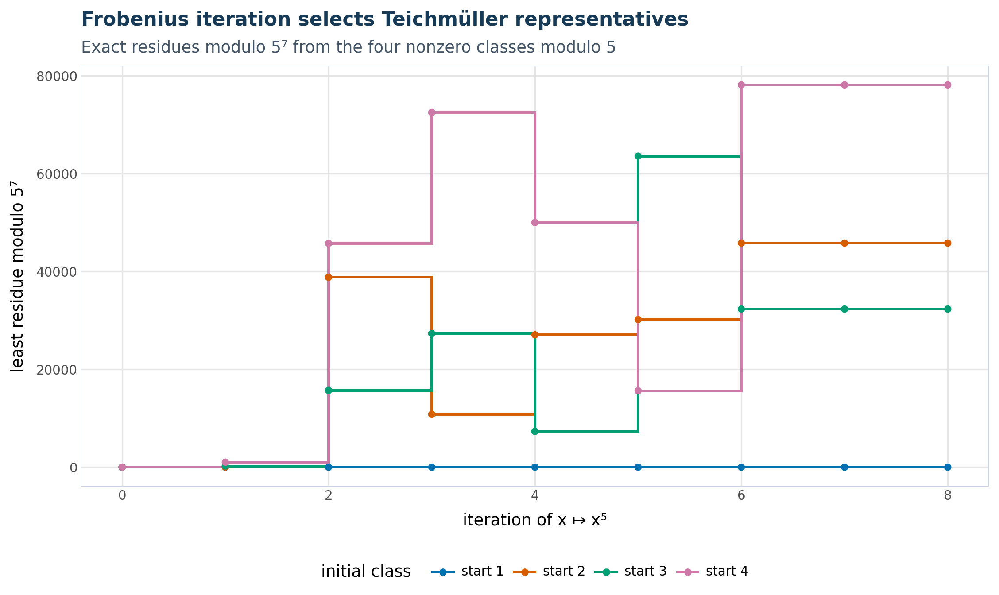

<figcaption>

Figure H.11: Frobenius iteration stabilizes four nonzero residue classes modulo increasing powers of five.

</figcaption>
</figure>

## Lab 19 — Compute measures of nested balls

Normalize Haar measure by $\mu(\mathbb Z_p)=1$. Since $\mathbb Z_p$ splits into
$p^N$ residue balls modulo $p^N$, translation invariance gives

$$
\mu(a+p^N\mathbb Z_p)=p^{-N}.
$$

```python
from fractions import Fraction
from math import isqrt

def is_prime(number: int) -> bool:
    """Return whether number is prime by exact trial division."""
    if number < 2:
        return False
    return all(number % divisor != 0 for divisor in range(2, isqrt(number) + 1))

def ball_partition_certificate(prime: int, depth: int) -> tuple[int, Fraction, Fraction]:
    """Return ball count, one ball's measure, and the total measure."""
    if not is_prime(prime) or depth < 0:
        raise ValueError("prime must be prime and depth nonnegative")
    count = prime**depth
    measure = Fraction(1, count)
    return count, measure, count * measure

for depth in range(6):
    print(depth, ball_partition_certificate(prime=3, depth=depth))
```

The final component equals $1$ exactly. Translation invariance and existence of
Haar measure are mathematical theorems; the code checks the finite partition
arithmetic that the formula predicts.

<figure id="fig-code-haar-ball-measures">
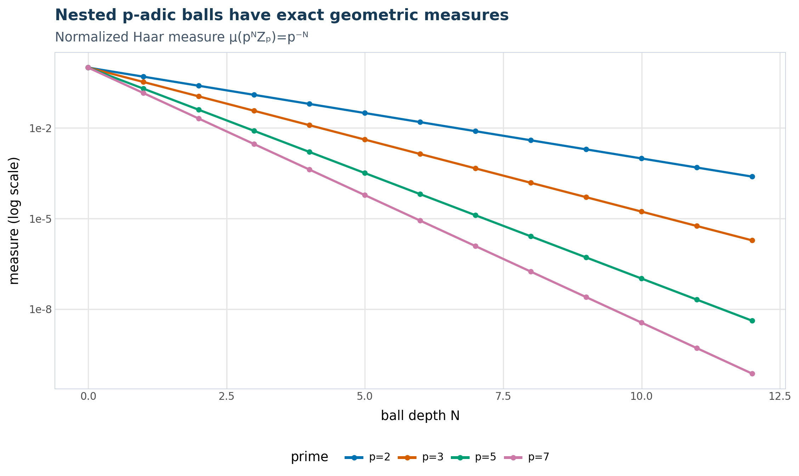

<figcaption>

Figure H.12: Measures of nested p-adic balls decay geometrically with depth.

</figcaption>
</figure>

## Lab 20 — Follow a polynomial map modulo $p^N$

A $p$-adic dynamical system can be projected to every finite residue ring. The
function below follows $x\mapsto x^2+1$ until a residue repeats, then reports the
preperiod and cycle separately.

```python
from math import isqrt

def is_prime(number: int) -> bool:
    """Return whether number is prime by exact trial division."""
    if number < 2:
        return False
    return all(number % divisor != 0 for divisor in range(2, isqrt(number) + 1))

def residue_orbit_certificate(
    start: int, prime: int, precision: int
) -> tuple[list[int], int, int]:
    """Return the finite orbit, preperiod, and period modulo prime**precision."""
    if not is_prime(prime) or precision <= 0:
        raise ValueError("prime must be prime and precision positive")
    modulus = prime**precision
    value = start % modulus
    positions: dict[int, int] = {}
    orbit: list[int] = []
    while value not in positions:
        positions[value] = len(orbit)
        orbit.append(value)
        value = (value * value + 1) % modulus
    preperiod = positions[value]
    period = len(orbit) - preperiod
    return orbit, preperiod, period

for precision in range(1, 7):
    orbit, preperiod, period = residue_orbit_certificate(0, prime=3, precision=precision)
    print(precision, len(orbit), preperiod, period, orbit[-1])
```

The pigeonhole principle proves that this loop terminates because the residue
ring is finite. Changing $N$ changes the finite system; a pattern across six
levels is not automatically a theorem about the full $p$-adic map.

<figure id="fig-code-finite-residue-dynamics">
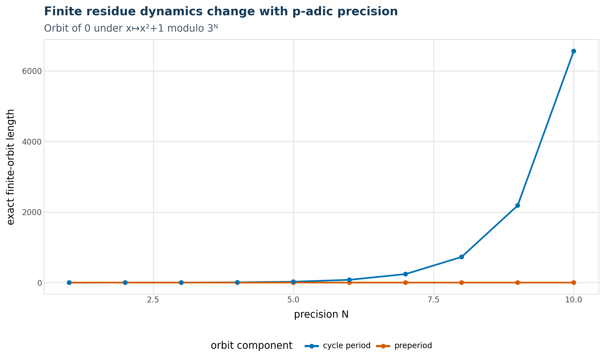

<figcaption>

Figure H.13: Preperiod and cycle lengths vary as the residue precision increases.

</figcaption>
</figure>

## Precision and failure checklist

Always state the prime and precision. Distinguish a residue representative from
the compatible $p$-adic object it approximates. Check the defining congruence
after every lift. Treat a zero derivative as a change of theorem, not as a
division error to suppress. Use exact integers for certificates and reserve
ordinary floats for secondary visualization.

Every Python block above is parsed and executed by the collection validator.
Functions validate their boundaries, loops have declared finite limits, and no
example downloads external data or silently catches an exception. The thirteen
new visuals are produced deterministically with Plotnine by `figures.py`.

Labs 1–5 support [valuations](02-absolute-values.md), [construction and
digits](05-digits.md), and [arithmetic](06-arithmetic.md). Labs
6–8 support [Hensel lifting](09-hensel.md) and [certified local-field
algorithms](39-computational-local-fields.md). Labs 9–10 connect finite
precision to [measure](11-compactness-measure.md), [continuous
functions](17-mahler-expansions.md),
and [model theory](45-padic-model-theory.md).
Labs 11–13 support [valuations](02-absolute-values.md), [congruence
arithmetic](06-arithmetic.md), and [power series](07-series.md). Labs
14–15 connect to [Newton polygons](19-newton-polygons.md), [Hensel
lifting](09-hensel.md), and [certified computation](39-computational-local-fields.md).
Labs 16–20 support [series](07-series.md), [analytic
groups](18-analytic-groups.md), [units](10-units-squares.md), [Haar
measure](11-compactness-measure.md), and [dynamics](13-dynamics.md). Their
formulas become exact finite certificates while the prime, precision, and
infinite-limit claims remain explicit.
