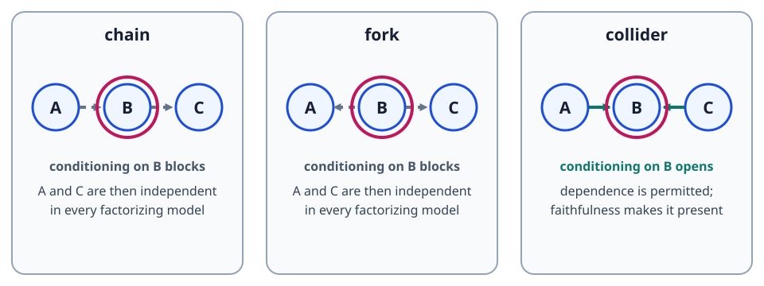

# Directed Graphical Models

## Preparation and source

This chapter expands the retained [Directed Graphical Models](../structured-probabilistic-learning/directed-graphical-models.md) source. Its original four exercises remain at their earlier identities. The preceding chapters established the joint-law viewpoint and graphical separation; here we prove the local-factorization equivalence, develop normalised generative mechanisms, and examine what changes under reversal, marginalization and evidence. All explicit table proofs assume finite state spaces. Gaussian examples use the stated nonsingular normal laws.

## Definition and factorization

**Definition 3.1 (Bayesian network).** A Bayesian network is a pair $(G, p)$ where $G = (V, E)$ is a directed acyclic graph with vertex set $V = \{1, \dots, d\}$ and $p$ is a joint probability distribution over random variables $X_{1}, \dots, X_{d}$ that factorizes as

$$p(x_{1}, \dots, x_{d}) = \prod_{j=1}^{d} p(x_{j} \mid x_{\text{pa}(j)}),$$

where $\text{pa}(j)$ denotes the parents of node $j$ in $G$.

The factorization says that each variable is conditionally independent of its nondescendants given its parents. This is the **local Markov property**.

**Definition 3.2 (Local Markov property).** In a Bayesian network, each node $X_{j}$ is conditionally independent of its nondescendants given its parents:

$$X_{j} \perp\!\!\perp \text{Nd}(X_{j}) \mid \text{Pa}(X_{j}),$$

where $\text{Nd}(X_{j})$ denotes the nondescendants of $X_{j}$.

## The three fundamental motifs

Three small graphs generate all conditional independence patterns in DAGs:

**Chain:** $A \to B \to C$. The factorization $p(a,b,c)=p(a)p(b\mid a)p(c\mid b)$ implies $A\perp\!\!\perp C\mid B$. Marginal dependence is generic but not guaranteed without faithfulness; an edge can have a zero effect.

**Fork:** $A \leftarrow B \to C$. The factorization $p(a,b,c)=p(b)p(a\mid b)p(c\mid b)$ implies $A\perp\!\!\perp C\mid B$. Sharing $B$ can create marginal dependence, and does so in faithful nondegenerate examples, but the DAG alone does not force it.

**Collider:** $A \to B \leftarrow C$. The factorization $p(a,b,c)=p(a)p(c)p(b\mid a,c)$ implies marginal independence of $A$ and $C$. Conditioning on $B$ or a descendant opens the path, so dependence is then permitted and is present under faithfulness; it is not forced for every parameter choice.

**Example 3.3 (Collider with coins).** Let $A$ and $C$ be independent fair coin flips, and let $B = 1[A = C]$ indicate whether they match. Marginally, $A$ and $C$ are independent. Given $B = 1$, knowing $A = \text{heads}$ determines $C = \text{heads}$; knowing $A = \text{tails}$ determines $C = \text{tails}$. Conditioning on the collider $B$ has created a dependence.

## d-separation

**Definition 3.4 (d-separation).** A path between nodes $A$ and $C$ is blocked by a set of nodes $S$ if:

1. the path contains a chain $A \to B \to C$ or fork $A \leftarrow B \to C$ with $B \in S$; or
2. the path contains a collider $A \to B \leftarrow C$ with $B \notin S$ and no descendant of $B$ in $S$.

Two sets of nodes $A$ and $C$ are d-separated by $S$ if every path between them is blocked by $S$. If $A$ and $C$ are d-separated by $S$, then $A \perp\!\!\perp C \mid S$ in every distribution that factorizes over the DAG.

The converse is not true without additional assumptions: d-separation implies conditional independence, but conditional independence does not always imply d-separation (faithfulness is required for the converse).

## Worked example: factorization and independence in a small DAG

**Example 3.5 (factorization and independence in a small DAG).** Consider the DAG $X_{1} \to X_{2} \to X_{3} \leftarrow X_{4}$ with $X_{1}$ and $X_{4}$ having no parents. The factorization is

$$p(x_{1}, x_{2}, x_{3}, x_{4}) = p(x_{1})p(x_{4})p(x_{2} \mid x_{1})p(x_{3} \mid x_{2}, x_{4}).$$

- $X_{1}$ and $X_{4}$ are independent because their path is blocked at the unconditioned collider $X_3$.
- $X_{1}$ and $X_{3}$ can be marginally dependent along the path $X_{1} \to X_{2} \to X_{3}$, and are dependent under faithfulness.
- $X_{1}$ and $X_{4}$ are still independent given $X_{2}$ (the path $X_{1} \to X_{2} \to X_{3} \leftarrow X_{4}$ is blocked at the collider $X_{3}$).
- Given $X_3$ alone, the path is open, so dependence is permitted (and follows under faithfulness).
- Given both $X_2$ and $X_3$, the path is still blocked at the conditioned noncollider $X_2$, so $X_1\perp\!\!\perp X_4\mid X_2,X_3$.

## From factorization to causal claims

A DAG can be used purely as a compact representation of a joint distribution. Giving the arrows a causal interpretation requires additional structure:

- A **causal model** specifies what happens under interventions.
- The **do-operator** $p(y \mid \text{do}(x))$ represents the distribution of $Y$ when $X$ is set to $x$ by an external intervention.
- **Observational equivalence:** several DAGs can encode the same conditional independences. Without additional assumptions, data alone cannot distinguish them.

**Example 3.6 (Observational equivalence).** The DAGs $A \to B \to C$, $A \leftarrow B \to C$, and $A \leftarrow B \leftarrow C$ all imply $A \perp\!\!\perp C \mid B$. They are observationally equivalent given only the conditional independences. Causal inference requires more: interventions, temporal information, or domain constraints.

## Common errors

- **Reading an absent DAG edge as marginal independence in every conditioning set.** Two nodes without a direct edge may still be dependent marginally or conditionally on other variables.
- **Conditioning on a collider and expecting independence.** Conditioning on a collider or its descendants can induce dependence between the parents, and does so under faithfulness; the graph alone does not force dependence for every parameter choice.
- **Reading probabilistic arrows as causal effects.** A Bayesian network factorization does not assert causation without a causal model.
- **Ignoring faithfulness and test power.** Exact parameter cancellations can create conditional independences absent from d-separation, violating faithfulness. Weak nonzero effects can instead be missed by a finite-sample test without creating a population independence.

## Why acyclicity supplies a generative order

Every finite DAG has a vertex with no incoming arrow. Otherwise repeatedly choose a parent; finiteness forces a repeated vertex and hence a directed cycle. Remove one root and repeat. The resulting topological order places every parent before its child. Given normalised conditional tables at each node, multiply them in this order. Summing variables in reverse topological order repeatedly removes a sink's normalised row, proving that the product has total mass one.

This proof does not require positive table entries. It also explains why multiplying arbitrary conditionals around a directed cycle is not the same construction. For two bits, the product of a deterministic equality conditional in each direction is one on both equal configurations and zero elsewhere, so its total mass is two. A partition function could normalise that product as an undirected factor model, but its original factors would no longer automatically be the normalised generative conditionals claimed by the cyclic notation.

A DAG can be simulated sequentially using an independent uniform variable at each vertex and the inverse cumulative table for its observed parent configuration. Conditional on all predecessors, the current independent uniform produces exactly its table row. Induction therefore gives the factored joint law. This constructs a possible generative representation. It does not establish that those independent noises describe physical interventions; that interpretation remains an additional causal assumption.

## Equivalence of local independence and factorization

**Theorem 3.7 (DAG factorization and the local Markov property).** Suppose first that the joint law factors over the DAG. Fix a vertex j and let N contain every other nondescendant of j, including its parents. The set consisting of j and N is ancestral: any ancestor of a nondescendant is again a nondescendant, and the ancestors of j belong to N. Sum out all descendants in reverse topological order. Their normalised factors disappear, leaving the original product on this ancestral set.

Within that product j has no child remaining, so the only factor involving its value is its own conditional table. All other terms depend only on N. Thus at a feasible N configuration the conditional law of j is its parent row. It depends on N only through the parents, which is exactly the local Markov property. Marginalizing any part of the nonparent nondescendants preserves that independence.

Conversely assume the local Markov property for a joint law. Choose a topological order. Every predecessor of j is a nondescendant, so local independence makes its conditional law given all predecessors depend only on its parents on positive-probability predecessor slices. Use those parent conditional rows in the ordinary chain rule. On an impossible prefix its product is already zero, and the remaining undefined rows can be chosen arbitrarily as normalised probabilities. Consequently the chain rule gives a DAG factorization on every complete configuration. This proves the equivalence without imposing positivity.

Combined with Chapter 2, we now have a full implication from local conditional independence through factorization to all d-separated independences. The factorization also gives a compact parameterization: if node j has r j states and q j possible parent configurations, its unconstrained table has q j times r j minus one free entries. Summing those counts across vertices gives the nominal model dimension. At parameter-boundary points with impossible parent configurations, some rows are not identified by the resulting joint law; the nominal count is a family description rather than an assertion of identifiability at every point.

## Worked example: a binary chain and its parameter count

**Example 3.8 (a binary chain and its parameter count).** For a three-bit chain, choose a root success probability one half and let each child copy its parent with probability three quarters. There is one root parameter and two rows of one free parameter for each child, for a total of five. A completely unrestricted three-bit law has seven free probabilities after normalisation, so the chain imposes a real restriction.

The endpoints agree with probability $\left(3/4\right)^2+\left(1/4\right)^2=5/8$. Each endpoint remains fair, so they are marginally dependent. Given the middle bit, the first and third are independent: the first has its Bayes-reversed conditional copy probability three quarters, and the third has its generative copy probability three quarters. This verifies both the factorization calculation and the local separation claim numerically, without equating absent direct edges with marginal independence.

## Reversing an edge without changing the joint family

In a two-node model with a positive joint table, Bayes rule reverses the direction: $p(a)p(b\mid a)=p(b)p(a\mid b)$. Both directions describe all positive two-node laws. A covered edge in a larger DAG has parent sets satisfying $\operatorname{pa}(B)=\operatorname{pa}(A)\cup\{A\}$. Write their shared other parents as U. Their factor pair can be rewritten
$$
p(a\mid u)p(b\mid a,u)=p(b\mid u)p(a\mid b,u).
$$
This reverses the edge, keeps every other factor, and gives the same joint law. At zero-probability conditioning configurations choose normalised rows arbitrarily, as before. Covered reversal preserves acyclicity: a second directed path from A to B would have a penultimate vertex that is another parent of B and hence a parent of A, producing a cycle in the original graph.

A general reversal need not preserve the family. Reversing one arrow in a three-node noncollider chain can create a collider, which changes whether the outer endpoints are marginally independent or independent given the middle. The shared skeleton alone is insufficient; collider configurations matter. Chapter 13 will use this distinction when comparing observational equivalence classes rather than pretending every learned arrow is individually determined.

## Worked example: the collider law from the retained source

**Example 3.9 (the collider law from the retained source).** Take the independent fair coins A and C and set B equal to the indicator that they match. The factorization has independent root factors and a deterministic child table. Summing out the child gives independent roots. Conditioning on a match gives only the two equal pairs, each with conditional probability one half. This is an exact instance of dependence induced by observing a collider, with no appeal to a generic parameter argument.

If the deterministic child is replaced by a noisy equality indicator with error probability strictly below one half, the same qualitative dependence persists while every complete configuration becomes positive. Thus collider behaviour is not an artifact of deterministic zero entries. But setting the child's two rows so it ignores its parents entirely removes the induced dependence while retaining the drawn arrows; the graph's permission of dependence still does not force it without faithfulness.

## Marginalization and conditioning alter the representation

Marginalizing a hidden common parent generally creates dependence between its children. The observed distribution may admit several different DAG descriptions; no literal directed edge between the observed children need correspond to a direct physical mechanism. Conditioning on a common child can instead create dependence between its parents. These are two different operations on the joint law, both handled by summing or restricting the factored product.

The full conditional distribution of one node given all others depends only on its parents, children, and the other parents of its children, whenever the conditioning configuration has positive probability. Indeed all factors not involving that node cancel from the conditional ratio. The remaining product is its own factor times the factors of its children. This collection is often called the Markov blanket. Its derivation requires no assertion that the node is independent of everything outside its descendants given only its children.

## Worked example: a node's full conditional uses its co-parent

**Example 3.10 (a node's full conditional uses its co-parent).** In $A\to C\leftarrow B$ with an additional child $C\to D$, the full conditional of A given B, C and D is proportional to $p(a)p(c\mid a,b)$. The factor for D cancels because C is fixed, but the co-parent B remains inside the child's likelihood. Even though A and B are marginally independent roots, B matters to A's posterior after C is observed. This is precisely why the blanket includes co-parents rather than only adjacent vertices in the original directed skeleton.

For a positive joint table the blanket expression normalizes for every conditioning configuration. With zeros it applies on positive-probability slices and can contain deterministic restrictions. A sampler using these full conditionals must still examine whether such restrictions prevent movement between parts of the support. Correct local conditionals are not alone a convergence proof for a simulation algorithm.

## Exercises

### Exercise 1

Write the factorization for $A\to B\leftarrow C\to D\leftarrow E$.

Hint 1

Identify the three roots.

Hint 2

Each nonroot factor uses exactly its parents.

Full solution

The roots A, C and E contribute their marginal probabilities. The remaining factors are the conditional table of B given A and C, and the conditional table of D given C and E. Their product is $p(a)p(c)p(e)p(b\mid a,c)p(d\mid c,e)$. Summing B and D first verifies root independence directly, including the joint independence of A, C and E.

### Exercise 2

Prove that a finite DAG has a topological order.

Hint 1

Assume there is no root.

Hint 2

Following parents must eventually repeat a vertex.

Full solution

If every remaining vertex has a parent, repeatedly following parent arrows in a finite set repeats a vertex, giving a directed cycle. Therefore an acyclic graph has a root. Remove it and apply the same argument to the smaller acyclic graph. Placing each removed root next in the order ensures every arrow points from an earlier to a later vertex.

### Exercise 3

Explain the normalisation failure for the two-bit cyclic equality product.

Hint 1

Evaluate its value on each of the four configurations.

Hint 2

Both equal configurations receive weight one.

Full solution

The first equality conditional and the second are simultaneously one on 00 and 11 and zero on 01 and 10. Their product therefore sums to two, not one. A directed cycle has no reverse topological sink-removal normalisation argument. Dividing by two defines a probability as a factor product, but is a distinct construction from the acyclic generative factorization theorem.

### Exercise 4

Count the nominal free parameters of a binary collider and compare with a binary chain.

Hint 1

A binary root has one free parameter.

Hint 2

A two-parent child has four binary conditional rows.

Full solution

The collider has two root parameters plus four conditional-row parameters, totaling six. The chain has one root parameter and two rows at each of two children, totaling five. The unrestricted three-bit table has seven. The two graph families therefore impose different restrictions despite their equal numbers of arrows and common skeleton.

### Exercise 5

Why does factorization imply the local Markov property without strict positivity?

Hint 1

Sum out descendants in reverse order.

Hint 2

Normalize only on feasible nondescendant configurations.

Full solution

After descendants are removed, the joint law of the vertex and its nondescendants is its parent conditional row times a function of the nondescendants. On every positive-probability nondescendant slice that other function cancels from the conditional ratio. The row depends only on the parents. Impossible slices need no conditional-independence constraint, so positivity is unnecessary.

### Exercise 6

In the noisy-copy chain, compute the endpoint agreement probability.

Hint 1

They agree if either zero or two copy errors occur.

Hint 2

The two independent transition errors each have probability one quarter.

Full solution

Agreement has probability nine sixteenths from two successful copies plus one sixteenth from two errors, totaling five eighths. Fair marginals would give independent agreement probability one half. Thus the endpoints are dependent marginally while still independent conditional on the middle node. These are different probability statements, both predicted by the chain factorization.

### Exercise 7

Give the full conditional of a node in terms of the original DAG factors.

Hint 1

Cancel factors independent of its value.

Hint 2

Keep its own factor and those of its children.

Full solution

On a positive-probability configuration of all other nodes, the full conditional is proportional to the node conditional given its parents times the product of each child conditional given that child parent set. Every other factor cancels in normalisation. The expression depends on parents, children and co-parents of children. Any zero factors restrict feasible node values and must remain in the expression.

### Exercise 8

Why does a covered reversal avoid creating a directed cycle?

Hint 1

Any new cycle must use the reversed edge.

Hint 2

The original alternative path would end at another parent of the child.

Full solution

A new cycle would require another directed path from A to B in the original graph. Its penultimate vertex is a parent of B distinct from A. Coveredness makes it a parent of A as well, so the path from A to that vertex followed by its arrow into A was already a cycle. This contradicts the original DAG assumption.

### Exercise 9

For independent nondegenerate bits U and V, show their covariance becomes negative after conditioning on $U\lor V=1$.

Hint 1

Write the conditioning probability s.

Hint 2

Compare the conditional joint success and product of conditional means.

Full solution

Let their success probabilities be u and v and set $s=u+v-uv$, strictly between zero and one. Given recruitment, the joint success probability is $uv/s$ while the marginal success probabilities are $u/s$ and $v/s$. The covariance is $uv(s-1)/s^2$, strictly negative. This gives the exact sign rather than relying only on an informal selection story.

### Exercise 10

Does sequential simulation with independent uniforms prove that the DAG arrows are causal?

Hint 1

The construction reproduces a joint law.

Hint 2

An intervention requires deciding which mechanisms remain stable.

Full solution

Independent uniforms and conditional tables construct one probabilistic generative representation for the observed law. Several such representations can describe the same observations. A causal claim additionally asserts how replacing one mechanism changes the others and which equations remain invariant under that operation. Those assumptions are not consequences of the observational factorization or the simulation construction.

