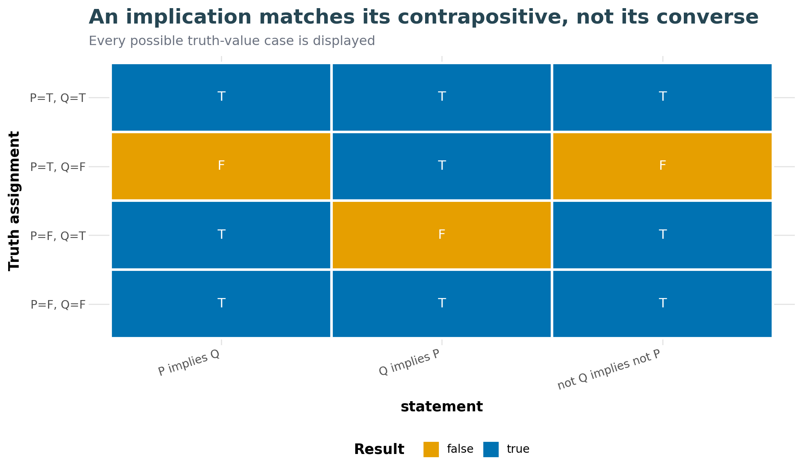

# A concise starting toolkit {#sec-pp-toolkit}

This one-sitting toolkit supplies only the notation and Python habits needed for
Chapter 1. Later chapters introduce calculus, matrices, and statistical ideas at
their first real use.

## Numbers, fractions, and probability

A probability lies between zero and one. For equally likely finite outcomes,

$$
\mathbb P(A)=\frac{\text{number of outcomes in }A}
{\text{number of possible outcomes}}.
$$

This counting formula is not the definition for every probability model, but it
builds intuition. Complements obey
$\mathbb P(A^c)=1-\mathbb P(A)$. Disjoint alternatives add. Conditional
probability restricts the reference population:

$$
\mathbb P(A\mid B)=\frac{\mathbb P(A\cap B)}{\mathbb P(B)}
$$

when $\mathbb P(B)>0$.


Odds are $p/(1-p)$ for $0<p<1$. Multiplying odds by a likelihood ratio is often
another form of Bayes' rule. Always convert back to probability before
interpreting.

## Variables, functions, and sums

A variable is a named quantity. A function maps an input to one output. The
composition $g(f(x))$ applies $f$ first. Sigma notation abbreviates a sum:

$$
\sum_{i=1}^n x_i=x_1+\cdots+x_n.
$$

An average is $\bar x=n^{-1}\sum_i x_i$. A weighted average uses nonnegative
weights that sum to one. Expectations are probability-weighted averages,
defined through sums or integrals according to the model.


## Products, logarithms, and scale

Independent likelihood contributions multiply. Products of many probabilities
become extremely small, so compute their logarithms:

$$
\log\prod_{i=1}^n p_i=\sum_{i=1}^n\log p_i.
$$

Logarithm is increasing, so it preserves the location of a maximum. It also
turns products into sums and ratios into differences. Never take a logarithm of
a negative number or of a dimensional physical quantity without a reference
scale.

The exponential reverses the logarithm. To normalize log weights safely,
subtract their maximum before exponentiating; the common factor cancels.

## Statements, assumptions, and conditioning

“Given $B$” means all probability statements are evaluated under the declared
condition, not that $B$ was caused by another variable. Independence is an
assumption that a joint probability factors. Conditional independence can hold
even when marginal independence does not.



A model is a collection of assumptions: support, distribution shapes,
dependence, measurement process, and link from latent quantities to data.
Inference is conditional on that collection. Posterior concentration cannot
repair a missing causal variable or a wrong observation model.

## Minimal Python

Lists store ordered values, dictionaries associate names with values, functions
package a calculation, and loops repeat finite work. Every public function in
this book declares input and return types. Invalid mathematical domains raise
errors rather than return plausible nonsense.

```python
from math import log

def bernoulli_log_likelihood(probability: float, data: list[int]) -> float:
    if not 0.0 < probability < 1.0:
        raise ValueError("probability must lie strictly between zero and one")
    if any(value not in (0, 1) for value in data):
        raise ValueError("Bernoulli observations must be zero or one")
    successes = sum(data)
    failures = len(data) - successes
    return successes * log(probability) + failures * log(1.0 - probability)

print(bernoulli_log_likelihood(0.7, [1, 0, 1, 1]))
```

This is an exact evaluation up to floating-point rounding. It does not say
whether Bernoulli independence is appropriate.

## Randomness and reproducibility

A pseudo-random generator produces a deterministic sequence from a seed. Use a
local generator and record the seed. Reusing a seed can reproduce debugging
output; varying seeds and increasing simulation size test Monte Carlo
sensitivity.

## Entry check

You are ready for Chapter 1 if you can:

1. convert a fraction to a probability and complement it;
2. distinguish a sum from a product;
3. explain why log turns a product into a sum;
4. read a short typed Python function; and
5. state one assumption that code output cannot verify.

If one item is unfamiliar, reread only that subsection. The next chapter builds
probability models from finite generative steps.

## Units, arrays, and finite evidence

Parameters inherit units from their role. A normal mean has outcome units, its
standard deviation has the same units, and its variance has squared units. A
log rate needs a declared reference unit before exponentiation becomes a
physical rate. Dimensionless probabilities and likelihood ratios may be logged
directly; a dimensional density value changes when measurement units change.

NumPy arrays store many values and apply arithmetic element by element. Shape is
part of a formula: a vector of observations, a matrix of predictors, and a
square covariance matrix cannot be interchanged because their numbers happen to
fit in memory. Later blocks validate the mathematical conditions that matter
for the displayed operation.

A finite simulation can refute an implementation claim—for example, generated
values outside declared support—but it cannot verify all future draws. A test
that passes under one seed is evidence about that execution. A theorem controls
the probability law; diagnostics assess whether a finite approximation is
adequate for a named estimand.
