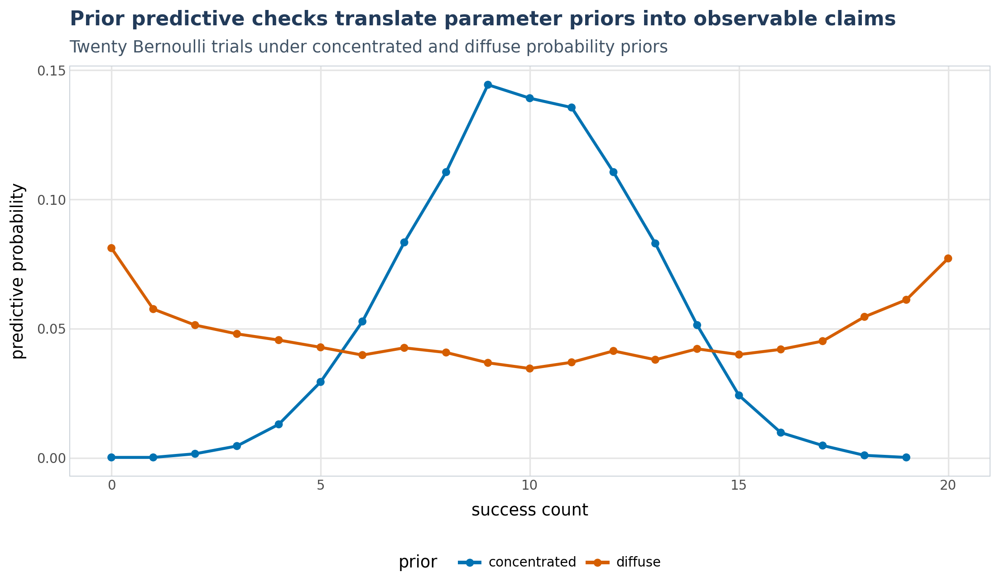

# Probability Models and Generative Programs {#sec-pp-models}

A probability model describes how uncertain quantities and observations could
be generated. A probabilistic program writes that description as a sequence of
random choices and deterministic transformations. Executing it forward
simulates; inference asks about hidden choices after observations are fixed.

## Probability spaces and random variables

A probability space $(\Omega,\mathcal A,\mathbb P)$ consists of outcomes,
admissible events, and a countably additive probability measure with total mass
one. A random variable $X:\Omega\to\mathcal X$ is a measurable function. Its
distribution is the pushforward probability on values, not an extra source of
randomness.

For a discrete variable with mass $p(x)$,

$$
\mathbb E[g(X)]=\sum_x g(x)p(x).
$$

For a density, the sum becomes an integral. Expectation is linear even when
variables are dependent. Variance is
$\mathbb E[(X-\mathbb EX)^2]$ and has squared units.

A joint model can be factored sequentially:

$$
p(x_1,\ldots,x_n)
=p(x_1)\prod_{i=2}^n p(x_i\mid x_1,\ldots,x_{i-1}).
$$

This chain rule always holds when conditionals are defined. Independence is the
stronger claim that selected factors ignore earlier variables.

## A generative program

Consider a coin-bias model:

1. draw $P\sim\operatorname{Beta}(2,2)$;
2. conditional on $P=p$, draw $Y_i\sim\operatorname{Bernoulli}(p)$
   independently for $i=1,\ldots,20$.

The program defines a joint distribution for a latent probability and observed
bits. A loop is a compact plate notation; it does not by itself justify
conditional independence unless each draw uses the declared independent random
source.

<figure id="fig-pp-generative-predictive">


<figcaption>

Figure 1.1: Prior-predictive count distributions reveal what a generative model says observable data should look like before conditioning.

</figcaption>
</figure>

Forward simulation is a unit test for model implications. Extreme prior
predictive counts may be intended or may reveal an implausible prior.

## Monte Carlo expectation

Independent draws $X_1,\ldots,X_N$ give the estimator

$$
\widehat\mu_N=\frac1N\sum_{i=1}^Ng(X_i).
$$

The Law of Large Numbers supplies convergence under integrability. Finite
standard error is approximately $s/\sqrt N$ under suitable variance and
independence. A fixed seed reproduces one realization; it does not remove
sampling error.

## Case clinic: repeated measurements

Suppose five sensors each report ten times. Fifty likelihood terms do not imply
fifty exchangeable experimental units. A generative program should first draw a
sensor offset, then conditional readings. The shared offset makes readings from
one sensor dependent after it is marginalized. Simulating both levels reveals a
wider distribution of aggregate means than a model with fifty iid errors.

When data are stored in a flat table, group identifiers retain this dependence
information. Dropping them changes the joint model, not merely the data format.

**Nonexample.** A function that draws data but omits the mechanism producing
missing values does not define the observed-data process. Ignoring selection is
a modeling decision, not a neutral program simplification.

<!-- inline-formula-code:start -->
## Formula and finite computation

The Bernoulli sample mean estimates

$$
\mathbb E[Y]=p,\qquad
\widehat p=\frac1N\sum_{i=1}^NY_i.
$$

```python
import numpy as np

def bernoulli_mean(probability: float, draws: int, seed: int) -> float:
    if not 0.0 <= probability <= 1.0 or draws <= 0:
        raise ValueError("require probability in [0,1] and positive draws")
    rng = np.random.default_rng(seed)
    return float(rng.binomial(1, probability, size=draws).mean())

for size in (100, 1_000, 10_000):
    print(size, bernoulli_mean(0.3, size, 2026))
```

**What the computation establishes.** Three reproducible finite estimates are
reported for one Bernoulli generator. The output does not prove the Law of
Large Numbers or validate Bernoulli assumptions for observed data.
<!-- inline-formula-code:end -->

## Summary

Probability spaces give events numerical mass; random variables map outcomes to
values. Joint laws factor into sequential conditionals, making generative
programs possible. Forward simulation exposes observable implications, while
Monte Carlo estimates carry finite sampling error and remain conditional on the
model.

## Exercises

<div class="exercise" id="probabilistic_programming-01-probability-generative-programs-ex-1">
<p class="exercise-title"><strong>Exercise 1</strong></p>

Write the joint mass of three conditionally independent Bernoulli draws.

</div>

<div class="exercise" id="probabilistic_programming-01-probability-generative-programs-ex-2">
<p class="exercise-title"><strong>Exercise 2</strong></p>

Derive expectation and variance of a Bernoulli variable.

<details class="solution"><summary>Solution</summary>

For Exercise 2, $\mathbb EY=1p+0(1-p)=p$. Since $Y^2=Y$,
$\operatorname{Var}(Y)=\mathbb EY^2-(\mathbb EY)^2=p-p^2=p(1-p)$.

</details>

</div>

<div class="exercise" id="probabilistic_programming-01-probability-generative-programs-ex-3">
<p class="exercise-title"><strong>Exercise 3</strong></p>

Simulate a beta–Bernoulli count distribution.

</div>

<div class="exercise" id="probabilistic_programming-01-probability-generative-programs-ex-4">
<p class="exercise-title"><strong>Exercise 4</strong></p>

Give two different programs with the same joint distribution.

</div>

<div class="exercise" id="probabilistic_programming-01-probability-generative-programs-ex-5">
<p class="exercise-title"><strong>Exercise 5</strong></p>

Identify every assumption in the coin-bias program.

</div>

<div class="exercise" id="probabilistic_programming-01-probability-generative-programs-ex-6">
<p class="exercise-title"><strong>Exercise 6</strong></p>

Explain why reproducibility and statistical accuracy differ.

</div>

### Selected solution

For Exercise 2, $\mathbb EY=1p+0(1-p)=p$. Since $Y^2=Y$,
$\operatorname{Var}(Y)=\mathbb EY^2-(\mathbb EY)^2=p-p^2=p(1-p)$.
