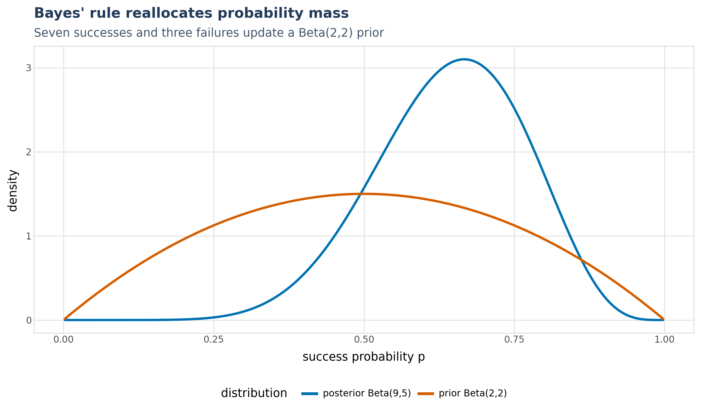

# Conditioning and Bayes' Rule {#sec-pp-bayes}

Conditioning updates uncertainty after information is declared. Bayes' rule is
an identity connecting the forward sampling model to the reverse question
about latent quantities.

## Discrete and density forms

For events with $\mathbb P(B)>0$,

$$
\mathbb P(A\mid B)
=\frac{\mathbb P(B\mid A)\mathbb P(A)}{\mathbb P(B)}.
$$

For parameter $\theta$ and observed $y$,

$$
p(\theta\mid y)
=\frac{p(y\mid\theta)p(\theta)}
{\int p(y\mid t)p(t)\,dt}.
$$

The likelihood is the observation model viewed as a function of $\theta$.
The denominator is marginal likelihood or evidence and normalizes the
posterior. Writing only “posterior proportional to likelihood times prior” is
enough for ratios but not posterior expectations or model evidence.

## Beta–binomial conjugacy

Let $p\sim\operatorname{Beta}(\alpha,\beta)$ and observe $s$ successes and
$f$ failures. Multiplying kernels gives

$$
p\mid y\sim\operatorname{Beta}(\alpha+s,\beta+f).
$$

The posterior predictive probability of the next success is

$$
\mathbb P(Y_{\mathrm{new}}=1\mid y)
=\frac{\alpha+s}{\alpha+\beta+s+f}.
$$

The update can be read as adding prior pseudo-counts, but that interpretation
is scale-dependent and should not replace examination of prior predictive
implications.

<figure id="fig-pp-bayes-update">


<figcaption>

Figure 2.1: A Beta prior shifts and concentrates after seven successes and three failures.

</figcaption>
</figure>

The posterior is narrower because the model treats observations as
conditionally independent information. Dependence or overdispersion would
change that concentration.

## Conditioning on probability-zero events

For continuous variables, $P(Y=y)=0$ for a single exact value. Conditional
densities and regular conditional distributions replace an event-ratio formula.
They are defined up to null sets and require measure-theoretic care. A program's
observe statement evaluates a density; it does not assign positive probability
to an exact real event.

## Posterior odds

For hypotheses $H_1,H_0$,

$$
\frac{P(H_1\mid y)}{P(H_0\mid y)}
= \frac{p(y\mid H_1)}{p(y\mid H_0)}
\frac{P(H_1)}{P(H_0)}.
$$

The likelihood ratio is a Bayes factor for simple hypotheses. Composite-model
evidence averages likelihood over each prior; maximizing likelihood is not a
replacement and can reward flexible models unfairly.

## Case clinic: rare-condition testing

Let prevalence be one percent, sensitivity ninety percent, and false-positive
rate five percent. Among ten thousand representative people, about ninety true
cases and 495 unaffected people test positive. Thus a positive result has
probability about $90/(90+495)$ of being a true case, far below sensitivity.
Bayes' rule has combined forward test behavior with a low base rate.

The same calculation can be written in probabilities instead of imagined
counts.  The denominator explicitly adds the true-positive and false-positive
routes to an observed positive test.

```python
from math import isfinite

def positive_predictive_probability(
    prevalence: float, sensitivity: float, false_positive_rate: float
) -> float:
    """Return P(condition | positive test) for a two-state test model."""
    values = (prevalence, sensitivity, false_positive_rate)
    if any(not isfinite(value) or not 0.0 <= value <= 1.0 for value in values):
        raise ValueError("all inputs must be finite probabilities")
    true_positive = sensitivity * prevalence
    false_positive = false_positive_rate * (1.0 - prevalence)
    evidence = true_positive + false_positive
    if evidence == 0.0:
        raise ValueError("the model assigns zero probability to a positive test")
    return true_positive / evidence

posterior_probability = positive_predictive_probability(0.01, 0.90, 0.05)
print(posterior_probability)
```

The result is about $0.1538$, matching $90/(90+495)$ apart from the rounded
ten-thousand-person narrative.  It is conditional on the three supplied rates
and does not account for referral bias, parameter uncertainty, or dependence.

Testing only high-risk referrals changes prevalence. Verification bias,
imperfect reference diagnoses, and dependence between tests need a richer model.

**Nonexample.** $P(\theta\mid y)$ is not generally proportional to
$P(\theta)P(y)$; the likelihood must depend on $\theta$. Omitting that
dependence destroys the update.

<!-- inline-formula-code:start -->
## Formula and finite computation

The conjugate update is

$$
(\alpha,\beta)\longmapsto(\alpha+s,\beta+f).
$$

```python
from math import isfinite

def beta_binomial_update(
    alpha: float, beta: float, successes: int, failures: int
) -> tuple[float, float, float]:
    if not isfinite(alpha) or not isfinite(beta) or alpha <= 0.0 or beta <= 0.0:
        raise ValueError("shape parameters must be finite and positive")
    if min(successes, failures) < 0:
        raise ValueError("success and failure counts must be nonnegative")
    posterior_alpha = alpha + successes
    posterior_beta = beta + failures
    predictive = posterior_alpha / (posterior_alpha + posterior_beta)
    return posterior_alpha, posterior_beta, predictive

print(beta_binomial_update(2.0, 2.0, 7, 3))
```

**What the computation establishes.** The exact conjugate parameters and
one-step predictive probability are calculated for the declared model. The
result does not test exchangeability, independence, or prior suitability.
<!-- inline-formula-code:end -->

## Summary

Bayes' rule reverses a forward probability model by normalization. Conjugacy
can make updates analytic, predictive distributions integrate parameter
uncertainty, and posterior odds separate prior odds from evidence. Continuous
conditioning and composite evidence demand care beyond event ratios.

## Exercises

<div class="exercise" id="probabilistic_programming-02-conditioning-bayes-ex-1">
<p class="exercise-title"><strong>Exercise 1</strong></p>

Derive Bayes' rule from the product rule.

</div>

<div class="exercise" id="probabilistic_programming-02-conditioning-bayes-ex-2">
<p class="exercise-title"><strong>Exercise 2</strong></p>

Update a Beta$(1,1)$ prior after four successes and one failure.

<details class="solution"><summary>Solution</summary>

For Exercise 2, the posterior is Beta$(5,2)$. Its mean and next-success
predictive probability are both $5/7$ under the exchangeable Bernoulli model.

</details>

</div>

<div class="exercise" id="probabilistic_programming-02-conditioning-bayes-ex-3">
<p class="exercise-title"><strong>Exercise 3</strong></p>

Compute the next-trial predictive probability.

</div>

<div class="exercise" id="probabilistic_programming-02-conditioning-bayes-ex-4">
<p class="exercise-title"><strong>Exercise 4</strong></p>

Compare posterior means under two priors.

</div>

<div class="exercise" id="probabilistic_programming-02-conditioning-bayes-ex-5">
<p class="exercise-title"><strong>Exercise 5</strong></p>

Derive posterior odds for a two-test medical example.

</div>

<div class="exercise" id="probabilistic_programming-02-conditioning-bayes-ex-6">
<p class="exercise-title"><strong>Exercise 6</strong></p>

Explain why a density value is not a probability.

</div>

### Selected solution

For Exercise 2, the posterior is Beta$(5,2)$. Its mean and next-success
predictive probability are both $5/7$ under the exchangeable Bernoulli model.
